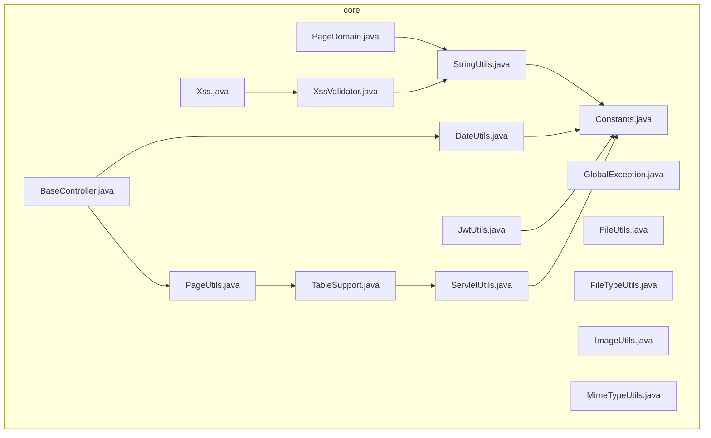
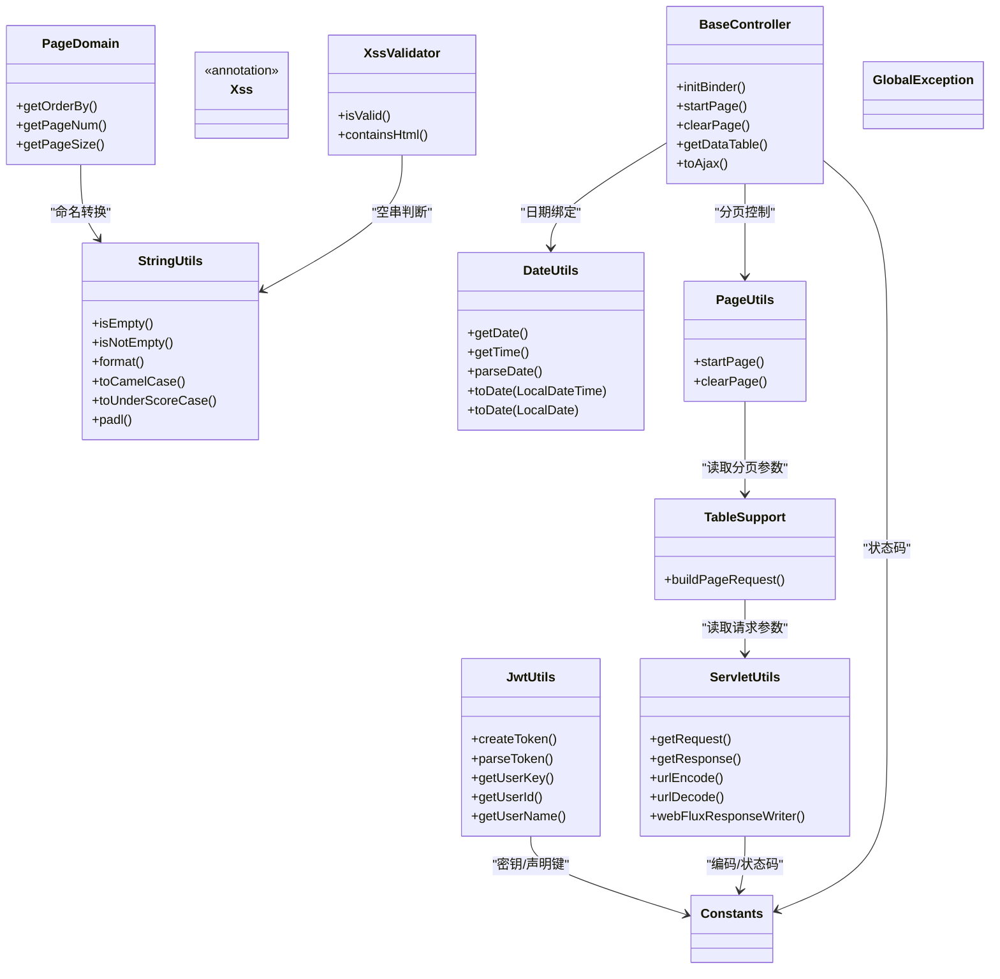
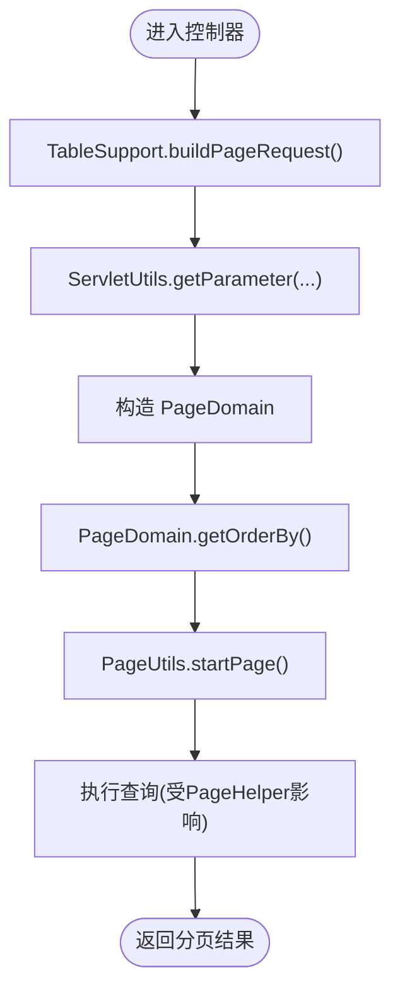
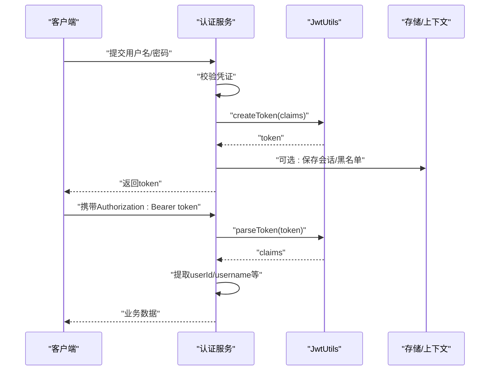
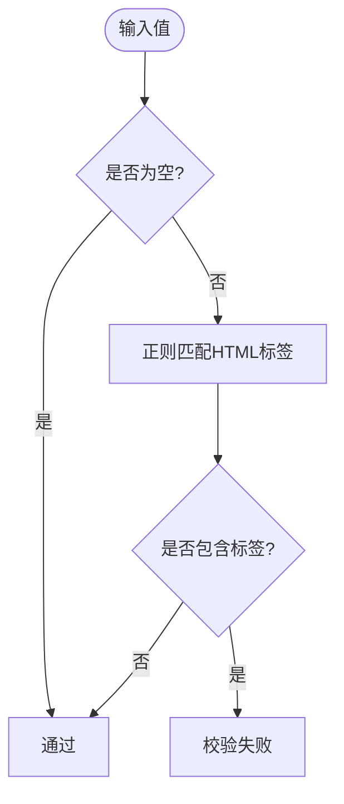
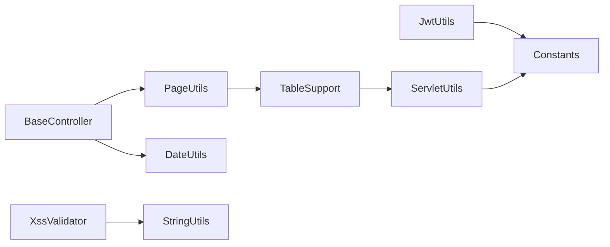

# 核心工具库

<cite>
**本文引用的文件**   
- [StringUtils.java](file://ruoyi-common/ruoyi-common-core/src/main/java/com/ruoyi/common/core/utils/StringUtils.java)
- [DateUtils.java](file://ruoyi-common/ruoyi-common-core/src/main/java/com/ruoyi/common/core/utils/DateUtils.java)
- [PageUtils.java](file://ruoyi-common/ruoyi-common-core/src/main/java/com/ruoyi/common/core/utils/PageUtils.java)
- [JwtUtils.java](file://ruoyi-common/ruoyi-common-core/src/main/java/com/ruoyi/common/core/utils/JwtUtils.java)
- [ServletUtils.java](file://ruoyi-common/ruoyi-common-core/src/main/java/com/ruoyi/common/core/utils/ServletUtils.java)
- [XssValidator.java](file://ruoyi-common/ruoyi-common-core/src/main/java/com/ruoyi/common/core/xss/XssValidator.java)
- [Xss.java](file://ruoyi-common/ruoyi-common-core/src/main/java/com/ruoyi/common/core/xss/Xss.java)
- [TableSupport.java](file://ruoyi-common/ruoyi-common-core/src/main/java/com/ruoyi/common/core/web/page/TableSupport.java)
- [PageDomain.java](file://ruoyi-common/ruoyi-common-core/src/main/java/com/ruoyi/common/core/web/page/PageDomain.java)
- [Constants.java](file://ruoyi-common/ruoyi-common-core/src/main/java/com/ruoyi/common/core/constant/Constants.java)
- [GlobalException.java](file://ruoyi-common/ruoyi-common-core/src/main/java/com/ruoyi/common/core/exception/GlobalException.java)
- [BaseController.java](file://ruoyi-common/ruoyi-common-core/src/main/java/com/ruoyi/common/core/web/controller/BaseController.java)
- [FileTypeUtils.java](file://ruoyi-common/ruoyi-common-core/src/main/java/com/ruoyi/common/core/utils/file/FileTypeUtils.java)
- [FileUtils.java](file://ruoyi-common/ruoyi-common-core/src/main/java/com/ruoyi/common/core/utils/file/FileUtils.java)
- [ImageUtils.java](file://ruoyi-common/ruoyi-common-core/src/main/java/com/ruoyi/common/core/utils/file/ImageUtils.java)
- [MimeTypeUtils.java](file://ruoyi-common/ruoyi-common-core/src/main/java/com/ruoyi/common/core/utils/file/MimeTypeUtils.java)
</cite>

## 目录
1. [简介](#简介)
2. [项目结构](#项目结构)
3. [核心组件](#核心组件)
4. [架构总览](#架构总览)
5. [详细组件分析](#详细组件分析)
6. [依赖关系分析](#依赖关系分析)
7. [性能与最佳实践](#性能与最佳实践)
8. [故障排查指南](#故障排查指南)
9. [结论](#结论)

## 简介
本文件面向“核心工具库”的使用与维护，聚焦通用工具类、常量定义、异常处理机制、Web基础类与XSS防护等能力。内容覆盖字符串处理、文件操作、日期时间、JWT令牌、分页处理、Web请求封装与安全校验等常用功能，并提供调用流程、依赖关系与最佳实践建议，帮助开发者快速上手并安全高效地使用这些工具。

## 项目结构
核心工具库位于 ruoyi-common-core 模块中，按职责划分为 utils（通用工具）、web（Web基础与分页模型）、xss（XSS校验）、constant（常量）与 exception（异常）等子包。下图展示与本主题相关的核心文件组织关系。

图表来源
- [StringUtils.java:1-531](file://ruoyi-common/ruoyi-common-core/src/main/java/com/ruoyi/common/core/utils/StringUtils.java#L1-L531)
- [DateUtils.java:1-180](file://ruoyi-common/ruoyi-common-core/src/main/java/com/ruoyi/common/core/utils/DateUtils.java#L1-L180)
- [JwtUtils.java:1-124](file://ruoyi-common/ruoyi-common-core/src/main/java/com/ruoyi/common/core/utils/JwtUtils.java#L1-L124)
- [ServletUtils.java:1-303](file://ruoyi-common/ruoyi-common-core/src/main/java/com/ruoyi/common/core/utils/ServletUtils.java#L1-L303)
- [PageUtils.java:1-36](file://ruoyi-common/ruoyi-common-core/src/main/java/com/ruoyi/common/core/utils/PageUtils.java#L1-L36)
- [TableSupport.java:1-57](file://ruoyi-common/ruoyi-common-core/src/main/java/com/ruoyi/common/core/web/page/TableSupport.java#L1-L57)
- [PageDomain.java:1-102](file://ruoyi-common/ruoyi-common-core/src/main/java/com/ruoyi/common/core/web/page/PageDomain.java#L1-L102)
- [Constants.java:1-142](file://ruoyi-common/ruoyi-common-core/src/main/java/com/ruoyi/common/core/constant/Constants.java#L1-L142)
- [GlobalException.java:1-58](file://ruoyi-common/ruoyi-common-core/src/main/java/com/ruoyi/common/core/exception/GlobalException.java#L1-L58)
- [BaseController.java:1-127](file://ruoyi-common/ruoyi-common-core/src/main/java/com/ruoyi/common/core/web/controller/BaseController.java#L1-L127)
- [Xss.java:1-28](file://ruoyi-common/ruoyi-common-core/src/main/java/com/ruoyi/common/core/xss/Xss.java#L1-L28)
- [XssValidator.java:1-34](file://ruoyi-common/ruoyi-common-core/src/main/java/com/ruoyi/common/core/xss/XssValidator.java#L1-L34)
- [FileUtils.java](file://ruoyi-common/ruoyi-common-core/src/main/java/com/ruoyi/common/core/utils/file/FileUtils.java)
- [FileTypeUtils.java](file://ruoyi-common/ruoyi-common-core/src/main/java/com/ruoyi/common/core/utils/file/FileTypeUtils.java)
- [ImageUtils.java](file://ruoyi-common/ruoyi-common-core/src/main/java/com/ruoyi/common/core/utils/file/ImageUtils.java)
- [MimeTypeUtils.java](file://ruoyi-common/ruoyi-common-core/src/main/java/com/ruoyi/common/core/utils/file/MimeTypeUtils.java)

章节来源
- [StringUtils.java:1-531](file://ruoyi-common/ruoyi-common-core/src/main/java/com/ruoyi/common/core/utils/StringUtils.java#L1-L531)
- [DateUtils.java:1-180](file://ruoyi-common/ruoyi-common-core/src/main/java/com/ruoyi/common/core/utils/DateUtils.java#L1-L180)
- [PageUtils.java:1-36](file://ruoyi-common/ruoyi-common-core/src/main/java/com/ruoyi/common/core/utils/PageUtils.java#L1-L36)
- [JwtUtils.java:1-124](file://ruoyi-common/ruoyi-common-core/src/main/java/com/ruoyi/common/core/utils/JwtUtils.java#L1-L124)
- [ServletUtils.java:1-303](file://ruoyi-common/ruoyi-common-core/src/main/java/com/ruoyi/common/core/utils/ServletUtils.java#L1-L303)
- [TableSupport.java:1-57](file://ruoyi-common/ruoyi-common-core/src/main/java/com/ruoyi/common/core/web/page/TableSupport.java#L1-L57)
- [PageDomain.java:1-102](file://ruoyi-common/ruoyi-common-core/src/main/java/com/ruoyi/common/core/web/page/PageDomain.java#L1-L102)
- [Constants.java:1-142](file://ruoyi-common/ruoyi-common-core/src/main/java/com/ruoyi/common/core/constant/Constants.java#L1-L142)
- [GlobalException.java:1-58](file://ruoyi-common/ruoyi-common-core/src/main/java/com/ruoyi/common/core/exception/GlobalException.java#L1-L58)
- [BaseController.java:1-127](file://ruoyi-common/ruoyi-common-core/src/main/java/com/ruoyi/common/core/web/controller/BaseController.java#L1-L127)
- [Xss.java:1-28](file://ruoyi-common/ruoyi-common-core/src/main/java/com/ruoyi/common/core/xss/Xss.java#L1-L28)
- [XssValidator.java:1-34](file://ruoyi-common/ruoyi-common-core/src/main/java/com/ruoyi/common/core/xss/XssValidator.java#L1-L34)
- [FileUtils.java](file://ruoyi-common/ruoyi-common-core/src/main/java/com/ruoyi/common/core/utils/file/FileUtils.java)
- [FileTypeUtils.java](file://ruoyi-common/ruoyi-common-core/src/main/java/com/ruoyi/common/core/utils/file/FileTypeUtils.java)
- [ImageUtils.java](file://ruoyi-common/ruoyi-common-core/src/main/java/com/ruoyi/common/core/utils/file/ImageUtils.java)
- [MimeTypeUtils.java](file://ruoyi-common/ruoyi-common-core/src/main/java/com/ruoyi/common/core/utils/file/MimeTypeUtils.java)

## 核心组件
- 字符串工具 StringUtils：提供空值判断、格式化、命名转换、URL匹配、补零等常用方法，扩展 Apache Commons Lang3。
- 日期工具 DateUtils：统一日期格式常量、字符串与日期互转、服务器启动时间获取、LocalDateTime/LocalDate 与 Date 互转。
- 分页工具 PageUtils：基于 PageHelper 封装 startPage/clearPage，结合 TableSupport 从请求解析分页参数。
- JWT工具 JwtUtils：基于 jjwt 生成/解析令牌，提取用户标识、用户名等声明。
- Web工具 ServletUtils：封装请求/响应/Session/头信息、Ajax识别、URL编解码、WebFlux响应写入。
- XSS防护 Xss注解 + XssValidator：自定义JSR-303校验注解，拦截含HTML标签的输入。
- Web基础 BaseController：统一日期绑定、分页控制、标准返回体封装。
- 常量 Constants：字符集、HTTP协议前缀、成功/失败码、分页键名、缓存Key前缀、资源路径前缀等。
- 异常 GlobalException：全局异常基类，支持消息与明细字段。
- 文件工具 file/*：FileTypeUtils、FileUtils、ImageUtils、MimeTypeUtils 提供文件类型、MIME、图片处理等能力。

章节来源
- [StringUtils.java:1-531](file://ruoyi-common/ruoyi-common-core/src/main/java/com/ruoyi/common/core/utils/StringUtils.java#L1-L531)
- [DateUtils.java:1-180](file://ruoyi-common/ruoyi-common-core/src/main/java/com/ruoyi/common/core/utils/DateUtils.java#L1-L180)
- [PageUtils.java:1-36](file://ruoyi-common/ruoyi-common-core/src/main/java/com/ruoyi/common/core/utils/PageUtils.java#L1-L36)
- [JwtUtils.java:1-124](file://ruoyi-common/ruoyi-common-core/src/main/java/com/ruoyi/common/core/utils/JwtUtils.java#L1-L124)
- [ServletUtils.java:1-303](file://ruoyi-common/ruoyi-common-core/src/main/java/com/ruoyi/common/core/utils/ServletUtils.java#L1-L303)
- [Xss.java:1-28](file://ruoyi-common/ruoyi-common-core/src/main/java/com/ruoyi/common/core/xss/Xss.java#L1-L28)
- [XssValidator.java:1-34](file://ruoyi-common/ruoyi-common-core/src/main/java/com/ruoyi/common/core/xss/XssValidator.java#L1-L34)
- [BaseController.java:1-127](file://ruoyi-common/ruoyi-common-core/src/main/java/com/ruoyi/common/core/web/controller/BaseController.java#L1-L127)
- [Constants.java:1-142](file://ruoyi-common/ruoyi-common-core/src/main/java/com/ruoyi/common/core/constant/Constants.java#L1-L142)
- [GlobalException.java:1-58](file://ruoyi-common/ruoyi-common-core/src/main/java/com/ruoyi/common/core/exception/GlobalException.java#L1-L58)
- [FileUtils.java](file://ruoyi-common/ruoyi-common-core/src/main/java/com/ruoyi/common/core/utils/file/FileUtils.java)
- [FileTypeUtils.java](file://ruoyi-common/ruoyi-common-core/src/main/java/com/ruoyi/common/core/utils/file/FileTypeUtils.java)
- [ImageUtils.java](file://ruoyi-common/ruoyi-common-core/src/main/java/com/ruoyi/common/core/utils/file/ImageUtils.java)
- [MimeTypeUtils.java](file://ruoyi-common/ruoyi-common-core/src/main/java/com/ruoyi/common/core/utils/file/MimeTypeUtils.java)

## 架构总览
核心工具库以“工具类 + 常量 + 异常 + Web基础 + 安全校验”的分层方式组织，被业务模块广泛复用。下图展示关键组件之间的交互关系。

图表来源
- [StringUtils.java:1-531](file://ruoyi-common/ruoyi-common-core/src/main/java/com/ruoyi/common/core/utils/StringUtils.java#L1-L531)
- [DateUtils.java:1-180](file://ruoyi-common/ruoyi-common-core/src/main/java/com/ruoyi/common/core/utils/DateUtils.java#L1-L180)
- [PageUtils.java:1-36](file://ruoyi-common/ruoyi-common-core/src/main/java/com/ruoyi/common/core/utils/PageUtils.java#L1-L36)
- [TableSupport.java:1-57](file://ruoyi-common/ruoyi-common-core/src/main/java/com/ruoyi/common/core/web/page/TableSupport.java#L1-L57)
- [PageDomain.java:1-102](file://ruoyi-common/ruoyi-common-core/src/main/java/com/ruoyi/common/core/web/page/PageDomain.java#L1-L102)
- [JwtUtils.java:1-124](file://ruoyi-common/ruoyi-common-core/src/main/java/com/ruoyi/common/core/utils/JwtUtils.java#L1-L124)
- [ServletUtils.java:1-303](file://ruoyi-common/ruoyi-common-core/src/main/java/com/ruoyi/common/core/utils/ServletUtils.java#L1-L303)
- [Xss.java:1-28](file://ruoyi-common/ruoyi-common-core/src/main/java/com/ruoyi/common/core/xss/Xss.java#L1-L28)
- [XssValidator.java:1-34](file://ruoyi-common/ruoyi-common-core/src/main/java/com/ruoyi/common/core/xss/XssValidator.java#L1-L34)
- [BaseController.java:1-127](file://ruoyi-common/ruoyi-common-core/src/main/java/com/ruoyi/common/core/web/controller/BaseController.java#L1-L127)
- [Constants.java:1-142](file://ruoyi-common/ruoyi-common-core/src/main/java/com/ruoyi/common/core/constant/Constants.java#L1-L142)

## 详细组件分析

### 字符串处理（StringUtils）
- 能力要点
  - 空值判断：Collection/Map/数组/String 的 isEmpty/isNotEmpty；isNull/isNotNull。
  - 文本处理：trim、substring、hasText、format（占位符替换）。
  - 命名转换：驼峰与下划线互转 toCamelCase/toUnderScoreCase。
  - URL匹配：AntPathMatcher 模式匹配 isMatch/matches。
  - 数字补零：padl 左补齐或截取到指定长度。
- 使用场景
  - 表单参数清洗与校验前置。
  - 接口白名单/路由匹配。
  - 数据库列名与Java属性名映射。
- 复杂度与注意事项
  - 正则与AntPathMatcher在高频调用时注意缓存策略。
  - format 占位符需避免注入风险，确保模板来自可信源。

章节来源
- [StringUtils.java:1-531](file://ruoyi-common/ruoyi-common-core/src/main/java/com/ruoyi/common/core/utils/StringUtils.java#L1-L531)

### 日期时间（DateUtils）
- 能力要点
  - 统一格式常量：YYYY_MM_DD、YYYY_MM_DD_HH_MM_SS 等。
  - 字符串与Date互转：parseDateToStr/dateTime，支持多模式解析 parseDate。
  - 新API兼容：LocalDateTime/LocalDate 转 Date。
  - 服务器启动时间：getServerStartDate。
- 使用场景
  - 日志时间戳、审计字段、报表统计。
  - 前端日期字符串后端解析。
- 复杂度与注意事项
  - SimpleDateFormat 非线程安全，内部通过 new 实例规避并发问题。
  - 解析失败返回null或抛出运行时异常，调用方需做好防御。

章节来源
- [DateUtils.java:1-180](file://ruoyi-common/ruoyi-common-core/src/main/java/com/ruoyi/common/core/utils/DateUtils.java#L1-L180)

### 分页处理（PageUtils / TableSupport / PageDomain）
- 能力要点
  - PageUtils.startPage：从请求解析分页参数，设置合理排序与合理化开关。
  - TableSupport.buildPageRequest：将请求参数封装为 PageDomain。
  - PageDomain.getOrderBy：将列名转换为下划线并拼接排序方向。
- 使用场景
  - 列表查询接口统一分页入口。
  - 前端传递 ascending/descending 兼容处理。
- 流程图（分页参数解析与生效）

图表来源
- [PageUtils.java:1-36](file://ruoyi-common/ruoyi-common-core/src/main/java/com/ruoyi/common/core/utils/PageUtils.java#L1-L36)
- [TableSupport.java:1-57](file://ruoyi-common/ruoyi-common-core/src/main/java/com/ruoyi/common/core/web/page/TableSupport.java#L1-L57)
- [PageDomain.java:1-102](file://ruoyi-common/ruoyi-common-core/src/main/java/com/ruoyi/common/core/web/page/PageDomain.java#L1-L102)
- [ServletUtils.java:1-303](file://ruoyi-common/ruoyi-common-core/src/main/java/com/ruoyi/common/core/utils/ServletUtils.java#L1-L303)

章节来源
- [PageUtils.java:1-36](file://ruoyi-common/ruoyi-common-core/src/main/java/com/ruoyi/common/core/utils/PageUtils.java#L1-L36)
- [TableSupport.java:1-57](file://ruoyi-common/ruoyi-common-core/src/main/java/com/ruoyi/common/core/web/page/TableSupport.java#L1-L57)
- [PageDomain.java:1-102](file://ruoyi-common/ruoyi-common-core/src/main/java/com/ruoyi/common/core/web/page/PageDomain.java#L1-L102)

### JWT令牌（JwtUtils）
- 能力要点
  - createToken：根据claims生成HS512签名的JWT。
  - parseToken：解析并返回Claims。
  - 便捷方法：getUserKey/getUserId/getUserName。
- 使用场景
  - 登录成功后签发令牌，后续请求携带令牌进行鉴权。
- 序列图（令牌签发与解析）

图表来源
- [JwtUtils.java:1-124](file://ruoyi-common/ruoyi-common-core/src/main/java/com/ruoyi/common/core/utils/JwtUtils.java#L1-L124)

章节来源
- [JwtUtils.java:1-124](file://ruoyi-common/ruoyi-common-core/src/main/java/com/ruoyi/common/core/utils/JwtUtils.java#L1-L124)

### Web基础与请求封装（ServletUtils / BaseController）
- ServletUtils
  - 参数获取：String/Integer/Boolean 重载方法，默认值处理。
  - Request/Response/Session 访问封装。
  - Ajax识别：Accept/X-Requested-With/后缀/参数。
  - URL编解码：urlEncode/urlDecode。
  - WebFlux响应：webFluxResponseWriter 系列方法。
- BaseController
  - @InitBinder 统一日期绑定，使用 DateUtils.parseDate。
  - startPage/clearPage 控制分页生命周期。
  - getDataTable 包装分页结果，toAjax/success/error 统一返回。
- 使用场景
  - 所有Controller继承 BaseController 以获得统一行为。
  - 跨框架（Servlet/WebFlux）的请求/响应处理。

章节来源
- [ServletUtils.java:1-303](file://ruoyi-common/ruoyi-common-core/src/main/java/com/ruoyi/common/core/utils/ServletUtils.java#L1-L303)
- [BaseController.java:1-127](file://ruoyi-common/ruoyi-common-core/src/main/java/com/ruoyi/common/core/web/controller/BaseController.java#L1-L127)

### XSS防护（Xss / XssValidator）
- 能力要点
  - Xss 注解：作用于方法、字段、构造器、参数，默认提示“不允许任何脚本运行”。
  - XssValidator：基于正则检测是否包含HTML标签，为空则放行。
- 使用场景
  - 对富文本以外的输入进行XSS防护。
  - 与JSR-303/JSR-380集成，自动触发校验。
- 流程图（XSS校验）

图表来源
- [Xss.java:1-28](file://ruoyi-common/ruoyi-common-core/src/main/java/com/ruoyi/common/core/xss/Xss.java#L1-L28)
- [XssValidator.java:1-34](file://ruoyi-common/ruoyi-common-core/src/main/java/com/ruoyi/common/core/xss/XssValidator.java#L1-L34)
- [StringUtils.java:1-531](file://ruoyi-common/ruoyi-common-core/src/main/java/com/ruoyi/common/core/utils/StringUtils.java#L1-L531)

章节来源
- [Xss.java:1-28](file://ruoyi-common/ruoyi-common-core/src/main/java/com/ruoyi/common/core/xss/Xss.java#L1-L28)
- [XssValidator.java:1-34](file://ruoyi-common/ruoyi-common-core/src/main/java/com/ruoyi/common/core/xss/XssValidator.java#L1-L34)

### 文件操作（file/*）
- 能力概览
  - FileTypeUtils：文件类型判断与扩展名映射。
  - FileUtils：常见文件读写、流处理、路径处理等。
  - ImageUtils：图片缩放、裁剪、格式转换等。
  - MimeTypeUtils：MIME类型与扩展名对照。
- 使用场景
  - 上传文件的类型校验、大小限制、预览图生成。
  - 导出Excel前的临时文件处理（与POI配合）。
- 依赖关系
  - 通常与 POI 及第三方库协作，具体实现见对应文件。

章节来源
- [FileTypeUtils.java](file://ruoyi-common/ruoyi-common-core/src/main/java/com/ruoyi/common/core/utils/file/FileTypeUtils.java)
- [FileUtils.java](file://ruoyi-common/ruoyi-common-core/src/main/java/com/ruoyi/common/core/utils/file/FileUtils.java)
- [ImageUtils.java](file://ruoyi-common/ruoyi-common-core/src/main/java/com/ruoyi/common/core/utils/file/ImageUtils.java)
- [MimeTypeUtils.java](file://ruoyi-common/ruoyi-common-core/src/main/java/com/ruoyi/common/core/utils/file/MimeTypeUtils.java)

### 加密解密
- 当前仓库未提供独立的加解密工具类。若需要，可参考以下实践：
  - 对称加密：使用 javax.crypto.Cipher 或第三方库（如BouncyCastle），结合常量管理密钥。
  - 哈希签名：使用 MessageDigest 或 HmacUtil（如有），用于密码哈希或签名校验。
  - 敏感配置：通过环境变量或配置中心注入，避免硬编码。
- 说明：本节为通用指导，不直接引用具体源码文件。

### Excel导入导出
- 当前仓库未在本节范围内提供POI工具类源码。可参考以下实践：
  - 导入：使用 Apache POI/Spring Boot 提供的 MultipartFile 读取，逐行解析并批量入库。
  - 导出：构建 Workbook/Sheet，填充数据后输出流；必要时结合 ImageUtils 插入图片。
  - 校验：结合 Xss 注解与自定义校验器，防止恶意内容进入系统。
- 说明：本节为通用指导，不直接引用具体源码文件。

## 依赖关系分析
- 组件耦合
  - PageUtils 依赖 TableSupport 与 SqlUtil（排序SQL安全），TableSupport 依赖 ServletUtils 读取请求参数。
  - BaseController 依赖 DateUtils 与 PageUtils，形成统一的Web层能力。
  - XssValidator 依赖 StringUtils 做空串判断。
  - JwtUtils 与 ServletUtils 均依赖 Constants 中的常量。
- 外部依赖
  - PageUtils 基于 PageHelper。
  - JwtUtils 基于 jjwt。
  - StringUtils 扩展 Apache Commons Lang3。
- 潜在循环依赖
  - 未发现直接循环依赖；各工具类保持单向依赖。

图表来源
- [PageUtils.java:1-36](file://ruoyi-common/ruoyi-common-core/src/main/java/com/ruoyi/common/core/utils/PageUtils.java#L1-L36)
- [TableSupport.java:1-57](file://ruoyi-common/ruoyi-common-core/src/main/java/com/ruoyi/common/core/web/page/TableSupport.java#L1-L57)
- [ServletUtils.java:1-303](file://ruoyi-common/ruoyi-common-core/src/main/java/com/ruoyi/common/core/utils/ServletUtils.java#L1-L303)
- [BaseController.java:1-127](file://ruoyi-common/ruoyi-common-core/src/main/java/com/ruoyi/common/core/web/controller/BaseController.java#L1-L127)
- [DateUtils.java:1-180](file://ruoyi-common/ruoyi-common-core/src/main/java/com/ruoyi/common/core/utils/DateUtils.java#L1-L180)
- [XssValidator.java:1-34](file://ruoyi-common/ruoyi-common-core/src/main/java/com/ruoyi/common/core/xss/XssValidator.java#L1-L34)
- [StringUtils.java:1-531](file://ruoyi-common/ruoyi-common-core/src/main/java/com/ruoyi/common/core/utils/StringUtils.java#L1-L531)
- [JwtUtils.java:1-124](file://ruoyi-common/ruoyi-common-core/src/main/java/com/ruoyi/common/core/utils/JwtUtils.java#L1-L124)
- [Constants.java:1-142](file://ruoyi-common/ruoyi-common-core/src/main/java/com/ruoyi/common/core/constant/Constants.java#L1-L142)

## 性能与最佳实践
- 字符串处理
  - 频繁匹配建议使用预编译正则或缓存 AntPathMatcher 实例。
  - 大字符串拼接优先使用 StringBuilder。
- 日期时间
  - 避免共享 SimpleDateFormat；DateUtils 已采用局部实例化。
  - 高吞吐场景考虑使用 java.time API 替代 Date。
- 分页
  - 始终在查询前调用 startPage，并在finally中 clearPage（或通过AOP/拦截器统一处理）。
  - 合理设置 reasonable，避免越界页导致全表扫描。
- JWT
  - 密钥应通过配置中心注入，定期轮换。
  - claims 仅存放必要信息，避免过大令牌。
- Web请求
  - 使用 ServletUtils 统一编解码，避免重复实现。
  - WebFlux 与 Servlet 环境区分处理，避免混用。
- XSS
  - 对富文本使用专门的白名单过滤方案（如Jsoup），Xss注解适用于非富文本输入。
- 文件与Excel
  - 大文件流式处理，避免一次性加载至内存。
  - 导出时按需分片写盘，减少GC压力。

[本节为通用指导，不直接引用具体源码文件]

## 故障排查指南
- 常见问题
  - 分页无效：检查是否在查询前调用 startPage，且未提前消费 PageInfo。
  - 日期绑定失败：确认前端传入格式与 DateUtils.parseDate 支持的格式一致。
  - XSS误报：确认输入是否确实包含HTML标签；富文本场景请改用专用净化器。
  - JWT解析失败：检查密钥是否一致、令牌是否过期或被篡改。
  - 乱码：确认 ServletUtils.urlEncode/urlDecode 与 Constants.UTF8 一致。
- 定位建议
  - 使用 BaseController.logger 记录关键入参与中间结果。
  - 借助 GlobalException 捕获并记录异常堆栈与明细。
  - 对分页与WebFlux分支分别打印日志，便于区分环境差异。

章节来源
- [GlobalException.java:1-58](file://ruoyi-common/ruoyi-common-core/src/main/java/com/ruoyi/common/core/exception/GlobalException.java#L1-L58)
- [BaseController.java:1-127](file://ruoyi-common/ruoyi-common-core/src/main/java/com/ruoyi/common/core/web/controller/BaseController.java#L1-L127)
- [ServletUtils.java:1-303](file://ruoyi-common/ruoyi-common-core/src/main/java/com/ruoyi/common/core/utils/ServletUtils.java#L1-L303)
- [DateUtils.java:1-180](file://ruoyi-common/ruoyi-common-core/src/main/java/com/ruoyi/common/core/utils/DateUtils.java#L1-L180)
- [PageUtils.java:1-36](file://ruoyi-common/ruoyi-common-core/src/main/java/com/ruoyi/common/core/utils/PageUtils.java#L1-L36)
- [JwtUtils.java:1-124](file://ruoyi-common/ruoyi-common-core/src/main/java/com/ruoyi/common/core/utils/JwtUtils.java#L1-L124)
- [XssValidator.java:1-34](file://ruoyi-common/ruoyi-common-core/src/main/java/com/ruoyi/common/core/xss/XssValidator.java#L1-L34)

## 结论
核心工具库提供了稳定、易用的通用能力，涵盖字符串、日期、分页、JWT、Web请求封装与XSS防护等关键领域。通过 BaseController 统一入口、PageUtils 标准化分页、Xss 注解保障输入安全，以及 Constants 统一管理常量，能够有效提升开发效率与代码一致性。建议在业务模块中优先复用这些工具类，遵循本文的最佳实践与注意事项，以获得更好的可维护性与安全性。