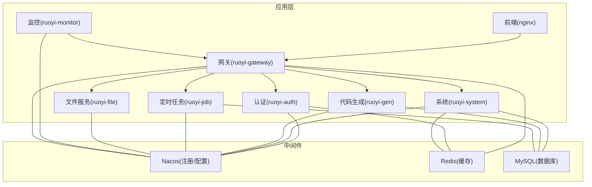
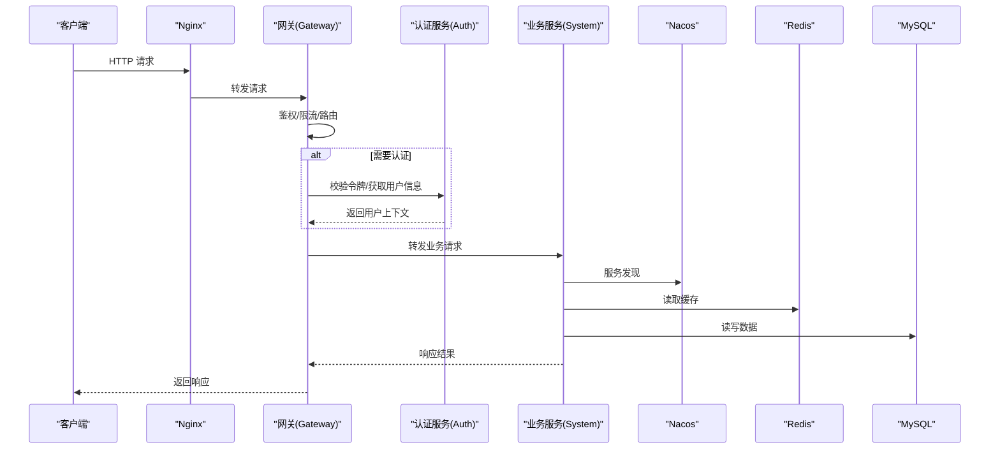
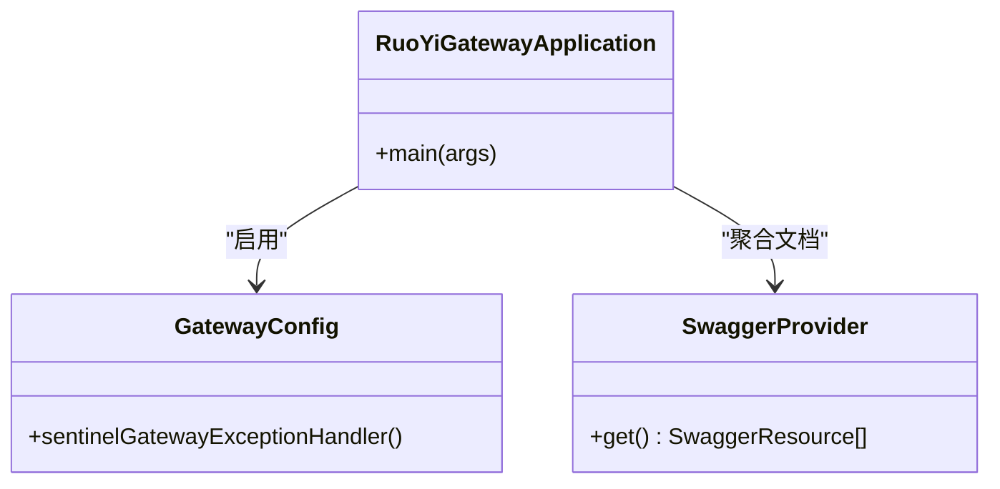
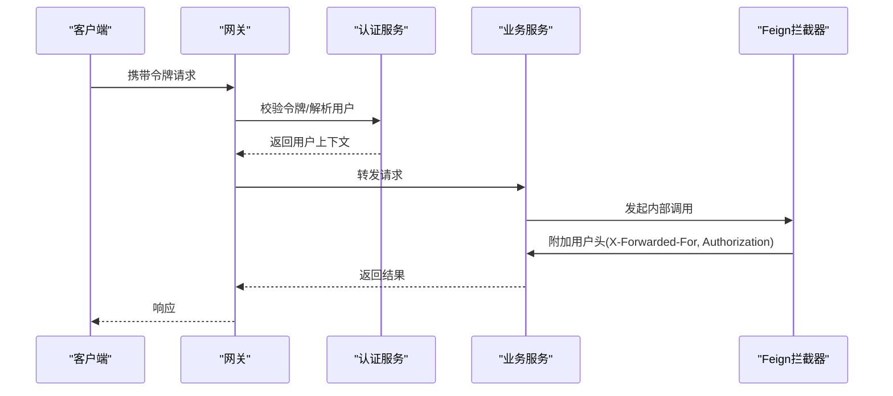
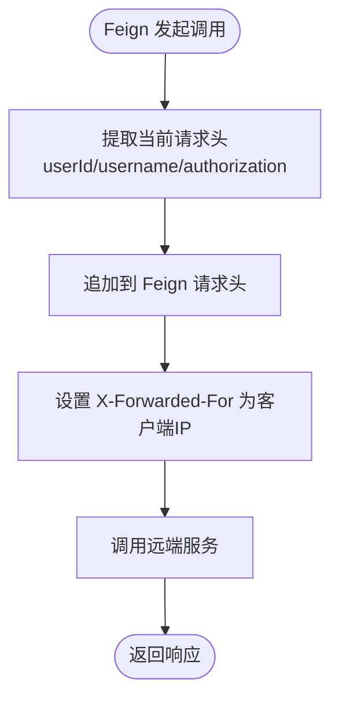
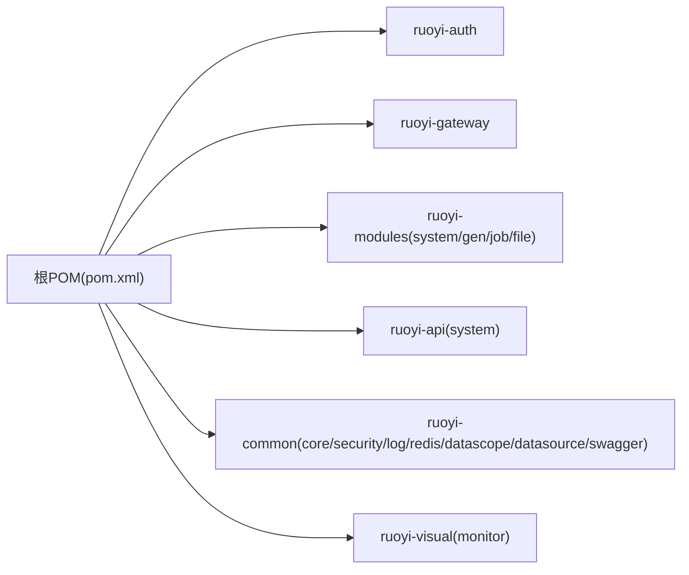

# 微服务架构

<cite>
**本文引用的文件**   
- [pom.xml](file://pom.xml)
- [docker-compose.yml](file://docker/docker-compose.yml)
- [bootstrap.yml（网关）](file://ruoyi-gateway/src/main/resources/bootstrap.yml)
- [bootstrap.yml（认证）](file://ruoyi-auth/src/main/resources/bootstrap.yml)
- [bootstrap.yml（系统模块）](file://ruoyi-modules/ruoyi-system/src/main/resources/bootstrap.yml)
- [bootstrap.yml（代码生成）](file://ruoyi-modules/ruoyi-gen/src/main/resources/bootstrap.yml)
- [bootstrap.yml（定时任务）](file://ruoyi-modules/ruoyi-job/src/main/resources/bootstrap.yml)
- [bootstrap.yml（文件服务）](file://ruoyi-modules/ruoyi-file/src/main/resources/bootstrap.yml)
- [bootstrap.yml（监控）](file://ruoyi-visual/ruoyi-monitor/src/main/resources/bootstrap.yml)
- [RuoYiGatewayApplication.java](file://ruoyi-gateway/src/main/java/com/ruoyi/gateway/RuoYiGatewayApplication.java)
- [SwaggerProvider.java](file://ruoyi-gateway/src/main/java/com/ruoyi/gateway/config/SwaggerProvider.java)
- [GatewayConfig.java](file://ruoyi-gateway/src/main/java/com/ruoyi/gateway/config/GatewayConfig.java)
- [RuoYiAuthApplication.java](file://ruoyi-auth/src/main/java/com/ruoyi/auth/RuoYiAuthApplication.java)
- [FeignAutoConfiguration.java](file://ruoyi-common/ruoyi-common-security/src/main/java/com/ruoyi/common/security/feign/FeignAutoConfiguration.java)
- [FeignRequestInterceptor.java](file://ruoyi-common/ruoyi-common-security/src/main/java/com/ruoyi/common/security/feign/FeignRequestInterceptor.java)
</cite>

## 目录
1. [简介](#简介)
2. [项目结构](#项目结构)
3. [核心组件](#核心组件)
4. [架构总览](#架构总览)
5. [详细组件分析](#详细组件分析)
6. [依赖关系分析](#依赖关系分析)
7. [性能与可观测性](#性能与可观测性)
8. [故障排查指南](#故障排查指南)
9. [结论](#结论)

## 简介
本项目基于 Spring Cloud + Spring Cloud Alibaba 构建的微服务系统，采用 Nacos 作为服务注册发现与配置中心，使用 Gateway 作为统一入口网关，通过 Feign 实现服务间调用。系统包含认证授权、系统管理、代码生成、定时任务、文件服务等业务模块，并通过 Sentinel 提供限流熔断能力，结合 Redis、MySQL 等基础设施支撑运行。

## 项目结构
仓库采用多模块 Maven 工程组织：
- ruoyi-auth：认证授权服务
- ruoyi-gateway：API 网关
- ruoyi-modules：业务模块集合（system、gen、job、file 等）
- ruoyi-api：跨服务接口定义
- ruoyi-common：公共基础库（安全、缓存、日志、数据源等）
- ruoyi-visual：可视化监控
- docker：容器化部署编排

图表来源
- [docker-compose.yml:1-140](file://docker/docker-compose.yml#L1-L140)
- [bootstrap.yml（网关）:1-44](file://ruoyi-gateway/src/main/resources/bootstrap.yml#L1-L44)
- [bootstrap.yml（认证）:1-26](file://ruoyi-auth/src/main/resources/bootstrap.yml#L1-L26)
- [bootstrap.yml（系统模块）:1-25](file://ruoyi-modules/ruoyi-system/src/main/resources/bootstrap.yml#L1-L25)

章节来源
- [docker-compose.yml:1-140](file://docker/docker-compose.yml#L1-L140)
- [pom.xml:244-251](file://pom.xml#L244-L251)

## 核心组件
- 服务注册与配置中心：Nacos
  - 所有服务在 bootstrap.yml 中配置 nacos.discovery.server-addr 与 nacos.config.server-addr，完成服务注册与配置拉取。
- API 网关：Spring Cloud Gateway
  - 统一入口，承载鉴权过滤、路由转发、聚合 Swagger、Sentinel 限流降级。
- 认证服务：ruoyi-auth
  - 负责登录、令牌签发与校验，对外暴露认证相关接口。
- 业务服务：ruoyi-system、ruoyi-gen、ruoyi-job、ruoyi-file 等
  - 各自领域职责清晰，通过 Feign 调用其他服务接口。
- 公共能力：ruoyi-common-*
  - 封装安全上下文传递、Feign 拦截器、缓存、日志、数据源等通用能力。
- 可视化监控：ruoyi-monitor
  - 接入 Spring Boot Admin 或类似监控体系，观察各服务健康状态。

章节来源
- [bootstrap.yml（网关）:1-44](file://ruoyi-gateway/src/main/resources/bootstrap.yml#L1-L44)
- [bootstrap.yml（认证）:1-26](file://ruoyi-auth/src/main/resources/bootstrap.yml#L1-L26)
- [bootstrap.yml（系统模块）:1-25](file://ruoyi-modules/ruoyi-system/src/main/resources/bootstrap.yml#L1-L25)

## 架构总览
整体采用“网关前置 + 服务自治 + 共享中间件”的架构模式：
- 外部请求经 Nginx 进入 Gateway，由 Gateway 进行鉴权、限流、路由转发到具体业务服务。
- 业务服务通过 Nacos 完成服务注册与发现，使用 Feign 进行声明式远程调用。
- 配置集中管理于 Nacos，支持按环境（dev/test/prod）动态下发。
- 限流与熔断通过 Sentinel 集成，规则可持久化至 Nacos。

图表来源
- [docker-compose.yml:51-77](file://docker/docker-compose.yml#L51-L77)
- [bootstrap.yml（网关）:1-44](file://ruoyi-gateway/src/main/resources/bootstrap.yml#L1-L44)
- [bootstrap.yml（认证）:1-26](file://ruoyi-auth/src/main/resources/bootstrap.yml#L1-L26)
- [bootstrap.yml（系统模块）:1-25](file://ruoyi-modules/ruoyi-system/src/main/resources/bootstrap.yml#L1-L25)

## 详细组件分析

### 网关服务（ruoyi-gateway）
职责与特性：
- 统一入口：接收外部请求，进行鉴权、限流、路由转发。
- 聚合文档：聚合各服务的 Swagger 文档，便于统一查看。
- 限流熔断：集成 Sentinel，支持流量控制与异常降级。
- 过滤器链：内置验证码、黑名单、XSS、缓存请求等过滤器。

关键实现要点：
- 启动类排除数据源自动装配，避免不必要的初始化。
- 通过 GatewayConfig 注册 Sentinel 全局异常处理器。
- SwaggerProvider 根据路由动态聚合各服务接口文档。

图表来源
- [RuoYiGatewayApplication.java:12-17](file://ruoyi-gateway/src/main/java/com/ruoyi/gateway/RuoYiGatewayApplication.java#L12-L17)
- [GatewayConfig.java:14-22](file://ruoyi-gateway/src/main/java/com/ruoyi/gateway/config/GatewayConfig.java#L14-L22)
- [SwaggerProvider.java:20-58](file://ruoyi-gateway/src/main/java/com/ruoyi/gateway/config/SwaggerProvider.java#L20-L58)

章节来源
- [RuoYiGatewayApplication.java:1-30](file://ruoyi-gateway/src/main/java/com/ruoyi/gateway/RuoYiGatewayApplication.java#L1-L30)
- [GatewayConfig.java:1-23](file://ruoyi-gateway/src/main/java/com/ruoyi/gateway/config/GatewayConfig.java#L1-L23)
- [SwaggerProvider.java:1-58](file://ruoyi-gateway/src/main/java/com/ruoyi/gateway/config/SwaggerProvider.java#L1-L58)
- [bootstrap.yml（网关）:1-44](file://ruoyi-gateway/src/main/resources/bootstrap.yml#L1-L44)

### 认证服务（ruoyi-auth）
职责与特性：
- 登录与令牌签发：处理用户登录，生成并返回访问令牌。
- 用户上下文传播：通过 Feign 拦截器将用户标识透传到下游服务。
- 服务发现与配置：注册到 Nacos，从 Nacos 拉取配置。

关键实现要点：
- 启动类启用 Feign 客户端扫描注解，以便调用其他服务。
- 通过 SecurityConstants 与 ServletUtils 提取并传递用户头信息。

图表来源
- [RuoYiAuthApplication.java:13-19](file://ruoyi-auth/src/main/java/com/ruoyi/auth/RuoYiAuthApplication.java#L13-L19)
- [FeignRequestInterceptor.java:21-47](file://ruoyi-common/ruoyi-common-security/src/main/java/com/ruoyi/common/security/feign/FeignRequestInterceptor.java#L21-L47)

章节来源
- [RuoYiAuthApplication.java:1-32](file://ruoyi-auth/src/main/java/com/ruoyi/auth/RuoYiAuthApplication.java#L1-L32)
- [bootstrap.yml（认证）:1-26](file://ruoyi-auth/src/main/resources/bootstrap.yml#L1-L26)
- [FeignRequestInterceptor.java:1-49](file://ruoyi-common/ruoyi-common-security/src/main/java/com/ruoyi/common/security/feign/FeignRequestInterceptor.java#L1-L49)

### 业务服务（ruoyi-system、ruoyi-gen、ruoyi-job、ruoyi-file）
职责与特性：
- ruoyi-system：系统管理（用户、角色、菜单、字典等）。
- ruoyi-gen：代码生成器，根据表结构生成前后端代码。
- ruoyi-job：分布式定时任务调度。
- ruoyi-file：文件上传下载服务。

共同点：
- 均通过 Nacos 注册与发现，从 Nacos 拉取配置。
- 通过 Feign 调用其他服务（如系统服务），并使用 Feign 拦截器透传用户上下文。

章节来源
- [bootstrap.yml（系统模块）:1-25](file://ruoyi-modules/ruoyi-system/src/main/resources/bootstrap.yml#L1-L25)
- [bootstrap.yml（代码生成）:1-25](file://ruoyi-modules/ruoyi-gen/src/main/resources/bootstrap.yml#L1-L25)
- [bootstrap.yml（定时任务）:1-25](file://ruoyi-modules/ruoyi-job/src/main/resources/bootstrap.yml#L1-L25)
- [bootstrap.yml（文件服务）:1-25](file://ruoyi-modules/ruoyi-file/src/main/resources/bootstrap.yml#L1-L25)

### 服务间通信机制（Feign + 安全上下文）
- Feign 自动配置：通过 FeignAutoConfiguration 注入 RequestInterceptor，统一处理请求头透传。
- 安全上下文透传：FeignRequestInterceptor 从当前请求中提取用户 ID、用户名、Authorization 等头，并追加到 Feign 请求中；同时设置 X-Forwarded-For 以传递真实 IP。

图表来源
- [FeignAutoConfiguration.java:12-19](file://ruoyi-common/ruoyi-common-security/src/main/java/com/ruoyi/common/security/feign/FeignAutoConfiguration.java#L12-L19)
- [FeignRequestInterceptor.java:21-47](file://ruoyi-common/ruoyi-common-security/src/main/java/com/ruoyi/common/security/feign/FeignRequestInterceptor.java#L21-L47)

章节来源
- [FeignAutoConfiguration.java:1-20](file://ruoyi-common/ruoyi-common-security/src/main/java/com/ruoyi/common/security/feign/FeignAutoConfiguration.java#L1-L20)
- [FeignRequestInterceptor.java:1-49](file://ruoyi-common/ruoyi-common-security/src/main/java/com/ruoyi/common/security/feign/FeignRequestInterceptor.java#L1-L49)

### 配置中心（Nacos）
- 服务注册：所有服务在 bootstrap.yml 中配置 nacos.discovery.server-addr，启动后自动注册。
- 配置拉取：nacos.config.file-extension 指定 yml，shared-configs 加载 application-${profile}.yml 共享配置。
- 限流规则持久化：网关集成 Sentinel，规则存储于 Nacos（dataId: sentinel-ruoyi-gateway）。

章节来源
- [bootstrap.yml（网关）:17-44](file://ruoyi-gateway/src/main/resources/bootstrap.yml#L17-L44)
- [bootstrap.yml（认证）:13-25](file://ruoyi-auth/src/main/resources/bootstrap.yml#L13-L25)
- [bootstrap.yml（系统模块）:13-25](file://ruoyi-modules/ruoyi-system/src/main/resources/bootstrap.yml#L13-L25)

### 服务治理与企业级特性
- 负载均衡：Gateway 基于 Spring Cloud LoadBalancer 对后端服务实例进行负载均衡（由 Spring Cloud 生态提供）。
- 限流与熔断：Sentinel 集成于网关与服务侧，支持流量控制、熔断降级、热点参数限流等。
- 灰度发布/蓝绿：可通过 Nacos 命名空间与分组隔离不同环境或版本的服务实例。
- 可观测性：监控服务（ruoyi-monitor）可对接 Spring Boot Admin 或 Prometheus/Grafana 等生态工具。

章节来源
- [bootstrap.yml（网关）:29-44](file://ruoyi-gateway/src/main/resources/bootstrap.yml#L29-L44)
- [docker-compose.yml:133-140](file://docker/docker-compose.yml#L133-L140)

## 依赖关系分析
Maven 多模块依赖与版本管理集中在根 pom.xml，统一管理 Spring Cloud、Spring Cloud Alibaba、Nacos 客户端等依赖版本，确保各子模块依赖一致。

图表来源
- [pom.xml:244-251](file://pom.xml#L244-L251)

章节来源
- [pom.xml:1-286](file://pom.xml#L1-L286)

## 性能与可观测性
- 连接池与超时：通过 Nacos 下发的 application-dev.yml 可统一配置 Feign 的 connectTimeout/readTimeout，以及开启压缩等优化项。
- 缓存加速：Redis 用于热点数据缓存，降低数据库压力。
- 监控告警：监控服务可采集各服务指标，结合日志与链路追踪提升排障效率。

章节来源
- [docker/mysql/db/ry_config_20220424.sql:34-35](file://docker/mysql/db/ry_config_20220424.sql#L34-L35)

## 故障排查指南
常见问题与定位建议：
- 服务无法注册到 Nacos
  - 检查 bootstrap.yml 中的 nacos.discovery.server-addr 是否正确，网络连通性是否良好。
- 配置未生效
  - 确认 shared-configs 路径与 profile 匹配，Nacos 控制台是否存在对应 dataId 的配置。
- 网关限流触发
  - 查看 Sentinel 控制台或 Nacos 中的 flow 规则，确认阈值是否合理。
- Feign 调用丢失用户上下文
  - 检查 FeignRequestInterceptor 是否生效，确认上游请求头是否携带 userId/username/authorization。
- 端口冲突或服务启动失败
  - 核对 docker-compose.yml 与各服务 bootstrap.yml 的 server.port 配置，避免端口占用。

章节来源
- [bootstrap.yml（网关）:1-44](file://ruoyi-gateway/src/main/resources/bootstrap.yml#L1-L44)
- [bootstrap.yml（认证）:1-26](file://ruoyi-auth/src/main/resources/bootstrap.yml#L1-L26)
- [docker-compose.yml:1-140](file://docker/docker-compose.yml#L1-L140)

## 结论
该项目以 Nacos 为核心，构建了完整的微服务基础设施，涵盖服务注册发现、配置中心、API 网关、认证授权、业务服务拆分、服务间通信与安全上下文透传、限流熔断等企业级能力。通过 Docker Compose 提供的编排脚本，能够快速拉起整套环境，便于本地开发与测试。建议在后续演进中完善链路追踪、指标采集与自动化运维流程，进一步提升系统的可观测性与稳定性。