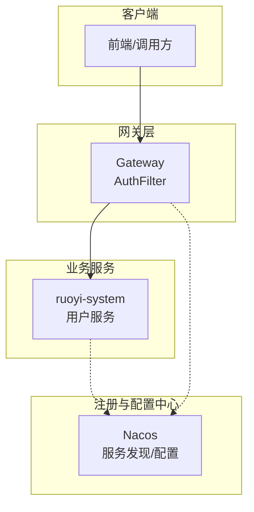
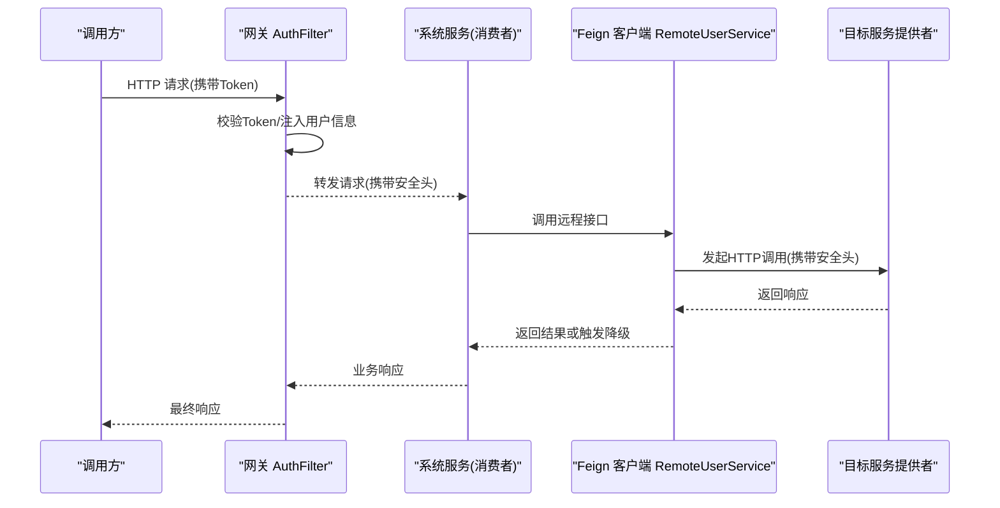
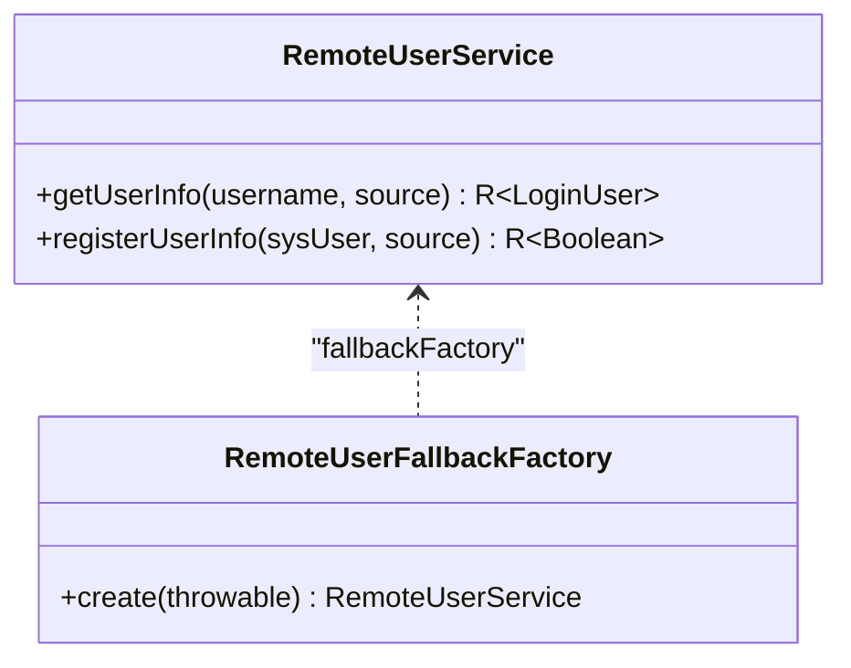
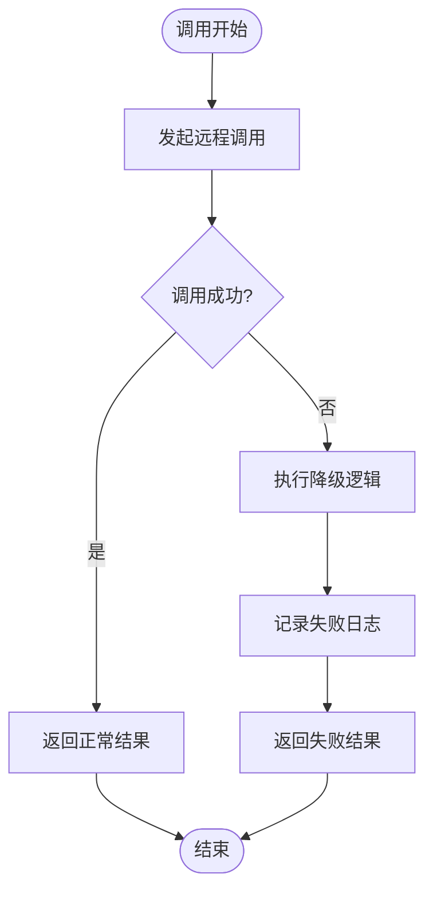
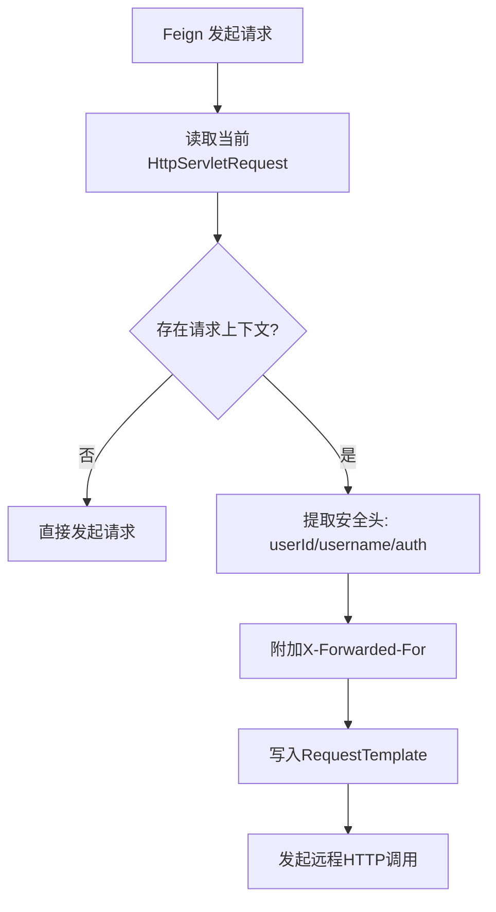
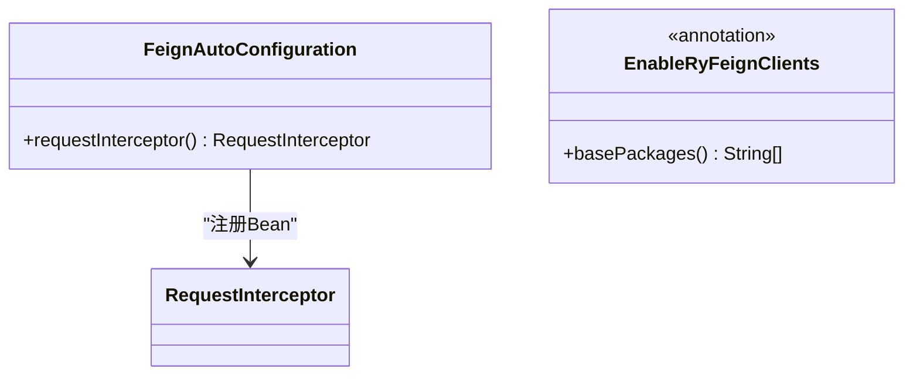
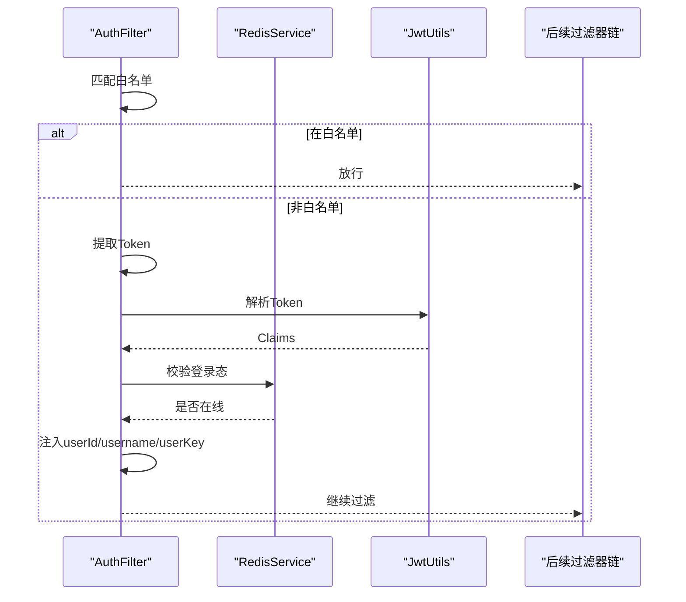
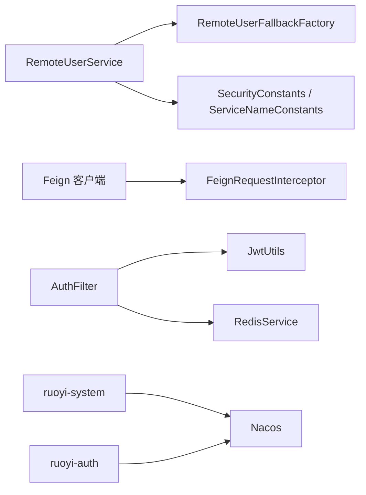

# 服务间通信

<cite>
**本文引用的文件**   
- [RemoteUserService.java](file://ruoyi-api/ruoyi-api-system/src/main/java/com/ruoyi/system/api/RemoteUserService.java)
- [RemoteUserFallbackFactory.java](file://ruoyi-api/ruoyi-api-system/src/main/java/com/ruoyi/system\api/factory/RemoteUserFallbackFactory.java)
- [FeignRequestInterceptor.java](file://ruoyi-common/ruoyi-common-security/src/main/java/com/ruoyi/common/security/feign/FeignRequestInterceptor.java)
- [FeignAutoConfiguration.java](file://ruoyi-common/ruoyi-common-security/src/main/java/com/ruoyi/common/security/feign/FeignAutoConfiguration.java)
- [EnableRyFeignClients.java](file://ruoyi-common/ruoyi-common-security/src/main/java/com/ruoyi/common/security/annotation/EnableRyFeignClients.java)
- [AuthFilter.java](file://ruoyi-gateway/src/main/java/com/ruoyi/gateway/filter/AuthFilter.java)
- [bootstrap.yml（系统服务）](file://ruoyi-modules/ruoyi-system/src/main/resources/bootstrap.yml)
- [bootstrap.yml（认证服务）](file://ruoyi-auth/src/main/resources/bootstrap.yml)
</cite>

## 目录
1. [简介](#简介)
2. [项目结构](#项目结构)
3. [核心组件](#核心组件)
4. [架构总览](#架构总览)
5. [详细组件分析](#详细组件分析)
6. [依赖关系分析](#依赖关系分析)
7. [性能与优化](#性能与优化)
8. [故障排查指南](#故障排查指南)
9. [结论](#结论)

## 简介
本文面向基于 Spring Cloud + OpenFeign 的微服务调用链路，围绕以下主题展开：
- 远程接口定义与使用（以 RemoteUserService 为例）
- 负载均衡与服务发现（Nacos）
- 熔断降级（FallbackFactory）
- 请求拦截器（FeignRequestInterceptor）
- 网关鉴权与安全头透传（AuthFilter）
- Feign 配置优化、错误处理与重试机制
- 性能监控与故障排查方法

## 项目结构
本仓库采用多模块微服务架构，关键目录与职责如下：
- ruoyi-api/ruoyi-api-system：对外暴露的远程接口契约（Feign Client 接口与 DTO）
- ruoyi-common/ruoyi-common-security：安全与通用能力，包含 Feign 自动装配与请求拦截器
- ruoyi-gateway：网关层，负责鉴权、白名单、跨域等全局过滤
- ruoyi-modules/ruoyi-system：系统服务，提供用户等业务能力
- ruoyi-auth：认证服务，负责令牌签发与校验

图表来源
- [AuthFilter.java:29-84](file://ruoyi-gateway/src/main/java/com/ruoyi/gateway/filter/AuthFilter.java#L29-L84)
- [bootstrap.yml（系统服务）:6-25](file://ruoyi-modules/ruoyi-system/src/main/resources/bootstrap.yml#L6-L25)
- [bootstrap.yml（认证服务）:6-25](file://ruoyi-auth/src/main/resources/bootstrap.yml#L6-L25)

章节来源
- [bootstrap.yml（系统服务）:1-26](file://ruoyi-modules/ruoyi-system/src/main/resources/bootstrap.yml#L1-L26)
- [bootstrap.yml（认证服务）:1-26](file://ruoyi-auth/src/main/resources/bootstrap.yml#L1-L26)

## 核心组件
- 远程接口契约：RemoteUserService，声明对系统服务的 HTTP 调用
- 熔断降级：RemoteUserFallbackFactory，实现 FallbackFactory，在调用失败时返回兜底结果
- 请求拦截器：FeignRequestInterceptor，将当前请求的安全上下文透传到下游服务
- 自动装配：FeignAutoConfiguration，注册 Feign 拦截器 Bean
- 注解开关：EnableRyFeignClients，统一扫描并启用 Feign 客户端
- 网关鉴权：AuthFilter，校验 Token、注入用户信息到请求头，并清理内部来源标记

章节来源
- [RemoteUserService.java:1-44](file://ruoyi-api/ruoyi-api-system/src/main/java/com/ruoyi/system/api/RemoteUserService.java#L1-L44)
- [RemoteUserFallbackFactory.java:1-42](file://ruoyi-api/ruoyi-api-system/src/main/java/com/ruoyi/system\api/factory/RemoteUserFallbackFactory.java#L1-L42)
- [FeignRequestInterceptor.java:1-49](file://ruoyi-common/ruoyi-common-security/src/main/java/com/ruoyi/common/security/feign/FeignRequestInterceptor.java#L1-L49)
- [FeignAutoConfiguration.java:1-21](file://ruoyi-common/ruoyi-common-security/src/main/java/com/ruoyi/common/security/feign/FeignAutoConfiguration.java#L1-L21)
- [EnableRyFeignClients.java:1-27](file://ruoyi-common/ruoyi-common-security/src/main/java/com/ruoyi/common/security/annotation/EnableRyFeignClients.java#L1-L27)
- [AuthFilter.java:1-135](file://ruoyi-gateway/src/main/java/com/ruoyi/gateway/filter/AuthFilter.java#L1-L135)

## 架构总览
下图展示一次典型的用户信息查询调用链：前端通过网关进入系统服务，系统服务通过 Feign 调用自身或其他服务；网关与 Feign 共同完成鉴权与安全头透传。

图表来源
- [AuthFilter.java:42-84](file://ruoyi-gateway/src/main/java/com/ruoyi/gateway/filter/AuthFilter.java#L42-L84)
- [FeignRequestInterceptor.java:21-48](file://ruoyi-common/ruoyi-common-security/src/main/java/com/ruoyi/common/security/feign/FeignRequestInterceptor.java#L21-L48)
- [RemoteUserService.java:21-43](file://ruoyi-api/ruoyi-api-system/src/main/java/com/ruoyi/system/api/RemoteUserService.java#L21-L43)

## 详细组件分析

### 远程接口 RemoteUserService
- 作用：声明对系统服务的远程调用，包括获取用户信息与注册用户
- 关键点：
  - 使用 @FeignClient 指定服务名与 fallbackFactory
  - 路径与方法签名与系统服务暴露的 REST 接口一致
  - 通过 RequestHeader 传递内部来源标识，便于服务端区分内外调用

图表来源
- [RemoteUserService.java:21-43](file://ruoyi-api/ruoyi-api-system/src/main/java/com/ruoyi/system/api/RemoteUserService.java#L21-L43)
- [RemoteUserFallbackFactory.java:17-40](file://ruoyi-api/ruoyi-api-system/src/main/java/com/ruoyi/system\api/factory/RemoteUserFallbackFactory.java#L17-L40)

章节来源
- [RemoteUserService.java:1-44](file://ruoyi-api/ruoyi-api-system/src/main/java/com/ruoyi/system/api/RemoteUserService.java#L1-L44)
- [RemoteUserFallbackFactory.java:1-42](file://ruoyi-api/ruoyi-api-system/src/main/java/com/ruoyi/system\api/factory/RemoteUserFallbackFactory.java#L1-L42)

### 熔断降级 RemoteUserFallbackFactory
- 作用：当远程调用出现异常或超时等故障时，返回统一的失败结果，避免级联故障
- 行为：
  - 记录失败日志
  - 为每个接口返回可识别的错误信息

图表来源
- [RemoteUserFallbackFactory.java:22-40](file://ruoyi-api/ruoyi-api-system/src/main/java/com/ruoyi/system\api/factory/RemoteUserFallbackFactory.java#L22-L40)

章节来源
- [RemoteUserFallbackFactory.java:1-42](file://ruoyi-api/ruoyi-api-system/src/main/java/com/ruoyi/system\api/factory/RemoteUserFallbackFactory.java#L1-L42)

### 请求拦截器 FeignRequestInterceptor
- 作用：在 Feign 发起请求前，从当前线程的 Servlet 上下文中提取安全相关头，并追加到下游请求中
- 透传内容：
  - 用户ID、用户名
  - Authorization 头
  - X-Forwarded-For（客户端真实IP）

图表来源
- [FeignRequestInterceptor.java:21-48](file://ruoyi-common/ruoyi-common-security/src/main/java/com/ruoyi/common/security/feign/FeignRequestInterceptor.java#L21-L48)

章节来源
- [FeignRequestInterceptor.java:1-49](file://ruoyi-common/ruoyi-common-security/src/main/java/com/ruoyi/common/security/feign/FeignRequestInterceptor.java#L1-L49)

### Feign 自动装配与注解开关
- FeignAutoConfiguration：注册 RequestInterceptor Bean，使所有 Feign 客户端生效拦截器
- EnableRyFeignClients：封装 @EnableFeignClients，默认扫描 com.ruoyi 包，简化启动类配置

图表来源
- [FeignAutoConfiguration.java:12-20](file://ruoyi-common/ruoyi-common-security/src/main/java/com/ruoyi/common/security/feign/FeignAutoConfiguration.java#L12-L20)
- [EnableRyFeignClients.java:12-27](file://ruoyi-common/ruoyi-common-security/src/main/java/com/ruoyi/common/security/annotation/EnableRyFeignClients.java#L12-L27)

章节来源
- [FeignAutoConfiguration.java:1-21](file://ruoyi-common/ruoyi-common-security/src/main/java/com/ruoyi/common/security/feign/FeignAutoConfiguration.java#L1-L21)
- [EnableRyFeignClients.java:1-27](file://ruoyi-common/ruoyi-common-security/src/main/java/com/ruoyi/common/security/annotation/EnableRyFeignClients.java#L1-L27)

### 网关鉴权 AuthFilter
- 作用：统一鉴权、白名单放行、Token 校验、向下游注入用户信息
- 流程要点：
  - 白名单匹配则直接放行
  - 解析 Token，校验过期与有效性
  - 将 userKey、userId、userName 注入请求头
  - 移除内部来源 FROM_SOURCE，防止泄露

图表来源
- [AuthFilter.java:42-84](file://ruoyi-gateway/src/main/java/com/ruoyi/gateway/filter/AuthFilter.java#L42-L84)

章节来源
- [AuthFilter.java:1-135](file://ruoyi-gateway/src/main/java/com/ruoyi/gateway/filter/AuthFilter.java#L1-L135)

## 依赖关系分析
- 远程接口依赖：
  - RemoteUserService 依赖 ServiceNameConstants.SYSTEM_SERVICE 作为服务名
  - RemoteUserService 依赖 RemoteUserFallbackFactory 作为降级工厂
- 安全链路依赖：
  - Feign 客户端依赖 FeignRequestInterceptor 进行安全头透传
  - 网关依赖 Redis/JWT 进行鉴权
- 服务发现与配置：
  - 各服务通过 bootstrap.yml 连接 Nacos 进行服务注册与配置拉取

图表来源
- [RemoteUserService.java:9-14](file://ruoyi-api/ruoyi-api-system/src/main/java/com/ruoyi/system/api/RemoteUserService.java#L9-L14)
- [FeignRequestInterceptor.java:6-9](file://ruoyi-common/ruoyi-common-security/src/main/java/com/ruoyi/common/security/feign/FeignRequestInterceptor.java#L6-L9)
- [AuthFilter.java:12-20](file://ruoyi-gateway/src/main/java/com/ruoyi/gateway/filter/AuthFilter.java#L12-L20)
- [bootstrap.yml（系统服务）:13-25](file://ruoyi-modules/ruoyi-system/src/main/resources/bootstrap.yml#L13-L25)
- [bootstrap.yml（认证服务）:13-25](file://ruoyi-auth/src/main/resources/bootstrap.yml#L13-L25)

章节来源
- [RemoteUserService.java:1-44](file://ruoyi-api/ruoyi-api-system/src/main/java/com/ruoyi/system/api/RemoteUserService.java#L1-L44)
- [FeignRequestInterceptor.java:1-49](file://ruoyi-common/ruoyi-common-security/src/main/java/com/ruoyi/common/security/feign/FeignRequestInterceptor.java#L1-L49)
- [AuthFilter.java:1-135](file://ruoyi-gateway/src/main/java/com/ruoyi/gateway/filter/AuthFilter.java#L1-L135)
- [bootstrap.yml（系统服务）:1-26](file://ruoyi-modules/ruoyi-system/src/main/resources/bootstrap.yml#L1-L26)
- [bootstrap.yml（认证服务）:1-26](file://ruoyi-auth/src/main/resources/bootstrap.yml#L1-L26)

## 性能与优化
- 负载均衡与服务发现
  - 基于 Nacos 的服务注册与发现，结合 Spring Cloud LoadBalancer/Ribbon 实现客户端侧负载均衡
  - 建议：合理设置服务实例数量，避免单点过载；关注健康检查与下线策略
- Feign 连接池与超时
  - 建议开启连接池复用，减少 TCP 握手开销
  - 合理配置 connectTimeout、readTimeout，避免长尾请求拖垮线程池
- 熔断与限流
  - 使用 FallbackFactory 快速失败，保护上游
  - 可在网关或服务侧接入 Sentinel 做细粒度限流与熔断
- 缓存与幂等
  - 对热点读接口增加本地/分布式缓存
  - 写接口保证幂等，避免重复提交导致数据不一致
- 监控与可观测性
  - 采集 Feign 调用耗时、成功率、错误码分布
  - 结合链路追踪（如 SkyWalking/Zipkin）定位慢调用

[本节为通用指导，不直接分析具体文件]

## 故障排查指南
- 常见问题与定位思路
  - 调用失败触发降级：查看 RemoteUserFallbackFactory 的日志输出，确认异常原因（网络、超时、下游异常）
  - 安全头丢失：检查 FeignRequestInterceptor 是否正确注入 userId/username/Authorization/X-Forwarded-For
  - 网关鉴权失败：检查 AuthFilter 的白名单配置、Token 解析与 Redis 登录态校验
  - 服务不可用：检查 Nacos 服务列表与健康状态，确认服务已正确注册
- 排查步骤
  - 确认网关层是否放行白名单，Token 是否有效
  - 确认 Feign 客户端是否启用拦截器，安全头是否透传
  - 查看下游服务日志，确认接口实现是否正常
  - 观察降级工厂日志，判断是否为远端异常或超时
- 建议的监控指标
  - Feign 调用次数、延迟分位、错误率
  - 网关鉴权失败次数
  - 服务实例健康状态与资源使用率

章节来源
- [RemoteUserFallbackFactory.java:22-40](file://ruoyi-api/ruoyi-api-system/src/main/java/com/ruoyi/system\api/factory/RemoteUserFallbackFactory.java#L22-L40)
- [FeignRequestInterceptor.java:21-48](file://ruoyi-common/ruoyi-common-security/src/main/java/com/ruoyi/common/security/feign/FeignRequestInterceptor.java#L21-L48)
- [AuthFilter.java:42-106](file://ruoyi-gateway/src/main/java/com/ruoyi/gateway/filter/AuthFilter.java#L42-L106)

## 结论
本项目通过 Feign 实现微服务间的声明式远程调用，配合网关鉴权与安全头透传，形成完整的服务间通信链路。借助 Nacos 提供服务发现与负载均衡，通过 FallbackFactory 实现熔断降级，保障系统稳定性。建议在现有基础上完善连接池与超时配置、接入限流与全链路监控，进一步提升系统的可观测性与韧性。