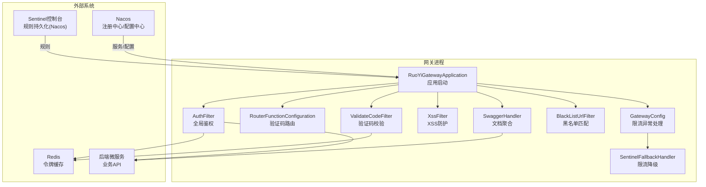
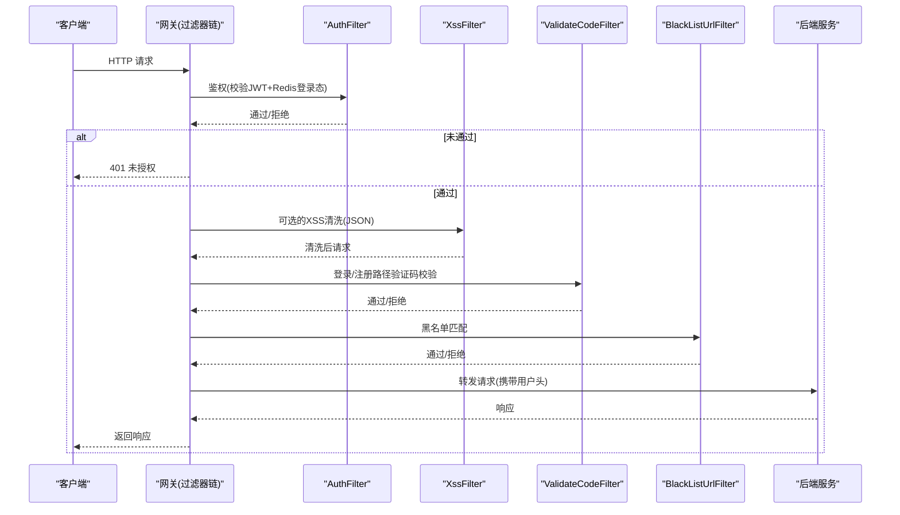
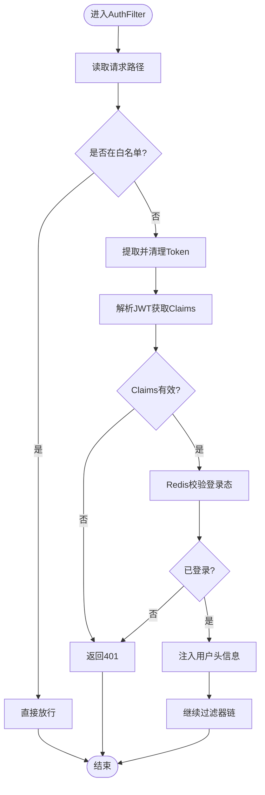
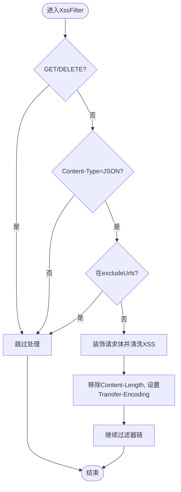
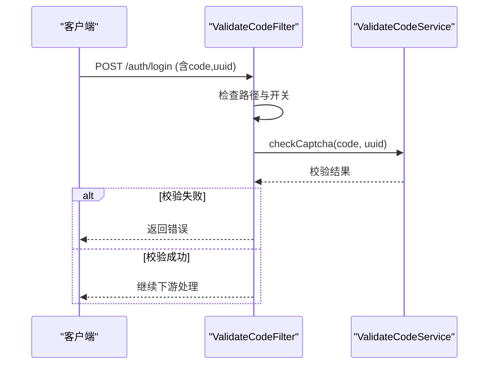
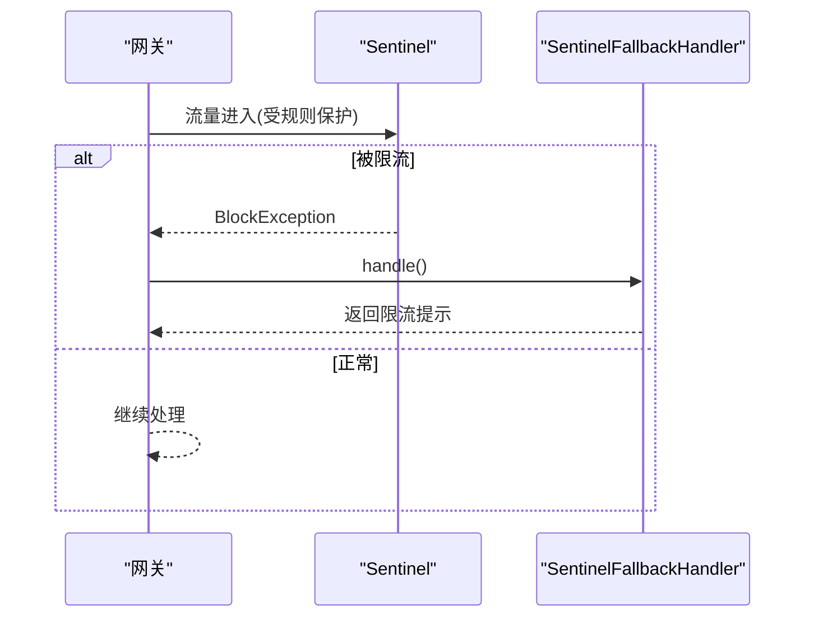
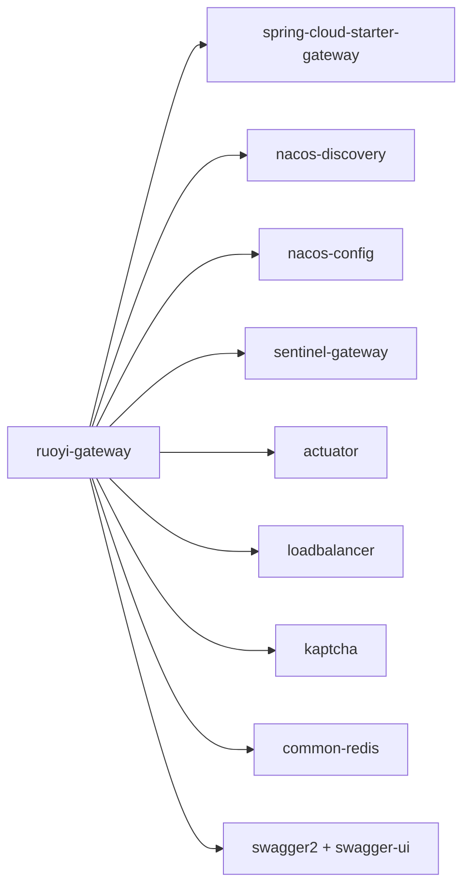

# 网关服务

<cite>
**本文引用的文件**   
- [pom.xml](file://ruoyi-gateway/pom.xml)
- [bootstrap.yml](file://ruoyi-gateway/src/main/resources/bootstrap.yml)
- [RuoYiGatewayApplication.java](file://ruoyi-gateway/src/main/java/com/ruoyi/gateway/RuoYiGatewayApplication.java)
- [GatewayConfig.java](file://ruoyi-gateway/src/main/java/com/ruoyi/gateway/config/GatewayConfig.java)
- [RouterFunctionConfiguration.java](file://ruoyi-gateway/src/main/java/com/ruoyi/gateway/config/RouterFunctionConfiguration.java)
- [SwaggerProvider.java](file://ruoyi-gateway/src/main/java/com/ruoyi/gateway/config/SwaggerProvider.java)
- [AuthFilter.java](file://ruoyi-gateway/src/main/java/com/ruoyi/gateway/filter/AuthFilter.java)
- [BlackListUrlFilter.java](file://ruoyi-gateway/src/main/java/com/ruoyi/gateway/filter/BlackListUrlFilter.java)
- [ValidateCodeFilter.java](file://ruoyi-gateway/src/main/java/com/ruoyi/gateway/filter/ValidateCodeFilter.java)
- [XssFilter.java](file://ruoyi-gateway/src/main/java/com/ruoyi/gateway/filter/XssFilter.java)
- [SwaggerHandler.java](file://ruoyi-gateway/src/main/java/com/ruoyi/gateway/handler/SwaggerHandler.java)
- [SentinelFallbackHandler.java](file://ruoyi-gateway/src/main/java/com/ruoyi/gateway/handler/SentinelFallbackHandler.java)
</cite>

## 目录
1. [简介](#简介)
2. [项目结构](#项目结构)
3. [核心组件](#核心组件)
4. [架构总览](#架构总览)
5. [详细组件分析](#详细组件分析)
6. [依赖关系分析](#依赖关系分析)
7. [性能与调优](#性能与调优)
8. [故障排除指南](#故障排除指南)
9. [结论](#结论)

## 简介
本文件为网关服务的完整技术文档，围绕网关作为微服务统一入口的职责展开，涵盖路由配置、请求过滤、权限验证、验证码校验、跨站脚本防护、限流熔断、Swagger 集成与安全策略。同时给出配置项说明、性能调优建议与常见问题排查方法，帮助读者快速理解并运维该网关模块。

## 项目结构
网关模块基于 Spring Cloud Gateway 构建，结合 Nacos 进行服务发现与配置管理，使用 Sentinel 实现限流熔断，并通过自定义过滤器完成鉴权、验证码校验、黑名单拦截与 XSS 防护。Swagger 通过网关侧处理器聚合各子服务接口文档。

图示来源
- [RuoYiGatewayApplication.java:12-17](file://ruoyi-gateway/src/main/java/com/ruoyi/gateway/RuoYiGatewayApplication.java#L12-L17)
- [GatewayConfig.java:14-22](file://ruoyi-gateway/src/main/java/com/ruoyi/gateway/config/GatewayConfig.java#L14-L22)
- [RouterFunctionConfiguration.java:17-30](file://ruoyi-gateway/src/main/java/com/ruoyi/gateway/config/RouterFunctionConfiguration.java#L17-L30)
- [AuthFilter.java:29-84](file://ruoyi-gateway/src/main/java/com/ruoyi/gateway/filter/AuthFilter.java#L29-L84)
- [XssFilter.java:33-63](file://ruoyi-gateway/src/main/java/com/ruoyi/gateway/filter/XssFilter.java#L33-L63)
- [ValidateCodeFilter.java:25-63](file://ruoyi-gateway/src/main/java/com/ruoyi/gateway/filter/ValidateCodeFilter.java#L25-L63)
- [BlackListUrlFilter.java:16-32](file://ruoyi-gateway/src/main/java/com/ruoyi/gateway/filter/BlackListUrlFilter.java#L16-L32)
- [SwaggerHandler.java:17-55](file://ruoyi-gateway/src/main/java/com/ruoyi/gateway/handler/SwaggerHandler.java#L17-L55)
- [SentinelFallbackHandler.java:16-40](file://ruoyi-gateway/src/main/java/com/ruoyi/gateway/handler/SentinelFallbackHandler.java#L16-L40)
- [bootstrap.yml:16-43](file://ruoyi-gateway/src/main/resources/bootstrap.yml#L16-L43)

章节来源
- [RuoYiGatewayApplication.java:12-17](file://ruoyi-gateway/src/main/java/com/ruoyi/gateway/RuoYiGatewayApplication.java#L12-L17)
- [bootstrap.yml:1-43](file://ruoyi-gateway/src/main/resources/bootstrap.yml#L1-L43)

## 核心组件
- 应用入口：禁用数据源自动装配，仅启动网关能力。
- 限流熔断：集成 Sentinel，提供统一的限流异常处理。
- 全局过滤器：
  - AuthFilter：统一鉴权，校验 JWT 并在 Redis 中校验登录态，透传用户信息到下游。
  - XssFilter：对 JSON 请求体进行 XSS 清洗（可开关）。
  - ValidateCodeFilter：登录/注册接口验证码校验。
  - BlackListUrlFilter：按正则黑名单拦截请求。
- 路由与文档：
  - RouterFunctionConfiguration：定义验证码获取路由。
  - SwaggerHandler：聚合各服务 Swagger 资源。
  - SwaggerProvider：提供 Swagger 资源列表（见引用文件）。

章节来源
- [RuoYiGatewayApplication.java:12-17](file://ruoyi-gateway/src/main/java/com/ruoyi/gateway/RuoYiGatewayApplication.java#L12-L17)
- [GatewayConfig.java:14-22](file://ruoyi-gateway/src/main/java/com/ruoyi/gateway/config/GatewayConfig.java#L14-L22)
- [AuthFilter.java:29-84](file://ruoyi-gateway/src/main/java/com/ruoyi/gateway/filter/AuthFilter.java#L29-L84)
- [XssFilter.java:33-63](file://ruoyi-gateway/src/main/java/com/ruoyi/gateway/filter/XssFilter.java#L33-L63)
- [ValidateCodeFilter.java:25-63](file://ruoyi-gateway/src/main/java/com/ruoyi/gateway/filter/ValidateCodeFilter.java#L25-L63)
- [BlackListUrlFilter.java:16-32](file://ruoyi-gateway/src/main/java/com/ruoyi/gateway/filter/BlackListUrlFilter.java#L16-L32)
- [RouterFunctionConfiguration.java:17-30](file://ruoyi-gateway/src/main/java/com/ruoyi/gateway/config/RouterFunctionConfiguration.java#L17-L30)
- [SwaggerHandler.java:17-55](file://ruoyi-gateway/src/main/java/com/ruoyi/gateway/handler/SwaggerHandler.java#L17-L55)

## 架构总览
网关在请求进入时依次执行全局过滤器与路由匹配，最终转发至具体微服务；同时承担安全与治理职责。

图示来源
- [AuthFilter.java:42-84](file://ruoyi-gateway/src/main/java/com/ruoyi/gateway/filter/AuthFilter.java#L42-L84)
- [XssFilter.java:41-63](file://ruoyi-gateway/src/main/java/com/ruoyi/gateway/filter/XssFilter.java#L41-L63)
- [ValidateCodeFilter.java:40-63](file://ruoyi-gateway/src/main/java/com/ruoyi/gateway/filter/ValidateCodeFilter.java#L40-L63)
- [BlackListUrlFilter.java:19-32](file://ruoyi-gateway/src/main/java/com/ruoyi/gateway/filter/BlackListUrlFilter.java#L19-L32)

## 详细组件分析

### 认证与鉴权（AuthFilter）
- 功能要点
  - 支持白名单跳过校验（忽略路径由配置注入）。
  - 从请求头提取 Token，去除前缀后解析 JWT。
  - 基于 Redis 校验登录态是否有效。
  - 将用户标识、用户名等写入下游请求头，便于后续服务使用。
  - 失败时统一返回未授权响应。
- 关键流程
  - 提取 URL → 白名单判断 → 提取 Token → 解析 JWT → Redis 校验 → 注入用户头 → 放行。

图示来源
- [AuthFilter.java:42-84](file://ruoyi-gateway/src/main/java/com/ruoyi/gateway/filter/AuthFilter.java#L42-L84)

章节来源
- [AuthFilter.java:29-135](file://ruoyi-gateway/src/main/java/com/ruoyi/gateway/filter/AuthFilter.java#L29-L135)

### 跨站脚本防护（XssFilter）
- 功能要点
  - 仅在启用 security.xss.enabled=true 时生效。
  - 仅对非 GET/DELETE 且 Content-Type 为 application/json 的请求进行处理。
  - 支持 excludeUrls 白名单跳过。
  - 通过装饰器重写请求体，调用 HTML 清洗工具清理 XSS。
  - 修正 Content-Length 并改为分块传输。
- 复杂度与性能
  - 对请求体进行解码与重组，存在额外 CPU 与内存开销；建议仅对必要接口开启。

图示来源
- [XssFilter.java:41-106](file://ruoyi-gateway/src/main/java/com/ruoyi/gateway/filter/XssFilter.java#L41-L106)

章节来源
- [XssFilter.java:33-125](file://ruoyi-gateway/src/main/java/com/ruoyi/gateway/filter/XssFilter.java#L33-L125)

### 验证码校验（ValidateCodeFilter）
- 功能要点
  - 针对 /auth/login 与 /auth/register 路径进行验证码校验。
  - 当验证码功能关闭时跳过处理。
  - 从请求体解析 code 与 uuid，调用验证码服务校验。
  - 校验失败直接返回错误消息。
- 注意
  - 由于需要读取请求体，需确保上游不会重复消费 Body。

图示来源
- [ValidateCodeFilter.java:40-63](file://ruoyi-gateway/src/main/java/com/ruoyi/gateway/filter/ValidateCodeFilter.java#L40-L63)

章节来源
- [ValidateCodeFilter.java:25-79](file://ruoyi-gateway/src/main/java/com/ruoyi/gateway/filter/ValidateCodeFilter.java#L25-L79)

### 黑名单拦截（BlackListUrlFilter）
- 功能要点
  - 基于 AbstractGatewayFilterFactory 实现的路由级过滤器。
  - 支持正则表达式黑名单匹配，命中则直接拒绝访问。
- 适用场景
  - 动态屏蔽敏感或恶意路径。

章节来源
- [BlackListUrlFilter.java:16-66](file://ruoyi-gateway/src/main/java/com/ruoyi/gateway/filter/BlackListUrlFilter.java#L16-L66)

### 限流熔断（Sentinel）
- 功能要点
  - 通过 GatewayConfig 注册最高优先级的限流异常处理器。
  - 当触发 Sentinel 规则时，统一返回“请求超过最大数，请稍候再试”。
  - 规则持久化于 Nacos，dataId 为 sentinel-ruoyi-gateway。
- 配置要点
  - bootstrap.yml 中启用 Sentinel 控制台连接与数据源配置。

图示来源
- [GatewayConfig.java:17-22](file://ruoyi-gateway/src/main/java/com/ruoyi/gateway/config/GatewayConfig.java#L17-L22)
- [SentinelFallbackHandler.java:16-40](file://ruoyi-gateway/src/main/java/com/ruoyi/gateway/handler/SentinelFallbackHandler.java#L16-L40)
- [bootstrap.yml:29-43](file://ruoyi-gateway/src/main/resources/bootstrap.yml#L29-L43)

章节来源
- [GatewayConfig.java:14-22](file://ruoyi-gateway/src/main/java/com/ruoyi/gateway/config/GatewayConfig.java#L14-L22)
- [SentinelFallbackHandler.java:16-42](file://ruoyi-gateway/src/main/java/com/ruoyi/gateway/handler/SentinelFallbackHandler.java#L16-L42)
- [bootstrap.yml:29-43](file://ruoyi-gateway/src/main/resources/bootstrap.yml#L29-L43)

### Swagger 集成
- 网关侧提供 SwaggerHandler 暴露 /swagger-resources 相关接口，用于聚合各子服务文档。
- 依赖 springfox-swagger2 与 swagger-ui，配合 SwaggerProvider 提供资源列表。
- 典型访问路径
  - /swagger-resources：获取所有服务文档资源
  - /swagger-resources/configuration/security：安全配置
  - /swagger-resources/configuration/ui：UI 配置

章节来源
- [SwaggerHandler.java:17-55](file://ruoyi-gateway/src/main/java/com/ruoyi/gateway/handler/SwaggerHandler.java#L17-L55)
- [pom.xml:79-89](file://ruoyi-gateway/pom.xml#L79-L89)

### 验证码路由（RouterFunctionConfiguration）
- 定义 GET /code 路由，返回验证码图片（文本生成由 KaptchaTextCreator 负责）。
- 该路由独立于网关过滤器链，避免被鉴权拦截。

章节来源
- [RouterFunctionConfiguration.java:17-30](file://ruoyi-gateway/src/main/java/com/ruoyi/gateway/config/RouterFunctionConfiguration.java#L17-L30)

## 依赖关系分析
- 运行时依赖
  - Spring Cloud Gateway：网关核心能力
  - Nacos Discovery/Config：服务发现与配置中心
  - Sentinel + Sentinel Gateway：限流熔断与网关适配
  - Actuator：健康检查与监控端点
  - Loadbalancer：负载均衡
  - Kaptcha：验证码生成
  - Redis：令牌与验证码缓存
  - Swagger：接口文档
- 模块内依赖
  - 过滤器依赖 common-core 常量与工具类、common-redis 的 RedisService
  - 限流异常处理依赖 ServletUtils 统一响应

图示来源
- [pom.xml:17-91](file://ruoyi-gateway/pom.xml#L17-L91)

章节来源
- [pom.xml:17-91](file://ruoyi-gateway/pom.xml#L17-L91)

## 性能与调优
- 过滤器顺序
  - AuthFilter 优先级较高，建议保持在前置位置以尽早拒绝非法请求。
  - XssFilter 会复制并清洗请求体，建议在非必要接口关闭或缩小范围。
- 网络与序列化
  - 网关基于 WebFlux/Netty，建议合理设置 JVM 堆大小与 Netty 线程参数。
  - 控制请求体大小，避免大对象导致内存抖动。
- 缓存与键空间
  - 合理使用 Redis 键前缀与过期时间，避免热点键倾斜。
- 限流策略
  - 根据业务峰值与下游承受能力，在 Sentinel 控制台配置合适的 QPS/并发阈值。
  - 对热点接口单独制定规则，避免误伤。
- 日志与监控
  - 开启 Actuator 指标，结合 Prometheus/Grafana 观察延迟与错误率。
  - 调整日志级别，生产环境降低 DEBUG 输出。

[本节为通用指导，不直接分析具体文件]

## 故障排除指南
- 401 未授权
  - 现象：请求被 AuthFilter 拒绝。
  - 排查要点
    - 确认请求头包含正确的 Token，且未遗漏前缀。
    - 检查 Redis 中对应登录态是否存在且未过期。
    - 核对白名单配置是否正确。
  - 参考
    - [AuthFilter.java:54-84](file://ruoyi-gateway/src/main/java/com/ruoyi/gateway/filter/AuthFilter.java#L54-L84)
- 验证码校验失败
  - 现象：登录/注册接口返回验证码错误。
  - 排查要点
    - 确认请求体包含 code 与 uuid。
    - 检查验证码服务是否正常，Redis 中验证码是否过期。
    - 确认 ValidateCodeFilter 未被其他逻辑提前消费请求体。
  - 参考
    - [ValidateCodeFilter.java:40-63](file://ruoyi-gateway/src/main/java/com/ruoyi/gateway/filter/ValidateCodeFilter.java#L40-L63)
- 限流触发
  - 现象：返回“请求超过最大数，请稍候再试”。
  - 排查要点
    - 查看 Sentinel 控制台规则是否命中。
    - 检查 Nacos 中 sentinel-ruoyi-gateway 规则配置。
  - 参考
    - [SentinelFallbackHandler.java:18-40](file://ruoyi-gateway/src/main/java/com/ruoyi/gateway/handler/SentinelFallbackHandler.java#L18-L40)
    - [bootstrap.yml:29-43](file://ruoyi-gateway/src/main/resources/bootstrap.yml#L29-L43)
- Swagger 无法加载
  - 现象：/swagger-resources 无数据或 UI 空白。
  - 排查要点
    - 确认 SwaggerHandler 与 SwaggerProvider 已正确装配。
    - 检查各子服务是否暴露了 Swagger 资源。
  - 参考
    - [SwaggerHandler.java:17-55](file://ruoyi-gateway/src/main/java/com/ruoyi/gateway/handler/SwaggerHandler.java#L17-L55)

章节来源
- [AuthFilter.java:54-84](file://ruoyi-gateway/src/main/java/com/ruoyi/gateway/filter/AuthFilter.java#L54-L84)
- [ValidateCodeFilter.java:40-63](file://ruoyi-gateway/src/main/java/com/ruoyi/gateway/filter/ValidateCodeFilter.java#L40-L63)
- [SentinelFallbackHandler.java:18-40](file://ruoyi-gateway/src/main/java/com/ruoyi/gateway/handler/SentinelFallbackHandler.java#L18-L40)
- [bootstrap.yml:29-43](file://ruoyi-gateway/src/main/resources/bootstrap.yml#L29-L43)
- [SwaggerHandler.java:17-55](file://ruoyi-gateway/src/main/java/com/ruoyi/gateway/handler/SwaggerHandler.java#L17-L55)

## 结论
网关模块通过全局过滤器与路由机制，统一承载鉴权、验证码校验、XSS 防护、黑名单拦截与限流熔断等横切关注点，显著降低了业务服务的复杂度。配合 Nacos 与 Sentinel，可实现灵活的配置管理与弹性治理能力。在生产环境中，应重点关注过滤器性能影响、限流策略合理性以及 Redis 与 Nacos 的稳定性，并结合监控与日志完善可观测性体系。