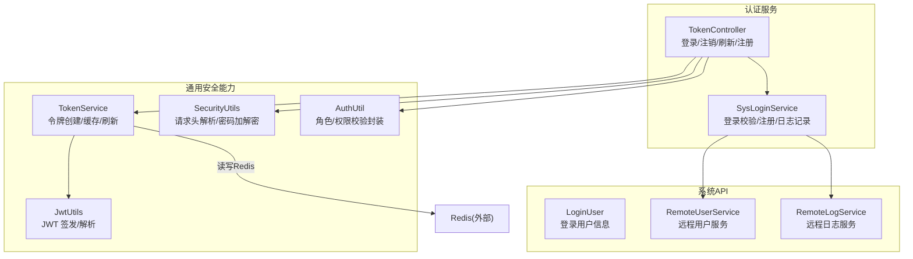
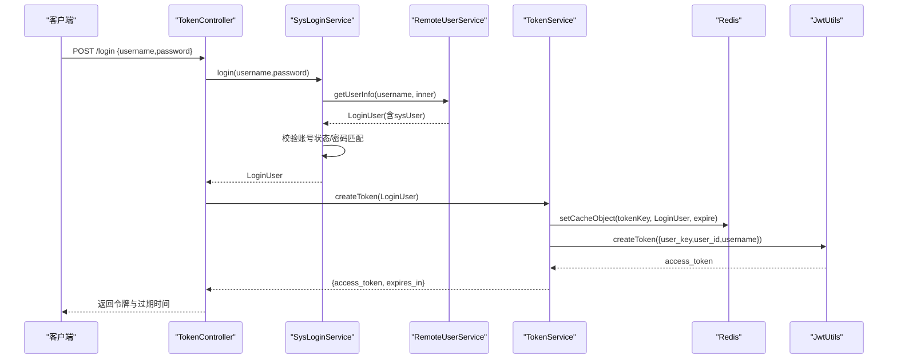
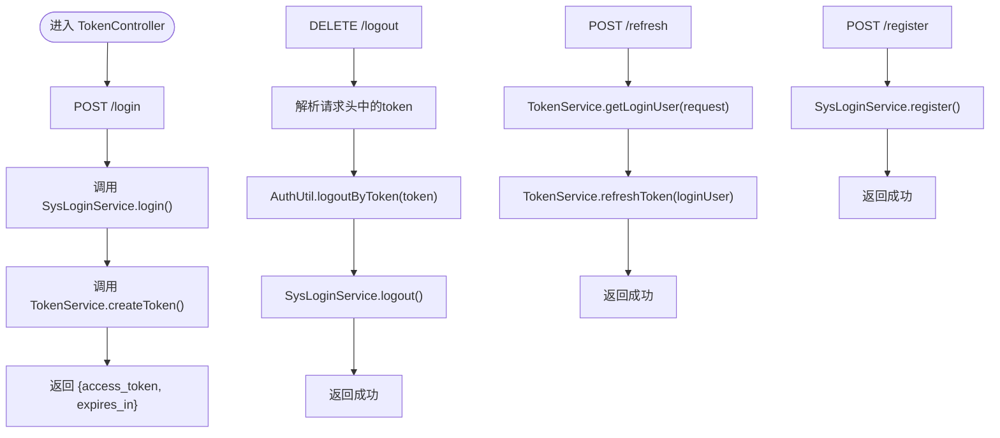
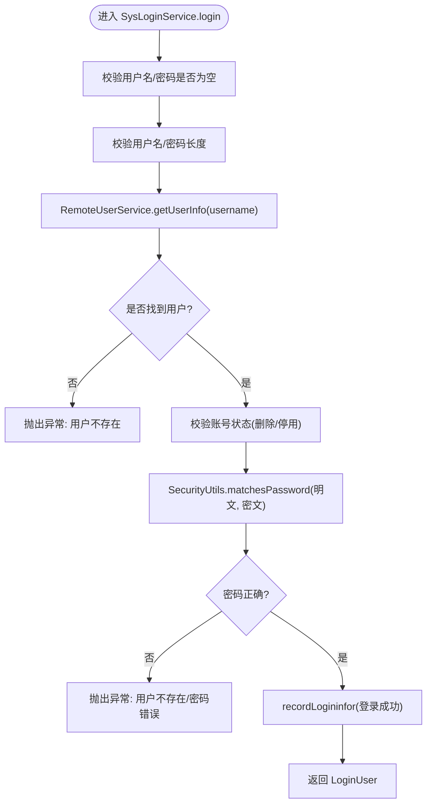
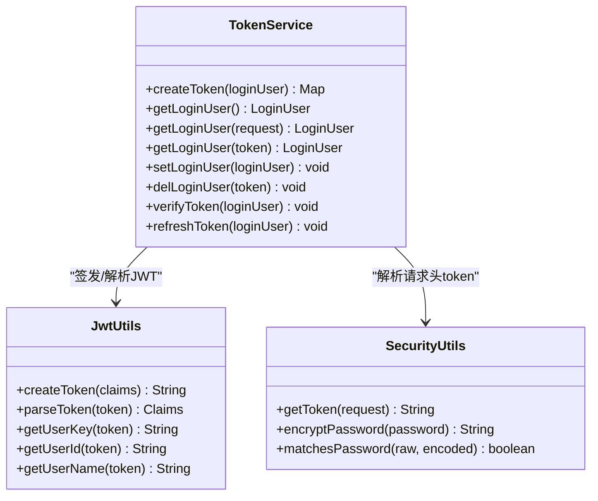
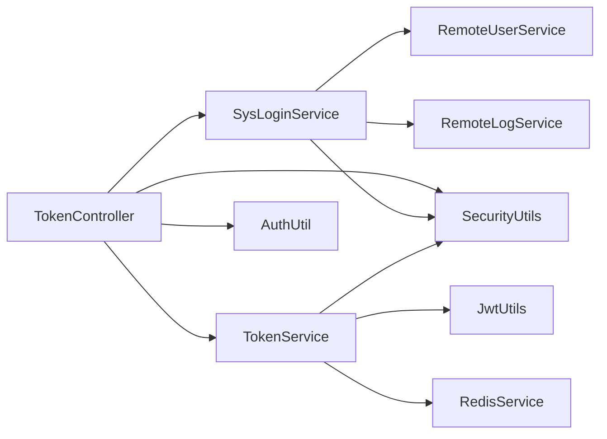

# 认证服务

<cite>
**本文引用的文件**   
- [TokenController.java](file://ruoyi-auth/src/main/java/com/ruoyi/auth/controller/TokenController.java)
- [SysLoginService.java](file://ruoyi-auth/src/main/java/com/ruoyi/auth/service/SysLoginService.java)
- [TokenService.java](file://ruoyi-common/ruoyi-common-security/src/main/java/com/ruoyi/common/security/service/TokenService.java)
- [JwtUtils.java](file://ruoyi-common/ruoyi-common-core/src/main/java/com/ruoyi/common/core/utils/JwtUtils.java)
- [SecurityUtils.java](file://ruoyi-common/ruoyi-common-security/src/main/java/com/ruoyi/common/security/utils/SecurityUtils.java)
- [AuthUtil.java](file://ruoyi-common/ruoyi-common-security/src/main/java/com/ruoyi/common/security/auth/AuthUtil.java)
- [LoginUser.java](file://ruoyi-api/ruoyi-api-system/src/main/java/com/ruoyi/system/api/model/LoginUser.java)
- [SecurityConstants.java](file://ruoyi-common/ruoyi-common-core/src/main/java/com/ruoyi/common/core/constant/SecurityConstants.java)
- [TokenConstants.java](file://ruoyi-common/ruoyi-common-core/src/main/java/com/ruoyi/common/core/constant/TokenConstants.java)
</cite>

## 目录
1. [简介](#简介)
2. [项目结构](#项目结构)
3. [核心组件](#核心组件)
4. [架构总览](#架构总览)
5. [详细组件分析](#详细组件分析)
6. [依赖关系分析](#依赖关系分析)
7. [性能与可扩展性](#性能与可扩展性)
8. [故障排查指南](#故障排查指南)
9. [结论](#结论)

## 简介
本文件面向认证服务的实现与使用，聚焦以下目标：
- 认证授权的核心机制：JWT 令牌生成与解析、用户登录流程、权限校验。
- TokenController 的接口职责与调用链。
- SysLoginService 的业务逻辑：登录校验、注册、退出记录等。
- 与系统服务的交互方式：通过 RemoteUserService、RemoteLogService 进行跨服务调用。
- 安全配置要点：密码加密（BCrypt）、会话管理（Redis + JWT）、令牌前缀与常量定义。

## 项目结构
认证相关代码主要分布在以下模块：
- ruoyi-auth：认证入口控制器与登录业务服务。
- ruoyi-common-security：通用安全能力（令牌服务、工具类、鉴权工具）。
- ruoyi-common-core：通用常量与 JWT 工具。
- ruoyi-api-system：系统域模型与远程服务接口（如 LoginUser、RemoteUserService）。

图表来源
- [TokenController.java:34-76](file://ruoyi-auth/src/main/java/com/ruoyi/auth/controller/TokenController.java#L34-L76)
- [SysLoginService.java:38-131](file://ruoyi-auth/src/main/java/com/ruoyi/auth/service/SysLoginService.java#L38-L131)
- [TokenService.java:44-66](file://ruoyi-common/ruoyi-common-security/src/main/java/com/ruoyi/common/security/service/TokenService.java#L44-L66)
- [JwtUtils.java:26-40](file://ruoyi-common/ruoyi-common-core/src/main/java/com/ruoyi/common/core/utils/JwtUtils.java#L26-L40)
- [SecurityUtils.java:62-115](file://ruoyi-common/ruoyi-common-security/src/main/java/com/ruoyi/common/security/utils/SecurityUtils.java#L62-L115)
- [AuthUtil.java:22-160](file://ruoyi-common/ruoyi-common-security/src/main/java/com/ruoyi/common/security/auth/AuthUtil.java#L22-L160)

章节来源
- [TokenController.java:1-79](file://ruoyi-auth/src/main/java/com/ruoyi/auth/controller/TokenController.java#L1-L79)
- [SysLoginService.java:1-159](file://ruoyi-auth/src/main/java/com/ruoyi/auth/service/SysLoginService.java#L1-L159)
- [TokenService.java:1-169](file://ruoyi-common/ruoyi-common-security/src/main/java/com/ruoyi/common/security/service/TokenService.java#L1-L169)
- [JwtUtils.java:1-124](file://ruoyi-common/ruoyi-common-core/src/main/java/com/ruoyi/common/core/utils/JwtUtils.java#L1-L124)
- [SecurityUtils.java:1-118](file://ruoyi-common/ruoyi-common-security/src/main/java/com/ruoyi/common/security/utils/SecurityUtils.java#L1-L118)
- [AuthUtil.java:1-163](file://ruoyi-common/ruoyi-common-security/src/main/java/com/ruoyi/common/security/auth/AuthUtil.java#L1-L163)
- [LoginUser.java:1-151](file://ruoyi-api/ruoyi-api-system/src/main/java/com/ruoyi/system/api/model/LoginUser.java#L1-L151)

## 核心组件
- TokenController：对外暴露登录、注销、刷新、注册接口，协调登录服务与令牌服务。
- SysLoginService：负责用户名/密码校验、账号状态检查、密码比对、注册数据准备与远程调用、登录日志记录。
- TokenService：负责令牌创建、Redis 中会话存储、令牌有效期校验与刷新、从请求或 token 获取登录用户。
- JwtUtils：基于 JJWT 的令牌签发与解析，提取 claims 中的 user_key、user_id、username。
- SecurityUtils：从请求头解析 Bearer token，提供 BCrypt 密码加密与匹配方法。
- AuthUtil：对角色与权限校验的统一封装，支持 hasRole/hasPermi 及 check* 系列方法。
- LoginUser：登录上下文对象，包含用户标识、权限集合、角色集合、登录时间、过期时间、IP 等。

章节来源
- [TokenController.java:25-78](file://ruoyi-auth/src/main/java/com/ruoyi/auth/controller/TokenController.java#L25-L78)
- [SysLoginService.java:26-159](file://ruoyi-auth/src/main/java/com/ruoyi/auth/service/SysLoginService.java#L26-L159)
- [TokenService.java:25-169](file://ruoyi-common/ruoyi-common-security/src/main/java/com/ruoyi/common/security/service/TokenService.java#L25-L169)
- [JwtUtils.java:16-124](file://ruoyi-common/ruoyi-common-core/src/main/java/com/ruoyi/common/core/utils/JwtUtils.java#L16-L124)
- [SecurityUtils.java:17-118](file://ruoyi-common/ruoyi-common-security/src/main/java/com/ruoyi/common/security/utils/SecurityUtils.java#L17-L118)
- [AuthUtil.java:12-163](file://ruoyi-common/ruoyi-common-security/src/main/java/com/ruoyi/common/security/auth/AuthUtil.java#L12-L163)
- [LoginUser.java:12-151](file://ruoyi-api/ruoyi-api-system/src/main/java/com/ruoyi/system/api/model/LoginUser.java#L12-L151)

## 架构总览
认证流程采用“无状态 JWT + 有状态 Redis 会话”的组合模式：
- 登录成功后，服务端生成 JWT（仅携带 user_key、user_id、username），并将完整 LoginUser 存入 Redis，键名包含 token。
- 后续请求在网关或拦截器中解析 Authorization 头，提取 token，再从 Redis 读取 LoginUser 完成鉴权。
- 当接近过期阈值时，自动刷新 Redis 中的会话 TTL；客户端可主动调用刷新接口续期。

图表来源
- [TokenController.java:34-41](file://ruoyi-auth/src/main/java/com/ruoyi/auth/controller/TokenController.java#L34-L41)
- [SysLoginService.java:38-91](file://ruoyi-auth/src/main/java/com/ruoyi/auth/service/SysLoginService.java#L38-L91)
- [TokenService.java:44-66](file://ruoyi-common/ruoyi-common-security/src/main/java/com/ruoyi/common/security/service/TokenService.java#L44-L66)
- [JwtUtils.java:26-29](file://ruoyi-common/ruoyi-common-core/src/main/java/com/ruoyi/common/core/utils/JwtUtils.java#L26-L29)

## 详细组件分析

### TokenController 接口实现
- 登录接口：接收 LoginBody，委托 SysLoginService 完成登录校验，再调用 TokenService.createToken 生成令牌并返回。
- 注销接口：从请求头取 token，解析用户名后调用 AuthUtil.logoutByToken 清理会话，并记录退出日志。
- 刷新接口：从当前请求解析 LoginUser，调用 TokenService.refreshToken 延长会话有效期。
- 注册接口：接收 RegisterBody，委托 SysLoginService.register 完成注册。

图表来源
- [TokenController.java:34-76](file://ruoyi-auth/src/main/java/com/ruoyi/auth/controller/TokenController.java#L34-L76)
- [SysLoginService.java:94-131](file://ruoyi-auth/src/main/java/com/ruoyi/auth/service/SysLoginService.java#L94-L131)
- [TokenService.java:156-163](file://ruoyi-common/ruoyi-common-security/src/main/java/com/ruoyi/common/security/service/TokenService.java#L156-L163)
- [AuthUtil.java:32-35](file://ruoyi-common/ruoyi-common-security/src/main/java/com/ruoyi/common/security/auth/AuthUtil.java#L32-L35)

章节来源
- [TokenController.java:34-76](file://ruoyi-auth/src/main/java/com/ruoyi/auth/controller/TokenController.java#L34-L76)

### SysLoginService 业务逻辑
- 登录流程：
  - 参数校验：用户名/密码非空、长度范围限制。
  - 远程查询用户：调用 RemoteUserService.getUserInfo，获取 LoginUser 与 SysUser。
  - 账号状态校验：删除标记、停用状态。
  - 密码校验：使用 SecurityUtils.matchesPassword 比对明文与密文。
  - 登录成功：记录登录日志，返回 LoginUser。
- 注册流程：
  - 参数校验：用户名/密码长度限制。
  - 密码加密：SecurityUtils.encryptPassword 生成 BCrypt 密文。
  - 远程写入：调用 RemoteUserService.registerUserInfo 保存用户。
  - 记录注册日志。
- 退出与日志：
  - logout 记录退出日志。
  - recordLogininfor 统一封装登录信息（用户名、IP、消息、状态）并通过 RemoteLogService 持久化。

图表来源
- [SysLoginService.java:38-91](file://ruoyi-auth/src/main/java/com/ruoyi/auth/service/SysLoginService.java#L38-L91)
- [SecurityUtils.java:112-115](file://ruoyi-common/ruoyi-common-security/src/main/java/com/ruoyi/common/security/utils/SecurityUtils.java#L112-L115)

章节来源
- [SysLoginService.java:38-131](file://ruoyi-auth/src/main/java/com/ruoyi/auth/service/SysLoginService.java#L38-L131)

### TokenService 令牌与会话管理
- 令牌创建：
  - 生成 UUID 作为 token，填充 LoginUser 的 token、userid、username、ipaddr。
  - 将 LoginUser 写入 Redis，键名为 ACCESS_TOKEN + token，过期时间为配置的分钟数。
  - 构建 JWT claims（user_key、user_id、username），调用 JwtUtils.createToken 生成 access_token。
  - 返回 access_token 与 expires_in。
- 获取登录用户：
  - 从请求头解析 token，提取 user_key，从 Redis 读取 LoginUser。
- 刷新与验证：
  - verifyToken：若距离过期不足 10 分钟，自动刷新 Redis 中的会话 TTL。
  - refreshToken：更新登录时间与过期时间，重新写入 Redis。

图表来源
- [TokenService.java:44-163](file://ruoyi-common/ruoyi-common-security/src/main/java/com/ruoyi/common/security/service/TokenService.java#L44-L163)
- [JwtUtils.java:26-40](file://ruoyi-common/ruoyi-common-core/src/main/java/com/ruoyi/common/core/utils/JwtUtils.java#L26-L40)
- [SecurityUtils.java:62-67](file://ruoyi-common/ruoyi-common-security/src/main/java/com/ruoyi/common/security/utils/SecurityUtils.java#L62-L67)

章节来源
- [TokenService.java:44-163](file://ruoyi-common/ruoyi-common-security/src/main/java/com/ruoyi/common/security/service/TokenService.java#L44-L163)

### 安全配置与密码加密
- 密码加密与匹配：
  - 使用 BCryptPasswordEncoder 进行加密与比对，避免明文存储。
  - 注册时对明文密码加密；登录时比对明文与密文。
- 令牌前缀与常量：
  - Authorization 头固定为 Authorization，前缀为 Bearer 。
  - SECRET 用于 JWT 签名（注意生产环境应使用强密钥）。
- 用户标识字段：
  - user_id、username、user_key、LOGIN_USER 等常量集中管理，保证一致性。

章节来源
- [SecurityUtils.java:99-115](file://ruoyi-common/ruoyi-common-security/src/main/java/com/ruoyi/common/security/utils/SecurityUtils.java#L99-L115)
- [TokenConstants.java:13-23](file://ruoyi-common/ruoyi-common-core/src/main/java/com/ruoyi/common/core/constant/TokenConstants.java#L13-L23)
- [SecurityConstants.java:13-43](file://ruoyi-common/ruoyi-common-core/src/main/java/com/ruoyi/common/core/constant/SecurityConstants.java#L13-L43)

### 权限校验与会话管理
- 会话管理：
  - 登录成功后，LoginUser 存入 Redis，键名包含 token，便于按 token 检索与失效控制。
  - 注销时通过 AuthUtil.logoutByToken 删除对应会话。
- 权限校验：
  - AuthUtil 提供 hasRole/hasPermi 与 checkRole/checkPermi 等方法，支持单值、AND/OR 组合校验。
  - 通常由网关或拦截器在鉴权阶段调用，结合注解实现细粒度访问控制。

章节来源
- [AuthUtil.java:22-160](file://ruoyi-common/ruoyi-common-security/src/main/java/com/ruoyi/common/security/auth/AuthUtil.java#L22-L160)
- [TokenService.java:127-163](file://ruoyi-common/ruoyi-common-security/src/main/java/com/ruoyi/common/security/service/TokenService.java#L127-L163)

## 依赖关系分析
- TokenController 依赖：
  - SysLoginService：处理登录、注册、退出等业务。
  - TokenService：生成与刷新令牌、获取登录用户。
  - SecurityUtils：从请求头解析 token。
  - AuthUtil：会话注销。
- SysLoginService 依赖：
  - RemoteUserService：远程获取用户信息与注册用户。
  - RemoteLogService：记录登录日志。
  - SecurityUtils：密码加密与匹配。
- TokenService 依赖：
  - JwtUtils：签发与解析 JWT。
  - RedisService：会话缓存存取。
  - SecurityUtils：解析请求头 token。

图表来源
- [TokenController.java:28-32](file://ruoyi-auth/src/main/java/com/ruoyi/auth/controller/TokenController.java#L28-L32)
- [SysLoginService.java:29-33](file://ruoyi-auth/src/main/java/com/ruoyi/auth/service/SysLoginService.java#L29-L33)
- [TokenService.java:28-17](file://ruoyi-common/ruoyi-common-security/src/main/java/com/ruoyi/common/security/service/TokenService.java#L28-L17)

章节来源
- [TokenController.java:28-32](file://ruoyi-auth/src/main/java/com/ruoyi/auth/controller/TokenController.java#L28-L32)
- [SysLoginService.java:29-33](file://ruoyi-auth/src/main/java/com/ruoyi/auth/service/SysLoginService.java#L29-L33)
- [TokenService.java:28-17](file://ruoyi-common/ruoyi-common-security/src/main/java/com/ruoyi/common/security/service/TokenService.java#L28-L17)

## 性能与可扩展性
- 令牌设计：
  - JWT 仅承载最小必要信息（user_key、user_id、username），减少体积与传输开销。
  - 完整会话（LoginUser）存于 Redis，便于集中管理与快速失效。
- 过期策略：
  - 接近过期阈值（10 分钟）自动刷新 Redis 会话，提升用户体验。
  - 客户端可主动刷新接口续期，降低频繁重登概率。
- 扩展建议：
  - 将 SECRET 从配置中心注入，避免硬编码。
  - 引入分布式锁或幂等机制，防止并发刷新导致的竞态条件。
  - 增加黑名单/白名单机制，支持强制下线与限流。

[本节为通用指导，不直接分析具体文件]

## 故障排查指南
- 登录失败常见原因：
  - 用户名/密码为空或长度不符合要求：检查前端传参与常量配置。
  - 用户不存在或已删除/停用：确认系统用户表状态。
  - 密码错误：核对密码加密方式与数据库密文。
- 令牌相关问题：
  - 未携带 Authorization 头或前缀不正确：确保请求头格式为 Bearer <token>。
  - 令牌无效或过期：检查 Redis 中是否存在对应会话，必要时调用刷新接口。
- 权限校验失败：
  - 用户缺少所需角色或权限码：检查角色与权限分配是否正确。
  - 注解使用不当：确认 @RequiresRoles/@RequiresPermissions 的参数与实际权限一致。

章节来源
- [SysLoginService.java:38-91](file://ruoyi-auth/src/main/java/com/ruoyi/auth/service/SysLoginService.java#L38-L91)
- [TokenService.java:95-111](file://ruoyi-common/ruoyi-common-security/src/main/java/com/ruoyi/common/security/service/TokenService.java#L95-L111)
- [AuthUtil.java:67-160](file://ruoyi-common/ruoyi-common-security/src/main/java/com/ruoyi/common/security/auth/AuthUtil.java#L67-L160)

## 结论
认证服务通过 TokenController 暴露标准接口，SysLoginService 完成登录注册与日志记录，TokenService 负责令牌与会话管理，JwtUtils 与 SecurityUtils 提供底层安全能力。整体采用 JWT + Redis 的混合模式，兼顾无状态与可控会话生命周期。建议在部署时将密钥外置、完善监控与审计，并结合网关层统一鉴权，以提升安全性与可维护性。