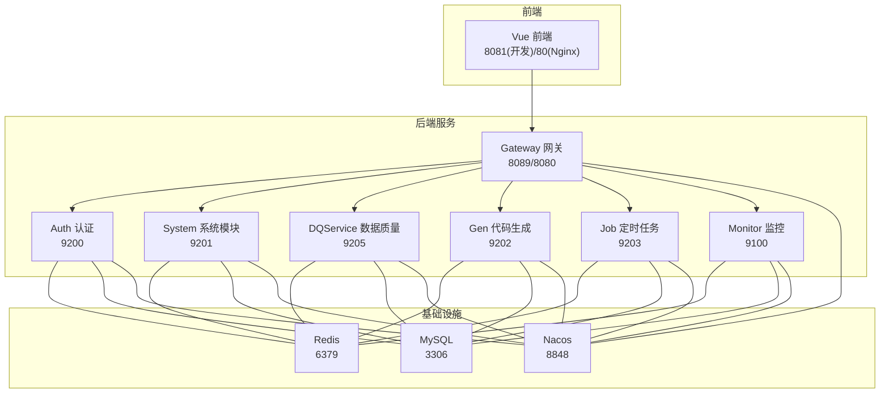
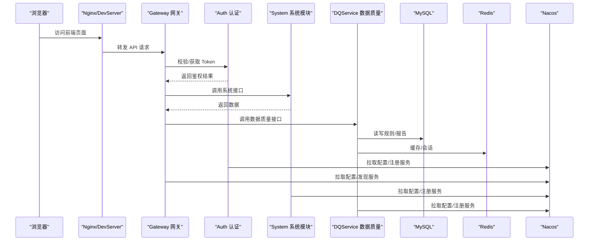
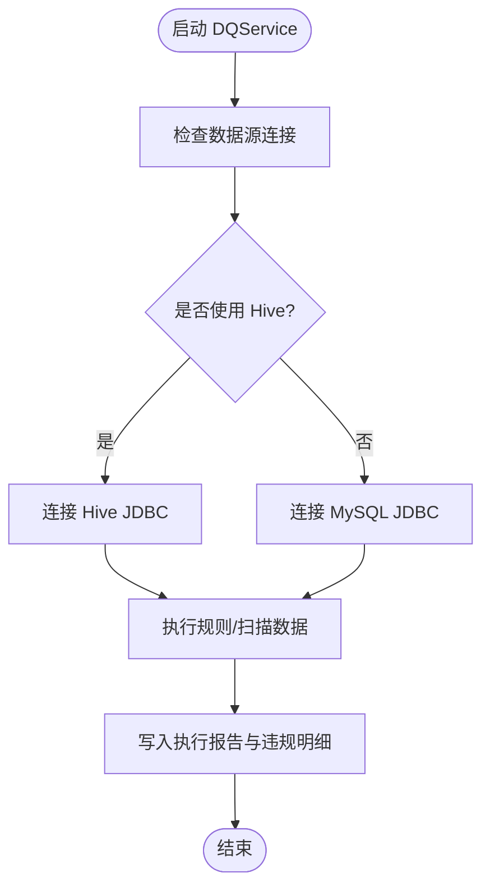
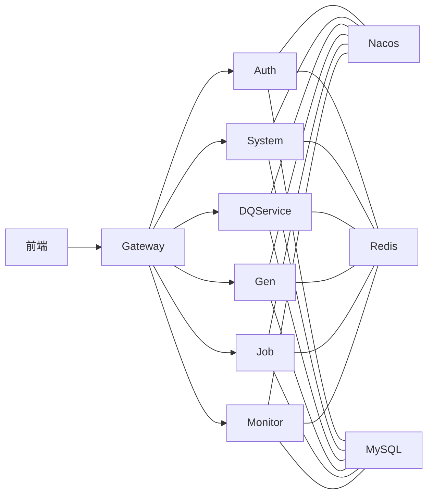

# 快速开始

<cite>
**本文引用的文件**   
- [pom.xml](file://pom.xml)
- [docker-compose.yml](file://docker/docker-compose.yml)
- [application.properties](file://docker/nacos/conf/application.properties)
- [bootstrap.yml（网关）](file://ruoyi-gateway/src/main/resources/bootstrap.yml)
- [bootstrap.yml（认证）](file://ruoyi-auth/src/main/resources/bootstrap.yml)
- [start-backend.ps1](file://bin/start-backend.ps1)
- [start-ui.ps1](file://bin/start-ui.ps1)
- [ry_20210908.sql](file://docker/mysql/db/ry_20210908.sql)
- [quartz.sql](file://sql/quartz.sql)
- [ry_config_20220424.sql](file://sql/ry_config_20220424.sql)
- [ry_dqservice_20261026.sql](file://sql/ry_dqservice_20261026.sql)
- [ry_dq_report_20261026.sql](file://sql/ry_dq_report_20261026.sql)
- [DBUtil.java](file://ruoyi-modules/ruoyi-dqservice/src/main/java/com/ruoyi/dqservice/connecter/DBUtil.java)
</cite>

## 目录
1. [简介](#简介)
2. [项目结构](#项目结构)
3. [核心组件](#核心组件)
4. [架构总览](#架构总览)
5. [详细组件分析](#详细组件分析)
6. [依赖关系分析](#依赖关系分析)
7. [性能与容量建议](#性能与容量建议)
8. [故障排查指南](#故障排查指南)
9. [结论](#结论)
10. [附录：端口与访问地址](#附录端口与访问地址)

## 简介
本指南面向首次接触本项目的开发者与运维人员，目标是帮助你在最短时间内完成环境准备、数据库初始化、服务启动，并成功访问前端页面与基本功能。系统采用微服务架构，包含认证、网关、系统模块、数据质量模块、代码生成、定时任务、监控等子服务；同时提供 Docker 一键部署与传统本地开发两种路径。

## 项目结构
- 后端为 Spring Cloud 微服务，使用 Nacos 作为注册中心与配置中心，MySQL 作为业务与配置存储，Redis 用于缓存与会话。
- 前端基于 Vue，通过 Nginx 或本地 dev server 提供静态资源与反向代理。
- 数据质量模块（dqservice）支持连接 MySQL/Hive 进行规则执行与报告记录。

图表来源
- [docker-compose.yml:1-140](file://docker/docker-compose.yml#L1-L140)
- [bootstrap.yml（网关）:1-44](file://ruoyi-gateway/src/main/resources/bootstrap.yml#L1-L44)
- [bootstrap.yml（认证）:1-26](file://ruoyi-auth/src/main/resources/bootstrap.yml#L1-L26)

章节来源
- [pom.xml:15-42](file://pom.xml#L15-L42)
- [docker-compose.yml:1-140](file://docker/docker-compose.yml#L1-L140)

## 核心组件
- 认证服务（ruoyi-auth）：负责登录、令牌签发与鉴权。
- 网关（ruoyi-gateway）：统一入口、路由转发、限流与跨域。
- 系统模块（ruoyi-system）：用户、角色、菜单、字典等基础能力。
- 数据质量模块（ruoyi-dqservice）：规则管理、数据源管理、执行与报告。
- 代码生成（ruoyi-gen）、定时任务（ruoyi-job）、监控（ruoyi-monitor）。
- 基础设施：Nacos（注册/配置）、MySQL（业务/配置库）、Redis（缓存）。

章节来源
- [docker-compose.yml:1-140](file://docker/docker-compose.yml#L1-L140)
- [bootstrap.yml（网关）:1-44](file://ruoyi-gateway/src/main/resources/bootstrap.yml#L1-L44)
- [bootstrap.yml（认证）:1-26](file://ruoyi-auth/src/main/resources/bootstrap.yml#L1-L26)

## 架构总览
下图展示从浏览器到后端服务的请求链路，以及各服务对中间件的依赖关系。

图表来源
- [bootstrap.yml（网关）:1-44](file://ruoyi-gateway/src/main/resources/bootstrap.yml#L1-L44)
- [bootstrap.yml（认证）:1-26](file://ruoyi-auth/src/main/resources/bootstrap.yml#L1-L26)
- [docker-compose.yml:1-140](file://docker/docker-compose.yml#L1-L140)

## 详细组件分析

### 环境要求
- JDK：Java 8（项目编译与运行目标版本为 1.8）。
- Node.js：建议使用 17+（前端开发脚本中针对 OpenSSL 兼容性做了处理）。
- MySQL：5.7（容器默认），字符集 utf8mb4。
- Redis：任意稳定版（容器默认）。
- Nacos：2.0.4（与客户端版本匹配）。
- Hive（可选）：若需使用 Hive 数据源，请另行安装并保证可连通。

章节来源
- [pom.xml:15-42](file://pom.xml#L15-L42)
- [start-ui.ps1:1-46](file://bin/start-ui.ps1#L1-L46)
- [docker-compose.yml:1-140](file://docker/docker-compose.yml#L1-L140)

### 数据库初始化步骤
- 创建业务库 ry-cloud，导入以下 SQL：
  - 基础表结构与初始数据：[ry_20210908.sql](file://docker/mysql/db/ry_20210908.sql)
  - 定时任务调度表：[quartz.sql](file://sql/quartz.sql)
  - 数据质量模块表结构：[ry_dqservice_20261026.sql](file://sql/ry_dqservice_20261026.sql)
  - 数据质量执行报告表：[ry_dq_report_20261026.sql](file://sql/ry_dq_report_20261026.sql)
- 创建配置库 ry-config，导入 Nacos 配置库脚本：[ry_config_20220424.sql](file://sql/ry_config_20220424.sql)
- 确保 MySQL 字符集为 utf8mb4，时区设置为 +08:00（容器已内置相关参数）。

章节来源
- [ry_20210908.sql:1-200](file://docker/mysql/db/ry_20210908.sql#L1-L200)
- [quartz.sql](file://sql/quartz.sql)
- [ry_dqservice_20261026.sql:1-40](file://sql/ry_dqservice_20261026.sql#L1-L40)
- [ry_dq_report_20261026.sql:1-40](file://sql/ry_dq_report_20261026.sql#L1-L40)
- [ry_config_20220424.sql:34-178](file://sql/ry_config_20220424.sql#L34-L178)

### 传统部署方式（本地开发）
- 启动顺序
  1) 启动 Nacos（单机模式，端口 8848），并确保其能连接到 MySQL（配置库 ry-config）。
     - Nacos 数据源配置参考：[application.properties](file://docker/nacos/conf/application.properties)
  2) 启动 Redis（端口 6379）。
  3) 启动后端服务（PowerShell 脚本自动拉起多个 jar 进程并等待端口就绪）：
     - 命令：powershell -ExecutionPolicy Bypass -File .\bin\start-backend.ps1
     - 脚本会按 auth → system → dqservice → gateway 的顺序启动，并检测端口监听状态。
     - 参考：[start-backend.ps1](file://bin/start-backend.ps1)
  4) 启动前端开发服务器：
     - 命令：powershell -ExecutionPolicy Bypass -File .\bin\start-ui.ps1
     - 默认端口 8081，如被占用可通过参数指定端口。
     - 参考：[start-ui.ps1](file://bin/start-ui.ps1)

- 关键端口
  - Nacos：8848
  - MySQL：3306
  - Redis：6379
  - Gateway：8089（本地开发）/ 8080（容器映射）
  - Auth：9200
  - System：9201
  - DQService：9205
  - Gen：9202
  - Job：9203
  - Monitor：9100
  - 前端 DevServer：8081（可自定义）

章节来源
- [application.properties:1-33](file://docker/nacos/conf/application.properties#L1-L33)
- [start-backend.ps1:1-112](file://bin/start-backend.ps1#L1-L112)
- [start-ui.ps1:1-46](file://bin/start-ui.ps1#L1-L46)

### Docker 一键部署
- 前置条件
  - 安装 Docker 与 docker-compose。
  - 提前准备好 MySQL 的 ry-cloud 与 ry-config 库及对应 SQL（或使用容器内预置数据卷）。
- 启动命令
  - 在项目根目录执行：docker-compose up -d
- 说明
  - compose 会依次拉起 Nacos、MySQL、Redis、Nginx、Gateway、Auth、System、Gen、Job、File、Monitor 等服务。
  - Nacos 使用 standalone 模式，持久化日志与配置挂载到宿主机。
  - MySQL 使用 mysql:5.7，字符集 utf8mb4，时区 +08:00。
  - Nginx 将前端构建产物映射到 /home/ruoyi/projects/ruoyi-ui。
  - 参考：[docker-compose.yml](file://docker/docker-compose.yml)

章节来源
- [docker-compose.yml:1-140](file://docker/docker-compose.yml#L1-L140)

### 数据质量模块（Hive/MySQL）
- 该模块支持连接 MySQL 或 Hive 进行规则执行与报告记录。
- 当前示例代码默认使用 Hive JDBC URL（localhost:10000），如需切换至 MySQL，请修改相应连接参数。
- 参考实现位置：[DBUtil.java](file://ruoyi-modules/ruoyi-dqservice/src/main/java/com/ruoyi/dqservice/connecter/DBUtil.java)

图表来源
- [DBUtil.java:1-33](file://ruoyi-modules/ruoyi-dqservice/src/main/java/com/ruoyi/dqservice/connecter/DBUtil.java#L1-L33)

章节来源
- [DBUtil.java:1-33](file://ruoyi-modules/ruoyi-dqservice/src/main/java/com/ruoyi/dqservice/connecter/DBUtil.java#L1-L33)

## 依赖关系分析
- 服务间依赖
  - Gateway 依赖 Nacos 进行服务发现与配置拉取。
  - Auth/System/DQService/Gen/Job/Monitor 均依赖 Nacos、Redis、MySQL。
- 外部依赖
  - Nacos 依赖 MySQL（配置库 ry-config）。
  - 前端通过 Nginx 或本地 dev server 访问 Gateway。

图表来源
- [docker-compose.yml:1-140](file://docker/docker-compose.yml#L1-L140)
- [bootstrap.yml（网关）:1-44](file://ruoyi-gateway/src/main/resources/bootstrap.yml#L1-L44)
- [bootstrap.yml（认证）:1-26](file://ruoyi-auth/src/main/resources/bootstrap.yml#L1-L26)

章节来源
- [docker-compose.yml:1-140](file://docker/docker-compose.yml#L1-L140)
- [bootstrap.yml（网关）:1-44](file://ruoyi-gateway/src/main/resources/bootstrap.yml#L1-L44)
- [bootstrap.yml（认证）:1-26](file://ruoyi-auth/src/main/resources/bootstrap.yml#L1-L26)

## 性能与容量建议
- MySQL
  - 容器默认 innodb-buffer-pool-size=80M，开发环境足够；生产建议根据内存适当调大。
  - 字符集与排序规则使用 utf8mb4，避免中文乱码。
- Redis
  - 建议开启持久化与内存淘汰策略，避免 OOM。
- Nacos
  - 单机模式适合开发与测试；生产建议集群部署并启用鉴权。
- JVM
  - 脚本默认堆大小 Xms512m/Xmx1024m，可根据机器内存调整。

章节来源
- [docker-compose.yml:1-140](file://docker/docker-compose.yml#L1-L140)
- [start-backend.ps1:86-90](file://bin/start-backend.ps1#L86-L90)

## 故障排查指南
- Nacos 无法连接 MySQL
  - 检查 Nacos 数据源配置（数据库地址、用户名、密码、库名 ry-config）。
  - 确认 MySQL 已启动且端口 3306 可达。
  - 参考：[application.properties](file://docker/nacos/conf/application.properties)
- 服务启动后端口未监听
  - 使用 PowerShell 脚本查看日志 logs/*.out.log 与 *.err.log。
  - 确认端口未被占用，必要时更换端口或停止冲突进程。
  - 参考：[start-backend.ps1](file://bin/start-backend.ps1)
- 前端启动报错（OpenSSL/EVP）
  - 使用提供的 start-ui.ps1 脚本，已设置兼容参数。
  - 若手动 npm run dev，请确保 Node 版本与 OpenSSL 兼容。
  - 参考：[start-ui.ps1](file://bin/start-ui.ps1)
- 数据质量模块连接失败
  - 确认 Hive/MySQL 服务可用，JDBC URL、用户名、密码正确。
  - 若使用 Hive，确保 HiveServer2 已启动并可访问 localhost:10000。
  - 参考：[DBUtil.java](file://ruoyi-modules/ruoyi-dqservice/src/main/java/com/ruoyi/dqservice/connecter/DBUtil.java)

章节来源
- [application.properties:1-33](file://docker/nacos/conf/application.properties#L1-L33)
- [start-backend.ps1:1-112](file://bin/start-backend.ps1#L1-L112)
- [start-ui.ps1:1-46](file://bin/start-ui.ps1#L1-L46)
- [DBUtil.java:1-33](file://ruoyi-modules/ruoyi-dqservice/src/main/java/com/ruoyi/dqservice/connecter/DBUtil.java#L1-L33)

## 结论
按照本指南完成环境准备、数据库初始化与服务启动后，即可在本地或容器中运行完整的数据质量平台。推荐使用 Docker 一键部署以最小化环境差异；本地开发则可使用 PowerShell 脚本快速拉起前后端服务。如遇问题，优先检查 Nacos/MySQL/Redis 的连接与端口，再结合日志定位具体原因。

## 附录：端口与访问地址
- Nacos 控制台：http://localhost:8848/nacos
- 网关（本地开发）：http://localhost:8089
- 网关（容器）：http://localhost:8080
- 前端（本地开发）：http://localhost:8081
- 前端（Nginx 容器）：http://localhost
- 监控（Admin）：http://localhost:9100/login

章节来源
- [docker-compose.yml:1-140](file://docker/docker-compose.yml#L1-L140)
- [bootstrap.yml（网关）:1-44](file://ruoyi-gateway/src/main/resources/bootstrap.yml#L1-L44)
- [bootstrap.yml（认证）:1-26](file://ruoyi-auth/src/main/resources/bootstrap.yml#L1-L26)