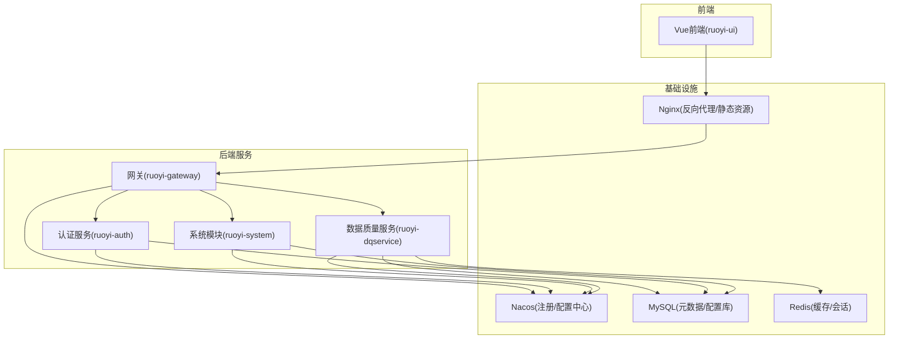
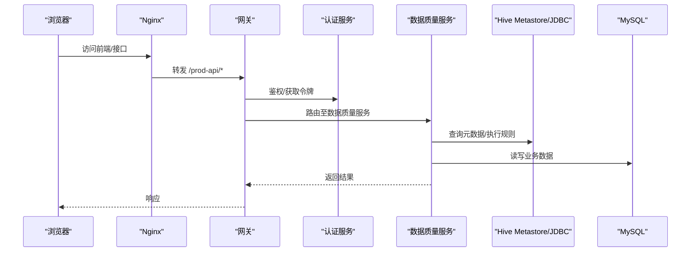
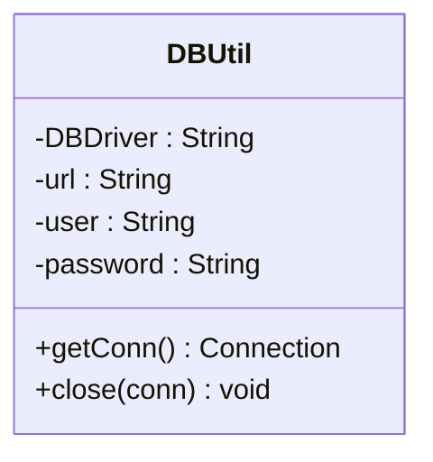
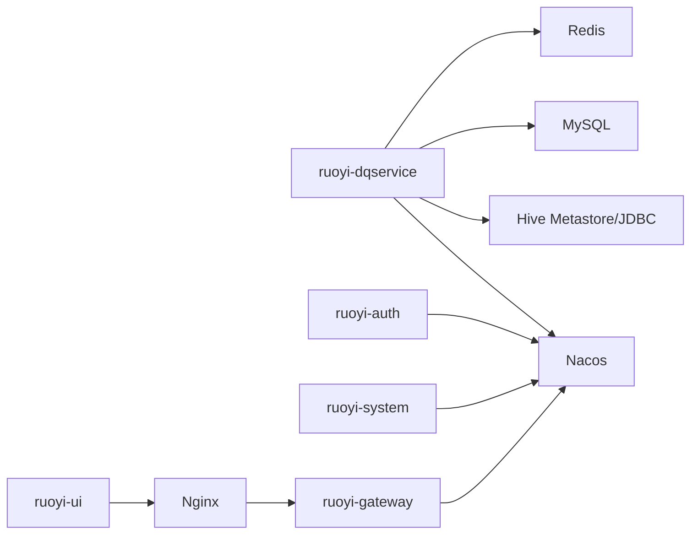
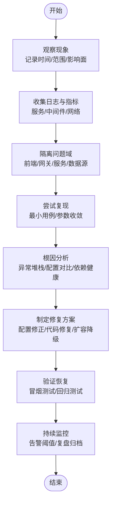

# 故障排除

<cite>
**本文引用的文件**   
- [README.md](file://README.md)
- [bootstrap.yml](file://ruoyi-modules/ruoyi-dqservice/src/main/resources/bootstrap.yml)
- [application.properties](file://ruoyi-modules/ruoyi-dqservice/src/main/resources/application.properties)
- [logback.xml](file://ruoyi-modules/ruoyi-dqservice/src/main/resources/logback.xml)
- [DBUtil.java](file://ruoyi-modules/ruoyi-dqservice/src/main/java/com/ruoyi/dqservice/connecter/DBUtil.java)
- [SysLoginService.java](file://ruoyi-auth/src/main/java/com/ruoyi/auth/service/SysLoginService.java)
- [application.properties](file://docker/nacos/conf/application.properties)
- [nginx.conf](file://docker/nginx/conf/nginx.conf)
- [redis.conf](file://docker/redis/conf/redis.conf)
</cite>

## 目录
1. [简介](#简介)
2. [项目结构](#项目结构)
3. [核心组件](#核心组件)
4. [架构总览](#架构总览)
5. [详细组件分析](#详细组件分析)
6. [依赖关系分析](#依赖关系分析)
7. [性能考虑](#性能考虑)
8. [故障排除指南](#故障排除指南)
9. [结论](#结论)
10. [附录](#附录)

## 简介
本故障排除文档面向生产运维与研发人员，聚焦环境配置、服务启动、数据库连接、规则执行等典型问题，提供日志分析方法、性能诊断思路与监控指标解读，并给出标准化的定位流程与处理建议。目标是在最短时间内恢复业务可用性，降低影响面。

## 项目结构
本项目为微服务架构，包含认证网关、系统模块、数据质量服务（dqservice）以及前端工程；基础设施包括 Nacos、MySQL、Redis、Nginx。关键运行配置集中在各服务的 bootstrap.yml、application.properties 与 logback.xml，以及 docker 下的中间件配置。

图示来源
- [bootstrap.yml:13-25](file://ruoyi-modules/ruoyi-dqservice/src/main/resources/bootstrap.yml#L13-L25)
- [nginx.conf:13-29](file://docker/nginx/conf/nginx.conf#L13-L29)

章节来源
- [README.md:1-1](file://README.md#L1-L1)

## 核心组件
- 数据质量服务（ruoyi-dqservice）：负责数据质量规则执行与结果上报，依赖 Hive Metastore/Hive JDBC 与外部数据库。
- 认证服务（ruoyi-auth）：用户登录、令牌签发与校验。
- 网关（ruoyi-gateway）：统一入口、鉴权过滤、路由转发。
- 系统模块（ruoyi-system）：基础字典、组织、权限等能力。
- 基础设施：Nacos（服务发现与配置）、MySQL（持久化）、Redis（缓存与会话）、Nginx（反向代理与静态资源）。

章节来源
- [bootstrap.yml:1-25](file://ruoyi-modules/ruoyi-dqservice/src/main/resources/bootstrap.yml#L1-L25)
- [application.properties:1-14](file://ruoyi-modules/ruoyi-dqservice/src/main/resources/application.properties#L1-L14)

## 架构总览
下图展示请求从浏览器到后端的完整链路，以及 dqservice 对 Hive/MySQL 的访问路径。

图示来源
- [nginx.conf:17-29](file://docker/nginx/conf/nginx.conf#L17-L29)
- [bootstrap.yml:13-25](file://ruoyi-modules/ruoyi-dqservice/src/main/resources/bootstrap.yml#L13-L25)
- [application.properties:1-14](file://ruoyi-modules/ruoyi-dqservice/src/main/resources/application.properties#L1-L14)

## 详细组件分析

### 数据质量服务（ruoyi-dqservice）
- 启动端口与注册配置：通过 bootstrap.yml 指定应用名、端口、Nacos 地址与共享配置。
- Hive 连接：application.properties 定义 Hive Metastore URI、JDBC URL 与 Kerberos 开关；DBUtil 中硬编码了 Hive JDBC 驱动与默认连接参数。
- 日志输出：logback.xml 将 INFO/ERROR 分别输出到 info.log/error.log，并按日滚动保留 60 天。

图示来源
- [DBUtil.java:7-32](file://ruoyi-modules/ruoyi-dqservice/src/main/java/com/ruoyi/dqservice/connecter/DBUtil.java#L7-L32)

章节来源
- [bootstrap.yml:1-25](file://ruoyi-modules/ruoyi-dqservice/src/main/resources/bootstrap.yml#L1-L25)
- [application.properties:1-14](file://ruoyi-modules/ruoyi-dqservice/src/main/resources/application.properties#L1-L14)
- [logback.xml:1-75](file://ruoyi-modules/ruoyi-dqservice/src/main/resources/logback.xml#L1-L75)
- [DBUtil.java:1-33](file://ruoyi-modules/ruoyi-dqservice/src/main/java/com/ruoyi/dqservice/connecter/DBUtil.java#L1-L33)

### 认证服务（ruoyi-auth）
- 登录逻辑抛出多种 ServiceException，涵盖必填校验、长度校验、账号状态异常等场景，便于上层统一捕获与提示。

章节来源
- [SysLoginService.java:10-129](file://ruoyi-auth/src/main/java/com/ruoyi/auth/service/SysLoginService.java#L10-L129)

### 网关（ruoyi-gateway）
- 作为统一入口，承载验证码、XSS、黑名单等过滤器，并将 /prod-api 转发至后端服务。

章节来源
- [nginx.conf:13-29](file://docker/nginx/conf/nginx.conf#L13-L29)

### 基础设施（Nacos/MySQL/Redis/Nginx）
- Nacos：使用 MySQL 存储配置，暴露 actuator 端点，关闭认证（生产需开启），Token 过期时间与安全密钥可配置。
- Redis：默认未启用密码（注释掉 requirepass），需根据部署策略决定是否启用。
- Nginx：静态资源根目录与后端网关反向代理路径已配置。

章节来源
- [application.properties:1-33](file://docker/nacos/conf/application.properties#L1-L33)
- [redis.conf:1-1](file://docker/redis/conf/redis.conf#L1-L1)
- [nginx.conf:1-36](file://docker/nginx/conf/nginx.conf#L1-L36)

## 依赖关系分析
- dqservice 依赖 Nacos 进行服务注册与配置拉取，依赖 Hive Metastore/JDBC 进行元数据访问与规则执行，依赖 MySQL/Redis 进行业务数据存储与缓存。
- auth/system/gateway 均依赖 Nacos 完成服务发现与配置管理。
- Nginx 仅承担反向代理与静态资源托管职责。

图示来源
- [bootstrap.yml:13-25](file://ruoyi-modules/ruoyi-dqservice/src/main/resources/bootstrap.yml#L13-L25)
- [application.properties:1-14](file://ruoyi-modules/ruoyi-dqservice/src/main/resources/application.properties#L1-L14)
- [nginx.conf:17-29](file://docker/nginx/conf/nginx.conf#L17-L29)

## 性能考虑
- 连接池与重试：Hive Metastore 的重试次数与间隔已在 application.properties 中配置，可根据集群规模调优。
- 日志滚动：按日滚动且保留 60 天，注意磁盘容量规划。
- 网关与代理：Nginx keepalive 与 worker_connections 需结合并发量评估。
- 缓存与限流：Redis 是否启用密码与连接数限制需与业务峰值匹配。

[本节为通用指导，不直接分析具体文件]

## 故障排除指南

### 一、常见问题分类与快速定位

#### 1. 环境配置问题
- 症状
  - 服务无法启动或启动后立即退出。
  - 前端页面无法加载或接口 404/502。
- 可能原因
  - Nacos 地址不可达或配置未生效。
  - Nginx 静态资源路径或反向代理路径错误。
  - Redis/Mysql 连接信息不正确或未启动。
- 排查步骤
  - 检查 bootstrap.yml 中的 Nacos server-addr 与 file-extension。
  - 检查 nginx.conf 的 location / 与 /prod-api 指向是否正确。
  - 检查 docker 下 nacos/mysql/redis 容器状态与端口映射。
- 处理建议
  - 修正 Nacos 地址与共享配置命名。
  - 确保 Nginx 静态资源目录存在且可读。
  - 确认中间件服务健康，必要时重启对应容器。

章节来源
- [bootstrap.yml:13-25](file://ruoyi-modules/ruoyi-dqservice/src/main/resources/bootstrap.yml#L13-L25)
- [nginx.conf:13-29](file://docker/nginx/conf/nginx.conf#L13-L29)

#### 2. 服务启动失败
- 症状
  - 控制台报 Nacos 连接异常、配置拉取失败。
  - 端口占用或 Tomcat 启动失败。
- 可能原因
  - Nacos 未启动或网络不通。
  - 端口冲突（如 9205 被占用）。
  - 共享配置文件不存在或格式错误。
- 排查步骤
  - 查看服务日志（info.log/error.log）中关于 Nacos 的连接与配置加载错误。
  - 本地/容器内 curl 测试 Nacos 健康端点。
  - 检查端口占用情况。
- 处理建议
  - 启动 Nacos 并确保可达。
  - 修改服务端口或释放占用端口。
  - 修正共享配置命名与内容。

章节来源
- [bootstrap.yml:1-25](file://ruoyi-modules/ruoyi-dqservice/src/main/resources/bootstrap.yml#L1-L25)
- [logback.xml:1-75](file://ruoyi-modules/ruoyi-dqservice/src/main/resources/logback.xml#L1-L75)

#### 3. 数据库连接异常（Hive/MySQL）
- 症状
  - 规则执行失败，日志中出现连接超时/拒绝连接。
  - Hive Metastore 查询元数据失败。
- 可能原因
  - Hive Metastore 未启动或 thrift 端口不通。
  - Hive JDBC URL 或驱动类名配置错误。
  - DBUtil 中硬编码的连接参数与实际不一致。
- 排查步骤
  - 检查 application.properties 中 hive.metastore.uris 与 hive.jdbc.url。
  - 验证 HiveServer2 与 Metastore 服务状态。
  - 核对 DBUtil 中的驱动类与默认连接参数。
- 处理建议
  - 修正 Metastore 地址与 JDBC URL。
  - 将硬编码参数迁移至配置中心，避免多环境差异。
  - 增加连接重试与超时控制。

章节来源
- [application.properties:1-14](file://ruoyi-modules/ruoyi-dqservice/src/main/resources/application.properties#L1-L14)
- [DBUtil.java:7-32](file://ruoyi-modules/ruoyi-dqservice/src/main/java/com/ruoyi/dqservice/connecter/DBUtil.java#L7-L32)

#### 4. 规则执行错误
- 症状
  - 任务调度成功但规则执行失败，返回错误码或空结果。
- 可能原因
  - 上游数据源不可用或权限不足。
  - Hive 元数据缺失或表结构变更未同步。
  - 规则脚本或 SQL 语法错误。
- 排查步骤
  - 查看 dqservice 的 error.log，定位具体异常堆栈。
  - 在 Hive Metastore 中验证目标库表是否存在。
  - 复现规则执行，收集输入参数与执行上下文。
- 处理建议
  - 修复数据源权限与连通性。
  - 同步元数据或重建分区。
  - 修正规则脚本，增加参数校验与异常兜底。

章节来源
- [logback.xml:1-75](file://ruoyi-modules/ruoyi-dqservice/src/main/resources/logback.xml#L1-L75)

#### 5. 认证与网关相关问题
- 症状
  - 登录失败、验证码错误或接口鉴权失败。
  - 前端能打开但 API 调用 401/403。
- 可能原因
  - 认证服务异常或用户状态异常。
  - 网关过滤器拦截（验证码/XSS/黑名单）。
  - 前端请求路径或跨域配置错误。
- 排查步骤
  - 检查 SysLoginService 抛出的业务异常类型与消息。
  - 查看网关日志与 Nginx 访问日志，确认请求是否到达后端。
  - 校验前端代理路径与后端路由一致。
- 处理建议
  - 修复用户状态或重置密码。
  - 调整网关过滤器白名单。
  - 修正前端代理与后端路由映射。

章节来源
- [SysLoginService.java:10-129](file://ruoyi-auth/src/main/java/com/ruoyi/auth/service/SysLoginService.java#L10-L129)
- [nginx.conf:17-29](file://docker/nginx/conf/nginx.conf#L17-L29)

### 二、日志分析方法
- 日志位置
  - dqservice：logs/ruoyi-dqservice/info.log 与 error.log。
  - Nacos：docker/nacos/logs 下的各类日志。
  - Nginx：容器内访问日志与错误页。
- 关键字段
  - 线程名、级别、类名、方法行号、消息体。
  - 异常堆栈、SQL 语句、HTTP 状态码。
- 分析技巧
  - 先查 error.log 中的 ERROR 级别日志，再回溯 info.log 上下文。
  - 结合时间戳与请求 ID 关联前后日志。
  - 针对 Hive/MySQL 连接异常，关注超时、拒绝连接、认证失败等关键词。

章节来源
- [logback.xml:1-75](file://ruoyi-modules/ruoyi-dqservice/src/main/resources/logback.xml#L1-L75)

### 三、性能诊断工具与监控指标
- JVM 与 GC
  - 观察 GC 日志与内存使用趋势，识别 Full GC 频繁与 OOM 风险。
- 数据库
  - 监控连接池使用率、慢查询、锁等待与死锁。
- 缓存
  - 监控 Redis 命中率、内存使用与键空间分布。
- 网关与代理
  - 监控 Nginx 连接数、吞吐与 5xx 比例。
- 服务注册与配置
  - 监控 Nacos 客户端心跳与配置拉取成功率。

[本节为通用指导，不直接分析具体文件]

### 四、问题定位思路与处理流程

[该图为概念流程图，无需图示来源]

## 结论
通过对环境配置、服务启动、数据库连接与规则执行的系统性排查，结合日志分析与监控指标，能够快速定位并解决生产环境问题。建议在上线前完善配置中心化管理、增强连接重试与熔断降级、完善日志规范与告警策略，以提升系统的可观测性与稳定性。

[本节为总结性内容，不直接分析具体文件]

## 附录
- 常用命令
  - 查看服务日志：tail -f logs/ruoyi-dqservice/error.log
  - 检查 Nacos 健康：curl http://nacos-host:8848/nacos/v1/console/health
  - 检查 Nginx 配置：nginx -t
- 参考配置
  - Nacos 配置中心：docker/nacos/conf/application.properties
  - Redis 安全：docker/redis/conf/redis.conf
  - Nginx 反向代理：docker/nginx/conf/nginx.conf

章节来源
- [application.properties:1-33](file://docker/nacos/conf/application.properties#L1-L33)
- [redis.conf:1-1](file://docker/redis/conf/redis.conf#L1-L1)
- [nginx.conf:1-36](file://docker/nginx/conf/nginx.conf#L1-L36)