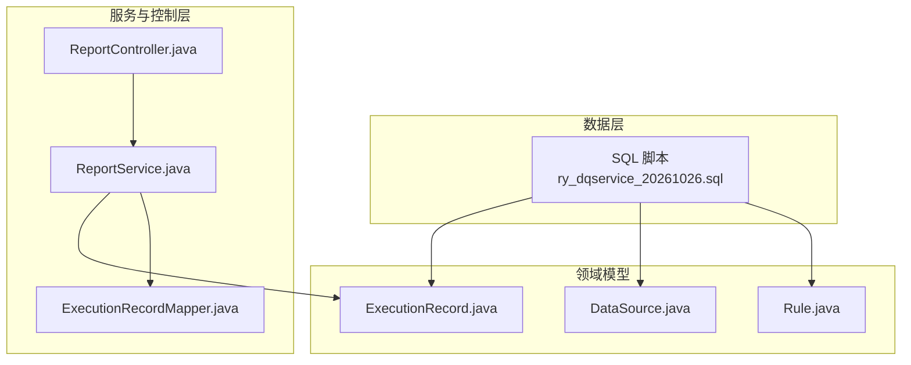
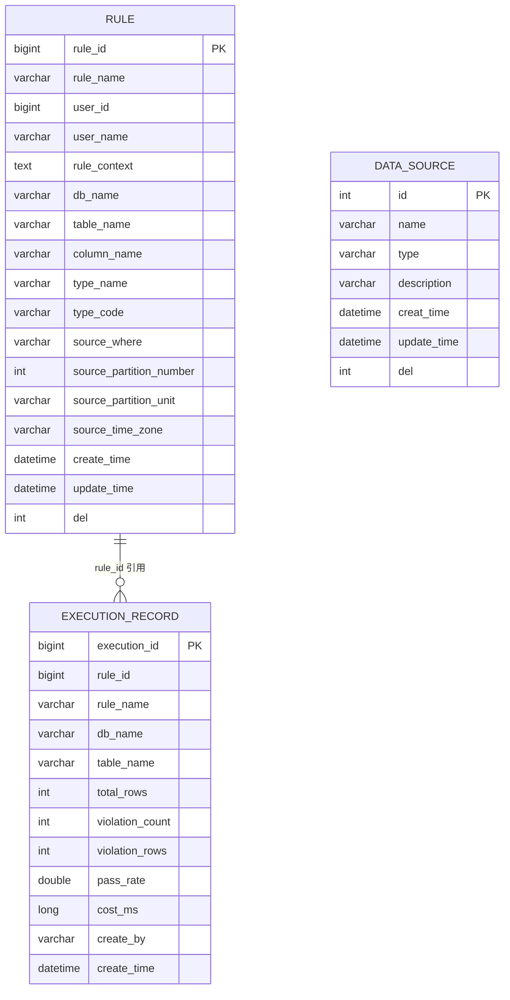
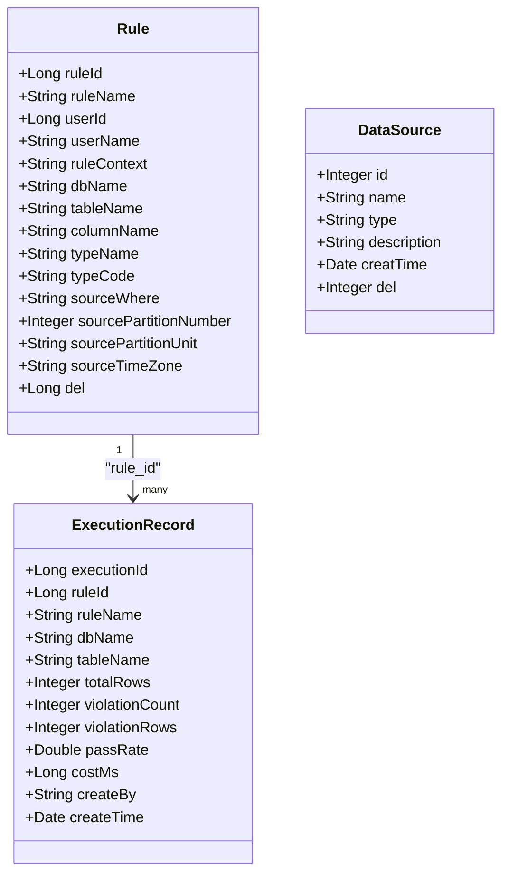
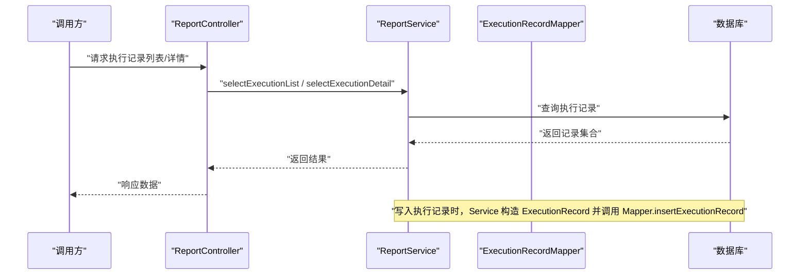
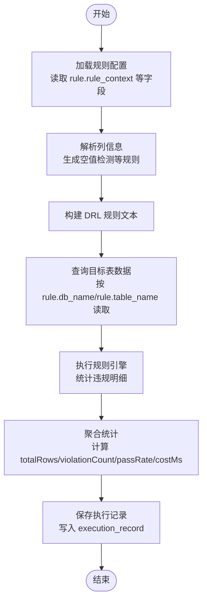
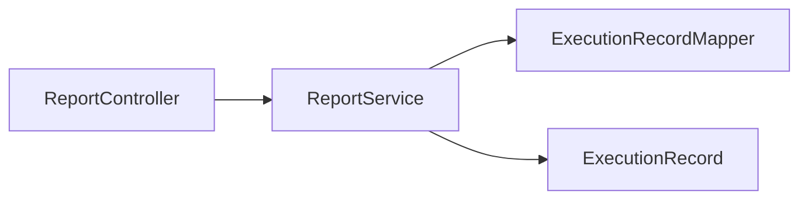

# 实体关系设计

<cite>
**本文引用的文件**   
- [ry_dqservice_20261026.sql](file://sql/ry_dqservice_20261026.sql)
- [Rule.java](file://ruoyi-modules/ruoyi-dqservice/src/main/java/com/ruoyi/dqservice/domain/Rule.java)
- [DataSource.java](file://ruoyi-modules/ruoyi-dqservice/src/main/java/com/ruoyi/dqservice/domain/DataSource.java)
- [ExecutionRecord.java](file://ruoyi-modules/ruoyi-dqservice/src/main/java/com/ruoyi/dqservice/domain/ExecutionRecord.java)
- [RuleMapper.xml](file://ruoyi-modules/ruoyi-dqservice/src/main/resources/mapper/dqservice/RuleMapper.xml)
- [ReportController.java](file://ruoyi-modules/ruoyi-dqservice/src/main/java/com/ruoyi/dqservice/controller/ReportController.java)
- [ReportService.java](file://ruoyi-modules/ruoyi-dqservice/src/main/java/com/ruoyi/dqservice/service/ReportService.java)
- [ExecutionRecordMapper.java](file://ruoyi-modules/ruoyi-dqservice/src/main/java/com/ruoyi/dqservice/mapper/ExecutionRecordMapper.java)
</cite>

## 目录
1. [引言](#引言)
2. [项目结构](#项目结构)
3. [核心实体](#核心实体)
4. [架构总览](#架构总览)
5. [详细组件分析](#详细组件分析)
6. [依赖关系分析](#依赖关系分析)
7. [性能与一致性](#性能与一致性)
8. [故障排查指南](#故障排查指南)
9. [结论](#结论)

## 引言
本文件聚焦数据质量模块的实体关系设计，围绕 rule、data_source、execution_record 三个核心实体展开，说明表间关联、外键约束、数据完整性约束与业务规则，并给出 ER 图、类图、时序图与流程图等可视化表达。文档同时解释一对多、多对一等关系的实现方式，以及数据一致性与级联操作的处理策略。

## 项目结构
数据质量相关的数据模型定义在 SQL 脚本中，Java 领域对象位于 dqservice 模块的 domain 包下，执行记录通过 ReportService 写入数据库，并通过 ReportController 对外暴露查询接口。

图表来源
- [ry_dqservice_20261026.sql:1-40](file://sql/ry_dqservice_20261026.sql#L1-L40)
- [Rule.java:1-87](file://ruoyi-modules/ruoyi-dqservice/src/main/java/com/ruoyi/dqservice/domain/Rule.java#L1-L87)
- [DataSource.java:1-111](file://ruoyi-modules/ruoyi-dqservice/src/main/java/com/ruoyi/dqservice/domain/DataSource.java#L1-L111)
- [ExecutionRecord.java:1-74](file://ruoyi-modules/ruoyi-dqservice/src/main/java/com/ruoyi/dqservice/domain/ExecutionRecord.java#L1-L74)
- [ReportController.java:1-40](file://ruoyi-modules/ruoyi-dqservice/src/main/java/com/ruoyi/dqservice/controller/ReportController.java#L1-L40)
- [ReportService.java:1-150](file://ruoyi-modules/ruoyi-dqservice/src/main/java/com/ruoyi/dqservice/service/ReportService.java#L1-L150)
- [ExecutionRecordMapper.java:1-24](file://ruoyi-modules/ruoyi-dqservice/src/main/java/com/ruoyi/dqservice/mapper/ExecutionRecordMapper.java#L1-L24)

章节来源
- [ry_dqservice_20261026.sql:1-40](file://sql/ry_dqservice_20261026.sql#L1-L40)
- [Rule.java:1-87](file://ruoyi-modules/ruoyi-dqservice/src/main/java/com/ruoyi/dqservice/domain/Rule.java#L1-L87)
- [DataSource.java:1-111](file://ruoyi-modules/ruoyi-dqservice/src/main/java/com/ruoyi/dqservice/domain/DataSource.java#L1-L111)
- [ExecutionRecord.java:1-74](file://ruoyi-modules/ruoyi-dqservice/src/main/java/com/ruoyi/dqservice/domain/ExecutionRecord.java#L1-L74)
- [ReportController.java:1-40](file://ruoyi-modules/ruoyi-dqservice/src/main/java/com/ruoyi/dqservice/controller/ReportController.java#L1-L40)
- [ReportService.java:1-150](file://ruoyi-modules/ruoyi-dqservice/src/main/java/com/ruoyi/dqservice/service/ReportService.java#L1-L150)
- [ExecutionRecordMapper.java:1-24](file://ruoyi-modules/ruoyi-dqservice/src/main/java/com/ruoyi/dqservice/mapper/ExecutionRecordMapper.java#L1-L24)

## 核心实体
本节梳理 rule、data_source、execution_record 的核心字段、主键与业务含义，并说明它们之间的逻辑关系。

- rule（数据质量规则）
  - 主键：rule_id
  - 关键字段：rule_name、user_id、user_name、rule_context、db_name、table_name、column_name、type_name、type_code、source_where、source_partition_number、source_partition_unit、source_time_zone、create_time、update_time、del
  - 业务含义：描述一条数据质量检查规则及其目标库表、过滤条件、分区与时区等元信息。

- data_source（数据源）
  - 主键：id
  - 关键字段：name、type、description、creat_time、update_time、del
  - 业务含义：描述一个可被规则访问的外部数据源（如 MySQL、Hive 等）。

- execution_record（执行记录）
  - 主键：execution_id
  - 关键字段：rule_id、rule_name、db_name、table_name、total_rows、violation_count、violation_rows、pass_rate、cost_ms、create_by、create_time
  - 业务含义：记录一次规则执行的汇总结果，包括扫描行数、违规条数、通过率、耗时等。

章节来源
- [ry_dqservice_20261026.sql:7-27](file://sql/ry_dqservice_20261026.sql#L7-L27)
- [ry_dqservice_20261026.sql:29-39](file://sql/ry_dqservice_20261026.sql#L29-L39)
- [ExecutionRecord.java:1-74](file://ruoyi-modules/ruoyi-dqservice/src/main/java/com/ruoyi/dqservice/domain/ExecutionRecord.java#L1-L74)

## 架构总览
下图展示规则、数据源与执行记录之间的关系，以及它们在系统中的职责分工。

图表来源
- [ry_dqservice_20261026.sql:7-27](file://sql/ry_dqservice_20261026.sql#L7-L27)
- [ry_dqservice_20261026.sql:29-39](file://sql/ry_dqservice_20261026.sql#L29-L39)
- [ExecutionRecord.java:1-74](file://ruoyi-modules/ruoyi-dqservice/src/main/java/com/ruoyi/dqservice/domain/ExecutionRecord.java#L1-L74)

## 详细组件分析

### 实体关系与约束
- rule 与 execution_record
  - 关系类型：一对多（一个规则对应多次执行记录）
  - 实现方式：execution_record.rule_id 作为逻辑外键引用 rule.rule_id
  - 约束说明：当前 DDL 未显式声明数据库级外键约束；数据一致性由应用层保证（插入前校验 rule_id 存在）
  - 业务规则：每次规则执行生成一条 execution_record，包含统计指标与时间戳

- data_source 与 rule
  - 关系类型：逻辑关联（规则通过 db_name/table_name 指向目标表，数据源通过 type/name 提供连接能力）
  - 实现方式：未在 DDL 中建立外键；建议在应用层维护“规则-数据源”映射或扩展 rule.source_data_source_id 以形成强约束
  - 建议：若需严格一致性，可在 rule 表中增加 source_data_source_id 字段并建立外键至 data_source.id

- data_source 与 execution_record
  - 关系类型：间接关联（通过 rule 的 db_name/table_name 与 data_source 的类型/名称进行匹配）
  - 实现方式：无直接外键；建议在报表查询时按 db_name 与 data_source.type/name 进行关联展示

章节来源
- [ry_dqservice_20261026.sql:7-27](file://sql/ry_dqservice_20261026.sql#L7-L27)
- [ry_dqservice_20261026.sql:29-39](file://sql/ry_dqservice_20261026.sql#L29-L39)
- [ExecutionRecord.java:1-74](file://ruoyi-modules/ruoyi-dqservice/src/main/java/com/ruoyi/dqservice/domain/ExecutionRecord.java#L1-L74)

### 类图：领域模型与关系

图表来源
- [Rule.java:1-87](file://ruoyi-modules/ruoyi-dqservice/src/main/java/com/ruoyi/dqservice/domain/Rule.java#L1-L87)
- [DataSource.java:1-111](file://ruoyi-modules/ruoyi-dqservice/src/main/java/com/ruoyi/dqservice/domain/DataSource.java#L1-L111)
- [ExecutionRecord.java:1-74](file://ruoyi-modules/ruoyi-dqservice/src/main/java/com/ruoyi/dqservice/domain/ExecutionRecord.java#L1-L74)

### 执行记录的写入流程（时序图）

图表来源
- [ReportController.java:1-40](file://ruoyi-modules/ruoyi-dqservice/src/main/java/com/ruoyi/dqservice/controller/ReportController.java#L1-L40)
- [ReportService.java:1-150](file://ruoyi-modules/ruoyi-dqservice/src/main/java/com/ruoyi/dqservice/service/ReportService.java#L1-L150)
- [ExecutionRecordMapper.java:1-24](file://ruoyi-modules/ruoyi-dqservice/src/main/java/com/ruoyi/dqservice/mapper/ExecutionRecordMapper.java#L1-L24)

### 规则解析与执行（流程图）

图表来源
- [RuleMapper.xml:45-70](file://ruoyi-modules/ruoyi-dqservice/src/main/resources/mapper/dqservice/RuleMapper.xml#L45-L70)
- [ExecutionRecord.java:1-74](file://ruoyi-modules/ruoyi-dqservice/src/main/java/com/ruoyi/dqservice/domain/ExecutionRecord.java#L1-L74)

## 依赖关系分析
- 代码层面依赖
  - ReportController 依赖 ReportService 提供执行记录的查询能力
  - ReportService 依赖 ExecutionRecordMapper 完成持久化操作
  - ExecutionRecord 作为领域模型承载执行结果

图表来源
- [ReportController.java:1-40](file://ruoyi-modules/ruoyi-dqservice/src/main/java/com/ruoyi/dqservice/controller/ReportController.java#L1-L40)
- [ReportService.java:1-150](file://ruoyi-modules/ruoyi-dqservice/src/main/java/com/ruoyi/dqservice/service/ReportService.java#L1-L150)
- [ExecutionRecordMapper.java:1-24](file://ruoyi-modules/ruoyi-dqservice/src/main/java/com/ruoyi/dqservice/mapper/ExecutionRecordMapper.java#L1-L24)
- [ExecutionRecord.java:1-74](file://ruoyi-modules/ruoyi-dqservice/src/main/java/com/ruoyi/dqservice/domain/ExecutionRecord.java#L1-L74)

章节来源
- [ReportController.java:1-40](file://ruoyi-modules/ruoyi-dqservice/src/main/java/com/ruoyi/dqservice/controller/ReportController.java#L1-L40)
- [ReportService.java:1-150](file://ruoyi-modules/ruoyi-dqservice/src/main/java/com/ruoyi/dqservice/service/ReportService.java#L1-L150)
- [ExecutionRecordMapper.java:1-24](file://ruoyi-modules/ruoyi-dqservice/src/main/java/com/ruoyi/dqservice/mapper/ExecutionRecordMapper.java#L1-L24)
- [ExecutionRecord.java:1-74](file://ruoyi-modules/ruoyi-dqservice/src/main/java/com/ruoyi/dqservice/domain/ExecutionRecord.java#L1-L74)

## 性能与一致性
- 索引与查询优化
  - 建议在 execution_record.rule_id 上建立索引，以提升按规则维度查询的性能
  - 对 rule.db_name、rule.table_name 建立复合索引，有助于定位规则对应的目标表范围

- 数据一致性保障
  - 当前 DDL 未使用数据库外键约束，建议在应用层进行一致性校验：
    - 插入 execution_record 前校验 rule_id 是否存在于 rule 表
    - 删除 rule 前检查是否仍有 execution_record 引用该 rule_id，必要时拒绝删除或先清理历史执行记录
  - 软删除策略：rule 与 data_source 均含 del 字段，建议在查询与更新时统一过滤 del=0 的记录

- 级联操作处理
  - 由于未启用数据库级联删除，建议在业务层实现：
    - 删除 rule 时，级联清理其所有 execution_record
    - 修改 data_source 名称或类型时，同步更新规则与报表展示中的显示字段（如 rule_name、rule.db_name 等）

[本节为通用指导，不直接分析具体文件]

## 故障排查指南
- 执行记录为空或统计异常
  - 检查 rule.rule_context 是否正确生成 DRL
  - 确认 rule.db_name/rule.table_name 是否有效且可访问
  - 核对 execution_record.total_rows、violation_count、pass_rate 的计算逻辑

- 规则与数据源不一致
  - 检查 rule 的目标库表与 data_source 的配置是否匹配
  - 建议在应用层增加“规则-数据源”映射校验，避免运行时连接失败

- 查询性能问题
  - 检查 execution_record.rule_id 是否有索引
  - 评估报表查询是否需要对 rule.db_name/rule.table_name 进行预聚合

章节来源
- [ExecutionRecord.java:1-74](file://ruoyi-modules/ruoyi-dqservice/src/main/java/com/ruoyi/dqservice/domain/ExecutionRecord.java#L1-L74)
- [ReportService.java:1-150](file://ruoyi-modules/ruoyi-dqservice/src/main/java/com/ruoyi/dqservice/service/ReportService.java#L1-L150)

## 结论
- rule 与 execution_record 是一对多关系，通过 rule_id 建立逻辑外键；当前 DDL 未声明数据库级外键，一致性由应用层保证。
- data_source 与 rule 为逻辑关联，建议在应用层维护映射或在 rule 中引入 source_data_source_id 以增强约束。
- 建议在关键查询字段建立索引，并在业务层实现删除时的级联清理与一致性校验，确保数据质量模块的稳定与高效运行。