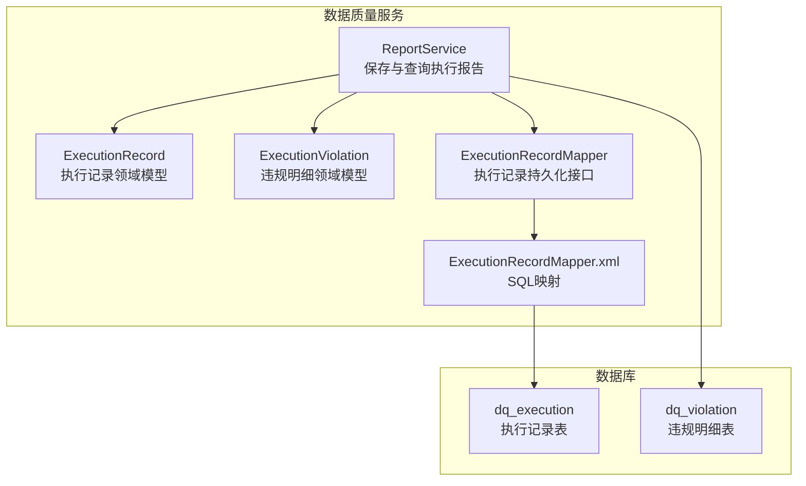
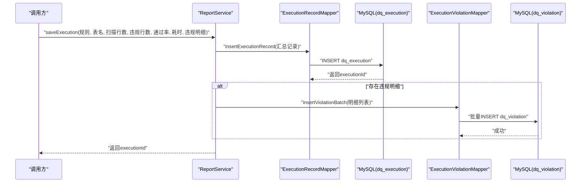
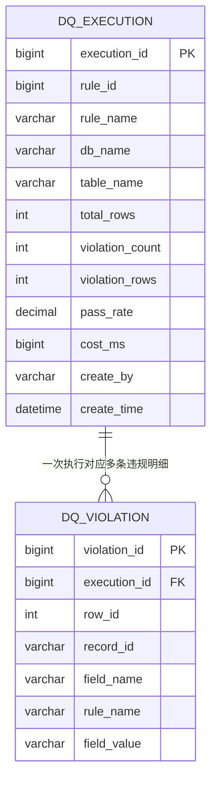
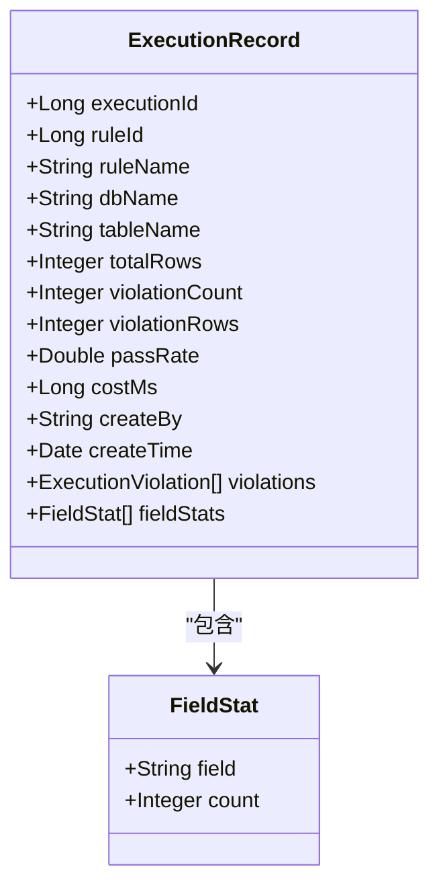
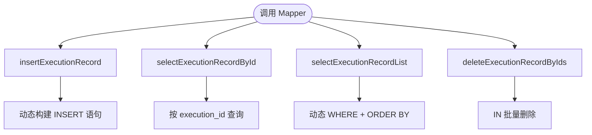
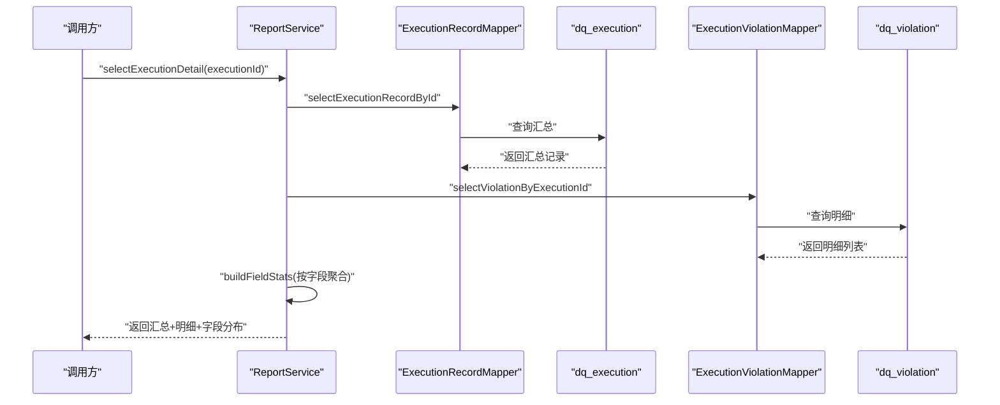
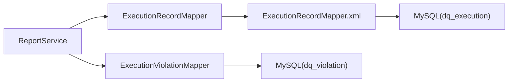

# 执行记录表

<cite>
**本文引用的文件**   
- [ry_dq_report_20261026.sql](file://sql/ry_dq_report_20261026.sql)
- [ExecutionRecord.java](file://ruoyi-modules/ruoyi-dqservice/src/main/java/com/ruoyi/dqservice/domain/ExecutionRecord.java)
- [ExecutionRecordMapper.java](file://ruoyi-modules/ruoyi-dqservice/src/main/java/com/ruoyi/dqservice/mapper/ExecutionRecordMapper.java)
- [ExecutionRecordMapper.xml](file://ruoyi-modules/ruoyi-dqservice/src/main/resources/mapper/dqservice/ExecutionRecordMapper.xml)
- [ReportService.java](file://ruoyi-modules/ruoyi-dqservice/src/main/java/com/ruoyi/dqservice/service/ReportService.java)
- [ExecutionViolation.java](file://ruoyi-modules/ruoyi-dqservice/src/main/java/com/ruoyi/dqservice/domain/ExecutionViolation.java)
</cite>

## 目录
1. [简介](#简介)
2. [项目结构中的定位](#项目结构中的定位)
3. [核心组件](#核心组件)
4. [架构总览](#架构总览)
5. [详细组件分析](#详细组件分析)
6. [依赖关系分析](#依赖关系分析)
7. [性能与分区策略](#性能与分区策略)
8. [故障排查指南](#故障排查指南)
9. [结论](#结论)

## 简介
本文围绕数据质量模块中的“执行记录”进行系统化说明，重点解释 dq_execution 表（即执行记录表）的设计目的、数据结构、生成机制、存储策略、查询方式与优化建议，并给出执行流程中的数据流转图与状态变更说明。需要特别说明的是：当前代码中并未定义“执行状态”字段，因此不存在传统意义上的状态机；执行结果以“汇总+明细”的方式落库，通过时间、规则、表名等维度进行检索与分析。

## 项目结构中的定位
执行记录相关能力集中在数据质量服务模块 ruoyi-dqservice 中，涉及领域模型、持久化映射与服务编排三个层次：
- 领域模型：ExecutionRecord、ExecutionViolation
- 持久化映射：ExecutionRecordMapper 接口与其 XML 实现
- 服务编排：ReportService 负责将一次规则执行的汇总与明细写入数据库，并提供列表与详情查询

图表来源
- [ReportService.java:45-89](file://ruoyi-modules/ruoyi-dqservice/src/main/java/com/ruoyi/dqservice/service/ReportService.java#L45-L89)
- [ExecutionRecord.java:9-73](file://ruoyi-modules/ruoyi-dqservice/src/main/java/com/ruoyi/dqservice/domain/ExecutionRecord.java#L9-L73)
- [ExecutionViolation.java:7-37](file://ruoyi-modules/ruoyi-dqservice/src/main/java/com/ruoyi/dqservice/domain/ExecutionViolation.java#L7-L37)
- [ExecutionRecordMapper.java:7-25](file://ruoyi-modules/ruoyi-dqservice/src/main/java/com/ruoyi/dqservice/mapper/ExecutionRecordMapper.java#L7-L25)
- [ExecutionRecordMapper.xml:22-41](file://ruoyi-modules/ruoyi-dqservice/src/main/resources/mapper/dqservice/ExecutionRecordMapper.xml#L22-L41)
- [ry_dq_report_20261026.sql:11-27](file://sql/ry_dq_report_20261026.sql#L11-L27)

章节来源
- [ReportService.java:21-28](file://ruoyi-modules/ruoyi-dqservice/src/main/java/com/ruoyi/dqservice/service/ReportService.java#L21-L28)
- [ExecutionRecord.java:9-15](file://ruoyi-modules/ruoyi-dqservice/src/main/java/com/ruoyi/dqservice/domain/ExecutionRecord.java#L9-L15)

## 核心组件
- 执行记录表 dq_execution：每次规则执行写一条汇总记录，包含扫描行数、违规条数、命中行数、通过率、耗时、执行人与执行时间等关键字段。
- 违规明细表 dq_violation：保存该次执行的逐条违规明细，便于后续分析与溯源。
- ExecutionRecord：对应 dq_execution 的领域对象，同时包含非表字段 violations 与 fieldStats，用于详情展示与前端统计。
- ExecutionRecordMapper：提供新增、按主键查询、条件列表查询与批量删除等能力。
- ReportService：封装“保存执行结果”和“查询执行记录”的业务逻辑，保证汇总与明细在同一事务内写入。

章节来源
- [ry_dq_report_20261026.sql:1-9](file://sql/ry_dq_report_20261026.sql#L1-L9)
- [ExecutionRecord.java:9-73](file://ruoyi-modules/ruoyi-dqservice/src/main/java/com/ruoyi/dqservice/domain/ExecutionRecord.java#L9-L73)
- [ExecutionRecordMapper.java:7-25](file://ruoyi-modules/ruoyi-dqservice/src/main/java/com/ruoyi/dqservice/mapper/ExecutionRecordMapper.java#L7-L25)
- [ReportService.java:45-89](file://ruoyi-modules/ruoyi-dqservice/src/main/java/com/ruoyi/dqservice/service/ReportService.java#L45-L89)

## 架构总览
执行记录的生成与存储遵循“汇总+明细”的两表设计：
- 汇总层（dq_execution）：记录一次规则执行的总体情况，如扫描行数、违规条数、命中率、耗时等。
- 明细层（dq_violation）：记录每条违规的具体信息，包括行号、记录主键、字段名、规则名与字段值等。

图表来源
- [ReportService.java:45-89](file://ruoyi-modules/ruoyi-dqservice/src/main/java/com/ruoyi/dqservice/service/ReportService.java#L45-L89)
- [ExecutionRecordMapper.xml:43-71](file://ruoyi-modules/ruoyi-dqservice/src/main/resources/mapper/dqservice/ExecutionRecordMapper.xml#L43-L71)
- [ry_dq_report_20261026.sql:11-27](file://sql/ry_dq_report_20261026.sql#L11-L27)

## 详细组件分析

### 执行记录表 dq_execution 设计
- 设计目的：为每次数据质量规则的执行提供一份可追溯的汇总快照，便于报表统计、趋势分析与问题定位。
- 关键字段说明：
  - execution_id：执行批次ID，自增主键，作为一次执行的唯一标识。
  - rule_id / rule_name：关联的规则标识与名称，便于按规则维度统计。
  - db_name / table_name：目标数据库与数据表，支持按库表维度筛选。
  - total_rows：扫描行数，反映本次执行的数据规模。
  - violation_count：违规条数，表示触发规则的明细数量。
  - violation_rows：命中行数，表示被判定为违规的记录行数。
  - pass_rate：通过率（百分比），用于衡量数据质量水平。
  - cost_ms：执行耗时（毫秒），用于性能评估与瓶颈定位。
  - create_by / create_time：执行人与执行时间，用于审计与排障。
- 索引设计：
  - 主键：execution_id
  - 二级索引：rule_id、create_time，分别支撑按规则与时间维度的查询。

图表来源
- [ry_dq_report_20261026.sql:11-39](file://sql/ry_dq_report_20261026.sql#L11-L39)

章节来源
- [ry_dq_report_20261026.sql:11-27](file://sql/ry_dq_report_20261026.sql#L11-L27)

### 领域模型 ExecutionRecord
- 作用：承载 dq_execution 的字段映射，并在详情场景下扩展 violations 与 fieldStats 两个非表字段，用于聚合展示。
- 关键属性：
  - 基础字段：executionId、ruleId、ruleName、dbName、tableName、totalRows、violationCount、violationRows、passRate、costMs、createBy、createTime。
  - 扩展字段：violations（违规明细列表）、fieldStats（按字段聚合的违规条数）。
- 复杂度与内存占用：
  - 在详情查询时，violations 可能较大，需注意分页或限制返回量，避免一次性加载过多明细导致内存压力。

图表来源
- [ExecutionRecord.java:9-73](file://ruoyi-modules/ruoyi-dqservice/src/main/java/com/ruoyi/dqservice/domain/ExecutionRecord.java#L9-L73)

章节来源
- [ExecutionRecord.java:9-73](file://ruoyi-modules/ruoyi-dqservice/src/main/java/com/ruoyi/dqservice/domain/ExecutionRecord.java#L9-L73)

### 持久化映射 ExecutionRecordMapper
- 接口方法：
  - insertExecutionRecord：新增执行记录，使用 useGeneratedKeys 回填 executionId。
  - selectExecutionRecordById：按主键查询单条执行记录。
  - selectExecutionRecordList：条件查询执行记录列表，支持 ruleId、ruleName、tableName 过滤，并按 execution_id 倒序。
  - deleteExecutionRecordByIds：批量删除执行记录。
- SQL 映射要点：
  - 动态插入：根据字段是否为空决定插入列与值。
  - 动态查询：where 条件根据传入参数动态拼接。
  - 排序：默认按 execution_id desc 排序，利于最新记录优先展示。

图表来源
- [ExecutionRecordMapper.java:7-25](file://ruoyi-modules/ruoyi-dqservice/src/main/java/com/ruoyi/dqservice/mapper/ExecutionRecordMapper.java#L7-L25)
- [ExecutionRecordMapper.xml:28-41](file://ruoyi-modules/ruoyi-dqservice/src/main/resources/mapper/dqservice/ExecutionRecordMapper.xml#L28-L41)
- [ExecutionRecordMapper.xml:43-78](file://ruoyi-modules/ruoyi-dqservice/src/main/resources/mapper/dqservice/ExecutionRecordMapper.xml#L43-L78)

章节来源
- [ExecutionRecordMapper.java:7-25](file://ruoyi-modules/ruoyi-dqservice/src/main/java/com/ruoyi/dqservice/mapper/ExecutionRecordMapper.java#L7-L25)
- [ExecutionRecordMapper.xml:22-78](file://ruoyi-modules/ruoyi-dqservice/src/main/resources/mapper/dqservice/ExecutionRecordMapper.xml#L22-L78)

### 服务编排 ReportService
- saveExecution：
  - 组装 ExecutionRecord 并插入 dq_execution。
  - 若存在违规明细，则转换为 ExecutionViolation 列表后批量插入 dq_violation。
  - 使用 @Transactional 保证汇总与明细在同一事务内写入，避免“只有汇总没有明细”的不一致情况。
- selectExecutionList：
  - 委托 ExecutionRecordMapper 进行条件查询。
- selectExecutionDetail：
  - 先查 dq_execution 汇总，再查 dq_violation 明细，并在内存中构建 fieldStats（按字段聚合的违规条数），按计数降序排列。

图表来源
- [ReportService.java:97-109](file://ruoyi-modules/ruoyi-dqservice/src/main/java/com/ruoyi/dqservice/service/ReportService.java#L97-L109)
- [ReportService.java:131-149](file://ruoyi-modules/ruoyi-dqservice/src/main/java/com/ruoyi/dqservice/service/ReportService.java#L131-L149)

章节来源
- [ReportService.java:45-89](file://ruoyi-modules/ruoyi-dqservice/src/main/java/com/ruoyi/dqservice/service/ReportService.java#L45-L89)
- [ReportService.java:91-109](file://ruoyi-modules/ruoyi-dqservice/src/main/java/com/ruoyi/dqservice/service/ReportService.java#L91-L109)
- [ReportService.java:131-149](file://ruoyi-modules/ruoyi-dqservice/src/main/java/com/ruoyi/dqservice/service/ReportService.java#L131-L149)

## 依赖关系分析
- 模块内依赖：
  - ReportService 依赖 ExecutionRecordMapper 与 ExecutionViolationMapper。
  - ExecutionRecordMapper 依赖 MyBatis XML 映射到 dq_execution。
  - ExecutionViolationMapper 依赖 dq_violation（由同模块其他 Mapper 提供）。
- 外部依赖：
  - Spring 事务管理：@Transactional 保证一致性。
  - 安全上下文：SecurityUtils.getUsername() 获取当前用户，失败时回退为 system。
  - 日期工具：DateUtils.getNowDate() 获取当前时间。

图表来源
- [ReportService.java:39-43](file://ruoyi-modules/ruoyi-dqservice/src/main/java/com/ruoyi/dqservice/service/ReportService.java#L39-L43)
- [ExecutionRecordMapper.xml:22-41](file://ruoyi-modules/ruoyi-dqservice/src/main/resources/mapper/dqservice/ExecutionRecordMapper.xml#L22-L41)

章节来源
- [ReportService.java:39-43](file://ruoyi-modules/ruoyi-dqservice/src/main/java/com/ruoyi/dqservice/service/ReportService.java#L39-L43)

## 性能与分区策略
- 查询优化建议：
  - 列表查询已按 execution_id desc 排序，适合“最新优先”的展示场景。
  - 条件查询支持 ruleId、ruleName、tableName，建议在高频查询条件下建立复合索引，例如 (rule_id, create_time)、(table_name, create_time)。
  - 对 ruleName 与 tableName 的模糊匹配（like '%...%'）无法有效利用前缀索引，建议结合业务需求考虑是否改为精确匹配或使用全文索引。
- 写入优化建议：
  - 明细写入采用批量插入，减少往返开销。
  - 汇总与明细在同一事务内写入，确保一致性；在高并发场景下，可考虑异步化明细写入以降低主事务持有时间。
- 分区策略建议：
  - 基于 create_time 进行范围分区（按月或按周），有助于历史数据归档与冷热分离。
  - 对 dq_violation 也可按 execution_id 所在的时间区间进行分区，提升按时间维度的查询效率。
  - 定期清理过期数据（例如超过保留期的执行记录与明细），降低表体积与维护成本。
- 监控与指标：
  - 关注 cost_ms 字段，识别慢执行规则。
  - 关注 violation_count 与 violation_rows，识别高风险数据表与字段。
  - 关注 pass_rate 趋势，评估数据质量改进效果。

[本节为通用性能指导，不直接分析具体文件]

## 故障排查指南
- 常见问题与处理：
  - 执行记录不存在：当 selectExecutionDetail 找不到汇总记录时抛出异常，需检查 executionId 是否正确或记录是否已被删除。
  - 明细缺失：若汇总存在但无明细，检查明细批量插入是否成功，以及事务是否回滚。
  - 用户名获取失败：在非登录上下文（定时任务）中，currentUsername 会捕获异常并返回 system，不影响落库。
- 日志与追踪：
  - 保存执行结果时会输出日志，包含 executionId、规则名与违规条数，便于快速定位问题。
  - 建议在调用方增加链路追踪 ID，贯穿 Rule 执行、ReportService 与数据库操作。

章节来源
- [ReportService.java:97-109](file://ruoyi-modules/ruoyi-dqservice/src/main/java/com/ruoyi/dqservice/service/ReportService.java#L97-L109)
- [ReportService.java:166-177](file://ruoyi-modules/ruoyi-dqservice/src/main/java/com/ruoyi/dqservice/service/ReportService.java#L166-L177)
- [ReportService.java:86-88](file://ruoyi-modules/ruoyi-dqservice/src/main/java/com/ruoyi/dqservice/service/ReportService.java#L86-L88)

## 结论
dq_execution 表作为数据质量规则执行的汇总快照，配合 dq_violation 明细表，形成了“汇总+明细”的可追溯执行记录体系。通过 ExecutionRecord 领域模型与 ReportService 服务编排，系统在写入时保证一致性，在查询时提供灵活的筛选与聚合能力。未来可在索引优化、分区策略与异步写入等方面进一步提升性能与可扩展性，同时加强监控与告警，帮助团队持续改善数据质量。