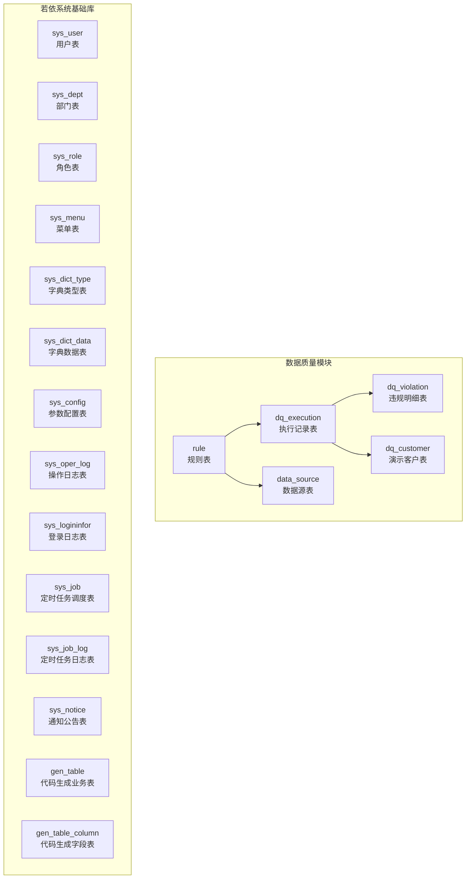
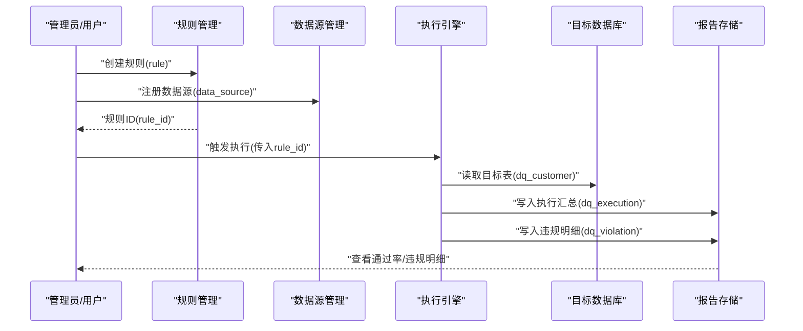
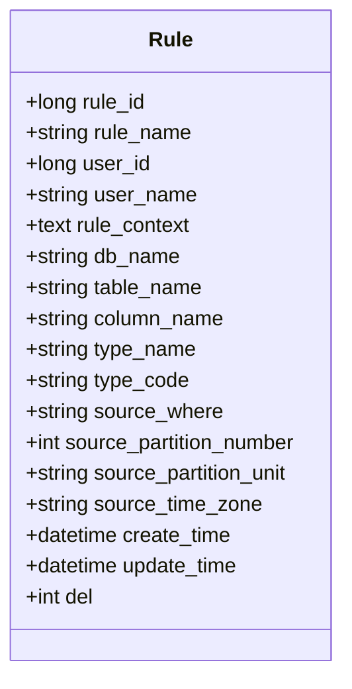
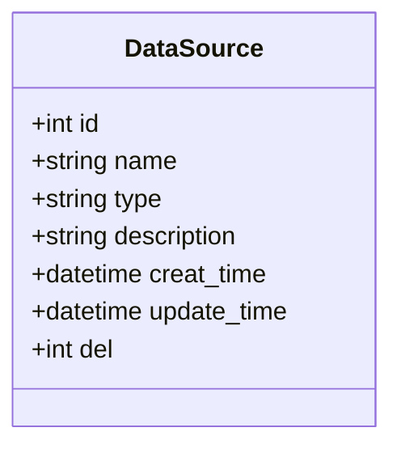
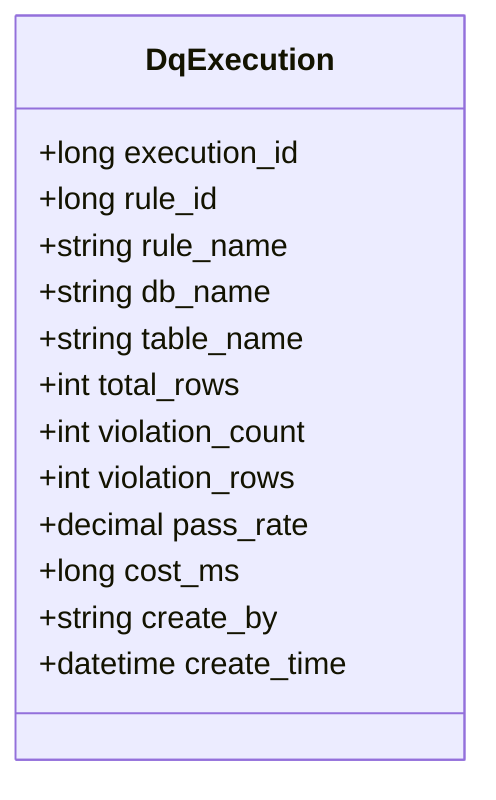
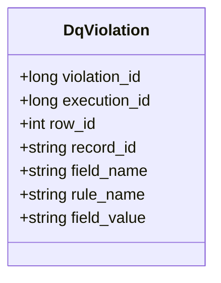
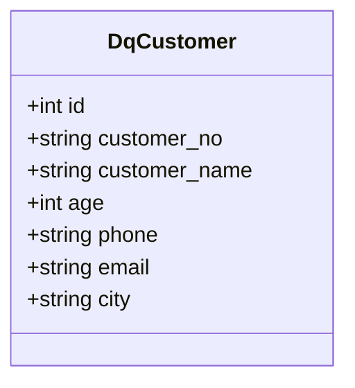
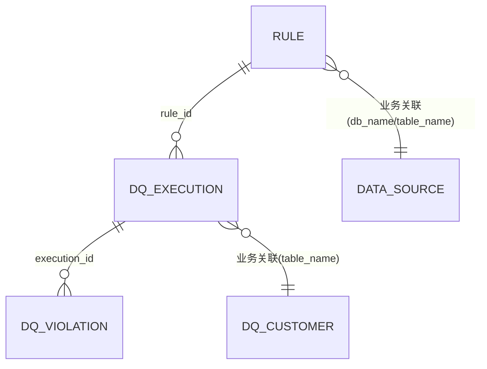
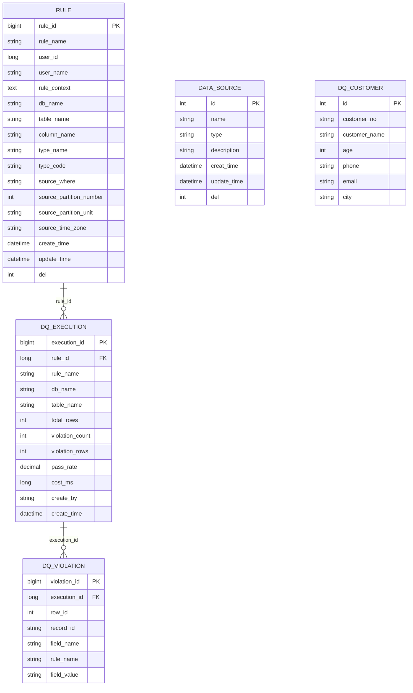

# 数据库设计

<cite>
**本文引用的文件**   
- [ry_dqservice_20261026.sql](file://sql/ry_dqservice_20261026.sql)
- [ry_dq_report_20261026.sql](file://sql/ry_dq_report_20261026.sql)
- [ry_dq_demo_customer_20261026.sql](file://sql/ry_dq_demo_customer_20261026.sql)
- [ry_20210908.sql](file://sql/ry_20210908.sql)
</cite>

## 目录
1. [引言](#引言)
2. [项目结构](#项目结构)
3. [核心组件](#核心组件)
4. [架构总览](#架构总览)
5. [详细组件分析](#详细组件分析)
6. [依赖关系分析](#依赖关系分析)
7. [性能考虑](#性能考虑)
8. [故障排查指南](#故障排查指南)
9. [结论](#结论)
10. [附录](#附录)

## 引言
本文件面向数据质量模块的数据库设计，目标是对规则表、数据源表、执行记录表与违规明细表等核心实体进行完整说明，包括字段定义、索引设计、约束关系、业务含义与设计考量，并提供ER图、样例数据、数据流转说明、迁移策略、性能优化建议与备份恢复方案。该文档同时覆盖若依系统基础表结构中与数据质量相关的用户、部门、角色、菜单等元数据，以便理解规则创建者、权限控制与审计上下文。

## 项目结构
仓库中与数据库设计直接相关的脚本位于 sql 目录，其中：
- ry_dqservice_20261026.sql：数据质量模块的规则表与数据源表。
- ry_dq_report_20261026.sql：数据质量执行报告（执行批次与违规明细）。
- ry_dq_demo_customer_20261026.sql：演示用客户表及样例数据，用于空值检测等规则验证。
- ry_20210908.sql：若依系统基础库表结构，包含用户、部门、角色、菜单、字典、参数、日志、定时任务等。

图表来源
- [ry_dqservice_20261026.sql:7-39](file://sql/ry_dqservice_20261026.sql#L7-L39)
- [ry_dq_report_20261026.sql:11-39](file://sql/ry_dq_report_20261026.sql#L11-L39)
- [ry_dq_demo_customer_20261026.sql:13-35](file://sql/ry_dq_demo_customer_20261026.sql#L13-L35)
- [ry_20210908.sql:6-686](file://sql/ry_20210908.sql#L6-L686)

章节来源
- [ry_dqservice_20261026.sql:1-40](file://sql/ry_dqservice_20261026.sql#L1-L40)
- [ry_dq_report_20261026.sql:1-40](file://sql/ry_dq_report_20261026.sql#L1-L40)
- [ry_dq_demo_customer_20261026.sql:1-36](file://sql/ry_dq_demo_customer_20261026.sql#L1-L36)
- [ry_20210908.sql:1-686](file://sql/ry_20210908.sql#L1-L686)

## 核心组件
本节聚焦数据质量模块的核心表结构与字段语义，并解释其业务含义与设计考量。

- 规则表 rule
  - 主键：rule_id
  - 关键字段：rule_name、user_id、user_name、rule_context、db_name、table_name、column_name、type_name、type_code、source_where、source_partition_number、source_partition_unit、source_time_zone、create_time、update_time、del
  - 业务含义：描述一条数据质量校验规则，包括规则名称、归属用户、规则表达式或内容、目标数据库/表/列、规则类型编码与名称、过滤条件、分区与时间区配置、软删除标志等。
  - 设计考量：将规则与具体数据源解耦，通过 db_name/table_name/column_name 定位目标；type_code/type_name 支持多类规则扩展；source_where 提供灵活的数据筛选；分区与时区字段为批量扫描与时间相关规则提供运行参数。

- 数据源表 data_source
  - 主键：id
  - 关键字段：name、type、description、creat_time、update_time、del
  - 业务含义：集中管理外部数据源连接信息，便于规则执行时复用连接。
  - 设计考量：type 字段区分不同数据库类型；description 便于运维说明；统一的时间戳与软删除标志便于审计与清理。

- 执行记录表 dq_execution
  - 主键：execution_id
  - 关键字段：rule_id、rule_name、db_name、table_name、total_rows、violation_count、violation_rows、pass_rate、cost_ms、create_by、create_time
  - 索引：idx_rule_id、idx_create_time
  - 业务含义：每次规则执行的汇总统计，包括扫描行数、违规条数、命中行数、通过率、耗时、执行人与执行时间。
  - 设计考量：聚合维度围绕 rule_id 与 create_time，便于按规则与时间范围查询；pass_rate 使用小数精度保留百分比展示；cost_ms 便于性能分析与告警。

- 违规明细表 dq_violation
  - 主键：violation_id
  - 关键字段：execution_id、row_id、record_id、field_name、rule_name、field_value
  - 索引：idx_execution_id
  - 业务含义：记录某次执行中每条违规的具体行与字段值，便于问题定位与回溯。
  - 设计考量：以 execution_id 关联执行批次；record_id 可指向业务主键，便于回查原始数据；field_value 存储违规字段的快照值，便于离线分析。

- 演示客户表 dq_customer
  - 主键：id
  - 关键字段：customer_no、customer_name、age、phone、email、city
  - 业务含义：用于演示空值检测等规则效果，刻意构造若干空值场景。
  - 设计考量：结构简单，便于快速验证规则命中与报告统计。

章节来源
- [ry_dqservice_20261026.sql:7-39](file://sql/ry_dqservice_20261026.sql#L7-L39)
- [ry_dq_report_20261026.sql:11-39](file://sql/ry_dq_report_20261026.sql#L11-L39)
- [ry_dq_demo_customer_20261026.sql:13-35](file://sql/ry_dq_demo_customer_20261026.sql#L13-L35)

## 架构总览
数据质量模块在若依系统之上运行，规则由用户创建并绑定到目标数据源；执行引擎根据规则对目标表进行扫描，产出执行汇总与违规明细；演示表用于验证规则与报告的正确性。

图表来源
- [ry_dqservice_20261026.sql:7-39](file://sql/ry_dqservice_20261026.sql#L7-L39)
- [ry_dq_report_20261026.sql:11-39](file://sql/ry_dq_report_20261026.sql#L11-L39)
- [ry_dq_demo_customer_20261026.sql:13-35](file://sql/ry_dq_demo_customer_20261026.sql#L13-L35)

## 详细组件分析

### 规则表 rule 分析
- 字段分组
  - 标识与归属：rule_id、rule_name、user_id、user_name
  - 规则内容与类型：rule_context、type_name、type_code
  - 目标对象：db_name、table_name、column_name
  - 执行参数：source_where、source_partition_number、source_partition_unit、source_time_zone
  - 审计字段：create_time、update_time、del
- 索引与约束
  - 主键：rule_id
  - 未显式建立复合索引；可按 (user_id, type_code)、(db_name, table_name) 等常见查询维度补充索引以提升检索效率。
- 设计考量
  - user_id/user_name 冗余存储便于报表与审计；type_code/type_name 支持规则类型扩展；source_where 允许灵活过滤；分区与时区字段为大规模数据扫描提供运行时参数。

图表来源
- [ry_dqservice_20261026.sql:7-27](file://sql/ry_dqservice_20261026.sql#L7-L27)

章节来源
- [ry_dqservice_20261026.sql:7-27](file://sql/ry_dqservice_20261026.sql#L7-L27)

### 数据源表 data_source 分析
- 字段分组
  - 标识与描述：id、name、description
  - 类型与状态：type、del
  - 审计字段：creat_time、update_time
- 索引与约束
  - 主键：id
  - 可按 name 或 type 增加唯一索引以避免重复注册。
- 设计考量
  - type 字段抽象不同数据库类型；description 便于运维说明；统一时间戳与软删除便于生命周期管理。

图表来源
- [ry_dqservice_20261026.sql:29-39](file://sql/ry_dqservice_20261026.sql#L29-L39)

章节来源
- [ry_dqservice_20261026.sql:29-39](file://sql/ry_dqservice_20261026.sql#L29-L39)

### 执行记录表 dq_execution 分析
- 字段分组
  - 标识与关联：execution_id、rule_id、rule_name
  - 目标对象：db_name、table_name
  - 统计指标：total_rows、violation_count、violation_rows、pass_rate
  - 性能与审计：cost_ms、create_by、create_time
- 索引与约束
  - 主键：execution_id
  - 索引：idx_rule_id、idx_create_time
- 设计考量
  - 聚合维度围绕 rule_id 与 create_time，便于按规则与时间范围统计；pass_rate 使用 decimal(5,1) 表示百分比；cost_ms 便于性能监控与阈值告警。

图表来源
- [ry_dq_report_20261026.sql:11-27](file://sql/ry_dq_report_20261026.sql#L11-L27)

章节来源
- [ry_dq_report_20261026.sql:11-27](file://sql/ry_dq_report_20261026.sql#L11-L27)

### 违规明细表 dq_violation 分析
- 字段分组
  - 标识与关联：violation_id、execution_id
  - 定位信息：row_id、record_id、field_name
  - 规则与值：rule_name、field_value
- 索引与约束
  - 主键：violation_id
  - 索引：idx_execution_id
- 设计考量
  - 以 execution_id 关联执行批次；record_id 可映射业务主键；field_value 保存违规字段快照，便于离线分析与取证。

图表来源
- [ry_dq_report_20261026.sql:29-39](file://sql/ry_dq_report_20261026.sql#L29-L39)

章节来源
- [ry_dq_report_20261026.sql:29-39](file://sql/ry_dq_report_20261026.sql#L29-L39)

### 演示客户表 dq_customer 分析
- 字段分组
  - 标识：id
  - 业务字段：customer_no、customer_name、age、phone、email、city
- 设计考量
  - 故意构造空值场景，便于验证空值检测规则与报告统计准确性。

图表来源
- [ry_dq_demo_customer_20261026.sql:13-23](file://sql/ry_dq_demo_customer_20261026.sql#L13-L23)

章节来源
- [ry_dq_demo_customer_20261026.sql:13-35](file://sql/ry_dq_demo_customer_20261026.sql#L13-L35)

### 若依系统基础表与数据质量的关系
- 用户与规则：rule.user_id 对应 sys_user.user_id，用于规则归属与审计。
- 菜单与权限：sys_menu 提供数据质量模块的菜单入口与按钮权限，结合角色与用户实现访问控制。
- 字典与枚举：sys_dict_type/sys_dict_data 可用于规则类型、状态等枚举值的统一管理。
- 日志与审计：sys_oper_log/sys_logininfor 记录系统操作与登录行为，辅助安全审计。
- 定时任务：sys_job/sys_job_log 可用于周期性执行数据质量规则。

章节来源
- [ry_20210908.sql:6-686](file://sql/ry_20210908.sql#L6-L686)

## 依赖关系分析
数据质量模块内部依赖关系如下：
- dq_execution 引用 rule.rule_id，形成“规则→执行汇总”的一对多关系。
- dq_violation 引用 dq_execution.execution_id，形成“执行汇总→违规明细”的一对多关系。
- rule 与 data_source 通过业务逻辑关联（规则指定目标数据库/表/列），并非外键约束。
- dq_customer 作为示例目标表，被规则执行过程读取。

图表来源
- [ry_dqservice_20261026.sql:7-39](file://sql/ry_dqservice_20261026.sql#L7-L39)
- [ry_dq_report_20261026.sql:11-39](file://sql/ry_dq_report_20261026.sql#L11-L39)
- [ry_dq_demo_customer_20261026.sql:13-23](file://sql/ry_dq_demo_customer_20261026.sql#L13-L23)

章节来源
- [ry_dqservice_20261026.sql:7-39](file://sql/ry_dqservice_20261026.sql#L7-L39)
- [ry_dq_report_20261026.sql:11-39](file://sql/ry_dq_report_20261026.sql#L11-L39)
- [ry_dq_demo_customer_20261026.sql:13-35](file://sql/ry_dq_demo_customer_20261026.sql#L13-L35)

## 性能考虑
- 索引优化
  - dq_execution：已具备 idx_rule_id、idx_create_time，适合按规则与时间范围查询；可按 (db_name, table_name) 增加复合索引以优化按目标对象的统计查询。
  - dq_violation：已具备 idx_execution_id；如需按 field_name 或 rule_name 检索，可增加相应索引。
  - rule：可按 (user_id, type_code)、(db_name, table_name) 增加复合索引提升规则检索效率。
  - data_source：可按 name 或 type 增加唯一索引避免重复注册并加速查找。
- 分区与归档
  - dq_execution 与 dq_violation 属于增长型表，建议按 create_time 进行分区（如按月）并结合归档策略清理历史数据。
- 统计计算
  - pass_rate 建议在应用层计算后落库，避免频繁复杂计算；必要时可对 total_rows、violation_count 等字段建立物化视图或汇总表。
- 并发与锁
  - 规则执行可能并发写 dq_execution 与 dq_violation，建议使用事务与合适的隔离级别，避免锁竞争；大批量插入时使用批量写入接口。
- 缓存
  - data_source 的连接信息可缓存于内存或Redis，减少连接开销；规则元数据也可缓存以提升加载速度。

[本节为通用性能指导，不直接分析具体文件]

## 故障排查指南
- 规则未命中或通过率异常
  - 检查 rule.rule_context 与 source_where 是否正确；确认 target 表的 column_name 是否存在且数据类型匹配。
  - 核对 dq_execution.total_rows 与 dq_violation.violation_count 是否一致；检查 pass_rate 的计算逻辑。
- 违规明细缺失
  - 检查 dq_violation.execution_id 是否与 dq_execution.execution_id 对应；确认 record_id 是否能回查到业务主键。
- 数据源连接失败
  - 检查 data_source.type 与连接参数；确认网络连通性与账号权限。
- 性能问题
  - 观察 dq_execution.cost_ms；检查是否缺少必要索引；评估是否需要分区或分批处理。
- 审计与溯源
  - 使用 sys_oper_log 与 sys_logininfor 追踪操作与登录行为；结合 rule.user_id 与 dq_execution.create_by 进行责任追溯。

章节来源
- [ry_dqservice_20261026.sql:7-39](file://sql/ry_dqservice_20261026.sql#L7-L39)
- [ry_dq_report_20261026.sql:11-39](file://sql/ry_dq_report_20261026.sql#L11-L39)
- [ry_20210908.sql:416-435](file://sql/ry_20210908.sql#L416-L435)
- [ry_20210908.sql:548-557](file://sql/ry_20210908.sql#L548-L557)

## 结论
本数据库设计围绕数据质量模块的核心实体展开，规则表与数据源表提供规则定义与连接管理，执行记录表与违规明细表提供执行结果与问题定位，演示客户表用于快速验证。整体结构清晰、可扩展性强，并通过若依系统的基础表支撑权限、审计与定时任务能力。建议在后续迭代中完善索引、分区与归档策略，持续优化性能与可维护性。

[本节为总结性内容，不直接分析具体文件]

## 附录

### ER图（实体关系）

图表来源
- [ry_dqservice_20261026.sql:7-39](file://sql/ry_dqservice_20261026.sql#L7-L39)
- [ry_dq_report_20261026.sql:11-39](file://sql/ry_dq_report_20261026.sql#L11-L39)
- [ry_dq_demo_customer_20261026.sql:13-23](file://sql/ry_dq_demo_customer_20261026.sql#L13-L23)

### 样例数据说明
- dq_customer 提供10条客户记录，包含多处空值，用于验证空值检测规则的命中情况与报告统计。
- 规则可通过 rule.rule_context 与 source_where 指定空值检测逻辑，执行后在 dq_execution 中汇总统计，在 dq_violation 中记录具体违规行与字段值。

章节来源
- [ry_dq_demo_customer_20261026.sql:25-35](file://sql/ry_dq_demo_customer_20261026.sql#L25-L35)

### 数据迁移策略
- 版本化管理
  - 所有DDL脚本以日期后缀命名（如 _20261026.sql），便于版本追踪与回滚。
- 幂等性
  - 使用 DROP TABLE IF EXISTS 与 CREATE TABLE IF NOT EXISTS 确保重复执行不会破坏已有数据。
- 增量升级
  - 新增字段或索引时，单独编写变更脚本并在部署流程中顺序执行。
- 回滚方案
  - 针对每个变更脚本准备对应的回滚SQL（如 DROP INDEX、ALTER TABLE DROP COLUMN），在紧急情况下快速恢复。

章节来源
- [ry_dqservice_20261026.sql:1-5](file://sql/ry_dqservice_20261026.sql#L1-L5)
- [ry_dq_report_20261026.sql:1-9](file://sql/ry_dq_report_20261026.sql#L1-L9)

### 备份恢复方案
- 全量备份
  - 定期使用 mysqldump 或企业级备份工具对 ry-cloud 库进行全量备份，保留最近N份历史备份。
- 增量备份
  - 开启MySQL二进制日志（binlog），基于时间点进行增量恢复，降低数据丢失风险。
- 恢复演练
  - 定期在测试环境进行恢复演练，验证备份有效性与恢复流程。
- 灾备策略
  - 跨机房或云区域复制数据库实例，确保高可用与灾难恢复能力。

[本节为通用备份恢复指导，不直接分析具体文件]