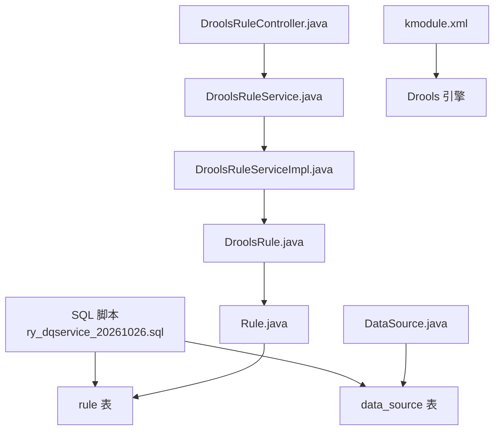
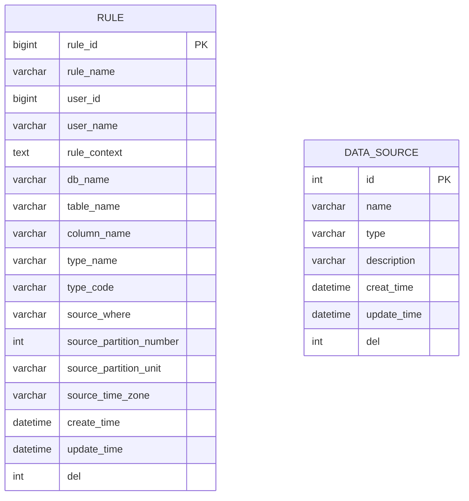
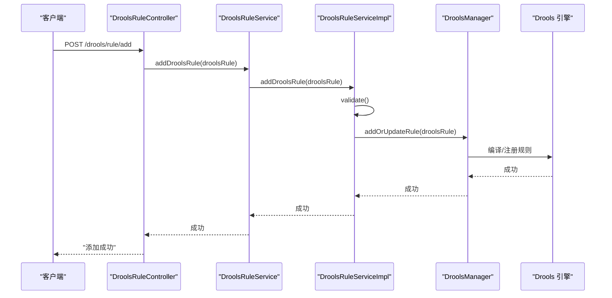
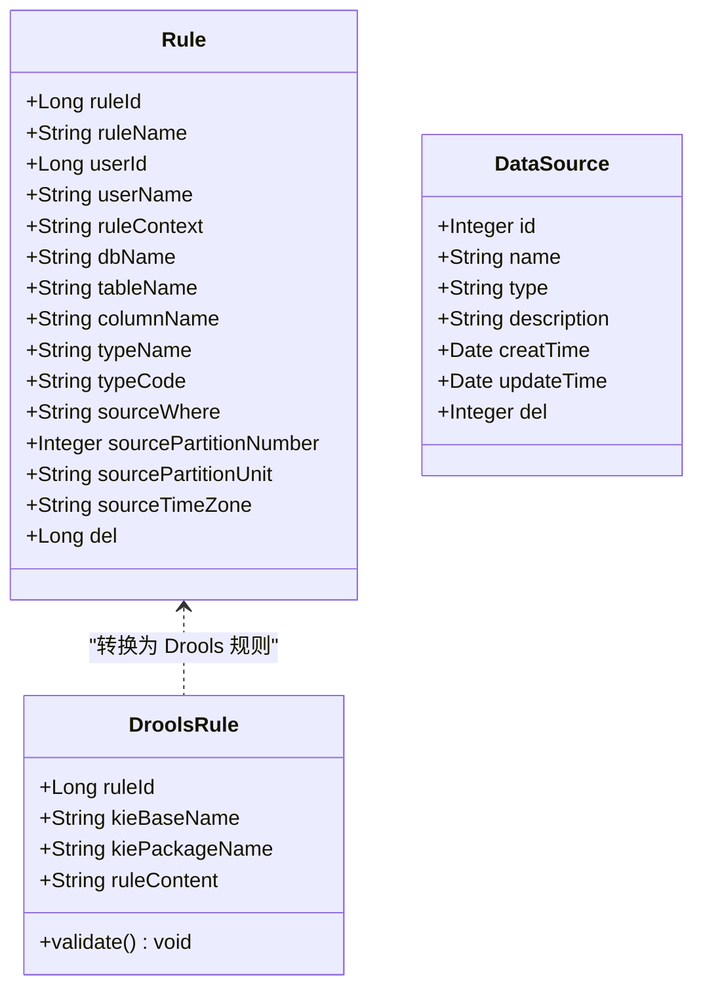

# 核心表结构

<cite>
**本文引用的文件**   
- [ry_dqservice_20261026.sql](file://sql/ry_dqservice_20261026.sql)
- [Rule.java](file://ruoyi-modules/ruoyi-dqservice/src/main/java/com/ruoyi/dqservice/domain/Rule.java)
- [DroolsRule.java](file://ruoyi-modules/ruoyi-dqservice/src/main/java/com/ruoyi/dqservice/domain/DroolsRule.java)
- [DataSource.java](file://ruoyi-modules/ruoyi-dqservice/src/main/java/com/ruoyi/dqservice/domain/DataSource.java)
- [DataSourceMapper.xml](file://ruoyi-modules/ruoyi-dqservice/src/main/resources/mapper/DataSourceMapper.xml)
- [DroolsRuleController.java](file://ruoyi-modules/ruoyi-dqservice/src/main/java/com/ruoyi/dqservice/controller/DroolsRuleController.java)
- [DroolsRuleService.java](file://ruoyi-modules/ruoyi-dqservice/src/main/java/com/ruoyi/dqservice/service/DroolsRuleService.java)
- [DroolsRuleServiceImpl.java](file://ruoyi-modules/ruoyi-dqservice/src/main/java/com/ruoyi/dqservice/service/impl/DroolsRuleServiceImpl.java)
- [kmodule.xml](file://ruoyi-modules/ruoyi-dqservice/src/main/resources/META-INF/kmodule.xml)
</cite>

## 目录
1. [引言](#引言)
2. [项目结构与定位](#项目结构与定位)
3. [核心表总览](#核心表总览)
4. [rule 表详细设计](#rule-表详细设计)
5. [data_source 表详细设计](#data_source-表详细设计)
6. [规则与 Drools 的关系](#规则与-drools-的关系)
7. [字段映射与默认值说明](#字段映射与默认值说明)
8. [依赖关系分析](#依赖关系分析)
9. [性能与扩展建议](#性能与扩展建议)
10. [常见问题排查](#常见问题排查)
11. [结论](#结论)

## 引言
本文聚焦数据质量模块中的两个核心表：rule 表和 data_source 表。文档从数据库建表语句、领域模型、以及 Drools 规则运行链路出发，解释每个字段的含义、数据类型选择原因、约束条件与业务逻辑，并给出字段映射关系和默认值说明，帮助读者快速理解“规则如何存储”和“数据源如何管理”。

## 项目结构与定位
- 数据质量相关表定义位于 SQL 脚本中，用于初始化 ry-cloud 库的 rule 与 data_source 表。
- Rule 与 DataSource 是 Java 领域对象，分别对应 rule 表与 data_source 表的实体。
- DroolsRule 是面向 Drools 引擎的规则载体，由 Rule 转换而来，用于构建 KieBase 与 KiePackage。
- DroolsRuleController 暴露规则增删改查与执行接口；DroolsRuleService 提供规则服务；kmodule.xml 配置 Drools 工作空间。

**图表来源**
- [ry_dqservice_20261026.sql:1-40](file://sql/ry_dqservice_20261026.sql#L1-L40)
- [Rule.java:20-86](file://ruoyi-modules/ruoyi-dqservice/src/main/java/com/ruoyi/dqservice/domain/Rule.java#L20-L86)
- [DataSource.java:16-111](file://ruoyi-modules/ruoyi-dqservice/src/main/java/com/ruoyi/dqservice/domain/DataSource.java#L16-L111)
- [DroolsRule.java:5-32](file://ruoyi-modules/ruoyi-dqservice/src/main/java/com/ruoyi/dqservice/domain/DroolsRule.java#L5-L32)
- [DroolsRuleController.java:13-49](file://ruoyi-modules/ruoyi-dqservice/src/main/java/com/ruoyi/dqservice/controller/DroolsRuleController.java#L13-L49)
- [DroolsRuleService.java:7-15](file://ruoyi-modules/ruoyi-dqservice/src/main/java/com/ruoyi/dqservice/service/DroolsRuleService.java#L7-L15)
- [DroolsRuleServiceImpl.java:11-48](file://ruoyi-modules/ruoyi-dqservice/src/main/java/com/ruoyi/dqservice/service/impl/DroolsRuleServiceImpl.java#L11-L48)
- [kmodule.xml:1-6](file://ruoyi-modules/ruoyi-dqservice/src/main/resources/META-INF/kmodule.xml#L1-L6)

**章节来源**
- [ry_dqservice_20261026.sql:1-40](file://sql/ry_dqservice_20261026.sql#L1-L40)

## 核心表总览
- rule 表：存储数据质量规则的定义、上下文、目标数据库/表/列、类型编码、分区参数等。
- data_source 表：存储数据源的名称、类型、描述、创建/更新时间、删除标志等基础信息。

**图表来源**
- [ry_dqservice_20261026.sql:7-39](file://sql/ry_dqservice_20261026.sql#L7-L39)

**章节来源**
- [ry_dqservice_20261026.sql:1-40](file://sql/ry_dqservice_20261026.sql#L1-L40)

## rule 表详细设计
- 主键：rule_id（自增 bigint），作为规则唯一标识。
- 规则元信息：
  - rule_name：规则名称，varchar(255)，便于检索与展示。
  - user_id / user_name：规则创建者标识与名称，便于权限与审计。
- 规则内容：
  - rule_context：text，存储规则文本（例如 Drools DRL）。使用 text 以容纳较长规则体。
- 目标数据范围：
  - db_name / table_name / column_name：指向具体数据库、表、列，便于规则作用域定位。
- 规则分类：
  - type_name / type_code：规则类型的中文名称与编码，便于前端展示与后端判断。
- 数据过滤与分区：
  - source_where：字符串形式的过滤条件，用于限定参与规则检查的数据范围。
  - source_partition_number / source_partition_unit / source_time_zone：分区大小、单位与时区，用于大数据量场景下的分批处理。
- 审计与软删除：
  - create_time / update_time：记录创建与更新时间。
  - del：int(1)，默认 0，表示未删除；1 表示已删除。

字段类型选择要点：
- rule_id 使用 bigint 自增，避免未来 ID 冲突与扩容问题。
- rule_context 使用 text，因为规则体可能很长，且需要完整保存。
- 时间字段使用 datetime，便于精确到秒的审计。
- del 使用 int(1) 配合默认值 0，实现软删除语义。

约束与索引：
- 当前仅对 rule_id 设置主键。若后续查询频繁按 user_id、type_code、db_name/table_name 组合过滤，可考虑增加复合索引以提升性能。

**章节来源**
- [ry_dqservice_20261026.sql:7-27](file://sql/ry_dqservice_20261026.sql#L7-L27)
- [Rule.java:20-86](file://ruoyi-modules/ruoyi-dqservice/src/main/java/com/ruoyi/dqservice/domain/Rule.java#L20-L86)

## data_source 表详细设计
- 主键：id（自增 int），作为数据源唯一标识。
- 基本信息：
  - name：数据源名称，varchar(128)。
  - type：数据源类型，varchar(64)，用于区分不同数据库或连接类型（如 MySQL、PostgreSQL、Hive 等）。
  - description：描述，varchar(500)，用于补充说明。
- 审计与软删除：
  - creat_time / update_time：创建与更新时间。
  - del：int(1)，默认 0，表示未删除；1 表示已删除。

字段类型选择要点：
- id 使用 int 自增，满足中小规模数据源数量。
- type 使用 varchar，便于扩展新的数据源类型。
- 时间字段使用 datetime，便于审计。
- del 使用 int(1) 配合默认值 0，实现软删除语义。

约束与索引：
- 当前仅对 id 设置主键。若按 type 或 name 查询较多，可考虑增加索引。

注意：
- 当前 data_source 表未包含连接参数（如 host、port、username、password、jdbc_url 等）。实际项目中可能需要扩展该表或在其他表中维护连接配置。

**章节来源**
- [ry_dqservice_20261026.sql:29-39](file://sql/ry_dqservice_20261026.sql#L29-L39)
- [DataSource.java:16-111](file://ruoyi-modules/ruoyi-dqservice/src/main/java/com/ruoyi/dqservice/domain/DataSource.java#L16-L111)
- [DataSourceMapper.xml:31-56](file://ruoyi-modules/ruoyi-dqservice/src/main/resources/mapper/DataSourceMapper.xml#L31-L56)

## 规则与 Drools 的关系
- Rule 是持久化规则对象，对应 rule 表。
- DroolsRule 是面向 Drools 引擎的规则载体，由 Rule 构造，包含：
  - ruleId：规则 ID。
  - kieBaseName：KieBase 名称，由 userName 派生。
  - kiePackageName：KiePackage 包名，由 userName 与 ruleName 派生。
  - ruleContent：规则内容，来自 ruleContext。
- DroolsRuleServiceImpl 在新增/更新规则时调用 DroolsManager.addOrUpdateRule，将规则加载到 Drools 引擎。
- kmodule.xml 定义了默认的 KieBase 与 KieSession，供运行时使用。

**图表来源**
- [DroolsRuleController.java:13-49](file://ruoyi-modules/ruoyi-dqservice/src/main/java/com/ruoyi/dqservice/controller/DroolsRuleController.java#L13-L49)
- [DroolsRuleService.java:7-15](file://ruoyi-modules/ruoyi-dqservice/src/main/java/com/ruoyi/dqservice/service/DroolsRuleService.java#L7-L15)
- [DroolsRuleServiceImpl.java:11-48](file://ruoyi-modules/ruoyi-dqservice/src/main/java/com/ruoyi/dqservice/service/impl/DroolsRuleServiceImpl.java#L11-L48)
- [DroolsRule.java:5-32](file://ruoyi-modules/ruoyi-dqservice/src/main/java/com/ruoyi/dqservice/domain/DroolsRule.java#L5-L32)
- [kmodule.xml:1-6](file://ruoyi-modules/ruoyi-dqservice/src/main/resources/META-INF/kmodule.xml#L1-L6)

**章节来源**
- [DroolsRule.java:5-32](file://ruoyi-modules/ruoyi-dqservice/src/main/java/com/ruoyi/dqservice/domain/DroolsRule.java#L5-L32)
- [DroolsRuleController.java:13-49](file://ruoyi-modules/ruoyi-dqservice/src/main/java/com/ruoyi/dqservice/controller/DroolsRuleController.java#L13-L49)
- [DroolsRuleService.java:7-15](file://ruoyi-modules/ruoyi-dqservice/src/main/java/com/ruoyi/dqservice/service/DroolsRuleService.java#L7-L15)
- [DroolsRuleServiceImpl.java:11-48](file://ruoyi-modules/ruoyi-dqservice/src/main/java/com/ruoyi/dqservice/service/impl/DroolsRuleServiceImpl.java#L11-L48)
- [kmodule.xml:1-6](file://ruoyi-modules/ruoyi-dqservice/src/main/resources/META-INF/kmodule.xml#L1-L6)

## 字段映射与默认值说明
- Rule 与 rule 表字段映射：
  - ruleId ↔ rule_id
  - ruleName ↔ rule_name
  - userId ↔ user_id
  - userName ↔ user_name
  - ruleContext ↔ rule_context
  - dbName ↔ db_name
  - tableName ↔ table_name
  - columnName ↔ column_name
  - typeName ↔ type_name
  - typeCode ↔ type_code
  - sourceWhere ↔ source_where
  - sourcePartitionNumber ↔ source_partition_number
  - sourcePartitionUnit ↔ source_partition_unit
  - sourceTimeZone ↔ source_time_zone
  - del ↔ del
- DataSource 与 data_source 表字段映射：
  - id ↔ id
  - name ↔ name
  - type ↔ type
  - description ↔ description
  - creatTime ↔ creat_time
  - updateTime ↔ update_time
  - del ↔ del

默认值与约束：
- rule.del 默认 0，表示未删除。
- data_source.del 默认 0，表示未删除。
- rule.rule_id 与 data_source.id 均为自增主键。

注意：
- DataSource.java 中 del 字段类型为 Integer，而 Rule.java 中 del 字段类型为 Long。建议在统一层面对齐类型，以避免序列化/反序列化不一致。

**章节来源**
- [Rule.java:20-86](file://ruoyi-modules/ruoyi-dqservice/src/main/java/com/ruoyi/dqservice/domain/Rule.java#L20-L86)
- [DataSource.java:16-111](file://ruoyi-modules/ruoyi-dqservice/src/main/java/com/ruoyi/dqservice/domain/DataSource.java#L16-L111)
- [ry_dqservice_20261026.sql:7-39](file://sql/ry_dqservice_20261026.sql#L7-L39)

## 依赖关系分析
- Rule 是持久化模型，DroolsRule 是其面向 Drools 的适配模型。
- DroolsRuleController 通过 DroolsRuleService 调用 DroolsRuleServiceImpl，最终与 DroolsManager 交互，完成规则的动态加载与执行。
- kmodule.xml 提供 Drools 工作空间配置，影响规则编译与执行环境。

**图表来源**
- [Rule.java:20-86](file://ruoyi-modules/ruoyi-dqservice/src/main/java/com/ruoyi/dqservice/domain/Rule.java#L20-L86)
- [DroolsRule.java:5-32](file://ruoyi-modules/ruoyi-dqservice/src/main/java/com/ruoyi/dqservice/domain/DroolsRule.java#L5-L32)
- [DataSource.java:16-111](file://ruoyi-modules/ruoyi-dqservice/src/main/java/com/ruoyi/dqservice/domain/DataSource.java#L16-L111)

**章节来源**
- [Rule.java:20-86](file://ruoyi-modules/ruoyi-dqservice/src/main/java/com/ruoyi/dqservice/domain/Rule.java#L20-L86)
- [DroolsRule.java:5-32](file://ruoyi-modules/ruoyi-dqservice/src/main/java/com/ruoyi/dqservice/domain/DroolsRule.java#L5-L32)
- [DataSource.java:16-111](file://ruoyi-modules/ruoyi-dqservice/src/main/java/com/ruoyi/dqservice/domain/DataSource.java#L16-L111)

## 性能与扩展建议
- 索引优化：
  - 若频繁按 user_id、type_code、db_name/table_name 查询，可在 rule 表上建立复合索引。
  - 若按 type 或 name 查询 data_source，可增加相应索引。
- 大规则体：
  - rule_context 使用 text，适合长规则；但需注意备份与传输体积。
- 分区参数：
  - source_partition_number/unit/time_zone 支持大数据量分批处理，建议结合业务数据分布合理设置。
- 连接配置扩展：
  - data_source 表目前缺少连接参数，建议扩展 host、port、username、password、jdbc_url 等字段，并在安全层加密存储敏感信息。

[本节为通用建议，不直接分析具体文件]

## 常见问题排查
- 规则校验失败：
  - DroolsRule.validate() 会检查 ruleId、kieBaseName、kiePackageName、ruleContent 是否为空，任一为空将抛出异常。
- 规则未生效：
  - 确认 DroolsRuleServiceImpl 是否正确调用 DroolsManager.addOrUpdateRule，以及 kmodule.xml 是否配置了正确的 KieBase/KieSession。
- 数据源缺失连接信息：
  - data_source 表未包含连接参数，需扩展表结构或在其他位置维护连接配置。

**章节来源**
- [DroolsRule.java:23-31](file://ruoyi-modules/ruoyi-dqservice/src/main/java/com/ruoyi/dqservice/domain/DroolsRule.java#L23-L31)
- [DroolsRuleServiceImpl.java:26-38](file://ruoyi-modules/ruoyi-dqservice/src/main/java/com/ruoyi/dqservice/service/impl/DroolsRuleServiceImpl.java#L26-L38)
- [kmodule.xml:1-6](file://ruoyi-modules/ruoyi-dqservice/src/main/resources/META-INF/kmodule.xml#L1-L6)

## 结论
- rule 表提供了完整的规则定义与上下文存储能力，支持规则作用域、类型分类与分区参数，适合数据质量规则的管理与执行。
- data_source 表目前仅提供数据源的基础信息，尚未包含连接参数，需根据实际业务扩展。
- DroolsRule 将 Rule 转换为 Drools 引擎可用的规则载体，并通过控制器与服务层暴露规则管理能力。
- 建议在后续迭代中完善 data_source 的连接配置、统一 del 字段类型、并根据查询模式优化索引。