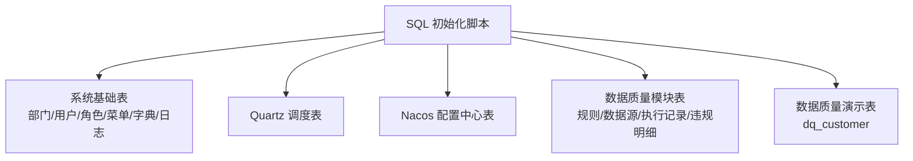
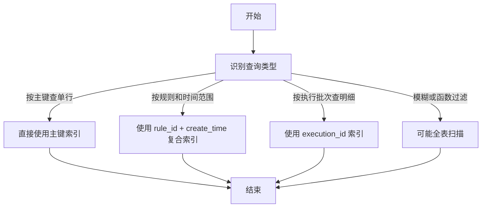
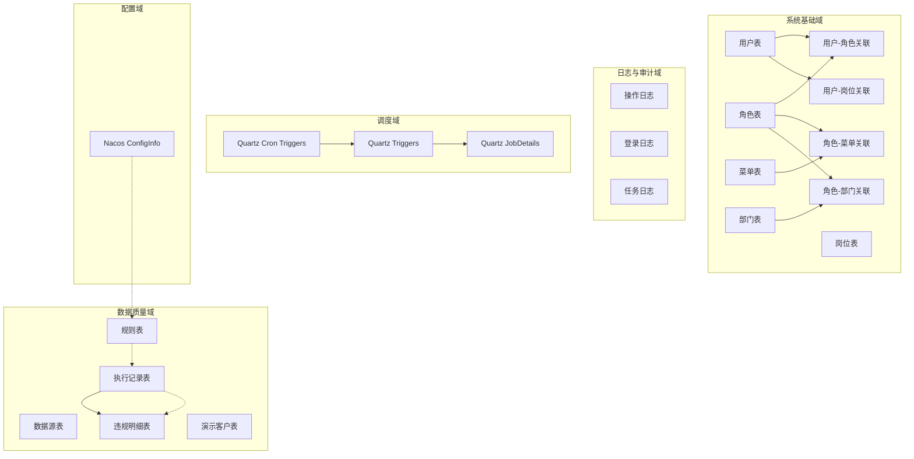

# 索引与约束

<cite>
**本文引用的文件**   
- [ry_20210908.sql](file://sql/ry_20210908.sql)
- [quartz.sql](file://sql/quartz.sql)
- [ry_config_20220424.sql](file://sql/ry_config_20220424.sql)
- [ry_dq_demo_customer_20261026.sql](file://sql/ry_dq_demo_customer_20261026.sql)
- [ry_dq_report_20261026.sql](file://sql/ry_dq_report_20261026.sql)
- [ry_dqservice_20261026.sql](file://sql/ry_dqservice_20261026.sql)
</cite>

## 目录
1. [引言](#引言)
2. [项目结构中的数据库定义位置](#项目结构中的数据库定义位置)
3. [核心表与索引设计总览](#核心表与索引设计总览)
4. [主键索引策略](#主键索引策略)
5. [唯一索引策略](#唯一索引策略)
6. [复合索引与查询优化](#复合索引与查询优化)
7. [数据完整性约束](#数据完整性约束)
8. [架构视角下的索引与约束关系](#架构视角下的索引与约束关系)
9. [性能分析与调优建议](#性能分析与调优建议)
10. [大数据量下的索引维护策略](#大数据量下的索引维护策略)
11. [常见问题排查](#常见问题排查)
12. [结论](#结论)

## 引言
本文围绕仓库中的 SQL 初始化脚本，系统性梳理现有索引与约束设计，并给出面向生产环境的查询优化、索引调优以及大数据量场景下的维护建议。文档重点覆盖：
- 主键索引、唯一索引、复合索引的使用场景与性能影响
- NOT NULL、DEFAULT、CHECK 等数据完整性约束现状与建议
- 高频查询路径对应的索引设计原则
- 日志类、配置类、调度类、数据质量模块表的差异化优化思路

## 项目结构中的数据库定义位置
本项目将数据库初始化脚本集中在 `sql` 目录中，同时 Docker 环境也包含一份 MySQL 初始数据。与索引和约束直接相关的核心脚本如下：
- 系统基础表与权限模型：[ry_20210908.sql](file://sql/ry_20210908.sql)
- Quartz 定时任务持久化表：[quartz.sql](file://sql/quartz.sql)
- Nacos 配置中心表结构：[ry_config_20220424.sql](file://sql/ry_config_20220424.sql)
- 数据质量演示客户表：[ry_dq_demo_customer_20261026.sql](file://sql/ry_dq_demo_customer_20261026.sql)
- 数据质量执行报告表：[ry_dq_report_20261026.sql](file://sql/ry_dq_report_20261026.sql)
- 数据质量规则与数据源表：[ry_dqservice_20261026.sql](file://sql/ry_dqservice_20261026.sql)

**图表来源**
- [ry_20210908.sql:1-686](file://sql/ry_20210908.sql#L1-L686)
- [quartz.sql:1-174](file://sql/quartz.sql#L1-L174)
- [ry_config_20220424.sql:1-217](file://sql/ry_config_20220424.sql#L1-L217)
- [ry_dq_demo_customer_20261026.sql:1-36](file://sql/ry_dq_demo_customer_20261026.sql#L1-L36)
- [ry_dq_report_20261026.sql:1-40](file://sql/ry_dq_report_20261026.sql#L1-L40)
- [ry_dqservice_20261026.sql:1-40](file://sql/ry_dqservice_20261026.sql#L1-L40)

**章节来源**
- [ry_20210908.sql:1-686](file://sql/ry_20210908.sql#L1-L686)
- [quartz.sql:1-174](file://sql/quartz.sql#L1-L174)
- [ry_config_20220424.sql:1-217](file://sql/ry_config_20220424.sql#L1-L217)
- [ry_dq_demo_customer_20261026.sql:1-36](file://sql/ry_dq_demo_customer_20261026.sql#L1-L36)
- [ry_dq_report_20261026.sql:1-40](file://sql/ry_dq_report_20261026.sql#L1-L40)
- [ry_dqservice_20261026.sql:1-40](file://sql/ry_dqservice_20261026.sql#L1-L40)

## 核心表与索引设计总览
从脚本可见，当前项目的索引设计以“主键为主、必要唯一约束为辅、关键查询字段补充普通索引”为原则。典型模式包括：
- 所有业务实体表均使用自增主键，便于快速定位单行记录
- 多对多关联表使用复合主键，避免重复关联
- 字典类型等需要全局唯一的字段使用唯一索引
- 配置中心表通过复合唯一键保证 data_id/group_id/tenant_id 的唯一性
- 日志与报告表为常见查询维度添加普通索引

```mermaid
erDiagram
SYS_DEPT {
bigint dept_id PK
bigint parent_id
varchar ancestors
varchar dept_name
int order_num
char status
char del_flag
}
SYS_USER {
bigint user_id PK
bigint dept_id
varchar user_name
varchar nick_name
char status
char del_flag
}
SYS_ROLE {
bigint role_id PK
varchar role_name
varchar role_key
char status
char del_flag
}
SYS_MENU {
bigint menu_id PK
varchar menu_name
bigint parent_id
char visible
char status
}
SYS_DICT_TYPE {
bigint dict_id PK
varchar dict_type UK
}
SYS_USER_ROLE {
bigint user_id PK
bigint role_id PK
}
SYS_ROLE_MENU {
bigint role_id PK
bigint menu_id PK
}
SYS_ROLE_DEPT {
bigint role_id PK
bigint dept_id PK
}
SYS_USER_POST {
bigint user_id PK
bigint post_id PK
}
SYS_OPER_LOG {
bigint oper_id PK
varchar title
int business_type
varchar method
datetime oper_time
}
SYS_JOB {
bigint job_id PK
varchar job_name
varchar job_group
varchar invoke_target
varchar cron_expression
char status
}
QRTZ_JOB_DETAILS {
varchar sched_name PK
varchar job_name PK
varchar job_group PK
varchar job_class_name
}
QRTZ_TRIGGERS {
varchar sched_name PK
varchar trigger_name PK
varchar trigger_group PK
varchar trigger_state
bigint next_fire_time
}
CONFIG_INFO {
bigint id PK
varchar data_id
varchar group_id
longtext content
varchar tenant_id
}
DQ_EXECUTION {
bigint execution_id PK
bigint rule_id
varchar db_name
varchar table_name
decimal pass_rate
datetime create_time
}
DQ_VIOLATION {
bigint violation_id PK
bigint execution_id
varchar record_id
varchar field_name
}
RULE {
bigint rule_id PK
varchar rule_name
varchar db_name
varchar table_name
varchar column_name
}
DATA_SOURCE {
int id PK
varchar name
varchar type
}
DQ_CUSTOMER {
int id PK
varchar customer_no
varchar customer_name
int age
varchar phone
varchar email
varchar city
}
SYS_USER ||--o{ SYS_USER_ROLE : "用户-角色"
SYS_ROLE ||--o{ SYS_USER_ROLE : "角色-用户"
SYS_ROLE ||--o{ SYS_ROLE_MENU : "角色-菜单"
SYS_MENU ||--o{ SYS_ROLE_MENU : "菜单-角色"
SYS_ROLE ||--o{ SYS_ROLE_DEPT : "角色-部门"
SYS_DEPT ||--o{ SYS_ROLE_DEPT : "部门-角色"
SYS_USER ||--o{ SYS_USER_POST : "用户-岗位"
QRTZ_TRIGGERS ||--|| QRTZ_JOB_DETAILS : "触发器-任务"
DQ_EXECUTION ||--o{ DQ_VIOLATION : "执行批次-违规明细"
```

**图表来源**
- [ry_20210908.sql:7-23](file://sql/ry_20210908.sql#L7-L23)
- [ry_20210908.sql:44-65](file://sql/ry_20210908.sql#L44-L65)
- [ry_20210908.sql:106-122](file://sql/ry_20210908.sql#L106-L122)
- [ry_20210908.sql:135-156](file://sql/ry_20210908.sql#L135-L156)
- [ry_20210908.sql:442-455](file://sql/ry_20210908.sql#L442-L455)
- [ry_20210908.sql:266-270](file://sql/ry_20210908.sql#L266-L270)
- [ry_20210908.sql:283-287](file://sql/ry_20210908.sql#L283-L287)
- [ry_20210908.sql:381-385](file://sql/ry_20210908.sql#L381-L385)
- [ry_20210908.sql:399-404](file://sql/ry_20210908.sql#L399-L404)
- [ry_20210908.sql:417-435](file://sql/ry_20210908.sql#L417-L435)
- [ry_20210908.sql:564-579](file://sql/ry_20210908.sql#L564-L579)
- [quartz.sql:16-28](file://sql/quartz.sql#L16-L28)
- [quartz.sql:33-52](file://sql/quartz.sql#L33-L52)
- [ry_config_20220424.sql:13-32](file://sql/ry_config_20220424.sql#L13-L32)
- [ry_dq_report_20261026.sql:11-27](file://sql/ry_dq_report_20261026.sql#L11-L27)
- [ry_dq_report_20261026.sql:29-39](file://sql/ry_dq_report_20261026.sql#L29-L39)
- [ry_dqservice_20261026.sql:8-27](file://sql/ry_dqservice_20261026.sql#L8-L27)
- [ry_dqservice_20261026.sql:30-39](file://sql/ry_dqservice_20261026.sql#L30-L39)
- [ry_dq_demo_customer_20261026.sql:14-23](file://sql/ry_dq_demo_customer_20261026.sql#L14-L23)

**章节来源**
- [ry_20210908.sql:7-686](file://sql/ry_20210908.sql#L7-L686)
- [quartz.sql:16-172](file://sql/quartz.sql#L16-L172)
- [ry_config_20220424.sql:13-217](file://sql/ry_config_20220424.sql#L13-L217)
- [ry_dq_demo_customer_20261026.sql:14-36](file://sql/ry_dq_demo_customer_20261026.sql#L14-L36)
- [ry_dq_report_20261026.sql:11-39](file://sql/ry_dq_report_20261026.sql#L11-L39)
- [ry_dqservice_20261026.sql:8-39](file://sql/ry_dqservice_20261026.sql#L8-L39)

## 主键索引策略
### 设计现状
- 所有核心业务表均采用自增主键，例如部门、用户、角色、菜单、字典、操作日志、定时任务、代码生成相关表等
- 多对多关联表采用复合主键，如用户-角色、角色-菜单、角色-部门、用户-岗位
- Quartz 的 JobDetails、Triggers、Cron Triggers、Simple Triggers、Blob Triggers、Calendars、Paused Trigger Groups、Fired Triggers、Scheduler State、Locks、Simprop Triggers 等表均以调度名称加业务标识作为复合主键

### 性能影响
- 自增主键顺序写入，减少页分裂，适合高并发插入
- 复合主键天然具备唯一性，避免重复关联，且可作为高效查找键
- 对于按主键精确查询的场景，InnoDB 聚簇索引可直接定位行，性能最优

### 建议
- 保持现有主键设计，避免引入无意义的业务主键
- 若未来存在跨库迁移或分布式 ID 需求，应评估 UUID 或雪花 ID 对索引体积和排序的影响

**章节来源**
- [ry_20210908.sql:7-23](file://sql/ry_20210908.sql#L7-L23)
- [ry_20210908.sql:44-65](file://sql/ry_20210908.sql#L44-L65)
- [ry_20210908.sql:106-122](file://sql/ry_20210908.sql#L106-L122)
- [ry_20210908.sql:135-156](file://sql/ry_20210908.sql#L135-L156)
- [ry_20210908.sql:266-270](file://sql/ry_20210908.sql#L266-L270)
- [ry_20210908.sql:283-287](file://sql/ry_20210908.sql#L283-L287)
- [ry_20210908.sql:381-385](file://sql/ry_20210908.sql#L381-L385)
- [ry_20210908.sql:399-404](file://sql/ry_20210908.sql#L399-L404)
- [quartz.sql:16-172](file://sql/quartz.sql#L16-L172)

## 唯一索引策略
### 设计现状
- 字典类型表对 `dict_type` 字段设置唯一索引，确保字典编码全局唯一
- Nacos 配置中心表对 `data_id`、`group_id`、`tenant_id` 等组合字段设置唯一索引，保证配置项在多租户、多分组下的唯一性
- Quartz 表通过复合主键实现唯一性约束

### 性能影响
- 唯一索引在插入时进行冲突检测，写放大较小但能保障数据一致性
- 多列唯一索引可支撑按业务键快速去重查询

### 建议
- 对高频查询且要求唯一性的业务键（如账号、邮箱、外部编号）优先使用唯一索引
- 注意唯一索引对更新操作的额外校验成本

**章节来源**
- [ry_20210908.sql:442-455](file://sql/ry_20210908.sql#L442-L455)
- [ry_config_20220424.sql:13-32](file://sql/ry_config_20220424.sql#L13-L32)
- [quartz.sql:16-172](file://sql/quartz.sql#L16-L172)

## 复合索引与查询优化
### 设计现状
- 多对多关联表的主键本身就是复合索引，用于快速判断关联是否存在
- 数据质量执行记录表对 `rule_id` 和 `create_time` 建立普通复合索引，便于按规则和创建时间查询
- 数据质量违规明细表对 `execution_id` 建立普通索引，便于按执行批次拉取明细

### 查询优化建议
- 关联表查询应优先利用复合主键，避免额外索引
- 对日志类表，建议根据实际查询模式设计复合索引，例如：
  - 按规则+时间范围统计
  - 按数据库名+表名+时间范围分页
- 避免为很少使用的查询维度创建索引，防止写放大

**图表来源**
- [ry_20210908.sql:266-270](file://sql/ry_20210908.sql#L266-L270)
- [ry_20210908.sql:283-287](file://sql/ry_20210908.sql#L283-L287)
- [ry_20210908.sql:381-385](file://sql/ry_20210908.sql#L381-L385)
- [ry_20210908.sql:399-404](file://sql/ry_20210908.sql#L399-L404)
- [ry_dq_report_20261026.sql:11-27](file://sql/ry_dq_report_20261026.sql#L11-L27)
- [ry_dq_report_20261026.sql:29-39](file://sql/ry_dq_report_20261026.sql#L29-L39)

**章节来源**
- [ry_20210908.sql:266-404](file://sql/ry_20210908.sql#L266-L404)
- [ry_dq_report_20261026.sql:11-39](file://sql/ry_dq_report_20261026.sql#L11-L39)

## 数据完整性约束
### NOT NULL
- 大量关键字段定义为 NOT NULL，例如用户账号、昵称、角色名称、角色键、菜单名称、任务调用目标、Quartz 任务类名、触发器状态等
- 优点：避免空值导致的逻辑歧义，提升查询稳定性
- 风险：应用层需保证必填字段非空，否则入库失败

### DEFAULT
- 广泛使用 DEFAULT 提供默认值，例如状态字段、删除标志、创建者、更新时间、租户字段等
- 优点：简化应用层赋值逻辑，降低空值概率
- 风险：默认值语义需清晰，避免掩盖业务异常

### CHECK 约束
- 当前脚本未显式使用 CHECK 约束
- 建议：对有限取值字段（如性别、状态、是否默认）可在数据库层增加 CHECK 约束，增强数据一致性

### 外键约束
- Quartz 表中定义了部分外键关系，例如 Triggers 引用 JobDetails
- 其他业务表未使用外键约束，依赖应用层维护关联一致性
- 建议：核心强一致关系可使用外键；高频写入或分库分表场景可继续使用应用层约束

**章节来源**
- [ry_20210908.sql:44-65](file://sql/ry_20210908.sql#L44-L65)
- [ry_20210908.sql:106-122](file://sql/ry_20210908.sql#L106-L122)
- [ry_20210908.sql:135-156](file://sql/ry_20210908.sql#L135-L156)
- [ry_20210908.sql:564-579](file://sql/ry_20210908.sql#L564-L579)
- [quartz.sql:16-172](file://sql/quartz.sql#L16-L172)
- [ry_config_20220424.sql:13-32](file://sql/ry_config_20220424.sql#L13-L32)

## 架构视角下的索引与约束关系

**图表来源**
- [ry_20210908.sql:7-686](file://sql/ry_20210908.sql#L7-L686)
- [quartz.sql:16-172](file://sql/quartz.sql#L16-L172)
- [ry_config_20220424.sql:13-32](file://sql/ry_config_20220424.sql#L13-L32)
- [ry_dqservice_20261026.sql:8-39](file://sql/ry_dqservice_20261026.sql#L8-L39)
- [ry_dq_report_20261026.sql:11-39](file://sql/ry_dq_report_20261026.sql#L11-L39)

## 性能分析与调优建议
### 查询热点分析
- 用户、角色、菜单、部门等基础表通常按主键查询，性能稳定
- 权限计算涉及多表关联，应关注关联键上的索引是否足够
- 操作日志、登录日志、任务日志属于增长型表，应按时间范围和业务维度设计索引
- 数据质量执行记录和违规明细表应按执行批次、规则、时间范围优化

### 索引调优原则
- 优先使用主键和唯一索引
- 为高频 WHERE、JOIN、ORDER BY 字段建立合适索引
- 避免过多低效索引导致写放大
- 对大表分页查询，建议使用覆盖索引或延迟关联

### 具体建议
- 操作日志表可增加按 `oper_time`、`title`、`business_type` 的复合索引，支持按模块和时间范围统计
- 登录日志表可增加按 `user_name`、`access_time` 的复合索引，支持按用户登录轨迹查询
- 数据质量执行记录表已具备 `rule_id`、`create_time` 索引，建议结合 `db_name`、`table_name` 扩展复合索引，支持按数据源维度统计
- 数据质量违规明细表可按 `execution_id`、`field_name` 建立复合索引，支持按字段维度分析违规分布

**章节来源**
- [ry_20210908.sql:417-435](file://sql/ry_20210908.sql#L417-L435)
- [ry_20210908.sql:549-557](file://sql/ry_20210908.sql#L549-L557)
- [ry_20210908.sql:590-600](file://sql/ry_20210908.sql#L590-L600)
- [ry_dq_report_20261026.sql:11-39](file://sql/ry_dq_report_20261026.sql#L11-L39)

## 大数据量下的索引维护策略
### 日志类表
- 操作日志、登录日志、任务日志会持续增长，建议：
  - 按月或按季度分区
  - 归档历史数据到冷存储
  - 定期重建或优化索引，减少碎片

### 配置中心表
- Nacos 配置表内容较大，需注意：
  - 避免频繁全表扫描
  - 对 `data_id`、`group_id`、`tenant_id` 的查询走唯一索引
  - 历史变更表已有时间索引，建议按时间范围清理或归档

### 数据质量模块
- 执行记录和违规明细表在高吞吐规则执行下会快速增长：
  - 建议按 `create_time` 分区
  - 对 `rule_id`、`db_name`、`table_name` 建立复合索引，支持按规则和数据源维度统计
  - 违规明细表可按 `execution_id`、`field_name` 建立复合索引，支持按字段维度分析

### 通用维护建议
- 定期分析慢查询日志，识别缺失索引
- 使用 `EXPLAIN` 分析执行计划，避免全表扫描
- 控制索引数量，避免过度索引
- 对大表批量更新后，考虑重建索引

**章节来源**
- [ry_20210908.sql:417-600](file://sql/ry_20210908.sql#L417-L600)
- [ry_config_20220424.sql:13-217](file://sql/ry_config_20220424.sql#L13-L217)
- [ry_dq_report_20261026.sql:11-39](file://sql/ry_dq_report_20261026.sql#L11-L39)

## 常见问题排查
### 问题一：权限查询慢
- 现象：用户登录后加载菜单、角色、部门权限较慢
- 原因：多表关联未命中合适索引
- 处理：确认用户-角色、角色-菜单、角色-部门关联键有索引；必要时为常用查询条件建立复合索引

### 问题二：日志查询慢
- 现象：按时间范围和操作模块查询日志慢
- 原因：缺少按时间和业务维度的索引
- 处理：为操作日志、登录日志增加按时间、标题、业务类型的复合索引

### 问题三：数据质量报告统计慢
- 现象：按规则或数据源统计执行结果慢
- 原因：缺少按规则、数据库名、表名的复合索引
- 处理：扩展执行记录表索引，支持多维度聚合

**章节来源**
- [ry_20210908.sql:266-404](file://sql/ry_20210908.sql#L266-L404)
- [ry_20210908.sql:417-600](file://sql/ry_20210908.sql#L417-L600)
- [ry_dq_report_20261026.sql:11-39](file://sql/ry_dq_report_20261026.sql#L11-L39)

## 结论
本项目在当前阶段采用了较为稳健的索引与约束设计：以主键为核心、唯一索引保障关键业务键、复合主键支撑多对多关系、关键查询字段补充普通索引。整体结构清晰，适合中小型规模系统。面向未来大数据量和高并发场景，建议：
- 完善日志类和报告类的复合索引
- 引入分区与归档机制
- 在关键枚举字段上考虑 CHECK 约束
- 持续监控慢查询，动态调整索引策略