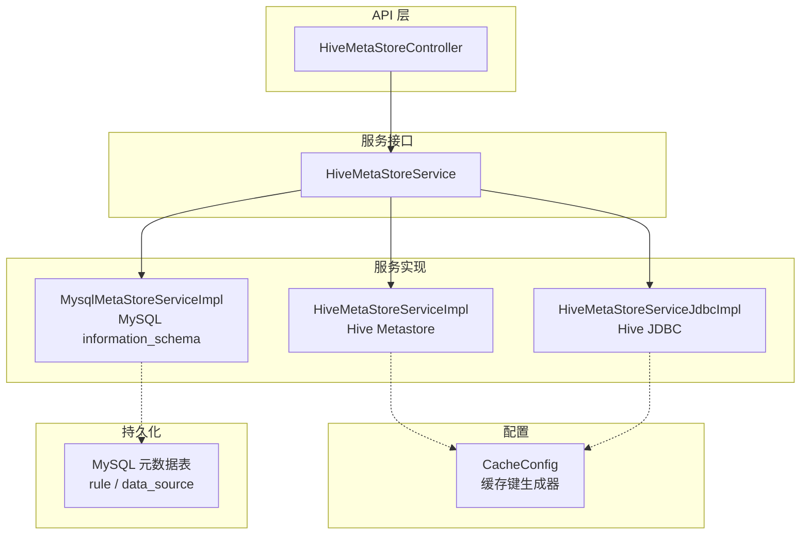
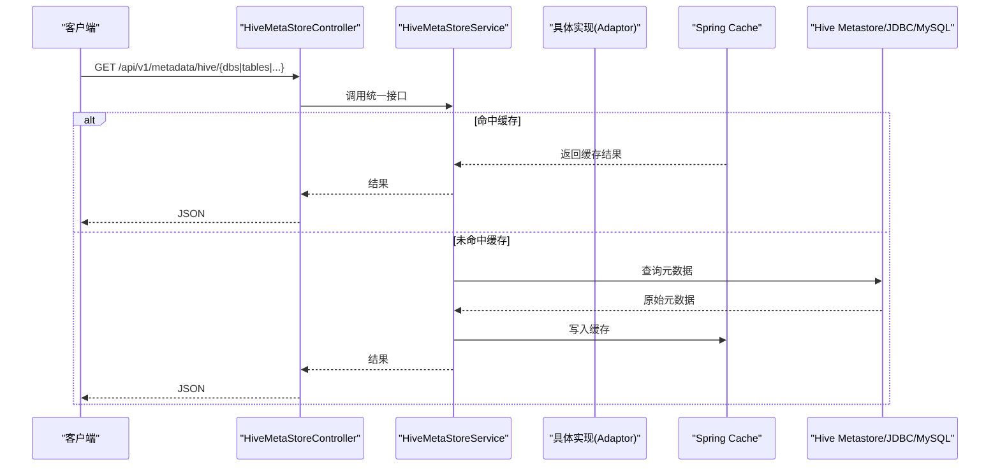
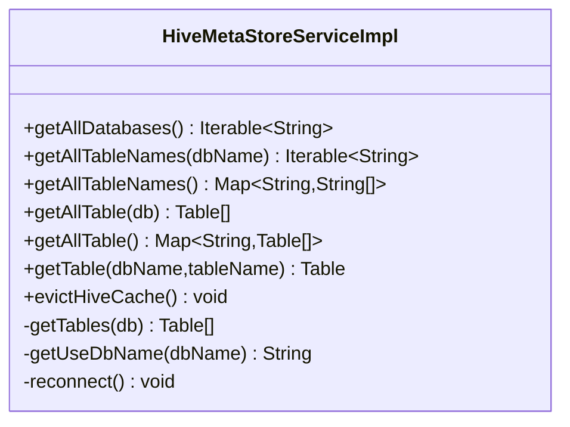
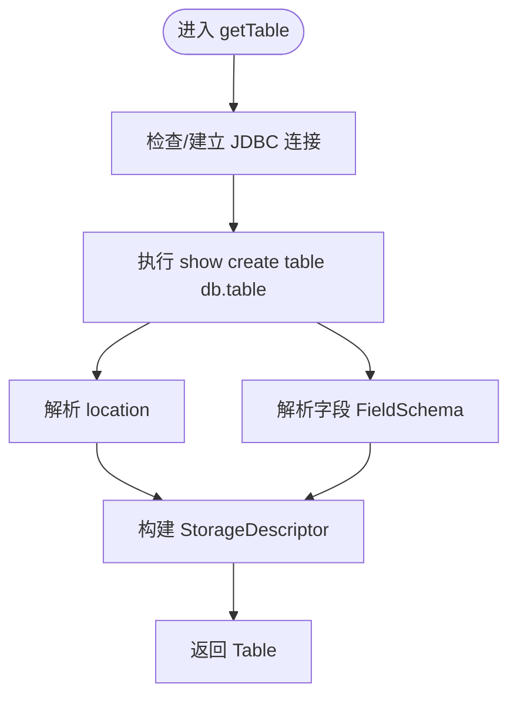
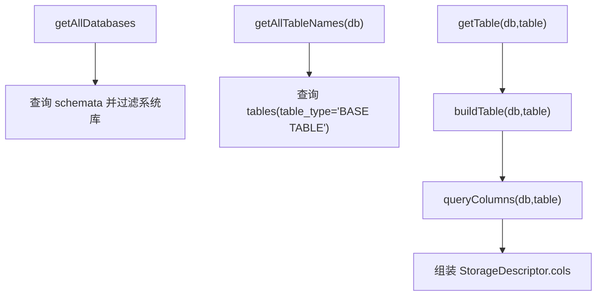
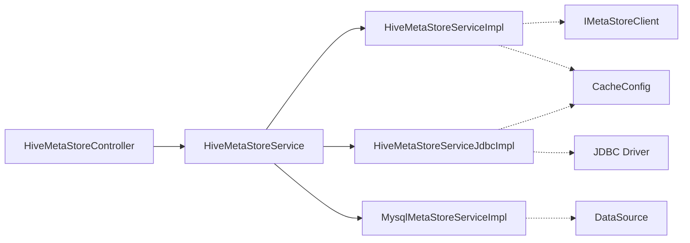

# 元数据管理

<cite>
**本文引用的文件**   
- [HiveMetaStoreController.java](file://ruoyi-modules/ruoyi-dqservice/src/main/java/com/ruoyi/dqservice/controller/HiveMetaStoreController.java)
- [HiveMetaStoreService.java](file://ruoyi-modules/ruoyi-dqservice/src/main/java/com/ruoyi/dqservice/service/HiveMetaStoreService.java)
- [HiveMetaStoreServiceImpl.java](file://ruoyi-modules/ruoyi-dqservice/src/main/java/com/ruoyi/dqservice/service/impl/HiveMetaStoreServiceImpl.java)
- [MysqlMetaStoreServiceImpl.java](file://ruoyi-modules/ruoyi-dqservice/src/main/java/com/ruoyi/dqservice/service/impl/MysqlMetaStoreServiceImpl.java)
- [HiveMetaStoreServiceJdbcImpl.java](file://ruoyi-modules/ruoyi-dqservice/src/main/java/com/ruoyi/dqservice/service/impl/HiveMetaStoreServiceJdbcImpl.java)
- [CacheConfig.java](file://ruoyi-modules/ruoyi-dqservice/src/main/java/com/ruoyi/dqservice/config/CacheConfig.java)
- [ry_dqservice_20261026.sql](file://sql/ry_dqservice_20261026.sql)
</cite>

## 目录
1. [简介](#简介)
2. [项目结构](#项目结构)
3. [核心组件](#核心组件)
4. [架构总览](#架构总览)
5. [详细组件分析](#详细组件分析)
6. [依赖关系分析](#依赖关系分析)
7. [性能与缓存策略](#性能与缓存策略)
8. [一致性保障与增量同步](#一致性保障与增量同步)
9. [操作流程与示例](#操作流程与示例)
10. [故障排查指南](#故障排查指南)
11. [结论](#结论)
12. [附录：扩展开发指南](#附录扩展开发指南)

## 简介
本章节面向“元数据管理”能力，围绕 Hive 与 MySQL 两类元数据源，说明自动发现、表结构解析、分区信息处理、适配器实现、缓存策略、增量同步机制以及查询/同步/更新流程。系统通过统一的服务接口暴露元数据能力，支持多种后端（Hive Metastore、Hive JDBC、MySQL information_schema），并提供定时缓存刷新与手动失效能力，以满足不同部署场景下的性能与一致性需求。

## 项目结构
元数据相关代码集中在 dqservice 模块中，采用 Controller-Service 分层：
- 控制器层：对外暴露 REST API，用于获取数据库、表名、表结构等元数据。
- 服务接口层：定义统一的元数据访问契约。
- 服务实现层：提供多后端适配（Hive Metastore、Hive JDBC、MySQL）。
- 配置层：缓存键生成器与缓存命名空间。
- 数据模型：规则与数据源表结构定义在 SQL 脚本中。

图示来源
- [HiveMetaStoreController.java:16-57](file://ruoyi-modules/ruoyi-dqservice/src/main/java/com/ruoyi/dqservice/controller/HiveMetaStoreController.java#L16-L57)
- [HiveMetaStoreService.java:8-23](file://ruoyi-modules/ruoyi-dqservice/src/main/java/com/ruoyi/dqservice/service/HiveMetaStoreService.java#L8-L23)
- [HiveMetaStoreServiceImpl.java:27-30](file://ruoyi-modules/ruoyi-dqservice/src/main/java/com/ruoyi/dqservice/service/impl/HiveMetaStoreServiceImpl.java#L27-L30)
- [HiveMetaStoreServiceJdbcImpl.java:35-38](file://ruoyi-modules/ruoyi-dqservice/src/main/java/com/ruoyi/dqservice/service/impl/HiveMetaStoreServiceJdbcImpl.java#L35-L38)
- [MysqlMetaStoreServiceImpl.java:35-37](file://ruoyi-modules/ruoyi-dqservice/src/main/java/com/ruoyi/dqservice/service/impl/MysqlMetaStoreServiceImpl.java#L35-L37)
- [CacheConfig.java:13-13](file://ruoyi-modules/ruoyi-dqservice/src/main/java/com/ruoyi/dqservice/config/CacheConfig.java#L13-L13)
- [ry_dqservice_20261026.sql:7-39](file://sql/ry_dqservice_20261026.sql#L7-L39)

章节来源
- [HiveMetaStoreController.java:16-57](file://ruoyi-modules/ruoyi-dqservice/src/main/java/com/ruoyi/dqservice/controller/HiveMetaStoreController.java#L16-L57)
- [HiveMetaStoreService.java:8-23](file://ruoyi-modules/ruoyi-dqservice/src/main/java/com/ruoyi/dqservice/service/HiveMetaStoreService.java#L8-L23)
- [ry_dqservice_20261026.sql:7-39](file://sql/ry_dqservice_20261026.sql#L7-L39)

## 核心组件
- 控制器：提供 /api/v1/metadata/hive 路径的 REST 接口，用于列出数据库、表名、表结构等。
- 服务接口：统一抽象出 getAllDatabases、getAllTableNames、getAllTable、getTable、evictHiveCache 等方法。
- 适配器实现：
  - HiveMetastore 适配器：基于 IMetaStoreClient 访问 Hive Metastore，具备 Spring Cache 注解与定时刷新。
  - Hive JDBC 适配器：基于 JDBC 执行 show databases/tables/create table 语句，支持 Kerberos 认证初始化。
  - MySQL 适配器：基于 application 主数据源的 information_schema 查询库、表、列信息，返回与 Hive 一致的 Table/StorageDescriptor/FieldSchema 结构。
- 缓存配置：使用 @CacheConfig 指定缓存名称与 keyGenerator，配合 @Cacheable/@CacheEvict 实现缓存命中与失效。

章节来源
- [HiveMetaStoreController.java:16-57](file://ruoyi-modules/ruoyi-dqservice/src/main/java/com/ruoyi/dqservice/controller/HiveMetaStoreController.java#L16-L57)
- [HiveMetaStoreService.java:8-23](file://ruoyi-modules/ruoyi-dqservice/src/main/java/com/ruoyi/dqservice/service/HiveMetaStoreService.java#L8-L23)
- [HiveMetaStoreServiceImpl.java:27-30](file://ruoyi-modules/ruoyi-dqservice/src/main/java/com/ruoyi/dqservice/service/impl/HiveMetaStoreServiceImpl.java#L27-L30)
- [HiveMetaStoreServiceJdbcImpl.java:35-38](file://ruoyi-modules/ruoyi-dqservice/src/main/java/com/ruoyi/dqservice/service/impl/HiveMetaStoreServiceJdbcImpl.java#L35-L38)
- [MysqlMetaStoreServiceImpl.java:35-37](file://ruoyi-modules/ruoyi-dqservice/src/main/java/com/ruoyi/dqservice/service/impl/MysqlMetaStoreServiceImpl.java#L35-L37)

## 架构总览
下图展示从请求到具体实现的调用链，以及缓存与外部系统的交互。

图示来源
- [HiveMetaStoreController.java:16-57](file://ruoyi-modules/ruoyi-dqservice/src/main/java/com/ruoyi/dqservice/controller/HiveMetaStoreController.java#L16-L57)
- [HiveMetaStoreService.java:8-23](file://ruoyi-modules/ruoyi-dqservice/src/main/java/com/ruoyi/dqservice/service/HiveMetaStoreService.java#L8-L23)
- [HiveMetaStoreServiceImpl.java:49-159](file://ruoyi-modules/ruoyi-dqservice/src/main/java/com/ruoyi/dqservice/service/impl/HiveMetaStoreServiceImpl.java#L49-L159)
- [HiveMetaStoreServiceJdbcImpl.java:102-183](file://ruoyi-modules/ruoyi-dqservice/src/main/java/com/ruoyi/dqservice/service/impl/HiveMetaStoreServiceJdbcImpl.java#L102-L183)
- [MysqlMetaStoreServiceImpl.java:58-135](file://ruoyi-modules/ruoyi-dqservice/src/main/java/com/ruoyi/dqservice/service/impl/MysqlMetaStoreServiceImpl.java#L58-L135)

## 详细组件分析

### 控制器：HiveMetaStoreController
- 职责：将 HTTP 请求路由到 HiveMetaStoreService 的统一方法。
- 关键端点：
  - GET /api/v1/metadata/hive/dbs：获取所有数据库列表。
  - GET /api/v1/metadata/hive/tables/names?db=xxx：获取某库下所有表名。
  - GET /api/v1/metadata/hive/tables?db=xxx：获取某库下表结构集合。
  - GET /api/v1/metadata/hive/dbs/tables：获取所有库下表结构映射。
  - GET /api/v1/metadata/hive/dbs/tables/names：获取所有库下表名映射。
  - GET /api/v1/metadata/hive/table?db=xxx&table=yyy：获取单表结构。
- 注入策略：默认注入名为 mysqlMetaStore 的实现，便于本地演示环境直接读取 MySQL 元数据。

章节来源
- [HiveMetaStoreController.java:16-57](file://ruoyi-modules/ruoyi-dqservice/src/main/java/com/ruoyi/dqservice/controller/HiveMetaStoreController.java#L16-L57)

### 服务接口：HiveMetaStoreService
- 统一方法：
  - getAllDatabases()
  - getAllTableNames(dbName)
  - getAllTableNames()
  - getAllTable(db)
  - getAllTable()
  - getTable(dbName, tableName)
  - evictHiveCache()
- 设计意图：屏蔽底层差异，向上提供一致的数据结构与行为。

章节来源
- [HiveMetaStoreService.java:8-23](file://ruoyi-modules/ruoyi-dqservice/src/main/java/com/ruoyi/dqservice/service/HiveMetaStoreService.java#L8-L23)

### 适配器一：HiveMetaStoreServiceImpl（Hive Metastore）
- 数据来源：IMetaStoreClient 连接 Hive Metastore。
- 特性：
  - 使用 @CacheConfig(cacheNames="hive") 与 @Cacheable/@CacheEvict 进行缓存控制。
  - 定时任务按固定频率清空缓存，保证元数据变更后可被刷新。
  - 异常时尝试 reconnect 并记录日志。
- 注意：
  - getAllTable() 与 getAllTable(db) 之间缓存复用存在 TODO 注释，需关注重复查询问题。
  - 当 client 为 null 时返回空集合或空映射，避免 NPE。

图示来源
- [HiveMetaStoreServiceImpl.java:27-199](file://ruoyi-modules/ruoyi-dqservice/src/main/java/com/ruoyi/dqservice/service/impl/HiveMetaStoreServiceImpl.java#L27-L199)

章节来源
- [HiveMetaStoreServiceImpl.java:27-199](file://ruoyi-modules/ruoyi-dqservice/src/main/java/com/ruoyi/dqservice/service/impl/HiveMetaStoreServiceImpl.java#L27-L199)

### 适配器二：HiveMetaStoreServiceJdbcImpl（Hive JDBC）
- 数据来源：通过 JDBC 驱动连接 HiveServer2，执行 show databases/tables 与 show create table。
- 特性：
  - 支持 Kerberos 认证初始化（根据配置项 needKerberos/keytabUser/keytabPath）。
  - 使用 @CacheConfig(cacheNames="jdbcHive") 与 @Cacheable/@CacheEvict 进行缓存控制。
  - 解析 CREATE TABLE 语句以提取 location 与字段信息（FieldSchema）。
- 限制：
  - getAllTable(db)/getAllTable() 当前返回 null，仅支持基础元数据查询。

图示来源
- [HiveMetaStoreServiceJdbcImpl.java:137-173](file://ruoyi-modules/ruoyi-dqservice/src/main/java/com/ruoyi/dqservice/service/impl/HiveMetaStoreServiceJdbcImpl.java#L137-L173)
- [HiveMetaStoreServiceJdbcImpl.java:239-325](file://ruoyi-modules/ruoyi-dqservice/src/main/java/com/ruoyi/dqservice/service/impl/HiveMetaStoreServiceJdbcImpl.java#L239-L325)

章节来源
- [HiveMetaStoreServiceJdbcImpl.java:35-38](file://ruoyi-modules/ruoyi-dqservice/src/main/java/com/ruoyi/dqservice/service/impl/HiveMetaStoreServiceJdbcImpl.java#L35-L38)
- [HiveMetaStoreServiceJdbcImpl.java:86-100](file://ruoyi-modules/ruoyi-dqservice/src/main/java/com/ruoyi/dqservice/service/impl/HiveMetaStoreServiceJdbcImpl.java#L86-L100)
- [HiveMetaStoreServiceJdbcImpl.java:102-183](file://ruoyi-modules/ruoyi-dqservice/src/main/java/com/ruoyi/dqservice/service/impl/HiveMetaStoreServiceJdbcImpl.java#L102-L183)
- [HiveMetaStoreServiceJdbcImpl.java:239-325](file://ruoyi-modules/ruoyi-dqservice/src/main/java/com/ruoyi/dqservice/service/impl/HiveMetaStoreServiceJdbcImpl.java#L239-L325)

### 适配器三：MysqlMetaStoreServiceImpl（MySQL information_schema）
- 数据来源：应用主数据源（javax.sql.DataSource），查询 information_schema.schemata/tables/columns。
- 特性：
  - 过滤系统库（information_schema/mysql/performance_schema/sys）。
  - 返回与 Hive 一致的 Table/StorageDescriptor/FieldSchema 结构，前端无需改动。
  - 实时查询，无内部缓存；evictHiveCache 为空实现。
- 关键点：
  - buildTable 仅填充库名与表名，列信息在 getTable 中单独查询，减少树节点负载。
  - queryColumns 按 ordinal_position 排序，保证列顺序。

图示来源
- [MysqlMetaStoreServiceImpl.java:58-135](file://ruoyi-modules/ruoyi-dqservice/src/main/java/com/ruoyi/dqservice/service/impl/MysqlMetaStoreServiceImpl.java#L58-L135)
- [MysqlMetaStoreServiceImpl.java:137-189](file://ruoyi-modules/ruoyi-dqservice/src/main/java/com/ruoyi/dqservice/service/impl/MysqlMetaStoreServiceImpl.java#L137-L189)

章节来源
- [MysqlMetaStoreServiceImpl.java:35-37](file://ruoyi-modules/ruoyi-dqservice/src/main/java/com/ruoyi/dqservice/service/impl/MysqlMetaStoreServiceImpl.java#L35-L37)
- [MysqlMetaStoreServiceImpl.java:58-135](file://ruoyi-modules/ruoyi-dqservice/src/main/java/com/ruoyi/dqservice/service/impl/MysqlMetaStoreServiceImpl.java#L58-L135)
- [MysqlMetaStoreServiceImpl.java:137-189](file://ruoyi-modules/ruoyi-dqservice/src/main/java/com/ruoyi/dqservice/service/impl/MysqlMetaStoreServiceImpl.java#L137-L189)

## 依赖关系分析
- 控制器依赖服务接口，不感知具体实现。
- 服务接口由三种实现提供：
  - HiveMetastore 实现依赖 IMetaStoreClient。
  - Hive JDBC 实现依赖 JDBC 驱动与 HiveServer2。
  - MySQL 实现依赖应用主数据源 DataSource。
- 缓存键生成器由 CacheConfig 提供，供多个实现共享。

图示来源
- [HiveMetaStoreController.java:16-57](file://ruoyi-modules/ruoyi-dqservice/src/main/java/com/ruoyi/dqservice/controller/HiveMetaStoreController.java#L16-L57)
- [HiveMetaStoreService.java:8-23](file://ruoyi-modules/ruoyi-dqservice/src/main/java/com/ruoyi/dqservice/service/HiveMetaStoreService.java#L8-L23)
- [HiveMetaStoreServiceImpl.java:27-30](file://ruoyi-modules/ruoyi-dqservice/src/main/java/com/ruoyi/dqservice/service/impl/HiveMetaStoreServiceImpl.java#L27-L30)
- [HiveMetaStoreServiceJdbcImpl.java:35-38](file://ruoyi-modules/ruoyi-dqservice/src/main/java/com/ruoyi/dqservice/service/impl/HiveMetaStoreServiceJdbcImpl.java#L35-L38)
- [MysqlMetaStoreServiceImpl.java:35-37](file://ruoyi-modules/ruoyi-dqservice/src/main/java/com/ruoyi/dqservice/service/impl/MysqlMetaStoreServiceImpl.java#L35-L37)
- [CacheConfig.java:13-13](file://ruoyi-modules/ruoyi-dqservice/src/main/java/com/ruoyi/dqservice/config/CacheConfig.java#L13-L13)

章节来源
- [HiveMetaStoreController.java:16-57](file://ruoyi-modules/ruoyi-dqservice/src/main/java/com/ruoyi/dqservice/controller/HiveMetaStoreController.java#L16-L57)
- [HiveMetaStoreService.java:8-23](file://ruoyi-modules/ruoyi-dqservice/src/main/java/com/ruoyi/dqservice/service/HiveMetaStoreService.java#L8-L23)

## 性能与缓存策略
- 缓存命名空间：
  - Hive Metastore 实现：cacheNames="hive"
  - Hive JDBC 实现：cacheNames="jdbcHive"
  - MySQL 实现：无缓存（实时查询）
- 缓存注解：
  - @Cacheable：对读接口进行缓存，条件排除 null 或空集合。
  - @CacheEvict：定时任务清空缓存，触发后下次请求重新加载。
- 键生成：
  - 通过 CacheConfig 提供的 cacheKeyGenerator 统一生成缓存键，确保相同参数命中同一缓存条目。
- 建议：
  - 对于大库/大表场景，优先使用按需查询（如先查库名/表名，再按需拉取列信息），避免一次性加载全量结构。
  - 合理设置定时刷新间隔，平衡新鲜度与性能。

章节来源
- [HiveMetaStoreServiceImpl.java:27-30](file://ruoyi-modules/ruoyi-dqservice/src/main/java/com/ruoyi/dqservice/service/impl/HiveMetaStoreServiceImpl.java#L27-L30)
- [HiveMetaStoreServiceImpl.java:49-159](file://ruoyi-modules/ruoyi-dqservice/src/main/java/com/ruoyi/dqservice/service/impl/HiveMetaStoreServiceImpl.java#L49-L159)
- [HiveMetaStoreServiceJdbcImpl.java:35-38](file://ruoyi-modules/ruoyi-dqservice/src/main/java/com/ruoyi/dqservice/service/impl/HiveMetaStoreServiceJdbcImpl.java#L35-L38)
- [HiveMetaStoreServiceJdbcImpl.java:102-183](file://ruoyi-modules/ruoyi-dqservice/src/main/java/com/ruoyi/dqservice/service/impl/HiveMetaStoreServiceJdbcImpl.java#L102-L183)
- [MysqlMetaStoreServiceImpl.java:131-135](file://ruoyi-modules/ruoyi-dqservice/src/main/java/com/ruoyi/dqservice/service/impl/MysqlMetaStoreServiceImpl.java#L131-L135)
- [CacheConfig.java:13-13](file://ruoyi-modules/ruoyi-dqservice/src/main/java/com/ruoyi/dqservice/config/CacheConfig.java#L13-L13)

## 一致性保障与增量同步
- 一致性保障：
  - 通过 @CacheEvict 定时清空缓存，确保后续请求从源头重新拉取最新元数据。
  - Hive Metastore 实现在异常时尝试 reconnect，提升可用性。
- 增量同步：
  - 当前实现未显式实现增量同步逻辑，主要依赖全量刷新与按需查询。
  - 若需增量同步，可在服务层引入“最后更新时间”与“变更事件监听”，结合业务侧变更通知进行局部刷新。
- 分区信息处理：
  - Hive JDBC 实现通过解析 CREATE TABLE 语句提取 location 与字段信息；分区字段属于列的一部分，可随列信息一并返回。
  - MySQL 实现通过 columns 表获取列信息，分区字段同样作为普通列返回。

章节来源
- [HiveMetaStoreServiceImpl.java:147-159](file://ruoyi-modules/ruoyi-dqservice/src/main/java/com/ruoyi/dqservice/service/impl/HiveMetaStoreServiceImpl.java#L147-L159)
- [HiveMetaStoreServiceImpl.java:191-197](file://ruoyi-modules/ruoyi-dqservice/src/main/java/com/ruoyi/dqservice/service/impl/HiveMetaStoreServiceImpl.java#L191-L197)
- [HiveMetaStoreServiceJdbcImpl.java:137-173](file://ruoyi-modules/ruoyi-dqservice/src/main/java/com/ruoyi/dqservice/service/impl/HiveMetaStoreServiceJdbcImpl.java#L137-L173)
- [MysqlMetaStoreServiceImpl.java:168-189](file://ruoyi-modules/ruoyi-dqservice/src/main/java/com/ruoyi/dqservice/service/impl/MysqlMetaStoreServiceImpl.java#L168-L189)

## 操作流程与示例

### 获取数据库列表
- 请求：GET /api/v1/metadata/hive/dbs
- 流程：
  - 控制器调用 HiveMetaStoreService.getAllDatabases()
  - 若启用缓存且命中，则直接返回
  - 否则调用对应实现（Hive Metastore/JDBC/MySQL）获取数据库列表
  - 写回缓存（非空结果）
- 输出：字符串数组

章节来源
- [HiveMetaStoreController.java:24-27](file://ruoyi-modules/ruoyi-dqservice/src/main/java/com/ruoyi/dqservice/controller/HiveMetaStoreController.java#L24-L27)
- [HiveMetaStoreService.java:10-10](file://ruoyi-modules/ruoyi-dqservice/src/main/java/com/ruoyi/dqservice/service/HiveMetaStoreService.java#L10-L10)
- [HiveMetaStoreServiceImpl.java:49-65](file://ruoyi-modules/ruoyi-dqservice/src/main/java/com/ruoyi/dqservice/service/impl/HiveMetaStoreServiceImpl.java#L49-L65)
- [HiveMetaStoreServiceJdbcImpl.java:102-106](file://ruoyi-modules/ruoyi-dqservice/src/main/java/com/ruoyi/dqservice/service/impl/HiveMetaStoreServiceJdbcImpl.java#L102-L106)
- [MysqlMetaStoreServiceImpl.java:58-80](file://ruoyi-modules/ruoyi-dqservice/src/main/java/com/ruoyi/dqservice/service/impl/MysqlMetaStoreServiceImpl.java#L58-L80)

### 获取某库下表名列表
- 请求：GET /api/v1/metadata/hive/tables/names?db=xxx
- 流程：
  - 控制器调用 getAllTableNames(db)
  - 实现层查询元数据源（Hive Metastore/JDBC/MySQL）
  - 返回表名集合（可能带缓存）
- 输出：字符串数组

章节来源
- [HiveMetaStoreController.java:30-33](file://ruoyi-modules/ruoyi-dqservice/src/main/java/com/ruoyi/dqservice/controller/HiveMetaStoreController.java#L30-L33)
- [HiveMetaStoreService.java:12-12](file://ruoyi-modules/ruoyi-dqservice/src/main/java/com/ruoyi/dqservice/service/HiveMetaStoreService.java#L12-L12)
- [HiveMetaStoreServiceImpl.java:68-85](file://ruoyi-modules/ruoyi-dqservice/src/main/java/com/ruoyi/dqservice/service/impl/HiveMetaStoreServiceImpl.java#L68-L85)
- [HiveMetaStoreServiceJdbcImpl.java:108-112](file://ruoyi-modules/ruoyi-dqservice/src/main/java/com/ruoyi/dqservice/service/impl/HiveMetaStoreServiceJdbcImpl.java#L108-L112)
- [MysqlMetaStoreServiceImpl.java:82-86](file://ruoyi-modules/ruoyi-dqservice/src/main/java/com/ruoyi/dqservice/service/impl/MysqlMetaStoreServiceImpl.java#L82-L86)

### 获取某库下表结构
- 请求：GET /api/v1/metadata/hive/tables?db=xxx
- 流程：
  - 控制器调用 getAllTable(db)
  - 实现层遍历表名，逐个构建 Table 对象（包含列信息）
  - 返回表结构集合（可能带缓存）
- 输出：Table 列表

章节来源
- [HiveMetaStoreController.java:35-38](file://ruoyi-modules/ruoyi-dqservice/src/main/java/com/ruoyi/dqservice/controller/HiveMetaStoreController.java#L35-L38)
- [HiveMetaStoreService.java:16-16](file://ruoyi-modules/ruoyi-dqservice/src/main/java/com/ruoyi/dqservice/service/HiveMetaStoreService.java#L16-L16)
- [HiveMetaStoreServiceImpl.java:88-92](file://ruoyi-modules/ruoyi-dqservice/src/main/java/com/ruoyi/dqservice/service/impl/HiveMetaStoreServiceImpl.java#L88-L92)
- [MysqlMetaStoreServiceImpl.java:99-108](file://ruoyi-modules/ruoyi-dqservice/src/main/java/com/ruoyi/dqservice/service/impl/MysqlMetaStoreServiceImpl.java#L99-L108)

### 获取单表结构
- 请求：GET /api/v1/metadata/hive/table?db=xxx&table=yyy
- 流程：
  - 控制器调用 getTable(db, table)
  - 实现层返回 Table 对象，包含列信息（StorageDescriptor.cols）
- 输出：Table 对象

章节来源
- [HiveMetaStoreController.java:50-54](file://ruoyi-modules/ruoyi-dqservice/src/main/java/com/ruoyi/dqservice/controller/HiveMetaStoreController.java#L50-L54)
- [HiveMetaStoreService.java:20-20](file://ruoyi-modules/ruoyi-dqservice/src/main/java/com/ruoyi/dqservice/service/HiveMetaStoreService.java#L20-L20)
- [HiveMetaStoreServiceImpl.java:128-145](file://ruoyi-modules/ruoyi-dqservice/src/main/java/com/ruoyi/dqservice/service/impl/HiveMetaStoreServiceImpl.java#L128-L145)
- [HiveMetaStoreServiceJdbcImpl.java:137-173](file://ruoyi-modules/ruoyi-dqservice/src/main/java/com/ruoyi/dqservice/service/impl/HiveMetaStoreServiceJdbcImpl.java#L137-L173)
- [MysqlMetaStoreServiceImpl.java:121-129](file://ruoyi-modules/ruoyi-dqservice/src/main/java/com/ruoyi/dqservice/service/impl/MysqlMetaStoreServiceImpl.java#L121-L129)

### 刷新元数据缓存
- 方式：
  - 定时任务：各实现类通过 @Scheduled 定时调用 evictHiveCache() 清空缓存。
  - 手动触发：可通过扩展控制器暴露刷新接口，或直接调用服务实现的方法。
- 效果：
  - 下一次请求将重新从元数据源拉取最新数据并回填缓存。

章节来源
- [HiveMetaStoreServiceImpl.java:147-159](file://ruoyi-modules/ruoyi-dqservice/src/main/java/com/ruoyi/dqservice/service/impl/HiveMetaStoreServiceImpl.java#L147-L159)
- [HiveMetaStoreServiceJdbcImpl.java:175-183](file://ruoyi-modules/ruoyi-dqservice/src/main/java/com/ruoyi/dqservice/service/impl/HiveMetaStoreServiceJdbcImpl.java#L175-L183)
- [MysqlMetaStoreServiceImpl.java:131-135](file://ruoyi-modules/ruoyi-dqservice/src/main/java/com/ruoyi/dqservice/service/impl/MysqlMetaStoreServiceImpl.java#L131-L135)

## 故障排查指南
- Hive Metastore 客户端为空：
  - 现象：返回空集合或空映射，控制台出现警告日志。
  - 排查：检查 hive.metastore.uris 等配置是否正确，确认 IMetaStoreClient 是否成功注入。
- Hive JDBC 连接失败：
  - 现象：JDBC 查询报错，日志中出现错误堆栈。
  - 排查：核对 hive.jdbc.className/url 配置，确认 Kerberos 配置（needKerberos/keytabUser/keytabPath）正确。
- MySQL 元数据查询失败：
  - 现象：日志记录“查询表列表失败/查询字段信息失败”。
  - 排查：确认应用主数据源可用，目标库具有 sufficient 权限访问 information_schema。
- 缓存未刷新：
  - 现象：修改元数据后，前端仍显示旧结构。
  - 排查：确认定时任务已启用，或手动触发 evictHiveCache。

章节来源
- [HiveMetaStoreServiceImpl.java:54-64](file://ruoyi-modules/ruoyi-dqservice/src/main/java/com/ruoyi/dqservice/service/impl/HiveMetaStoreServiceImpl.java#L54-L64)
- [HiveMetaStoreServiceImpl.java:191-197](file://ruoyi-modules/ruoyi-dqservice/src/main/java/com/ruoyi/dqservice/service/impl/HiveMetaStoreServiceImpl.java#L191-L197)
- [HiveMetaStoreServiceJdbcImpl.java:196-213](file://ruoyi-modules/ruoyi-dqservice/src/main/java/com/ruoyi/dqservice/service/impl/HiveMetaStoreServiceJdbcImpl.java#L196-L213)
- [MysqlMetaStoreServiceImpl.java:75-79](file://ruoyi-modules/ruoyi-dqservice/src/main/java/com/ruoyi/dqservice/service/impl/MysqlMetaStoreServiceImpl.java#L75-L79)
- [MysqlMetaStoreServiceImpl.java:161-165](file://ruoyi-modules/ruoyi-dqservice/src/main/java/com/ruoyi/dqservice/service/impl/MysqlMetaStoreServiceImpl.java#L161-L165)
- [MysqlMetaStoreServiceImpl.java:184-188](file://ruoyi-modules/ruoyi-dqservice/src/main/java/com/ruoyi/dqservice/service/impl/MysqlMetaStoreServiceImpl.java#L184-L188)

## 结论
本方案通过统一服务接口与多适配器实现，提供了跨 Hive 与 MySQL 的元数据管理能力。借助 Spring Cache 与定时刷新，系统在性能与一致性之间取得平衡；同时通过按需查询与结构对齐，降低前端耦合度。针对大规模元数据场景，建议结合增量同步与更细粒度的缓存策略进一步优化。

## 附录：扩展开发指南
- 新增适配器：
  - 实现 HiveMetaStoreService 接口，并在类上标注 @Service 与 @Qualifier。
  - 如需缓存，添加 @CacheConfig 与 @Cacheable/@CacheEvict。
  - 在控制器中通过 @Qualifier 注入新实现，或扩展控制器暴露新端点。
- 缓存键生成：
  - 在 CacheConfig 中完善 cacheKeyGenerator，确保不同参数的查询命中不同缓存条目。
- 数据模型扩展：
  - 如需持久化元数据快照或变更记录，可在 ry_dqservice_20261026.sql 基础上扩展表结构，并在服务层增加读写逻辑。

章节来源
- [HiveMetaStoreService.java:8-23](file://ruoyi-modules/ruoyi-dqservice/src/main/java/com/ruoyi/dqservice/service/HiveMetaStoreService.java#L8-L23)
- [CacheConfig.java:13-13](file://ruoyi-modules/ruoyi-dqservice/src/main/java/com/ruoyi/dqservice/config/CacheConfig.java#L13-L13)
- [ry_dqservice_20261026.sql:7-39](file://sql/ry_dqservice_20261026.sql#L7-L39)