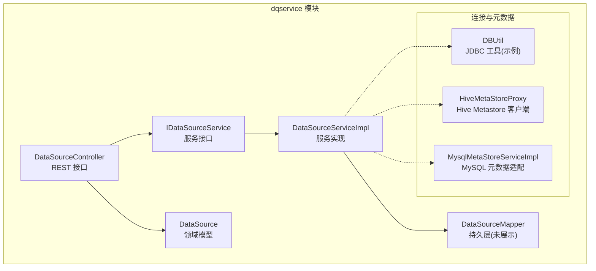
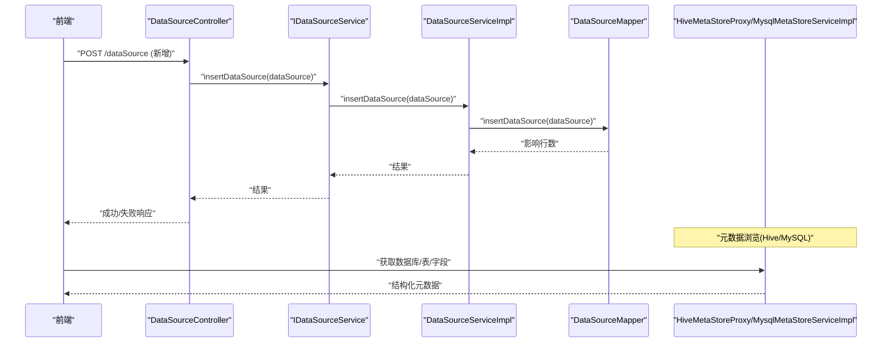
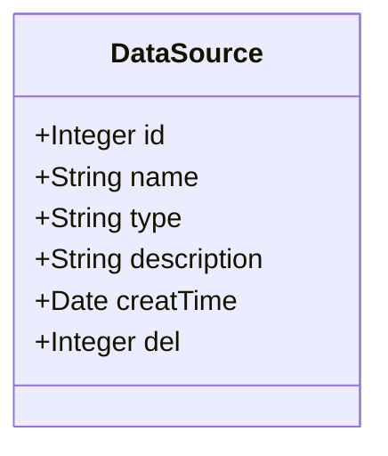
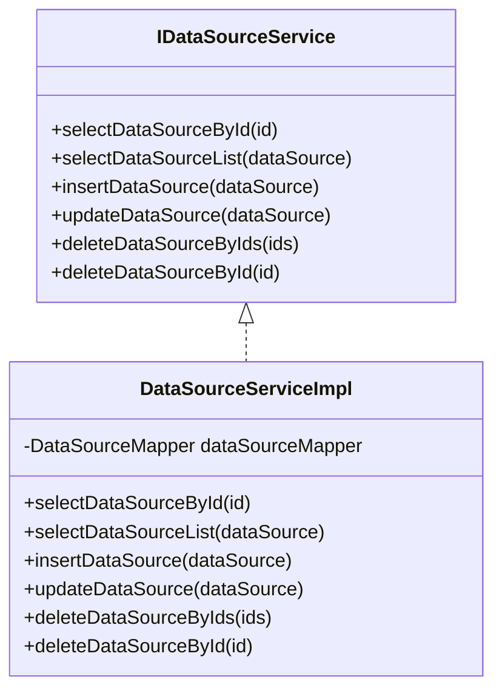
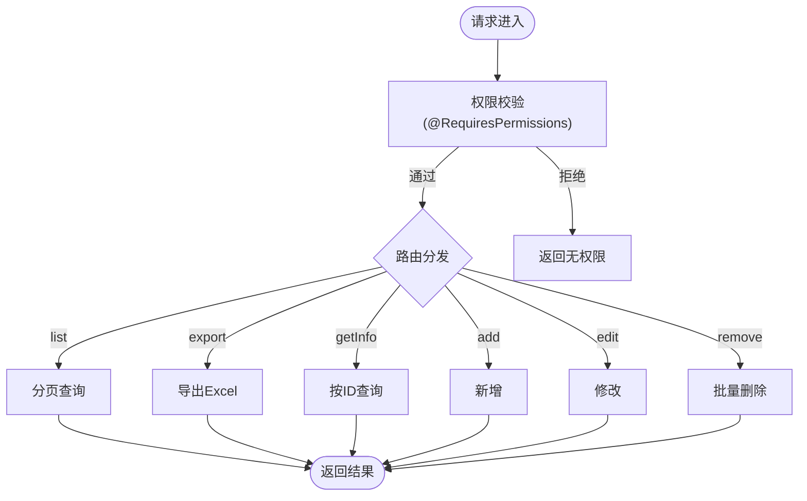
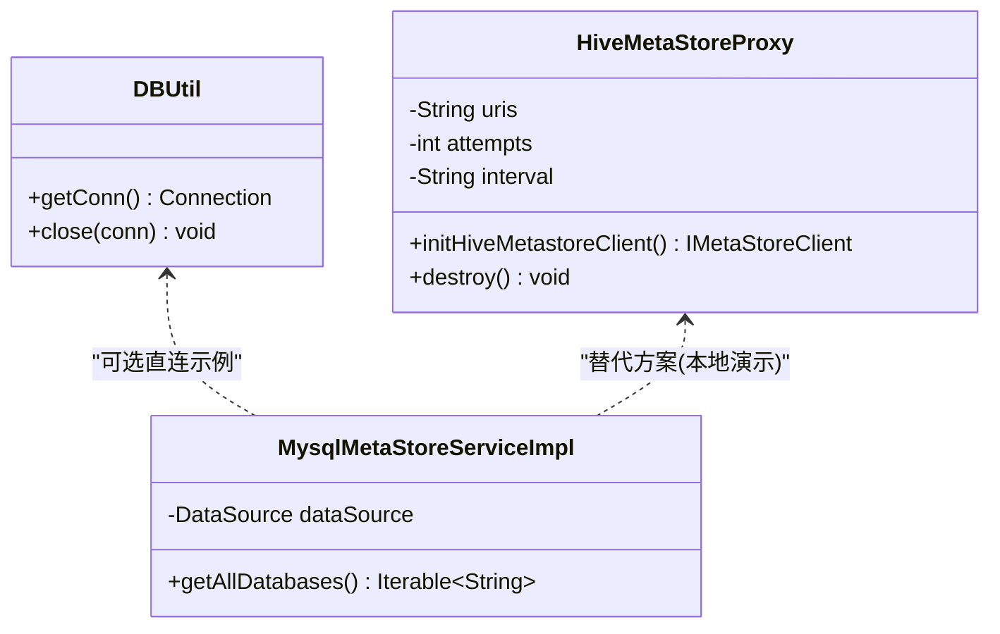
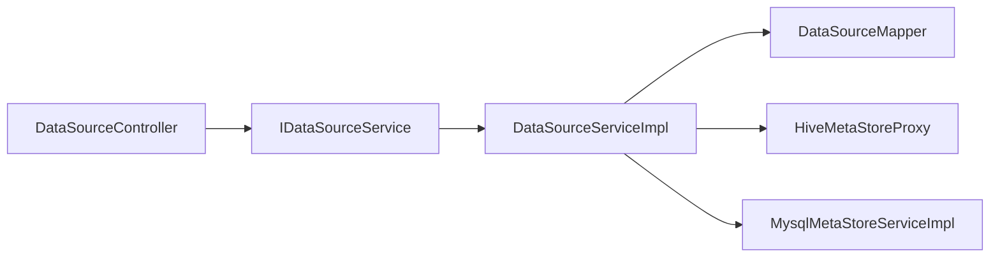

# 数据源管理

<cite>
**本文引用的文件**   
- [DataSource.java](file://ruoyi-modules/ruoyi-dqservice/src/main/java/com/ruoyi/dqservice/domain/DataSource.java)
- [IDataSourceService.java](file://ruoyi-modules/ruoyi-dqservice/src/main/java/com/ruoyi/dqservice/service/IDataSourceService.java)
- [DataSourceServiceImpl.java](file://ruoyi-modules/ruoyi-dqservice/src/main/java/com/ruoyi/dqservice/service/impl/DataSourceServiceImpl.java)
- [DataSourceController.java](file://ruoyi-modules/ruoyi-dqservice/src/main/java/com/ruoyi/dqservice/controller/DataSourceController.java)
- [DBUtil.java](file://ruoyi-modules/ruoyi-dqservice/src/main/java/com/ruoyi/dqservice/connecter/DBUtil.java)
- [HiveMetaStoreProxy.java](file://ruoyi-modules/ruoyi-dqservice/src/main/java/com/ruoyi/dqservice/connecter/HiveMetaStoreProxy.java)
- [MysqlMetaStoreServiceImpl.java](file://ruoyi-modules/ruoyi-dqservice/src/main/java/com/ruoyi/dqservice/service/impl/MysqlMetaStoreServiceImpl.java)
</cite>

## 目录
1. [简介](#简介)
2. [项目结构](#项目结构)
3. [核心组件](#核心组件)
4. [架构总览](#架构总览)
5. [详细组件分析](#详细组件分析)
6. [依赖关系分析](#依赖关系分析)
7. [性能与连接池](#性能与连接池)
8. [安全与权限控制](#安全与权限控制)
9. [配置与示例](#配置与示例)
10. [故障排除指南](#故障排除指南)
11. [结论](#结论)

## 简介
本文件围绕“数据源管理”功能，系统性说明多类型数据源的配置、连接测试、权限控制、连接池管理等核心能力，并给出 MySQL、Hive 等数据源的适配实现要点。文档覆盖数据源的添加、查询、修改、删除的完整流程，以及连接异常处理与性能优化策略，并提供可操作的配置示例与排障建议。

## 项目结构
数据源管理相关代码集中在 dqservice 模块中，采用典型的 Controller-Service-Mapper 分层：
- 领域模型：DataSource
- 服务接口与实现：IDataSourceService / DataSourceServiceImpl
- 控制器：DataSourceController
- 连接工具与元数据代理：DBUtil、HiveMetaStoreProxy
- MySQL 元数据适配：MysqlMetaStoreServiceImpl（用于规则制作向导浏览库表字段）

图表来源
- [DataSourceController.java:31-105](file://ruoyi-modules/ruoyi-dqservice/src/main/java/com/ruoyi/dqservice/controller/DataSourceController.java#L31-L105)
- [IDataSourceService.java:12-61](file://ruoyi-modules/ruoyi-dqservice/src/main/java/com/ruoyi/dqservice/service/IDataSourceService.java#L12-L61)
- [DataSourceServiceImpl.java:17-95](file://ruoyi-modules/ruoyi-dqservice/src/main/java/com/ruoyi/dqservice/service/impl/DataSourceServiceImpl.java#L17-L95)
- [DataSource.java:16-110](file://ruoyi-modules/ruoyi-dqservice/src/main/java/com/ruoyi/dqservice/domain/DataSource.java#L16-L110)
- [DBUtil.java:7-33](file://ruoyi-modules/ruoyi-dqservice/src/main/java/com/ruoyi/dqservice/connecter/DBUtil.java#L7-L33)
- [HiveMetaStoreProxy.java:14-63](file://ruoyi-modules/ruoyi-dqservice/src/main/java/com/ruoyi/dqservice/connecter/HiveMetaStoreProxy.java#L14-L63)
- [MysqlMetaStoreServiceImpl.java:35-56](file://ruoyi-modules/ruoyi-dqservice/src/main/java/com/ruoyi/dqservice/service/impl/MysqlMetaStoreServiceImpl.java#L35-L56)

章节来源
- [DataSourceController.java:31-105](file://ruoyi-modules/ruoyi-dqservice/src/main/java/com/ruoyi/dqservice/controller/DataSourceController.java#L31-L105)
- [IDataSourceService.java:12-61](file://ruoyi-modules/ruoyi-dqservice/src/main/java/com/ruoyi/dqservice/service/IDataSourceService.java#L12-L61)
- [DataSourceServiceImpl.java:17-95](file://ruoyi-modules/ruoyi-dqservice/src/main/java/com/ruoyi/dqservice/service/impl/DataSourceServiceImpl.java#L17-L95)
- [DataSource.java:16-110](file://ruoyi-modules/ruoyi-dqservice/src/main/java/com/ruoyi/dqservice/domain/DataSource.java#L16-L110)

## 核心组件
- 领域模型 DataSource：承载数据源的基本信息（名称、类型、描述、创建时间、删除位等），作为前后端交互与持久化的载体。
- 服务接口 IDataSourceService：定义数据源的增删改查与批量删除等标准操作。
- 服务实现 DataSourceServiceImpl：将业务逻辑委托给 Mapper 完成持久化，并在更新时设置更新时间。
- 控制器 DataSourceController：暴露 REST 接口，包含列表查询、导出、详情、新增、修改、删除；通过权限注解进行访问控制。
- 连接工具 DBUtil：提供 JDBC 直连示例（当前默认 Hive URL），演示驱动加载与连接获取。
- Hive 元数据代理 HiveMetaStoreProxy：封装 Hive Metastore 客户端初始化、重试参数注入与资源释放。
- MySQL 元数据适配 MysqlMetaStoreServiceImpl：基于 MySQL information_schema 提供库、表、字段读取，兼容 Hive 元数据结构，便于规则制作向导复用前端。

章节来源
- [DataSource.java:16-110](file://ruoyi-modules/ruoyi-dqservice/src/main/java/com/ruoyi/dqservice/domain/DataSource.java#L16-L110)
- [IDataSourceService.java:12-61](file://ruoyi-modules/ruoyi-dqservice/src/main/java/com/ruoyi/dqservice/service/IDataSourceService.java#L12-L61)
- [DataSourceServiceImpl.java:17-95](file://ruoyi-modules/ruoyi-dqservice/src/main/java/com/ruoyi/dqservice/service/impl/DataSourceServiceImpl.java#L17-L95)
- [DataSourceController.java:31-105](file://ruoyi-modules/ruoyi-dqservice/src/main/java/com/ruoyi/dqservice/controller/DataSourceController.java#L31-L105)
- [DBUtil.java:7-33](file://ruoyi-modules/ruoyi-dqservice/src/main/java/com/ruoyi/dqservice/connecter/DBUtil.java#L7-L33)
- [HiveMetaStoreProxy.java:14-63](file://ruoyi-modules/ruoyi-dqservice/src/main/java/com/ruoyi/dqservice/connecter/HiveMetaStoreProxy.java#L14-L63)
- [MysqlMetaStoreServiceImpl.java:35-56](file://ruoyi-modules/ruoyi-dqservice/src/main/java/com/ruoyi/dqservice/service/impl/MysqlMetaStoreServiceImpl.java#L35-L56)

## 架构总览
下图展示了数据源管理的请求链路及与外部系统的交互点：

图表来源
- [DataSourceController.java:73-82](file://ruoyi-modules/ruoyi-dqservice/src/main/java/com/ruoyi/dqservice/controller/DataSourceController.java#L73-L82)
- [IDataSourceService.java:30-36](file://ruoyi-modules/ruoyi-dqservice/src/main/java/com/ruoyi/dqservice/service/IDataSourceService.java#L30-L36)
- [DataSourceServiceImpl.java:53-57](file://ruoyi-modules/ruoyi-dqservice/src/main/java/com/ruoyi/dqservice/service/impl/DataSourceServiceImpl.java#L53-L57)
- [HiveMetaStoreProxy.java:39-55](file://ruoyi-modules/ruoyi-dqservice/src/main/java/com/ruoyi/dqservice/connecter/HiveMetaStoreProxy.java#L39-L55)
- [MysqlMetaStoreServiceImpl.java:58-67](file://ruoyi-modules/ruoyi-dqservice/src/main/java/com/ruoyi/dqservice/service/impl/MysqlMetaStoreServiceImpl.java#L58-L67)

## 详细组件分析

### 领域模型：DataSource
- 字段含义
  - id：主键
  - name：数据源名称
  - type：数据源类型（如 MySQL、Hive 等）
  - description：描述
  - creatTime：创建时间
  - del：删除标记
- 设计要点
  - 继承 BaseEntity，统一审计字段扩展点
  - 使用 Excel 注解支持导出
  - toString 输出便于日志调试

图表来源
- [DataSource.java:16-110](file://ruoyi-modules/ruoyi-dqservice/src/main/java/com/ruoyi/dqservice/domain/DataSource.java#L16-L110)

章节来源
- [DataSource.java:16-110](file://ruoyi-modules/ruoyi-dqservice/src/main/java/com/ruoyi/dqservice/domain/DataSource.java#L16-L110)

### 服务层：IDataSourceService 与 DataSourceServiceImpl
- 职责
  - 提供数据源的标准 CRUD 与批量删除
  - 在更新时自动填充更新时间
- 复杂度
  - 均为薄封装，主要调用 Mapper，时间复杂度 O(1)~O(n) 取决于底层 SQL

图表来源
- [IDataSourceService.java:12-61](file://ruoyi-modules/ruoyi-dqservice/src/main/java/com/ruoyi/dqservice/service/IDataSourceService.java#L12-L61)
- [DataSourceServiceImpl.java:17-95](file://ruoyi-modules/ruoyi-dqservice/src/main/java/com/ruoyi/dqservice/service/impl/DataSourceServiceImpl.java#L17-L95)

章节来源
- [IDataSourceService.java:12-61](file://ruoyi-modules/ruoyi-dqservice/src/main/java/com/ruoyi/dqservice/service/IDataSourceService.java#L12-L61)
- [DataSourceServiceImpl.java:17-95](file://ruoyi-modules/ruoyi-dqservice/src/main/java/com/ruoyi/dqservice/service/impl/DataSourceServiceImpl.java#L17-L95)

### 控制器：DataSourceController
- 接口清单
  - GET /dataSource/list：分页查询数据源列表
  - POST /dataSource/export：导出数据源列表为 Excel
  - GET /dataSource/{id}：根据 ID 获取详情
  - POST /dataSource：新增数据源
  - PUT /dataSource：修改数据源
  - DELETE /dataSource/{ids}：批量删除数据源
- 权限控制
  - 所有接口均使用 @RequiresPermissions 进行细粒度权限校验
- 日志记录
  - 写操作使用 @Log 标注业务类型，便于审计

图表来源
- [DataSourceController.java:31-105](file://ruoyi-modules/ruoyi-dqservice/src/main/java/com/ruoyi/dqservice/controller/DataSourceController.java#L31-L105)

章节来源
- [DataSourceController.java:31-105](file://ruoyi-modules/ruoyi-dqservice/src/main/java/com/ruoyi/dqservice/controller/DataSourceController.java#L31-L105)

### 连接工具与元数据适配
- DBUtil
  - 提供 JDBC 直连示例，默认指向 Hive（可通过常量调整）
  - 适合快速验证连通性，不建议在生产环境直接复用
- HiveMetaStoreProxy
  - 从配置注入 hive.metastore.uris、重试次数与间隔
  - 初始化 HiveConf 并创建同步客户端，异常时记录错误但不阻断启动
  - 提供销毁方法关闭客户端
- MysqlMetaStoreServiceImpl
  - 基于 MySQL information_schema 提供库、表、字段读取
  - 过滤系统库，避免干扰
  - 返回结构与 Hive 实现一致，便于前端复用

图表来源
- [DBUtil.java:7-33](file://ruoyi-modules/ruoyi-dqservice/src/main/java/com/ruoyi/dqservice/connecter/DBUtil.java#L7-L33)
- [HiveMetaStoreProxy.java:14-63](file://ruoyi-modules/ruoyi-dqservice/src/main/java/com/ruoyi/dqservice/connecter/HiveMetaStoreProxy.java#L14-L63)
- [MysqlMetaStoreServiceImpl.java:35-56](file://ruoyi-modules/ruoyi-dqservice/src/main/java/com/ruoyi/dqservice/service/impl/MysqlMetaStoreServiceImpl.java#L35-L56)

章节来源
- [DBUtil.java:7-33](file://ruoyi-modules/ruoyi-dqservice/src/main/java/com/ruoyi/dqservice/connecter/DBUtil.java#L7-L33)
- [HiveMetaStoreProxy.java:14-63](file://ruoyi-modules/ruoyi-dqservice/src/main/java/com/ruoyi/dqservice/connecter/HiveMetaStoreProxy.java#L14-L63)
- [MysqlMetaStoreServiceImpl.java:35-56](file://ruoyi-modules/ruoyi-dqservice/src/main/java/com/ruoyi/dqservice/service/impl/MysqlMetaStoreServiceImpl.java#L35-L56)

## 依赖关系分析
- 控制器依赖服务接口，服务实现依赖 Mapper（持久层）
- 元数据访问通过 HiveMetaStoreProxy 或 MysqlMetaStoreServiceImpl 两种路径
- 权限由框架提供的 @RequiresPermissions 注解拦截
- 日志由 @Log 注解统一采集

图表来源
- [DataSourceController.java:31-105](file://ruoyi-modules/ruoyi-dqservice/src/main/java/com/ruoyi/dqservice/controller/DataSourceController.java#L31-L105)
- [IDataSourceService.java:12-61](file://ruoyi-modules/ruoyi-dqservice/src/main/java/com/ruoyi/dqservice/service/IDataSourceService.java#L12-L61)
- [DataSourceServiceImpl.java:17-95](file://ruoyi-modules/ruoyi-dqservice/src/main/java/com/ruoyi/dqservice/service/impl/DataSourceServiceImpl.java#L17-L95)
- [HiveMetaStoreProxy.java:14-63](file://ruoyi-modules/ruoyi-dqservice/src/main/java/com/ruoyi/dqservice/connecter/HiveMetaStoreProxy.java#L14-L63)
- [MysqlMetaStoreServiceImpl.java:35-56](file://ruoyi-modules/ruoyi-dqservice/src/main/java/com/ruoyi/dqservice/service/impl/MysqlMetaStoreServiceImpl.java#L35-L56)

## 性能与连接池
- 连接池建议
  - 生产环境应使用受管的数据源（如 Druid、HikariCP），避免 DBUtil 中的直连方式
  - 合理配置最大连接数、最小空闲连接、连接超时、心跳检测等
- Hive 元数据访问
  - 通过 HiveMetaStoreProxy 复用客户端实例，减少握手开销
  - 调整重试次数与间隔以应对网络抖动
- MySQL 元数据访问
  - 使用 application 数据源（javax.sql.DataSource）获取连接，避免每次新建连接
  - 对大库表扫描增加索引与分页限制，避免全表扫描

[本节为通用指导，不直接分析具体文件]

## 安全与权限控制
- 接口级权限
  - 所有数据源管理接口均使用 @RequiresPermissions 保护，需分配对应权限标识（如 dqservice:dataSource:add）
- 审计日志
  - 写操作通过 @Log 记录业务类型，便于追踪变更
- 敏感信息
  - 数据源密码等敏感字段建议在传输与存储时加密，避免明文落盘

章节来源
- [DataSourceController.java:31-105](file://ruoyi-modules/ruoyi-dqservice/src/main/java/com/ruoyi/dqservice/controller/DataSourceController.java#L31-L105)

## 配置与示例
- 数据源实体字段
  - 名称、类型、描述、创建时间、删除标记
  - 参考：[DataSource.java:16-110](file://ruoyi-modules/ruoyi-dqservice/src/main/java/com/ruoyi/dqservice/domain/DataSource.java#L16-L110)
- 新增数据源流程
  - 前端提交 JSON 到 POST /dataSource
  - 控制器校验权限后调用服务层插入
  - 参考：[DataSourceController.java:73-82](file://ruoyi-modules/ruoyi-dqservice/src/main/java/com/ruoyi/dqservice/controller/DataSourceController.java#L73-L82)、[DataSourceServiceImpl.java:53-57](file://ruoyi-modules/ruoyi-dqservice/src/main/java/com/ruoyi/dqservice/service/impl/DataSourceServiceImpl.java#L53-L57)
- 修改数据源流程
  - 前端提交 JSON 到 PUT /dataSource
  - 服务层更新前自动设置更新时间
  - 参考：[DataSourceController.java:84-93](file://ruoyi-modules/ruoyi-dqservice/src/main/java/com/ruoyi/dqservice/controller/DataSourceController.java#L84-L93)、[DataSourceServiceImpl.java:65-70](file://ruoyi-modules/ruoyi-dqservice/src/main/java/com/ruoyi/dqservice/service/impl/DataSourceServiceImpl.java#L65-L70)
- 删除数据源流程
  - 前端提交 ID 数组到 DELETE /dataSource/{ids}
  - 服务层执行批量删除
  - 参考：[DataSourceController.java:95-104](file://ruoyi-modules/ruoyi-dqservice/src/main/java/com/ruoyi/dqservice/controller/DataSourceController.java#L95-L104)、[DataSourceServiceImpl.java:78-82](file://ruoyi-modules/ruoyi-dqservice/src/main/java/com/ruoyi/dqservice/service/impl/DataSourceServiceImpl.java#L78-L82)
- 连接测试
  - 可使用 DBUtil.getConn() 快速验证 JDBC 连通性（示例）
  - 参考：[DBUtil.java:14-22](file://ruoyi-modules/ruoyi-dqservice/src/main/java/com/ruoyi/dqservice/connecter/DBUtil.java#L14-L22)
- Hive 元数据访问
  - 通过 HiveMetaStoreProxy 初始化客户端，读取库表信息
  - 参考：[HiveMetaStoreProxy.java:39-55](file://ruoyi-modules/ruoyi-dqservice/src/main/java/com/ruoyi/dqservice/connecter/HiveMetaStoreProxy.java#L39-L55)
- MySQL 元数据访问
  - 通过 MysqlMetaStoreServiceImpl 基于 information_schema 读取库表字段
  - 参考：[MysqlMetaStoreServiceImpl.java:58-67](file://ruoyi-modules/ruoyi-dqservice/src/main/java/com/ruoyi/dqservice/service/impl/MysqlMetaStoreServiceImpl.java#L58-L67)

章节来源
- [DataSource.java:16-110](file://ruoyi-modules/ruoyi-dqservice/src/main/java/com/ruoyi/dqservice/domain/DataSource.java#L16-L110)
- [DataSourceController.java:73-104](file://ruoyi-modules/ruoyi-dqservice/src/main/java/com/ruoyi/dqservice/controller/DataSourceController.java#L73-L104)
- [DataSourceServiceImpl.java:53-82](file://ruoyi-modules/ruoyi-dqservice/src/main/java/com/ruoyi/dqservice/service/impl/DataSourceServiceImpl.java#L53-L82)
- [DBUtil.java:14-22](file://ruoyi-modules/ruoyi-dqservice/src/main/java/com/ruoyi/dqservice/connecter/DBUtil.java#L14-L22)
- [HiveMetaStoreProxy.java:39-55](file://ruoyi-modules/ruoyi-dqservice/src/main/java/com/ruoyi/dqservice/connecter/HiveMetaStoreProxy.java#L39-L55)
- [MysqlMetaStoreServiceImpl.java:58-67](file://ruoyi-modules/ruoyi-dqservice/src/main/java/com/ruoyi/dqservice/service/impl/MysqlMetaStoreServiceImpl.java#L58-L67)

## 故障排除指南
- 无法连接 Hive Metastore
  - 检查 hive.metastore.uris 配置是否正确
  - 查看 HiveMetaStoreProxy 初始化日志，确认是否捕获到连接异常
  - 参考：[HiveMetaStoreProxy.java:39-55](file://ruoyi-modules/ruoyi-dqservice/src/main/java/com/ruoyi/dqservice/connecter/HiveMetaStoreProxy.java#L39-L55)
- JDBC 连接失败
  - 核对驱动类名、URL、用户名、密码
  - 若使用 DBUtil 示例，注意其默认 URL 指向 Hive
  - 参考：[DBUtil.java:7-22](file://ruoyi-modules/ruoyi-dqservice/src/main/java/com/ruoyi/dqservice/connecter/DBUtil.java#L7-L22)
- 权限不足
  - 确认当前用户已具备对应权限标识（如 dqservice:dataSource:add）
  - 参考：[DataSourceController.java:31-105](file://ruoyi-modules/ruoyi-dqservice/src/main/java/com/ruoyi/dqservice/controller/DataSourceController.java#L31-L105)
- 元数据为空或异常
  - 检查 MySQL 系统库过滤逻辑是否误过滤目标库
  - 确认 connection 获取与 SQL 执行无误
  - 参考：[MysqlMetaStoreServiceImpl.java:35-56](file://ruoyi-modules/ruoyi-dqservice/src/main/java/com/ruoyi/dqservice/service/impl/MysqlMetaStoreServiceImpl.java#L35-L56)

章节来源
- [HiveMetaStoreProxy.java:39-55](file://ruoyi-modules/ruoyi-dqservice/src/main/java/com/ruoyi/dqservice/connecter/HiveMetaStoreProxy.java#L39-L55)
- [DBUtil.java:7-22](file://ruoyi-modules/ruoyi-dqservice/src/main/java/com/ruoyi/dqservice/connecter/DBUtil.java#L7-L22)
- [DataSourceController.java:31-105](file://ruoyi-modules/ruoyi-dqservice/src/main/java/com/ruoyi/dqservice/controller/DataSourceController.java#L31-L105)
- [MysqlMetaStoreServiceImpl.java:35-56](file://ruoyi-modules/ruoyi-dqservice/src/main/java/com/ruoyi/dqservice/service/impl/MysqlMetaStoreServiceImpl.java#L35-L56)

## 结论
本项目提供了完善的数据源管理能力，涵盖多类型数据源的接入、权限控制、审计日志与元数据浏览。对于生产环境，建议：
- 使用受管连接池替代直连
- 完善数据源配置项（包括认证、SSL、连接池参数）
- 强化权限与审计
- 针对 Hive/MySQL 元数据访问进行性能调优与监控