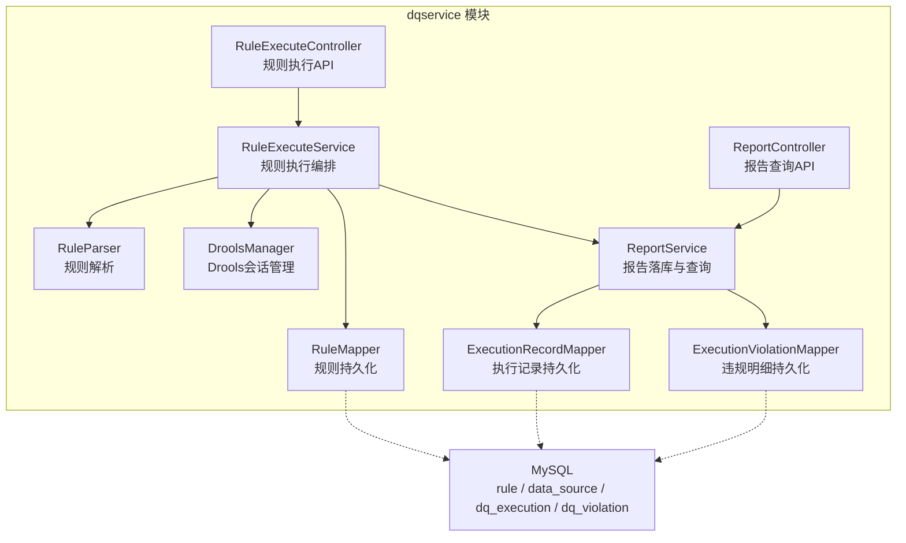
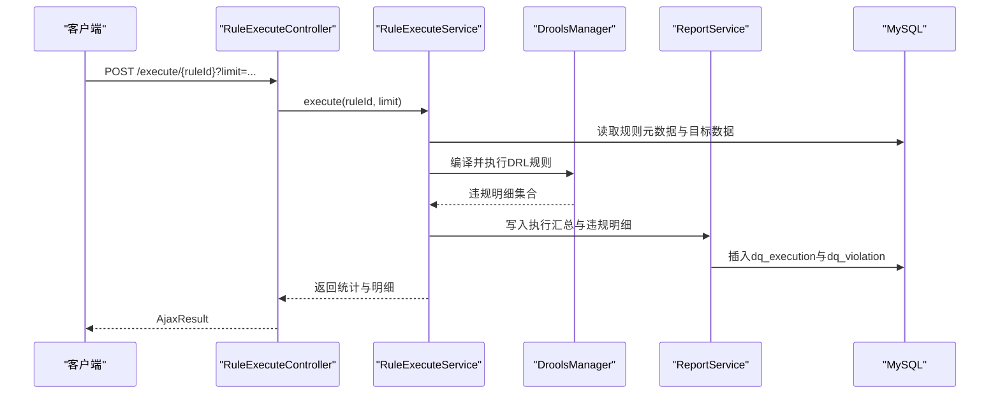
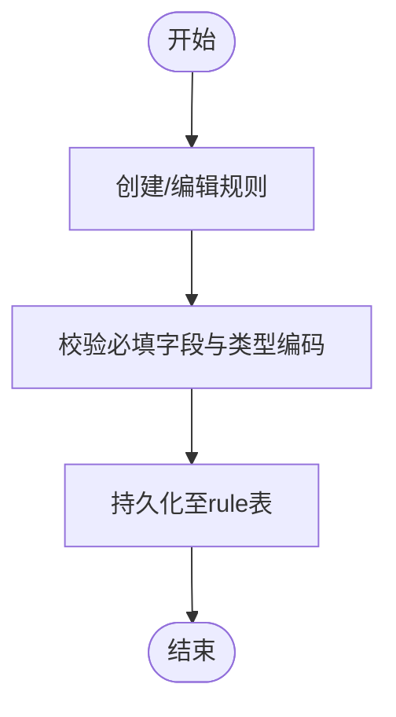
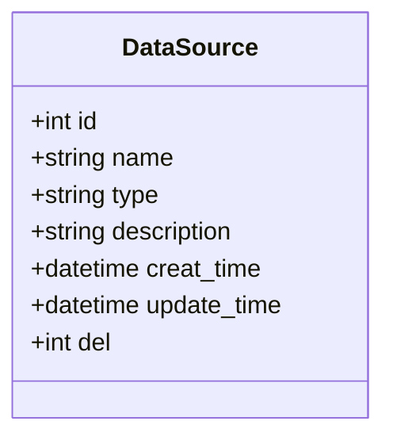
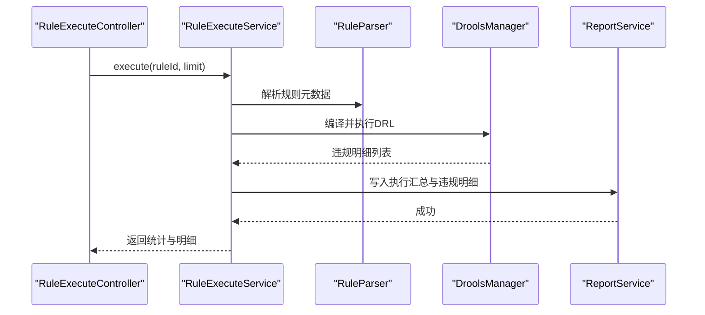
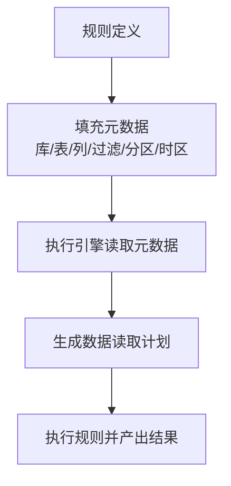
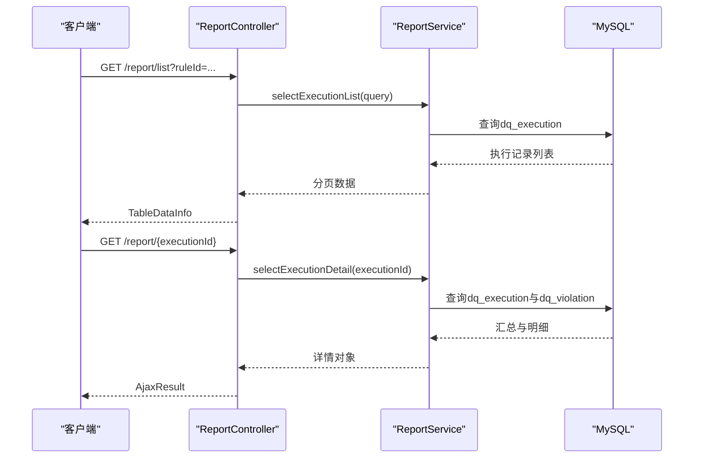
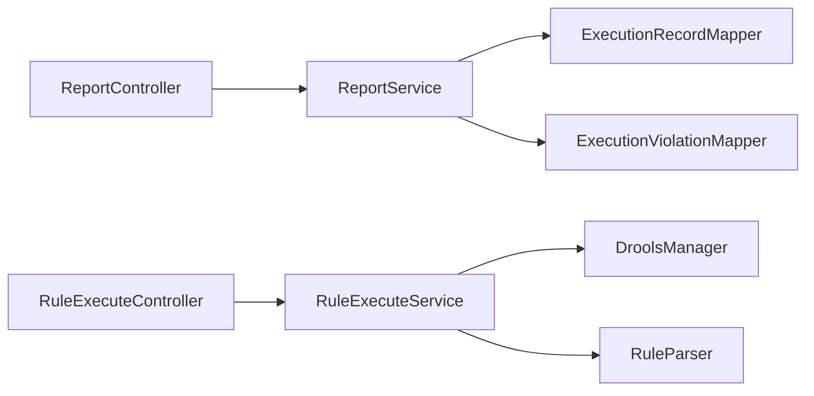

# 数据质量管理

<cite>
**本文引用的文件**   
- [ry_dqservice_20261026.sql](file://sql/ry_dqservice_20261026.sql)
- [ry_dq_report_20261026.sql](file://sql/ry_dq_report_20261026.sql)
- [RuleExecuteController.java](file://ruoyi-modules/ruoyi-dqservice/src/main/java/com/ruoyi/dqservice/controller/RuleExecuteController.java)
- [RuleExecuteService.java](file://ruoyi-modules/ruoyi-dqservice/src/main/java/com/ruoyi/dqservice/service/RuleExecuteService.java)
- [ReportController.java](file://ruoyi-modules/ruoyi-dqservice/src/main/java/com/ruoyi/dqservice/controller/ReportController.java)
- [ReportService.java](file://ruoyi-modules/ruoyi-dqservice/src/main/java/com/ruoyi/dqservice/service/ReportService.java)
</cite>

## 目录
1. [简介](#简介)
2. [项目结构](#项目结构)
3. [核心组件](#核心组件)
4. [架构总览](#架构总览)
5. [详细组件分析](#详细组件分析)
6. [依赖关系分析](#依赖关系分析)
7. [性能与扩展建议](#性能与扩展建议)
8. [故障排查指南](#故障排查指南)
9. [结论](#结论)

## 简介
本模块面向企业级数据质量治理，提供规则管理、数据源管理、规则执行引擎、元数据管理与监控报告等核心能力。通过可视化规则定义与可配置的规则执行流程，实现对业务数据的完整性、一致性、准确性进行持续校验与度量，并以执行记录与违规明细的形式沉淀质量结果，支撑报表展示与问题定位。

## 项目结构
数据质量相关代码位于 ruoyi-modules/ruoyi-dqservice 子模块中，采用典型的分层架构：
- 控制器层（controller）：对外暴露 REST API，负责参数校验、权限控制与响应封装
- 服务层（service）：编排规则解析、数据读取、Drools 规则执行、结果汇总与落库
- 持久层（mapper）：基于 MyBatis 的数据库访问接口
- 领域模型（domain）：规则、执行记录、违规明细等实体
- 工具与连接（util/connecter）：规则解析器、Drools 会话管理等基础设施

图表来源
- [RuleExecuteController.java:1-40](file://ruoyi-modules/ruoyi-dqservice/src/main/java/com/ruoyi/dqservice/controller/RuleExecuteController.java#L1-L40)
- [RuleExecuteService.java:1-43](file://ruoyi-modules/ruoyi-dqservice/src/main/java/com/ruoyi/dqservice/service/RuleExecuteService.java#L1-L43)
- [ReportController.java:1-50](file://ruoyi-modules/ruoyi-dqservice/src/main/java/com/ruoyi/dqservice/controller/ReportController.java#L1-L50)
- [ReportService.java:1-45](file://ruoyi-modules/ruoyi-dqservice/src/main/java/com/ruoyi/dqservice/service/ReportService.java#L1-L45)

章节来源
- [ry_dqservice_20261026.sql:1-40](file://sql/ry_dqservice_20261026.sql#L1-L40)
- [ry_dq_report_20261026.sql:1-40](file://sql/ry_dq_report_20261026.sql#L1-L40)

## 核心组件
- 规则管理
  - 职责：维护规则定义（名称、类型编码、目标表/列、过滤条件、分区与时区等），支持增删改查与版本演进
  - 关键表：rule
- 数据源管理
  - 职责：统一管理多数据源连接信息，供规则执行时按规则绑定读取数据
  - 关键表：data_source
- 规则执行引擎
  - 职责：根据规则从主数据源拉取数据，将行转为 Map，交由 Drools 引擎执行 DRL 规则，收集 then 块产出的违规明细并汇总通过率
  - 关键类：RuleExecuteService、DroolsManager、RuleParser
- 元数据管理
  - 职责：描述规则作用域（库名、表名、列名）、过滤条件、分区策略与时区等元数据，驱动执行引擎的数据采集范围
  - 关键表：rule
- 监控报告
  - 职责：记录每次规则执行的汇总指标（扫描行数、违规条数、通过率、耗时等）与逐条违规明细，并提供查询接口
  - 关键表：dq_execution、dq_violation；关键类：ReportService、ReportController

章节来源
- [ry_dqservice_20261026.sql:7-27](file://sql/ry_dqservice_20261026.sql#L7-L27)
- [ry_dqservice_20261026.sql:29-39](file://sql/ry_dqservice_20261026.sql#L29-L39)
- [ry_dq_report_20261026.sql:11-27](file://sql/ry_dq_report_20261026.sql#L11-L27)
- [ry_dq_report_20261026.sql:29-39](file://sql/ry_dq_report_20261026.sql#L29-L39)

## 架构总览
系统以 Spring Boot 微服务形式运行，对外暴露两类主要 API：
- 规则执行 API：POST /execute/{ruleId}，触发指定规则的扫描与校验，返回违规明细与通过率
- 报告查询 API：GET /report/list 与 GET /report/{executionId}，分页查询执行记录与详情

图表来源
- [RuleExecuteController.java:21-39](file://ruoyi-modules/ruoyi-dqservice/src/main/java/com/ruoyi/dqservice/controller/RuleExecuteController.java#L21-L39)
- [RuleExecuteService.java:26-43](file://ruoyi-modules/ruoyi-dqservice/src/main/java/com/ruoyi/dqservice/service/RuleExecuteService.java#L26-L43)
- [ReportService.java:21-45](file://ruoyi-modules/ruoyi-dqservice/src/main/java/com/ruoyi/dqservice/service/ReportService.java#L21-L45)

## 详细组件分析

### 规则管理
- 使用场景
  - 业务分析师或数据工程师在系统中创建规则，如“手机号格式校验”“订单金额非负”等
  - 通过规则类型编码（type_code）关联不同校验逻辑（由 Drools 侧实现）
- 配置方法
  - 填写规则名称、目标库/表/列、过滤条件（source_where）、分区数量/单位、时区等
  - 选择规则类型名称与编码，用于后续执行引擎识别具体校验逻辑
- 操作流程
  - 新增/编辑/删除规则，持久化到 rule 表
  - 规则变更后，可通过执行接口验证效果
- 技术实现要点
  - 规则表字段覆盖规则全生命周期元数据，便于审计与回溯
  - 结合 RuleMapper 完成 CRUD 操作

图表来源
- [ry_dqservice_20261026.sql:7-27](file://sql/ry_dqservice_20261026.sql#L7-L27)

章节来源
- [ry_dqservice_20261026.sql:7-27](file://sql/ry_dqservice_20261026.sql#L7-L27)

### 数据源管理
- 使用场景
  - 为不同环境（开发/测试/生产）或不同业务系统注册数据源，供规则执行时按规则绑定的库/表读取数据
- 配置方法
  - 登记数据源名称、类型、描述等基本信息
- 操作流程
  - 新增/编辑/删除数据源
  - 规则执行时根据规则元数据选择对应数据源连接
- 技术实现要点
  - data_source 表作为数据源元数据存储，实际连接池与路由由上层框架或连接管理器负责

图表来源
- [ry_dqservice_20261026.sql:29-39](file://sql/ry_dqservice_20261026.sql#L29-L39)

章节来源
- [ry_dqservice_20261026.sql:29-39](file://sql/ry_dqservice_20261026.sql#L29-L39)

### 规则执行引擎
- 使用场景
  - 对已定义的规则进行一次性或定时执行，产出质量评估结果与违规明细
- 配置方法
  - 调用执行接口传入 ruleId，可选 limit 限制单次扫描行数
- 操作流程
  - 控制器接收请求，服务层解析规则、读取数据、交给 Drools 执行、汇总结果并落库
- 技术实现要点
  - RuleExecuteService 负责数据读取与 Drools 集成
  - DroolsManager 管理规则会话与执行上下文
  - RuleParser 负责规则内容解析与参数注入
  - 默认限制扫描行数以避免大表拖慢演示环境

图表来源
- [RuleExecuteController.java:21-39](file://ruoyi-modules/ruoyi-dqservice/src/main/java/com/ruoyi/dqservice/controller/RuleExecuteController.java#L21-L39)
- [RuleExecuteService.java:26-43](file://ruoyi-modules/ruoyi-dqservice/src/main/java/com/ruoyi/dqservice/service/RuleExecuteService.java#L26-L43)

章节来源
- [RuleExecuteController.java:1-40](file://ruoyi-modules/ruoyi-dqservice/src/main/java/com/ruoyi/dqservice/controller/RuleExecuteController.java#L1-L40)
- [RuleExecuteService.java:1-43](file://ruoyi-modules/ruoyi-dqservice/src/main/java/com/ruoyi/dqservice/service/RuleExecuteService.java#L1-L43)

### 元数据管理
- 使用场景
  - 描述规则的作用域与执行参数，包括目标库/表/列、过滤条件、分区策略与时区
- 配置方法
  - 在规则定义中填写 db_name、table_name、column_name、source_where、source_partition_number、source_partition_unit、source_time_zone 等
- 操作流程
  - 规则执行时，引擎依据这些元数据构造 SQL 或数据读取计划
- 技术实现要点
  - 元数据与规则强绑定，确保执行的可追溯性与可重复性

图表来源
- [ry_dqservice_20261026.sql:7-27](file://sql/ry_dqservice_20261026.sql#L7-L27)

章节来源
- [ry_dqservice_20261026.sql:7-27](file://sql/ry_dqservice_20261026.sql#L7-L27)

### 监控报告
- 使用场景
  - 查看历史执行记录、通过率趋势、违规明细与字段分布，辅助质量治理与问题定位
- 配置方法
  - 无需额外配置，执行后自动写入 dq_execution 与 dq_violation
- 操作流程
  - 报告服务将执行汇总与违规明细落库；控制器提供分页查询与详情接口
- 技术实现要点
  - ReportService 负责汇总与明细写入，保证字段长度与表结构一致
  - ReportController 提供 list 与 detail 两个查询端点

图表来源
- [ReportController.java:22-49](file://ruoyi-modules/ruoyi-dqservice/src/main/java/com/ruoyi/dqservice/controller/ReportController.java#L22-L49)
- [ReportService.java:21-45](file://ruoyi-modules/ruoyi-dqservice/src/main/java/com/ruoyi/dqservice/service/ReportService.java#L21-L45)

章节来源
- [ReportController.java:1-50](file://ruoyi-modules/ruoyi-dqservice/src/main/java/com/ruoyi/dqservice/controller/ReportController.java#L1-L50)
- [ReportService.java:1-45](file://ruoyi-modules/ruoyi-dqservice/src/main/java/com/ruoyi/dqservice/service/ReportService.java#L1-L45)
- [ry_dq_report_20261026.sql:11-39](file://sql/ry_dq_report_20261026.sql#L11-L39)

## 依赖关系分析
- 控制器与服务解耦：控制器仅负责入参与权限校验，核心逻辑下沉至服务层
- 规则执行依赖 Drools 引擎：通过 DroolsManager 管理会话，避免频繁编译开销
- 报告服务与持久层解耦：ReportService 通过 Mapper 访问数据库，屏蔽 SQL 细节
- 表结构与字段约束：报告服务内部常量与 dq_violation 字段长度保持一致，防止入库截断

图表来源
- [ReportController.java:22-49](file://ruoyi-modules/ruoyi-dqservice/src/main/java/com/ruoyi/dqservice/controller/ReportController.java#L22-L49)
- [ReportService.java:21-45](file://ruoyi-modules/ruoyi-dqservice/src/main/java/com/ruoyi/dqservice/service/ReportService.java#L21-L45)
- [RuleExecuteController.java:21-39](file://ruoyi-modules/ruoyi-dqservice/src/main/java/com/ruoyi/dqservice/controller/RuleExecuteController.java#L21-L39)
- [RuleExecuteService.java:26-43](file://ruoyi-modules/ruoyi-dqservice/src/main/java/com/ruoyi/dqservice/service/RuleExecuteService.java#L26-L43)

章节来源
- [ReportController.java:1-50](file://ruoyi-modules/ruoyi-dqservice/src/main/java/com/ruoyi/dqservice/controller/ReportController.java#L1-L50)
- [ReportService.java:1-45](file://ruoyi-modules/ruoyi-dqservice/src/main/java/com/ruoyi/dqservice/service/ReportService.java#L1-L45)
- [RuleExecuteController.java:1-40](file://ruoyi-modules/ruoyi-dqservice/src/main/java/com/ruoyi/dqservice/controller/RuleExecuteController.java#L1-L40)
- [RuleExecuteService.java:1-43](file://ruoyi-modules/ruoyi-dqservice/src/main/java/com/ruoyi/dqservice/service/RuleExecuteService.java#L1-L43)

## 性能与扩展建议
- 执行限流
  - 通过 limit 参数限制单次扫描行数，避免大表导致超时或资源耗尽
- 分区与过滤
  - 合理设置 source_where 与分区参数，缩小扫描范围，提升执行效率
- Drools 优化
  - 复用 Drools 会话，减少规则编译开销；按需加载规则集
- 报告聚合
  - 对高频规则执行结果进行聚合统计，降低查询压力
- 可扩展性
  - 新增规则类型仅需扩展 Drools 规则集与类型编码映射
  - 数据源扩展通过注册新数据源即可接入

[本节为通用指导，不直接分析具体文件]

## 故障排查指南
- 执行失败
  - 检查规则元数据是否完整（库/表/列、过滤条件、分区与时区）
  - 确认数据源连接可用且权限正确
- 违规明细缺失
  - 检查 Drools 规则是否正确命中；核对 then 块输出字段与 ReportService 写入逻辑
- 报告查询异常
  - 确认 dq_execution 与 dq_violation 表结构一致，字段长度满足要求
  - 检查 ReportService 中字段长度常量是否与表结构匹配

章节来源
- [ReportService.java:21-45](file://ruoyi-modules/ruoyi-dqservice/src/main/java/com/ruoyi/dqservice/service/ReportService.java#L21-L45)
- [ry_dq_report_20261026.sql:11-39](file://sql/ry_dq_report_20261026.sql#L11-L39)

## 结论
该数据质量管理模块以规则为中心，结合 Drools 规则引擎与标准化报告体系，形成从规则定义、数据源接入、规则执行到质量可视化的闭环。通过清晰的层次划分与稳定的表结构设计，既满足当前业务需求，也为后续扩展（更多规则类型、更丰富的数据源、更复杂的聚合报表）预留了空间。开发者可在现有基础上快速扩展规则类型、增强执行性能与完善监控维度。