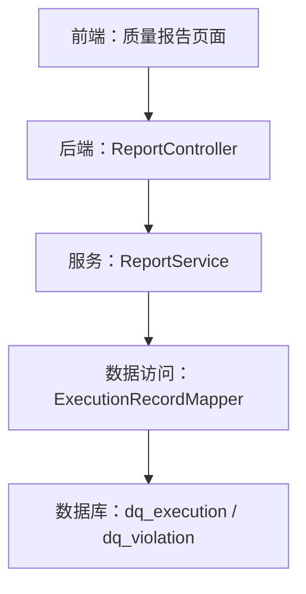
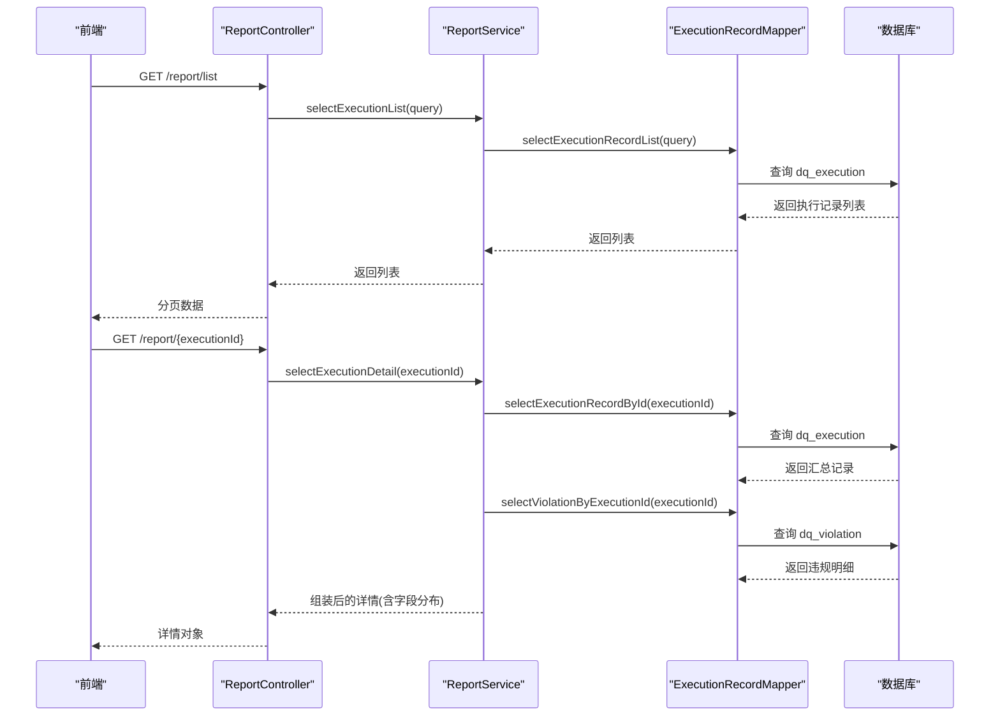
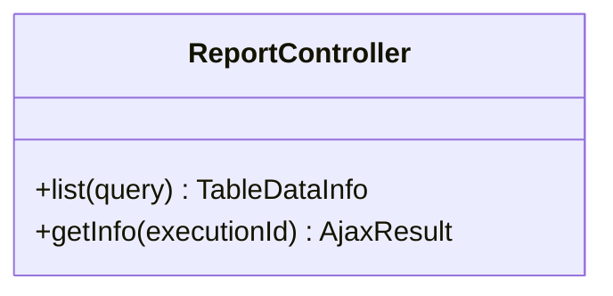
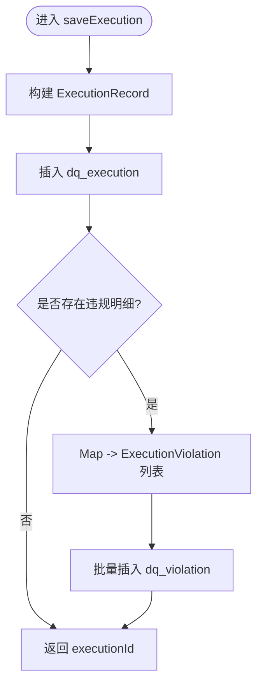
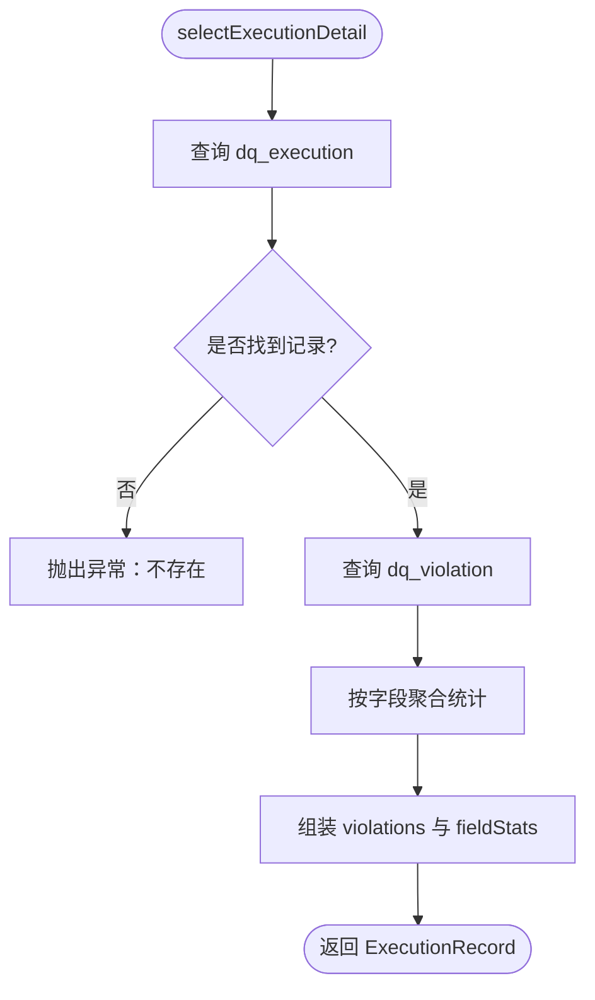
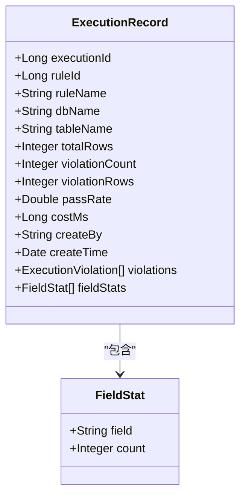
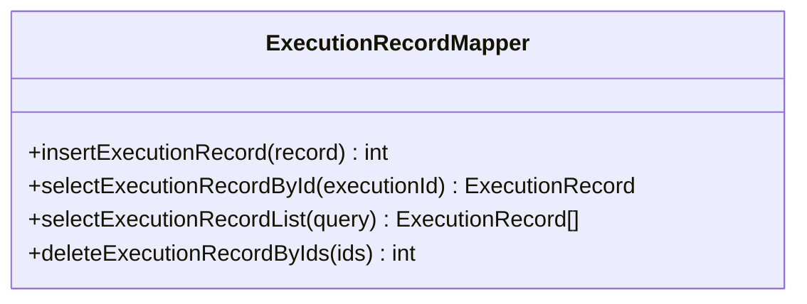
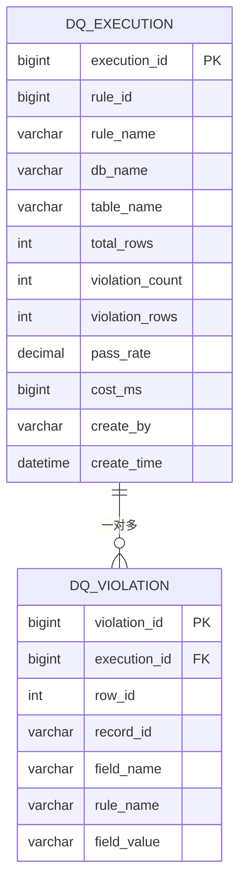
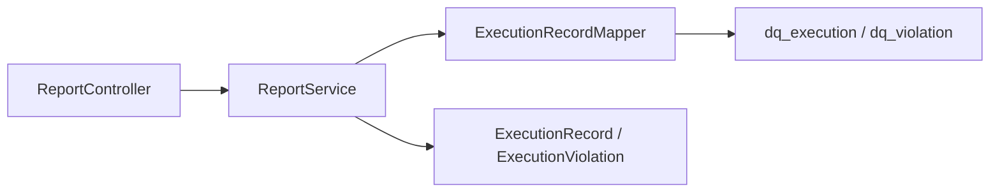

# 监控报告

<cite>
**本文引用的文件**   
- [ReportController.java](file://ruoyi-modules/ruoyi-dqservice/src/main/java/com/ruoyi/dqservice/controller/ReportController.java)
- [ReportService.java](file://ruoyi-modules/ruoyi-dqservice/src/main/java/com/ruoyi/dqservice/service/ReportService.java)
- [ExecutionRecord.java](file://ruoyi-modules/ruoyi-dqservice/src/main/java/com/ruoyi/dqservice/domain/ExecutionRecord.java)
- [ExecutionRecordMapper.java](file://ruoyi-modules/ruoyi-dqservice/src/main/java/com/ruoyi/dqservice/mapper/ExecutionRecordMapper.java)
- [ry_dq_report_20261026.sql](file://sql/ry_dq_report_20261026.sql)
- [ry_dqservice_20261026.sql](file://sql/ry_dqservice_20261026.sql)
- [ry_dq_report_menu_20261026.sql](file://sql/ry_dq_report_menu_20261026.sql)
</cite>

## 目录
1. [简介](#简介)
2. [项目结构](#项目结构)
3. [核心组件](#核心组件)
4. [架构总览](#架构总览)
5. [详细组件分析](#详细组件分析)
6. [依赖关系分析](#依赖关系分析)
7. [性能与扩展性](#性能与扩展性)
8. [故障排查指南](#故障排查指南)
9. [结论](#结论)
10. [附录](#附录)

## 简介
本文件为“监控报告”功能的完整技术文档，覆盖实时监控面板、执行历史记录、质量指标统计、报表导出等能力。重点说明监控数据的采集、存储、展示流程，以及报表生成、Excel 导出、图表展示的技术实现路径；并提供监控指标自定义配置、告警规则设置、历史数据查询的端到端操作流程。

## 项目结构
监控报告功能位于数据质量服务模块中，后端通过 REST 接口暴露执行记录列表与详情，前端在菜单下挂载“质量报告”页面进行可视化展示。数据库层包含执行汇总表与违规明细表，用于持久化每次规则执行的结果。

**图示来源**  
- [ReportController.java:22-49](file://ruoyi-modules/ruoyi-dqservice/src/main/java/com/ruoyi/dqservice/controller/ReportController.java#L22-L49)
- [ReportService.java:58-109](file://ruoyi-modules/ruoyi-dqservice/src/main/java/com/ruoyi/dqservice/service/ReportService.java#L58-L109)
- [ExecutionRecordMapper.java:12-24](file://ruoyi-modules/ruoyi-dqservice/src/main/java/com/ruoyi/dqservice/mapper/ExecutionRecordMapper.java#L12-L24)
- [ry_dq_report_20261026.sql:11-39](file://sql/ry_dq_report_20261026.sql#L11-L39)

**章节来源**  
- [ry_dq_report_menu_20261026.sql:1-13](file://sql/ry_dq_report_menu_20261026.sql#L1-L13)

## 核心组件
- 控制器层：提供执行记录列表与详情查询接口，统一权限校验与分页封装。
- 服务层：负责保存一次规则执行的汇总与明细（事务保证一致性），并组装字段分布统计。
- 领域模型：执行记录实体包含汇总指标与非表字段（违规明细、字段分布）。
- 数据访问层：定义执行记录的增删查操作。
- 数据库表：执行汇总表与违规明细表，支撑历史查询与统计。

**章节来源**  
- [ReportController.java:22-49](file://ruoyi-modules/ruoyi-dqservice/src/main/java/com/ruoyi/dqservice/controller/ReportController.java#L22-L49)
- [ReportService.java:58-109](file://ruoyi-modules/ruoyi-dqservice/src/main/java/com/ruoyi/dqservice/service/ReportService.java#L58-L109)
- [ExecutionRecord.java:16-73](file://ruoyi-modules/ruoyi-dqservice/src/main/java/com/ruoyi/dqservice/domain/ExecutionRecord.java#L16-L73)
- [ExecutionRecordMapper.java:12-24](file://ruoyi-modules/ruoyi-dqservice/src/main/java/com/ruoyi/dqservice/mapper/ExecutionRecordMapper.java#L12-L24)
- [ry_dq_report_20261026.sql:11-39](file://sql/ry_dq_report_20261026.sql#L11-L39)

## 架构总览
监控报告的数据流从规则引擎产出违规明细开始，经服务层落库，再由控制器对外暴露查询接口，最终由前端渲染为表格、图表与导出报表。

**图示来源**  
- [ReportController.java:32-49](file://ruoyi-modules/ruoyi-dqservice/src/main/java/com/ruoyi/dqservice/controller/ReportController.java#L32-L49)
- [ReportService.java:91-109](file://ruoyi-modules/ruoyi-dqservice/src/main/java/com/ruoyi/dqservice/service/ReportService.java#L91-L109)
- [ExecutionRecordMapper.java:14-24](file://ruoyi-modules/ruoyi-dqservice/src/main/java/com/ruoyi/dqservice/mapper/ExecutionRecordMapper.java#L14-L24)
- [ry_dq_report_20261026.sql:11-39](file://sql/ry_dq_report_20261026.sql#L11-L39)

## 详细组件分析

### 控制器：ReportController
职责
- 暴露两个接口：执行记录列表与执行记录详情。
- 使用权限注解控制访问范围。
- 复用基础控制器提供的分页与响应封装。

关键行为
- 列表接口接收 ExecutionRecord 作为查询条件，调用服务层获取分页结果。
- 详情接口根据 executionId 获取汇总与明细，并返回给前端。

**图示来源**  
- [ReportController.java:22-49](file://ruoyi-modules/ruoyi-dqservice/src/main/java/com/ruoyi/dqservice/controller/ReportController.java#L22-L49)

**章节来源**  
- [ReportController.java:22-49](file://ruoyi-modules/ruoyi-dqservice/src/main/java/com/ruoyi/dqservice/controller/ReportController.java#L22-L49)

### 服务：ReportService
职责
- 保存一次规则执行的结果（汇总+明细），保证事务一致性。
- 查询执行记录列表与详情，并在详情中聚合字段分布统计。
- 将 Drools 产出的 Map 违规明细转换为持久化实体，并进行长度截断与类型转换。

核心流程（保存）

**图示来源**  
- [ReportService.java:58-89](file://ruoyi-modules/ruoyi-dqservice/src/main/java/com/ruoyi/dqservice/service/ReportService.java#L58-L89)

核心流程（详情查询）

**图示来源**  
- [ReportService.java:97-109](file://ruoyi-modules/ruoyi-dqservice/src/main/java/com/ruoyi/dqservice/service/ReportService.java#L97-L109)

**章节来源**  
- [ReportService.java:58-109](file://ruoyi-modules/ruoyi-dqservice/src/main/java/com/ruoyi/dqservice/service/ReportService.java#L58-L109)
- [ReportService.java:111-149](file://ruoyi-modules/ruoyi-dqservice/src/main/java/com/ruoyi/dqservice/service/ReportService.java#L111-L149)

### 领域模型：ExecutionRecord
字段说明
- 执行批次ID、规则ID/名称、数据库名、表名、扫描行数、违规条数、命中行数、通过率、耗时、执行人、执行时间。
- 非表字段：violations（违规明细）、fieldStats（字段分布统计）。

**图示来源**  
- [ExecutionRecord.java:16-73](file://ruoyi-modules/ruoyi-dqservice/src/main/java/com/ruoyi/dqservice/domain/ExecutionRecord.java#L16-L73)

**章节来源**  
- [ExecutionRecord.java:16-73](file://ruoyi-modules/ruoyi-dqservice/src/main/java/com/ruoyi/dqservice/domain/ExecutionRecord.java#L16-L73)

### 数据访问：ExecutionRecordMapper
职责
- 定义执行记录的插入、按主键查询、列表查询与批量删除方法。

**图示来源**  
- [ExecutionRecordMapper.java:12-24](file://ruoyi-modules/ruoyi-dqservice/src/main/java/com/ruoyi/dqservice/mapper/ExecutionRecordMapper.java#L12-L24)

**章节来源**  
- [ExecutionRecordMapper.java:12-24](file://ruoyi-modules/ruoyi-dqservice/src/main/java/com/ruoyi/dqservice/mapper/ExecutionRecordMapper.java#L12-L24)

### 数据库设计
- dq_execution：每次规则执行写一条汇总记录，包含扫描行数、违规条数、命中率、耗时等指标。
- dq_violation：保存该次执行的逐条违规明细，便于后续分析与可视化。

**图示来源**  
- [ry_dq_report_20261026.sql:11-39](file://sql/ry_dq_report_20261026.sql#L11-L39)

**章节来源**  
- [ry_dq_report_20261026.sql:1-39](file://sql/ry_dq_report_20261026.sql#L1-L39)

## 依赖关系分析
- 控制器依赖服务层，服务层依赖 Mapper 与领域模型。
- 服务层内部还依赖安全工具获取当前用户，以及日期工具写入执行时间。
- 数据库表结构与领域模型一一对应，保障数据一致性与可追溯性。

**图示来源**  
- [ReportController.java:22-49](file://ruoyi-modules/ruoyi-dqservice/src/main/java/com/ruoyi/dqservice/controller/ReportController.java#L22-L49)
- [ReportService.java:39-43](file://ruoyi-modules/ruoyi-dqservice/src/main/java/com/ruoyi/dqservice/service/ReportService.java#L39-L43)
- [ExecutionRecordMapper.java:12-24](file://ruoyi-modules/ruoyi-dqservice/src/main/java/com/ruoyi/dqservice/mapper/ExecutionRecordMapper.java#L12-L24)
- [ry_dq_report_20261026.sql:11-39](file://sql/ry_dq_report_20261026.sql#L11-L39)

**章节来源**  
- [ry_dqservice_20261026.sql:1-39](file://sql/ry_dqservice_20261026.sql#L1-L39)

## 性能与扩展性
- 事务边界：保存汇总与明细在同一事务内，避免数据不一致。
- 批量写入：违规明细采用批量插入，降低数据库交互次数。
- 索引优化：执行记录表对 rule_id 与 create_time 建立索引，提升历史查询效率；违规明细表对 execution_id 建立索引，加速详情加载。
- 可扩展点：
  - 新增指标：在 ExecutionRecord 中添加字段并在 SQL 中同步扩展。
  - 多维统计：在服务层增加按规则、数据库、表的聚合统计方法。
  - 异步落库：在高吞吐场景可将明细写入改为异步队列，但需补偿机制保证一致性。

[本节为通用指导，不直接分析具体文件]

## 故障排查指南
常见问题与定位思路
- 详情接口返回“执行记录不存在”
  - 检查 executionId 是否正确传入。
  - 确认 dq_execution 表中是否存在对应记录。
- 列表无数据或分页异常
  - 检查查询条件是否与数据库字段匹配。
  - 确认分页参数与排序字段是否合理。
- 明细缺失或字段值被截断
  - 检查 Drools 产出的 Map 字段映射是否正确。
  - 注意服务层对字符串长度的截断逻辑，必要时调整字段长度。

**章节来源**  
- [ReportService.java:97-109](file://ruoyi-modules/ruoyi-dqservice/src/main/java/com/ruoyi/dqservice/service/ReportService.java#L97-L109)
- [ReportService.java:111-164](file://ruoyi-modules/ruoyi-dqservice/src/main/java/com/ruoyi/dqservice/service/ReportService.java#L111-L164)

## 结论
监控报告功能以清晰的三层架构组织，围绕“执行汇总+违规明细”的数据模型，提供了完整的采集、存储、查询与展示能力。通过事务与批量写入保障数据一致性，配合合理的索引设计满足历史查询与统计需求。前端可在“质量报告”菜单下进行实时监控、历史回溯与报表导出。

[本节为总结性内容，不直接分析具体文件]

## 附录

### 前端菜单与入口
- 菜单项“质量报告”挂在“数据质量”目录下，指向 rules/report/index 页面，权限标识为 dqservice:report:list。

**章节来源**  
- [ry_dq_report_menu_20261026.sql:1-13](file://sql/ry_dq_report_menu_20261026.sql#L1-L13)

### 监控指标自定义配置
- 指标定义：在 ExecutionRecord 中扩展字段，并在 SQL 中同步新增列。
- 规则维度：结合 Rule 表中的 type_code/type_name 进行分组统计。
- 数据来源：通过 data_source 表关联不同数据源，支持按数据源维度筛选。

**章节来源**  
- [ry_dqservice_20261026.sql:1-39](file://sql/ry_dqservice_20261026.sql#L1-L39)

### 告警规则设置
- 阈值告警：基于 pass_rate、violation_count、violation_rows 等指标设定阈值，触发告警。
- 规则联动：结合 Rule 表的 type_code 与 source_where 过滤条件，精准定位问题数据。
- 通知渠道：可在服务层扩展通知逻辑（邮件、IM、短信等）。

[本节为概念性说明，不直接分析具体文件]

### 历史数据查询操作流程
- 打开“质量报告”页面，选择时间范围、规则名称、数据库/表等条件。
- 调用 /report/list 获取分页列表，点击某条记录查看详情。
- 详情接口 /report/{executionId} 返回汇总与违规明细，并可渲染字段分布图。

**章节来源**  
- [ReportController.java:32-49](file://ruoyi-modules/ruoyi-dqservice/src/main/java/com/ruoyi/dqservice/controller/ReportController.java#L32-L49)
- [ReportService.java:91-109](file://ruoyi-modules/ruoyi-dqservice/src/main/java/com/ruoyi/dqservice/service/ReportService.java#L91-L109)

### 报表生成与 Excel 导出
- 报表模板：基于 ExecutionRecord 汇总字段与 ExecutionViolation 明细字段生成报表。
- 导出步骤：
  - 前端发起导出请求，携带查询条件。
  - 后端聚合数据并生成 Excel 文件流返回。
  - 前端下载文件并提示完成。
- 建议：大数据量导出时启用分页拉取与流式写入，避免内存溢出。

[本节为通用指导，不直接分析具体文件]

### 监控界面截图与报表示例
- 监控面板：展示通过率趋势、违规数量趋势、字段分布柱状图。
- 执行历史：表格列出每次执行的摘要信息，支持筛选与分页。
- 详情弹窗：展示违规明细列表与字段分布统计。
- 报表示例：包含执行摘要与违规明细两页签，支持导出为 Excel。

[本节为概念性说明，不直接分析具体文件]