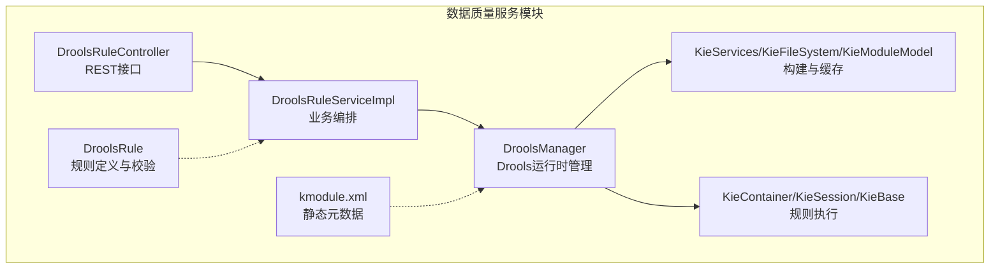
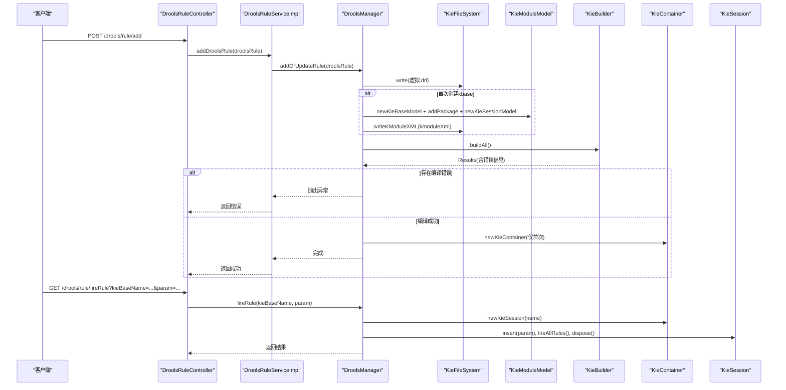
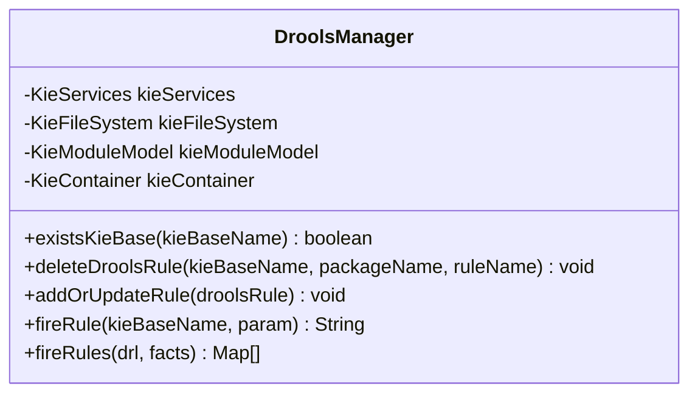
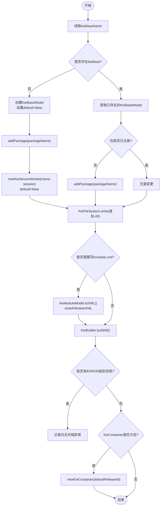
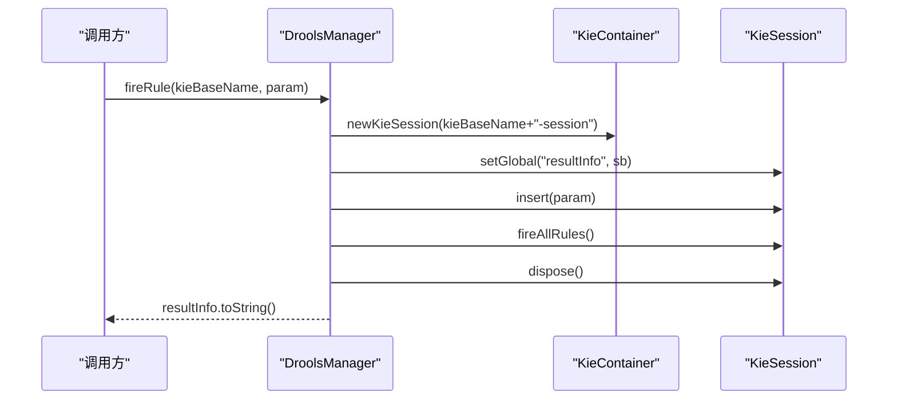
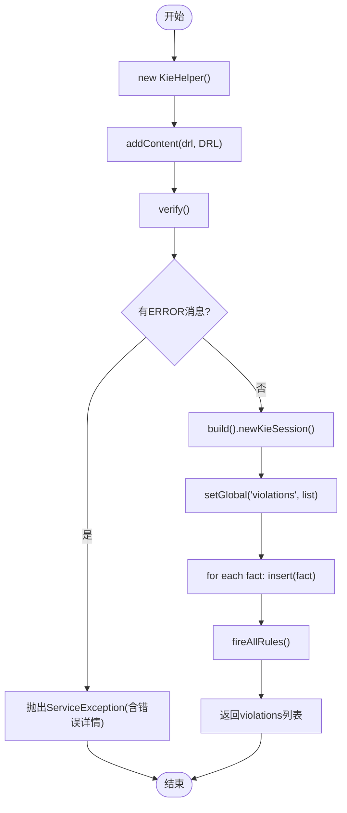
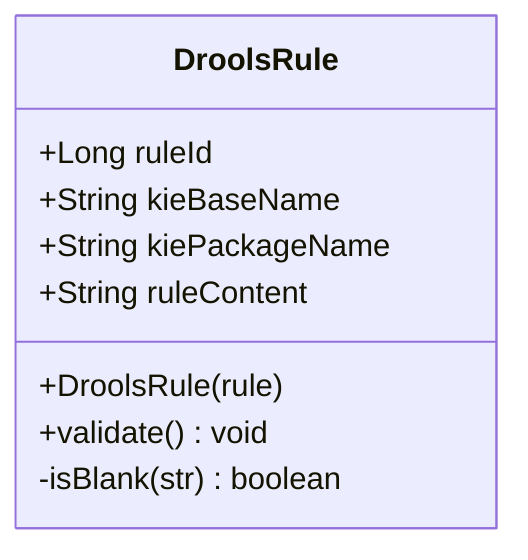
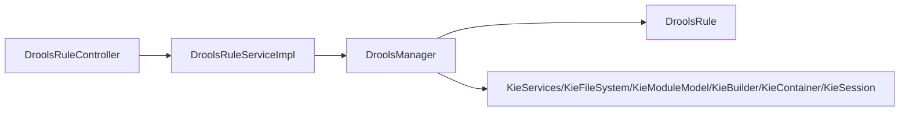

# Drools规则引擎集成

<cite>
**本文引用的文件**   
- [DroolsManager.java](file://ruoyi-modules/ruoyi-dqservice/src/main/java/com/ruoyi/dqservice/connecter/DroolsManager.java)
- [DroolsRule.java](file://ruoyi-modules/ruoyi-dqservice/src/main/java/com/ruoyi/dqservice/domain/DroolsRule.java)
- [DroolsRuleServiceImpl.java](file://ruoyi-modules/ruoyi-dqservice/src/main/java/com/ruoyi/dqservice/service/impl/DroolsRuleServiceImpl.java)
- [DroolsRuleController.java](file://ruoyi-modules/ruoyi-dqservice/src/main/java/com/ruoyi/dqservice/controller/DroolsRuleController.java)
- [kmodule.xml](file://ruoyi-modules/ruoyi-dqservice/src/main/resources/META-INF/kmodule.xml)
</cite>

## 目录
1. [简介](#简介)
2. [项目结构](#项目结构)
3. [核心组件](#核心组件)
4. [架构总览](#架构总览)
5. [详细组件分析](#详细组件分析)
6. [依赖关系分析](#依赖关系分析)
7. [性能与内存优化](#性能与内存优化)
8. [常见问题与排错](#常见问题与排错)
9. [结论](#结论)
10. [附录：Spring集成与配置要点](#附录spring集成与配置要点)

## 简介
本技术文档围绕数据质量服务模块中的Drools规则引擎集成，重点说明以下方面：
- DroolsManager类的核心职责：KieContainer初始化、规则包动态加载、会话创建与销毁。
- DroolsRule实体类的设计：规则定义、编译配置与执行上下文。
- kmodule.xml的作用与结构。
- 在Spring环境下的集成方式与最佳实践。
- 规则编译缓存策略、内存管理与性能优化建议。
- 实际集成示例与常见问题解决方案。

## 项目结构
该功能位于 ruoyi-modules/ruoyi-dqservice 模块中，主要包含控制器、服务实现、领域模型与Drools连接器。

图表来源
- [DroolsRuleController.java:13-49](file://ruoyi-modules/ruoyi-dqservice/src/main/java/com/ruoyi/dqservice/controller/DroolsRuleController.java#L13-L49)
- [DroolsRuleServiceImpl.java:11-48](file://ruoyi-modules/ruoyi-dqservice/src/main/java/com/ruoyi/dqservice/service/impl/DroolsRuleServiceImpl.java#L11-L48)
- [DroolsManager.java:22-120](file://ruoyi-modules/ruoyi-dqservice/src/main/java/com/ruoyi/dqservice/connecter/DroolsManager.java#L22-L120)
- [DroolsRule.java:5-32](file://ruoyi-modules/ruoyi-dqservice/src/main/java/com/ruoyi/dqservice/domain/DroolsRule.java#L5-L32)
- [kmodule.xml:1-7](file://ruoyi-modules/ruoyi-dqservice/src/main/resources/META-INF/kmodule.xml#L1-L7)

章节来源
- [DroolsRuleController.java:13-49](file://ruoyi-modules/ruoyi-dqservice/src/main/java/com/ruoyi/dqservice/controller/DroolsRuleController.java#L13-L49)
- [DroolsRuleServiceImpl.java:11-48](file://ruoyi-modules/ruoyi-dqservice/src/main/java/com/ruoyi/dqservice/service/impl/DroolsRuleServiceImpl.java#L11-L48)
- [DroolsManager.java:22-120](file://ruoyi-modules/ruoyi-dqservice/src/main/java/com/ruoyi/dqservice/connecter/DroolsManager.java#L22-L120)
- [DroolsRule.java:5-32](file://ruoyi-modules/ruoyi-dqservice/src/main/java/com/ruoyi/dqservice/domain/DroolsRule.java#L5-L32)
- [kmodule.xml:1-7](file://ruoyi-modules/ruoyi-dqservice/src/main/resources/META-INF/kmodule.xml#L1-L7)

## 核心组件
- DroolsManager：封装Drools运行时，负责KieContainer生命周期、规则动态加载、会话创建与销毁、规则删除与批量执行。
- DroolsRule：承载规则定义（规则ID、kieBase名称、包名、DRL内容）并提供参数校验。
- DroolsRuleServiceImpl：对外暴露增删改查与触发能力，内部维护规则映射并调用DroolsManager。
- DroolsRuleController：提供REST接口，用于添加、更新、删除规则以及触发规则执行。
- kmodule.xml：静态的Drools模块描述文件，声明默认kbase与ksession。

章节来源
- [DroolsManager.java:22-190](file://ruoyi-modules/ruoyi-dqservice/src/main/java/com/ruoyi/dqservice/connecter/DroolsManager.java#L22-L190)
- [DroolsRule.java:5-32](file://ruoyi-modules/ruoyi-dqservice/src/main/java/com/ruoyi/dqservice/domain/DroolsRule.java#L5-L32)
- [DroolsRuleServiceImpl.java:11-48](file://ruoyi-modules/ruoyi-dqservice/src/main/java/com/ruoyi/dqservice/service/impl/DroolsRuleServiceImpl.java#L11-L48)
- [DroolsRuleController.java:13-49](file://ruoyi-modules/ruoyi-dqservice/src/main/java/com/ruoyi/dqservice/controller/DroolsRuleController.java#L13-L49)
- [kmodule.xml:1-7](file://ruoyi-modules/ruoyi-dqservice/src/main/resources/META-INF/kmodule.xml#L1-L7)

## 架构总览
下图展示从HTTP请求到Drools执行的完整流程，包括规则动态加载与会话执行路径。

图表来源
- [DroolsRuleController.java:27-48](file://ruoyi-modules/ruoyi-dqservice/src/main/java/com/ruoyi/dqservice/controller/DroolsRuleController.java#L27-L48)
- [DroolsRuleServiceImpl.java:27-47](file://ruoyi-modules/ruoyi-dqservice/src/main/java/com/ruoyi/dqservice/service/impl/DroolsRuleServiceImpl.java#L27-L47)
- [DroolsManager.java:63-120](file://ruoyi-modules/ruoyi-dqservice/src/main/java/com/ruoyi/dqservice/connecter/DroolsManager.java#L63-L120)
- [DroolsManager.java:125-134](file://ruoyi-modules/ruoyi-dqservice/src/main/java/com/ruoyi/dqservice/connecter/DroolsManager.java#L125-L134)

## 详细组件分析

### DroolsManager：Drools运行时管理器
职责与关键点：
- 单例容器：通过Spring @Component保证单例；内部持有KieServices、KieFileSystem、KieModuleModel与KieContainer。
- 规则动态加载：将DRL写入KieFileSystem，按需生成kmodule.xml，并通过KieBuilder构建。
- KieContainer生命周期：仅在首次需要时创建，避免频繁重建导致会话失效或资源泄漏。
- 会话管理：fireRule为每个请求创建KieSession并在finally中dispose；fireRules使用KieHelper独立编译执行，不污染全局文件系统。
- 规则删除：基于KieBase.removeRule移除指定包与规则名。

图表来源
- [DroolsManager.java:22-190](file://ruoyi-modules/ruoyi-dqservice/src/main/java/com/ruoyi/dqservice/connecter/DroolsManager.java#L22-L190)

章节来源
- [DroolsManager.java:22-190](file://ruoyi-modules/ruoyi-dqservice/src/main/java/com/ruoyi/dqservice/connecter/DroolsManager.java#L22-L190)

#### 关键流程：添加或更新规则

图表来源
- [DroolsManager.java:63-120](file://ruoyi-modules/ruoyi-dqservice/src/main/java/com/ruoyi/dqservice/connecter/DroolsManager.java#L63-L120)

章节来源
- [DroolsManager.java:63-120](file://ruoyi-modules/ruoyi-dqservice/src/main/java/com/ruoyi/dqservice/connecter/DroolsManager.java#L63-L120)

#### 关键流程：触发规则（单个事实）

图表来源
- [DroolsManager.java:125-134](file://ruoyi-modules/ruoyi-dqservice/src/main/java/com/ruoyi/dqservice/connecter/DroolsManager.java#L125-L134)

章节来源
- [DroolsManager.java:125-134](file://ruoyi-modules/ruoyi-dqservice/src/main/java/com/ruoyi/dqservice/connecter/DroolsManager.java#L125-L134)

#### 关键流程：批量执行DRL（无持久化）

图表来源
- [DroolsManager.java:149-187](file://ruoyi-modules/ruoyi-dqservice/src/main/java/com/ruoyi/dqservice/connecter/DroolsManager.java#L149-L187)

章节来源
- [DroolsManager.java:149-187](file://ruoyi-modules/ruoyi-dqservice/src/main/java/com/ruoyi/dqservice/connecter/DroolsManager.java#L149-L187)

### DroolsRule：规则定义与校验
设计要点：
- 字段：ruleId、kieBaseName、kiePackageName、ruleContent。
- 构造器：从外部Rule对象派生kieBaseName与kiePackageName，便于按用户与规则名隔离命名空间。
- 校验：validate方法确保必要字段非空，否则抛出运行时异常。

图表来源
- [DroolsRule.java:5-32](file://ruoyi-modules/ruoyi-dqservice/src/main/java/com/ruoyi/dqservice/domain/DroolsRule.java#L5-L32)

章节来源
- [DroolsRule.java:5-32](file://ruoyi-modules/ruoyi-dqservice/src/main/java/com/ruoyi/dqservice/domain/DroolsRule.java#L5-L32)

### DroolsRuleServiceImpl：业务编排
职责：
- 维护规则内存映射（模拟数据库）。
- 调用DroolsManager进行规则的增删改与执行。
- 对入参进行校验后转发至DroolsManager。

章节来源
- [DroolsRuleServiceImpl.java:11-48](file://ruoyi-modules/ruoyi-dqservice/src/main/java/com/ruoyi/dqservice/service/impl/DroolsRuleServiceImpl.java#L11-L48)

### DroolsRuleController：REST接口
职责：
- 暴露规则查询、新增、更新、删除与触发的REST接口。
- 直接注入并使用DroolsManager以支持快速触发测试。

章节来源
- [DroolsRuleController.java:13-49](file://ruoyi-modules/ruoyi-dqservice/src/main/java/com/ruoyi/dqservice/controller/DroolsRuleController.java#L13-L49)

### kmodule.xml：静态模块描述
作用：
- 声明默认的kbase与ksession，作为静态基线配置。
- 运行时可通过KieModuleModel动态扩展新的kbase与ksession，并写入KieFileSystem。

章节来源
- [kmodule.xml:1-7](file://ruoyi-modules/ruoyi-dqservice/src/main/resources/META-INF/kmodule.xml#L1-L7)

## 依赖关系分析
- DroolsRuleController依赖DroolsRuleService与DroolsManager。
- DroolsRuleServiceImpl依赖DroolsManager。
- DroolsManager依赖DroolsRule（作为输入），并组合KieServices、KieFileSystem、KieModuleModel、KieBuilder、KieContainer、KieSession等Drools API。

图表来源
- [DroolsRuleController.java:13-49](file://ruoyi-modules/ruoyi-dqservice/src/main/java/com/ruoyi/dqservice/controller/DroolsRuleController.java#L13-L49)
- [DroolsRuleServiceImpl.java:11-48](file://ruoyi-modules/ruoyi-dqservice/src/main/java/com/ruoyi/dqservice/service/impl/DroolsRuleServiceImpl.java#L11-L48)
- [DroolsManager.java:22-190](file://ruoyi-modules/ruoyi-dqservice/src/main/java/com/ruoyi/dqservice/connecter/DroolsManager.java#L22-L190)

章节来源
- [DroolsRuleController.java:13-49](file://ruoyi-modules/ruoyi-dqservice/src/main/java/com/ruoyi/dqservice/controller/DroolsRuleController.java#L13-L49)
- [DroolsRuleServiceImpl.java:11-48](file://ruoyi-modules/ruoyi-dqservice/src/main/java/com/ruoyi/dqservice/service/impl/DroolsRuleServiceImpl.java#L11-L48)
- [DroolsManager.java:22-190](file://ruoyi-modules/ruoyi-dqservice/src/main/java/com/ruoyi/dqservice/connecter/DroolsManager.java#L22-L190)

## 性能与内存优化
- KieContainer复用：当前实现仅在首次创建KieContainer，避免重复构建带来的开销与潜在会话失效问题。
- KieFileSystem与KieModuleModel缓存：保持实例不变，避免每次添加规则都重建文件系统导致之前规则丢失。
- 会话生命周期：fireRule与fireRules均在finally中dispose KieSession，防止内存泄漏。
- 编译隔离：fireRules使用KieHelper独立编译，单条规则语法错误不影响其他规则，且修改可立即生效。
- 规则粒度：按kieBaseName与packageName隔离规则集，减少冲突与扫描范围。
- 建议优化：
  - 对高频触发的规则集合，考虑预构建KieContainer并按需刷新（例如定时增量构建）。
  - 对大批量fact插入，评估批量insert与批处理策略，减少fireAllRules次数。
  - 监控KieContainer与KieSession数量，避免长时间持有未释放的会话。
  - 对DRL文本进行版本化管理，结合缓存键（如规则MD5）避免重复编译。

[本节为通用性能指导，不直接分析具体文件]

## 常见问题与排错
- 规则编译失败：
  - 现象：addOrUpdateRule过程中出现ERROR级别消息，抛出“加载规则出现异常”。
  - 排查：检查DRL语法、包名与规则名是否与kmodule一致；查看日志中的Message详情。
  - 参考：[DroolsManager.java:103-115](file://ruoyi-modules/ruoyi-dqservice/src/main/java/com/ruoyi/dqservice/connecter/DroolsManager.java#L103-L115)
- 规则未生效或找不到kieBase：
  - 现象：fireRule时报找不到对应session或kbase。
  - 排查：确认kieBaseName与session命名约定（kieBaseName + “-session”）；检查是否存在kieBase。
  - 参考：[DroolsManager.java:40-50](file://ruoyi-modules/ruoyi-dqservice/src/main/java/com/ruoyi/dqservice/connecter/DroolsManager.java#L40-L50)、[DroolsManager.java:125-134](file://ruoyi-modules/ruoyi-dqservice/src/main/java/com/ruoyi/dqservice/connecter/DroolsManager.java#L125-L134)
- 规则删除无效：
  - 现象：deleteDroolsRule后规则仍存在。
  - 排查：确认kieBaseName、packageName与ruleName完全匹配；注意removeRule仅从KieBase移除，不改变KieFileSystem中的DRL。
  - 参考：[DroolsManager.java:52-58](file://ruoyi-modules/ruoyi-dqservice/src/main/java/com/ruoyi/dqservice/connecter/DroolsManager.java#L52-L58)
- 批量执行报错global未声明：
  - 现象：fireRules抛出“规则未声明 global java.util.List violations”。
  - 排查：确保DRL中声明了global List violations用于收集违规明细。
  - 参考：[DroolsManager.java:168-176](file://ruoyi-modules/ruoyi-dqservice/src/main/java/com/ruoyi/dqservice/connecter/DroolsManager.java#L168-L176)
- 参数校验失败：
  - 现象：DroolsRule.validate抛出“参数有问题”。
  - 排查：确保ruleId、kieBaseName、kiePackageName、ruleContent均非空。
  - 参考：[DroolsRule.java:23-27](file://ruoyi-modules/ruoyi-dqservice/src/main/java/com/ruoyi/dqservice/domain/DroolsRule.java#L23-L27)

章节来源
- [DroolsManager.java:52-58](file://ruoyi-modules/ruoyi-dqservice/src/main/java/com/ruoyi/dqservice/connecter/DroolsManager.java#L52-L58)
- [DroolsManager.java:103-115](file://ruoyi-modules/ruoyi-dqservice/src/main/java/com/ruoyi/dqservice/connecter/DroolsManager.java#L103-L115)
- [DroolsManager.java:125-134](file://ruoyi-modules/ruoyi-dqservice/src/main/java/com/ruoyi/dqservice/connecter/DroolsManager.java#L125-L134)
- [DroolsManager.java:168-176](file://ruoyi-modules/ruoyi-dqservice/src/main/java/com/ruoyi/dqservice/connecter/DroolsManager.java#L168-L176)
- [DroolsRule.java:23-27](file://ruoyi-modules/ruoyi-dqservice/src/main/java/com/ruoyi/dqservice/domain/DroolsRule.java#L23-L27)

## 结论
本项目在Spring环境下实现了Drools规则引擎的动态加载与执行，核心由DroolsManager统一管理KieContainer与会话生命周期，配合DroolsRule定义规则元数据，并通过REST接口暴露管理能力。通过KieFileSystem与KieModuleModel的缓存机制，避免了频繁重建导致的资源浪费与状态不一致。同时，fireRules提供了独立的编译执行通道，提升了规则调试与迭代效率。建议在大规模场景下进一步引入规则版本化、增量构建与会话池化等优化手段。

[本节为总结性内容，不直接分析具体文件]

## 附录：Spring集成与配置要点
- Spring装配：
  - DroolsManager标注@Component，由Spring容器管理其生命周期。
  - DroolsRuleServiceImpl与DroolsRuleController通过@Resource/@Autowired注入依赖。
- 静态配置：
  - src/main/resources/META-INF/kmodule.xml定义了默认kbase与ksession，可作为基线配置。
- 动态扩展：
  - 通过KieModuleModel动态创建新的kbase与ksession，并写入KieFileSystem，随后由KieBuilder构建。
- 注意事项：
  - 避免在热更新路径中频繁new KieContainer，应复用已有实例。
  - 确保DRL包名与kmodule中配置的packages一致。
  - 对高频规则执行，考虑预热KieContainer与合理设置会话超时。

章节来源
- [DroolsManager.java:22-120](file://ruoyi-modules/ruoyi-dqservice/src/main/java/com/ruoyi/dqservice/connecter/DroolsManager.java#L22-L120)
- [DroolsRuleServiceImpl.java:11-48](file://ruoyi-modules/ruoyi-dqservice/src/main/java/com/ruoyi/dqservice/service/impl/DroolsRuleServiceImpl.java#L11-L48)
- [DroolsRuleController.java:13-49](file://ruoyi-modules/ruoyi-dqservice/src/main/java/com/ruoyi/dqservice/controller/DroolsRuleController.java#L13-L49)
- [kmodule.xml:1-7](file://ruoyi-modules/ruoyi-dqservice/src/main/resources/META-INF/kmodule.xml#L1-L7)