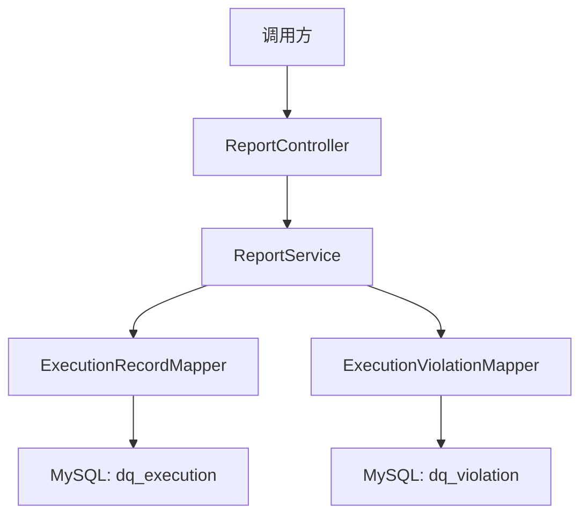
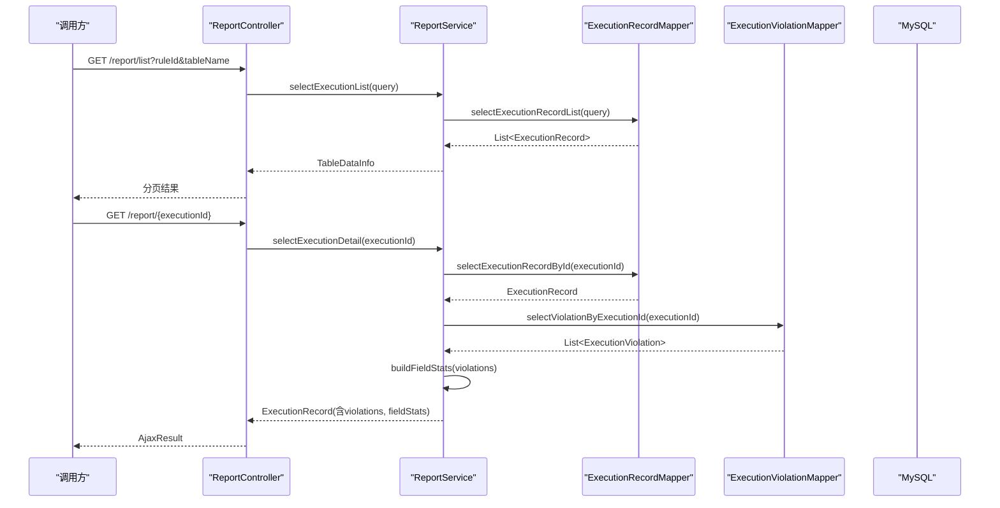
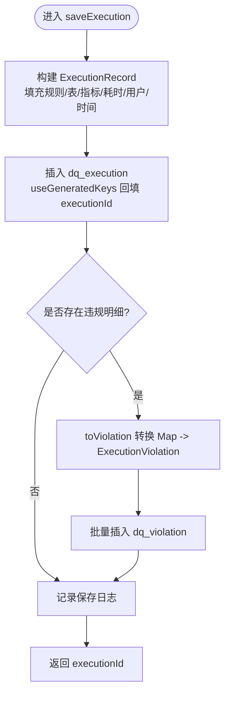
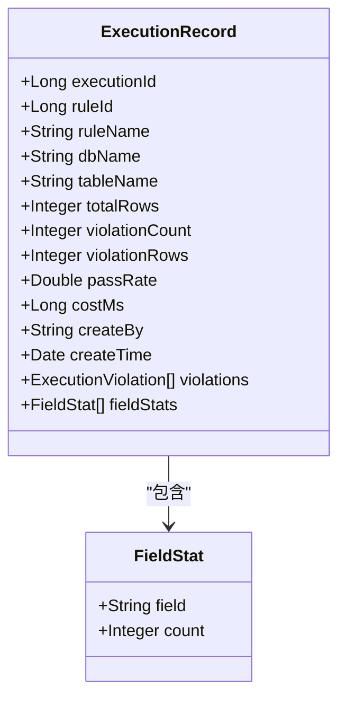
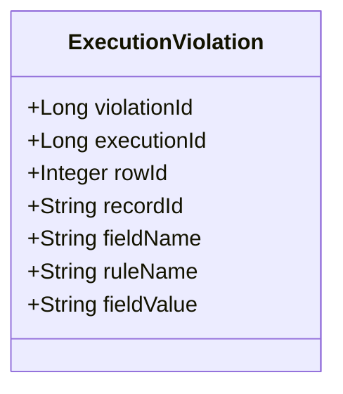
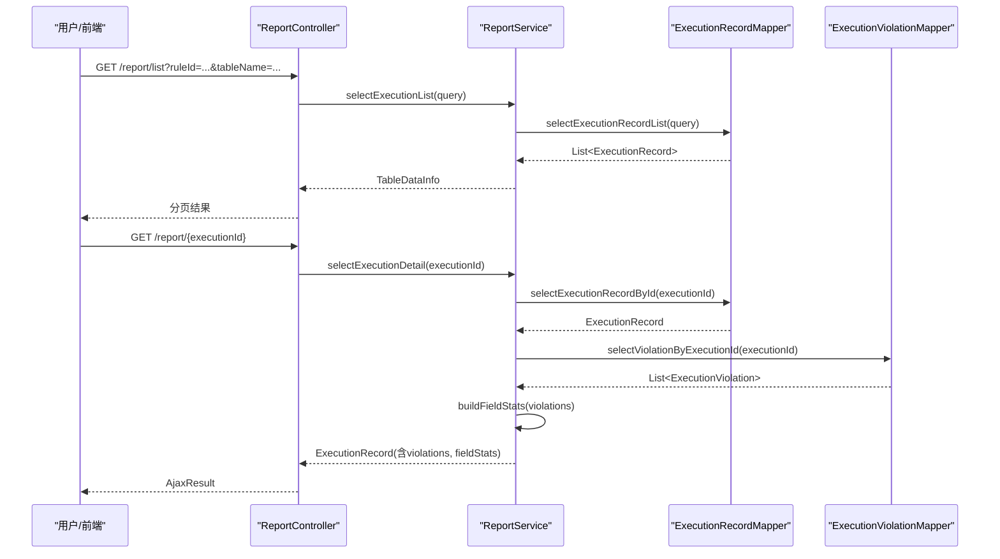
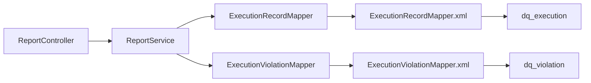

# 执行监控与追踪

<cite>
**本文引用的文件**   
- [ReportController.java](file://ruoyi-modules/ruoyi-dqservice/src/main/java/com/ruoyi/dqservice/controller/ReportController.java)
- [ReportService.java](file://ruoyi-modules/ruoyi-dqservice/src/main/java/com/ruoyi/dqservice/service/ReportService.java)
- [ExecutionRecord.java](file://ruoyi-modules/ruoyi-dqservice/src/main/java/com/ruoyi/dqservice/domain/ExecutionRecord.java)
- [ExecutionViolation.java](file://ruoyi-modules/ruoyi-dqservice/src/main/java/com/ruoyi/dqservice/domain/ExecutionViolation.java)
- [ExecutionRecordMapper.java](file://ruoyi-modules/ruoyi-dqservice/src/main/java/com/ruoyi/dqservice/mapper/ExecutionRecordMapper.java)
- [ExecutionViolationMapper.java](file://ruoyi-modules/ruoyi-dqservice/src/main/java/com/ruoyi/dqservice/mapper/ExecutionViolationMapper.java)
- [ExecutionRecordMapper.xml](file://ruoyi-modules/ruoyi-dqservice/src/main/resources/mapper/dqservice/ExecutionRecordMapper.xml)
- [ExecutionViolationMapper.xml](file://ruoyi-modules/ruoyi-dqservice/src/main/resources/mapper/dqservice/ExecutionViolationMapper.xml)
- [ry_dq_report_20261026.sql](file://sql/ry_dq_report_20261026.sql)
</cite>

## 目录
1. [简介](#简介)
2. [项目结构](#项目结构)
3. [核心组件](#核心组件)
4. [架构总览](#架构总览)
5. [详细组件分析](#详细组件分析)
6. [依赖关系分析](#依赖关系分析)
7. [性能考量](#性能考量)
8. [故障诊断与排错指南](#故障诊断与排错指南)
9. [结论](#结论)
10. [附录](#附录)

## 简介
本技术文档聚焦于数据质量服务中的“执行监控与追踪”能力，围绕 ReportService 的执行记录保存机制展开，涵盖执行ID生成、耗时统计、结果汇总与持久化存储；详细说明 ExecutionRecord 与 ExecutionViolation 的数据模型设计；解释扫描行数、违规条数、通过率等关键指标的统计逻辑；并给出执行历史查询接口、趋势分析与报表生成的扩展建议，以及监控告警配置、日志记录与故障诊断的最佳实践。

## 项目结构
该功能位于 ruoyi-dqservice 模块中，采用典型的 Controller-Service-Mapper-XML 分层：
- 控制器层：ReportController 暴露执行记录的列表与详情查询接口
- 服务层：ReportService 负责执行结果的组装、指标计算、明细转换与落库
- 领域模型：ExecutionRecord（汇总）、ExecutionViolation（明细）
- 数据访问层：ExecutionRecordMapper / ExecutionViolationMapper 及其 XML 映射
- 数据库脚本：ry_dq_report_20261026.sql 定义 dq_execution 与 dq_violation 表结构

图表来源
- [ReportController.java:22-49](file://ruoyi-modules/ruoyi-dqservice/src/main/java/com/ruoyi/dqservice/controller/ReportController.java#L22-L49)
- [ReportService.java:28-89](file://ruoyi-modules/ruoyi-dqservice/src/main/java/com/ruoyi/dqservice/service/ReportService.java#L28-L89)
- [ExecutionRecordMapper.java:12-25](file://ruoyi-modules/ruoyi-dqservice/src/main/java/com/ruoyi/dqservice/mapper/ExecutionRecordMapper.java#L12-L25)
- [ExecutionViolationMapper.java:12-22](file://ruoyi-modules/ruoyi-dqservice/src/main/java/com/ruoyi/dqservice/mapper/ExecutionViolationMapper.java#L12-L22)

章节来源
- [ReportController.java:17-49](file://ruoyi-modules/ruoyi-dqservice/src/main/java/com/ruoyi/dqservice/controller/ReportController.java#L17-L49)
- [ReportService.java:21-89](file://ruoyi-modules/ruoyi-dqservice/src/main/java/com/ruoyi/dqservice/service/ReportService.java#L21-L89)

## 核心组件
- ReportController：提供执行记录分页列表与按执行ID的详情查询接口，权限控制通过注解实现
- ReportService：封装一次规则执行的汇总与明细落库、字段分布统计、异常处理与用户上下文获取
- ExecutionRecord：汇总维度包含规则信息、目标表、扫描行数、违规条数、命中行数、通过率、耗时、执行人与时间
- ExecutionViolation：明细维度包含执行批次ID、行号、记录主键、违规字段、命中规则名、字段值
- Mapper接口与XML：完成CRUD与批量操作，支持动态条件查询与排序

章节来源
- [ReportController.java:22-49](file://ruoyi-modules/ruoyi-dqservice/src/main/java/com/ruoyi/dqservice/controller/ReportController.java#L22-L49)
- [ReportService.java:28-178](file://ruoyi-modules/ruoyi-dqservice/src/main/java/com/ruoyi/dqservice/service/ReportService.java#L28-L178)
- [ExecutionRecord.java:16-73](file://ruoyi-modules/ruoyi-dqservice/src/main/java/com/ruoyi/dqservice/domain/ExecutionRecord.java#L16-L73)
- [ExecutionViolation.java:12-37](file://ruoyi-modules/ruoyi-dqservice/src/main/java/com/ruoyi/dqservice/domain/ExecutionViolation.java#L12-L37)
- [ExecutionRecordMapper.java:12-25](file://ruoyi-modules/ruoyi-dqservice/src/main/java/com/ruoyi/dqservice/mapper/ExecutionRecordMapper.java#L12-L25)
- [ExecutionViolationMapper.java:12-22](file://ruoyi-modules/ruoyi-dqservice/src/main/java/com/ruoyi/dqservice/mapper/ExecutionViolationMapper.java#L12-L22)

## 架构总览
下图展示从请求到落库的关键流程，包括事务边界、明细转换与字段分布统计。

图表来源
- [ReportController.java:32-49](file://ruoyi-modules/ruoyi-dqservice/src/main/java/com/ruoyi/dqservice/controller/ReportController.java#L32-L49)
- [ReportService.java:92-109](file://ruoyi-modules/ruoyi-dqservice/src/main/java/com/ruoyi/dqservice/service/ReportService.java#L92-L109)
- [ExecutionRecordMapper.java:17-21](file://ruoyi-modules/ruoyi-dqservice/src/main/java/com/ruoyi/dqservice/mapper/ExecutionRecordMapper.java#L17-L21)
- [ExecutionViolationMapper.java:17-18](file://ruoyi-modules/ruoyi-dqservice/src/main/java/com/ruoyi/dqservice/mapper/ExecutionViolationMapper.java#L17-L18)

## 详细组件分析

### ReportService 执行记录保存机制
- 事务性写入：saveExecution 使用事务保证汇总与明细同时成功或失败，避免“只有汇总没有明细”的报告
- 执行ID生成：通过 MyBatis 自增主键返回 executionId，作为批次标识贯穿汇总与明细
- 耗时统计：costMs 由上层传入，表示规则执行耗时（毫秒），用于性能分析
- 结果汇总：totalRows、violationCount、violationRows、passRate 在保存时直接写入汇总记录
- 明细转换：toViolation 将 Drools 产出的 Map 转换为 ExecutionViolation，并对 recordId、field、rule、fieldValue 进行长度截断以匹配数据库字段长度
- 字段分布统计：buildFieldStats 对 violations 按 fieldName 聚合计数，并按降序排列，便于定位高频违规字段
- 用户上下文：currentUsername 优先取当前登录用户，若为内部调用或定时任务则回退为 system

图表来源
- [ReportService.java:58-89](file://ruoyi-modules/ruoyi-dqservice/src/main/java/com/ruoyi/dqservice/service/ReportService.java#L58-L89)
- [ReportService.java:111-129](file://ruoyi-modules/ruoyi-dqservice/src/main/java/com/ruoyi/dqservice/service/ReportService.java#L111-L129)
- [ExecutionRecordMapper.xml:43-71](file://ruoyi-modules/ruoyi-dqservice/src/main/resources/mapper/dqservice/ExecutionRecordMapper.xml#L43-L71)
- [ExecutionViolationMapper.xml:24-30](file://ruoyi-modules/ruoyi-dqservice/src/main/resources/mapper/dqservice/ExecutionViolationMapper.xml#L24-L30)

章节来源
- [ReportService.java:45-89](file://ruoyi-modules/ruoyi-dqservice/src/main/java/com/ruoyi/dqservice/service/ReportService.java#L45-L89)
- [ReportService.java:111-149](file://ruoyi-modules/ruoyi-dqservice/src/main/java/com/ruoyi/dqservice/service/ReportService.java#L111-L149)
- [ExecutionRecordMapper.xml:43-71](file://ruoyi-modules/ruoyi-dqservice/src/main/resources/mapper/dqservice/ExecutionRecordMapper.xml#L43-L71)
- [ExecutionViolationMapper.xml:24-30](file://ruoyi-modules/ruoyi-dqservice/src/main/resources/mapper/dqservice/ExecutionViolationMapper.xml#L24-L30)

### ExecutionRecord 实体数据结构设计
- 执行批次ID：executionId（自增主键，唯一标识一次规则执行）
- 规则信息：ruleId、ruleName、dbName、tableName
- 性能与质量指标：
  - totalRows：扫描行数
  - violationCount：违规条数（明细数量）
  - violationRows：命中行数（被判定为违规的行数）
  - passRate：通过率（百分比）
  - costMs：执行耗时（毫秒）
- 审计字段：createBy、createTime
- 非表字段：violations（明细列表）、fieldStats（字段分布统计）

图表来源
- [ExecutionRecord.java:16-73](file://ruoyi-modules/ruoyi-dqservice/src/main/java/com/ruoyi/dqservice/domain/ExecutionRecord.java#L16-L73)

章节来源
- [ExecutionRecord.java:16-73](file://ruoyi-modules/ruoyi-dqservice/src/main/java/com/ruoyi/dqservice/domain/ExecutionRecord.java#L16-L73)

### ExecutionViolation 实体数据结构设计
- 明细ID：violationId（自增主键）
- 关联批次：executionId（外键语义，关联 dq_execution）
- 行级信息：rowId（扫描行号）、recordId（业务记录主键）
- 违规信息：fieldName（违规字段）、ruleName（命中规则名）、fieldValue（字段值）

图表来源
- [ExecutionViolation.java:12-37](file://ruoyi-modules/ruoyi-dqservice/src/main/java/com/ruoyi/dqservice/domain/ExecutionViolation.java#L12-L37)

章节来源
- [ExecutionViolation.java:12-37](file://ruoyi-modules/ruoyi-dqservice/src/main/java/com/ruoyi/dqservice/domain/ExecutionViolation.java#L12-L37)

### 监控数据采集维度与统计逻辑
- 扫描行数（totalRows）：由上层传入，代表本次规则扫描的数据量
- 违规条数（violationCount）：等于明细列表大小，反映触发规则的条目总数
- 命中行数（violationRows）：由上层传入，表示被判定为违规的行数（可能与违规条数不同，因一行可能触发多条规则）
- 通过率（passRate）：由上层传入，表示通过校验的比例（百分比）
- 字段分布统计（fieldStats）：按 fieldName 聚合违规明细计数，降序排列，帮助定位高频问题字段

章节来源
- [ReportService.java:58-89](file://ruoyi-modules/ruoyi-dqservice/src/main/java/com/ruoyi/dqservice/service/ReportService.java#L58-L89)
- [ReportService.java:131-149](file://ruoyi-modules/ruoyi-dqservice/src/main/java/com/ruoyi/dqservice/service/ReportService.java#L131-L149)

### 执行历史的查询接口
- 列表查询：GET /report/list，支持按 ruleId、ruleName、tableName 动态过滤，默认按 execution_id 倒序
- 详情查询：GET /report/{executionId}，返回汇总记录、违规明细与字段分布统计

图表来源
- [ReportController.java:32-49](file://ruoyi-modules/ruoyi-dqservice/src/main/java/com/ruoyi/dqservice/controller/ReportController.java#L32-L49)
- [ReportService.java:92-109](file://ruoyi-modules/ruoyi-dqservice/src/main/java/com/ruoyi/dqservice/service/ReportService.java#L92-L109)
- [ExecutionRecordMapper.xml:28-41](file://ruoyi-modules/ruoyi-dqservice/src/main/resources/mapper/dqservice/ExecutionRecordMapper.xml#L28-L41)
- [ExecutionViolationMapper.xml:17-22](file://ruoyi-modules/ruoyi-dqservice/src/main/resources/mapper/dqservice/ExecutionViolationMapper.xml#L17-L22)

章节来源
- [ReportController.java:29-49](file://ruoyi-modules/ruoyi-dqservice/src/main/java/com/ruoyi/dqservice/controller/ReportController.java#L29-L49)
- [ReportService.java:92-109](file://ruoyi-modules/ruoyi-dqservice/src/main/java/com/ruoyi/dqservice/service/ReportService.java#L92-L109)
- [ExecutionRecordMapper.xml:28-41](file://ruoyi-modules/ruoyi-dqservice/src/main/resources/mapper/dqservice/ExecutionRecordMapper.xml#L28-L41)
- [ExecutionViolationMapper.xml:17-22](file://ruoyi-modules/ruoyi-dqservice/src/main/resources/mapper/dqservice/ExecutionViolationMapper.xml#L17-L22)

### 趋势分析与报表生成功能（扩展建议）
- 趋势分析：基于 dq_execution 表的 createTime、passRate、costMs、violationCount 等字段，按日/周/月聚合，绘制通过率与耗时的趋势图
- 报表生成：结合 ruleName、tableName 维度，输出周期性质量报告，包含通过率、违规热点字段、TopN 慢规则
- 数据导出：可复用现有分页接口，增加导出端点，将列表结果转为 Excel/CSV
- 注意：上述为扩展建议，当前代码未实现具体报表与导出逻辑

[本节为概念性扩展说明，不直接分析具体文件]

## 依赖关系分析
- 控制器依赖服务：ReportController 依赖 ReportService
- 服务依赖数据访问：ReportService 依赖 ExecutionRecordMapper 与 ExecutionViolationMapper
- 数据访问依赖SQL映射：Mapper接口对应 XML 中的 SQL 语句
- 数据库表依赖：dq_execution 与 dq_violation 通过 executionId 建立一对多关系

图表来源
- [ReportController.java:22-49](file://ruoyi-modules/ruoyi-dqservice/src/main/java/com/ruoyi/dqservice/controller/ReportController.java#L22-L49)
- [ReportService.java:28-89](file://ruoyi-modules/ruoyi-dqservice/src/main/java/com/ruoyi/dqservice/service/ReportService.java#L28-L89)
- [ExecutionRecordMapper.java:12-25](file://ruoyi-modules/ruoyi-dqservice/src/main/java/com/ruoyi/dqservice/mapper/ExecutionRecordMapper.java#L12-L25)
- [ExecutionViolationMapper.java:12-22](file://ruoyi-modules/ruoyi-dqservice/src/main/java/com/ruoyi/dqservice/mapper/ExecutionViolationMapper.java#L12-L22)
- [ExecutionRecordMapper.xml:28-41](file://ruoyi-modules/ruoyi-dqservice/src/main/resources/mapper/dqservice/ExecutionRecordMapper.xml#L28-L41)
- [ExecutionViolationMapper.xml:17-30](file://ruoyi-modules/ruoyi-dqservice/src/main/resources/mapper/dqservice/ExecutionViolationMapper.xml#L17-L30)

章节来源
- [ReportController.java:22-49](file://ruoyi-modules/ruoyi-dqservice/src/main/java/com/ruoyi/dqservice/controller/ReportController.java#L22-L49)
- [ReportService.java:28-89](file://ruoyi-modules/ruoyi-dqservice/src/main/java/com/ruoyi/dqservice/service/ReportService.java#L28-L89)
- [ExecutionRecordMapper.java:12-25](file://ruoyi-modules/ruoyi-dqservice/src/main/java/com/ruoyi/dqservice/mapper/ExecutionRecordMapper.java#L12-L25)
- [ExecutionViolationMapper.java:12-22](file://ruoyi-modules/ruoyi-dqservice/src/main/java/com/ruoyi/dqservice/mapper/ExecutionViolationMapper.java#L12-L22)

## 性能考量
- 事务边界：saveExecution 在同一事务内写入汇总与明细，确保一致性，但需注意大明细批量的事务开销
- 批量写入：insertViolationBatch 使用 foreach 批量插入，减少往返次数，提升吞吐
- 字段截断：toViolation 中对 recordId、field、rule、fieldValue 进行长度截断，避免超长导致入库失败
- 索引建议：
  - dq_execution：建议在 rule_id、table_name、create_time 上建立索引，优化列表查询与趋势分析
  - dq_violation：建议在 execution_id 上建立索引，加速明细查询与字段分布统计
- 分页与排序：列表查询默认按 execution_id 倒序，适合最新记录优先的场景

章节来源
- [ReportService.java:58-89](file://ruoyi-modules/ruoyi-dqservice/src/main/java/com/ruoyi/dqservice/service/ReportService.java#L58-L89)
- [ExecutionViolationMapper.xml:24-30](file://ruoyi-modules/ruoyi-dqservice/src/main/resources/mapper/dqservice/ExecutionViolationMapper.xml#L24-L30)
- [ExecutionRecordMapper.xml:28-36](file://ruoyi-modules/ruoyi-dqservice/src/main/resources/mapper/dqservice/ExecutionRecordMapper.xml#L28-L36)

## 故障诊断与排错指南
- 执行记录不存在：selectExecutionDetail 在未找到记录时抛出 ServiceException，需检查 executionId 是否正确
- 明细为空：当 violations 为空时不会写入 dq_violation，但仍会写入汇总记录，属正常行为
- 字段长度超限：toViolation 已做截断，若仍出现入库错误，请核对数据库字段长度与常量 LEN_RECORD_ID、LEN_FIELD_NAME、LEN_RULE_NAME、LEN_FIELD_VALUE
- 用户上下文缺失：currentUsername 捕获异常后回退为 system，不影响落库；如需审计准确用户，请确保调用链存在安全上下文
- 日志排查：saveExecution 在保存成功后记录日志，包含 executionId、ruleName、违规条数，可用于快速定位问题批次

章节来源
- [ReportService.java:97-109](file://ruoyi-modules/ruoyi-dqservice/src/main/java/com/ruoyi/dqservice/service/ReportService.java#L97-L109)
- [ReportService.java:111-129](file://ruoyi-modules/ruoyi-dqservice/src/main/java/com/ruoyi/dqservice/service/ReportService.java#L111-L129)
- [ReportService.java:166-177](file://ruoyi-modules/ruoyi-dqservice/src/main/java/com/ruoyi/dqservice/service/ReportService.java#L166-L177)
- [ReportService.java:86-88](file://ruoyi-modules/ruoyi-dqservice/src/main/java/com/ruoyi/dqservice/service/ReportService.java#L86-L88)

## 结论
ReportService 提供了完整的数据质量执行记录保存与查询能力，通过事务保障汇总与明细的一致性，并通过字段分布统计增强可观测性。ExecutionRecord 与 ExecutionViolation 的数据模型清晰表达了一次规则执行的性能与质量指标。在此基础上，可通过索引优化、趋势分析与报表扩展进一步提升监控与运维效率。

[本节为总结性内容，不直接分析具体文件]

## 附录

### 数据库表结构概览
- dq_execution：存储每次规则执行的汇总记录
- dq_violation：存储该次执行的逐条违规明细

章节来源
- [ry_dq_report_20261026.sql:6-29](file://sql/ry_dq_report_20261026.sql#L6-L29)