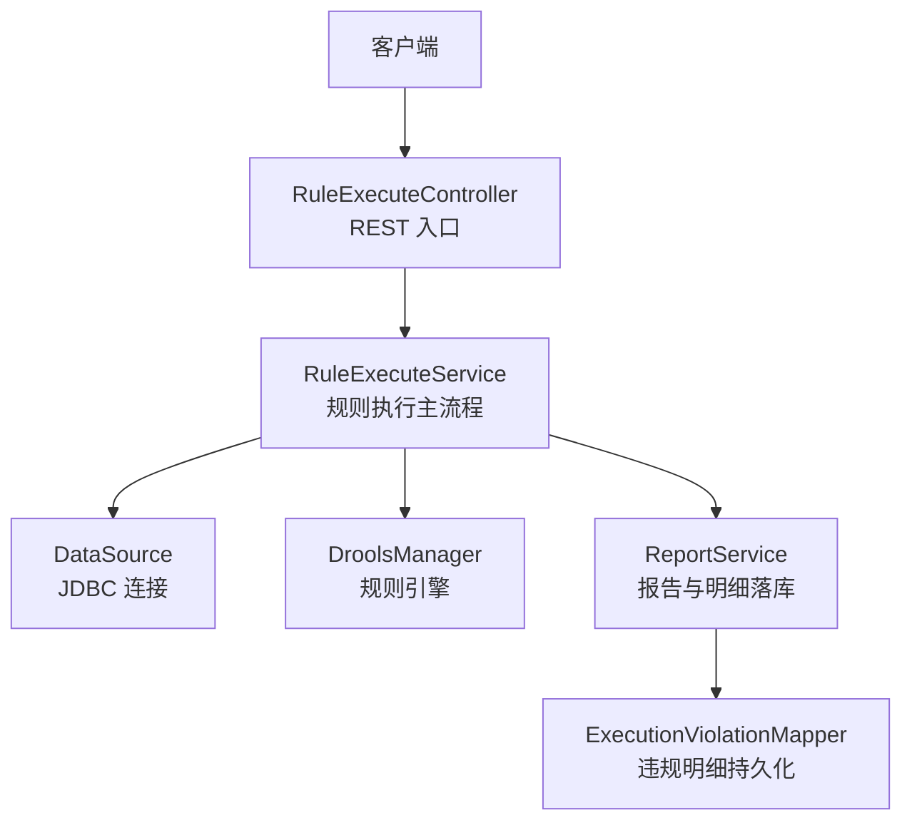
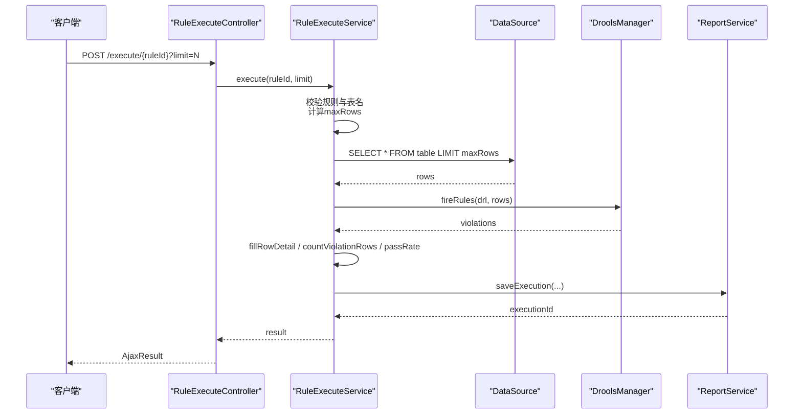
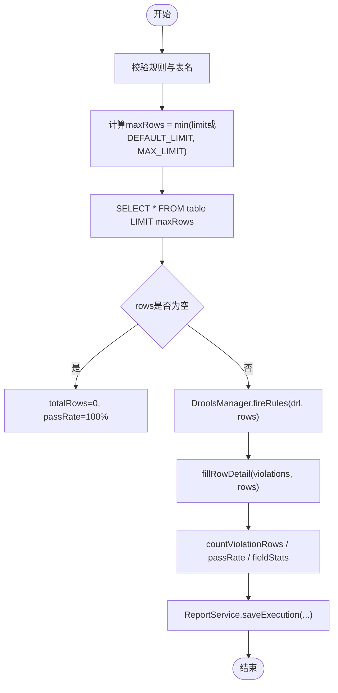
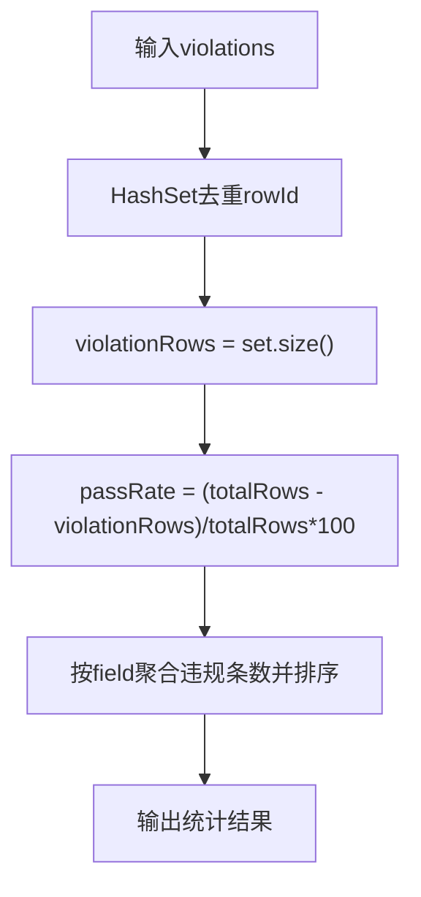
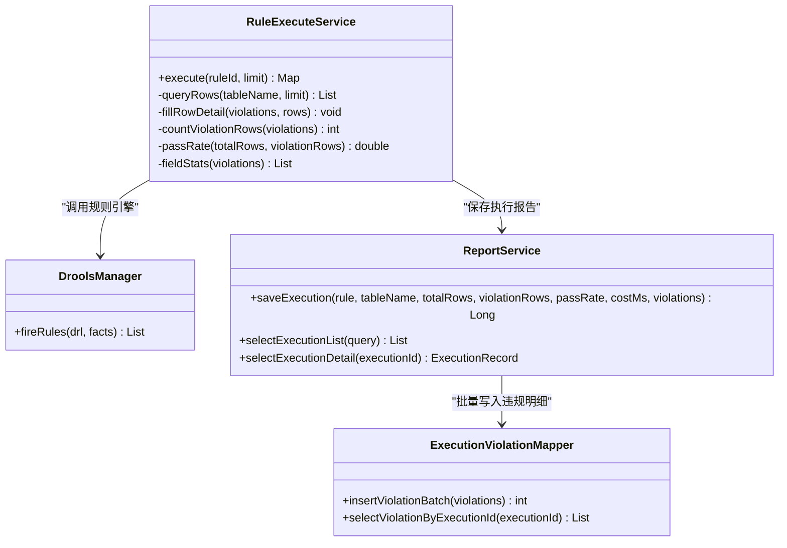

# 批量处理与性能优化

<cite>
**本文引用的文件**   
- [RuleExecuteService.java](file://ruoyi-modules/ruoyi-dqservice/src/main/java/com/ruoyi/dqservice/service/RuleExecuteService.java)
- [ReportService.java](file://ruoyi-modules/ruoyi-dqservice/src/main/java/com/ruoyi/dqservice/service/ReportService.java)
- [DroolsManager.java](file://ruoyi-modules/ruoyi-dqservice/src/main/java/com/ruoyi/dqservice/connecter/DroolsManager.java)
- [RuleParser.java](file://ruoyi-modules/ruoyi-dqservice/src/main/java/com/ruoyi/dqservice/util/RuleParser.java)
- [DBUtil.java](file://ruoyi-modules/ruoyi-dqservice/src/main/java/com/ruoyi/dqservice/connecter/DBUtil.java)
- [ExecutionViolationMapper.java](file://ruoyi-modules/ruoyi-dqservice/src/main/java/com/ruoyi/dqservice/mapper/ExecutionViolationMapper.java)
- [RuleExecuteController.java](file://ruoyi-modules/ruoyi-dqservice/src/main/java/com/ruoyi/dqservice/controller/RuleExecuteController.java)
</cite>

## 目录
1. [引言](#引言)
2. [项目结构](#项目结构)
3. [核心组件](#核心组件)
4. [架构总览](#架构总览)
5. [详细组件分析](#详细组件分析)
6. [依赖关系分析](#依赖关系分析)
7. [性能与并发控制](#性能与并发控制)
8. [数据库连接池与SQL优化](#数据库连接池与sql优化)
9. [监控指标与基准测试](#监控指标与基准测试)
10. [故障排查指南](#故障排查指南)
11. [结论](#结论)

## 引言
本技术文档围绕数据质量服务中的批量规则执行与性能优化展开，重点解析 RuleExecuteService 的批量数据处理机制、内存管理、并发控制策略，以及 DEFAULT_LIMIT 与 MAX_LIMIT 的设计考量。同时说明违规记录统计、通过率算法、字段分布分析的实现细节，并给出数据库连接池配置建议、SQL 优化与查询调优方法，最后提供监控指标、基准测试思路与优化案例，帮助在大数据量场景下稳定高效地运行规则引擎。

## 项目结构
该模块位于 ruoyi-modules/ruoyi-dqservice，核心流程由控制器触发规则执行，服务层负责读取数据、调用规则引擎、汇总结果并落库。关键文件职责如下：
- RuleExecuteController：对外暴露规则执行接口，接收 ruleId 与可选 limit 参数。
- RuleExecuteService：规则执行主流程，包含数据读取、规则匹配、统计计算与报告保存。
- DroolsManager：封装 Drools 规则编译与执行，支持动态 DRL 文本。
- ReportService：执行结果与违规明细持久化，并提供字段分布统计。
- RuleParser：根据列约束生成空值检测 DRL，定义行号占位字段 ROW_ID_KEY。
- DBUtil：示例 JDBC 工具类（非当前主流程使用）。
- ExecutionViolationMapper：违规明细的批量写入与查询接口。

图表来源
- [RuleExecuteController.java:21-39](file://ruoyi-modules/ruoyi-dqservice/src/main/java/com/ruoyi/dqservice/controller/RuleExecuteController.java#L21-L39)
- [RuleExecuteService.java:69-114](file://ruoyi-modules/ruoyi-dqservice/src/main/java/com/ruoyi/dqservice/service/RuleExecuteService.java#L69-L114)
- [DroolsManager.java:149-186](file://ruoyi-modules/ruoyi-dqservice/src/main/java/com/ruoyi/dqservice/connecter/DroolsManager.java#L149-L186)
- [ReportService.java:58-89](file://ruoyi-modules/ruoyi-dqservice/src/main/java/com/ruoyi/dqservice/service/ReportService.java#L58-L89)
- [ExecutionViolationMapper.java:12-22](file://ruoyi-modules/ruoyi-dqservice/src/main/java/com/ruoyi/dqservice/mapper/ExecutionViolationMapper.java#L12-L22)

章节来源
- [RuleExecuteController.java:21-39](file://ruoyi-modules/ruoyi-dqservice/src/main/java/com/ruoyi/dqservice/controller/RuleExecuteController.java#L21-L39)
- [RuleExecuteService.java:69-114](file://ruoyi-modules/ruoyi-dqservice/src/main/java/com/ruoyi/dqservice/service/RuleExecuteService.java#L69-L114)

## 核心组件
- RuleExecuteService
  - 负责校验规则、限制扫描行数、读取数据、调用规则引擎、统计违规与通过率、保存执行报告。
  - 通过白名单校验表名，防止 SQL 注入；通过 DEFAULT_LIMIT 与 MAX_LIMIT 控制单次扫描规模。
- DroolsManager
  - 动态编译 DRL 文本，创建独立 KieSession 执行规则，收集 then 块产出的违规明细。
  - 对规则语法错误进行统一提示，避免影响其他规则。
- ReportService
  - 将执行汇总与违规明细在同一事务内落库，保证一致性。
  - 提供字段分布统计，便于可视化展示。
- RuleParser
  - 根据列约束生成空值检测 DRL，定义 ROW_ID_KEY 用于回填行详情。
- ExecutionViolationMapper
  - 提供违规明细的批量插入与按批次查询能力。

章节来源
- [RuleExecuteService.java:36-114](file://ruoyi-modules/ruoyi-dqservice/src/main/java/com/ruoyi/dqservice/service/RuleExecuteService.java#L36-L114)
- [DroolsManager.java:149-186](file://ruoyi-modules/ruoyi-dqservice/src/main/java/com/ruoyi/dqservice/connecter/DroolsManager.java#L149-L186)
- [ReportService.java:58-109](file://ruoyi-modules/ruoyi-dqservice/src/main/java/com/ruoyi/dqservice/service/ReportService.java#L58-L109)
- [RuleParser.java:16-93](file://ruoyi-modules/ruoyi-dqservice/src/main/java/com/ruoyi/dqservice/util/RuleParser.java#L16-L93)
- [ExecutionViolationMapper.java:12-22](file://ruoyi-modules/ruoyi-dqservice/src/main/java/com/ruoyi/dqservice/mapper/ExecutionViolationMapper.java#L12-L22)

## 架构总览
规则执行的端到端流程如下：
- 客户端调用 /execute/{ruleId}?limit=N。
- RuleExecuteController 转发到 RuleExecuteService.execute。
- RuleExecuteService 校验规则与表名，计算 maxRows，读取 rows。
- DroolsManager.fireRules 编译并执行 DRL，返回 violations。
- RuleExecuteService 填充行详情、统计违规行数与通过率，调用 ReportService.saveExecution 落库。
- 返回执行结果，包含 executionId、totalRows、violationCount、passRate、fieldStats、violations。

图表来源
- [RuleExecuteController.java:21-39](file://ruoyi-modules/ruoyi-dqservice/src/main/java/com/ruoyi/dqservice/controller/RuleExecuteController.java#L21-L39)
- [RuleExecuteService.java:69-114](file://ruoyi-modules/ruoyi-dqservice/src/main/java/com/ruoyi/dqservice/service/RuleExecuteService.java#L69-L114)
- [DroolsManager.java:149-186](file://ruoyi-modules/ruoyi-dqservice/src/main/java/com/ruoyi/dqservice/connecter/DroolsManager.java#L149-L186)
- [ReportService.java:58-89](file://ruoyi-modules/ruoyi-dqservice/src/main/java/com/ruoyi/dqservice/service/ReportService.java#L58-L89)

## 详细组件分析

### RuleExecuteService 批量处理机制
- 数据分页读取
  - 当前实现为“单次 LIMIT”模式：SELECT * FROM table LIMIT maxRows。
  - 未实现游标式分页或基于 ID 的分页，适合演示与小批量场景。
  - 对于大表，应扩展为分批读取（例如基于主键范围或游标），以降低内存占用与网络传输压力。
- 内存管理
  - rows 以 List<Map<String,Object>> 存储，每行 Map 包含所有字段与 ROW_ID_KEY。
  - violations 同样以 List<Map<String,Object>> 存储，可能包含重复 rowId。
  - fillRowDetail 构建 rowIndex 映射，将违规明细关联回原始行，时间复杂度 O(V+R)，空间复杂度 O(R)。
- 并发控制
  - 当前 execute 为同步串行执行，无显式线程池或限流。
  - 若需并发执行多条规则，应在上层引入线程池与限流器，并对 Drools KieSession 做隔离与资源回收。
- 安全与健壮性
  - 表名白名单校验防止 SQL 注入。
  - limit 为空或非法时采用 DEFAULT_LIMIT，且上限受 MAX_LIMIT 限制。

图表来源
- [RuleExecuteService.java:69-114](file://ruoyi-modules/ruoyi-dqservice/src/main/java/com/ruoyi/dqservice/service/RuleExecuteService.java#L69-L114)
- [RuleExecuteService.java:120-149](file://ruoyi-modules/ruoyi-dqservice/src/main/java/com/ruoyi/dqservice/service/RuleExecuteService.java#L120-L149)
- [RuleExecuteService.java:154-197](file://ruoyi-modules/ruoyi-dqservice/src/main/java/com/ruoyi/dqservice/service/RuleExecuteService.java#L154-L197)

章节来源
- [RuleExecuteService.java:69-114](file://ruoyi-modules/ruoyi-dqservice/src/main/java/com/ruoyi/dqservice/service/RuleExecuteService.java#L69-L114)
- [RuleExecuteService.java:120-149](file://ruoyi-modules/ruoyi-dqservice/src/main/java/com/ruoyi/dqservice/service/RuleExecuteService.java#L120-L149)
- [RuleExecuteService.java:154-197](file://ruoyi-modules/ruoyi-dqservice/src/main/java/com/ruoyi/dqservice/service/RuleExecuteService.java#L154-L197)

### DEFAULT_LIMIT 与 MAX_LIMIT 设计考虑
- DEFAULT_LIMIT=1000：默认扫描行数，避免在大表上拖慢演示环境。
- MAX_LIMIT=10000：单次执行扫描行数上限，防止恶意或误用导致过大查询。
- 计算逻辑：当 limit 为空或非法时使用 DEFAULT_LIMIT；否则取 min(limit, MAX_LIMIT)。
- 风险缓解：通过白名单校验表名，结合 limit 上限，降低全表扫描与大对象传输的风险。

章节来源
- [RuleExecuteService.java:40-44](file://ruoyi-modules/ruoyi-dqservice/src/main/java/com/ruoyi/dqservice/service/RuleExecuteService.java#L40-L44)
- [RuleExecuteService.java:76-89](file://ruoyi-modules/ruoyi-dqservice/src/main/java/com/ruoyi/dqservice/service/RuleExecuteService.java#L76-L89)

### 违规记录统计、通过率与字段分布
- 违规行数统计
  - 使用 HashSet 去重 rowId，统计命中违规的记录行数，避免同一行多字段违规被重复计数。
- 通过率算法
  - 公式：(totalRows - violationRows) / totalRows，保留一位小数；空表视为 100%。
- 字段分布分析
  - 遍历 violations，按 field 聚合违规条数，降序排列，供前端可视化。

图表来源
- [RuleExecuteService.java:175-197](file://ruoyi-modules/ruoyi-dqservice/src/main/java/com/ruoyi/dqservice/service/RuleExecuteService.java#L175-L197)
- [RuleExecuteService.java:199-219](file://ruoyi-modules/ruoyi-dqservice/src/main/java/com/ruoyi/dqservice/service/RuleExecuteService.java#L199-L219)

章节来源
- [RuleExecuteService.java:175-197](file://ruoyi-modules/ruoyi-dqservice/src/main/java/com/ruoyi/dqservice/service/RuleExecuteService.java#L175-L197)
- [RuleExecuteService.java:199-219](file://ruoyi-modules/ruoyi-dqservice/src/main/java/com/ruoyi/dqservice/service/RuleExecuteService.java#L199-L219)

### DroolsManager 规则执行与内存模型
- 动态编译
  - 每次调用 fireRules 使用独立的 KieHelper 编译 DRL，不污染全局文件系统，避免单条规则错误影响其他规则。
- 会话隔离
  - 每次执行创建新的 KieSession，并在 finally 中 dispose，确保资源释放。
- 违规收集
  - 通过 global List violations 收集 then 块产出的违规明细；若未声明 global，抛出可读异常提示。
- 事实模型
  - 每条数据库记录作为 Map fact 插入，字段通过 this["col"] 访问，无需 declare 动态类型。

章节来源
- [DroolsManager.java:149-186](file://ruoyi-modules/ruoyi-dqservice/src/main/java/com/ruoyi/dqservice/connecter/DroolsManager.java#L149-L186)

### ReportService 报告与明细持久化
- 事务一致性
  - saveExecution 使用 @Transactional，确保汇总与明细在同一事务内写入，避免只有汇总没有明细的报告。
- 字段截断
  - 对 recordId、fieldName、ruleName、fieldValue 等字段进行长度截断，防止超长数据入库失败。
- 字段分布
  - buildFieldStats 按 fieldName 聚合违规条数，降序排列，供报告展示。

章节来源
- [ReportService.java:58-89](file://ruoyi-modules/ruoyi-dqservice/src/main/java/com/ruoyi/dqservice/service/ReportService.java#L58-L89)
- [ReportService.java:111-149](file://ruoyi-modules/ruoyi-dqservice/src/main/java/com/ruoyi/dqservice/service/ReportService.java#L111-L149)

### RuleParser 行号占位与空值检测
- ROW_ID_KEY="__rowId"
  - 在执行阶段由 RuleExecuteService 写入每条记录的 ROW_ID_KEY，供 Drools 规则引用。
- 空值检测 DRL
  - 根据列约束生成针对每个字段的空值检测规则，命中后将违规详情写入 violations。

章节来源
- [RuleParser.java:16-93](file://ruoyi-modules/ruoyi-dqservice/src/main/java/com/ruoyi/dqservice/util/RuleParser.java#L16-L93)
- [RuleExecuteService.java:120-149](file://ruoyi-modules/ruoyi-dqservice/src/main/java/com/ruoyi/dqservice/service/RuleExecuteService.java#L120-L149)

## 依赖关系分析
- RuleExecuteService 依赖：
  - RuleMapper（获取规则）
  - DroolsManager（规则引擎）
  - javax.sql.DataSource（数据源）
  - ReportService（报告落库）
- ReportService 依赖：
  - ExecutionRecordMapper（执行记录）
  - ExecutionViolationMapper（违规明细）
- DroolsManager 依赖：
  - Drools API（KieServices/KieHelper/KieSession）

图表来源
- [RuleExecuteService.java:36-114](file://ruoyi-modules/ruoyi-dqservice/src/main/java/com/ruoyi/dqservice/service/RuleExecuteService.java#L36-L114)
- [DroolsManager.java:149-186](file://ruoyi-modules/ruoyi-dqservice/src/main/java/com/ruoyi/dqservice/connecter/DroolsManager.java#L149-L186)
- [ReportService.java:58-109](file://ruoyi-modules/ruoyi-dqservice/src/main/java/com/ruoyi/dqservice/service/ReportService.java#L58-L109)
- [ExecutionViolationMapper.java:12-22](file://ruoyi-modules/ruoyi-dqservice/src/main/java/com/ruoyi/dqservice/mapper/ExecutionViolationMapper.java#L12-L22)

章节来源
- [RuleExecuteService.java:36-114](file://ruoyi-modules/ruoyi-dqservice/src/main/java/com/ruoyi/dqservice/service/RuleExecuteService.java#L36-L114)
- [DroolsManager.java:149-186](file://ruoyi-modules/ruoyi-dqservice/src/main/java/com/ruoyi/dqservice/connecter/DroolsManager.java#L149-L186)
- [ReportService.java:58-109](file://ruoyi-modules/ruoyi-dqservice/src/main/java/com/ruoyi/dqservice/service/ReportService.java#L58-L109)
- [ExecutionViolationMapper.java:12-22](file://ruoyi-modules/ruoyi-dqservice/src/main/java/com/ruoyi/dqservice/mapper/ExecutionViolationMapper.java#L12-L22)

## 性能与并发控制
- 当前实现为同步串行执行，适合小规模演示与验证。
- 潜在瓶颈
  - 全表扫描：即使有 LIMIT，仍可能加载大量对象到内存。
  - 规则引擎开销：每条记录作为 Map fact 插入，规则复杂度高时会显著增加 CPU 消耗。
  - 报告落库：violations 列表较大时，批量插入与字段分布统计会增加内存与 I/O 压力。
- 并发控制建议
  - 引入线程池执行多条规则，限制并发度以避免压垮数据库与规则引擎。
  - 对 Drools KieSession 做隔离与复用策略评估，避免频繁创建销毁带来的开销。
  - 对 ReportService 的批量写入进行分片与异步化，减少主流程阻塞。

[本节为通用性能指导，不直接分析具体文件]

## 数据库连接池与SQL优化
- 连接池配置
  - 当前 RuleExecuteService 直接使用 Spring 注入的 javax.sql.DataSource，未在此处显式配置连接池参数。
  - 建议在应用配置中启用连接池（如 HikariCP），合理设置最大连接数、最小空闲连接、连接超时等。
- SQL 优化建议
  - 避免 SELECT *，仅选择必要字段以减少网络与内存开销。
  - 对大表查询使用基于主键的范围分页或游标分页，替代固定 LIMIT。
  - 为常用过滤条件建立索引，避免全表扫描。
  - 对违规明细批量插入使用 MyBatis 批处理或数据库原生批量语句，提升吞吐。
- 查询性能调优
  - 监控慢查询日志，定位高延迟 SQL。
  - 调整数据库缓冲池与临时表大小，减少磁盘 IO。
  - 对规则引擎侧进行预热与缓存，减少重复编译开销。

章节来源
- [RuleExecuteService.java:120-149](file://ruoyi-modules/ruoyi-dqservice/src/main/java/com/ruoyi/dqservice/service/RuleExecuteService.java#L120-L149)
- [ExecutionViolationMapper.java:12-22](file://ruoyi-modules/ruoyi-dqservice/src/main/java/com/ruoyi/dqservice/mapper/ExecutionViolationMapper.java#L12-L22)

## 监控指标与基准测试
- 监控指标
  - 执行耗时（costMs）
  - 扫描行数（totalRows）
  - 违规条数（violationCount）
  - 命中违规行数（violationRows）
  - 通过率（passRate）
  - 字段分布（fieldStats）
  - 批次ID（executionId）
- 基准测试思路
  - 不同数据规模（1k、10k、100k）与字段数量下的吞吐量与延迟对比。
  - 不同规则复杂度（简单空值检测 vs 复杂表达式）对 CPU 与内存的影响。
  - 并发执行多条规则时的资源利用率与稳定性。
- 优化案例
  - 将 SELECT * 改为只选必要字段，减少内存占用。
  - 将 LIMIT 分页升级为基于主键范围分页，避免大对象累积。
  - 对高频规则进行预编译与缓存，减少 KieHelper 编译开销。

章节来源
- [RuleExecuteService.java:96-113](file://ruoyi-modules/ruoyi-dqservice/src/main/java/com/ruoyi/dqservice/service/RuleExecuteService.java#L96-L113)

## 故障排查指南
- 规则不存在或内容为空
  - 现象：抛出 ServiceException，提示规则不存在或规则内容为空。
  - 排查：检查 RuleMapper.selectRuleByRuleId 返回值与 ruleContext 是否有效。
- 表名校验失败
  - 现象：抛出 ServiceException，提示规则未绑定合法的数据表。
  - 排查：确认表名是否符合白名单正则 [A-Za-z0-9_]+。
- 规则编译失败
  - 现象：DroolsManager 抛出 ServiceException，提示规则编译失败或未声明 global violations。
  - 排查：检查 DRL 语法与 global 声明是否正确。
- 数据表读取失败
  - 现象：抛出 ServiceException，提示读取数据表失败。
  - 排查：检查 DataSource 配置、权限与 SQL 合法性。

章节来源
- [RuleExecuteService.java:71-85](file://ruoyi-modules/ruoyi-dqservice/src/main/java/com/ruoyi/dqservice/service/RuleExecuteService.java#L71-L85)
- [RuleExecuteService.java:143-147](file://ruoyi-modules/ruoyi-dqservice/src/main/java/com/ruoyi/dqservice/service/RuleExecuteService.java#L143-L147)
- [DroolsManager.java:153-176](file://ruoyi-modules/ruoyi-dqservice/src/main/java/com/ruoyi/dqservice/connecter/DroolsManager.java#L153-L176)

## 结论
RuleExecuteService 在当前实现中以“单次 LIMIT”方式读取数据，并通过 DEFAULT_LIMIT 与 MAX_LIMIT 控制扫描规模，保障演示环境的稳定性。违规统计、通过率与字段分布分析逻辑清晰，配合 DroolsManager 的动态规则执行与 ReportService 的事务一致性落库，形成完整的规则执行闭环。面向生产环境的大表与高并发场景，建议扩展分页策略、优化 SQL、引入连接池与并发控制，并完善监控与基准测试体系，以实现更稳健的性能表现。