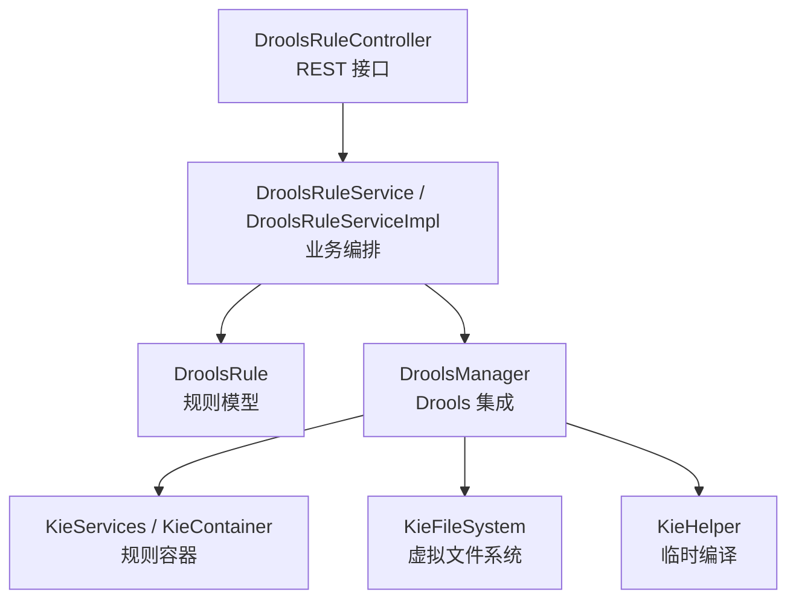
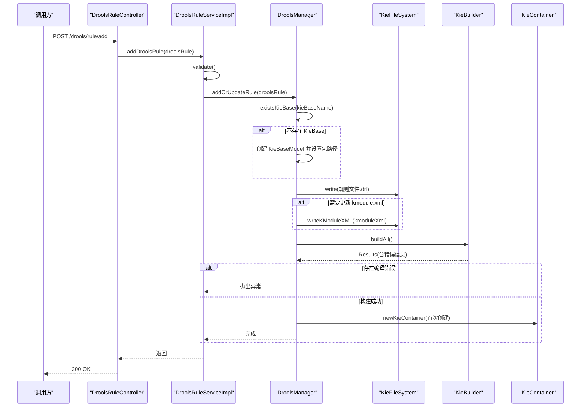
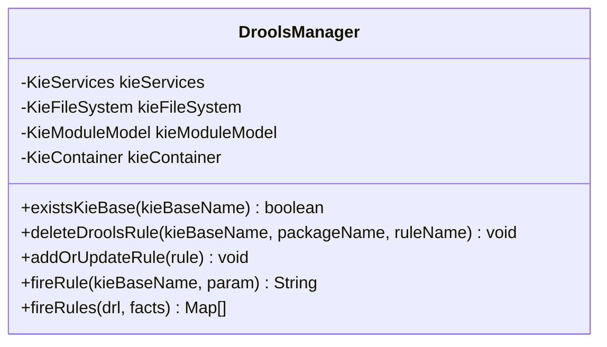
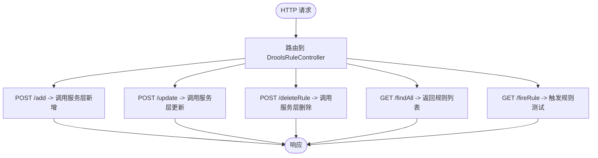
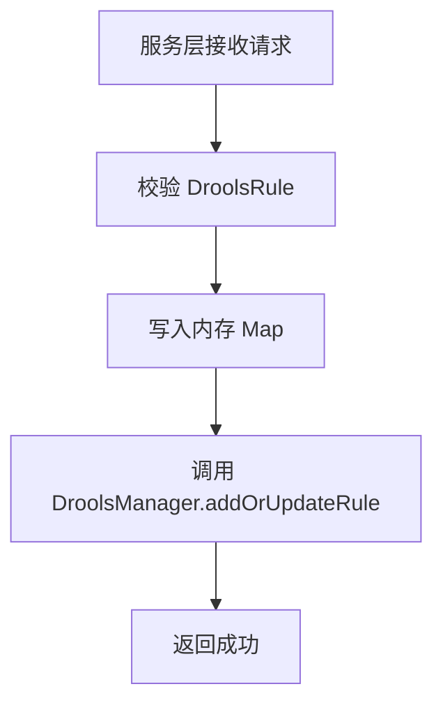
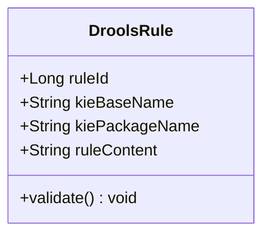
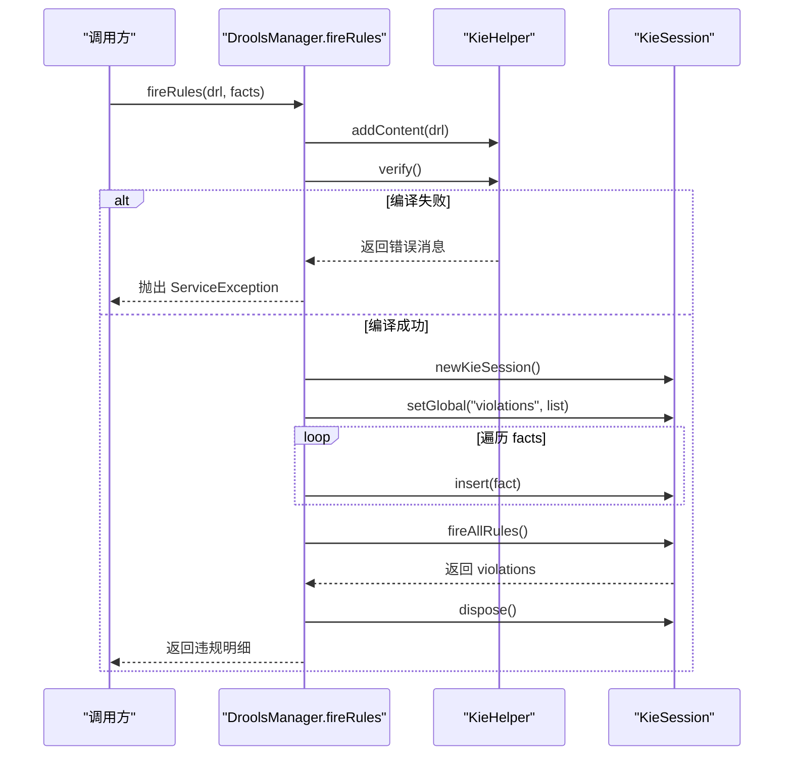
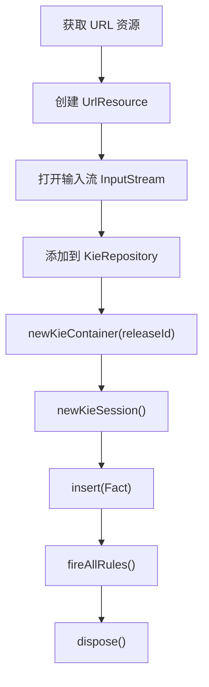
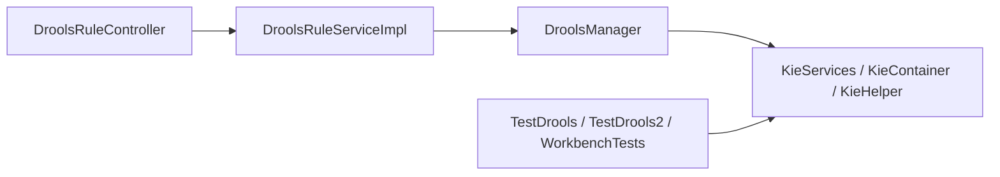

# 规则执行引擎

<cite>
**本文引用的文件**   
- [DroolsManager.java](file://ruoyi-modules/ruoyi-dqservice/src/main/java/com/ruoyi/dqservice/connecter/DroolsManager.java)
- [DroolsRuleController.java](file://ruoyi-modules/ruoyi-dqservice/src/main/java/com/ruoyi/dqservice/controller/DroolsRuleController.java)
- [DroolsRuleService.java](file://ruoyi-modules/ruoyi-dqservice/src/main/java/com/ruoyi/dqservice/service/DroolsRuleService.java)
- [DroolsRuleServiceImpl.java](file://ruoyi-modules/ruoyi-dqservice/src/main/java/com/ruoyi/dqservice/service/impl/DroolsRuleServiceImpl.java)
- [DroolsRule.java](file://ruoyi-modules/ruoyi-dqservice/src/main/java/com/ruoyi/dqservice/domain/DroolsRule.java)
- [TestDrools.java](file://ruoyi-modules/ruoyi-dqservice/src/main/java/com/sch/test/TestDrools.java)
- [TestDrools2.java](file://ruoyi-modules/ruoyi-dqservice/src/main/java/com/sch/test/TestDrools2.java)
- [DroolsApplicationWorkBenchTests.java](file://ruoyi-modules/ruoyi-dqservice/src/test/java/com/ruoyi/dqservice/DroolsApplicationWorkBenchTests.java)
</cite>

## 目录
1. [简介](#简介)
2. [项目结构](#项目结构)
3. [核心组件](#核心组件)
4. [架构总览](#架构总览)
5. [详细组件分析](#详细组件分析)
6. [依赖关系分析](#依赖关系分析)
7. [性能与并发优化](#性能与并发优化)
8. [监控指标与可观测性](#监控指标与可观测性)
9. [故障诊断与恢复](#故障诊断与恢复)
10. [结论](#结论)

## 简介
本技术文档围绕数据质量服务模块中的 Drools 规则执行引擎展开，系统性说明规则从加载、编译到执行的完整生命周期，以及批量处理、并发执行、内存管理、错误恢复等高级特性。文档同时给出性能调优建议、关键监控指标和常见问题的诊断方法，帮助读者在生产环境中稳定、高效地使用规则引擎。

## 项目结构
规则执行能力集中在数据质量服务模块中，采用分层组织：
- 控制器层：对外暴露规则管理与执行接口
- 服务层：封装规则增删改查与校验逻辑
- 领域模型：描述规则元数据与内容
- 连接器层：封装 Drools KIE API，负责规则构建与执行

**图表来源**
- [DroolsRuleController.java:13-49](file://ruoyi-modules/ruoyi-dqservice/src/main/java/com/ruoyi/dqservice/controller/DroolsRuleController.java#L13-L49)
- [DroolsRuleService.java:7-15](file://ruoyi-modules/ruoyi-dqservice/src/main/java/com/ruoyi/dqservice/service/DroolsRuleService.java#L7-L15)
- [DroolsRuleServiceImpl.java:11-48](file://ruoyi-modules/ruoyi-dqservice/src/main/java/com/ruoyi/dqservice/service/impl/DroolsRuleServiceImpl.java#L11-L48)
- [DroolsRule.java:5-31](file://ruoyi-modules/ruoyi-dqservice/src/main/java/com/ruoyi/dqservice/domain/DroolsRule.java#L5-L31)
- [DroolsManager.java:22-120](file://ruoyi-modules/ruoyi-dqservice/src/main/java/com/ruoyi/dqservice/connecter/DroolsManager.java#L22-L120)

**章节来源**
- [DroolsRuleController.java:13-49](file://ruoyi-modules/ruoyi-dqservice/src/main/java/com/ruoyi/dqservice/controller/DroolsRuleController.java#L13-L49)
- [DroolsRuleService.java:7-15](file://ruoyi-modules/ruoyi-dqservice/src/main/java/com/ruoyi/dqservice/service/DroolsRuleService.java#L7-L15)
- [DroolsRuleServiceImpl.java:11-48](file://ruoyi-modules/ruoyi-dqservice/src/main/java/com/ruoyi/dqservice/service/impl/DroolsRuleServiceImpl.java#L11-L48)
- [DroolsRule.java:5-31](file://ruoyi-modules/ruoyi-dqservice/src/main/java/com/ruoyi/dqservice/domain/DroolsRule.java#L5-L31)
- [DroolsManager.java:22-120](file://ruoyi-modules/ruoyi-dqservice/src/main/java/com/ruoyi/dqservice/connecter/DroolsManager.java#L22-L120)

## 核心组件
- DroolsManager：Drools 集成核心，负责 KieBase/KieSession 生命周期、规则动态写入与编译、批量事实插入与执行、违规结果收集。
- DroolsRuleController：提供规则查询、新增、更新、删除以及简单触发测试的 REST 接口。
- DroolsRuleService / DroolsRuleServiceImpl：规则的业务编排与持久化模拟（当前为内存 Map）。
- DroolsRule：规则模型，包含规则标识、KieBase 名称、包名与 DRL 文本，并提供参数校验。

关键职责边界：
- 控制器仅做请求路由与参数透传
- 服务层负责规则对象校验与状态维护
- 连接器层屏蔽 Drools API 细节，向上提供统一能力

**章节来源**
- [DroolsManager.java:22-187](file://ruoyi-modules/ruoyi-dqservice/src/main/java/com/ruoyi/dqservice/connecter/DroolsManager.java#L22-L187)
- [DroolsRuleController.java:13-49](file://ruoyi-modules/ruoyi-dqservice/src/main/java/com/ruoyi/dqservice/controller/DroolsRuleController.java#L13-L49)
- [DroolsRuleService.java:7-15](file://ruoyi-modules/ruoyi-dqservice/src/main/java/com/ruoyi/dqservice/service/DroolsRuleService.java#L7-L15)
- [DroolsRuleServiceImpl.java:11-48](file://ruoyi-modules/ruoyi-dqservice/src/main/java/com/ruoyi/dqservice/service/impl/DroolsRuleServiceImpl.java#L11-L48)
- [DroolsRule.java:5-31](file://ruoyi-modules/ruoyi-dqservice/src/main/java/com/ruoyi/dqservice/domain/DroolsRule.java#L5-L31)

## 架构总览
下图展示一次“添加或更新规则”的端到端流程，包括规则校验、虚拟文件写入、KieModule 配置生成、构建与容器初始化。

**图表来源**
- [DroolsRuleController.java:27-31](file://ruoyi-modules/ruoyi-dqservice/src/main/java/com/ruoyi/dqservice/controller/DroolsRuleController.java#L27-L31)
- [DroolsRuleServiceImpl.java:26-31](file://ruoyi-modules/ruoyi-dqservice/src/main/java/com/ruoyi/dqservice/service/impl/DroolsRuleServiceImpl.java#L26-L31)
- [DroolsManager.java:63-120](file://ruoyi-modules/ruoyi-dqservice/src/main/java/com/ruoyi/dqservice/connecter/DroolsManager.java#L63-L120)

## 详细组件分析

### DroolsManager：规则加载、编译与执行中枢
- 全局单例容器：使用 KieServices、KieFileSystem、KieModuleModel 与 KieContainer 作为类级字段，避免重复构建带来的资源竞争与不一致问题。
- 动态规则写入：将规则内容以虚拟文件形式写入 KieFileSystem，按需生成 kmodule.xml，并通过 KieBuilder 构建所有 KieBase。
- 构建结果校验：读取构建结果中的 ERROR 级别消息，若存在则记录日志并抛出运行时异常，阻止脏规则进入运行期。
- 会话生命周期：fireRule 每次创建独立 KieSession，插入事实后执行全部规则，最后 dispose 释放资源。
- 批量执行与违规收集：fireRules 通过 KieHelper 对单次传入的 DRL 进行临时编译，支持任意数量的 Map 事实；通过 global violations 收集 then 块产出的违规明细，并在 finally 中确保会话销毁。

**图表来源**
- [DroolsManager.java:22-187](file://ruoyi-modules/ruoyi-dqservice/src/main/java/com/ruoyi/dqservice/connecter/DroolsManager.java#L22-L187)

**章节来源**
- [DroolsManager.java:22-187](file://ruoyi-modules/ruoyi-dqservice/src/main/java/com/ruoyi/dqservice/connecter/DroolsManager.java#L22-L187)

### DroolsRuleController：规则管理入口
- 提供规则查询、新增、更新、删除接口，以及一个用于快速验证规则的 fireRule 接口。
- 所有写操作均委托给 DroolsRuleService，读操作直接返回服务层数据。

**图表来源**
- [DroolsRuleController.java:13-49](file://ruoyi-modules/ruoyi-dqservice/src/main/java/com/ruoyi/dqservice/controller/DroolsRuleController.java#L13-L49)

**章节来源**
- [DroolsRuleController.java:13-49](file://ruoyi-modules/ruoyi-dqservice/src/main/java/com/ruoyi/dqservice/controller/DroolsRuleController.java#L13-L49)

### DroolsRuleService / DroolsRuleServiceImpl：业务编排
- 使用内存 Map 模拟数据库存储规则。
- 新增/更新前对 DroolsRule 进行参数校验，随后调用 DroolsManager 同步规则到 Drools 环境。
- 删除时根据规则元数据调用 DroolsManager 移除对应规则。

**图表来源**
- [DroolsRuleServiceImpl.java:26-38](file://ruoyi-modules/ruoyi-dqservice/src/main/java/com/ruoyi/dqservice/service/impl/DroolsRuleServiceImpl.java#L26-L38)

**章节来源**
- [DroolsRuleService.java:7-15](file://ruoyi-modules/ruoyi-dqservice/src/main/java/com/ruoyi/dqservice/service/DroolsRuleService.java#L7-L15)
- [DroolsRuleServiceImpl.java:11-48](file://ruoyi-modules/ruoyi-dqservice/src/main/java/com/ruoyi/dqservice/service/impl/DroolsRuleServiceImpl.java#L11-L48)

### DroolsRule：规则模型
- 包含规则 ID、KieBase 名称、包名与 DRL 文本。
- 提供 validate 方法，确保必要字段非空。

**图表来源**
- [DroolsRule.java:5-31](file://ruoyi-modules/ruoyi-dqservice/src/main/java/com/ruoyi/dqservice/domain/DroolsRule.java#L5-L31)

**章节来源**
- [DroolsRule.java:5-31](file://ruoyi-modules/ruoyi-dqservice/src/main/java/com/ruoyi/dqservice/domain/DroolsRule.java#L5-L31)

### 典型执行流程：批量规则执行与违规收集
fireRules 是面向数据质量场景的核心方法，支持将多条记录（Map）作为事实批量插入，并通过 global violations 收集违规明细。

**图表来源**
- [DroolsManager.java:149-187](file://ruoyi-modules/ruoyi-dqservice/src/main/java/com/ruoyi/dqservice/connecter/DroolsManager.java#L149-L187)

**章节来源**
- [DroolsManager.java:149-187](file://ruoyi-modules/ruoyi-dqservice/src/main/java/com/ruoyi/dqservice/connecter/DroolsManager.java#L149-L187)

### Workbench 与外部 JAR 集成示例
仓库中包含多个示例，演示如何从远程 Maven 仓库或本地路径加载已编译的规则 JAR，并创建 KieContainer 与 KieSession 执行规则。这些示例展示了两种常用模式：
- 在 DRL 中使用 declare 定义 Fact 类型，后端通过 FactType 动态实例化并插入
- 在 Workbench 中配置 JavaBean，后端定义相同 Bean 并插入执行

**图表来源**
- [TestDrools.java:22-67](file://ruoyi-modules/ruoyi-dqservice/src/main/java/com/sch/test/TestDrools.java#L22-L67)
- [TestDrools2.java:25-46](file://ruoyi-modules/ruoyi-dqservice/src/main/java/com/sch/test/TestDrools2.java#L25-L46)
- [DroolsApplicationWorkBenchTests.java:20-47](file://ruoyi-modules/ruoyi-dqservice/src/test/java/com/ruoyi/dqservice/DroolsApplicationWorkBenchTests.java#L20-L47)

**章节来源**
- [TestDrools.java:22-67](file://ruoyi-modules/ruoyi-dqservice/src/main/java/com/sch/test/TestDrools.java#L22-L67)
- [TestDrools2.java:25-46](file://ruoyi-modules/ruoyi-dqservice/src/main/java/com/sch/test/TestDrools2.java#L25-L46)
- [DroolsApplicationWorkBenchTests.java:20-47](file://ruoyi-modules/ruoyi-dqservice/src/test/java/com/ruoyi/dqservice/DroolsApplicationWorkBenchTests.java#L20-L47)

## 依赖关系分析
- 控制器依赖服务层与 DroolsManager
- 服务层依赖 DroolsManager 与领域模型
- 管理器依赖 Drools KIE API（KieServices、KieFileSystem、KieModuleModel、KieBuilder、KieContainer、KieHelper、KieSession）
- 示例代码依赖 org.drools.core.impl 与 UrlResource

**图表来源**
- [DroolsRuleController.java:13-49](file://ruoyi-modules/ruoyi-dqservice/src/main/java/com/ruoyi/dqservice/controller/DroolsRuleController.java#L13-L49)
- [DroolsRuleServiceImpl.java:11-48](file://ruoyi-modules/ruoyi-dqservice/src/main/java/com/ruoyi/dqservice/service/impl/DroolsRuleServiceImpl.java#L11-L48)
- [DroolsManager.java:22-187](file://ruoyi-modules/ruoyi-dqservice/src/main/java/com/ruoyi/dqservice/connecter/DroolsManager.java#L22-L187)
- [TestDrools.java:22-67](file://ruoyi-modules/ruoyi-dqservice/src/main/java/com/sch/test/TestDrools.java#L22-L67)
- [TestDrools2.java:25-46](file://ruoyi-modules/ruoyi-dqservice/src/main/java/com/sch/test/TestDrools2.java#L25-L46)
- [DroolsApplicationWorkBenchTests.java:20-47](file://ruoyi-modules/ruoyi-dqservice/src/test/java/com/ruoyi/dqservice/DroolsApplicationWorkBenchTests.java#L20-L47)

**章节来源**
- [DroolsRuleController.java:13-49](file://ruoyi-modules/ruoyi-dqservice/src/main/java/com/ruoyi/dqservice/controller/DroolsRuleController.java#L13-L49)
- [DroolsRuleServiceImpl.java:11-48](file://ruoyi-modules/ruoyi-dqservice/src/main/java/com/ruoyi/dqservice/service/impl/DroolsRuleServiceImpl.java#L11-L48)
- [DroolsManager.java:22-187](file://ruoyi-modules/ruoyi-dqservice/src/main/java/com/ruoyi/dqservice/connecter/DroolsManager.java#L22-L187)
- [TestDrools.java:22-67](file://ruoyi-modules/ruoyi-dqservice/src/main/java/com/sch/test/TestDrools.java#L22-L67)
- [TestDrools2.java:25-46](file://ruoyi-modules/ruoyi-dqservice/src/main/java/com/sch/test/TestDrools2.java#L25-L46)
- [DroolsApplicationWorkBenchTests.java:20-47](file://ruoyi-modules/ruoyi-dqservice/src/test/java/com/ruoyi/dqservice/DroolsApplicationWorkBenchTests.java#L20-L47)

## 性能与并发优化
- 复用 KieContainer：管理器中 KieContainer 仅在首次创建后复用，避免频繁重建导致的开销与线程安全问题。
- 分离热路径与冷路径：
  - 热路径（高频执行）：优先使用已构建的 KieContainer 与命名 KieSession，减少编译成本。
  - 冷路径（临时规则）：使用 KieHelper 对单次 DRL 进行临时编译，避免污染全局 KieFileSystem。
- 批量事实插入：fireRules 将所有事实一次性 insert 后再 fireAllRules，降低会话交互次数。
- 会话生命周期管理：每次 fireRule/fireRules 结束后显式 dispose，防止会话泄漏。
- 规则隔离：按 kieBaseName 区分不同业务域，避免规则冲突与相互影响。
- 构建错误短路：构建阶段即捕获 ERROR 级别消息并抛出异常，避免无效规则进入运行期。
- 并发安全建议：
  - 同一 KieContainer 可在多线程下共享，但每个线程应使用独立的 KieSession。
  - 对规则增删改操作需加锁或使用串行队列，避免并发修改 KieFileSystem 与 KieModuleModel。
- 内存优化建议：
  - 控制 facts 集合大小，分批提交，避免一次性插入过多对象导致堆增长。
  - 避免在规则中使用大对象或复杂计算，尽量在 then 块中只产出轻量违规明细。
  - 及时 dispose KieSession，必要时结合 JVM 监控观察对象回收情况。

[本节为通用性能指导，不直接分析具体文件]

## 监控指标与可观测性
建议在规则执行链路中埋点采集以下指标：
- 规则编译耗时：addOrUpdateRule 中构建阶段的耗时
- 规则执行耗时：fireRule/fireRules 的 fireAllRules 耗时
- 规则命中数：fireAllRules 返回值
- 违规条数：violations 集合大小
- 会话创建/销毁次数：KieSession 生命周期统计
- 错误率：构建失败与运行时异常占比
- 资源占用：堆内存、线程池活跃度、会话数量

实现建议：
- 在 DroolsManager 的关键步骤前后记录时间戳与上下文（kieBaseName、ruleId、factCount）
- 将违规明细采样输出至日志或指标系统，便于定位热点规则
- 对 ServiceException 与 RuntimeException 分类统计，辅助故障定位

[本节为通用监控建议，不直接分析具体文件]

## 故障诊断与恢复
常见问题与处理方法：
- 规则语法错误
  - 现象：构建阶段返回 ERROR 级别消息，抛出运行时异常
  - 排查：查看日志中的规则编译失败详情
  - 恢复：修正 DRL 后重新调用 addOrUpdateRule
- 未声明 global violations
  - 现象：fireRules 设置 global 时报错
  - 排查：检查规则是否声明 java.util.List violations
  - 恢复：在规则中添加 global 声明，或在 then 块中将违规明细加入该集合
- 会话未释放
  - 现象：长时间运行后线程或内存增长
  - 排查：确认 fireRule/fireRules 的 finally 分支是否正确 dispose
  - 恢复：修复调用方或封装层，确保会话生命周期受控
- 并发修改规则
  - 现象：规则增删改与执行并发导致不一致
  - 排查：检查是否存在多线程同时调用 addOrUpdateRule/deleteDroolsRule
  - 恢复：引入串行化或读写锁保护规则变更路径

**章节来源**
- [DroolsManager.java:103-120](file://ruoyi-modules/ruoyi-dqservice/src/main/java/com/ruoyi/dqservice/connecter/DroolsManager.java#L103-L120)
- [DroolsManager.java:164-187](file://ruoyi-modules/ruoyi-dqservice/src/main/java/com/ruoyi/dqservice/connecter/DroolsManager.java#L164-L187)

## 结论
本项目的 Drools 规则执行引擎以 DroolsManager 为核心，实现了规则动态加载、编译与执行的全生命周期管理。通过 KieContainer 复用、KieHelper 临时编译、批量事实插入与会话生命周期管控，兼顾了性能与灵活性。配合清晰的控制器与服务层分工，以及示例中对 Workbench 与外部 JAR 的集成方式，形成了可扩展的数据质量规则执行方案。生产环境中建议加强并发控制、资源监控与错误告警，以确保规则引擎在高负载下的稳定性与可观测性。