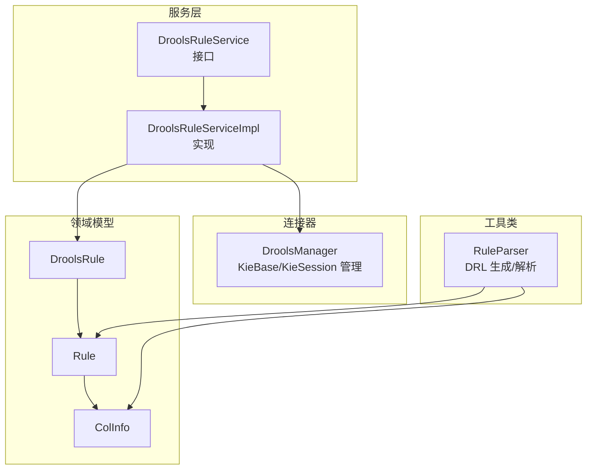
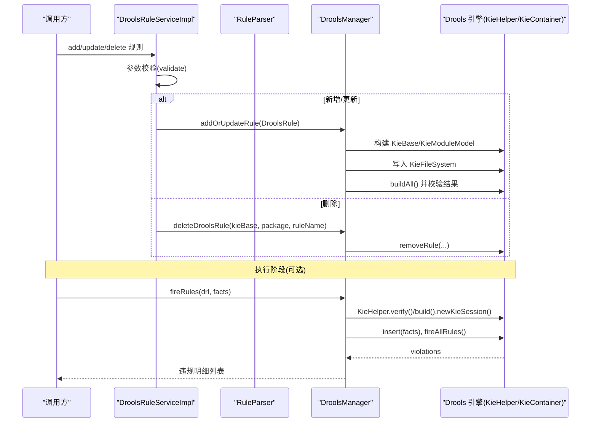
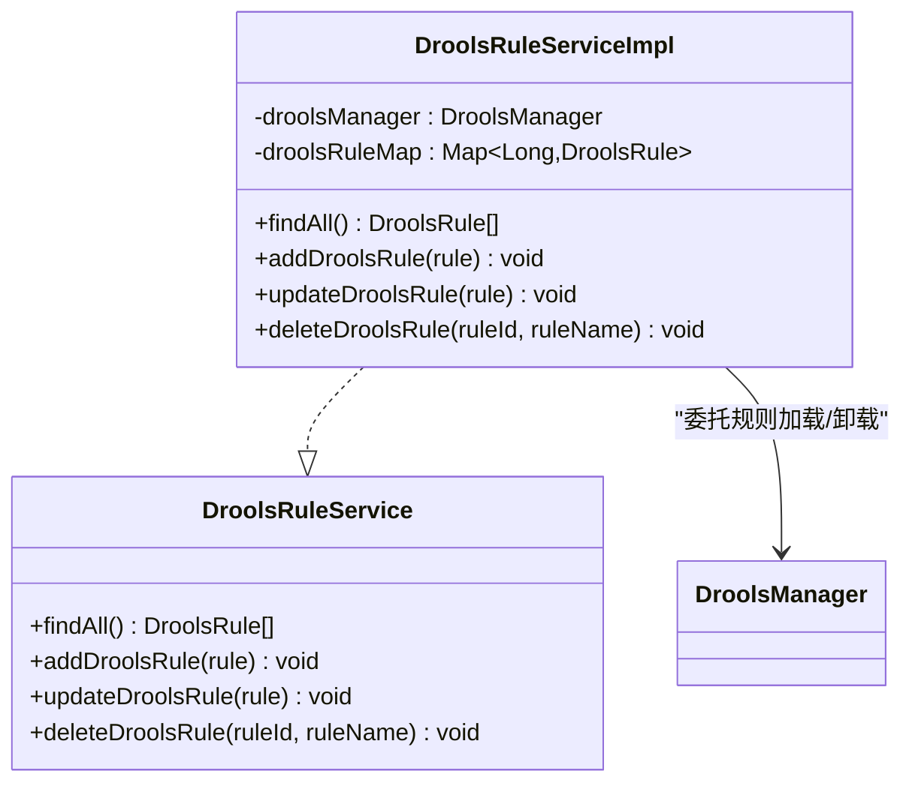
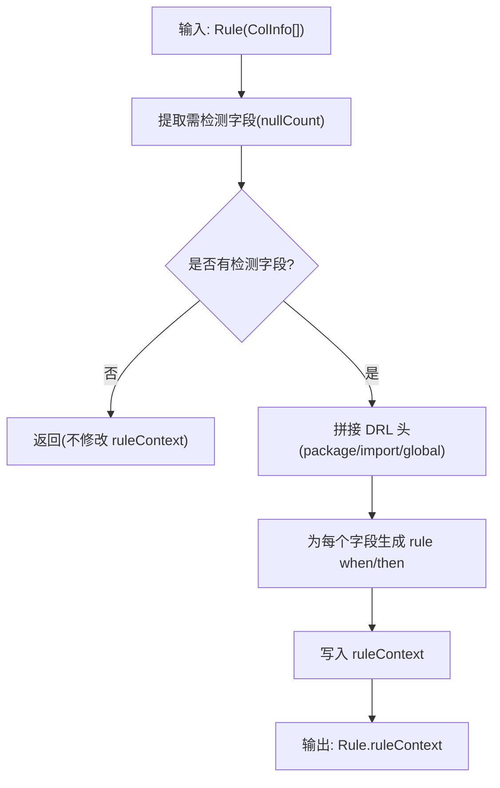
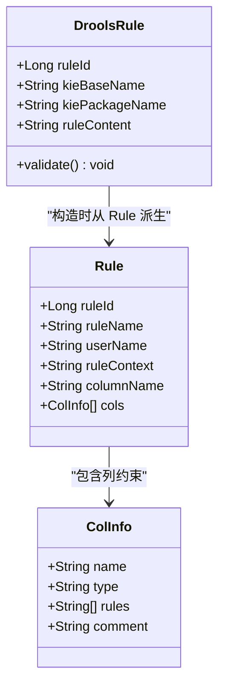
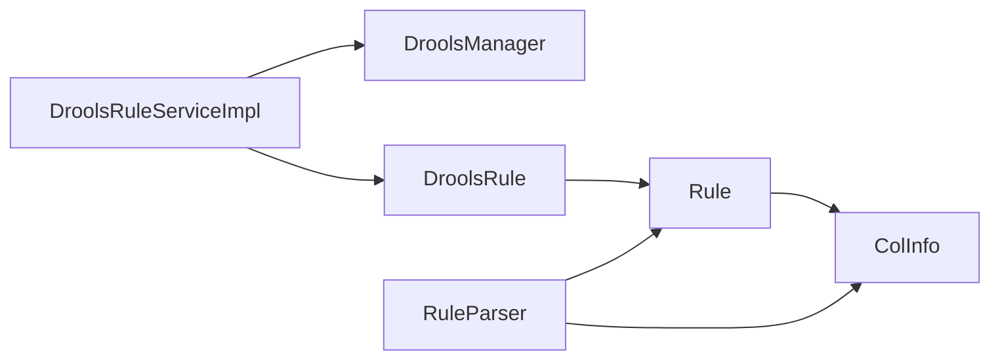

# 规则编译与执行流程

<cite>
**本文引用的文件**   
- [DroolsRuleService.java](file://ruoyi-modules/ruoyi-dqservice/src/main/java/com/ruoyi/dqservice/service/DroolsRuleService.java)
- [DroolsRuleServiceImpl.java](file://ruoyi-modules/ruoyi-dqservice/src/main/java/com/ruoyi/dqservice/service/impl/DroolsRuleServiceImpl.java)
- [DroolsManager.java](file://ruoyi-modules/ruoyi-dqservice/src/main/java/com/ruoyi/dqservice/connecter/DroolsManager.java)
- [RuleParser.java](file://ruoyi-modules/ruoyi-dqservice/src/main/java/com/ruoyi/dqservice/util/RuleParser.java)
- [DroolsRule.java](file://ruoyi-modules/ruoyi-dqservice/src/main/java/com/ruoyi/dqservice/domain/DroolsRule.java)
- [Rule.java](file://ruoyi-modules/ruoyi-dqservice/src/main/java/com/ruoyi/dqservice/domain/Rule.java)
- [ColInfo.java](file://ruoyi-modules/ruoyi-dqservice/src/main/java/com/ruoyi/dqservice/dto/ColInfo.java)
</cite>

## 目录
1. [简介](#简介)
2. [项目结构](#项目结构)
3. [核心组件](#核心组件)
4. [架构总览](#架构总览)
5. [详细组件分析](#详细组件分析)
6. [依赖关系分析](#依赖关系分析)
7. [性能考虑](#性能考虑)
8. [故障排查指南](#故障排查指南)
9. [结论](#结论)
10. [附录：最佳实践与示例路径](#附录最佳实践与示例路径)

## 简介
本文面向数据质量模块中的“规则编译与执行”能力，系统性说明 Drools 规则从文本到可执行对象的生命周期，包括解析、验证、编译、部署与热重载。重点覆盖以下方面：
- DroolsRuleService 接口及其实现类的工作机制
- RuleParser 工具类的语法解析逻辑（空值检测 DRL 生成、字段映射转换、数据绑定）
- DroolsManager 的 KieBase/KieSession 管理、KieFileSystem/KieModuleModel 构建、错误处理与并发安全
- 规则从文本到可执行对象的完整生命周期、版本管理与热重载支持
- 规则编译的性能优化策略、异常恢复机制与最佳实践

## 项目结构
本功能位于 ruoyi-modules/ruoyi-dqservice 模块中，围绕服务层、连接器、领域模型与工具类组织代码：
- 服务层：DroolsRuleService 接口与 DroolsRuleServiceImpl 实现
- 连接器：DroolsManager 封装 Drools 引擎交互
- 领域模型：Rule、DroolsRule、ColInfo
- 工具类：RuleParser 负责 DRL 生成与解析

图表来源
- [DroolsRuleService.java:7-15](file://ruoyi-modules/ruoyi-dqservice/src/main/java/com/ruoyi/dqservice/service/DroolsRuleService.java#L7-L15)
- [DroolsRuleServiceImpl.java:11-48](file://ruoyi-modules/ruoyi-dqservice/src/main/java/com/ruoyi/dqservice/service/impl/DroolsRuleServiceImpl.java#L11-L48)
- [DroolsManager.java:22-187](file://ruoyi-modules/ruoyi-dqservice/src/main/java/com/ruoyi/dqservice/connecter/DroolsManager.java#L22-L187)
- [Rule.java:20-86](file://ruoyi-modules/ruoyi-dqservice/src/main/java/com/ruoyi/dqservice/domain/Rule.java#L20-L86)
- [DroolsRule.java:5-32](file://ruoyi-modules/ruoyi-dqservice/src/main/java/com/ruoyi/dqservice/domain/DroolsRule.java#L5-L32)
- [ColInfo.java:5-14](file://ruoyi-modules/ruoyi-dqservice/src/main/java/com/ruoyi/dqservice/dto/ColInfo.java#L5-L14)
- [RuleParser.java:16-159](file://ruoyi-modules/ruoyi-dqservice/src/main/java/com/ruoyi/dqservice/util/RuleParser.java#L16-L159)

章节来源
- [DroolsRuleService.java:7-15](file://ruoyi-modules/ruoyi-dqservice/src/main/java/com/ruoyi/dqservice/service/DroolsRuleService.java#L7-L15)
- [DroolsRuleServiceImpl.java:11-48](file://ruoyi-modules/ruoyi-dqservice/src/main/java/com/ruoyi/dqservice/service/impl/DroolsRuleServiceImpl.java#L11-L48)
- [DroolsManager.java:22-187](file://ruoyi-modules/ruoyi-dqservice/src/main/java/com/ruoyi/dqservice/connecter/DroolsManager.java#L22-L187)
- [RuleParser.java:16-159](file://ruoyi-modules/ruoyi-dqservice/src/main/java/com/ruoyi/dqservice/util/RuleParser.java#L16-L159)

## 核心组件
- DroolsRuleService：定义规则查询、新增、更新、删除的统一接口
- DroolsRuleServiceImpl：维护内存中的规则集合，校验并委托 DroolsManager 进行规则加载与卸载
- DroolsManager：封装 Drools 引擎，负责 KieBase/KieSession 生命周期、KieFileSystem/KieModuleModel 构建、规则编译与执行
- RuleParser：根据业务配置（如 ColInfo[]）生成 DRL 文本，或从已有 DRL 中解析出实际生效的检测字段
- 领域模型：
  - Rule：规则元信息（名称、用户、数据库、表、字段、类型等）
  - DroolsRule：用于构建 Drools 工作空间的载体（包含 kieBaseName、kiePackageName、ruleContent）
  - ColInfo：列级约束描述（字段名、类型、规则标识数组）

章节来源
- [DroolsRuleService.java:7-15](file://ruoyi-modules/ruoyi-dqservice/src/main/java/com/ruoyi/dqservice/service/DroolsRuleService.java#L7-L15)
- [DroolsRuleServiceImpl.java:11-48](file://ruoyi-modules/ruoyi-dqservice/src/main/java/com/ruoyi/dqservice/service/impl/DroolsRuleServiceImpl.java#L11-L48)
- [DroolsManager.java:22-187](file://ruoyi-modules/ruoyi-dqservice/src/main/java/com/ruoyi/dqservice/connecter/DroolsManager.java#L22-L187)
- [RuleParser.java:16-159](file://ruoyi-modules/ruoyi-dqservice/src/main/java/com/ruoyi/dqservice/util/RuleParser.java#L16-L159)
- [Rule.java:20-86](file://ruoyi-modules/ruoyi-dqservice/src/main/java/com/ruoyi/dqservice/domain/Rule.java#L20-L86)
- [DroolsRule.java:5-32](file://ruoyi-modules/ruoyi-dqservice/src/main/java/com/ruoyi/dqservice/domain/DroolsRule.java#L5-L32)
- [ColInfo.java:5-14](file://ruoyi-modules/ruoyi-dqservice/src/main/java/com/ruoyi/dqservice/dto/ColInfo.java#L5-L14)

## 架构总览
下图展示规则从“文本到可执行对象”的端到端流程，以及关键组件之间的调用关系。

图表来源
- [DroolsRuleServiceImpl.java:26-47](file://ruoyi-modules/ruoyi-dqservice/src/main/java/com/ruoyi/dqservice/service/impl/DroolsRuleServiceImpl.java#L26-L47)
- [DroolsManager.java:63-120](file://ruoyi-modules/ruoyi-dqservice/src/main/java/com/ruoyi/dqservice/connecter/DroolsManager.java#L63-L120)
- [DroolsManager.java:149-187](file://ruoyi-modules/ruoyi-dqservice/src/main/java/com/ruoyi/dqservice/connecter/DroolsManager.java#L149-L187)

## 详细组件分析

### DroolsRuleService 与 DroolsRuleServiceImpl
职责与行为：
- 提供规则的增删改查接口
- 在新增/更新前对 DroolsRule 做必填项校验
- 使用内存 Map 模拟持久化存储（便于演示与快速迭代）
- 将规则变更委托给 DroolsManager 完成引擎侧的加载/卸载

关键点：
- 校验失败直接抛出运行时异常，阻止无效规则进入引擎
- 删除时依据 DroolsRule 中的 kieBaseName/kiePackageName/ruleName 精准移除规则

图表来源
- [DroolsRuleService.java:7-15](file://ruoyi-modules/ruoyi-dqservice/src/main/java/com/ruoyi/dqservice/service/DroolsRuleService.java#L7-L15)
- [DroolsRuleServiceImpl.java:11-48](file://ruoyi-modules/ruoyi-dqservice/src/main/java/com/ruoyi/dqservice/service/impl/DroolsRuleServiceImpl.java#L11-L48)

章节来源
- [DroolsRuleService.java:7-15](file://ruoyi-modules/ruoyi-dqservice/src/main/java/com/ruoyi/dqservice/service/DroolsRuleService.java#L7-L15)
- [DroolsRuleServiceImpl.java:11-48](file://ruoyi-modules/ruoyi-dqservice/src/main/java/com/ruoyi/dqservice/service/impl/DroolsRuleServiceImpl.java#L11-L48)

### DroolsManager：KieBase/KieSession 管理与规则编译执行
职责与行为：
- 维护全局唯一的 KieContainer，避免频繁重建带来的会话不一致问题
- 通过 KieFileSystem 与 KieModuleModel 动态构建虚拟规则文件与 kmodule.xml
- 提供 addOrUpdateRule 与 deleteDroolsRule 方法，完成规则的增量编译与卸载
- 提供 fireRules 方法，基于 KieHelper 对任意 DRL 文本进行即时编译与执行，返回违规明细

关键点：
- 首次创建 KieContainer 后复用，减少开销
- 构建完成后检查编译结果中的 ERROR 级别消息，失败则抛出异常
- fireRules 每次使用独立 KieHelper，隔离语法错误，不影响其它规则；同时要求 DRL 声明 global java.util.List violations 以收集违规结果

```mermaid
flowchart TD
Start(["开始"]) --> CheckKB["检查 KieBase 是否存在"]
CheckKB --> |不存在| CreateKB["创建 KieBaseModel<br/>添加包路径/Session"]
CheckKB --> |存在| UseKB["复用现有 KieBaseModel"]
CreateKB --> WriteFS["写入 .drl 到 KieFileSystem"]
UseKB --> WriteFS
WriteFS --> Build["KieBuilder.buildAll()"]
Build --> Verify{"编译结果含ERROR?"}
Verify --> |是| ThrowErr["记录日志并抛出异常"]
Verify --> |否| EnsureKC["确保 KieContainer 已创建"]
EnsureKC --> End(["结束"])
```

图表来源
- [DroolsManager.java:63-120](file://ruoyi-modules/ruoyi-dqservice/src/main/java/com/ruoyi/dqservice/connecter/DroolsManager.java#L63-L120)

章节来源
- [DroolsManager.java:22-187](file://ruoyi-modules/ruoyi-dqservice/src/main/java/com/ruoyi/dqservice/connecter/DroolsManager.java#L22-L187)

### RuleParser：DRL 生成与解析
职责与行为：
- nullCountParser：根据 ColInfo[] 生成“空值检测”DRL，为每个需要检测的字段生成一条规则，命中后将违规详情写入 global violations
- parseNullColumns：从已有 DRL 中解析出实际生效的空值检测字段
- fillDetectColumns：将解析出的字段回填至 Rule.cols，供前端回显编辑
- 其他辅助方法：字符串转义、apriori 相关工具方法（与本主题关联度较低）

设计要点：
- 数据行以 Map 作为 fact 插入 KieSession，字段通过 this["col"] 访问，无需 declare 动态类型
- 每条规则 then 块产出违规明细（包含 rule/field/rowId），由调用方回收
- ROW_ID_KEY 作为行号占位字段，在执行时由上层写入每条记录的 rowId

图表来源
- [RuleParser.java:41-93](file://ruoyi-modules/ruoyi-dqservice/src/main/java/com/ruoyi/dqservice/util/RuleParser.java#L41-L93)
- [RuleParser.java:131-159](file://ruoyi-modules/ruoyi-dqservice/src/main/java/com/ruoyi/dqservice/util/RuleParser.java#L131-L159)

章节来源
- [RuleParser.java:16-159](file://ruoyi-modules/ruoyi-dqservice/src/main/java/com/ruoyi/dqservice/util/RuleParser.java#L16-L159)

### 领域模型：Rule、DroolsRule、ColInfo
- Rule：承载规则的业务元数据与 DRL 文本，包含字段名、类型、分区信息等
- DroolsRule：用于构建 Drools 工作空间，包含 kieBaseName、kiePackageName、ruleContent，并提供 validate 校验
- ColInfo：列级约束描述，rules 数组中包含约束标识（如 nullCount）

图表来源
- [Rule.java:20-86](file://ruoyi-modules/ruoyi-dqservice/src/main/java/com/ruoyi/dqservice/domain/Rule.java#L20-L86)
- [DroolsRule.java:5-32](file://ruoyi-modules/ruoyi-dqservice/src/main/java/com/ruoyi/dqservice/domain/DroolsRule.java#L5-L32)
- [ColInfo.java:5-14](file://ruoyi-modules/ruoyi-dqservice/src/main/java/com/ruoyi/dqservice/dto/ColInfo.java#L5-L14)

章节来源
- [Rule.java:20-86](file://ruoyi-modules/ruoyi-dqservice/src/main/java/com/ruoyi/dqservice/domain/Rule.java#L20-L86)
- [DroolsRule.java:5-32](file://ruoyi-modules/ruoyi-dqservice/src/main/java/com/ruoyi/dqservice/domain/DroolsRule.java#L5-L32)
- [ColInfo.java:5-14](file://ruoyi-modules/ruoyi-dqservice/src/main/java/com/ruoyi/dqservice/dto/ColInfo.java#L5-L14)

## 依赖关系分析
- DroolsRuleServiceImpl 依赖 DroolsManager 与 DroolsRule
- DroolsManager 依赖 Drools 引擎 API（KieServices、KieFileSystem、KieModuleModel、KieContainer、KieHelper、KieSession）
- RuleParser 依赖 Rule 与 ColInfo，生成 DRL 文本

图表来源
- [DroolsRuleServiceImpl.java:11-48](file://ruoyi-modules/ruoyi-dqservice/src/main/java/com/ruoyi/dqservice/service/impl/DroolsRuleServiceImpl.java#L11-L48)
- [DroolsManager.java:22-187](file://ruoyi-modules/ruoyi-dqservice/src/main/java/com/ruoyi/dqservice/connecter/DroolsManager.java#L22-L187)
- [RuleParser.java:16-159](file://ruoyi-modules/ruoyi-dqservice/src/main/java/com/ruoyi/dqservice/util/RuleParser.java#L16-L159)

章节来源
- [DroolsRuleServiceImpl.java:11-48](file://ruoyi-modules/ruoyi-dqservice/src/main/java/com/ruoyi/dqservice/service/impl/DroolsRuleServiceImpl.java#L11-L48)
- [DroolsManager.java:22-187](file://ruoyi-modules/ruoyi-dqservice/src/main/java/com/ruoyi/dqservice/connecter/DroolsManager.java#L22-L187)
- [RuleParser.java:16-159](file://ruoyi-modules/ruoyi-dqservice/src/main/java/com/ruoyi/dqservice/util/RuleParser.java#L16-L159)

## 性能考虑
- 复用 KieContainer：DroolsManager 仅在首次创建 KieContainer，后续复用，避免重复初始化开销
- 增量构建：通过 KieFileSystem.write 仅写入变更的规则文件，配合 KieBuilder.buildAll 进行增量构建
- 隔离编译：fireRules 使用 KieHelper 对单条 DRL 进行即时编译，避免影响全局容器，提升并发安全性与错误隔离性
- 规则粒度：RuleParser 为每个检测字段生成独立规则，利于细粒度统计与定位，但需注意规则数量增长对匹配性能的影响
- 建议优化方向：
  - 对高频执行的规则集，考虑预编译并缓存 KieSession（注意线程安全与会话生命周期）
  - 合并相近条件的规则以减少规则数量
  - 对大事实集分批插入与执行，降低单次 fireAllRules 的压力

[本节为通用性能讨论，不直接分析具体文件]

## 故障排查指南
常见问题与定位要点：
- 规则编译失败
  - 现象：抛出运行时异常或服务端异常
  - 原因：DRL 语法错误或缺少必要声明（如 global violations）
  - 定位：查看 DroolsManager 中编译结果的 ERROR 日志与抛出的 ServiceException
- 未声明 global violations
  - 现象：执行时报错提示无法收集违规结果
  - 原因：手写 DRL 未声明 global java.util.List violations
  - 解决：在 DRL 中添加 global 声明或使用 RuleParser 生成的模板
- 规则未生效或冲突
  - 现象：新增/更新后规则未生效或出现同名冲突
  - 原因：kieBaseName/kiePackageName 配置不当或规则名重复
  - 解决：确保 kieBaseName/kiePackageName 唯一且规则名不冲突

章节来源
- [DroolsManager.java:103-120](file://ruoyi-modules/ruoyi-dqservice/src/main/java/com/ruoyi/dqservice/connecter/DroolsManager.java#L103-L120)
- [DroolsManager.java:149-187](file://ruoyi-modules/ruoyi-dqservice/src/main/java/com/ruoyi/dqservice/connecter/DroolsManager.java#L149-L187)

## 结论
该方案通过服务层、连接器与工具类的分层设计，实现了规则从文本到可执行对象的完整生命周期管理。DroolsManager 提供了稳定的引擎管理能力，RuleParser 将业务配置转换为标准 DRL，DroolsRuleServiceImpl 串联校验与引擎操作。整体具备较好的可扩展性与可维护性，适合在数据质量场景中进行规则的热更新与批量执行。

[本节为总结性内容，不直接分析具体文件]

## 附录：最佳实践与示例路径
- 规则定义与生成
  - 使用 RuleParser.nullCountParser 根据 ColInfo[] 自动生成空值检测 DRL
  - 参考路径：[RuleParser.java:41-93](file://ruoyi-modules/ruoyi-dqservice/src/main/java/com/ruoyi/dqservice/util/RuleParser.java#L41-L93)
- 规则加载与卸载
  - 新增/更新：DroolsRuleServiceImpl.addDroolsRule/updateDroolsRule 调用 DroolsManager.addOrUpdateRule
  - 删除：DroolsRuleServiceImpl.deleteDroolsRule 调用 DroolsManager.deleteDroolsRule
  - 参考路径：
    - [DroolsRuleServiceImpl.java:26-47](file://ruoyi-modules/ruoyi-dqservice/src/main/java/com/ruoyi/dqservice/service/impl/DroolsRuleServiceImpl.java#L26-L47)
    - [DroolsManager.java:63-120](file://ruoyi-modules/ruoyi-dqservice/src/main/java/com/ruoyi/dqservice/connecter/DroolsManager.java#L63-L120)
- 规则执行与结果回收
  - 使用 DroolsManager.fireRules 传入 DRL 与事实集合，回收 violations
  - 参考路径：[DroolsManager.java:149-187](file://ruoyi-modules/ruoyi-dqservice/src/main/java/com/ruoyi/dqservice/connecter/DroolsManager.java#L149-L187)
- 字段映射与数据绑定
  - 数据行以 Map 作为 fact，字段通过 this["col"] 访问；行号通过 ROW_ID_KEY 注入
  - 参考路径：[RuleParser.java:21-27](file://ruoyi-modules/ruoyi-dqservice/src/main/java/com/ruoyi/dqservice/util/RuleParser.java#L21-L27)、[RuleParser.java:79-90](file://ruoyi-modules/ruoyi-dqservice/src/main/java/com/ruoyi/dqservice/util/RuleParser.java#L79-L90)
- 版本管理与热重载
  - 通过 KieFileSystem 与 KieModuleModel 动态构建规则，结合 KieContainer 复用实现热重载
  - 参考路径：[DroolsManager.java:28-35](file://ruoyi-modules/ruoyi-dqservice/src/main/java/com/ruoyi/dqservice/connecter/DroolsManager.java#L28-L35)、[DroolsManager.java:93-120](file://ruoyi-modules/ruoyi-dqservice/src/main/java/com/ruoyi/dqservice/connecter/DroolsManager.java#L93-L120)