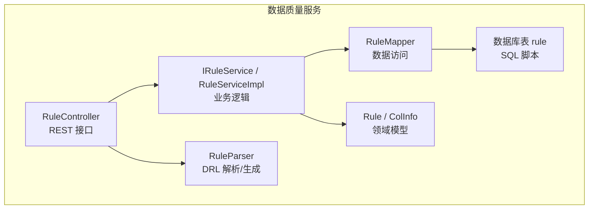
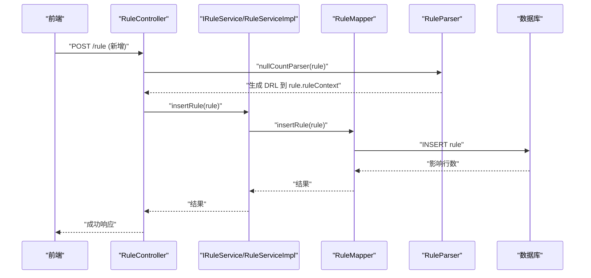
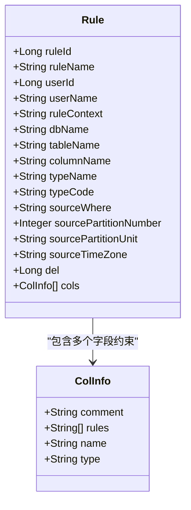
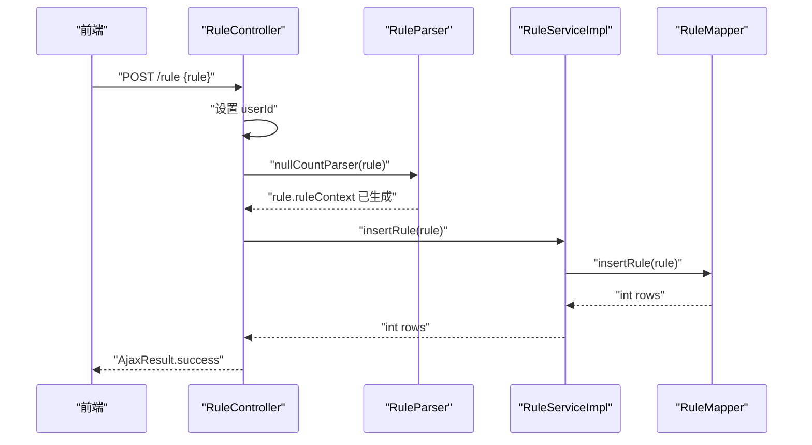
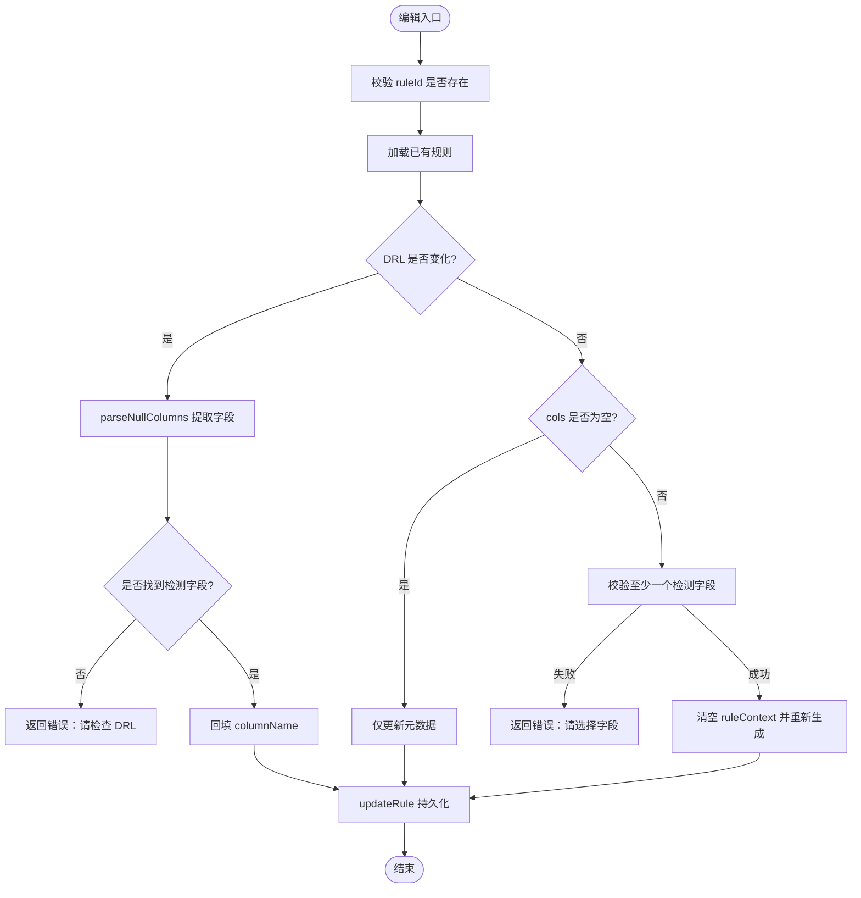
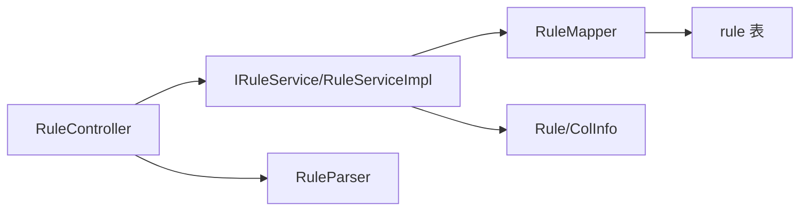

# 规则管理

<cite>
**本文引用的文件**   
- [Rule.java](file://ruoyi-modules/ruoyi-dqservice/src/main/java/com/ruoyi/dqservice/domain/Rule.java)
- [ColInfo.java](file://ruoyi-modules/ruoyi-dqservice/src/main/java/com/ruoyi/dqservice/dto/ColInfo.java)
- [RuleController.java](file://ruoyi-modules/ruoyi-dqservice/src/main/java/com/ruoyi/dqservice/controller/RuleController.java)
- [IRuleService.java](file://ruoyi-modules/ruoyi-dqservice/src/main/java/com/ruoyi/dqservice/service/IRuleService.java)
- [RuleServiceImpl.java](file://ruoyi-modules/ruoyi-dqservice/src/main/java/com/ruoyi/dqservice/service/impl/RuleServiceImpl.java)
- [RuleMapper.java](file://ruoyi-modules/ruoyi-dqservice/src/main/java/com/ruoyi/dqservice/mapper/RuleMapper.java)
- [RuleParser.java](file://ruoyi-modules/ruoyi-dqservice/src/main/java/com/ruoyi/dqservice/util/RuleParser.java)
- [ry_dqservice_20261026.sql](file://sql/ry_dqservice_20261026.sql)
</cite>

## 目录
1. [简介](#简介)
2. [项目结构](#项目结构)
3. [核心组件](#核心组件)
4. [架构总览](#架构总览)
5. [详细组件分析](#详细组件分析)
6. [依赖关系分析](#依赖关系分析)
7. [性能与扩展性](#性能与扩展性)
8. [故障排查指南](#故障排查指南)
9. [结论](#结论)
10. [附录：API 规范](#附录api-规范)

## 简介
本文件面向“规则管理”功能，覆盖规则实体的数据结构、CRUD 接口、DRL 语法生成与校验、字段映射配置、导入导出流程以及错误处理机制。该模块基于 Spring Boot + MyBatis 分层架构，规则以 DRL（Drools Rule Language）形式持久化，并通过解析器从用户选择的检测字段自动生成或反向解析 DRL，保证前端编辑体验与后端执行一致性。

## 项目结构
规则管理相关代码集中在数据质量服务模块 ruoyi-dqservice 中，采用典型的 Controller-Service-Mapper 三层结构，并辅以工具类完成 DRL 的生成与解析。



图表来源
- [RuleController.java:34-153](file://ruoyi-modules/ruoyi-dqservice/src/main/java/com/ruoyi/dqservice/controller/RuleController.java#L34-L153)
- [IRuleService.java:12-61](file://ruoyi-modules/ruoyi-dqservice/src/main/java/com/ruoyi/dqservice/service/IRuleService.java#L12-L61)
- [RuleServiceImpl.java:17-96](file://ruoyi-modules/ruoyi-dqservice/src/main/java/com/ruoyi/dqservice/service/impl/RuleServiceImpl.java#L17-L96)
- [RuleMapper.java:12-61](file://ruoyi-modules/ruoyi-dqservice/src/main/java/com/ruoyi/dqservice/mapper/RuleMapper.java#L12-L61)
- [RuleParser.java:16-159](file://ruoyi-modules/ruoyi-dqservice/src/main/java/com/ruoyi/dqservice/util/RuleParser.java#L16-L159)
- [ry_dqservice_20261026.sql:8-27](file://sql/ry_dqservice_20261026.sql#L8-L27)

章节来源
- [RuleController.java:34-153](file://ruoyi-modules/ruoyi-dqservice/src/main/java/com/ruoyi/dqservice/controller/RuleController.java#L34-L153)
- [IRuleService.java:12-61](file://ruoyi-modules/ruoyi-dqservice/src/main/java/com/ruoyi/dqservice/service/IRuleService.java#L12-L61)
- [RuleServiceImpl.java:17-96](file://ruoyi-modules/ruoyi-dqservice/src/main/java/com/ruoyi/dqservice/service/impl/RuleServiceImpl.java#L17-L96)
- [RuleMapper.java:12-61](file://ruoyi-modules/ruoyi-dqservice/src/main/java/com/ruoyi/dqservice/mapper/RuleMapper.java#L12-L61)
- [RuleParser.java:16-159](file://ruoyi-modules/ruoyi-dqservice/src/main/java/com/ruoyi/dqservice/util/RuleParser.java#L16-L159)
- [ry_dqservice_20261026.sql:8-27](file://sql/ry_dqservice_20261026.sql#L8-L27)

## 核心组件
- 规则实体 Rule：承载规则元信息、DRL 文本、目标库表字段、分区过滤等。
- 列约束 ColInfo：描述字段名、类型、注释及规则约束集合（如空值检测）。
- 控制器 RuleController：提供规则列表、详情、新增、修改、删除、导出等 REST 接口。
- 服务层 IRuleService/RuleServiceImpl：封装规则 CRUD 业务逻辑，统一时间戳填充。
- 数据访问 RuleMapper：定义规则表的查询与更新方法。
- 解析器 RuleParser：负责根据字段约束生成 DRL、从已有 DRL 解析检测字段、回填前端编辑所需字段。

章节来源
- [Rule.java:20-86](file://ruoyi-modules/ruoyi-dqservice/src/main/java/com/ruoyi/dqservice/domain/Rule.java#L20-L86)
- [ColInfo.java:5-14](file://ruoyi-modules/ruoyi-dqservice/src/main/java/com/ruoyi/dqservice/dto/ColInfo.java#L5-L14)
- [RuleController.java:34-153](file://ruoyi-modules/ruoyi-dqservice/src/main/java/com/ruoyi/dqservice/controller/RuleController.java#L34-L153)
- [IRuleService.java:12-61](file://ruoyi-modules/ruoyi-dqservice/src/main/java/com/ruoyi/dqservice/service/IRuleService.java#L12-L61)
- [RuleServiceImpl.java:17-96](file://ruoyi-modules/ruoyi-dqservice/src/main/java/com/ruoyi/dqservice/service/impl/RuleServiceImpl.java#L17-L96)
- [RuleMapper.java:12-61](file://ruoyi-modules/ruoyi-dqservice/src/main/java/com/ruoyi/dqservice/mapper/RuleMapper.java#L12-L61)
- [RuleParser.java:16-159](file://ruoyi-modules/ruoyi-dqservice/src/main/java/com/ruoyi/dqservice/util/RuleParser.java#L16-L159)

## 架构总览
规则管理的请求链路如下：前端调用 RuleController 暴露的 REST 接口；控制器进行权限校验、日志记录、参数预处理后委托给 IRuleService；服务层调用 RuleMapper 完成持久化；在新增/编辑时，通过 RuleParser 生成或解析 DRL，确保规则内容与字段映射一致。



图表来源
- [RuleController.java:85-93](file://ruoyi-modules/ruoyi-dqservice/src/main/java/com/ruoyi/dqservice/controller/RuleController.java#L85-L93)
- [RuleParser.java:41-68](file://ruoyi-modules/ruoyi-dqservice/src/main/java/com/ruoyi/dqservice/util/RuleParser.java#L41-L68)
- [RuleServiceImpl.java:53-58](file://ruoyi-modules/ruoyi-dqservice/src/main/java/com/ruoyi/dqservice/service/impl/RuleServiceImpl.java#L53-L58)
- [RuleMapper.java:30-36](file://ruoyi-modules/ruoyi-dqservice/src/main/java/com/ruoyi/dqservice/mapper/RuleMapper.java#L30-L36)

## 详细组件分析

### 规则实体与字段映射
- Rule 实体包含规则 ID、名称、创建者、DRL 文本、数据库名、表名、列名、规则类型、分区过滤条件、分区大小/单位/时区、删除标志等。
- ColInfo 用于描述字段名、类型、注释和规则约束数组，其中约束标识 nullCount 表示“空值检测”。
- 数据库表 rule 对应 Rule 实体，主键为 rule_id，包含 create_time/update_time/del 等通用审计字段。



图表来源
- [Rule.java:20-86](file://ruoyi-modules/ruoyi-dqservice/src/main/java/com/ruoyi/dqservice/domain/Rule.java#L20-L86)
- [ColInfo.java:5-14](file://ruoyi-modules/ruoyi-dqservice/src/main/java/com/ruoyi/dqservice/dto/ColInfo.java#L5-L14)
- [ry_dqservice_20261026.sql:8-27](file://sql/ry_dqservice_20261026.sql#L8-L27)

章节来源
- [Rule.java:20-86](file://ruoyi-modules/ruoyi-dqservice/src/main/java/com/ruoyi/dqservice/domain/Rule.java#L20-L86)
- [ColInfo.java:5-14](file://ruoyi-modules/ruoyi-dqservice/src/main/java/com/ruoyi/dqservice/dto/ColInfo.java#L5-L14)
- [ry_dqservice_20261026.sql:8-27](file://sql/ry_dqservice_20261026.sql#L8-L27)

### DRL 语法生成与校验
- 生成策略：当用户选择若干字段的“空值检测”约束时，RuleParser.nullCountParser 会为每个字段生成一条 DRL 规则，匹配 Map 事实中该字段为空的情况，并将违规明细写入全局 violations 集合。
- 校验策略：编辑规则时，若用户直接修改了 DRL，控制器会调用 RuleParser.parseNullColumns 提取 this["字段"]==null 的条件；若无匹配则返回错误提示。
- 回显策略：获取规则详情时，RuleParser.fillDetectColumns 会从 DRL 中提取实际生效的检测字段，回填到 rule.cols，供前端编辑弹窗展示。

```mermaid
flowchart TD
Start(["开始"]) --> CheckCols["检查是否选择了空值检测字段"]
CheckCols --> |否| KeepExisting["保留现有 DRL 不再生成"]
CheckCols --> |是| BuildDrl["按字段生成 DRL<br/>this[\"col\"] == null"]
BuildDrl --> SetMeta["设置 columnName 与 ruleContext"]
SetMeta --> End(["结束"])
KeepExisting --> End
```

图表来源
- [RuleParser.java:41-68](file://ruoyi-modules/ruoyi-dqservice/src/main/java/com/ruoyi/dqservice/util/RuleParser.java#L41-L68)
- [RuleParser.java:100-159](file://ruoyi-modules/ruoyi-dqservice/src/main/java/com/ruoyi/dqservice/util/RuleParser.java#L100-L159)
- [RuleController.java:118-139](file://ruoyi-modules/ruoyi-dqservice/src/main/java/com/ruoyi/dqservice/controller/RuleController.java#L118-L139)

章节来源
- [RuleParser.java:41-68](file://ruoyi-modules/ruoyi-dqservice/src/main/java/com/ruoyi/dqservice/util/RuleParser.java#L41-L68)
- [RuleParser.java:100-159](file://ruoyi-modules/ruoyi-dqservice/src/main/java/com/ruoyi/dqservice/util/RuleParser.java#L100-L159)
- [RuleController.java:118-139](file://ruoyi-modules/ruoyi-dqservice/src/main/java/com/ruoyi/dqservice/controller/RuleController.java#L118-L139)

### 规则 CRUD 业务流程

#### 新增规则
- 入口：POST /rule
- 行为：设置当前用户 ID，调用 RuleParser.nullCountParser 生成 DRL，再调用 service.insertRule 持久化。
- 返回：统一 AjaxResult 包装。



图表来源
- [RuleController.java:85-93](file://ruoyi-modules/ruoyi-dqservice/src/main/java/com/ruoyi/dqservice/controller/RuleController.java#L85-L93)
- [RuleParser.java:41-68](file://ruoyi-modules/ruoyi-dqservice/src/main/java/com/ruoyi/dqservice/util/RuleParser.java#L41-L68)
- [RuleServiceImpl.java:53-58](file://ruoyi-modules/ruoyi-dqservice/src/main/java/com/ruoyi/dqservice/service/impl/RuleServiceImpl.java#L53-L58)
- [RuleMapper.java:30-36](file://ruoyi-modules/ruoyi-dqservice/src/main/java/com/ruoyi/dqservice/mapper/RuleMapper.java#L30-L36)

章节来源
- [RuleController.java:85-93](file://ruoyi-modules/ruoyi-dqservice/src/main/java/com/ruoyi/dqservice/controller/RuleController.java#L85-L93)
- [RuleServiceImpl.java:53-58](file://ruoyi-modules/ruoyi-dqservice/src/main/java/com/ruoyi/dqservice/service/impl/RuleServiceImpl.java#L53-L58)

#### 查询规则列表与详情
- 列表：GET /rule/list，支持分页，返回 TableDataInfo。
- 详情：GET /rule/{ruleId}，返回规则对象，并在服务端回填检测字段以便前端编辑。

章节来源
- [RuleController.java:44-51](file://ruoyi-modules/ruoyi-dqservice/src/main/java/com/ruoyi/dqservice/controller/RuleController.java#L44-L51)
- [RuleController.java:69-80](file://ruoyi-modules/ruoyi-dqservice/src/main/java/com/ruoyi/dqservice/controller/RuleController.java#L69-L80)
- [RuleParser.java:146-159](file://ruoyi-modules/ruoyi-dqservice/src/main/java/com/ruoyi/dqservice/util/RuleParser.java#L146-L159)

#### 修改规则
- 入口：PUT /rule
- 行为：
  - 校验 ruleId 存在。
  - 判断 DRL 是否变更：若变更，解析 DRL 中的空值检测字段并回填 columnName；若无匹配则报错。
  - 若未改 DRL 但改了 cols：校验至少选择一个检测字段，清空 ruleContext 后重新生成 DRL。
  - 最终调用 updateRule 持久化。



图表来源
- [RuleController.java:103-141](file://ruoyi-modules/ruoyi-dqservice/src/main/java/com/ruoyi/dqservice/controller/RuleController.java#L103-L141)
- [RuleParser.java:131-159](file://ruoyi-modules/ruoyi-dqservice/src/main/java/com/ruoyi/dqservice/util/RuleParser.java#L131-L159)

章节来源
- [RuleController.java:103-141](file://ruoyi-modules/ruoyi-dqservice/src/main/java/com/ruoyi/dqservice/controller/RuleController.java#L103-L141)
- [RuleParser.java:131-159](file://ruoyi-modules/ruoyi-dqservice/src/main/java/com/ruoyi/dqservice/util/RuleParser.java#L131-L159)

#### 删除规则
- 入口：DELETE /rule/{ruleIds}
- 行为：批量删除，返回统一结果。

章节来源
- [RuleController.java:146-152](file://ruoyi-modules/ruoyi-dqservice/src/main/java/com/ruoyi/dqservice/controller/RuleController.java#L146-L152)
- [RuleServiceImpl.java:80-83](file://ruoyi-modules/ruoyi-dqservice/src/main/java/com/ruoyi/dqservice/service/impl/RuleServiceImpl.java#L80-L83)
- [RuleMapper.java:54-60](file://ruoyi-modules/ruoyi-dqservice/src/main/java/com/ruoyi/dqservice/mapper/RuleMapper.java#L54-L60)

#### 导出规则
- 入口：POST /rule/export
- 行为：根据查询条件拉取规则列表，使用 ExcelUtil 导出为 Excel 文件。

章节来源
- [RuleController.java:56-64](file://ruoyi-modules/ruoyi-dqservice/src/main/java/com/ruoyi/dqservice/controller/RuleController.java#L56-L64)

### 规则模板管理
- 当前实现以“空值检测”作为默认规则模板：通过 ColInfo.rules 中的 nullCount 标识触发 DRL 生成。
- 模板扩展点：可在 RuleParser 中增加新的约束标识与对应的 DRL 生成逻辑，并在前端表单中提供相应模板选项。

章节来源
- [RuleParser.java:18-19](file://ruoyi-modules/ruoyi-dqservice/src/main/java/com/ruoyi/dqservice/util/RuleParser.java#L18-L19)
- [RuleParser.java:100-125](file://ruoyi-modules/ruoyi-dqservice/src/main/java/com/ruoyi/dqservice/util/RuleParser.java#L100-L125)

### 导入导出
- 导出：已实现规则列表导出 Excel。
- 导入：当前仓库未见规则导入接口；如需导入，可参考导出流程反向实现，将 Excel 解析为 Rule 列表后批量插入。

章节来源
- [RuleController.java:56-64](file://ruoyi-modules/ruoyi-dqservice/src/main/java/com/ruoyi/dqservice/controller/RuleController.java#L56-L64)

## 依赖关系分析
- 控制器依赖服务接口与解析器，服务实现依赖 Mapper，Mapper 依赖数据库表。
- 解析器与领域模型耦合度较低，便于扩展新规则类型。



图表来源
- [RuleController.java:34-153](file://ruoyi-modules/ruoyi-dqservice/src/main/java/com/ruoyi/dqservice/controller/RuleController.java#L34-L153)
- [IRuleService.java:12-61](file://ruoyi-modules/ruoyi-dqservice/src/main/java/com/ruoyi/dqservice/service/IRuleService.java#L12-L61)
- [RuleServiceImpl.java:17-96](file://ruoyi-modules/ruoyi-dqservice/src/main/java/com/ruoyi/dqservice/service/impl/RuleServiceImpl.java#L17-L96)
- [RuleMapper.java:12-61](file://ruoyi-modules/ruoyi-dqservice/src/main/java/com/ruoyi/dqservice/mapper/RuleMapper.java#L12-L61)
- [RuleParser.java:16-159](file://ruoyi-modules/ruoyi-dqservice/src/main/java/com/ruoyi/dqservice/util/RuleParser.java#L16-L159)
- [ry_dqservice_20261026.sql:8-27](file://sql/ry_dqservice_20261026.sql#L8-L27)

章节来源
- [RuleController.java:34-153](file://ruoyi-modules/ruoyi-dqservice/src/main/java/com/ruoyi/dqservice/controller/RuleController.java#L34-L153)
- [IRuleService.java:12-61](file://ruoyi-modules/ruoyi-dqservice/src/main/java/com/ruoyi/dqservice/service/IRuleService.java#L12-L61)
- [RuleServiceImpl.java:17-96](file://ruoyi-modules/ruoyi-dqservice/src/main/java/com/ruoyi/dqservice/service/impl/RuleServiceImpl.java#L17-L96)
- [RuleMapper.java:12-61](file://ruoyi-modules/ruoyi-dqservice/src/main/java/com/ruoyi/dqservice/mapper/RuleMapper.java#L12-L61)
- [RuleParser.java:16-159](file://ruoyi-modules/ruoyi-dqservice/src/main/java/com/ruoyi/dqservice/util/RuleParser.java#L16-L159)
- [ry_dqservice_20261026.sql:8-27](file://sql/ry_dqservice_20261026.sql#L8-L27)

## 性能与扩展性
- DRL 生成复杂度：与所选检测字段数量线性相关，每条字段生成一条规则，适合中等规模字段集。
- 可扩展点：
  - 新增规则类型：在 RuleParser 中添加新的约束标识与生成逻辑。
  - 字段映射增强：在 ColInfo 中扩展更多约束类型，配合前端表单动态渲染。
- 建议：
  - 对频繁更新的规则，考虑缓存生成的 DRL 以减少重复解析。
  - 对大批量规则导出，建议使用异步任务与流式写入降低内存占用。

## 故障排查指南
- 编辑时报错“规则内容中未找到空值检测条件”：
  - 原因：用户直接修改了 DRL，但未包含 this["字段"]==null 的模式。
  - 解决：恢复标准 DRL 或在 DRL 中添加空值检测条件。
- 编辑时报错“请至少选择一个检测字段”：
  - 原因：未选择任何带 nullCount 约束的字段。
  - 解决：在前端表单中选择至少一个字段并勾选空值检测。
- 列表/详情查询无数据：
  - 检查 ruleId 是否正确、数据库连接是否正常、Mapper XML 是否存在（若使用 XML）。
- 导出为空：
  - 检查查询条件是否过严，确认权限 dqservice:rule:export 是否授予。

章节来源
- [RuleController.java:118-139](file://ruoyi-modules/ruoyi-dqservice/src/main/java/com/ruoyi/dqservice/controller/RuleController.java#L118-L139)

## 结论
规则管理模块围绕 Rule 实体与 DRL 文本展开，通过 RuleParser 实现字段到规则的自动化生成与反向解析，结合 Controller-Service-Mapper 的分层设计，提供了完整的 CRUD、导出能力，并为后续扩展更多规则类型预留了清晰扩展点。建议在后续迭代中补充规则导入、更丰富的规则模板与可视化校验，以提升用户体验与可维护性。

## 附录：API 规范

- 查询规则列表
  - 方法：GET
  - 路径：/rule/list
  - 权限：dqservice:rule:list
  - 说明：支持分页，返回 TableDataInfo

- 导出规则
  - 方法：POST
  - 路径：/rule/export
  - 权限：dqservice:rule:export
  - 说明：根据查询条件导出 Excel

- 获取规则详情
  - 方法：GET
  - 路径：/rule/{ruleId}
  - 权限：dqservice:rule:query
  - 说明：返回 Rule 对象，并回填检测字段

- 新增规则
  - 方法：POST
  - 路径：/rule
  - 权限：dqservice:rule:add
  - 说明：自动设置 userId，生成 DRL，持久化

- 修改规则
  - 方法：PUT
  - 路径：/rule
  - 权限：dqservice:rule:edit
  - 说明：校验 ruleId，判断 DRL 是否变更，必要时重建 DRL

- 删除规则
  - 方法：DELETE
  - 路径：/rule/{ruleIds}
  - 权限：dqservice:rule:remove
  - 说明：批量删除

章节来源
- [RuleController.java:44-153](file://ruoyi-modules/ruoyi-dqservice/src/main/java/com/ruoyi/dqservice/controller/RuleController.java#L44-L153)