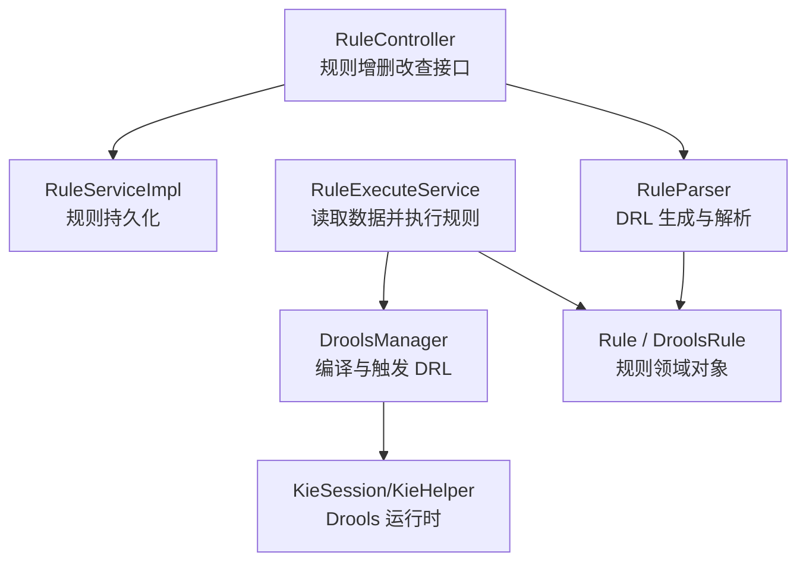
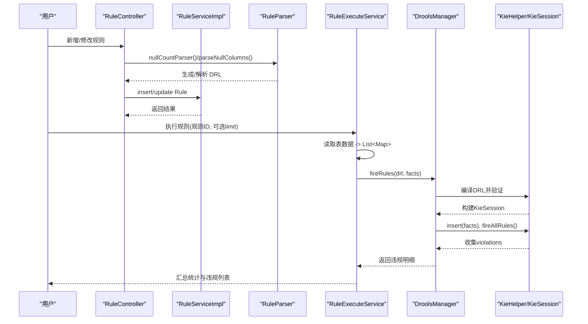
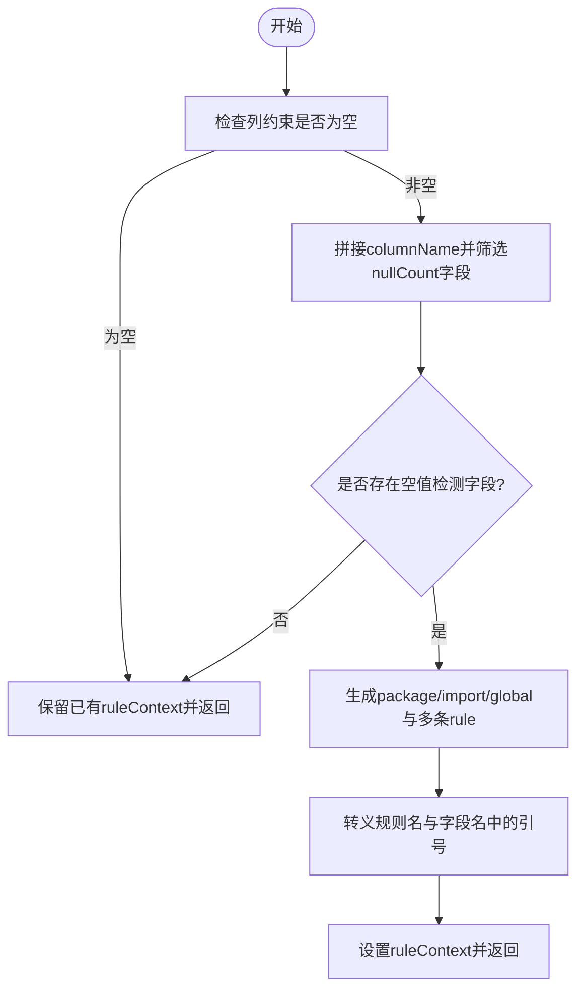
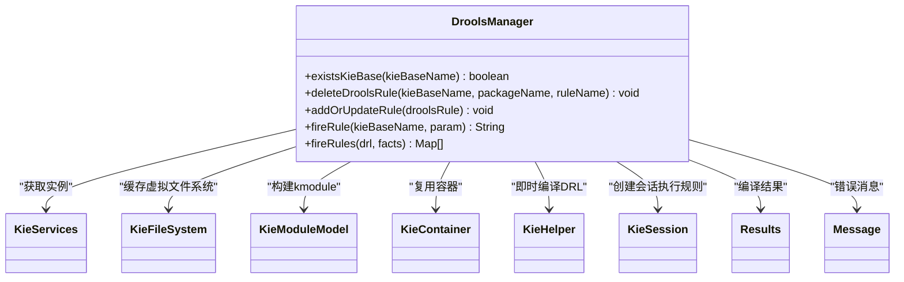
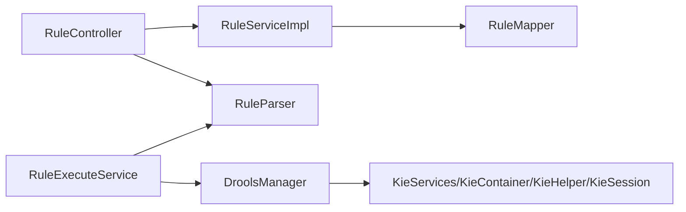

# DRL规则语法

<cite>
**本文引用的文件**   
- [RuleParser.java](file://ruoyi-modules/ruoyi-dqservice/src/main/java/com/ruoyi/dqservice/util/RuleParser.java)
- [DroolsManager.java](file://ruoyi-modules/ruoyi-dqservice/src/main/java/com/ruoyi/dqservice/connecter/DroolsManager.java)
- [RuleController.java](file://ruoyi-modules/ruoyi-dqservice/src/main/java/com/ruoyi/dqservice/controller/RuleController.java)
- [RuleServiceImpl.java](file://ruoyi-modules/ruoyi-dqservice/src/main/java/com/ruoyi/dqservice/service/impl/RuleServiceImpl.java)
- [RuleExecuteService.java](file://ruoyi-modules/ruoyi-dqservice/src/main/java/com/ruoyi/dqservice/service/RuleExecuteService.java)
- [Rule.java](file://ruoyi-modules/ruoyi-dqservice/src/main/java/com/ruoyi/dqservice/domain/Rule.java)
- [DroolsRule.java](file://ruoyi-modules/ruoyi-dqservice/src/main/java/com/ruoyi/dqservice/domain/DroolsRule.java)
</cite>

## 目录
1. [简介](#简介)
2. [项目结构](#项目结构)
3. [核心组件](#核心组件)
4. [架构总览](#架构总览)
5. [详细组件分析](#详细组件分析)
6. [依赖关系分析](#依赖关系分析)
7. [性能与最佳实践](#性能与最佳实践)
8. [调试与排错指南](#调试与排错指南)
9. [结论](#结论)

## 简介
本指南面向需要在数据质量服务中使用 Drools 的开发者，系统讲解项目中 DRL 语法的实际用法、数据模型映射、规则编写范式、全局变量与函数使用方式，以及调试技巧与性能优化建议。项目通过“规则文本 + 动态事实 Map”的方式运行 DRL：每条数据库记录被转换为一个 Map 作为事实插入 KieSession；规则在 when 中匹配条件，在 then 中将违规明细写入全局集合 violations，由执行层回收并汇总为质量评估结果。

## 项目结构
本项目中与 DRL 相关的代码集中在数据质量模块 ruoyi-dqservice 下，关键路径如下：
- 规则解析与生成：util/RuleParser.java
- Drools 引擎封装：connecter/DroolsManager.java
- 规则管理接口：controller/RuleController.java
- 规则持久化实现：service/impl/RuleServiceImpl.java
- 规则执行与结果聚合：service/RuleExecuteService.java
- 领域模型：domain/Rule.java、domain/DroolsRule.java

图表来源
- [RuleController.java:34-154](file://ruoyi-modules/ruoyi-dqservice/src/main/java/com/ruoyi/dqservice/controller/RuleController.java#L34-L154)
- [RuleServiceImpl.java:17-97](file://ruoyi-modules/ruoyi-dqservice/src/main/java/com/ruoyi/dqservice/service/impl/RuleServiceImpl.java#L17-L97)
- [RuleParser.java:16-159](file://ruoyi-modules/ruoyi-dqservice/src/main/java/com/ruoyi/dqservice/util/RuleParser.java#L16-L159)
- [RuleExecuteService.java:36-114](file://ruoyi-modules/ruoyi-dqservice/src/main/java/com/ruoyi/dqservice/service/RuleExecuteService.java#L36-L114)
- [DroolsManager.java:22-187](file://ruoyi-modules/ruoyi-dqservice/src/main/java/com/ruoyi/dqservice/connecter/DroolsManager.java#L22-L187)
- [Rule.java:20-86](file://ruoyi-modules/ruoyi-dqservice/src/main/java/com/ruoyi/dqservice/domain/Rule.java#L20-L86)
- [DroolsRule.java:5-32](file://ruoyi-modules/ruoyi-dqservice/src/main/java/com/ruoyi/dqservice/domain/DroolsRule.java#L5-L32)

章节来源
- [RuleController.java:34-154](file://ruoyi-modules/ruoyi-dqservice/src/main/java/com/ruoyi/dqservice/controller/RuleController.java#L34-L154)
- [RuleServiceImpl.java:17-97](file://ruoyi-modules/ruoyi-dqservice/src/main/java/com/ruoyi/dqservice/service/impl/RuleServiceImpl.java#L17-L97)
- [RuleParser.java:16-159](file://ruoyi-modules/ruoyi-dqservice/src/main/java/com/ruoyi/dqservice/util/RuleParser.java#L16-L159)
- [RuleExecuteService.java:36-114](file://ruoyi-modules/ruoyi-dqservice/src/main/java/com/ruoyi/dqservice/service/RuleExecuteService.java#L36-L114)
- [DroolsManager.java:22-187](file://ruoyi-modules/ruoyi-dqservice/src/main/java/com/ruoyi/dqservice/connecter/DroolsManager.java#L22-L187)
- [Rule.java:20-86](file://ruoyi-modules/ruoyi-dqservice/src/main/java/com/ruoyi/dqservice/domain/Rule.java#L20-L86)
- [DroolsRule.java:5-32](file://ruoyi-modules/ruoyi-dqservice/src/main/java/com/ruoyi/dqservice/domain/DroolsRule.java#L5-L32)

## 核心组件
- RuleParser：根据列约束自动生成空值检测 DRL，同时支持从已有 DRL 中解析出检测字段，用于前端回显与编辑校验。
- DroolsManager：封装 Drools 的 KieFileSystem/KieContainer/KieHelper/KieSession，提供添加/删除规则、编译验证、批量事实执行等能力。
- RuleController：对外暴露规则的查询、新增、修改、删除接口，并在新增/修改时调用 RuleParser 处理规则文本。
- RuleServiceImpl：规则数据的持久化实现。
- RuleExecuteService：按规则绑定表读取数据，将每行转为 Map 事实，交给 DroolsManager 执行 DRL，汇总违规明细与通过率。
- Rule/DroolsRule：规则领域模型，承载规则名称、上下文（DRL）、表名、字段等信息。

章节来源
- [RuleParser.java:16-159](file://ruoyi-modules/ruoyi-dqservice/src/main/java/com/ruoyi/dqservice/util/RuleParser.java#L16-L159)
- [DroolsManager.java:22-187](file://ruoyi-modules/ruoyi-dqservice/src/main/java/com/ruoyi/dqservice/connecter/DroolsManager.java#L22-L187)
- [RuleController.java:34-154](file://ruoyi-modules/ruoyi-dqservice/src/main/java/com/ruoyi/dqservice/controller/RuleController.java#L34-L154)
- [RuleServiceImpl.java:17-97](file://ruoyi-modules/ruoyi-dqservice/src/main/java/com/ruoyi/dqservice/service/impl/RuleServiceImpl.java#L17-L97)
- [RuleExecuteService.java:36-114](file://ruoyi-modules/ruoyi-dqservice/src/main/java/com/ruoyi/dqservice/service/RuleExecuteService.java#L36-L114)
- [Rule.java:20-86](file://ruoyi-modules/ruoyi-dqservice/src/main/java/com/ruoyi/dqservice/domain/Rule.java#L20-L86)
- [DroolsRule.java:5-32](file://ruoyi-modules/ruoyi-dqservice/src/main/java/com/ruoyi/dqservice/domain/DroolsRule.java#L5-L32)

## 架构总览
下图展示了从用户操作到规则执行的完整流程：用户在控制器层维护规则，规则文本由解析器生成或校验；执行时，服务层从数据库读取数据并转为 Map 事实，交由 Drools 引擎编译执行，最终汇总违规明细与统计指标。

图表来源
- [RuleController.java:82-141](file://ruoyi-modules/ruoyi-dqservice/src/main/java/com/ruoyi/dqservice/controller/RuleController.java#L82-L141)
- [RuleParser.java:41-98](file://ruoyi-modules/ruoyi-dqservice/src/main/java/com/ruoyi/dqservice/util/RuleParser.java#L41-L98)
- [RuleServiceImpl.java:53-71](file://ruoyi-modules/ruoyi-dqservice/src/main/java/com/ruoyi/dqservice/service/impl/RuleServiceImpl.java#L53-L71)
- [RuleExecuteService.java:76-114](file://ruoyi-modules/ruoyi-dqservice/src/main/java/com/ruoyi/dqservice/service/RuleExecuteService.java#L76-L114)
- [DroolsManager.java:149-187](file://ruoyi-modules/ruoyi-dqservice/src/main/java/com/ruoyi/dqservice/connecter/DroolsManager.java#L149-L187)

## 详细组件分析

### 规则声明与生成（RuleParser）
- 自动生成的 DRL 固定 package 为 dq.dynamic，并导入 java.util.Map 与 java.util.HashMap。
- 每个需要空值检测的字段会生成一条独立 rule，命名形如 “规则名_字段_null”。
- when 子句使用 $row: Map(this["字段"] == null) 匹配该字段为空的数据行。
- then 子句构造违规详情 Map，包含 rule、field、rowId，并追加到全局集合 violations。
- 提供 parseNullColumns 与 fillDetectColumns 以从已有 DRL 中解析检测字段，便于前端回显与编辑校验。

图表来源
- [RuleParser.java:41-98](file://ruoyi-modules/ruoyi-dqservice/src/main/java/com/ruoyi/dqservice/util/RuleParser.java#L41-L98)
- [RuleParser.java:95-98](file://ruoyi-modules/ruoyi-dqservice/src/main/java/com/ruoyi/dqservice/util/RuleParser.java#L95-L98)

章节来源
- [RuleParser.java:16-159](file://ruoyi-modules/ruoyi-dqservice/src/main/java/com/ruoyi/dqservice/util/RuleParser.java#L16-L159)

### Drools 引擎封装（DroolsManager）
- 提供两类执行入口：
  - fireRule：基于 KieContainer 的示例方法，向会话插入单个 Integer 事实，并通过 global resultInfo 输出结果。
  - fireRules：面向数据质量场景，接收任意数量的 Map 事实，使用 KieHelper 即时编译 DRL，避免污染全局 KieFileSystem；通过 global violations 收集违规明细。
- 对 DRL 进行 verify 编译验证，若存在错误则抛出 ServiceException，便于快速定位语法问题。
- 当手写 DRL 未声明 global java.util.List violations 时，给出明确提示，避免裸异常。

图表来源
- [DroolsManager.java:22-187](file://ruoyi-modules/ruoyi-dqservice/src/main/java/com/ruoyi/dqservice/connecter/DroolsManager.java#L22-L187)

章节来源
- [DroolsManager.java:22-187](file://ruoyi-modules/ruoyi-dqservice/src/main/java/com/ruoyi/dqservice/connecter/DroolsManager.java#L22-L187)

### 规则管理接口（RuleController）
- 新增规则：调用 RuleParser.nullCountParser 生成 DRL，再持久化。
- 修改规则：区分三种情况：
  - 用户直接改动 DRL：解析其中的空值检测字段，回填 columnName。
  - 仅调整检测字段：清空 ruleContext 后重新生成，保证 DRL 与最新约束一致。
  - 两者均未变：只更新元数据，不改动 ruleContext。
- 查询规则：填充检测字段以便前端回显。

章节来源
- [RuleController.java:66-141](file://ruoyi-modules/ruoyi-dqservice/src/main/java/com/ruoyi/dqservice/controller/RuleController.java#L66-L141)

### 规则执行服务（RuleExecuteService）
- 校验规则绑定的表名与 DRL 内容是否合法。
- 默认限制扫描行数，防止大表拖慢演示环境；上限有保护。
- 读取数据表，每行转为 Map，并写入 __rowId 占位字段供 DRL 回填 rowId。
- 调用 DroolsManager.fireRules 执行 DRL，汇总违规明细、命中行数、通过率等指标，并保存执行报告。

章节来源
- [RuleExecuteService.java:36-114](file://ruoyi-modules/ruoyi-dqservice/src/main/java/com/ruoyi/dqservice/service/RuleExecuteService.java#L36-L114)

### 领域模型（Rule / DroolsRule）
- Rule：承载规则名称、创建者、规则文本（DRL）、数据库名、表名、字段名、类型信息等，并提供列约束数组 cols。
- DroolsRule：用于构建 Drools 工作空间，包含 kieBaseName、kiePackageName、ruleContent，并提供参数校验。

章节来源
- [Rule.java:20-86](file://ruoyi-modules/ruoyi-dqservice/src/main/java/com/ruoyi/dqservice/domain/Rule.java#L20-L86)
- [DroolsRule.java:5-32](file://ruoyi-modules/ruoyi-dqservice/src/main/java/com/ruoyi/dqservice/domain/DroolsRule.java#L5-L32)

## 依赖关系分析
- RuleController 依赖 RuleServiceImpl 与 RuleParser。
- RuleServiceImpl 依赖 RuleMapper（持久化）。
- RuleExecuteService 依赖 DroolsManager 与 RuleParser。
- DroolsManager 依赖 Drools API（KieServices、KieFileSystem、KieContainer、KieHelper、KieSession）。
- RuleParser 依赖 Rule 与 ColInfo（列约束），并导出 ROW_ID_KEY 常量供执行层使用。

图表来源
- [RuleController.java:34-154](file://ruoyi-modules/ruoyi-dqservice/src/main/java/com/ruoyi/dqservice/controller/RuleController.java#L34-L154)
- [RuleServiceImpl.java:17-97](file://ruoyi-modules/ruoyi-dqservice/src/main/java/com/ruoyi/dqservice/service/impl/RuleServiceImpl.java#L17-L97)
- [RuleExecuteService.java:36-114](file://ruoyi-modules/ruoyi-dqservice/src/main/java/com/ruoyi/dqservice/service/RuleExecuteService.java#L36-L114)
- [DroolsManager.java:22-187](file://ruoyi-modules/ruoyi-dqservice/src/main/java/com/ruoyi/dqservice/connecter/DroolsManager.java#L22-L187)
- [RuleParser.java:16-159](file://ruoyi-modules/ruoyi-dqservice/src/main/java/com/ruoyi/dqservice/util/RuleParser.java#L16-L159)

## 性能与最佳实践
- 使用 KieHelper 即时编译单条规则：避免污染全局 KieFileSystem，单条规则语法错误不影响其它规则，且修改后可立即生效。
- 控制扫描行数：RuleExecuteService 默认限制扫描行数，避免大表拖慢执行；生产环境应根据业务量合理配置 limit 与 MAX_LIMIT。
- 减少不必要的 import 与复杂表达式：when 条件尽量简洁，优先使用 Map 键访问 this["字段"]，避免深层嵌套与复杂计算。
- 合理使用 global：仅在 then 块中追加违规明细到 violations，避免在规则中进行大量 I/O 或复杂逻辑。
- 复用 KieContainer：对于静态规则集，可复用 KieContainer；对于动态规则，建议使用 KieHelper 按需编译。
- 避免重复事实插入：确保 facts 集合无重复条目，必要时去重后再插入。
- 日志与监控：记录规则执行耗时、扫描行数、违规数量与命中率，便于容量规划与瓶颈定位。

[本节为通用指导，不直接分析具体文件]

## 调试与排错指南
- 编译失败：DroolsManager.fireRules 会对 DRL 进行 verify，若存在错误会抛出 ServiceException，并附带错误消息。请检查 package、import、global 声明与规则语法。
- 未声明 global violations：如果手写 DRL 未声明 global java.util.List violations，执行时会抛出 ServiceException 提示无法收集违规结果。请在 DRL 顶部添加 global 声明。
- 字段名与规则名转义：RuleParser 对规则名与字段名中的反斜杠与双引号进行转义，避免破坏 DRL 字符串字面量。若自定义生成 DRL，也需做同样处理。
- 检测字段不一致：修改规则时，若仅调整检测字段，系统会清空 ruleContext 并重新生成，以保证 DRL 与最新约束一致；若直接编辑 DRL，需确保包含 this["字段"] == null 形式的空值检测条件。
- 行号回填：执行层会在每条 Map 事实中写入 __rowId，DRL 可通过 $row.get("__rowId") 获取行号，便于定位原始数据。

章节来源
- [DroolsManager.java:149-187](file://ruoyi-modules/ruoyi-dqservice/src/main/java/com/ruoyi/dqservice/connecter/DroolsManager.java#L149-L187)
- [RuleParser.java:95-98](file://ruoyi-modules/ruoyi-dqservice/src/main/java/com/ruoyi/dqservice/util/RuleParser.java#L95-L98)
- [RuleController.java:118-139](file://ruoyi-modules/ruoyi-dqservice/src/main/java/com/ruoyi/dqservice/controller/RuleController.java#L118-L139)
- [RuleExecuteService.java:116-130](file://ruoyi-modules/ruoyi-dqservice/src/main/java/com/ruoyi/dqservice/service/RuleExecuteService.java#L116-L130)

## 结论
本项目通过“规则文本 + 动态事实 Map”的方式实现了灵活的数据质量规则引擎。RuleParser 负责生成与解析 DRL，DroolsManager 封装 Drools 运行时，RuleExecuteService 负责数据读取与结果聚合。遵循本文的语法规范、调试方法与性能建议，可以在保证稳定性的前提下高效扩展业务规则。

[本节为总结性内容，不直接分析具体文件]