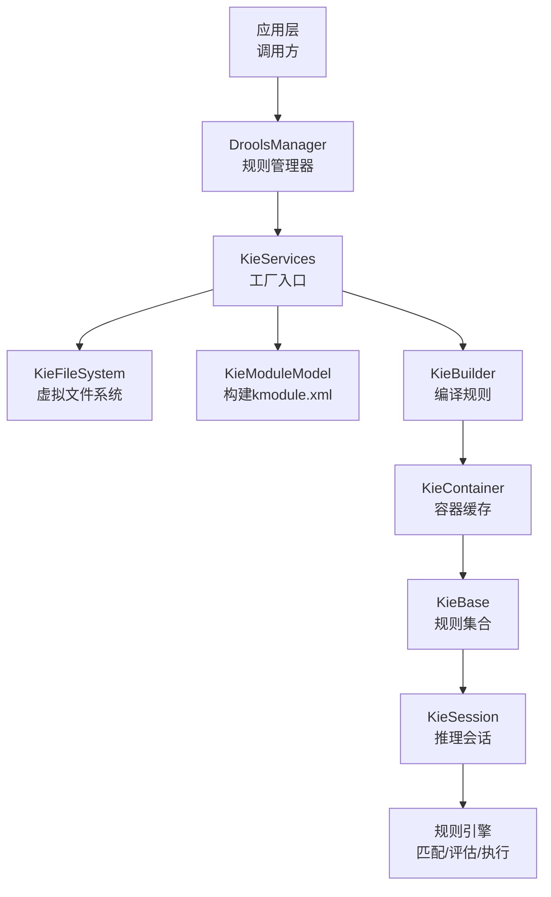
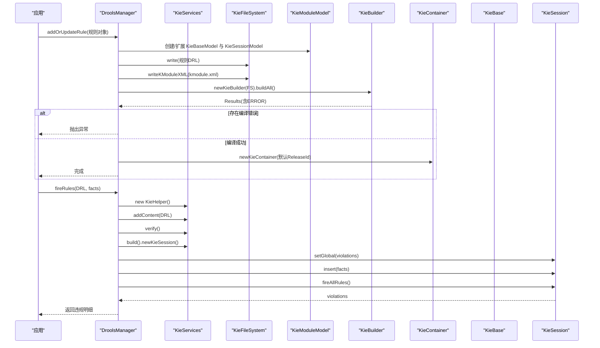
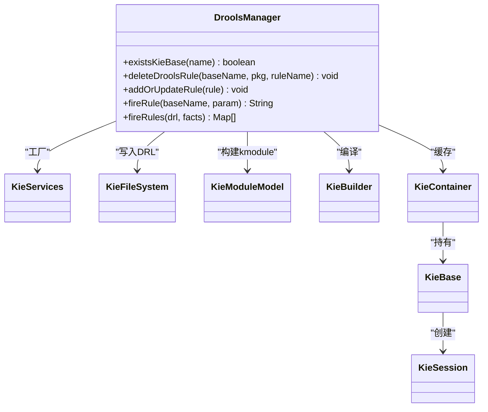
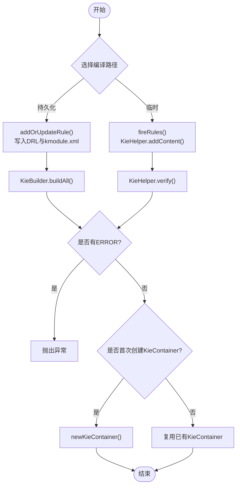
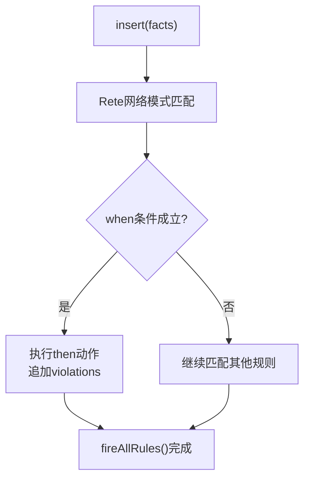
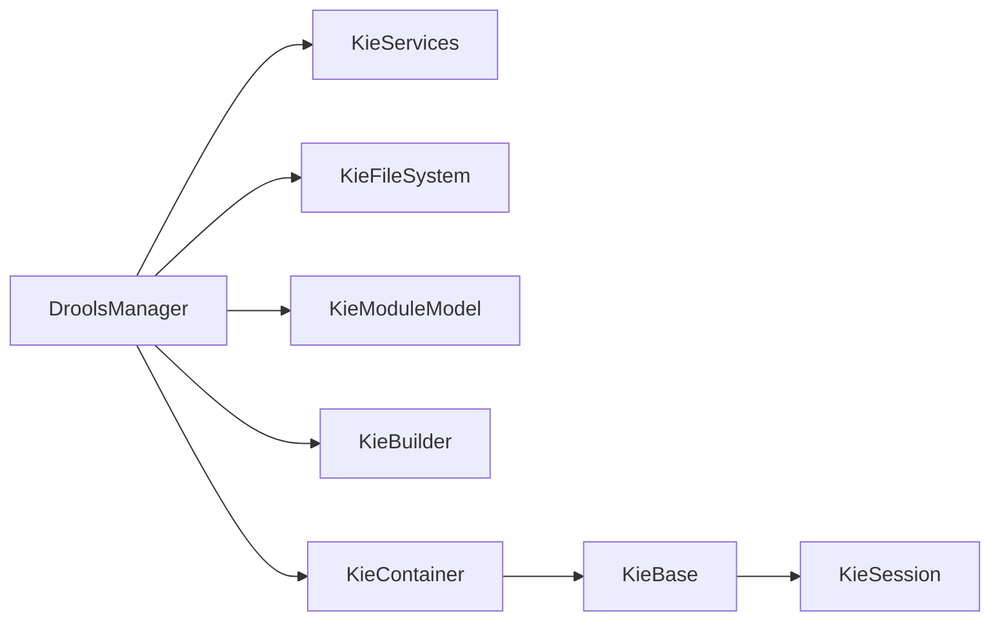

# Drools核心概念

<cite>
**本文引用的文件**   
- [DroolsManager.java](file://ruoyi-modules/ruoyi-dqservice/src/main/java/com/ruoyi/dqservice/connecter/DroolsManager.java)
- [kmodule.xml（主资源）](file://ruoyi-modules/ruoyi-dqservice/src/main/resources/META-INF/kmodule.xml)
- [kmodule.xml（测试资源）](file://ruoyi-modules/ruoyi-dqservice/src/test/java/resources/META-INF/kmodule.xml)
- [DrlSyntaxTest.java](file://ruoyi-modules/ruoyi-dqservice/src/test/java/com/ruoyi/dqservice/DrlSyntaxTest.java)
- [DroolsRule.java](file://ruoyi-modules/ruoyi-dqservice/src/main/java/com/ruoyi/dqservice/domain/DroolsRule.java)
- [TestDroolsLocal.java](file://ruoyi-modules/ruoyi-dqservice/src/main/java/com/sch/test/TestDroolsLocal.java)
</cite>

## 目录
1. [引言](#引言)
2. [项目结构](#项目结构)
3. [核心组件](#核心组件)
4. [架构总览](#架构总览)
5. [详细组件分析](#详细组件分析)
6. [依赖关系分析](#依赖关系分析)
7. [性能与内存优化](#性能与内存优化)
8. [故障排查指南](#故障排查指南)
9. [结论](#结论)

## 引言
本文面向需要在业务系统中集成 Drools 规则引擎的开发者，围绕 KIE 容器架构、规则编译流程、事实匹配机制以及 kmodule.xml 配置进行系统化说明。文档以仓库中实际代码为依据，重点解释以下主题：
- KIE 容器中的 KieServices、KieFileSystem、KieModuleModel、KieBase、KieSession 的职责与协作方式
- DRL 从文本到可执行规则的编译路径
- 模式匹配、条件评估与动作执行的运行机制
- kmodule.xml 的配置结构与最佳实践
- 性能优化与内存管理策略

## 项目结构
本项目在数据质量服务模块中集成了 Drools/KIE，关键实现集中在 ruoyi-dqservice 模块：
- 运行时入口与规则编排：com.ruoyi.dqservice.connecter.DroolsManager
- 规则模型：com.ruoyi.dqservice.domain.DroolsRule
- 静态 KIE 配置：META-INF/kmodule.xml
- 语法与行为验证：DrlSyntaxTest、TestDroolsLocal

图表来源
- [DroolsManager.java:26-35](file://ruoyi-modules/ruoyi-dqservice/src/main/java/com/ruoyi/dqservice/connecter/DroolsManager.java#L26-L35)
- [DroolsManager.java:103-119](file://ruoyi-modules/ruoyi-dqservice/src/main/java/com/ruoyi/dqservice/connecter/DroolsManager.java#L103-L119)
- [DroolsManager.java:125-133](file://ruoyi-modules/ruoyi-dqservice/src/main/java/com/ruoyi/dqservice/connecter/DroolsManager.java#L125-L133)

章节来源
- [DroolsManager.java:1-190](file://ruoyi-modules/ruoyi-dqservice/src/main/java/com/ruoyi/dqservice/connecter/DroolsManager.java#L1-L190)
- [DroolsRule.java:1-32](file://ruoyi-modules/ruoyi-dqservice/src/main/java/com/ruoyi/dqservice/domain/DroolsRule.java#L1-L32)
- [kmodule.xml（主资源）:1-7](file://ruoyi-modules/ruoyi-dqservice/src/main/resources/META-INF/kmodule.xml#L1-L7)

## 核心组件
本节聚焦 Drools/KIE 的核心对象及其在项目中的使用方式。

- KieServices
  - 作用：KIE 容器的统一工厂入口，提供创建 KieFileSystem、KieModuleModel、KieBuilder、KieContainer 等能力。
  - 项目中用法：作为单例持有，用于初始化文件系统、模块模型和容器。

- KieFileSystem
  - 作用：虚拟文件系统，允许将 DRL 内容写入内存，避免频繁落盘。
  - 项目中用法：全局缓存一个实例，动态写入规则文件，避免重复 new 导致之前规则丢失。

- KieModuleModel
  - 作用：程序化构建 kmodule.xml 的模型，定义 KieBase、包路径、KieSession 等元信息。
  - 项目中用法：根据规则动态创建或扩展 KieBase 与 Session，并生成 XML 写回文件系统。

- KieBuilder
  - 作用：读取 KieFileSystem 中的资源，编译所有规则，产出 Results 错误信息。
  - 项目中用法：每次添加/更新规则后调用 buildAll()，检查 ERROR 级别消息。

- KieContainer
  - 作用：加载并缓存 KieModule，对外暴露 KieBase 与 KieSession。
  - 项目中用法：仅首次创建一次，后续复用；通过名称获取指定 KieBase 与 Session。

- KieBase
  - 作用：规则的定义集合，包含已编译的规则、类型信息等。
  - 项目中用法：判断是否存在、删除特定规则、按名称获取。

- KieSession
  - 作用：有状态推理会话，负责插入事实、设置全局变量、触发规则、回收资源。
  - 项目中用法：每次请求新建，完成后 dispose；支持批量 Map 事实与 global 收集违规结果。

章节来源
- [DroolsManager.java:26-35](file://ruoyi-modules/ruoyi-dqservice/src/main/java/com/ruoyi/dqservice/connecter/DroolsManager.java#L26-L35)
- [DroolsManager.java:40-58](file://ruoyi-modules/ruoyi-dqservice/src/main/java/com/ruoyi/dqservice/connecter/DroolsManager.java#L40-L58)
- [DroolsManager.java:63-119](file://ruoyi-modules/ruoyi-dqservice/src/main/java/com/ruoyi/dqservice/connecter/DroolsManager.java#L63-L119)
- [DroolsManager.java:125-187](file://ruoyi-modules/ruoyi-dqservice/src/main/java/com/ruoyi/dqservice/connecter/DroolsManager.java#L125-L187)

## 架构总览
下图展示从“规则编写”到“规则执行”的端到端流程，映射到具体类与方法。

图表来源
- [DroolsManager.java:63-119](file://ruoyi-modules/ruoyi-dqservice/src/main/java/com/ruoyi/dqservice/connecter/DroolsManager.java#L63-L119)
- [DroolsManager.java:149-187](file://ruoyi-modules/ruoyi-dqservice/src/main/java/com/ruoyi/dqservice/connecter/DroolsManager.java#L149-L187)

## 详细组件分析

### DroolsManager：规则管理与执行中枢
职责概览
- 维护 KieServices、KieFileSystem、KieModuleModel 的单例引用
- 动态创建/扩展 KieBase 与 KieSession 模型
- 将 DRL 写入虚拟文件系统，触发编译
- 提供两类执行接口：
  - fireRule：向已有 KieContainer 的 Session 插入简单事实并触发
  - fireRules：基于 KieHelper 临时编译 DRL，支持批量 Map 事实与 global 收集违规

关键流程
- 添加/更新规则
  - 若目标 KieBase 不存在，则创建并设置非默认 KieBase，同时创建对应 Session
  - 若已存在，则按需追加包路径
  - 将 DRL 写入 KieFileSystem，必要时重写 kmodule.xml
  - 调用 KieBuilder.buildAll() 编译，检查 ERROR 消息
  - 首次构建时创建 KieContainer 并缓存

- 触发规则
  - fireRule：从 KieContainer 获取命名 Session，插入 Integer 事实，fireAllRules 后 dispose
  - fireRules：使用 KieHelper 编译 DRL，verify 失败抛异常；成功后创建 Session，设置 global List violations，批量 insert Map 事实，fireAllRules 后返回 violations

图表来源
- [DroolsManager.java:26-35](file://ruoyi-modules/ruoyi-dqservice/src/main/java/com/ruoyi/dqservice/connecter/DroolsManager.java#L26-L35)
- [DroolsManager.java:63-119](file://ruoyi-modules/ruoyi-dqservice/src/main/java/com/ruoyi/dqservice/connecter/DroolsManager.java#L63-L119)
- [DroolsManager.java:125-187](file://ruoyi-modules/ruoyi-dqservice/src/main/java/com/ruoyi/dqservice/connecter/DroolsManager.java#L125-L187)

章节来源
- [DroolsManager.java:1-190](file://ruoyi-modules/ruoyi-dqservice/src/main/java/com/ruoyi/dqservice/connecter/DroolsManager.java#L1-L190)

### DroolsRule：规则输入模型
职责概览
- 封装规则 ID、KieBase 名称、包名、DRL 内容
- 构造器从领域 Rule 映射为 DroolsRule
- 提供基础参数校验

设计要点
- kieBaseName 由用户名派生，便于多租户隔离
- kiePackageName 由用户与规则名组合，形成独立包空间
- validate 方法对必填字段做空值校验

章节来源
- [DroolsRule.java:1-32](file://ruoyi-modules/ruoyi-dqservice/src/main/java/com/ruoyi/dqservice/domain/DroolsRule.java#L1-L32)

### kmodule.xml：KIE 静态配置
结构说明
- 根元素 kmodule，声明命名空间
- kbase 标签定义规则基座：
  - name：KieBase 名称
  - packages：扫描的包路径
  - default：是否默认
- ksession 标签定义会话：
  - name：会话名称
  - default：是否默认

最佳实践
- 生产环境建议显式命名 KieBase 与 KieSession，避免依赖默认值
- 将不同业务域拆分到不同 kbase，提升隔离性与可维护性
- 结合 DroolsManager 的动态构建，可在运行时扩展包路径与会话

章节来源
- [kmodule.xml（主资源）:1-7](file://ruoyi-modules/ruoyi-dqservice/src/main/resources/META-INF/kmodule.xml#L1-L7)
- [kmodule.xml（测试资源）:1-7](file://ruoyi-modules/ruoyi-dqservice/src/test/java/resources/META-INF/kmodule.xml#L1-L7)

### 规则编译流程：从 DRL 到可执行规则
两种路径
- 持久化规则路径（addOrUpdateRule）
  - 通过 KieFileSystem.write 写入 DRL
  - 通过 KieModuleModel.toXML 生成 kmodule.xml 并写回
  - 使用 KieBuilder.buildAll() 编译，检查结果中的 ERROR 消息
  - 首次构建时创建 KieContainer 并缓存

- 临时规则路径（fireRules）
  - 使用 KieHelper.addContent 直接编译 DRL 文本
  - verify() 校验语法与语义，失败抛异常
  - build().newKieSession() 创建会话执行

图表来源
- [DroolsManager.java:63-119](file://ruoyi-modules/ruoyi-dqservice/src/main/java/com/ruoyi/dqservice/connecter/DroolsManager.java#L63-L119)
- [DroolsManager.java:149-187](file://ruoyi-modules/ruoyi-dqservice/src/main/java/com/ruoyi/dqservice/connecter/DroolsManager.java#L149-L187)

章节来源
- [DroolsManager.java:63-119](file://ruoyi-modules/ruoyi-dqservice/src/main/java/com/ruoyi/dqservice/connecter/DroolsManager.java#L63-L119)
- [DroolsManager.java:149-187](file://ruoyi-modules/ruoyi-dqservice/src/main/java/com/ruoyi/dqservice/connecter/DroolsManager.java#L149-L187)

### 事实匹配机制：模式匹配、条件评估与动作执行
- 模式匹配
  - 将事实（Fact）插入 KieSession 后，规则引擎构建 Rete 网络并进行模式匹配
  - 项目中支持两类事实：
    - 简单事实：Integer（fireRule）
    - 动态表结构：Map<String,Object>（fireRules），配合 DRL 中对 Map 的属性访问或索引访问

- 条件评估
  - 当模式匹配命中时，评估 when 子句的条件表达式
  - 测试用例展示了多种 Map 访问语法，包括 MVEL 索引访问与 Drools 属性访问糖

- 动作执行
  - then 块中执行副作用，如向 global 列表追加违规记录
  - 项目中使用 global java.util.List violations 收集违规明细

图表来源
- [DroolsManager.java:125-133](file://ruoyi-modules/ruoyi-dqservice/src/main/java/com/ruoyi/dqservice/connecter/DroolsManager.java#L125-L133)
- [DroolsManager.java:164-181](file://ruoyi-modules/ruoyi-dqservice/src/main/java/com/ruoyi/dqservice/connecter/DroolsManager.java#L164-L181)
- [DrlSyntaxTest.java:31-39](file://ruoyi-modules/ruoyi-dqservice/src/test/java/com/ruoyi/dqservice/DrlSyntaxTest.java#L31-L39)
- [DrlSyntaxTest.java:54-83](file://ruoyi-modules/ruoyi-dqservice/src/test/java/com/ruoyi/dqservice/DrlSyntaxTest.java#L54-L83)

章节来源
- [DroolsManager.java:125-187](file://ruoyi-modules/ruoyi-dqservice/src/main/java/com/ruoyi/dqservice/connecter/DroolsManager.java#L125-L187)
- [DrlSyntaxTest.java:1-106](file://ruoyi-modules/ruoyi-dqservice/src/test/java/com/ruoyi/dqservice/DrlSyntaxTest.java#L1-L106)

## 依赖关系分析
- 组件耦合
  - DroolsManager 强依赖 KieServices、KieFileSystem、KieModuleModel、KieBuilder、KieContainer
  - KieContainer 持有 KieBase，KieBase 提供 KieSession
- 外部依赖
  - Spring 上下文注入 DroolsManager（@Component）
  - 日志框架（Slf4j）输出编译与运行期信息
- 潜在循环依赖
  - 当前实现无循环依赖；KieContainer 仅被创建一次并复用

图表来源
- [DroolsManager.java:26-35](file://ruoyi-modules/ruoyi-dqservice/src/main/java/com/ruoyi/dqservice/connecter/DroolsManager.java#L26-L35)
- [DroolsManager.java:103-119](file://ruoyi-modules/ruoyi-dqservice/src/main/java/com/ruoyi/dqservice/connecter/DroolsManager.java#L103-L119)

章节来源
- [DroolsManager.java:1-190](file://ruoyi-modules/ruoyi-dqservice/src/main/java/com/ruoyi/dqservice/connecter/DroolsManager.java#L1-L190)

## 性能与内存优化
- 容器与会话生命周期
  - KieContainer 应全局唯一并复用，避免频繁重建导致的规则重编译与内存抖动
  - KieSession 应在每次请求结束后 dispose，释放工作内存与 Rete 节点

- 规则组织
  - 合理划分 KieBase 与包路径，减少无关规则参与匹配
  - 将高频规则放在靠前位置，降低匹配成本

- 事实处理
  - 批量 insert 事实，减少多次 fireAllRules 的开销
  - 对于动态表结构，优先使用 Drools 对 Map 的属性访问糖，减少 MVEL 解析开销

- 编译策略
  - 持久化规则使用 KieBuilder.buildAll() 一次性编译，避免逐条编译
  - 临时规则使用 KieHelper，适合热更新场景，但应避免频繁大体积 DRL 编译

- 资源清理
  - 确保 finally 块中 dispose KieSession
  - 避免在 then 块中持有长生命周期对象，防止内存泄漏

[本节为通用指导，不直接分析具体文件]

## 故障排查指南
- 规则编译失败
  - 现象：addOrUpdateRule 或 fireRules 抛出异常
  - 排查：查看 Results.getMessages(Message.Level.ERROR) 中的错误信息
  - 参考：DroolsManager 中编译与 verify 的错误处理逻辑

- 未声明 global 导致异常
  - 现象：fireRules 设置 global violations 时报错
  - 原因：DRL 未声明 global java.util.List violations
  - 解决：在 DRL 头部声明 global 并使用该变量收集违规

- 规则未生效
  - 现象：新增规则后未命中
  - 排查：确认 KieBase 名称、包路径是否正确；检查 kmodule.xml 是否被正确生成与加载

- 会话未释放
  - 现象：内存持续增长
  - 排查：确保每个 KieSession 在使用后 dispose

章节来源
- [DroolsManager.java:103-119](file://ruoyi-modules/ruoyi-dqservice/src/main/java/com/ruoyi/dqservice/connecter/DroolsManager.java#L103-L119)
- [DroolsManager.java:149-187](file://ruoyi-modules/ruoyi-dqservice/src/main/java/com/ruoyi/dqservice/connecter/DroolsManager.java#L149-L187)

## 结论
本仓库在数据质量服务中通过 DroolsManager 统一管理 KIE 容器与规则生命周期，实现了：
- 动态规则加载与编译（KieFileSystem + KieModuleModel + KieBuilder）
- 稳定的容器与会话管理（KieContainer 复用、KieSession 短生命周期）
- 灵活的事实匹配（Integer 与 Map 双通道）
- 清晰的 kmodule.xml 配置结构

在生产环境中，建议遵循本文的性能与内存优化建议，并结合业务域划分 KieBase 与包路径，以提升规则系统的可维护性与执行效率。