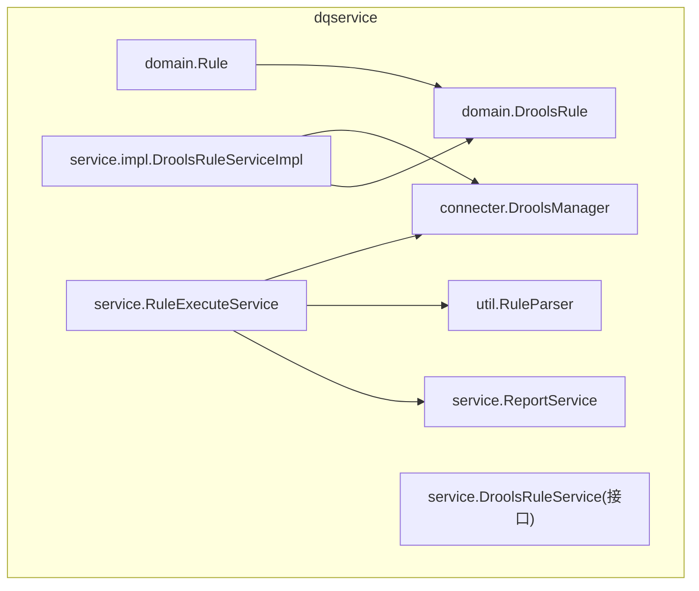
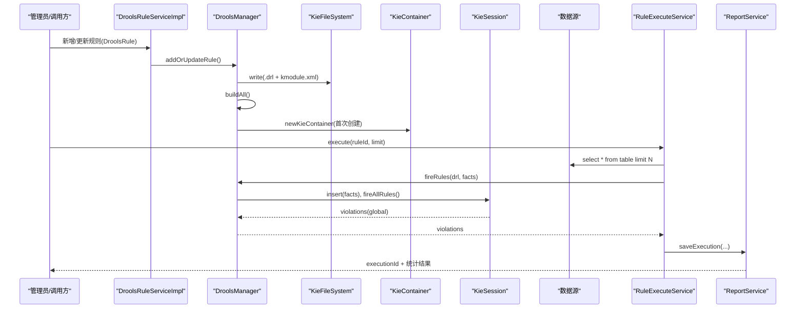
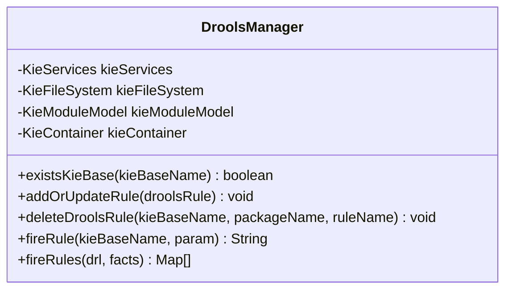
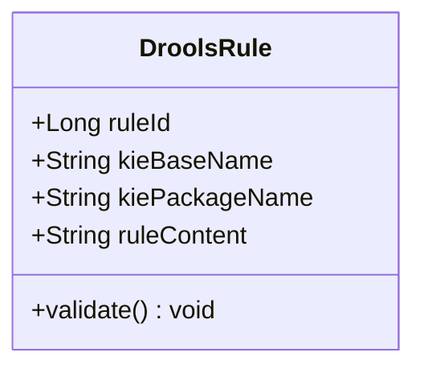
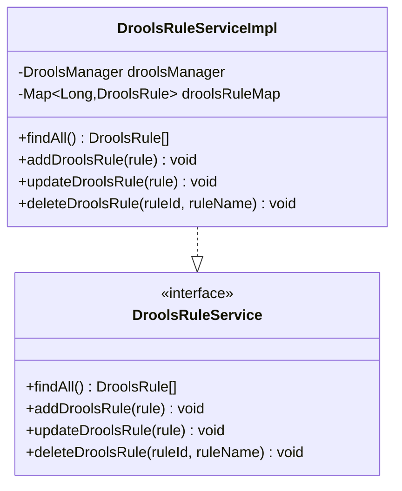
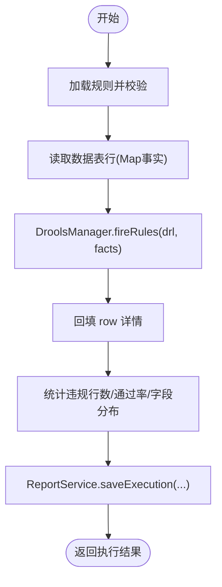
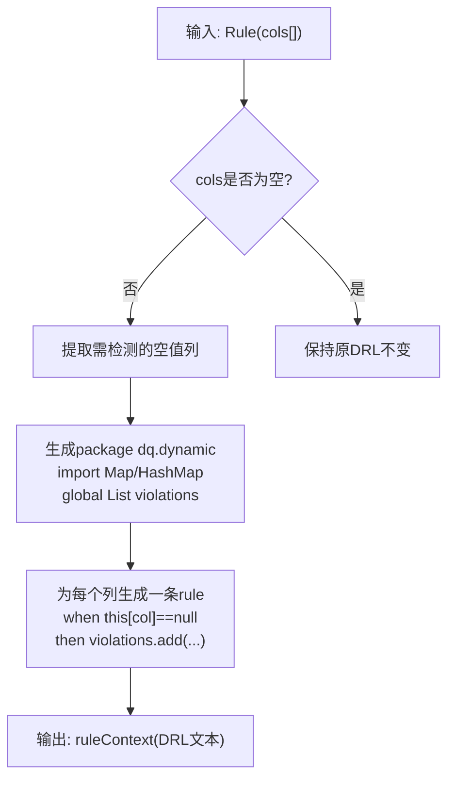
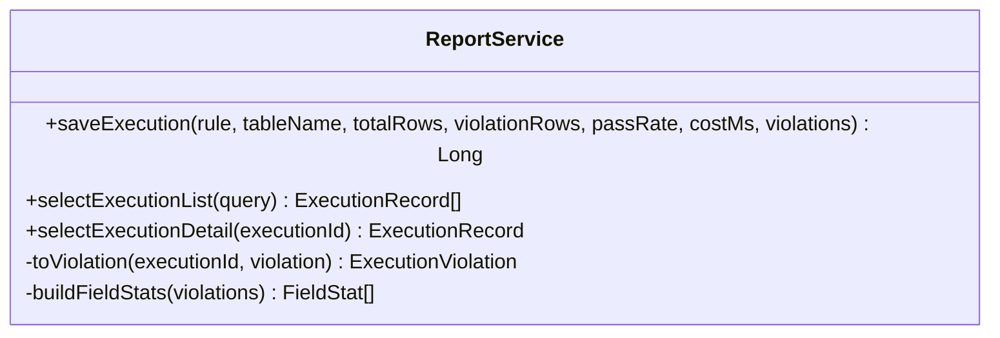
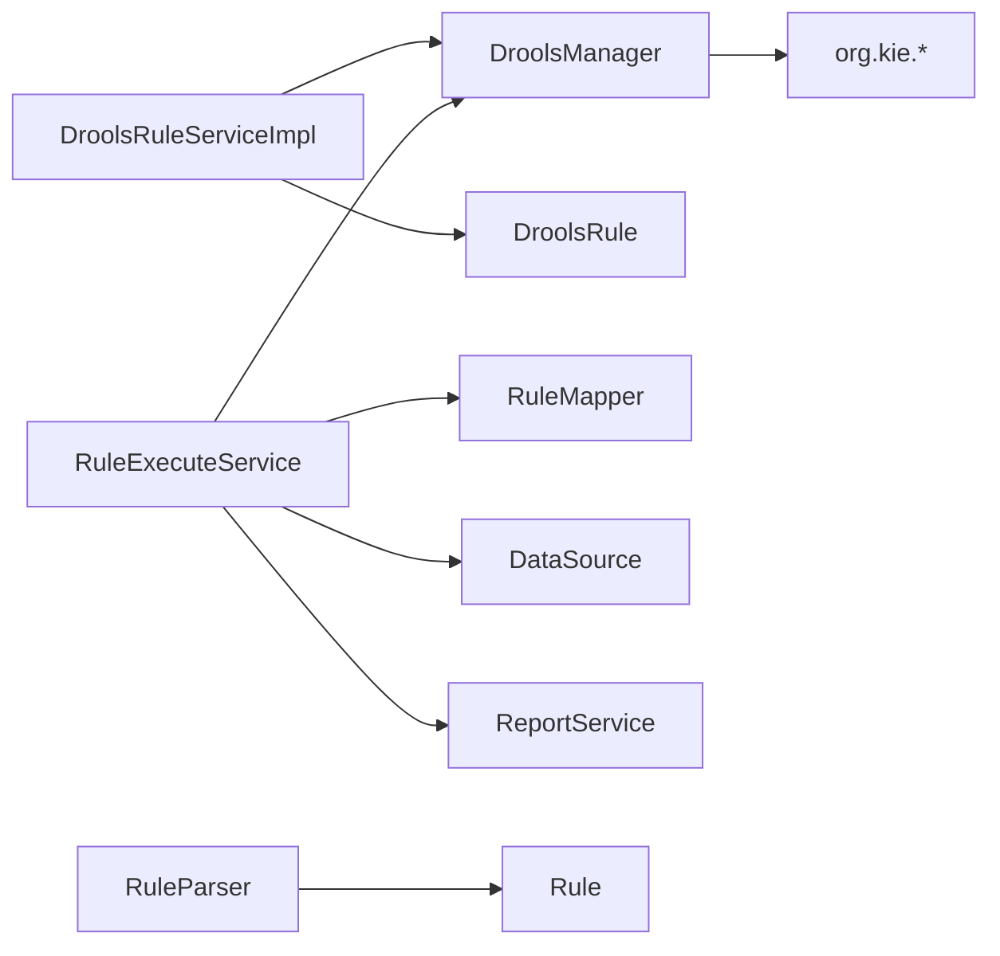

# Drools规则引擎

<cite>
**本文引用的文件**   
- [DroolsManager.java](file://ruoyi-modules/ruoyi-dqservice/src/main/java/com/ruoyi/dqservice/connecter/DroolsManager.java)
- [DroolsRuleServiceImpl.java](file://ruoyi-modules/ruoyi-dqservice/src/main/java/com/ruoyi/dqservice/service/impl/DroolsRuleServiceImpl.java)
- [DroolsRuleService.java](file://ruoyi-modules/ruoyi-dqservice/src/main/java/com/ruoyi/dqservice/service/DroolsRuleService.java)
- [DroolsRule.java](file://ruoyi-modules/ruoyi-dqservice/src/main/java/com/ruoyi/dqservice/domain/DroolsRule.java)
- [RuleExecuteService.java](file://ruoyi-modules/ruoyi-dqservice/src/main/java/com/ruoyi/dqservice/service/RuleExecuteService.java)
- [RuleParser.java](file://ruoyi-modules/ruoyi-dqservice/src/main/java/com/ruoyi/dqservice/util/RuleParser.java)
- [ReportService.java](file://ruoyi-modules/ruoyi-dqservice/src/main/java/com/ruoyi/dqservice/service/ReportService.java)
- [Rule.java](file://ruoyi-modules/ruoyi-dqservice/src/main/java/com/ruoyi/dqservice/domain/Rule.java)
</cite>

## 目录
1. [简介](#简介)
2. [项目结构](#项目结构)
3. [核心组件](#核心组件)
4. [架构总览](#架构总览)
5. [详细组件分析](#详细组件分析)
6. [依赖关系分析](#依赖关系分析)
7. [性能与优化](#性能与优化)
8. [故障排查指南](#故障排查指南)
9. [结论](#结论)
10. [附录：DRL语法与实践指南](#附录drl语法与实践指南)

## 简介
本技术文档围绕数据质量服务中的 Drools 规则引擎集成，系统性说明 KIE 容器、规则编译、事实匹配与执行流程；重点解析 DroolsManager 的加载与管理策略、DroolsRule 封装设计，以及 RuleExecuteService 如何将“规则”和“数据”接通并产出可展示的质量评估结果。同时提供 DRL 编写指南、性能优化建议与调试技巧，帮助开发者快速上手与稳定扩展。

## 项目结构
本项目在 ruoyi-dqservice 模块中实现 Drools 集成，关键代码位于 connect、domain、service、util 等包下：
- connect：DroolsManager 负责 KIE 容器生命周期管理、规则编译与执行。
- domain：DroolsRule、Rule 等模型承载规则元信息与上下文。
- service：DroolsRuleService 接口与其实现类负责规则增删改；RuleExecuteService 负责数据读取、规则执行与报告汇总；ReportService 负责执行结果落库。
- util：RuleParser 用于从列约束生成空值检测 DRL，并提供辅助解析能力。

图表来源
- [DroolsManager.java:22-120](file://ruoyi-modules/ruoyi-dqservice/src/main/java/com/ruoyi/dqservice/connecter/DroolsManager.java#L22-L120)
- [DroolsRule.java:5-31](file://ruoyi-modules/ruoyi-dqservice/src/main/java/com/ruoyi/dqservice/domain/DroolsRule.java#L5-L31)
- [Rule.java:20-86](file://ruoyi-modules/ruoyi-dqservice/src/main/java/com/ruoyi/dqservice/domain/Rule.java#L20-L86)
- [DroolsRuleServiceImpl.java:11-47](file://ruoyi-modules/ruoyi-dqservice/src/main/java/com/ruoyi/dqservice/service/impl/DroolsRuleServiceImpl.java#L11-L47)
- [RuleExecuteService.java:36-114](file://ruoyi-modules/ruoyi-dqservice/src/main/java/com/ruoyi/dqservice/service/RuleExecuteService.java#L36-L114)
- [RuleParser.java:16-93](file://ruoyi-modules/ruoyi-dqservice/src/main/java/com/ruoyi/dqservice/util/RuleParser.java#L16-L93)
- [ReportService.java:26-89](file://ruoyi-modules/ruoyi-dqservice/src/main/java/com/ruoyi/dqservice/service/ReportService.java#L26-L89)

章节来源
- [DroolsManager.java:22-120](file://ruoyi-modules/ruoyi-dqservice/src/main/java/com/ruoyi/dqservice/connecter/DroolsManager.java#L22-L120)
- [DroolsRuleServiceImpl.java:11-47](file://ruoyi-modules/ruoyi-dqservice/src/main/java/com/ruoyi/dqservice/service/impl/DroolsRuleServiceImpl.java#L11-L47)
- [RuleExecuteService.java:36-114](file://ruoyi-modules/ruoyi-dqservice/src/main/java/com/ruoyi/dqservice/service/RuleExecuteService.java#L36-L114)

## 核心组件
- DroolsManager：KIE 容器与文件系统缓存、规则构建与执行入口，提供 addOrUpdateRule、deleteDroolsRule、fireRule、fireRules 等方法。
- DroolsRule：封装规则到 KIE 工作空间所需的最小信息（ruleId、kieBaseName、kiePackageName、ruleContent），并提供参数校验。
- DroolsRuleService / DroolsRuleServiceImpl：对外暴露规则的查询、新增、更新、删除；内部使用内存 Map 模拟持久化，并委托 DroolsManager 完成规则加载。
- RuleExecuteService：将数据库表行转换为 Map 事实，调用 DroolsManager.fireRules 执行 DRL，统计通过率、字段分布并保存执行报告。
- RuleParser：根据列约束自动生成空值检测 DRL，支持解析现有 DRL 以回填前端编辑界面。
- ReportService：将 Drools 产出的违规明细持久化为执行记录与违规明细，并提供查询接口。

章节来源
- [DroolsManager.java:22-187](file://ruoyi-modules/ruoyi-dqservice/src/main/java/com/ruoyi/dqservice/connecter/DroolsManager.java#L22-L187)
- [DroolsRule.java:5-31](file://ruoyi-modules/ruoyi-dqservice/src/main/java/com/ruoyi/dqservice/domain/DroolsRule.java#L5-L31)
- [DroolsRuleService.java:7-14](file://ruoyi-modules/ruoyi-dqservice/src/main/java/com/ruoyi/dqservice/service/DroolsRuleService.java#L7-L14)
- [DroolsRuleServiceImpl.java:11-47](file://ruoyi-modules/ruoyi-dqservice/src/main/java/com/ruoyi/dqservice/service/impl/DroolsRuleServiceImpl.java#L11-L47)
- [RuleExecuteService.java:36-114](file://ruoyi-modules/ruoyi-dqservice/src/main/java/com/ruoyi/dqservice/service/RuleExecuteService.java#L36-L114)
- [RuleParser.java:16-93](file://ruoyi-modules/ruoyi-dqservice/src/main/java/com/ruoyi/dqservice/util/RuleParser.java#L16-L93)
- [ReportService.java:26-89](file://ruoyi-modules/ruoyi-dqservice/src/main/java/com/ruoyi/dqservice/service/ReportService.java#L26-L89)

## 架构总览
下图展示了规则从“定义—加载—执行—报告”的全链路：

图表来源
- [DroolsRuleServiceImpl.java:26-37](file://ruoyi-modules/ruoyi-dqservice/src/main/java/com/ruoyi/dqservice/service/impl/DroolsRuleServiceImpl.java#L26-L37)
- [DroolsManager.java:63-120](file://ruoyi-modules/ruoyi-dqservice/src/main/java/com/ruoyi/dqservice/connecter/DroolsManager.java#L63-L120)
- [RuleExecuteService.java:69-114](file://ruoyi-modules/ruoyi-dqservice/src/main/java/com/ruoyi/dqservice/service/RuleExecuteService.java#L69-L114)
- [ReportService.java:58-89](file://ruoyi-modules/ruoyi-dqservice/src/main/java/com/ruoyi/dqservice/service/ReportService.java#L58-L89)

## 详细组件分析

### DroolsManager：KIE 容器与规则执行中枢
职责与要点：
- 单例式管理 KieServices、KieFileSystem、KieModuleModel、KieContainer，避免重复构建导致的规则丢失或会话冲突。
- addOrUpdateRule：动态写入 .drl 与 kmodule.xml，构建 KieModule，仅在首次创建 KieContainer。
- deleteDroolsRule：通过 KieBase.removeRule 移除指定包下的规则。
- fireRule：演示型方法，向 KieSession 插入 Integer 事实并通过 global 收集结果。
- fireRules：每次独立编译 DRL（KieHelper），不污染全局 KieFileSystem；通过 global List violations 回收 then 块产出的违规明细；对未声明 global 的情况给出可读异常提示。

图表来源
- [DroolsManager.java:22-187](file://ruoyi-modules/ruoyi-dqservice/src/main/java/com/ruoyi/dqservice/connecter/DroolsManager.java#L22-L187)

章节来源
- [DroolsManager.java:22-187](file://ruoyi-modules/ruoyi-dqservice/src/main/java/com/ruoyi/dqservice/connecter/DroolsManager.java#L22-L187)

### DroolsRule：规则封装与校验
职责与要点：
- 封装 ruleId、kieBaseName、kiePackageName、ruleContent，供 DroolsManager 构建 KIE 工作空间。
- validate：校验必填字段，缺失时抛出运行时异常。
- 构造函数基于 Rule 对象派生 kieBaseName 与 kiePackageName，便于多用户隔离。

图表来源
- [DroolsRule.java:5-31](file://ruoyi-modules/ruoyi-dqservice/src/main/java/com/ruoyi/dqservice/domain/DroolsRule.java#L5-L31)

章节来源
- [DroolsRule.java:5-31](file://ruoyi-modules/ruoyi-dqservice/src/main/java/com/ruoyi/dqservice/domain/DroolsRule.java#L5-L31)

### DroolsRuleService 与实现类：规则生命周期管理
职责与要点：
- 接口定义 findAll、addDroolsRule、updateDroolsRule、deleteDroolsRule。
- 实现类使用内存 Map 模拟持久化，并在增改后调用 DroolsManager.addOrUpdateRule 完成规则加载；删除时调用 DroolsManager.deleteDroolsRule。

图表来源
- [DroolsRuleService.java:7-14](file://ruoyi-modules/ruoyi-dqservice/src/main/java/com/ruoyi/dqservice/service/DroolsRuleService.java#L7-L14)
- [DroolsRuleServiceImpl.java:11-47](file://ruoyi-modules/ruoyi-dqservice/src/main/java/com/ruoyi/dqservice/service/impl/DroolsRuleServiceImpl.java#L11-L47)

章节来源
- [DroolsRuleService.java:7-14](file://ruoyi-modules/ruoyi-dqservice/src/main/java/com/ruoyi/dqservice/service/DroolsRuleService.java#L7-L14)
- [DroolsRuleServiceImpl.java:11-47](file://ruoyi-modules/ruoyi-dqservice/src/main/java/com/ruoyi/dqservice/service/impl/DroolsRuleServiceImpl.java#L11-L47)

### RuleExecuteService：规则与数据的桥接
职责与要点：
- 校验规则存在、绑定表名合法、DRL 非空。
- 从主数据源按白名单表名读取数据，每行转成 Map 事实，并注入行号占位字段 __rowId。
- 调用 DroolsManager.fireRules 执行 DRL，回收 violations。
- 计算扫描行数、违规条数、命中行数、通过率、字段分布，并持久化执行报告。

图表来源
- [RuleExecuteService.java:69-114](file://ruoyi-modules/ruoyi-dqservice/src/main/java/com/ruoyi/dqservice/service/RuleExecuteService.java#L69-L114)
- [ReportService.java:58-89](file://ruoyi-modules/ruoyi-dqservice/src/main/java/com/ruoyi/dqservice/service/ReportService.java#L58-L89)

章节来源
- [RuleExecuteService.java:69-114](file://ruoyi-modules/ruoyi-dqservice/src/main/java/com/ruoyi/dqservice/service/RuleExecuteService.java#L69-L114)

### RuleParser：DRL 生成与解析
职责与要点：
- nullCountParser：根据列约束生成空值检测 DRL，每个检测字段一条规则，then 块将违规明细写入 global List violations。
- parseNullColumns/fillDetectColumns：从已有 DRL 解析实际生效的空值检测字段，回显至前端编辑界面。
- ROW_ID_KEY：约定行号占位字段，供 RuleExecuteService 注入与 DRL 回填。

图表来源
- [RuleParser.java:16-93](file://ruoyi-modules/ruoyi-dqservice/src/main/java/com/ruoyi/dqservice/util/RuleParser.java#L16-L93)

章节来源
- [RuleParser.java:16-93](file://ruoyi-modules/ruoyi-dqservice/src/main/java/com/ruoyi/dqservice/util/RuleParser.java#L16-L93)

### ReportService：执行结果持久化
职责与要点：
- saveExecution：在同一事务内写入执行汇总与违规明细，保证一致性。
- toViolation：将 Drools 产出的 Map 违规明细映射为 ExecutionViolation 实体，截断超长字段。
- selectExecutionDetail：聚合违规明细与字段分布，供前端展示。

图表来源
- [ReportService.java:26-179](file://ruoyi-modules/ruoyi-dqservice/src/main/java/com/ruoyi/dqservice/service/ReportService.java#L26-L179)

章节来源
- [ReportService.java:26-179](file://ruoyi-modules/ruoyi-dqservice/src/main/java/com/ruoyi/dqservice/service/ReportService.java#L26-L179)

## 依赖关系分析
- DroolsManager 依赖 org.kie.* API，管理 KieFileSystem/KieModuleModel/KieContainer/KieSession。
- DroolsRuleServiceImpl 依赖 DroolsManager 与 DroolsRule。
- RuleExecuteService 依赖 DroolsManager、RuleMapper、DataSource、ReportService。
- RuleParser 依赖 Rule 与 ColInfo，生成 DRL 文本。
- ReportService 依赖 ExecutionRecordMapper/ExecutionViolationMapper 进行持久化。

图表来源
- [DroolsManager.java:22-187](file://ruoyi-modules/ruoyi-dqservice/src/main/java/com/ruoyi/dqservice/connecter/DroolsManager.java#L22-L187)
- [DroolsRuleServiceImpl.java:11-47](file://ruoyi-modules/ruoyi-dqservice/src/main/java/com/ruoyi/dqservice/service/impl/DroolsRuleServiceImpl.java#L11-L47)
- [RuleExecuteService.java:36-114](file://ruoyi-modules/ruoyi-dqservice/src/main/java/com/ruoyi/dqservice/service/RuleExecuteService.java#L36-L114)
- [RuleParser.java:16-93](file://ruoyi-modules/ruoyi-dqservice/src/main/java/com/ruoyi/dqservice/util/RuleParser.java#L16-L93)
- [ReportService.java:26-89](file://ruoyi-modules/ruoyi-dqservice/src/main/java/com/ruoyi/dqservice/service/ReportService.java#L26-L89)

章节来源
- [DroolsManager.java:22-187](file://ruoyi-modules/ruoyi-dqservice/src/main/java/com/ruoyi/dqservice/connecter/DroolsManager.java#L22-L187)
- [DroolsRuleServiceImpl.java:11-47](file://ruoyi-modules/ruoyi-dqservice/src/main/java/com/ruoyi/dqservice/service/impl/DroolsRuleServiceImpl.java#L11-L47)
- [RuleExecuteService.java:36-114](file://ruoyi-modules/ruoyi-dqservice/src/main/java/com/ruoyi/dqservice/service/RuleExecuteService.java#L36-L114)
- [RuleParser.java:16-93](file://ruoyi-modules/ruoyi-dqservice/src/main/java/com/ruoyi/dqservice/util/RuleParser.java#L16-L93)
- [ReportService.java:26-89](file://ruoyi-modules/ruoyi-dqservice/src/main/java/com/ruoyi/dqservice/service/ReportService.java#L26-L89)

## 性能与优化
- 规则加载与容器复用
  - 使用全局 KieContainer 避免频繁重建；仅在首次创建容器，后续复用。
  - 使用 KieFileSystem 缓存规则文件，避免重复写入导致的状态不一致。
- 执行路径优化
  - fireRules 使用 KieHelper 单次编译，错误隔离且不污染全局文件系统，适合热更新场景。
  - 限制单次扫描行数（默认 1000，上限 10000），防止大表拖慢演示环境。
- 数据访问优化
  - 表名白名单校验，避免 SQL 注入风险；仅 select * 必要字段时可进一步裁剪列集减少开销。
- 结果处理优化
  - 使用 LinkedHashMap 保留字段顺序，便于前端展示；按字段聚合统计时使用 merge 计数，降低复杂度。
- 资源释放
  - KieSession 使用后及时 dispose，避免内存泄漏。

[本节为通用指导，不直接分析具体文件]

## 故障排查指南
- 规则编译失败
  - 现象：fireRules 抛出 ServiceException，包含编译错误详情。
  - 排查：检查 DRL 语法、global 声明是否包含 java.util.List violations；确认字段名与事实 Map 键一致。
  - 定位：查看 DroolsManager.fireRules 的错误日志与抛出的异常信息。
- 规则未声明 global
  - 现象：抛出 ServiceException 提示未声明 global List violations。
  - 解决：在 DRL 顶部声明 global java.util.List violations，并在 then 块中追加违规明细。
- 规则删除无效
  - 现象：删除后仍命中旧规则。
  - 排查：确认 existsKieBase 判断逻辑与 removeRule 调用是否正确；检查 kieBaseName/packageName/ruleName 是否匹配。
- 数据读取失败
  - 现象：抛出 ServiceException 提示读取数据表失败。
  - 排查：检查 DataSource 配置、表名合法性、权限与连接池状态。
- 报告不一致
  - 现象：执行记录与违规明细数量不一致。
  - 排查：确认 ReportService.saveExecution 的事务边界；检查 violations 列表是否为空或为空集合时的分支。

章节来源
- [DroolsManager.java:149-187](file://ruoyi-modules/ruoyi-dqservice/src/main/java/com/ruoyi/dqservice/connecter/DroolsManager.java#L149-L187)
- [RuleExecuteService.java:69-147](file://ruoyi-modules/ruoyi-dqservice/src/main/java/com/ruoyi/dqservice/service/RuleExecuteService.java#L69-L147)
- [ReportService.java:58-89](file://ruoyi-modules/ruoyi-dqservice/src/main/java/com/ruoyi/dqservice/service/ReportService.java#L58-L89)

## 结论
本方案通过 DroolsManager 统一管理 KIE 容器与规则编译，结合 RuleExecuteService 的数据桥接与 ReportService 的结果持久化，形成“规则即代码、数据即事实”的可扩展数据质量评估体系。DroolsRule 与 RuleParser 提供了灵活的规则封装与 DRL 生成能力，配合严格的参数校验与错误提示，有助于在生产环境中稳定运行与快速排障。

[本节为总结性内容，不直接分析具体文件]

## 附录：DRL语法与实践指南

### 基本结构
- package：命名空间，示例中使用 dq.dynamic。
- import：引入 Java 类型，如 Map、HashMap、List。
- global：声明全局变量，例如 global java.util.List violations，用于 in then 块中收集违规明细。
- rule：规则体，包含 when 条件与 then 动作。

### 条件判断
- 空值检测：this["field"] == null
- 数值范围：this["age"] > 18 && this["age"] < 60
- 字符串匹配：this["name"].startsWith("A")
- 集合操作：from $list : List()

### 动作执行
- 收集违规明细：violations.add(map)，map 至少包含 rule、field、rowId。
- 修改事实：在需要时更新 fact 字段（谨慎使用，避免副作用）。
- 调用函数：可使用内置函数或自定义函数（需在 DRL 中声明）。

### 函数调用
- 在 DRL 中声明 function 或使用 Java 静态方法（需 import）。
- 在 then 块中调用函数处理业务逻辑，并将结果写入 violations。

### 最佳实践
- 每条规则聚焦单一检测目标，便于统计与定位。
- 使用 global List violations 统一收集违规明细，避免分散输出。
- 控制事实规模：分批插入事实或限制扫描行数，避免 OOM。
- 规则热更新：优先使用 fireRules 的 KieHelper 模式，避免影响其他规则。
- 字段名与事实键保持一致，必要时在 RuleExecuteService 中注入 __rowId 以便关联原始记录。

[本节为概念性指导，不直接分析具体文件]