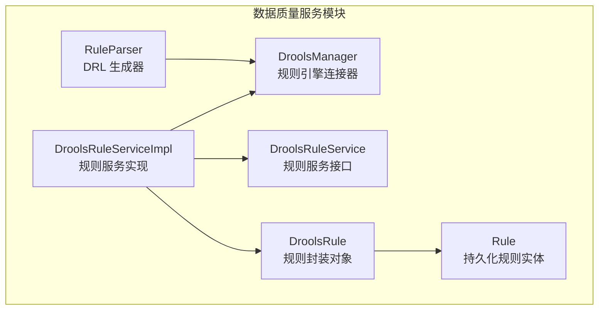
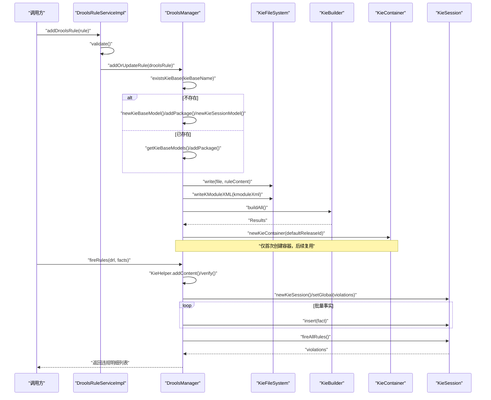
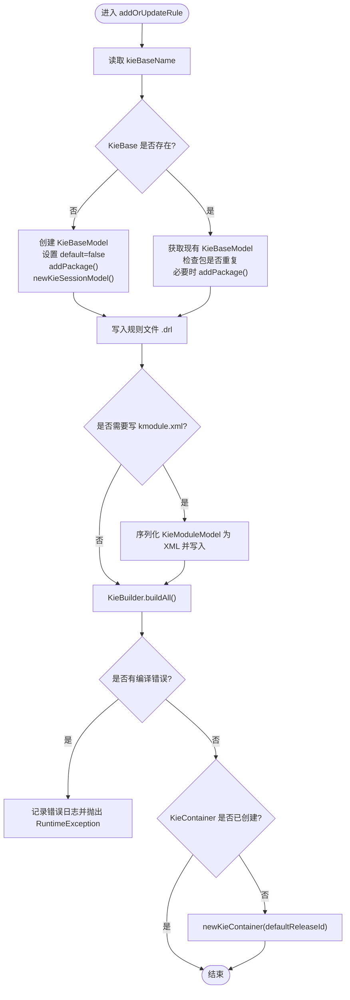
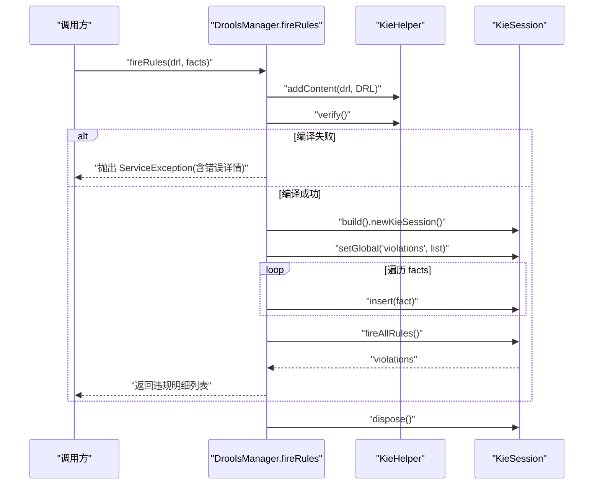
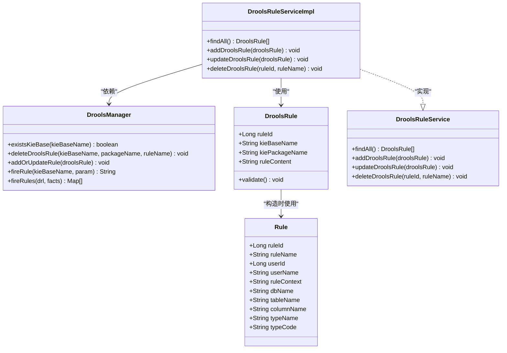

# Drools集成实现

<cite>
**本文引用的文件**   
- [DroolsManager.java](file://ruoyi-modules/ruoyi-dqservice/src/main/java/com/ruoyi/dqservice/connecter/DroolsManager.java)
- [DroolsRule.java](file://ruoyi-modules/ruoyi-dqservice/src/main/java/com/ruoyi/dqservice/domain/DroolsRule.java)
- [DroolsRuleServiceImpl.java](file://ruoyi-modules/ruoyi-dqservice/src/main/java/com/ruoyi/dqservice/service/impl/DroolsRuleServiceImpl.java)
- [DroolsRuleService.java](file://ruoyi-modules/ruoyi-dqservice/src/main/java/com/ruoyi/dqservice/service/DroolsRuleService.java)
- [Rule.java](file://ruoyi-modules/ruoyi-dqservice/src/main/java/com/ruoyi/dqservice/domain/Rule.java)
- [RuleParser.java](file://ruoyi-modules/ruoyi-dqservice/src/main/java/com/ruoyi/dqservice/util/RuleParser.java)
</cite>

## 目录
1. [简介](#简介)
2. [项目结构](#项目结构)
3. [核心组件](#核心组件)
4. [架构总览](#架构总览)
5. [详细组件分析](#详细组件分析)
6. [依赖关系分析](#依赖关系分析)
7. [性能与扩展性](#性能与扩展性)
8. [故障排查指南](#故障排查指南)
9. [结论](#结论)

## 简介
本技术文档聚焦于项目中基于 Drools 的规则引擎集成实现，重点围绕以下目标展开：
- 深入解析 DroolsManager 类的规则加载、管理与执行机制；
- 详细说明 addOrUpdateRule 方法的实现逻辑，包括 KieBase 的动态创建、包管理与规则文件写入；
- 解释 fireRules 方法的设计思路，包括 KieHelper 的使用、批量事实处理与违规结果收集；
- 说明 DroolsRule 封装类的设计模式与扩展点；
- 梳理错误处理机制与异常策略。

该实现位于数据质量服务模块中，通过 Spring 容器管理 DroolsManager 单例，结合内存中的虚拟文件系统与动态构建的 KieContainer/KieSession，实现对 DRL 规则的动态加载与执行。

## 项目结构
与 Drools 集成相关的代码主要分布在 ruoyi-dqservice 模块下，关键路径如下：
- 连接器层：connecter/DroolsManager.java
- 领域模型：domain/DroolsRule.java、domain/Rule.java
- 服务层：service/DroolsRuleService.java、service/impl/DroolsRuleServiceImpl.java
- 工具层：util/RuleParser.java（用于生成 DRL）

**图表来源**
- [DroolsManager.java:22-120](file://ruoyi-modules/ruoyi-dqservice/src/main/java/com/ruoyi/dqservice/connecter/DroolsManager.java#L22-L120)
- [DroolsRule.java:5-32](file://ruoyi-modules/ruoyi-dqservice/src/main/java/com/ruoyi/dqservice/domain/DroolsRule.java#L5-L32)
- [Rule.java:20-63](file://ruoyi-modules/ruoyi-dqservice/src/main/java/com/ruoyi/dqservice/domain/Rule.java#L20-L63)
- [DroolsRuleService.java:7-15](file://ruoyi-modules/ruoyi-dqservice/src/main/java/com/ruoyi/dqservice/service/DroolsRuleService.java#L7-L15)
- [DroolsRuleServiceImpl.java:11-48](file://ruoyi-modules/ruoyi-dqservice/src/main/java/com/ruoyi/dqservice/service/impl/DroolsRuleServiceImpl.java#L11-L48)
- [RuleParser.java:61-98](file://ruoyi-modules/ruoyi-dqservice/src/main/java/com/ruoyi/dqservice/util/RuleParser.java#L61-L98)

**章节来源**
- [DroolsManager.java:22-120](file://ruoyi-modules/ruoyi-dqservice/src/main/java/com/ruoyi/dqservice/connecter/DroolsManager.java#L22-L120)
- [DroolsRuleServiceImpl.java:11-48](file://ruoyi-modules/ruoyi-dqservice/src/main/java/com/ruoyi/dqservice/service/impl/DroolsRuleServiceImpl.java#L11-L48)

## 核心组件
- DroolsManager：负责 Drools 工作空间（KieFileSystem）、模块模型（KieModuleModel）、容器（KieContainer）与会话（KieSession）的生命周期管理，提供规则增删改查与执行能力。
- DroolsRule：对 Drools 规则进行轻量封装，包含规则标识、KieBase 名称、包名与规则文本，并提供参数校验。
- DroolsRuleService / DroolsRuleServiceImpl：对外暴露规则管理能力，内部维护一个内存 Map 模拟数据库，并委托 DroolsManager 完成规则在 Drools 侧的同步。
- Rule：持久化规则实体，包含规则名称、用户信息、上下文等字段，供业务层使用。
- RuleParser：根据业务规则生成 DRL 文本，便于动态注入到 Drools 引擎。

**章节来源**
- [DroolsManager.java:22-120](file://ruoyi-modules/ruoyi-dqservice/src/main/java/com/ruoyi/dqservice/connecter/DroolsManager.java#L22-L120)
- [DroolsRule.java:5-32](file://ruoyi-modules/ruoyi-dqservice/src/main/java/com/ruoyi/dqservice/domain/DroolsRule.java#L5-L32)
- [DroolsRuleService.java:7-15](file://ruoyi-modules/ruoyi-dqservice/src/main/java/com/ruoyi/dqservice/service/DroolsRuleService.java#L7-L15)
- [DroolsRuleServiceImpl.java:11-48](file://ruoyi-modules/ruoyi-dqservice/src/main/java/com/ruoyi/dqservice/service/impl/DroolsRuleServiceImpl.java#L11-L48)
- [Rule.java:20-63](file://ruoyi-modules/ruoyi-dqservice/src/main/java/com/ruoyi/dqservice/domain/Rule.java#L20-L63)
- [RuleParser.java:61-98](file://ruoyi-modules/ruoyi-dqservice/src/main/java/com/ruoyi/dqservice/util/RuleParser.java#L61-L98)

## 架构总览
下图展示了从业务调用到 Drools 引擎执行的端到端流程，以及关键组件之间的交互关系。

**图表来源**
- [DroolsRuleServiceImpl.java:27-38](file://ruoyi-modules/ruoyi-dqservice/src/main/java/com/ruoyi/dqservice/service/impl/DroolsRuleServiceImpl.java#L27-L38)
- [DroolsManager.java:63-120](file://ruoyi-modules/ruoyi-dqservice/src/main/java/com/ruoyi/dqservice/connecter/DroolsManager.java#L63-L120)
- [DroolsManager.java:149-187](file://ruoyi-modules/ruoyi-dqservice/src/main/java/com/ruoyi/dqservice/connecter/DroolsManager.java#L149-L187)

## 详细组件分析

### DroolsManager 类分析
DroolsManager 是 Drools 集成的核心连接器，承担以下职责：
- 维护全局唯一的 KieServices、KieFileSystem、KieModuleModel 与 KieContainer；
- 动态创建与管理 KieBase 与包路径；
- 将规则内容写入虚拟文件系统，并通过 KieBuilder 编译；
- 提供规则删除、简单触发与批量规则执行能力；
- 统一处理编译错误与运行时异常。

#### 关键方法与行为
- existsKieBase：判断指定 KieBase 是否存在，若不存在则记录日志提示需要创建。
- deleteDroolsRule：从已有 KieBase 中移除指定包下的规则。
- addOrUpdateRule：
  - 根据 DroolsRule 获取 kieBaseName；
  - 若 KieBase 不存在，则创建 KieBaseModel，设置非默认、添加包路径，并创建对应 KieSessionModel；
  - 若已存在，则检查包是否重复，必要时追加包；
  - 将规则内容以 .drl 形式写入 KieFileSystem；
  - 若新增或更新 KieBaseModel，则将 KieModuleModel 序列化为 XML 并写回文件系统；
  - 通过 KieBuilder.buildAll() 编译所有模块，检查编译错误并抛出异常；
  - 仅在首次创建时初始化 KieContainer，之后复用。
- fireRule：为演示用途，向会话插入单个 Integer 事实，设置全局变量 resultInfo，触发规则后返回结果字符串。
- fireRules：
  - 使用 KieHelper 动态编译传入的 DRL 文本；
  - 校验编译结果，如有错误则抛出 ServiceException；
  - 创建独立 KieSession，设置 global violations 集合用于收集违规明细；
  - 批量 insert 事实并 fireAllRules；
  - 返回 violations 列表，并在 finally 中释放会话资源。

**图表来源**
- [DroolsManager.java:63-120](file://ruoyi-modules/ruoyi-dqservice/src/main/java/com/ruoyi/dqservice/connecter/DroolsManager.java#L63-L120)

**章节来源**
- [DroolsManager.java:40-120](file://ruoyi-modules/ruoyi-dqservice/src/main/java/com/ruoyi/dqservice/connecter/DroolsManager.java#L40-L120)

### fireRules 方法设计思路
fireRules 面向“任意数量的 Map 事实”场景，适用于数据质量校验中对多条记录的批量规则执行。其设计要点如下：
- 每次调用使用独立的 KieHelper 编译 DRL，避免污染全局 KieFileSystem；
- 编译失败时抛出 ServiceException，携带详细错误信息；
- 通过 global violations 收集 then 块产出的违规明细；
- 批量 insert 事实后统一 fireAllRules；
- 在 finally 中确保 KieSession 被正确释放，防止资源泄漏。

**图表来源**
- [DroolsManager.java:149-187](file://ruoyi-modules/ruoyi-dqservice/src/main/java/com/ruoyi/dqservice/connecter/DroolsManager.java#L149-L187)

**章节来源**
- [DroolsManager.java:149-187](file://ruoyi-modules/ruoyi-dqservice/src/main/java/com/ruoyi/dqservice/connecter/DroolsManager.java#L149-L187)

### DroolsRule 封装类设计与扩展点
DroolsRule 是对 Drools 规则对象的轻量封装，包含：
- ruleId：规则唯一标识；
- kieBaseName：KieBase 名称，通常由用户名派生；
- kiePackageName：包路径，通常由用户名与规则名组合；
- ruleContent：DRL 规则文本。

此外，该类提供 validate 方法进行必填字段校验，缺失时将抛出 RuntimeException。

扩展点建议：
- 可引入枚举或配置项区分不同 KieBase 的策略（如线程安全、缓存策略）；
- 可增加规则版本控制字段，支持灰度发布与回滚；
- 可将 validate 逻辑下沉至服务层或使用 Bean Validation 注解；
- 可与 Rule 实体建立更紧密的映射关系，减少手动构造。

**章节来源**
- [DroolsRule.java:5-32](file://ruoyi-modules/ruoyi-dqservice/src/main/java/com/ruoyi/dqservice/domain/DroolsRule.java#L5-L32)

### DroolsRuleService 与服务实现
DroolsRuleService 定义了规则管理的标准接口，包括查询全部、新增、更新与删除。DroolsRuleServiceImpl 使用内存 Map 模拟数据库存储，并在增删改操作中调用 DroolsManager 同步规则到 Drools 引擎。

关键点：
- 新增/更新前调用 DroolsRule.validate() 进行参数校验；
- 删除操作先清理内存 Map，再调用 DroolsManager.deleteDroolsRule 删除引擎侧规则；
- 查询返回当前内存快照。

**章节来源**
- [DroolsRuleService.java:7-15](file://ruoyi-modules/ruoyi-dqservice/src/main/java/com/ruoyi/dqservice/service/DroolsRuleService.java#L7-L15)
- [DroolsRuleServiceImpl.java:11-48](file://ruoyi-modules/ruoyi-dqservice/src/main/java/com/ruoyi/dqservice/service/impl/DroolsRuleServiceImpl.java#L11-L48)

### Rule 实体与 DRL 生成
Rule 实体承载持久化规则信息，包含规则名称、用户信息、上下文等字段。RuleParser 可根据业务需求生成 DRL 文本，例如针对空值检测生成规则，并通过 global violations 收集违规明细。

注意：
- RuleParser 生成的 DRL 固定 package 为 dq.dynamic，避免与动态规则冲突；
- 生成的 DRL 会声明 global java.util.List violations，以便 fireRules 收集结果；
- 对规则名与字段名进行转义，避免破坏 DRL 语法。

**章节来源**
- [Rule.java:20-63](file://ruoyi-modules/ruoyi-dqservice/src/main/java/com/ruoyi/dqservice/domain/Rule.java#L20-L63)
- [RuleParser.java:61-98](file://ruoyi-modules/ruoyi-dqservice/src/main/java/com/ruoyi/dqservice/util/RuleParser.java#L61-L98)

## 依赖关系分析
DroolsManager 依赖 Drools API 提供的 KieServices、KieFileSystem、KieModuleModel、KieBuilder、KieContainer、KieSession 与 KieHelper，同时依赖 ServiceException 作为业务异常类型。DroolsRuleService 与 DroolsRuleServiceImpl 之间为接口与实现关系，DroolsRule 作为领域模型被服务层与连接器层共同使用。

**图表来源**
- [DroolsManager.java:22-187](file://ruoyi-modules/ruoyi-dqservice/src/main/java/com/ruoyi/dqservice/connecter/DroolsManager.java#L22-L187)
- [DroolsRule.java:5-32](file://ruoyi-modules/ruoyi-dqservice/src/main/java/com/ruoyi/dqservice/domain/DroolsRule.java#L5-L32)
- [DroolsRuleService.java:7-15](file://ruoyi-modules/ruoyi-dqservice/src/main/java/com/ruoyi/dqservice/service/DroolsRuleService.java#L7-L15)
- [DroolsRuleServiceImpl.java:11-48](file://ruoyi-modules/ruoyi-dqservice/src/main/java/com/ruoyi/dqservice/service/impl/DroolsRuleServiceImpl.java#L11-L48)
- [Rule.java:20-63](file://ruoyi-modules/ruoyi-dqservice/src/main/java/com/ruoyi/dqservice/domain/Rule.java#L20-L63)

**章节来源**
- [DroolsManager.java:22-187](file://ruoyi-modules/ruoyi-dqservice/src/main/java/com/ruoyi/dqservice/connecter/DroolsManager.java#L22-L187)
- [DroolsRuleServiceImpl.java:11-48](file://ruoyi-modules/ruoyi-dqservice/src/main/java/com/ruoyi/dqservice/service/impl/DroolsRuleServiceImpl.java#L11-L48)

## 性能与扩展性
- KieContainer 复用：仅在首次创建时初始化，后续复用，避免频繁重建带来的开销。
- 规则编译隔离：fireRules 使用 KieHelper 独立编译，单条规则语法错误不影响其它规则，且修改后可立即生效。
- 会话生命周期：fireRules 在 finally 中释放 KieSession，避免资源泄漏。
- 包管理优化：当包已存在时不再重复添加，减少不必要的构建。
- 可扩展点：
  - 支持多 KieBase 策略（如按租户隔离）；
  - 增加规则版本与灰度发布；
  - 引入规则缓存与预热机制；
  - 支持异步规则执行与结果回调。

[本节为通用指导，不直接分析具体文件]

## 故障排查指南
- 规则编译失败：
  - 现象：fireRules 抛出 ServiceException，包含详细错误信息；
  - 排查：检查 DRL 语法是否正确，global violations 是否声明；
  - 参考：[DroolsManager.java:149-187](file://ruoyi-modules/ruoyi-dqservice/src/main/java/com/ruoyi/dqservice/connecter/DroolsManager.java#L149-L187)
- 规则加载异常：
  - 现象：addOrUpdateRule 抛出 RuntimeException，日志输出编译错误；
  - 排查：检查规则文件路径、包名与 KieBase 配置；
  - 参考：[DroolsManager.java:103-115](file://ruoyi-modules/ruoyi-dqservice/src/main/java/com/ruoyi/dqservice/connecter/DroolsManager.java#L103-L115)
- 参数校验失败：
  - 现象：DroolsRule.validate 抛出 RuntimeException；
  - 排查：确认 ruleId、kieBaseName、kiePackageName、ruleContent 是否为空；
  - 参考：[DroolsRule.java:23-31](file://ruoyi-modules/ruoyi-dqservice/src/main/java/com/ruoyi/dqservice/domain/DroolsRule.java#L23-L31)
- 会话未释放：
  - 现象：内存增长或会话泄漏；
  - 排查：确认 fireRules 的 finally 分支是否执行 dispose；
  - 参考：[DroolsManager.java:182-186](file://ruoyi-modules/ruoyi-dqservice/src/main/java/com/ruoyi/dqservice/connecter/DroolsManager.java#L182-L186)

**章节来源**
- [DroolsManager.java:103-115](file://ruoyi-modules/ruoyi-dqservice/src/main/java/com/ruoyi/dqservice/connecter/DroolsManager.java#L103-L115)
- [DroolsManager.java:149-187](file://ruoyi-modules/ruoyi-dqservice/src/main/java/com/ruoyi/dqservice/connecter/DroolsManager.java#L149-L187)
- [DroolsRule.java:23-31](file://ruoyi-modules/ruoyi-dqservice/src/main/java/com/ruoyi/dqservice/domain/DroolsRule.java#L23-L31)

## 结论
本项目通过 DroolsManager 实现了 Drools 规则引擎的动态加载、管理与执行，具备以下特点：
- 动态创建 KieBase 与包管理，支持规则热更新；
- 使用 KieHelper 进行规则编译隔离，提升健壮性与可维护性；
- 批量事实处理与违规结果收集，满足数据质量校验场景；
- 完善的错误处理与异常策略，便于问题定位与修复；
- 清晰的组件分层与职责划分，便于扩展与演进。

建议在后续迭代中引入规则版本管理、灰度发布与性能监控，进一步提升系统的稳定性与可观测性。