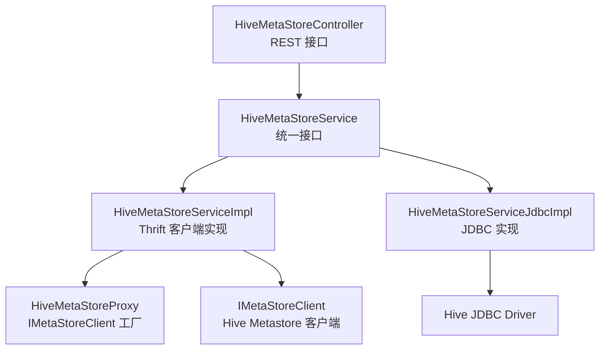
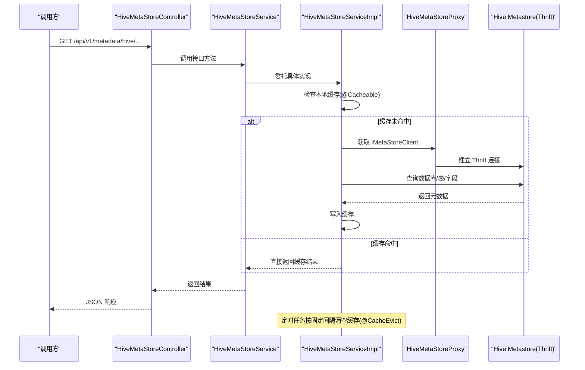
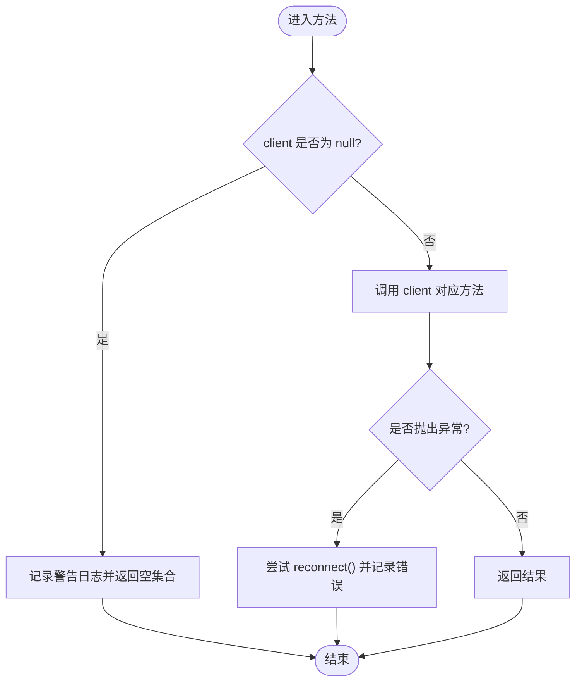
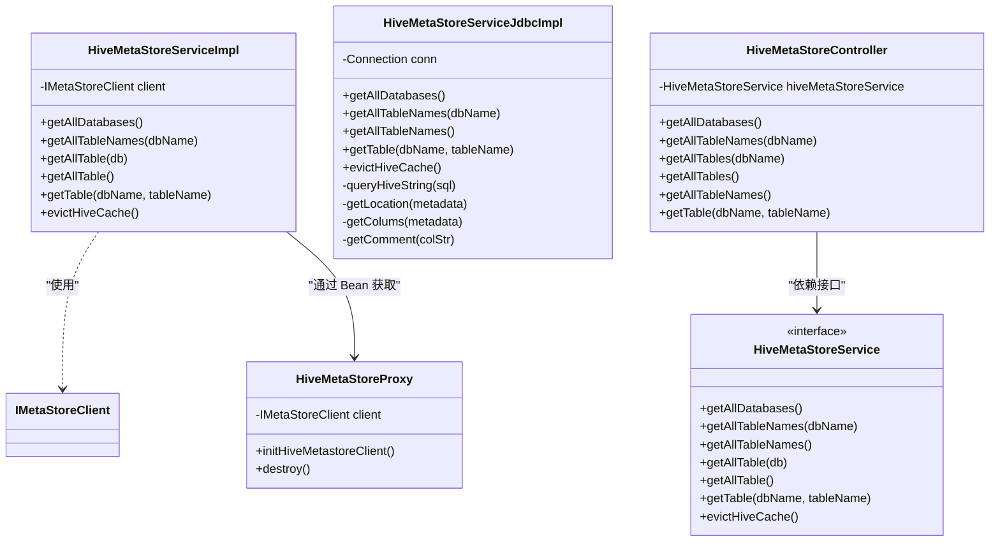

# Hive元数据集成

<cite>
**本文引用的文件**   
- [HiveMetaStoreService.java](file://ruoyi-modules/ruoyi-dqservice/src/main/java/com/ruoyi/dqservice/service/HiveMetaStoreService.java)
- [HiveMetaStoreServiceImpl.java](file://ruoyi-modules/ruoyi-dqservice/src/main/java/com/ruoyi/dqservice/service/impl/HiveMetaStoreServiceImpl.java)
- [HiveMetaStoreServiceJdbcImpl.java](file://ruoyi-modules/ruoyi-dqservice/src/main/java/com/ruoyi/dqservice/service/impl/HiveMetaStoreServiceJdbcImpl.java)
- [HiveMetaStoreProxy.java](file://ruoyi-modules/ruoyi-dqservice/src/main/java/com/ruoyi/dqservice/connecter/HiveMetaStoreProxy.java)
- [HiveMetaStoreController.java](file://ruoyi-modules/ruoyi-dqservice/src/main/java/com/ruoyi/dqservice/controller/HiveMetaStoreController.java)
- [application.properties](file://ruoyi-modules/ruoyi-dqservice/src/main/resources/application.properties)
</cite>

## 目录
1. [简介](#简介)
2. [项目结构](#项目结构)
3. [核心组件](#核心组件)
4. [架构总览](#架构总览)
5. [详细组件分析](#详细组件分析)
6. [依赖关系分析](#依赖关系分析)
7. [性能与缓存策略](#性能与缓存策略)
8. [连接配置说明](#连接配置说明)
9. [错误处理与故障排查](#错误处理与故障排查)
10. [使用示例与最佳实践](#使用示例与最佳实践)
11. [结论](#结论)

## 简介
本模块提供对 Hive Metastore 的元数据访问能力，支持两种接入方式：
- 基于 Thrift 的 IMetaStoreClient 直连（默认实现）
- 基于 JDBC 的 HiveServer2 查询（备用实现）

模块通过统一的接口暴露数据库列表、表名列表、表结构等元数据能力，并提供 Spring Cache 注解进行结果缓存与定时刷新。对外以 REST API 暴露查询能力，便于上层系统调用。

## 项目结构
该功能位于 ruoyi-dqservice 模块中，主要包含以下层次：
- 控制器层：REST 接口定义
- 服务接口层：统一抽象
- 服务实现层：Thrift 客户端实现与 JDBC 实现
- 连接代理层：IMetaStoreClient 生命周期管理
- 配置层：Hive 连接参数与缓存刷新周期

图表来源
- [HiveMetaStoreController.java:16-57](file://ruoyi-modules/ruoyi-dqservice/src/main/java/com/ruoyi/dqservice/controller/HiveMetaStoreController.java#L16-L57)
- [HiveMetaStoreService.java:8-23](file://ruoyi-modules/ruoyi-dqservice/src/main/java/com/ruoyi/dqservice/service/HiveMetaStoreService.java#L8-L23)
- [HiveMetaStoreServiceImpl.java:27-199](file://ruoyi-modules/ruoyi-dqservice/src/main/java/com/ruoyi/dqservice/service/impl/HiveMetaStoreServiceImpl.java#L27-L199)
- [HiveMetaStoreServiceJdbcImpl.java:35-327](file://ruoyi-modules/ruoyi-dqservice/src/main/java/com/ruoyi/dqservice/service/impl/HiveMetaStoreServiceJdbcImpl.java#L35-L327)
- [HiveMetaStoreProxy.java:14-63](file://ruoyi-modules/ruoyi-dqservice/src/main/java/com/ruoyi/dqservice/connecter/HiveMetaStoreProxy.java#L14-L63)

章节来源
- [HiveMetaStoreController.java:16-57](file://ruoyi-modules/ruoyi-dqservice/src/main/java/com/ruoyi/dqservice/controller/HiveMetaStoreController.java#L16-L57)
- [HiveMetaStoreService.java:8-23](file://ruoyi-modules/ruoyi-dqservice/src/main/java/com/ruoyi/dqservice/service/HiveMetaStoreService.java#L8-L23)
- [HiveMetaStoreServiceImpl.java:27-199](file://ruoyi-modules/ruoyi-dqservice/src/main/java/com/ruoyi/dqservice/service/impl/HiveMetaStoreServiceImpl.java#L27-L199)
- [HiveMetaStoreServiceJdbcImpl.java:35-327](file://ruoyi-modules/ruoyi-dqservice/src/main/java/com/ruoyi/dqservice/service/impl/HiveMetaStoreServiceJdbcImpl.java#L35-L327)
- [HiveMetaStoreProxy.java:14-63](file://ruoyi-modules/ruoyi-dqservice/src/main/java/com/ruoyi/dqservice/connecter/HiveMetaStoreProxy.java#L14-L63)

## 核心组件
- 接口定义：HiveMetaStoreService
  - 暴露数据库列表、表名列表、表对象获取、全量表聚合、缓存清理等方法
- Thrift 实现：HiveMetaStoreServiceImpl
  - 基于 IMetaStoreClient 访问 Hive Metastore
  - 使用 Spring Cache 注解缓存结果并定时刷新
- JDBC 实现：HiveMetaStoreServiceJdbcImpl
  - 通过 Hive JDBC 执行 SHOW DATABASES / SHOW TABLES / SHOW CREATE TABLE
  - 解析建表语句提取字段与位置信息
- 连接代理：HiveMetaStoreProxy
  - 负责创建和关闭 IMetaStoreClient，注入重试与 URI 等配置
- 控制器：HiveMetaStoreController
  - 对外暴露 REST 接口，默认注入 MySQL 元数据实现（见 @Qualifier("mysqlMetaStore")），但当前代码路径仍指向 Hive 相关接口

章节来源
- [HiveMetaStoreService.java:8-23](file://ruoyi-modules/ruoyi-dqservice/src/main/java/com/ruoyi/dqservice/service/HiveMetaStoreService.java#L8-L23)
- [HiveMetaStoreServiceImpl.java:27-199](file://ruoyi-modules/ruoyi-dqservice/src/main/java/com/ruoyi/dqservice/service/impl/HiveMetaStoreServiceImpl.java#L27-L199)
- [HiveMetaStoreServiceJdbcImpl.java:35-327](file://ruoyi-modules/ruoyi-dqservice/src/main/java/com/ruoyi/dqservice/service/impl/HiveMetaStoreServiceJdbcImpl.java#L35-L327)
- [HiveMetaStoreProxy.java:14-63](file://ruoyi-modules/ruoyi-dqservice/src/main/java/com/ruoyi/dqservice/connecter/HiveMetaStoreProxy.java#L14-L63)
- [HiveMetaStoreController.java:16-57](file://ruoyi-modules/ruoyi-dqservice/src/main/java/com/ruoyi/dqservice/controller/HiveMetaStoreController.java#L16-L57)

## 架构总览
下图展示了从 HTTP 请求到 Hive Metastore 的完整调用链，包括缓存与定时刷新机制。

图表来源
- [HiveMetaStoreController.java:16-57](file://ruoyi-modules/ruoyi-dqservice/src/main/java/com/ruoyi/dqservice/controller/HiveMetaStoreController.java#L16-L57)
- [HiveMetaStoreServiceImpl.java:49-159](file://ruoyi-modules/ruoyi-dqservice/src/main/java/com/ruoyi/dqservice/service/impl/HiveMetaStoreServiceImpl.java#L49-L159)
- [HiveMetaStoreProxy.java:39-55](file://ruoyi-modules/ruoyi-dqservice/src/main/java/com/ruoyi/dqservice/connecter/HiveMetaStoreProxy.java#L39-L55)

## 详细组件分析

### 接口：HiveMetaStoreService
- 职责
  - 定义统一的元数据访问契约，屏蔽底层 Thrift/JDBC 差异
- 关键方法
  - getAllDatabases：获取所有数据库名
  - getAllTableNames(dbName)：获取指定库下的所有表名
  - getAllTableNames()：获取所有库及其表名的映射
  - getAllTable(db)：获取指定库的所有 Table 对象
  - getAllTable()：获取所有库及其 Table 对象的映射
  - getTable(dbName, tableName)：获取单张表的 Table 对象
  - evictHiveCache：主动清理缓存（由定时任务触发）

章节来源
- [HiveMetaStoreService.java:8-23](file://ruoyi-modules/ruoyi-dqservice/src/main/java/com/ruoyi/dqservice/service/HiveMetaStoreService.java#L8-L23)

### 实现：HiveMetaStoreServiceImpl（Thrift）
- 设计要点
  - 通过 @Autowired(required = false) 注入 IMetaStoreClient，允许在 Hive 不可用时降级返回空结果
  - 使用 @CacheConfig + @Cacheable 对查询结果进行缓存，避免频繁远程调用
  - 使用 @Scheduled + @CacheEvict 定时清空缓存，保证元数据变更可被感知
  - 异常时尝试 reconnect 提升容错性
- 核心流程
  - 获取数据库列表：client.getAllDatabases()
  - 获取表名列表：client.getAllTables(useDbName)
  - 获取表对象：client.getTable(db, table)
  - 全量聚合：遍历数据库与表，组装 Map<String, List<Table>>
  - 默认库名：当传入 dbName 为空时使用配置项 hive.metastore.dbname
- 缓存策略
  - 缓存命名空间：hive
  - 条件缓存：unless="#result==null" 或 unless="#result==null || #result.isEmpty()"
  - 定时刷新：fixedRateString="${cache.evict.hive.fixedRate.in.milliseconds}"

图表来源
- [HiveMetaStoreServiceImpl.java:49-85](file://ruoyi-modules/ruoyi-dqservice/src/main/java/com/ruoyi/dqservice/service/impl/HiveMetaStoreServiceImpl.java#L49-L85)
- [HiveMetaStoreServiceImpl.java:128-145](file://ruoyi-modules/ruoyi-dqservice/src/main/java/com/ruoyi/dqservice/service/impl/HiveMetaStoreServiceImpl.java#L128-L145)
- [HiveMetaStoreServiceImpl.java:191-197](file://ruoyi-modules/ruoyi-dqservice/src/main/java/com/ruoyi/dqservice/service/impl/HiveMetaStoreServiceImpl.java#L191-L197)

章节来源
- [HiveMetaStoreServiceImpl.java:27-199](file://ruoyi-modules/ruoyi-dqservice/src/main/java/com/ruoyi/dqservice/service/impl/HiveMetaStoreServiceImpl.java#L27-L199)

### 实现：HiveMetaStoreServiceJdbcImpl（JDBC）
- 设计要点
  - 通过 Hive JDBC 驱动执行 SHOW DATABASES / SHOW TABLES / SHOW CREATE TABLE
  - 解析 SHOW CREATE TABLE 输出，提取 location 与字段列表（FieldSchema）
  - 支持 Kerberos 认证初始化（根据配置开关）
  - 使用独立的缓存命名空间 jdbcHive
- 关键方法
  - getAllDatabases：SHOW DATABASES
  - getAllTableNames(dbName)：SHOW TABLES IN dbName
  - getTable(dbName, tableName)：SHOW CREATE TABLE 后解析为 Table 对象（含 StorageDescriptor 与 FieldSchema）
  - getLocation / getColums / getComment：解析建表语句的工具方法
- 注意事项
  - getAllTable(db)/getAllTable() 返回 null（未实现）
  - 每次查询可能新建 Statement/ResultSet，并在 finally 中关闭连接

章节来源
- [HiveMetaStoreServiceJdbcImpl.java:35-327](file://ruoyi-modules/ruoyi-dqservice/src/main/java/com/ruoyi/dqservice/service/impl/HiveMetaStoreServiceJdbcImpl.java#L35-L327)

### 连接代理：HiveMetaStoreProxy
- 职责
  - 构造 HiveConf 并设置 Metastore URI、重试次数与间隔
  - 创建线程安全的 IMetaStoreClient（newSynchronizedClient）
  - 应用启动失败时记录错误但不影响其他功能
  - 容器销毁时关闭客户端连接
- 配置项
  - hive.metastore.uris
  - hive.hmshandler.retry.attempts
  - hive.hmshandler.retry.interval

章节来源
- [HiveMetaStoreProxy.java:14-63](file://ruoyi-modules/ruoyi-dqservice/src/main/java/com/ruoyi/dqservice/connecter/HiveMetaStoreProxy.java#L14-L63)

### 控制器：HiveMetaStoreController
- 对外接口
  - GET /api/v1/metadata/hive/dbs：获取数据库列表
  - GET /api/v1/metadata/hive/tables/names?db=xxx：获取某库的表名列表
  - GET /api/v1/metadata/hive/tables?db=xxx：获取某库的表对象列表
  - GET /api/v1/metadata/hive/dbs/tables：获取所有库及表对象映射
  - GET /api/v1/metadata/hive/dbs/tables/names：获取所有库及表名映射
  - GET /api/v1/metadata/hive/table?db=xxx&table=yyy：获取单张表对象
- 注入策略
  - 当前代码默认注入 @Qualifier("mysqlMetaStore")，若需使用 Hive 实现，应改为 "metastoreSvc" 或 "jdbcSvc"

章节来源
- [HiveMetaStoreController.java:16-57](file://ruoyi-modules/ruoyi-dqservice/src/main/java/com/ruoyi/dqservice/controller/HiveMetaStoreController.java#L16-L57)

## 依赖关系分析
- 组件耦合
  - Controller 仅依赖接口 HiveMetaStoreService，解耦具体实现
  - HiveMetaStoreServiceImpl 依赖 IMetaStoreClient（由 HiveMetaStoreProxy 提供）
  - HiveMetaStoreServiceJdbcImpl 依赖 JDBC 驱动与 Connection
- 外部依赖
  - Apache Hive Metastore Thrift 客户端
  - Apache Hive JDBC 驱动
  - Spring Cache 与调度框架
- 潜在循环依赖
  - 无直接循环依赖；Proxy 不反向依赖 Service

图表来源
- [HiveMetaStoreService.java:8-23](file://ruoyi-modules/ruoyi-dqservice/src/main/java/com/ruoyi/dqservice/service/HiveMetaStoreService.java#L8-L23)
- [HiveMetaStoreServiceImpl.java:27-199](file://ruoyi-modules/ruoyi-dqservice/src/main/java/com/ruoyi/dqservice/service/impl/HiveMetaStoreServiceImpl.java#L27-L199)
- [HiveMetaStoreServiceJdbcImpl.java:35-327](file://ruoyi-modules/ruoyi-dqservice/src/main/java/com/ruoyi/dqservice/service/impl/HiveMetaStoreServiceJdbcImpl.java#L35-L327)
- [HiveMetaStoreProxy.java:14-63](file://ruoyi-modules/ruoyi-dqservice/src/main/java/com/ruoyi/dqservice/connecter/HiveMetaStoreProxy.java#L14-L63)
- [HiveMetaStoreController.java:16-57](file://ruoyi-modules/ruoyi-dqservice/src/main/java/com/ruoyi/dqservice/controller/HiveMetaStoreController.java#L16-L57)

## 性能与缓存策略
- 缓存命名空间
  - Thrift 实现：hive
  - JDBC 实现：jdbcHive
- 缓存键生成
  - 使用自定义 keyGenerator（未在本文档展示），建议以方法签名与入参作为键
- 缓存失效
  - 定时任务按固定间隔清空全部缓存，时间由配置项控制
- 连接与重试
  - Thrift 客户端设置 METASTORETHRIFTCONNECTIONRETRIES 与 HMSHANDLERATTEMPTS/HMSHANDLERINTERVAL
  - 异常时尝试 reconnect，降低瞬时故障影响
- 全量聚合优化建议
  - getAllTable()/getAllTableNames() 会遍历所有库与表，建议在大数据量场景下分页或增量更新
  - 当前 getAllTable(db) 与 getAllTable() 之间未共享缓存，存在重复查询风险

章节来源
- [HiveMetaStoreServiceImpl.java:27-159](file://ruoyi-modules/ruoyi-dqservice/src/main/java/com/ruoyi/dqservice/service/impl/HiveMetaStoreServiceImpl.java#L27-L159)
- [HiveMetaStoreServiceJdbcImpl.java:175-183](file://ruoyi-modules/ruoyi-dqservice/src/main/java/com/ruoyi/dqservice/service/impl/HiveMetaStoreServiceJdbcImpl.java#L175-L183)
- [HiveMetaStoreProxy.java:40-55](file://ruoyi-modules/ruoyi-dqservice/src/main/java/com/ruoyi/dqservice/connecter/HiveMetaStoreProxy.java#L40-L55)

## 连接配置说明
- Thrift 模式（推荐）
  - hive.metastore.uris：Metastore Thrift 地址
  - hive.metastore.dbname：默认数据库名
  - hive.hmshandler.retry.attempts：HMSHandler 重试次数
  - hive.hmshandler.retry.interval：HMSHandler 重试间隔
- JDBC 模式（备选）
  - hive.jdbc.className：JDBC 驱动类名
  - hive.jdbc.url：JDBC URL
  - hive.need.kerberos：是否启用 Kerberos 认证
  - hive.keytab.user / hive.keytab.path：Kerberos keytab 用户与路径
- 缓存刷新周期
  - cache.evict.hive.fixedRate.in.milliseconds：定时清理缓存的间隔毫秒数

章节来源
- [application.properties:1-13](file://ruoyi-modules/ruoyi-dqservice/src/main/resources/application.properties#L1-L13)
- [HiveMetaStoreProxy.java:19-48](file://ruoyi-modules/ruoyi-dqservice/src/main/java/com/ruoyi/dqservice/connecter/HiveMetaStoreProxy.java#L19-L48)
- [HiveMetaStoreServiceJdbcImpl.java:49-62](file://ruoyi-modules/ruoyi-dqservice/src/main/java/com/ruoyi/dqservice/service/impl/HiveMetaStoreServiceJdbcImpl.java#L49-L62)

## 错误处理与故障排查
- 客户端为空
  - 现象：日志告警“Hive client is null”，返回空集合或空对象
  - 原因：Hive 环境不可用或配置错误导致 IMetaStoreClient 注入失败
  - 处理：检查 hive.metastore.uris 与网络连通性，确认 Hive 服务可用
- 连接异常
  - 现象：捕获异常后尝试 reconnect，并记录错误日志
  - 处理：检查 Metastore 服务状态、防火墙与端口可达性
- JDBC 认证失败
  - 现象：Kerberos 登录失败或 JDBC 连接失败
  - 处理：核对 hive.need.kerberos、keytab 路径与权限，确保 Hadoop/Kerberos 环境正确
- 缓存未刷新
  - 现象：元数据变更后未及时反映
  - 处理：调整 cache.evict.hive.fixedRate.in.milliseconds，或手动触发 evictHiveCache（若暴露）

章节来源
- [HiveMetaStoreServiceImpl.java:54-64](file://ruoyi-modules/ruoyi-dqservice/src/main/java/com/ruoyi/dqservice/service/impl/HiveMetaStoreServiceImpl.java#L54-L64)
- [HiveMetaStoreServiceImpl.java:191-197](file://ruoyi-modules/ruoyi-dqservice/src/main/java/com/ruoyi/dqservice/service/impl/HiveMetaStoreServiceImpl.java#L191-L197)
- [HiveMetaStoreServiceJdbcImpl.java:86-100](file://ruoyi-modules/ruoyi-dqservice/src/main/java/com/ruoyi/dqservice/service/impl/HiveMetaStoreServiceJdbcImpl.java#L86-L100)
- [HiveMetaStoreProxy.java:50-53](file://ruoyi-modules/ruoyi-dqservice/src/main/java/com/ruoyi/dqservice/connecter/HiveMetaStoreProxy.java#L50-L53)

## 使用示例与最佳实践

### 获取数据库列表
- 接口
  - GET /api/v1/metadata/hive/dbs
- 行为
  - 返回 Iterable<String> 数据库名列表
  - 若 client 为空，返回空集合并记录警告日志

章节来源
- [HiveMetaStoreController.java:24-27](file://ruoyi-modules/ruoyi-dqservice/src/main/java/com/ruoyi/dqservice/controller/HiveMetaStoreController.java#L24-L27)
- [HiveMetaStoreServiceImpl.java:49-65](file://ruoyi-modules/ruoyi-dqservice/src/main/java/com/ruoyi/dqservice/service/impl/HiveMetaStoreServiceImpl.java#L49-L65)

### 获取表名列表
- 接口
  - GET /api/v1/metadata/hive/tables/names?db=xxx
- 行为
  - 返回 Iterable<String> 表名列表
  - 若未传 db，则使用默认库名

章节来源
- [HiveMetaStoreController.java:30-33](file://ruoyi-modules/ruoyi-dqservice/src/main/java/com/ruoyi/dqservice/controller/HiveMetaStoreController.java#L30-L33)
- [HiveMetaStoreServiceImpl.java:68-85](file://ruoyi-modules/ruoyi-dqservice/src/main/java/com/ruoyi/dqservice/service/impl/HiveMetaStoreServiceImpl.java#L68-L85)

### 获取表结构与字段信息
- 接口
  - GET /api/v1/metadata/hive/table?db=xxx&table=yyy
- 行为（Thrift 实现）
  - 返回 org.apache.hadoop.hive.metastore.api.Table 对象，包含字段、分区、存储描述等
- 行为（JDBC 实现）
  - 通过 SHOW CREATE TABLE 解析出 Location 与 FieldSchema 列表，填充到 Table 的 StorageDescriptor

章节来源
- [HiveMetaStoreController.java:50-54](file://ruoyi-modules/ruoyi-dqservice/src/main/java/com/ruoyi/dqservice/controller/HiveMetaStoreController.java#L50-L54)
- [HiveMetaStoreServiceImpl.java:128-145](file://ruoyi-modules/ruoyi-dqservice/src/main/java/com/ruoyi/dqservice/service/impl/HiveMetaStoreServiceImpl.java#L128-L145)
- [HiveMetaStoreServiceJdbcImpl.java:137-173](file://ruoyi-modules/ruoyi-dqservice/src/main/java/com/ruoyi/dqservice/service/impl/HiveMetaStoreServiceJdbcImpl.java#L137-L173)

### 获取分区信息
- 说明
  - 当前接口未直接暴露分区列表；可通过 Table.getPartitionKeys() 或相关 API 获取分区键信息
  - 如需分区值列表，可在上层扩展接口调用 Metastore 的分区查询 API

章节来源
- [HiveMetaStoreService.java:16-20](file://ruoyi-modules/ruoyi-dqservice/src/main/java/com/ruoyi/dqservice/service/HiveMetaStoreService.java#L16-L20)

### 最佳实践
- 优先使用 Thrift 模式，以获得更完整的元数据结构与更好的性能
- 合理设置缓存刷新周期，平衡实时性与性能
- 在大库多表场景下，避免频繁调用 getAllTable()/getAllTableNames()，建议按需查询
- 生产环境开启监控与告警，关注 Metastore 连接与重试指标

[本节为通用指导，不直接分析具体文件]

## 结论
本模块通过统一接口封装了 Hive Metastore 的元数据访问能力，提供了 Thrift 与 JDBC 两种实现，并结合 Spring Cache 实现了结果缓存与定时刷新。Thrift 实现具备更强的完整性与性能，适合生产环境；JDBC 实现可作为轻量替代方案。通过合理的配置与缓存策略，可有效降低 Metastore 压力并提升查询效率。