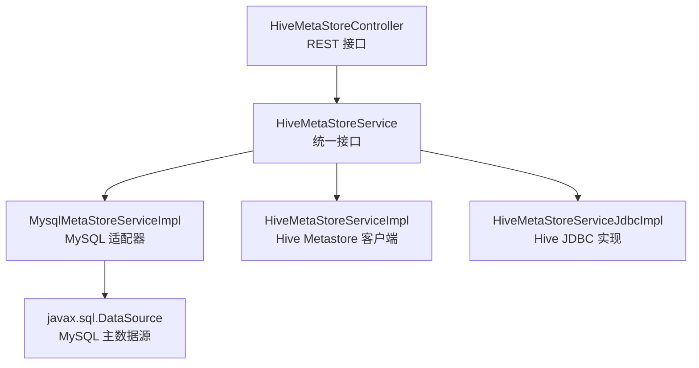
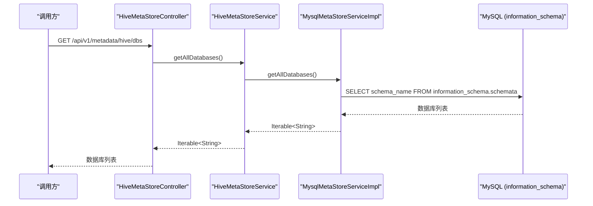
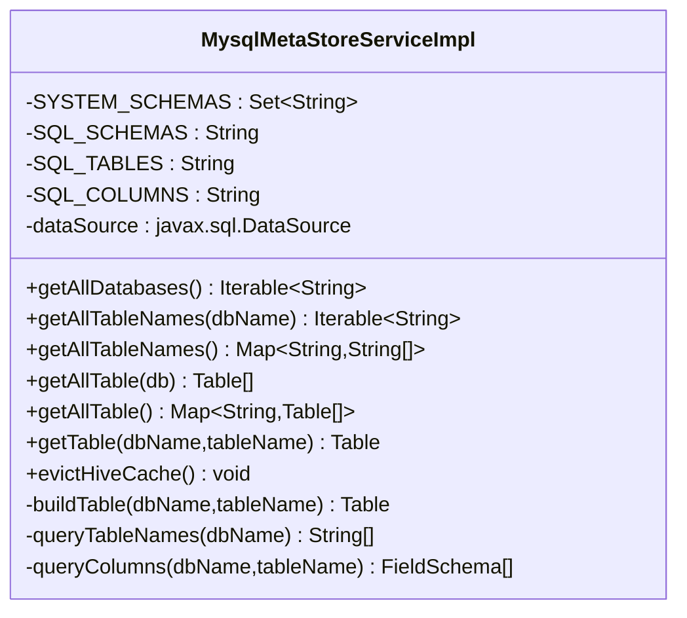
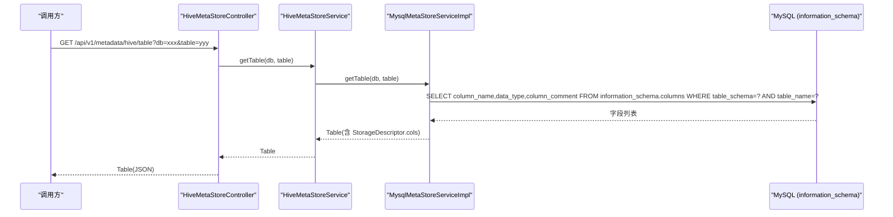
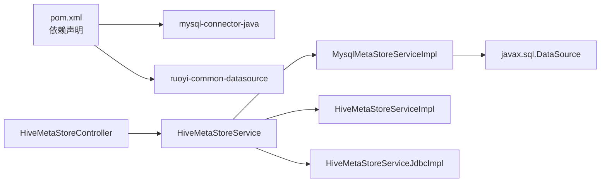

# MySQL元数据适配器

<cite>
**本文引用的文件**   
- [MysqlMetaStoreServiceImpl.java](file://ruoyi-modules/ruoyi-dqservice/src/main/java/com/ruoyi/dqservice/service/impl/MysqlMetaStoreServiceImpl.java)
- [HiveMetaStoreService.java](file://ruoyi-modules/ruoyi-dqservice/src/main/java/com/ruoyi/dqservice/service/HiveMetaStoreService.java)
- [HiveMetaStoreController.java](file://ruoyi-modules/ruoyi-dqservice/src/main/java/com/ruoyi/dqservice/controller/HiveMetaStoreController.java)
- [HiveMetaStoreServiceImpl.java](file://ruoyi-modules/ruoyi-dqservice/src/main/java/com/ruoyi/dqservice/service/impl/HiveMetaStoreServiceImpl.java)
- [HiveMetaStoreServiceJdbcImpl.java](file://ruoyi-modules/ruoyi-dqservice/src/main/java/com/ruoyi/dqservice/service/impl/HiveMetaStoreServiceJdbcImpl.java)
- [pom.xml](file://ruoyi-modules/ruoyi-dqservice/pom.xml)
</cite>

## 目录
1. [简介](#简介)
2. [项目结构](#项目结构)
3. [核心组件](#核心组件)
4. [架构总览](#架构总览)
5. [详细组件分析](#详细组件分析)
6. [依赖关系分析](#依赖关系分析)
7. [性能与优化](#性能与优化)
8. [故障排查](#故障排查)
9. [结论](#结论)
10. [附录：使用示例与配置要点](#附录使用示例与配置要点)

## 简介
本技术文档聚焦于 MySQL 元数据适配器的设计与实现，重点说明以下方面：
- 基于 MySQL information_schema 的元数据获取机制，包括数据库、表、字段信息的查询策略。
- MysqlMetaStoreServiceImpl 的实现细节：连接管理、SQL 构建、结果集映射到 Hive 元数据模型。
- 统一抽象设计：通过 HiveMetaStoreService 接口将不同数据源（Hive Metastore、MySQL）统一暴露给上层调用方。
- 连接配置、查询性能优化建议与异常处理方案。
- 如何获取 MySQL 表的完整元数据信息的使用路径与流程说明。

## 项目结构
MySQL 元数据适配器位于 ruoyi-modules/ruoyi-dqservice 模块中，关键代码组织如下：
- 服务接口层：HiveMetaStoreService 定义统一的元数据访问能力。
- 服务实现层：
  - MysqlMetaStoreServiceImpl：基于 MySQL information_schema 的适配器。
  - HiveMetaStoreServiceImpl：基于 Hive Metastore 客户端的实现。
  - HiveMetaStoreServiceJdbcImpl：基于 JDBC 访问 Hive 的补充实现。
- 控制器层：HiveMetaStoreController 对外暴露 REST API，统一路由到具体实现。
- 依赖声明：pom.xml 引入 MySQL Connector 等依赖。

图表来源
- [HiveMetaStoreController.java:16-57](file://ruoyi-modules/ruoyi-dqservice/src/main/java/com/ruoyi/dqservice/controller/HiveMetaStoreController.java#L16-L57)
- [HiveMetaStoreService.java:8-23](file://ruoyi-modules/ruoyi-dqservice/src/main/java/com/ruoyi/dqservice/service/HiveMetaStoreService.java#L8-L23)
- [MysqlMetaStoreServiceImpl.java:35-56](file://ruoyi-modules/ruoyi-dqservice/src/main/java/com/ruoyi/dqservice/service/impl/MysqlMetaStoreServiceImpl.java#L35-L56)

章节来源
- [HiveMetaStoreController.java:16-57](file://ruoyi-modules/ruoyi-dqservice/src/main/java/com/ruoyi/dqservice/controller/HiveMetaStoreController.java#L16-L57)
- [HiveMetaStoreService.java:8-23](file://ruoyi-modules/ruoyi-dqservice/src/main/java/com/ruoyi/dqservice/service/HiveMetaStoreService.java#L8-L23)
- [MysqlMetaStoreServiceImpl.java:23-56](file://ruoyi-modules/ruoyi-dqservice/src/main/java/com/ruoyi/dqservice/service/impl/MysqlMetaStoreServiceImpl.java#L23-L56)

## 核心组件
- HiveMetaStoreService：统一元数据访问接口，定义数据库列表、表名列表、表对象、缓存清理等方法。
- MysqlMetaStoreServiceImpl：MySQL 元数据适配器，直接读取 MySQL 的 information_schema 系统表，返回与 Hive 一致的 Table/StorageDescriptor/FieldSchema 结构。
- HiveMetaStoreServiceImpl：基于 IMetaStoreClient 的 Hive Metastore 客户端实现，具备缓存与重连逻辑。
- HiveMetaStoreServiceJdbcImpl：基于 JDBC 的 Hive 元数据实现，解析 SHOW CREATE TABLE 输出以构造 FieldSchema。
- HiveMetaStoreController：REST 控制器，统一对外暴露 /api/v1/metadata/hive/* 接口，默认注入 mysqlMetaStore 实现。

章节来源
- [HiveMetaStoreService.java:8-23](file://ruoyi-modules/ruoyi-dqservice/src/main/java/com/ruoyi/dqservice/service/HiveMetaStoreService.java#L8-L23)
- [MysqlMetaStoreServiceImpl.java:35-56](file://ruoyi-modules/ruoyi-dqservice/src/main/java/com/ruoyi/dqservice/service/impl/MysqlMetaStoreServiceImpl.java#L35-L56)
- [HiveMetaStoreServiceImpl.java:27-47](file://ruoyi-modules/ruoyi-dqservice/src/main/java/com/ruoyi/dqservice/service/impl/HiveMetaStoreServiceImpl.java#L27-L47)
- [HiveMetaStoreServiceJdbcImpl.java:35-68](file://ruoyi-modules/ruoyi-dqservice/src/main/java/com/ruoyi/dqservice/service/impl/HiveMetaStoreServiceJdbcImpl.java#L35-L68)
- [HiveMetaStoreController.java:16-22](file://ruoyi-modules/ruoyi-dqservice/src/main/java/com/ruoyi/dqservice/controller/HiveMetaStoreController.java#L16-L22)

## 架构总览
整体架构采用“接口 + 多实现”的设计模式，上层控制器不关心底层数据源差异，仅通过统一接口进行调用。MySQL 适配器通过 Spring 注入 javax.sql.DataSource，直接访问 MySQL 的 information_schema；Hive 相关实现则分别通过 Metastore 客户端或 JDBC 访问 Hive。

图表来源
- [HiveMetaStoreController.java:24-27](file://ruoyi-modules/ruoyi-dqservice/src/main/java/com/ruoyi/dqservice/controller/HiveMetaStoreController.java#L24-L27)
- [HiveMetaStoreService.java:10-10](file://ruoyi-modules/ruoyi-dqservice/src/main/java/com/ruoyi/dqservice/service/HiveMetaStoreService.java#L10-L10)
- [MysqlMetaStoreServiceImpl.java:58-80](file://ruoyi-modules/ruoyi-dqservice/src/main/java/com/ruoyi/dqservice/service/impl/MysqlMetaStoreServiceImpl.java#L58-L80)

## 详细组件分析

### MysqlMetaStoreServiceImpl 实现细节
该实现的核心职责是：
- 从 MySQL 的 information_schema.schemata 获取数据库列表，并过滤系统库（如 information_schema、mysql、performance_schema、sys）。
- 从 information_schema.tables 获取指定数据库下的所有 BASE TABLE 表名。
- 从 information_schema.columns 获取指定表的字段名、数据类型和注释，按 ordinal_position 排序。
- 将结果映射为 Hive 元数据模型中的 Table、StorageDescriptor、FieldSchema，确保与 Hive 实现一致。

关键 SQL 与行为：
- SQL_SCHEMAS：查询所有 schema_name，用于列出数据库。
- SQL_TABLES：按 table_schema 过滤且只取 BASE TABLE，避免视图等干扰。
- SQL_COLUMNS：按 table_schema 和 table_name 过滤，按 ordinal_position 排序，保证字段顺序。

连接管理与资源释放：
- 使用 try-with-resources 自动关闭 Connection、PreparedStatement、ResultSet，降低资源泄漏风险。
- 捕获 SQLException 并记录日志，避免异常向上抛出导致调用方崩溃。

结果映射：
- buildTable：创建轻量级 Table 对象，仅包含 dbName 与 tableName，适合树节点展示。
- queryColumns：逐行读取 column_name、data_type、column_comment，构造 FieldSchema 列表。
- getTable：组装 Table 与 StorageDescriptor，设置列集合。

图表来源
- [MysqlMetaStoreServiceImpl.java:39-56](file://ruoyi-modules/ruoyi-dqservice/src/main/java/com/ruoyi/dqservice/service/impl/MysqlMetaStoreServiceImpl.java#L39-L56)
- [MysqlMetaStoreServiceImpl.java:58-135](file://ruoyi-modules/ruoyi-dqservice/src/main/java/com/ruoyi/dqservice/service/impl/MysqlMetaStoreServiceImpl.java#L58-L135)
- [MysqlMetaStoreServiceImpl.java:137-189](file://ruoyi-modules/ruoyi-dqservice/src/main/java/com/ruoyi/dqservice/service/impl/MysqlMetaStoreServiceImpl.java#L137-L189)

章节来源
- [MysqlMetaStoreServiceImpl.java:39-56](file://ruoyi-modules/ruoyi-dqservice/src/main/java/com/ruoyi/dqservice/service/impl/MysqlMetaStoreServiceImpl.java#L39-L56)
- [MysqlMetaStoreServiceImpl.java:58-135](file://ruoyi-modules/ruoyi-dqservice/src/main/java/com/ruoyi/dqservice/service/impl/MysqlMetaStoreServiceImpl.java#L58-L135)
- [MysqlMetaStoreServiceImpl.java:137-189](file://ruoyi-modules/ruoyi-dqservice/src/main/java/com/ruoyi/dqservice/service/impl/MysqlMetaStoreServiceImpl.java#L137-L189)

### HiveMetaStoreService 统一抽象
该接口定义了统一的元数据访问方法，屏蔽底层实现差异：
- getAllDatabases：获取数据库列表。
- getAllTableNames/dbName：获取指定数据库的表名列表。
- getAllTableNames：获取所有数据库及其表名的映射。
- getAllTable/db：获取指定数据库的所有表对象。
- getAllTable：获取所有数据库及其表对象的映射。
- getTable/dbName/tableName：获取单个表的完整元数据（含列信息）。
- evictHiveCache：清理缓存（MySQL 实现为空操作）。

这种设计使得上层控制器无需关心具体数据源类型，便于扩展新的元数据适配器。

章节来源
- [HiveMetaStoreService.java:8-23](file://ruoyi-modules/ruoyi-dqservice/src/main/java/com/ruoyi/dqservice/service/HiveMetaStoreService.java#L8-L23)

### Hive 相关实现对比
- HiveMetaStoreServiceImpl：
  - 通过 IMetaStoreClient 访问 Hive Metastore。
  - 使用 @Cacheable/@CacheEvict 对结果进行缓存，支持定时刷新。
  - 在 client 为 null 时给出警告日志，并在异常时尝试 reconnect。
- HiveMetaStoreServiceJdbcImpl：
  - 通过 JDBC 执行 show databases/show tables in .../show create table ...。
  - 解析 SHOW CREATE TABLE 的输出字符串，提取 location 与列信息。
  - 提供 Kerberos 认证初始化逻辑。

章节来源
- [HiveMetaStoreServiceImpl.java:27-47](file://ruoyi-modules/ruoyi-dqservice/src/main/java/com/ruoyi/dqservice/service/impl/HiveMetaStoreServiceImpl.java#L27-L47)
- [HiveMetaStoreServiceImpl.java:49-125](file://ruoyi-modules/ruoyi-dqservice/src/main/java/com/ruoyi/dqservice/service/impl/HiveMetaStoreServiceImpl.java#L49-L125)
- [HiveMetaStoreServiceJdbcImpl.java:35-68](file://ruoyi-modules/ruoyi-dqservice/src/main/java/com/ruoyi/dqservice/service/impl/HiveMetaStoreServiceJdbcImpl.java#L35-L68)
- [HiveMetaStoreServiceJdbcImpl.java:131-173](file://ruoyi-modules/ruoyi-dqservice/src/main/java/com/ruoyi/dqservice/service/impl/HiveMetaStoreServiceJdbcImpl.java#L131-L173)

### REST 控制器与调用流程
HiveMetaStoreController 对外暴露以下接口：
- GET /api/v1/metadata/hive/dbs：获取数据库列表。
- GET /api/v1/metadata/hive/tables/names?db=...：获取指定数据库的表名列表。
- GET /api/v1/metadata/hive/tables?db=...：获取指定数据库的表对象列表。
- GET /api/v1/metadata/hive/dbs/tables：获取所有数据库及其表对象映射。
- GET /api/v1/metadata/hive/dbs/tables/names：获取所有数据库及其表名映射。
- GET /api/v1/metadata/hive/table?db=...&table=...：获取单个表的完整元数据。

默认注入 mysqlMetaStore 实现，因此这些接口在本地演示环境中直接走 MySQL 适配器。

图表来源
- [HiveMetaStoreController.java:50-54](file://ruoyi-modules/ruoyi-dqservice/src/main/java/com/ruoyi/dqservice/controller/HiveMetaStoreController.java#L50-L54)
- [MysqlMetaStoreServiceImpl.java:121-129](file://ruoyi-modules/ruoyi-dqservice/src/main/java/com/ruoyi/dqservice/service/impl/MysqlMetaStoreServiceImpl.java#L121-L129)
- [MysqlMetaStoreServiceImpl.java:168-189](file://ruoyi-modules/ruoyi-dqservice/src/main/java/com/ruoyi/dqservice/service/impl/MysqlMetaStoreServiceImpl.java#L168-L189)

章节来源
- [HiveMetaStoreController.java:16-57](file://ruoyi-modules/ruoyi-dqservice/src/main/java/com/ruoyi/dqservice/controller/HiveMetaStoreController.java#L16-L57)
- [MysqlMetaStoreServiceImpl.java:121-129](file://ruoyi-modules/ruoyi-dqservice/src/main/java/com/ruoyi/dqservice/service/impl/MysqlMetaStoreServiceImpl.java#L121-L129)

## 依赖关系分析
- MysqlMetaStoreServiceImpl 依赖 javax.sql.DataSource，由 Spring 容器注入。
- HiveMetaStoreServiceImpl 依赖 IMetaStoreClient，由外部 Hive Metastore 配置决定。
- HiveMetaStoreServiceJdbcImpl 依赖 JDBC 驱动与连接参数，支持 Kerberos 认证。
- pom.xml 引入 mysql-connector-java 与 RuoYi Common DataSource 等依赖。

图表来源
- [pom.xml:49-59](file://ruoyi-modules/ruoyi-dqservice/pom.xml#L49-L59)
- [HiveMetaStoreController.java:16-22](file://ruoyi-modules/ruoyi-dqservice/src/main/java/com/ruoyi/dqservice/controller/HiveMetaStoreController.java#L16-L22)
- [MysqlMetaStoreServiceImpl.java:54-56](file://ruoyi-modules/ruoyi-dqservice/src/main/java/com/ruoyi/dqservice/service/impl/MysqlMetaStoreServiceImpl.java#L54-L56)

章节来源
- [pom.xml:49-59](file://ruoyi-modules/ruoyi-dqservice/pom.xml#L49-L59)
- [HiveMetaStoreController.java:16-22](file://ruoyi-modules/ruoyi-dqservice/src/main/java/com/ruoyi/dqservice/controller/HiveMetaStoreController.java#L16-L22)
- [MysqlMetaStoreServiceImpl.java:54-56](file://ruoyi-modules/ruoyi-dqservice/src/main/java/com/ruoyi/dqservice/service/impl/MysqlMetaStoreServiceImpl.java#L54-L56)

## 性能与优化
- 使用 PreparedStatement 防止 SQL 注入并提升重复执行效率。
- 过滤 system schemas，减少无关数据库带来的开销。
- 仅查询必要字段（column_name、data_type、column_comment），避免冗余数据传输。
- 使用 LinkedHashMap 保持插入顺序，便于前端稳定渲染。
- 对于 Hive 实现，使用 @Cacheable 缓存结果，降低频繁访问 Metastore 的压力；MySQL 实现无缓存，实时查询以保证一致性。
- 建议在大数据量场景下，按需分页或增量加载元数据，避免一次性拉取全部库表。

[本节为通用性能建议，不直接分析具体文件]

## 故障排查
常见问题与处理：
- 无法连接 MySQL：检查 DataSource 配置是否正确，确认网络连通性与账号权限。
- 查询数据库列表失败：查看日志中“查询 MySQL 库列表失败”，确认是否有权限访问 information_schema.schemata。
- 查询表列表失败：查看日志中“查询表列表失败”，确认传入的 dbName 是否存在且有访问权限。
- 查询字段信息失败：查看日志中“查询字段信息失败”，确认 dbName.tableName 存在且有访问权限。
- Hive Metastore 客户端为空：HiveMetaStoreServiceImpl 会打印警告日志，需检查 hive.metastore.uris 等配置。
- Hive JDBC 连接异常：检查 hive.jdbc.className/url 配置，必要时启用 Kerberos 认证。

章节来源
- [MysqlMetaStoreServiceImpl.java:75-79](file://ruoyi-modules/ruoyi-dqservice/src/main/java/com/ruoyi/dqservice/service/impl/MysqlMetaStoreServiceImpl.java#L75-L79)
- [MysqlMetaStoreServiceImpl.java:161-165](file://ruoyi-modules/ruoyi-dqservice/src/main/java/com/ruoyi/dqservice/service/impl/MysqlMetaStoreServiceImpl.java#L161-L165)
- [MysqlMetaStoreServiceImpl.java:184-188](file://ruoyi-modules/ruoyi-dqservice/src/main/java/com/ruoyi/dqservice/service/impl/MysqlMetaStoreServiceImpl.java#L184-L188)
- [HiveMetaStoreServiceImpl.java:54-63](file://ruoyi-modules/ruoyi-dqservice/src/main/java/com/ruoyi/dqservice/service/impl/HiveMetaStoreServiceImpl.java#L54-L63)
- [HiveMetaStoreServiceJdbcImpl.java:148-171](file://ruoyi-modules/ruoyi-dqservice/src/main/java/com/ruoyi/dqservice/service/impl/HiveMetaStoreServiceJdbcImpl.java#L148-L171)

## 结论
MySQL 元数据适配器通过统一的 HiveMetaStoreService 接口，将 MySQL 的 information_schema 元数据转换为与 Hive 一致的 Table/StorageDescriptor/FieldSchema 结构，从而让上层控制器与前端无需改动即可复用同一套元数据浏览能力。该实现简洁可靠，适合本地演示与快速集成；在生产环境可根据需要扩展更多数据源适配器，并保持接口一致性。

[本节为总结性内容，不直接分析具体文件]

## 附录：使用示例与配置要点

### 获取 MySQL 表的完整元数据信息
- 调用 REST 接口：GET /api/v1/metadata/hive/table?db=<数据库名>&table=<表名>
- 返回的 Table 对象包含：
  - dbName：数据库名
  - tableName：表名
  - sd.cols：字段列表（FieldSchema），包含字段名、数据类型、注释

调用流程参考前述序列图。

章节来源
- [HiveMetaStoreController.java:50-54](file://ruoyi-modules/ruoyi-dqservice/src/main/java/com/ruoyi/dqservice/controller/HiveMetaStoreController.java#L50-L54)
- [MysqlMetaStoreServiceImpl.java:121-129](file://ruoyi-modules/ruoyi-dqservice/src/main/java/com/ruoyi/dqservice/service/impl/MysqlMetaStoreServiceImpl.java#L121-L129)
- [MysqlMetaStoreServiceImpl.java:168-189](file://ruoyi-modules/ruoyi-dqservice/src/main/java/com/ruoyi/dqservice/service/impl/MysqlMetaStoreServiceImpl.java#L168-L189)

### 连接配置要点
- MySQL 连接器依赖：pom.xml 中已引入 mysql-connector-java。
- DataSource 注入：MysqlMetaStoreServiceImpl 通过 @Autowired 注入 javax.sql.DataSource，由 Spring 容器管理连接池与连接生命周期。
- Hive 相关配置（如需切换至 Hive 实现）：
  - hive.metastore.uris、hive.metastore.dbname 等属性用于 HiveMetaStoreServiceImpl。
  - hive.jdbc.className、hive.jdbc.url 等属性用于 HiveMetaStoreServiceJdbcImpl。
  - Kerberos 认证可通过 needKerberos、keytabUser、keytabPath 配置。

章节来源
- [pom.xml:49-59](file://ruoyi-modules/ruoyi-dqservice/pom.xml#L49-L59)
- [MysqlMetaStoreServiceImpl.java:54-56](file://ruoyi-modules/ruoyi-dqservice/src/main/java/com/ruoyi/dqservice/service/impl/MysqlMetaStoreServiceImpl.java#L54-L56)
- [HiveMetaStoreServiceImpl.java:38-39](file://ruoyi-modules/ruoyi-dqservice/src/main/java/com/ruoyi/dqservice/service/impl/HiveMetaStoreServiceImpl.java#L38-L39)
- [HiveMetaStoreServiceJdbcImpl.java:49-62](file://ruoyi-modules/ruoyi-dqservice/src/main/java/com/ruoyi/dqservice/service/impl/HiveMetaStoreServiceJdbcImpl.java#L49-L62)