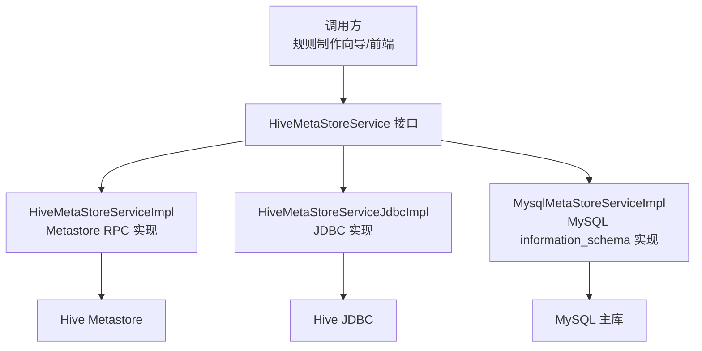
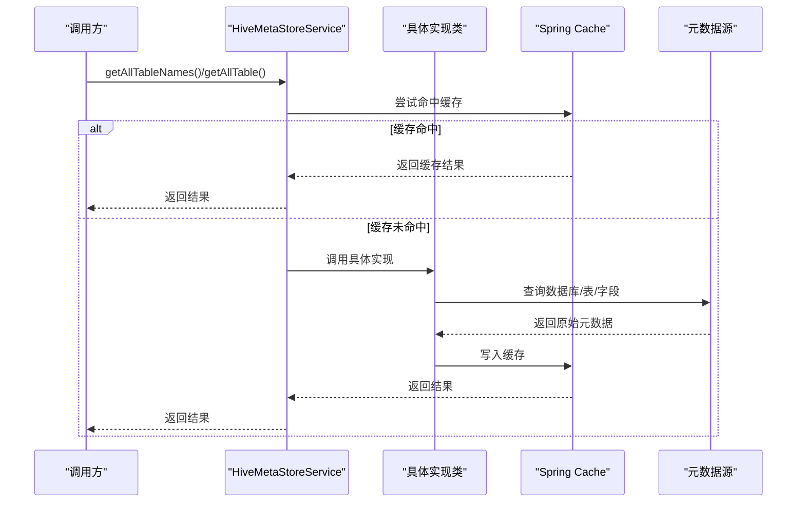
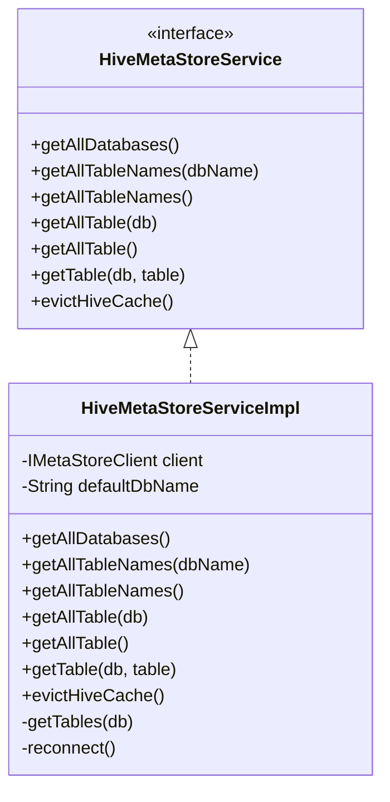
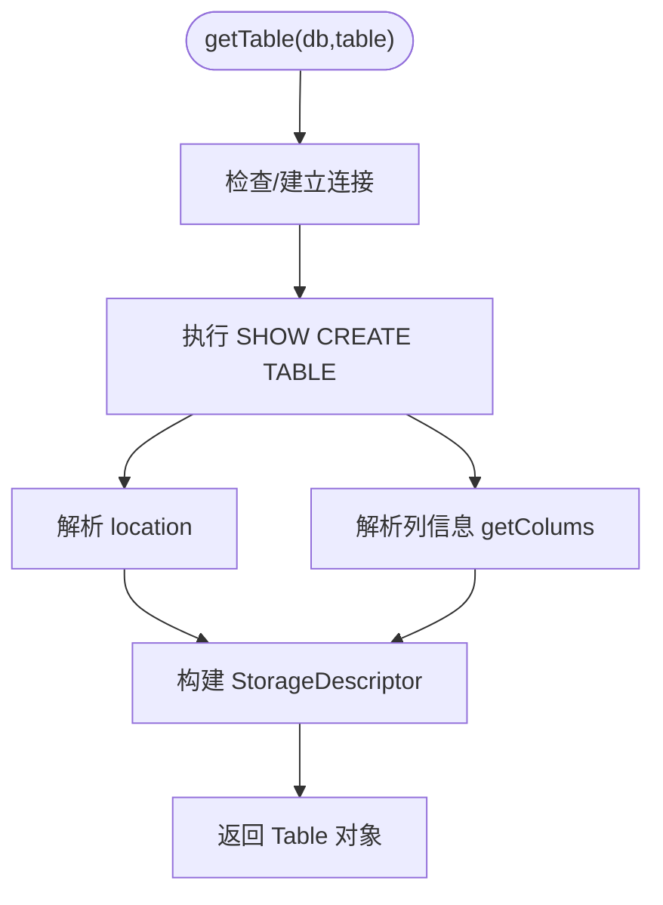
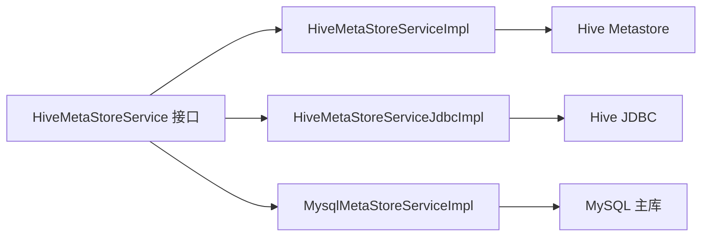
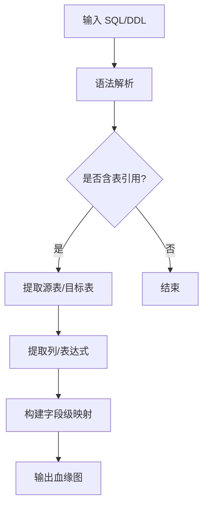

# 元数据同步机制

<cite>
**本文引用的文件**   
- [HiveMetaStoreService.java](file://ruoyi-modules/ruoyi-dqservice/src/main/java/com/ruoyi/dqservice/service/HiveMetaStoreService.java)
- [HiveMetaStoreServiceImpl.java](file://ruoyi-modules/ruoyi-dqservice/src/main/java/com/ruoyi/dqservice/service/impl/HiveMetaStoreServiceImpl.java)
- [HiveMetaStoreServiceJdbcImpl.java](file://ruoyi-modules/ruoyi-dqservice/src/main/java/com/ruoyi/dqservice/service/impl/HiveMetaStoreServiceJdbcImpl.java)
- [MysqlMetaStoreServiceImpl.java](file://ruoyi-modules/ruoyi-dqservice/src/main/java/com/ruoyi/dqservice/service/impl/MysqlMetaStoreServiceImpl.java)
</cite>

## 目录
1. [引言](#引言)
2. [项目结构](#项目结构)
3. [核心组件](#核心组件)
4. [架构总览](#架构总览)
5. [详细组件分析](#详细组件分析)
6. [依赖关系分析](#依赖关系分析)
7. [性能与一致性](#性能与一致性)
8. [调度、监控与故障恢复](#调度监控与故障恢复)
9. [血缘追踪与字段级映射](#血缘追踪与字段级映射)
10. [排错指南](#排错指南)
11. [结论](#结论)

## 引言
本技术文档围绕“元数据同步机制”展开，聚焦以下目标：
- 元数据缓存策略：本地缓存、分布式缓存（通过 Spring Cache）与缓存失效机制。
- 增量与全量同步：变更检测思路与一致性保障。
- 血缘追踪：表依赖分析与字段级血缘映射。
- 任务调度配置、性能监控指标与故障恢复策略。
- 提供可落地的实现路径与代码片段位置指引。

## 项目结构
本项目采用多模块微服务架构，元数据同步相关能力集中在 dqservice 模块的 service 层，提供统一的 Hive 元数据访问抽象，并包含多种后端实现：
- 接口定义：HiveMetaStoreService
- 基于 Metastore RPC 的实现：HiveMetaStoreServiceImpl
- 基于 JDBC 的实现：HiveMetaStoreServiceJdbcImpl
- 面向演示环境的 MySQL information_schema 实现：MysqlMetaStoreServiceImpl

图表来源
- [HiveMetaStoreService.java:8-22](file://ruoyi-modules/ruoyi-dqservice/src/main/java/com/ruoyi/dqservice/service/HiveMetaStoreService.java#L8-L22)
- [HiveMetaStoreServiceImpl.java:27-30](file://ruoyi-modules/ruoyi-dqservice/src/main/java/com/ruoyi/dqservice/service/impl/HiveMetaStoreServiceImpl.java#L27-L30)
- [HiveMetaStoreServiceJdbcImpl.java:35-38](file://ruoyi-modules/ruoyi-dqservice/src/main/java/com/ruoyi/dqservice/service/impl/HiveMetaStoreServiceJdbcImpl.java#L35-L38)
- [MysqlMetaStoreServiceImpl.java:35-37](file://ruoyi-modules/ruoyi-dqservice/src/main/java/com/ruoyi/dqservice/service/impl/MysqlMetaStoreServiceImpl.java#L35-L37)

章节来源
- [HiveMetaStoreService.java:1-24](file://ruoyi-modules/ruoyi-dqservice/src/main/java/com/ruoyi/dqservice/service/HiveMetaStoreService.java#L1-L24)

## 核心组件
- 统一接口：HiveMetaStoreService
  - 暴露数据库列表、表名列表、表详情等元数据查询能力，以及缓存驱逐入口。
- 三种实现：
  - HiveMetaStoreServiceImpl：通过 IMetaStoreClient 直接访问 Hive Metastore，具备完整的缓存注解与定时刷新。
  - HiveMetaStoreServiceJdbcImpl：通过 JDBC 执行 SHOW DATABASES/TABLES 和 SHOW CREATE TABLE，解析 Schema 与 Location，支持 Kerberos 初始化。
  - MysqlMetaStoreServiceImpl：在本地演示环境使用 MySQL information_schema 模拟 Hive 元数据结构，保持前端无感切换。

章节来源
- [HiveMetaStoreService.java:8-22](file://ruoyi-modules/ruoyi-dqservice/src/main/java/com/ruoyi/dqservice/service/HiveMetaStoreService.java#L8-L22)
- [HiveMetaStoreServiceImpl.java:27-30](file://ruoyi-modules/ruoyi-dqservice/src/main/java/com/ruoyi/dqservice/service/impl/HiveMetaStoreServiceImpl.java#L27-L30)
- [HiveMetaStoreServiceJdbcImpl.java:35-38](file://ruoyi-modules/ruoyi-dqservice/src/main/java/com/ruoyi/dqservice/service/impl/HiveMetaStoreServiceJdbcImpl.java#L35-L38)
- [MysqlMetaStoreServiceImpl.java:23-37](file://ruoyi-modules/ruoyi-dqservice/src/main/java/com/ruoyi/dqservice/service/impl/MysqlMetaStoreServiceImpl.java#L23-L37)

## 架构总览
下图展示元数据读取与缓存的整体流程：调用方通过统一接口获取元数据，具体实现根据运行环境选择 Metastore RPC、JDBC 或 MySQL；所有读操作均经过 Spring Cache 注解进行缓存，定时任务触发缓存失效以拉取最新元数据。

图表来源
- [HiveMetaStoreServiceImpl.java:49-125](file://ruoyi-modules/ruoyi-dqservice/src/main/java/com/ruoyi/dqservice/service/impl/HiveMetaStoreServiceImpl.java#L49-L125)
- [HiveMetaStoreServiceJdbcImpl.java:102-173](file://ruoyi-modules/ruoyi-dqservice/src/main/java/com/ruoyi/dqservice/service/impl/HiveMetaStoreServiceJdbcImpl.java#L102-L173)

## 详细组件分析

### 组件一：HiveMetaStoreService 接口
职责：
- 定义跨实现的元数据访问契约，屏蔽底层差异。
- 提供 evictHiveCache 作为外部触发的缓存清理入口。

关键方法：
- getAllDatabases/getAllTableNames/getAllTable/getTable：覆盖从库到表的各级元数据查询。
- evictHiveCache：供调度器或管理端主动清空缓存，触发下一次读取时重新拉取。

章节来源
- [HiveMetaStoreService.java:8-22](file://ruoyi-modules/ruoyi-dqservice/src/main/java/com/ruoyi/dqservice/service/HiveMetaStoreService.java#L8-L22)

### 组件二：HiveMetaStoreServiceImpl（Metastore RPC 实现）
设计要点：
- 使用 @CacheConfig 指定缓存名称 hive 与自定义 keyGenerator。
- 对读方法广泛使用 @Cacheable，避免空结果进入缓存。
- 通过 @Scheduled + @CacheEvict 周期性清空缓存，保证元数据最终一致。
- 异常处理中调用 reconnect() 尝试重连 Metastore。

缓存策略：
- 读缓存：@Cacheable(unless = "#result==null") 等条件控制。
- 写缓存：由 Spring Cache 自动完成。
- 失效策略：定时任务按固定间隔清空全部缓存项。

图表来源
- [HiveMetaStoreService.java:8-22](file://ruoyi-modules/ruoyi-dqservice/src/main/java/com/ruoyi/dqservice/service/HiveMetaStoreService.java#L8-L22)
- [HiveMetaStoreServiceImpl.java:27-199](file://ruoyi-modules/ruoyi-dqservice/src/main/java/com/ruoyi/dqservice/service/impl/HiveMetaStoreServiceImpl.java#L27-L199)

章节来源
- [HiveMetaStoreServiceImpl.java:27-199](file://ruoyi-modules/ruoyi-dqservice/src/main/java/com/ruoyi/dqservice/service/impl/HiveMetaStoreServiceImpl.java#L27-L199)

### 组件三：HiveMetaStoreServiceJdbcImpl（JDBC 实现）
设计要点：
- 通过 JDBC 执行 SHOW DATABASES/TABLES 与 SHOW CREATE TABLE，解析列信息与存储位置。
- 支持 Kerberos 认证初始化（可选）。
- 同样使用 @CacheConfig(cacheNames="jdbcHive") 与 @Cacheable/@CacheEvict 进行缓存管理。
- 提供 getLocation/getColums/getComment 等解析工具方法。

图表来源
- [HiveMetaStoreServiceJdbcImpl.java:137-173](file://ruoyi-modules/ruoyi-dqservice/src/main/java/com/ruoyi/dqservice/service/impl/HiveMetaStoreServiceJdbcImpl.java#L137-L173)
- [HiveMetaStoreServiceJdbcImpl.java:239-325](file://ruoyi-modules/ruoyi-dqservice/src/main/java/com/ruoyi/dqservice/service/impl/HiveMetaStoreServiceJdbcImpl.java#L239-L325)

章节来源
- [HiveMetaStoreServiceJdbcImpl.java:35-38](file://ruoyi-modules/ruoyi-dqservice/src/main/java/com/ruoyi/dqservice/service/impl/HiveMetaStoreServiceJdbcImpl.java#L35-L38)
- [HiveMetaStoreServiceJdbcImpl.java:86-100](file://ruoyi-modules/ruoyi-dqservice/src/main/java/com/ruoyi/dqservice/service/impl/HiveMetaStoreServiceJdbcImpl.java#L86-L100)
- [HiveMetaStoreServiceJdbcImpl.java:102-183](file://ruoyi-modules/ruoyi-dqservice/src/main/java/com/ruoyi/dqservice/service/impl/HiveMetaStoreServiceJdbcImpl.java#L102-L183)
- [HiveMetaStoreServiceJdbcImpl.java:239-325](file://ruoyi-modules/ruoyi-dqservice/src/main/java/com/ruoyi/dqservice/service/impl/HiveMetaStoreServiceJdbcImpl.java#L239-L325)

### 组件四：MysqlMetaStoreServiceImpl（MySQL 演示实现）
设计要点：
- 将元数据来源切换到项目自身的 MySQL 主数据源，便于本地演示。
- 返回结构与 Hive 实现保持一致（Table/StorageDescriptor/FieldSchema），前端无需改动。
- 隐藏系统库，提升用户体验。

章节来源
- [MysqlMetaStoreServiceImpl.java:23-37](file://ruoyi-modules/ruoyi-dqservice/src/main/java/com/ruoyi/dqservice/service/impl/MysqlMetaStoreServiceImpl.java#L23-L37)

## 依赖关系分析
- 接口与实现解耦：上层仅依赖 HiveMetaStoreService，运行时通过 @Qualifier 注入不同实现。
- 缓存依赖：Spring Cache 注解驱动，缓存名称分别为 hive 与 jdbcHive，键生成策略通过 cacheKeyGenerator 定制。
- 外部依赖：
  - HiveMetaStoreServiceImpl 依赖 IMetaStoreClient（Hadoop/Hive Metastore）。
  - HiveMetaStoreServiceJdbcImpl 依赖 JDBC 驱动与 Hive Server。
  - MysqlMetaStoreServiceImpl 依赖 MySQL 主库。

图表来源
- [HiveMetaStoreService.java:8-22](file://ruoyi-modules/ruoyi-dqservice/src/main/java/com/ruoyi/dqservice/service/HiveMetaStoreService.java#L8-L22)
- [HiveMetaStoreServiceImpl.java:27-30](file://ruoyi-modules/ruoyi-dqservice/src/main/java/com/ruoyi/dqservice/service/impl/HiveMetaStoreServiceImpl.java#L27-L30)
- [HiveMetaStoreServiceJdbcImpl.java:35-38](file://ruoyi-modules/ruoyi-dqservice/src/main/java/com/ruoyi/dqservice/service/impl/HiveMetaStoreServiceJdbcImpl.java#L35-L38)
- [MysqlMetaStoreServiceImpl.java:35-37](file://ruoyi-modules/ruoyi-dqservice/src/main/java/com/ruoyi/dqservice/service/impl/MysqlMetaStoreServiceImpl.java#L35-L37)

章节来源
- [HiveMetaStoreService.java:1-24](file://ruoyi-modules/ruoyi-dqservice/src/main/java/com/ruoyi/dqservice/service/HiveMetaStoreService.java#L1-L24)

## 性能与一致性

### 缓存策略
- 本地缓存：Spring Cache 默认基于内存，适合单机场景。
- 分布式缓存：可通过替换 Spring Cache 实现（如 Redis）实现跨节点共享，当前代码已预留 cacheNames 与 keyGenerator 扩展点。
- 缓存失效：
  - 定时任务：@Scheduled(fixedRateString="${cache.evict.hive.fixedRate.in.milliseconds}") 定期清空缓存。
  - 手动触发：evictHiveCache 方法可由管理端或调度中心调用。

章节来源
- [HiveMetaStoreServiceImpl.java:147-159](file://ruoyi-modules/ruoyi-dqservice/src/main/java/com/ruoyi/dqservice/service/impl/HiveMetaStoreServiceImpl.java#L147-L159)
- [HiveMetaStoreServiceJdbcImpl.java:175-183](file://ruoyi-modules/ruoyi-dqservice/src/main/java/com/ruoyi/dqservice/service/impl/HiveMetaStoreServiceJdbcImpl.java#L175-L183)

### 增量与全量同步
- 全量同步：getAllTable/getAllTableNames 等方法会遍历库与表，属于全量扫描。
- 增量同步建议：
  - 基于时间戳或版本号：为每张表维护 last_modified 或 schema_version，对比后仅拉取变更表。
  - 基于事件订阅：若 Metastore/JDBC 支持变更日志或审计日志，消费增量事件更新缓存。
  - 分层缓存：先查库级索引，再查表级详情，减少无效全量扫描。
- 一致性保障：
  - 强一致：关闭缓存或在每次读取前强制刷新（适用于低并发、高一致场景）。
  - 最终一致：保留定时刷新与手动刷新，结合业务容忍度设置合适的刷新频率。

[本节为通用指导，不直接分析具体文件]

## 调度、监控与故障恢复

### 调度配置
- 定时刷新：通过 @Scheduled 与配置文件项 ${cache.evict.hive.fixedRate.in.milliseconds} 控制刷新周期。
- 手动刷新：对外暴露 evictHiveCache 方法，可由任务中心或运维平台调用。

章节来源
- [HiveMetaStoreServiceImpl.java:147-159](file://ruoyi-modules/ruoyi-dqservice/src/main/java/com/ruoyi/dqservice/service/impl/HiveMetaStoreServiceImpl.java#L147-L159)
- [HiveMetaStoreServiceJdbcImpl.java:175-183](file://ruoyi-modules/ruoyi-dqservice/src/main/java/com/ruoyi/dqservice/service/impl/HiveMetaStoreServiceJdbcImpl.java#L175-L183)

### 监控指标
建议采集以下指标（可在实现层埋点或通过 AOP 统计）：
- 缓存命中率、缓存大小、过期次数
- 各实现方法的调用次数、耗时分布、失败率
- 元数据源连接状态、重试次数
- 调度任务执行成功率与延迟

[本节为通用指导，不直接分析具体文件]

### 故障恢复
- 连接异常：HiveMetaStoreServiceImpl 在异常分支调用 reconnect() 尝试重连 Metastore。
- 鉴权问题：HiveMetaStoreServiceJdbcImpl 在启动阶段支持 Kerberos 登录，失败时记录错误日志。
- 降级方案：在 Metastore 不可用时，可使用 MysqlMetaStoreServiceImpl 回退至 MySQL 演示模式。

章节来源
- [HiveMetaStoreServiceImpl.java:191-197](file://ruoyi-modules/ruoyi-dqservice/src/main/java/com/ruoyi/dqservice/service/impl/HiveMetaStoreServiceImpl.java#L191-L197)
- [HiveMetaStoreServiceJdbcImpl.java:86-100](file://ruoyi-modules/ruoyi-dqservice/src/main/java/com/ruoyi/dqservice/service/impl/HiveMetaStoreServiceJdbcImpl.java#L86-L100)
- [MysqlMetaStoreServiceImpl.java:23-37](file://ruoyi-modules/ruoyi-dqservice/src/main/java/com/ruoyi/dqservice/service/impl/MysqlMetaStoreServiceImpl.java#L23-L37)

## 血缘追踪与字段级映射

### 表依赖分析
- 基于 SQL 解析：抽取 SELECT/FROM/JOIN/INSERT INTO/CREATE VIEW 等语句中的表引用，构建表间依赖图。
- 基于元数据：结合 Hive Metastore 的视图定义与分区信息，辅助判断逻辑依赖。

### 字段级血缘映射
- 列级映射：解析 SELECT 子句中的列别名与表达式，建立 source_table.column -> target_table.column 的映射。
- 类型与注释：复用 FieldSchema 的结构，携带字段类型与注释，便于质量规则与影响分析。

### 示例流程（概念性）

[该图为概念性流程图，不直接对应具体源码文件]

## 排错指南
常见问题与建议：
- Hive Metastore 客户端为空：检查 hive.metastore.uris 等配置是否正确，确保 IMetaStoreClient 能成功注入。
- JDBC 连接失败：确认 hive.jdbc.className/url 配置正确，必要时启用 Kerberos 认证。
- 缓存未生效：确认启用了 Spring Cache 配置，且 cacheKeyGenerator 正确注册；检查缓存名称是否与 @CacheConfig 一致。
- 定时刷新未触发：检查 @Scheduled 配置项与任务调度器是否启用。

章节来源
- [HiveMetaStoreServiceImpl.java:35-39](file://ruoyi-modules/ruoyi-dqservice/src/main/java/com/ruoyi/dqservice/service/impl/HiveMetaStoreServiceImpl.java#L35-L39)
- [HiveMetaStoreServiceJdbcImpl.java:49-62](file://ruoyi-modules/ruoyi-dqservice/src/main/java/com/ruoyi/dqservice/service/impl/HiveMetaStoreServiceJdbcImpl.java#L49-L62)

## 结论
本实现通过统一接口与多后端实现，提供了灵活的元数据同步能力；借助 Spring Cache 实现了高效的本地缓存与定时失效；同时给出 JDBC 与 MySQL 两种落地方式，便于在不同环境中部署。建议在后续演进中引入增量同步、分布式缓存与更完善的监控告警体系，以提升大规模场景下的性能与稳定性。