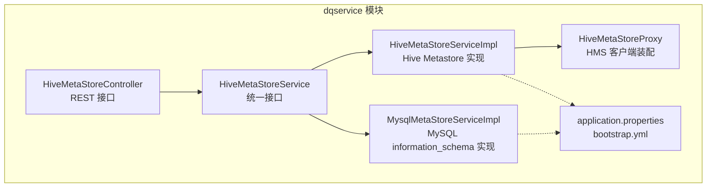
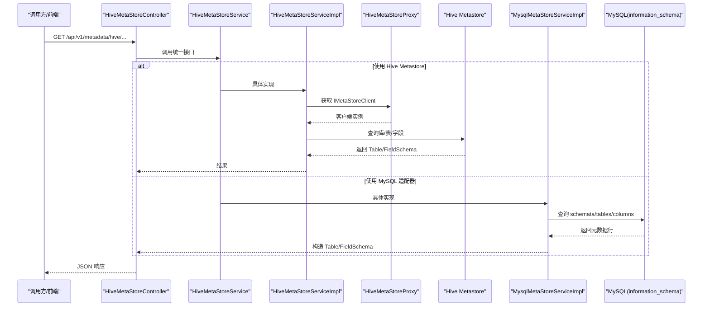
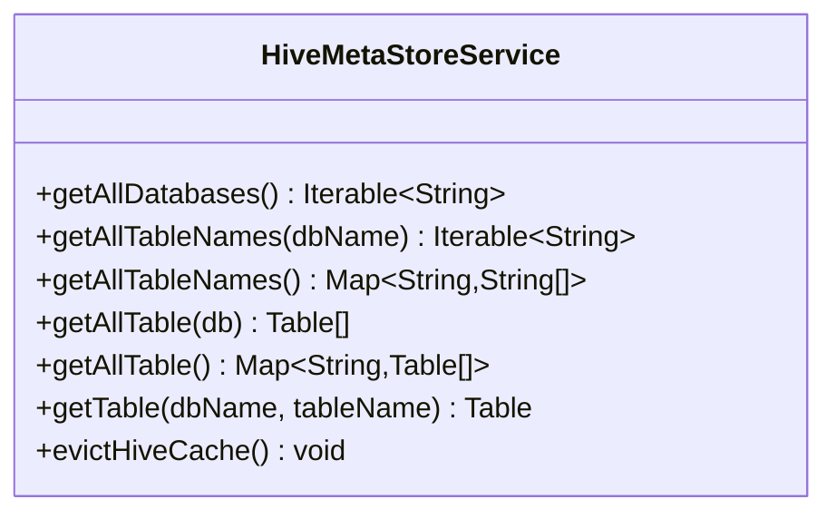
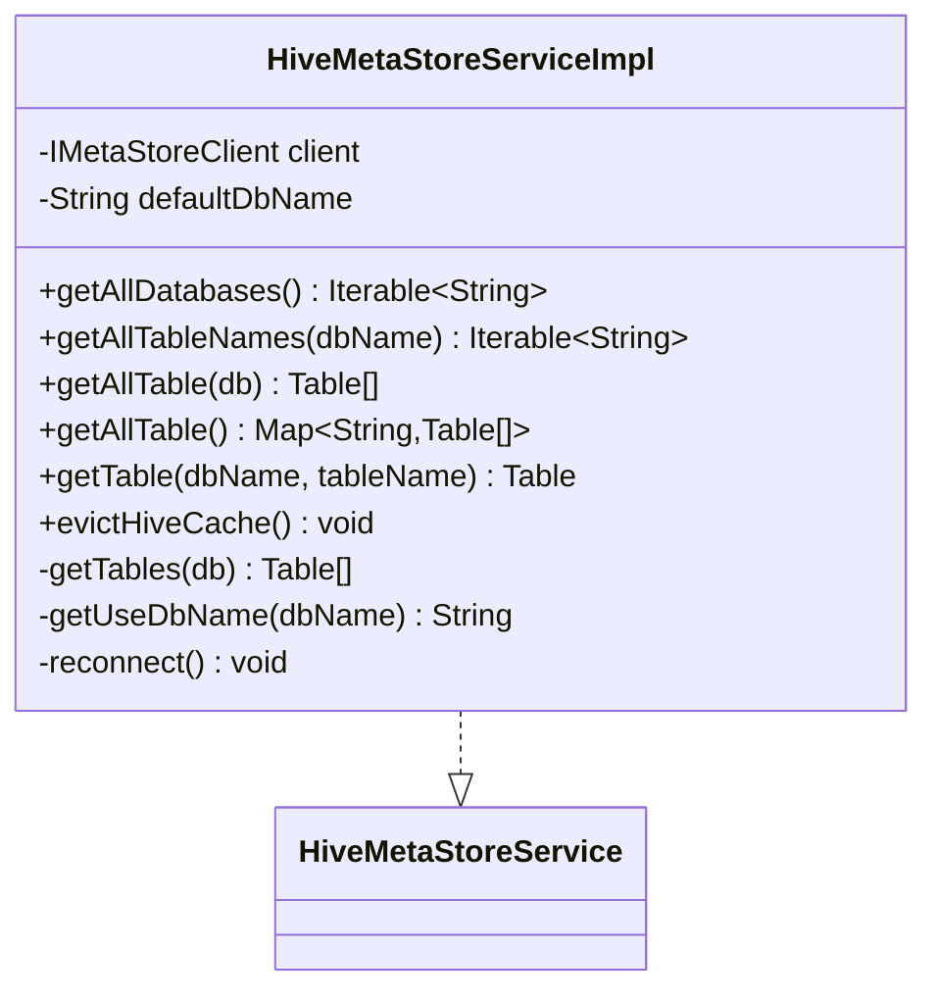
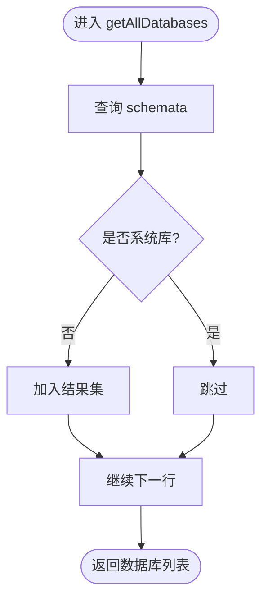
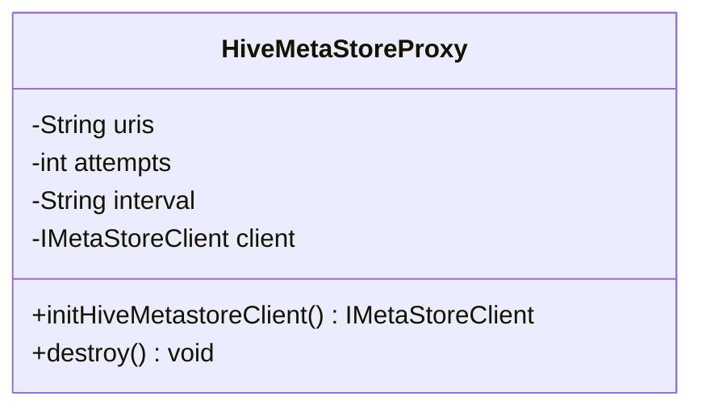
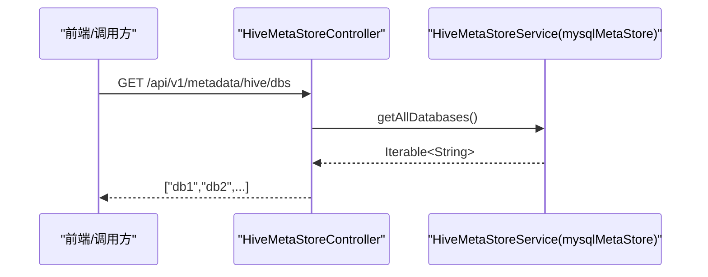
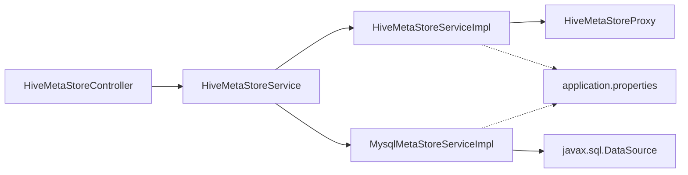

# 元数据管理

<cite>
**本文引用的文件**   
- [HiveMetaStoreService.java](file://ruoyi-modules/ruoyi-dqservice/src/main/java/com/ruoyi/dqservice/service/HiveMetaStoreService.java)
- [HiveMetaStoreServiceImpl.java](file://ruoyi-modules/ruoyi-dqservice/src/main/java/com/ruoyi/dqservice/service/impl/HiveMetaStoreServiceImpl.java)
- [MysqlMetaStoreServiceImpl.java](file://ruoyi-modules/ruoyi-dqservice/src/main/java/com/ruoyi/dqservice/service/impl/MysqlMetaStoreServiceImpl.java)
- [HiveMetaStoreProxy.java](file://ruoyi-modules/ruoyi-dqservice/src/main/java/com/ruoyi/dqservice/connecter/HiveMetaStoreProxy.java)
- [HiveMetaStoreController.java](file://ruoyi-modules/ruoyi-dqservice/src/main/java/com/ruoyi/dqservice/controller/HiveMetaStoreController.java)
- [application.properties](file://ruoyi-modules/ruoyi-dqservice/src/main/resources/application.properties)
- [bootstrap.yml](file://ruoyi-modules/ruoyi-dqservice/src/main/resources/bootstrap.yml)
</cite>

## 目录
1. [引言](#引言)
2. [项目结构](#项目结构)
3. [核心组件](#核心组件)
4. [架构总览](#架构总览)
5. [详细组件分析](#详细组件分析)
6. [依赖关系分析](#依赖关系分析)
7. [性能与缓存](#性能与缓存)
8. [故障排查指南](#故障排查指南)
9. [结论](#结论)
10. [附录](#附录)

## 引言
本技术文档围绕“元数据管理系统”展开，聚焦以下目标：
- 解释元数据的概念及其在数据质量管理中的作用，包括表结构信息、字段属性、分区信息等。
- 详细说明 Hive Metastore 的集成实现，涵盖连接配置、查询接口与错误处理。
- 解析 MySQL 元数据适配器的设计模式与扩展机制。
- 提供元数据同步策略与数据血缘追踪的实现方案建议。
- 给出多类型数据源支持的架构设计与代码级示例路径。

## 项目结构
本项目为若依微服务架构下的数据质量模块（ruoyi-dqservice），其中与元数据管理直接相关的代码位于 dqservice 模块中，主要包含：
- 控制器层：对外暴露元数据查询 REST API。
- 服务接口层：定义统一的元数据访问抽象。
- 服务实现层：分别提供基于 Hive Metastore 和基于 MySQL information_schema 的两套实现。
- 连接器层：封装 Hive Metastore 客户端生命周期与重试参数。
- 配置层：通过 application.properties 与 bootstrap.yml 注入运行期配置。

图示来源
- [HiveMetaStoreController.java:16-57](file://ruoyi-modules/ruoyi-dqservice/src/main/java/com/ruoyi/dqservice/controller/HiveMetaStoreController.java#L16-L57)
- [HiveMetaStoreService.java:8-22](file://ruoyi-modules/ruoyi-dqservice/src/main/java/com/ruoyi/dqservice/service/HiveMetaStoreService.java#L8-L22)
- [HiveMetaStoreServiceImpl.java:27-30](file://ruoyi-modules/ruoyi-dqservice/src/main/java/com/ruoyi/dqservice/service/impl/HiveMetaStoreServiceImpl.java#L27-L30)
- [MysqlMetaStoreServiceImpl.java:35-37](file://ruoyi-modules/ruoyi-dqservice/src/main/java/com/ruoyi/dqservice/service/impl/MysqlMetaStoreServiceImpl.java#L35-L37)
- [HiveMetaStoreProxy.java:14-15](file://ruoyi-modules/ruoyi-dqservice/src/main/java/com/ruoyi/dqservice/connecter/HiveMetaStoreProxy.java#L14-L15)
- [application.properties:1-14](file://ruoyi-modules/ruoyi-dqservice/src/main/resources/application.properties#L1-L14)
- [bootstrap.yml:1-26](file://ruoyi-modules/ruoyi-dqservice/src/main/resources/bootstrap.yml#L1-L26)

章节来源
- [HiveMetaStoreController.java:16-57](file://ruoyi-modules/ruoyi-dqservice/src/main/java/com/ruoyi/dqservice/controller/HiveMetaStoreController.java#L16-L57)
- [HiveMetaStoreService.java:8-22](file://ruoyi-modules/ruoyi-dqservice/src/main/java/com/ruoyi/dqservice/service/HiveMetaStoreService.java#L8-L22)
- [HiveMetaStoreServiceImpl.java:27-30](file://ruoyi-modules/ruoyi-dqservice/src/main/java/com/ruoyi/dqservice/service/impl/HiveMetaStoreServiceImpl.java#L27-L30)
- [MysqlMetaStoreServiceImpl.java:35-37](file://ruoyi-modules/ruoyi-dqservice/src/main/java/com/ruoyi/dqservice/service/impl/MysqlMetaStoreServiceImpl.java#L35-L37)
- [HiveMetaStoreProxy.java:14-15](file://ruoyi-modules/ruoyi-dqservice/src/main/java/com/ruoyi/dqservice/connecter/HiveMetaStoreProxy.java#L14-L15)
- [application.properties:1-14](file://ruoyi-modules/ruoyi-dqservice/src/main/resources/application.properties#L1-L14)
- [bootstrap.yml:1-26](file://ruoyi-modules/ruoyi-dqservice/src/main/resources/bootstrap.yml#L1-L26)

## 核心组件
- 统一接口：HiveMetaStoreService 定义了数据库列表、表名列表、表详情等标准方法，屏蔽底层差异。
- Hive Metastore 实现：HiveMetaStoreServiceImpl 通过 IMetaStoreClient 访问外部 Hive Metastore，并启用 Spring Cache 缓存与定时刷新。
- MySQL 适配器：MysqlMetaStoreServiceImpl 通过 JDBC 读取 MySQL information_schema，返回与 Hive 一致的 Table/StorageDescriptor/FieldSchema 模型，便于前端复用。
- 客户端代理：HiveMetaStoreProxy 负责构建 HiveConf、设置重试参数、创建并关闭 IMetaStoreClient。
- REST 控制器：HiveMetaStoreController 将上述能力以 REST API 暴露给前端或调用方。

章节来源
- [HiveMetaStoreService.java:8-22](file://ruoyi-modules/ruoyi-dqservice/src/main/java/com/ruoyi/dqservice/service/HiveMetaStoreService.java#L8-L22)
- [HiveMetaStoreServiceImpl.java:27-30](file://ruoyi-modules/ruoyi-dqservice/src/main/java/com/ruoyi/dqservice/service/impl/HiveMetaStoreServiceImpl.java#L27-L30)
- [MysqlMetaStoreServiceImpl.java:35-37](file://ruoyi-modules/ruoyi-dqservice/src/main/java/com/ruoyi/dqservice/service/impl/MysqlMetaStoreServiceImpl.java#L35-L37)
- [HiveMetaStoreProxy.java:14-15](file://ruoyi-modules/ruoyi-dqservice/src/main/java/com/ruoyi/dqservice/connecter/HiveMetaStoreProxy.java#L14-L15)
- [HiveMetaStoreController.java:16-57](file://ruoyi-modules/ruoyi-dqservice/src/main/java/com/ruoyi/dqservice/controller/HiveMetaStoreController.java#L16-L57)

## 架构总览
下图展示了从 HTTP 请求到元数据源的完整链路，以及两种后端实现（Hive Metastore 与 MySQL）的并行接入方式。

图示来源
- [HiveMetaStoreController.java:16-57](file://ruoyi-modules/ruoyi-dqservice/src/main/java/com/ruoyi/dqservice/controller/HiveMetaStoreController.java#L16-L57)
- [HiveMetaStoreService.java:8-22](file://ruoyi-modules/ruoyi-dqservice/src/main/java/com/ruoyi/dqservice/service/HiveMetaStoreService.java#L8-L22)
- [HiveMetaStoreServiceImpl.java:49-145](file://ruoyi-modules/ruoyi-dqservice/src/main/java/com/ruoyi/dqservice/service/impl/HiveMetaStoreServiceImpl.java#L49-L145)
- [HiveMetaStoreProxy.java:39-55](file://ruoyi-modules/ruoyi-dqservice/src/main/java/com/ruoyi/dqservice/connecter/HiveMetaStoreProxy.java#L39-L55)
- [MysqlMetaStoreServiceImpl.java:58-129](file://ruoyi-modules/ruoyi-dqservice/src/main/java/com/ruoyi/dqservice/service/impl/MysqlMetaStoreServiceImpl.java#L58-L129)

## 详细组件分析

### 统一接口：HiveMetaStoreService
职责与契约
- 定义数据库列表、表名列表、表详情等标准方法，屏蔽 Hive 与 MySQL 的差异。
- 提供 evictHiveCache 用于触发缓存失效（不同实现可差异化处理）。

复杂度与行为
- getAllTableNames()/getAllTable() 等方法可能遍历多个数据库，时间复杂度与数据库数量及表数量线性相关。
- getTable(db, table) 通常需额外查询列信息，存在一次或多次 SQL 调用。

图示来源
- [HiveMetaStoreService.java:8-22](file://ruoyi-modules/ruoyi-dqservice/src/main/java/com/ruoyi/dqservice/service/HiveMetaStoreService.java#L8-L22)

章节来源
- [HiveMetaStoreService.java:8-22](file://ruoyi-modules/ruoyi-dqservice/src/main/java/com/ruoyi/dqservice/service/HiveMetaStoreService.java#L8-L22)

### Hive Metastore 实现：HiveMetaStoreServiceImpl
关键特性
- 通过 IMetaStoreClient 访问外部 Hive Metastore。
- 使用 @Cacheable/@CacheConfig 对常用查询进行缓存，降低远程调用压力。
- 使用 @Scheduled + @CacheEvict 定时清理缓存，保证元数据变更后的可见性。
- 异常时尝试 reconnect，增强可用性。

图示来源
- [HiveMetaStoreServiceImpl.java:27-30](file://ruoyi-modules/ruoyi-dqservice/src/main/java/com/ruoyi/dqservice/service/impl/HiveMetaStoreServiceImpl.java#L27-L30)
- [HiveMetaStoreServiceImpl.java:49-159](file://ruoyi-modules/ruoyi-dqservice/src/main/java/com/ruoyi/dqservice/service/impl/HiveMetaStoreServiceImpl.java#L49-L159)

章节来源
- [HiveMetaStoreServiceImpl.java:27-30](file://ruoyi-modules/ruoyi-dqservice/src/main/java/com/ruoyi/dqservice/service/impl/HiveMetaStoreServiceImpl.java#L27-L30)
- [HiveMetaStoreServiceImpl.java:49-159](file://ruoyi-modules/ruoyi-dqservice/src/main/java/com/ruoyi/dqservice/service/impl/HiveMetaStoreServiceImpl.java#L49-L159)

### MySQL 元数据适配器：MysqlMetaStoreServiceImpl
设计要点
- 通过 javax.sql.DataSource 直连 MySQL，读取 information_schema.schemata/tables/columns。
- 过滤系统库（information_schema、mysql、performance_schema、sys），避免干扰业务树。
- 返回结构与 Hive 一致（Table/StorageDescriptor/FieldSchema），前端无需改动。
- 无缓存：每次实时查询，保证强一致性；evictHiveCache 为空实现。

图示来源
- [MysqlMetaStoreServiceImpl.java:58-80](file://ruoyi-modules/ruoyi-dqservice/src/main/java/com/ruoyi/dqservice/service/impl/MysqlMetaStoreServiceImpl.java#L58-L80)

章节来源
- [MysqlMetaStoreServiceImpl.java:35-37](file://ruoyi-modules/ruoyi-dqservice/src/main/java/com/ruoyi/dqservice/service/impl/MysqlMetaStoreServiceImpl.java#L35-L37)
- [MysqlMetaStoreServiceImpl.java:58-129](file://ruoyi-modules/ruoyi-dqservice/src/main/java/com/ruoyi/dqservice/service/impl/MysqlMetaStoreServiceImpl.java#L58-L129)
- [MysqlMetaStoreServiceImpl.java:146-189](file://ruoyi-modules/ruoyi-dqservice/src/main/java/com/ruoyi/dqservice/service/impl/MysqlMetaStoreServiceImpl.java#L146-L189)

### Hive Metastore 客户端代理：HiveMetaStoreProxy
职责
- 从配置读取 metastore.uris、重试次数与间隔。
- 初始化 HiveConf，设置本地/远程模式、重试参数，创建 IMetaStoreClient。
- 应用销毁时关闭客户端。

图示来源
- [HiveMetaStoreProxy.java:14-15](file://ruoyi-modules/ruoyi-dqservice/src/main/java/com/ruoyi/dqservice/connecter/HiveMetaStoreProxy.java#L14-L15)
- [HiveMetaStoreProxy.java:39-62](file://ruoyi-modules/ruoyi-dqservice/src/main/java/com/ruoyi/dqservice/connecter/HiveMetaStoreProxy.java#L39-L62)

章节来源
- [HiveMetaStoreProxy.java:14-15](file://ruoyi-modules/ruoyi-dqservice/src/main/java/com/ruoyi/dqservice/connecter/HiveMetaStoreProxy.java#L14-L15)
- [HiveMetaStoreProxy.java:39-62](file://ruoyi-modules/ruoyi-dqservice/src/main/java/com/ruoyi/dqservice/connecter/HiveMetaStoreProxy.java#L39-L62)

### REST 控制器：HiveMetaStoreController
职责
- 暴露 /api/v1/metadata/hive 系列接口，包括库列表、表名列表、表详情等。
- 默认注入名为 mysqlMetaStore 的服务实现，便于演示环境直接使用 MySQL 适配器。

图示来源
- [HiveMetaStoreController.java:16-57](file://ruoyi-modules/ruoyi-dqservice/src/main/java/com/ruoyi/dqservice/controller/HiveMetaStoreController.java#L16-L57)

章节来源
- [HiveMetaStoreController.java:16-57](file://ruoyi-modules/ruoyi-dqservice/src/main/java/com/ruoyi/dqservice/controller/HiveMetaStoreController.java#L16-L57)

## 依赖关系分析
- 控制器依赖统一接口，解耦具体实现。
- Hive 实现依赖 IMetaStoreClient，由 HiveMetaStoreProxy 装配。
- MySQL 实现依赖 javax.sql.DataSource（主数据源），直接访问 information_schema。
- 配置项集中在 application.properties，bootstrap.yml 提供基础启动配置。

图示来源
- [HiveMetaStoreController.java:16-57](file://ruoyi-modules/ruoyi-dqservice/src/main/java/com/ruoyi/dqservice/controller/HiveMetaStoreController.java#L16-L57)
- [HiveMetaStoreService.java:8-22](file://ruoyi-modules/ruoyi-dqservice/src/main/java/com/ruoyi/dqservice/service/HiveMetaStoreService.java#L8-L22)
- [HiveMetaStoreServiceImpl.java:27-30](file://ruoyi-modules/ruoyi-dqservice/src/main/java/com/ruoyi/dqservice/service/impl/HiveMetaStoreServiceImpl.java#L27-L30)
- [MysqlMetaStoreServiceImpl.java:54-56](file://ruoyi-modules/ruoyi-dqservice/src/main/java/com/ruoyi/dqservice/service/impl/MysqlMetaStoreServiceImpl.java#L54-L56)
- [HiveMetaStoreProxy.java:39-55](file://ruoyi-modules/ruoyi-dqservice/src/main/java/com/ruoyi/dqservice/connecter/HiveMetaStoreProxy.java#L39-L55)
- [application.properties:1-14](file://ruoyi-modules/ruoyi-dqservice/src/main/resources/application.properties#L1-L14)

章节来源
- [HiveMetaStoreController.java:16-57](file://ruoyi-modules/ruoyi-dqservice/src/main/java/com/ruoyi/dqservice/controller/HiveMetaStoreController.java#L16-L57)
- [HiveMetaStoreService.java:8-22](file://ruoyi-modules/ruoyi-dqservice/src/main/java/com/ruoyi/dqservice/service/HiveMetaStoreService.java#L8-L22)
- [HiveMetaStoreServiceImpl.java:27-30](file://ruoyi-modules/ruoyi-dqservice/src/main/java/com/ruoyi/dqservice/service/impl/HiveMetaStoreServiceImpl.java#L27-L30)
- [MysqlMetaStoreServiceImpl.java:54-56](file://ruoyi-modules/ruoyi-dqservice/src/main/java/com/ruoyi/dqservice/service/impl/MysqlMetaStoreServiceImpl.java#L54-L56)
- [HiveMetaStoreProxy.java:39-55](file://ruoyi-modules/ruoyi-dqservice/src/main/java/com/ruoyi/dqservice/connecter/HiveMetaStoreProxy.java#L39-L55)
- [application.properties:1-14](file://ruoyi-modules/ruoyi-dqservice/src/main/resources/application.properties#L1-L14)

## 性能与缓存
- Hive 实现采用 Spring Cache 注解缓存库、表名、表详情等热点数据，减少远程调用延迟。
- 定时任务按固定周期清理缓存，平衡一致性与性能。
- MySQL 实现未引入缓存，确保元数据变更即时可见；适合演示环境与中小规模场景。
- 建议在大规模场景下对 MySQL 实现也引入多级缓存（如本地缓存+分布式缓存），并结合增量同步策略。

章节来源
- [HiveMetaStoreServiceImpl.java:27-30](file://ruoyi-modules/ruoyi-dqservice/src/main/java/com/ruoyi/dqservice/service/impl/HiveMetaStoreServiceImpl.java#L27-L30)
- [HiveMetaStoreServiceImpl.java:147-159](file://ruoyi-modules/ruoyi-dqservice/src/main/java/com/ruoyi/dqservice/service/impl/HiveMetaStoreServiceImpl.java#L147-L159)
- [MysqlMetaStoreServiceImpl.java:131-135](file://ruoyi-modules/ruoyi-dqservice/src/main/java/com/ruoyi/dqservice/service/impl/MysqlMetaStoreServiceImpl.java#L131-L135)

## 故障排查指南
常见问题与建议
- Hive Metastore 不可用
  - 现象：HiveMetaStoreProxy 初始化失败，日志提示无法连接。
  - 检查：hive.metastore.uris、hive.hmshandler.retry.attempts、hive.hmshandler.retry.interval 配置是否正确。
  - 影响：Hive 实现返回空集合，不影响 MySQL 适配器。
- 数据库/表/字段查询失败
  - 现象：MySQL 适配器日志记录 SQL 执行异常。
  - 检查：DataSource 连接是否正常、权限是否足够访问 information_schema。
- 缓存不一致
  - 现象：Hive 端元数据变更后前端未及时反映。
  - 处理：等待定时任务清理缓存，或主动触发 evictHiveCache。

章节来源
- [HiveMetaStoreProxy.java:39-55](file://ruoyi-modules/ruoyi-dqservice/src/main/java/com/ruoyi/dqservice/connecter/HiveMetaStoreProxy.java#L39-L55)
- [application.properties:1-14](file://ruoyi-modules/ruoyi-dqservice/src/main/resources/application.properties#L1-L14)
- [MysqlMetaStoreServiceImpl.java:75-78](file://ruoyi-modules/ruoyi-dqservice/src/main/java/com/ruoyi/dqservice/service/impl/MysqlMetaStoreServiceImpl.java#L75-L78)
- [MysqlMetaStoreServiceImpl.java:161-164](file://ruoyi-modules/ruoyi-dqservice/src/main/java/com/ruoyi/dqservice/service/impl/MysqlMetaStoreServiceImpl.java#L161-L164)
- [MysqlMetaStoreServiceImpl.java:184-187](file://ruoyi-modules/ruoyi-dqservice/src/main/java/com/ruoyi/dqservice/service/impl/MysqlMetaStoreServiceImpl.java#L184-L187)
- [HiveMetaStoreServiceImpl.java:147-159](file://ruoyi-modules/ruoyi-dqservice/src/main/java/com/ruoyi/dqservice/service/impl/HiveMetaStoreServiceImpl.java#L147-L159)

## 结论
本系统通过统一接口抽象了元数据访问能力，同时提供 Hive Metastore 与 MySQL 两套实现，兼顾生产可用性与演示便捷性。Hive 实现具备缓存与定时刷新能力，MySQL 实现则强调简单与一致性。结合 REST 控制器，系统能够稳定地为上层数据质量管理功能提供元数据支撑。后续可在多数据源扩展、增量同步与血缘追踪方面进一步增强。

## 附录

### 元数据概念与在数据质量管理中的作用
- 表结构信息：库、表、分区、存储格式等，用于规则引擎识别数据对象。
- 字段属性：字段名、类型、注释、是否主键/唯一键等，用于校验规则与质量指标计算。
- 分区信息：分区键与分区值，用于定位数据范围与增量扫描。
- 作用：为数据质量规则制定、执行与报告提供稳定的元数据基础。

### Hive Metastore 集成要点
- 连接配置：hive.metastore.uris、hive.hmshandler.retry.attempts、hive.hmshandler.retry.interval。
- 客户端装配：HiveMetaStoreProxy 负责创建与关闭 IMetaStoreClient。
- 查询接口：通过 HiveMetaStoreService 暴露的方法访问库、表、字段。
- 错误处理：捕获异常并重连，必要时降级返回空结果。

章节来源
- [application.properties:1-14](file://ruoyi-modules/ruoyi-dqservice/src/main/resources/application.properties#L1-L14)
- [HiveMetaStoreProxy.java:39-62](file://ruoyi-modules/ruoyi-dqservice/src/main/java/com/ruoyi/dqservice/connecter/HiveMetaStoreProxy.java#L39-L62)
- [HiveMetaStoreService.java:8-22](file://ruoyi-modules/ruoyi-dqservice/src/main/java/com/ruoyi/dqservice/service/HiveMetaStoreService.java#L8-L22)

### MySQL 元数据适配器设计与扩展
- 设计模式：适配器模式，将 MySQL information_schema 映射为 Hive 风格的 Table/StorageDescriptor/FieldSchema。
- 扩展机制：新增其他 RDBMS 只需实现 HiveMetaStoreService，并在控制器中切换 @Qualifier。
- 过滤策略：排除系统库，避免污染业务视图。

章节来源
- [MysqlMetaStoreServiceImpl.java:35-37](file://ruoyi-modules/ruoyi-dqservice/src/main/java/com/ruoyi/dqservice/service/impl/MysqlMetaStoreServiceImpl.java#L35-L37)
- [MysqlMetaStoreServiceImpl.java:39-52](file://ruoyi-modules/ruoyi-dqservice/src/main/java/com/ruoyi/dqservice/service/impl/MysqlMetaStoreServiceImpl.java#L39-L52)
- [HiveMetaStoreController.java:20-22](file://ruoyi-modules/ruoyi-dqservice/src/main/java/com/ruoyi/dqservice/controller/HiveMetaStoreController.java#L20-L22)

### 元数据同步策略建议
- 全量+增量：定期全量拉取，结合变更事件（如 binlog、CDC）做增量更新。
- 缓存分层：本地缓存 + 分布式缓存，结合 TTL 与版本号控制一致性。
- 一致性保障：写后失效（Write-Invalidation）或版本号比较，避免脏读。

### 数据血缘追踪实现方案
- 采集点：ETL 脚本、SQL 作业、数据管道（如 Spark/Flink Job）输出结构化血缘。
- 存储模型：节点（库/表/字段）、边（转换/加工关系）、属性（版本、时间戳、责任人）。
- 可视化：基于图数据库或关系型存储，提供上下游分析与影响面评估。

### 多类型数据源支持架构
- 统一接口：所有数据源均实现 HiveMetaStoreService。
- 注册与选择：通过 @Qualifier 或工厂类动态选择具体实现。
- 扩展步骤：新增实现类 -> 注册 Bean -> 控制器注入指定 Bean。

章节来源
- [HiveMetaStoreService.java:8-22](file://ruoyi-modules/ruoyi-dqservice/src/main/java/com/ruoyi/dqservice/service/HiveMetaStoreService.java#L8-L22)
- [HiveMetaStoreController.java:20-22](file://ruoyi-modules/ruoyi-dqservice/src/main/java/com/ruoyi/dqservice/controller/HiveMetaStoreController.java#L20-L22)