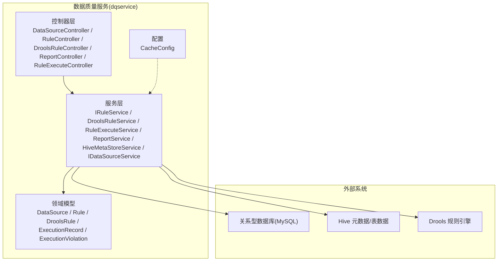
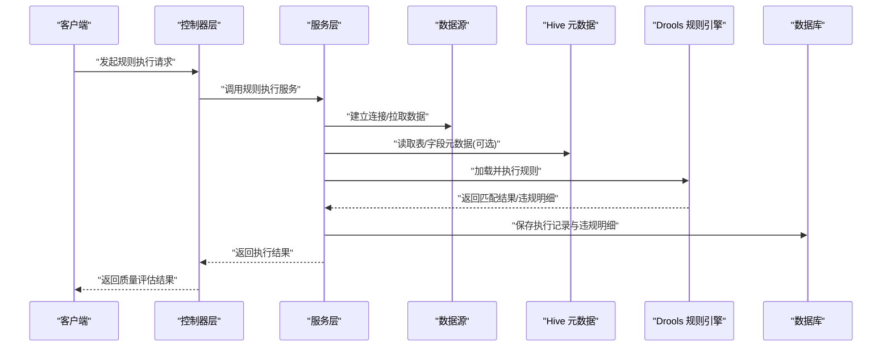
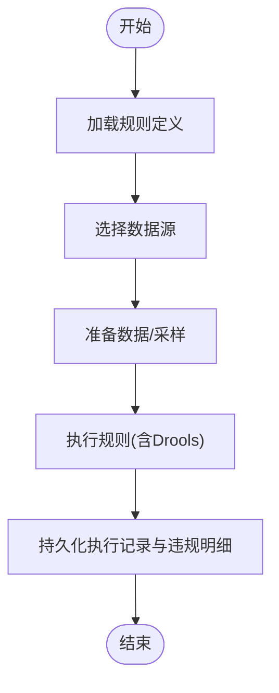
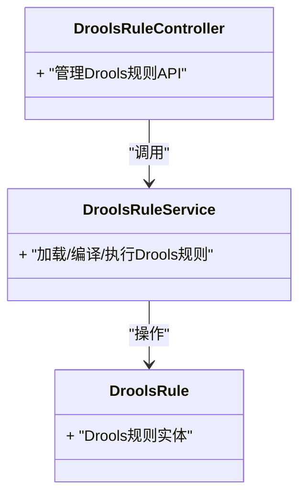
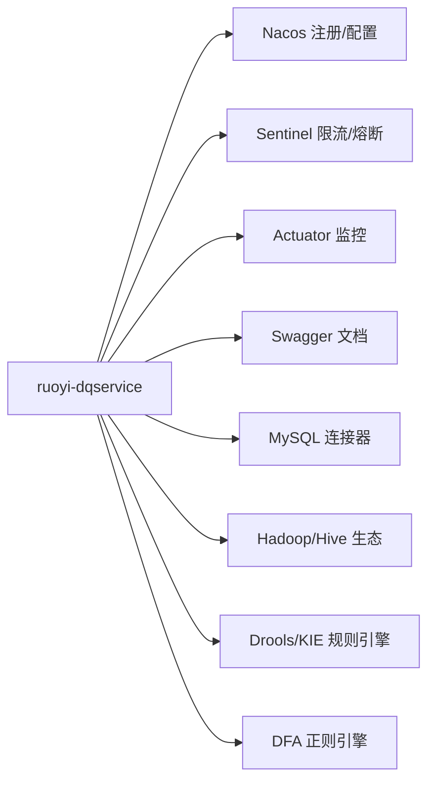

# 数据质量基础

<cite>
**本文引用的文件**   
- [pom.xml](file://ruoyi-modules/ruoyi-dqservice/pom.xml)
- [DqserviceApplication.java](file://ruoyi-modules/ruoyi-dqservice/src/main/java/com/ruoyi/dqservice/DqserviceApplication.java)
- [DataSourceController.java](file://ruoyi-modules/ruoyi-dqservice/src/main/java/com/ruoyi/dqservice/controller/DataSourceController.java)
- [RuleController.java](file://ruoyi-modules/ruoyi-dqservice/src/main/java/com/ruoyi/dqservice/controller/RuleController.java)
- [DroolsRuleController.java](file://ruoyi-modules/ruoyi-dqservice/src/main/java/com/ruoyi/dqservice/controller/DroolsRuleController.java)
- [ReportController.java](file://ruoyi-modules/ruoyi-dqservice/src/main/java/com/ruoyi/dqservice/controller/ReportController.java)
- [RuleExecuteController.java](file://ruoyi-modules/ruoyi-dqservice/src/main/java/com/ruoyi/dqservice/controller/RuleExecuteController.java)
- [HiveMetaStoreController.java](file://ruoyi-modules/ruoyi-dqservice/src/main/java/com/ruoyi/dqservice/controller/HiveMetaStoreController.java)
- [DataSource.java](file://ruoyi-modules/ruoyi-dqservice/src/main/java/com/ruoyi/dqservice/domain/DataSource.java)
- [Rule.java](file://ruoyi-modules/ruoyi-dqservice/src/main/java/com/ruoyi/dqservice/domain/Rule.java)
- [DroolsRule.java](file://ruoyi-modules/ruoyi-dqservice/src/main/java/com/ruoyi/dqservice/domain/DroolsRule.java)
- [ExecutionRecord.java](file://ruoyi-modules/ruoyi-dqservice/src/main/java/com/ruoyi/dqservice/domain/ExecutionRecord.java)
- [ExecutionViolation.java](file://ruoyi-modules/ruoyi-dqservice/src/main/java/com/ruoyi/dqservice/domain/ExecutionViolation.java)
- [IRuleService.java](file://ruoyi-modules/ruoyi-dqservice/src/main/java/com/ruoyi/dqservice/service/IRuleService.java)
- [DroolsRuleService.java](file://ruoyi-modules/ruoyi-dqservice/src/main/java/com/ruoyi/dqservice/service/DroolsRuleService.java)
- [RuleExecuteService.java](file://ruoyi-modules/ruoyi-dqservice/src/main/java/com/ruoyi/dqservice/service/RuleExecuteService.java)
- [ReportService.java](file://ruoyi-modules/ruoyi-dqservice/src/main/java/com/ruoyi/dqservice/service/ReportService.java)
- [HiveMetaStoreService.java](file://ruoyi-modules/ruoyi-dqservice/src/main/java/com/ruoyi/dqservice/service/HiveMetaStoreService.java)
- [IDataSourceService.java](file://ruoyi-modules/ruoyi-dqservice/src/main/java/com/ruoyi/dqservice/service/IDataSourceService.java)
- [CacheConfig.java](file://ruoyi-modules/ruoyi-dqservice/src/main/java/com/ruoyi/dqservice/config/CacheConfig.java)
</cite>

## 目录
1. [引言](#引言)
2. [项目结构](#项目结构)
3. [核心组件](#核心组件)
4. [架构总览](#架构总览)
5. [详细组件分析](#详细组件分析)
6. [依赖关系分析](#依赖关系分析)
7. [性能与可扩展性](#性能与可扩展性)
8. [故障排查指南](#故障排查指南)
9. [结论](#结论)
10. [附录：业务场景与检测示例](#附录业务场景与检测示例)

## 引言
本文件面向数据质量管理的基础概念与实践，围绕“完整性、准确性、一致性、及时性”等核心维度，解释数据质量检测的基本原理与实现方式，重点说明规则驱动的质量控制模式。结合仓库中的数据质量服务模块（ruoyi-dqservice），给出端到端的数据质量管控流程、关键组件职责、典型业务场景与最佳实践建议，帮助读者快速理解并落地数据质量治理。

## 项目结构
该仓库采用微服务模块化组织，数据质量能力集中在 ruoyi-dqservice 模块中，提供数据源管理、规则定义与执行、报告统计、元数据访问等能力；同时集成 Drools 规则引擎与 Hive 元数据访问能力，支持在多种数据源上执行数据质量检查。

图表来源
- [DqserviceApplication.java](file://ruoyi-modules/ruoyi-dqservice/src/main/java/com/ruoyi/dqservice/DqserviceApplication.java)
- [DataSourceController.java](file://ruoyi-modules/ruoyi-dqservice/src/main/java/com/ruoyi/dqservice/controller/DataSourceController.java)
- [RuleController.java](file://ruoyi-modules/ruoyi-dqservice/src/main/java/com/ruoyi/dqservice/controller/RuleController.java)
- [DroolsRuleController.java](file://ruoyi-modules/ruoyi-dqservice/src/main/java/com/ruoyi/dqservice/controller/DroolsRuleController.java)
- [ReportController.java](file://ruoyi-modules/ruoyi-dqservice/src/main/java/com/ruoyi/dqservice/controller/ReportController.java)
- [RuleExecuteController.java](file://ruoyi-modules/ruoyi-dqservice/src/main/java/com/ruoyi/dqservice/controller/RuleExecuteController.java)
- [HiveMetaStoreController.java](file://ruoyi-modules/ruoyi-dqservice/src/main/java/com/ruoyi/dqservice/controller/HiveMetaStoreController.java)
- [IRuleService.java](file://ruoyi-modules/ruoyi-dqservice/src/main/java/com/ruoyi/dqservice/service/IRuleService.java)
- [DroolsRuleService.java](file://ruoyi-modules/ruoyi-dqservice/src/main/java/com/ruoyi/dqservice/service/DroolsRuleService.java)
- [RuleExecuteService.java](file://ruoyi-modules/ruoyi-dqservice/src/main/java/com/ruoyi/dqservice/service/RuleExecuteService.java)
- [ReportService.java](file://ruoyi-modules/ruoyi-dqservice/src/main/java/com/ruoyi/dqservice/service/ReportService.java)
- [HiveMetaStoreService.java](file://ruoyi-modules/ruoyi-dqservice/src/main/java/com/ruoyi/dqservice/service/HiveMetaStoreService.java)
- [IDataSourceService.java](file://ruoyi-modules/ruoyi-dqservice/src/main/java/com/ruoyi/dqservice/service/IDataSourceService.java)
- [CacheConfig.java](file://ruoyi-modules/ruoyi-dqservice/src/main/java/com/ruoyi/dqservice/config/CacheConfig.java)

章节来源
- [pom.xml:12-14](file://ruoyi-modules/ruoyi-dqservice/pom.xml#L12-L14)
- [pom.xml:16-77](file://ruoyi-modules/ruoyi-dqservice/pom.xml#L16-L77)
- [pom.xml:79-319](file://ruoyi-modules/ruoyi-dqservice/pom.xml#L79-L319)
- [pom.xml:327-365](file://ruoyi-modules/ruoyi-dqservice/pom.xml#L327-L365)

## 核心组件
- 控制器层
  - 数据源管理：提供数据源连接信息的增删改查与连通性校验。
  - 规则管理：规则的定义、编辑、发布与版本管理。
  - Drools 规则：基于 Drools 的规则管理与执行入口。
  - 报告与统计：质量评估结果汇总与可视化展示。
  - 规则执行：触发规则执行、批量执行与异步调度。
  - Hive 元数据：读取 Hive 表结构与元信息，辅助规则生成与验证。
- 服务层
  - 规则服务：封装规则生命周期与执行编排。
  - Drools 规则服务：加载、编译、运行 Drools 规则。
  - 规则执行服务：协调数据源、规则与结果落库。
  - 报告服务：聚合执行结果，计算质量指标。
  - Hive 元数据服务：对接 Hive Metastore，获取表/字段元数据。
  - 数据源服务：统一数据源接入与连接管理。
- 领域模型
  - 数据源、规则、Drools 规则、执行记录、违规明细等实体。
- 配置
  - 缓存配置：用于提升规则解析、元数据查询等热点数据的访问效率。

章节来源
- [DataSourceController.java](file://ruoyi-modules/ruoyi-dqservice/src/main/java/com/ruoyi/dqservice/controller/DataSourceController.java)
- [RuleController.java](file://ruoyi-modules/ruoyi-dqservice/src/main/java/com/ruoyi/dqservice/controller/RuleController.java)
- [DroolsRuleController.java](file://ruoyi-modules/ruoyi-dqservice/src/main/java/com/ruoyi/dqservice/controller/DroolsRuleController.java)
- [ReportController.java](file://ruoyi-modules/ruoyi-dqservice/src/main/java/com/ruoyi/dqservice/controller/ReportController.java)
- [RuleExecuteController.java](file://ruoyi-modules/ruoyi-dqservice/src/main/java/com/ruoyi/dqservice/controller/RuleExecuteController.java)
- [HiveMetaStoreController.java](file://ruoyi-modules/ruoyi-dqservice/src/main/java/com/ruoyi/dqservice/controller/HiveMetaStoreController.java)
- [IRuleService.java](file://ruoyi-modules/ruoyi-dqservice/src/main/java/com/ruoyi/dqservice/service/IRuleService.java)
- [DroolsRuleService.java](file://ruoyi-modules/ruoyi-dqservice/src/main/java/com/ruoyi/dqservice/service/DroolsRuleService.java)
- [RuleExecuteService.java](file://ruoyi-modules/ruoyi-dqservice/src/main/java/com/ruoyi/dqservice/service/RuleExecuteService.java)
- [ReportService.java](file://ruoyi-modules/ruoyi-dqservice/src/main/java/com/ruoyi/dqservice/service/ReportService.java)
- [HiveMetaStoreService.java](file://ruoyi-modules/ruoyi-dqservice/src/main/java/com/ruoyi/dqservice/service/HiveMetaStoreService.java)
- [IDataSourceService.java](file://ruoyi-modules/ruoyi-dqservice/src/main/java/com/ruoyi/dqservice/service/IDataSourceService.java)
- [DataSource.java](file://ruoyi-modules/ruoyi-dqservice/src/main/java/com/ruoyi/dqservice/domain/DataSource.java)
- [Rule.java](file://ruoyi-modules/ruoyi-dqservice/src/main/java/com/ruoyi/dqservice/domain/Rule.java)
- [DroolsRule.java](file://ruoyi-modules/ruoyi-dqservice/src/main/java/com/ruoyi/dqservice/domain/DroolsRule.java)
- [ExecutionRecord.java](file://ruoyi-modules/ruoyi-dqservice/src/main/java/com/ruoyi/dqservice/domain/ExecutionRecord.java)
- [ExecutionViolation.java](file://ruoyi-modules/ruoyi-dqservice/src/main/java/com/ruoyi/dqservice/domain/ExecutionViolation.java)
- [CacheConfig.java](file://ruoyi-modules/ruoyi-dqservice/src/main/java/com/ruoyi/dqservice/config/CacheConfig.java)

## 架构总览
数据质量服务以“控制器-服务-领域模型”分层架构组织，通过 REST API 暴露能力，内部使用 Drools 规则引擎进行规则匹配与判定，借助 Hive 元数据服务获取目标表的元信息，最终将执行结果持久化到数据库，并通过报告服务对外输出质量指标。

图表来源
- [RuleExecuteController.java](file://ruoyi-modules/ruoyi-dqservice/src/main/java/com/ruoyi/dqservice/controller/RuleExecuteController.java)
- [RuleExecuteService.java](file://ruoyi-modules/ruoyi-dqservice/src/main/java/com/ruoyi/dqservice/service/RuleExecuteService.java)
- [HiveMetaStoreService.java](file://ruoyi-modules/ruoyi-dqservice/src/main/java/com/ruoyi/dqservice/service/HiveMetaStoreService.java)
- [DroolsRuleService.java](file://ruoyi-modules/ruoyi-dqservice/src/main/java/com/ruoyi/dqservice/service/DroolsRuleService.java)
- [ReportService.java](file://ruoyi-modules/ruoyi-dqservice/src/main/java/com/ruoyi/dqservice/service/ReportService.java)

## 详细组件分析

### 数据源管理组件
- 职责
  - 维护多类型数据源的连接信息，提供连通性校验与连接复用。
  - 为规则执行提供统一的数据访问入口。
- 关键点
  - 连接池与超时策略需根据数据源类型差异化配置。
  - 敏感信息（如密码）应加密存储与传输。
- 相关类
  - DataSourceController、IDataSourceService、DataSource

章节来源
- [DataSourceController.java](file://ruoyi-modules/ruoyi-dqservice/src/main/java/com/ruoyi/dqservice/controller/DataSourceController.java)
- [IDataSourceService.java](file://ruoyi-modules/ruoyi-dqservice/src/main/java/com/ruoyi/dqservice/service/IDataSourceService.java)
- [DataSource.java](file://ruoyi-modules/ruoyi-dqservice/src/main/java/com/ruoyi/dqservice/domain/DataSource.java)

### 规则定义与执行组件
- 职责
  - 规则的生命周期管理（创建、更新、启用/停用）。
  - 规则执行编排：选择数据源、加载规则、执行、结果持久化。
- 关键点
  - 规则与数据解耦，支持 SQL、表达式、Drools 等多种规则形式。
  - 执行过程可观测：记录执行上下文、耗时、失败原因。
- 相关类
  - RuleController、IRuleService、Rule、ExecutionRecord、ExecutionViolation

图表来源
- [RuleController.java](file://ruoyi-modules/ruoyi-dqservice/src/main/java/com/ruoyi/dqservice/controller/RuleController.java)
- [IRuleService.java](file://ruoyi-modules/ruoyi-dqservice/src/main/java/com/ruoyi/dqservice/service/IRuleService.java)
- [Rule.java](file://ruoyi-modules/ruoyi-dqservice/src/main/java/com/ruoyi/dqservice/domain/Rule.java)
- [ExecutionRecord.java](file://ruoyi-modules/ruoyi-dqservice/src/main/java/com/ruoyi/dqservice/domain/ExecutionRecord.java)
- [ExecutionViolation.java](file://ruoyi-modules/ruoyi-dqservice/src/main/java/com/ruoyi/dqservice/domain/ExecutionViolation.java)

章节来源
- [RuleController.java](file://ruoyi-modules/ruoyi-dqservice/src/main/java/com/ruoyi/dqservice/controller/RuleController.java)
- [IRuleService.java](file://ruoyi-modules/ruoyi-dqservice/src/main/java/com/ruoyi/dqservice/service/IRuleService.java)
- [Rule.java](file://ruoyi-modules/ruoyi-dqservice/src/main/java/com/ruoyi/dqservice/domain/Rule.java)
- [ExecutionRecord.java](file://ruoyi-modules/ruoyi-dqservice/src/main/java/com/ruoyi/dqservice/domain/ExecutionRecord.java)
- [ExecutionViolation.java](file://ruoyi-modules/ruoyi-dqservice/src/main/java/com/ruoyi/dqservice/domain/ExecutionViolation.java)

### Drools 规则引擎集成
- 职责
  - 管理 Drools 规则的加载、编译、会话创建与执行。
  - 将业务规则与代码解耦，便于非开发人员维护。
- 关键点
  - 规则热更新与版本管理。
  - 规则性能优化：避免过度复杂的条件组合，合理使用事实对象。
- 相关类
  - DroolsRuleController、DroolsRuleService、DroolsRule

图表来源
- [DroolsRuleController.java](file://ruoyi-modules/ruoyi-dqservice/src/main/java/com/ruoyi/dqservice/controller/DroolsRuleController.java)
- [DroolsRuleService.java](file://ruoyi-modules/ruoyi-dqservice/src/main/java/com/ruoyi/dqservice/service/DroolsRuleService.java)
- [DroolsRule.java](file://ruoyi-modules/ruoyi-dqservice/src/main/java/com/ruoyi/dqservice/domain/DroolsRule.java)

章节来源
- [DroolsRuleController.java](file://ruoyi-modules/ruoyi-dqservice/src/main/java/com/ruoyi/dqservice/controller/DroolsRuleController.java)
- [DroolsRuleService.java](file://ruoyi-modules/ruoyi-dqservice/src/main/java/com/ruoyi/dqservice/service/DroolsRuleService.java)
- [DroolsRule.java](file://ruoyi-modules/ruoyi-dqservice/src/main/java/com/ruoyi/dqservice/domain/DroolsRule.java)

### Hive 元数据访问组件
- 职责
  - 读取 Hive 表结构、分区、字段类型等元数据，辅助规则生成与校验。
- 关键点
  - 元数据缓存以减少频繁查询开销。
  - 权限与安全：最小权限原则访问元数据。
- 相关类
  - HiveMetaStoreController、HiveMetaStoreService

章节来源
- [HiveMetaStoreController.java](file://ruoyi-modules/ruoyi-dqservice/src/main/java/com/ruoyi/dqservice/controller/HiveMetaStoreController.java)
- [HiveMetaStoreService.java](file://ruoyi-modules/ruoyi-dqservice/src/main/java/com/ruoyi/dqservice/service/HiveMetaStoreService.java)

### 报告与统计组件
- 职责
  - 汇总规则执行结果，计算质量指标（如完整率、准确率、一致率、及时率）。
  - 提供报表接口供前端或 BI 工具消费。
- 关键点
  - 指标口径明确、可追溯至具体规则与执行批次。
  - 支持按时间窗口、业务域、数据源等多维下钻。
- 相关类
  - ReportController、ReportService

章节来源
- [ReportController.java](file://ruoyi-modules/ruoyi-dqservice/src/main/java/com/ruoyi/dqservice/controller/ReportController.java)
- [ReportService.java](file://ruoyi-modules/ruoyi-dqservice/src/main/java/com/ruoyi/dqservice/service/ReportService.java)

## 依赖关系分析
- 运行时依赖
  - Spring Cloud Alibaba Nacos（注册与配置中心）
  - Sentinel（限流与熔断）
  - Actuator（健康检查与监控）
  - Swagger（接口文档）
  - MySQL Connector（关系型数据库访问）
  - Hadoop Client + Hive Metastore + Hive JDBC（Hive 元数据与数据访问）
  - Drools/KIE（规则引擎）
  - DFA（正则表达式引擎）
- 模块内依赖
  - 控制器依赖服务层；服务层依赖领域模型与外部系统（数据库、Hive、规则引擎）。

图表来源
- [pom.xml:16-77](file://ruoyi-modules/ruoyi-dqservice/pom.xml#L16-L77)
- [pom.xml:79-319](file://ruoyi-modules/ruoyi-dqservice/pom.xml#L79-L319)
- [pom.xml:327-365](file://ruoyi-modules/ruoyi-dqservice/pom.xml#L327-L365)

章节来源
- [pom.xml:16-77](file://ruoyi-modules/ruoyi-dqservice/pom.xml#L16-L77)
- [pom.xml:79-319](file://ruoyi-modules/ruoyi-dqservice/pom.xml#L79-L319)
- [pom.xml:327-365](file://ruoyi-modules/ruoyi-dqservice/pom.xml#L327-L365)

## 性能与可扩展性
- 规则执行性能
  - 对大数据量数据源，优先采用“抽样+增量”策略降低扫描成本。
  - 利用缓存（如 CacheConfig）缓存热点元数据与规则解析结果。
  - 合理拆分规则粒度，避免单条规则过于复杂导致匹配开销过大。
- 并发与资源隔离
  - 使用线程池隔离不同数据源或不同业务域的规则执行任务。
  - 借助 Sentinel 对高负载接口进行限流与降级保护。
- 扩展性
  - 规则引擎抽象：除 Drools 外，预留其他规则引擎接入点。
  - 数据源抽象：统一数据源 SPI，便于接入更多数据源类型。

[本节为通用指导，不直接分析具体文件]

## 故障排查指南
- 规则执行失败
  - 检查数据源连接是否可用、权限是否正确。
  - 查看执行记录与违规明细，定位失败的规则与数据行。
  - 若使用 Drools，确认规则语法与事实对象映射正确。
- Hive 元数据异常
  - 核对 Hive Metastore 地址与认证配置。
  - 检查网络连通性与 Kerberos 安全配置（如启用）。
- 性能问题
  - 观察慢查询与长事务，优化规则 SQL 或减少全表扫描。
  - 调整缓存命中率与规则解析频率。
- 监控与告警
  - 通过 Actuator 暴露健康与指标端点，结合监控系统设置阈值告警。

章节来源
- [ExecutionRecord.java](file://ruoyi-modules/ruoyi-dqservice/src/main/java/com/ruoyi/dqservice/domain/ExecutionRecord.java)
- [ExecutionViolation.java](file://ruoyi-modules/ruoyi-dqservice/src/main/java/com/ruoyi/dqservice/domain/ExecutionViolation.java)
- [HiveMetaStoreService.java](file://ruoyi-modules/ruoyi-dqservice/src/main/java/com/ruoyi/dqservice/service/HiveMetaStoreService.java)
- [DroolsRuleService.java](file://ruoyi-modules/ruoyi-dqservice/src/main/java/com/ruoyi/dqservice/service/DroolsRuleService.java)

## 结论
数据质量管理的核心在于“以规则为中心”的持续治理闭环：定义规则、执行检查、沉淀结果、度量指标、持续改进。本项目通过控制器-服务-领域模型的分层设计，结合 Drools 规则引擎与 Hive 元数据能力，提供了从数据源接入到质量报告输出的完整链路。建议在实施中坚持“指标可度量、规则可演进、执行可观测”的原则，逐步完善数据质量体系。

[本节为总结性内容，不直接分析具体文件]

## 附录：业务场景与检测示例
以下示例聚焦数据质量的四大维度，并结合仓库提供的能力说明检测方法。

- 完整性
  - 场景：客户主键缺失、必填字段为空。
  - 检测：对关键字段进行空值/唯一性检查；对 Hive 分区表检查分区覆盖度。
  - 指标：完整率 = 有效记录数 / 总记录数。
- 准确性
  - 场景：身份证号位数错误、手机号格式不符、金额负数。
  - 检测：使用正则或内置函数校验格式；跨系统比对权威数据源。
  - 指标：准确率 = 校验通过记录数 / 总记录数。
- 一致性
  - 场景：订单状态与支付状态不一致、同一客户在不同系统名称不一致。
  - 检测：跨表/跨系统关联校验；字典值一致性检查。
  - 指标：一致率 = 一致记录数 / 总记录数。
- 及时性
  - 场景：T+1 报表延迟、实时指标延迟超过阈值。
  - 检测：比较数据到达时间与预期 SLA；监控任务调度延迟。
  - 指标：及时率 = 按时到达记录数 / 总记录数。

[本节为概念性示例，不直接分析具体文件]