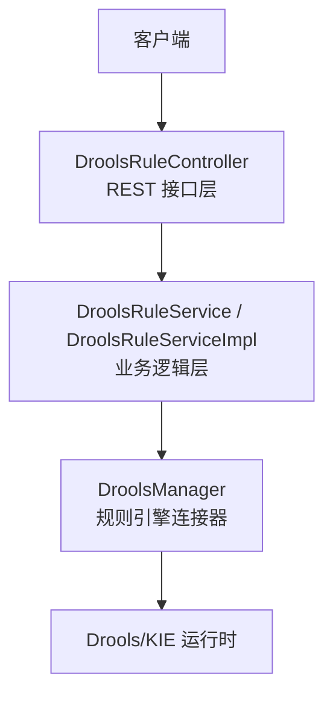
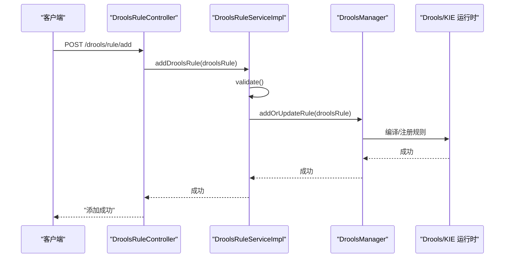
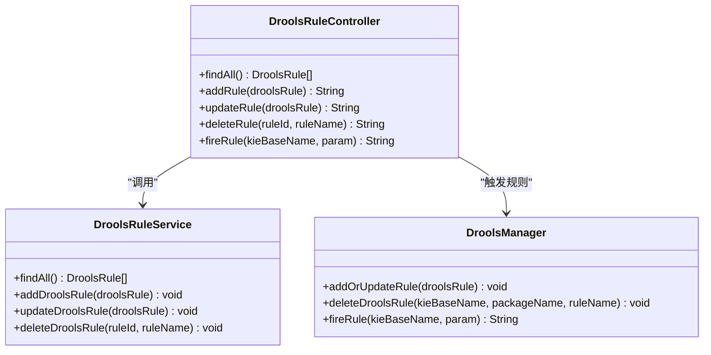
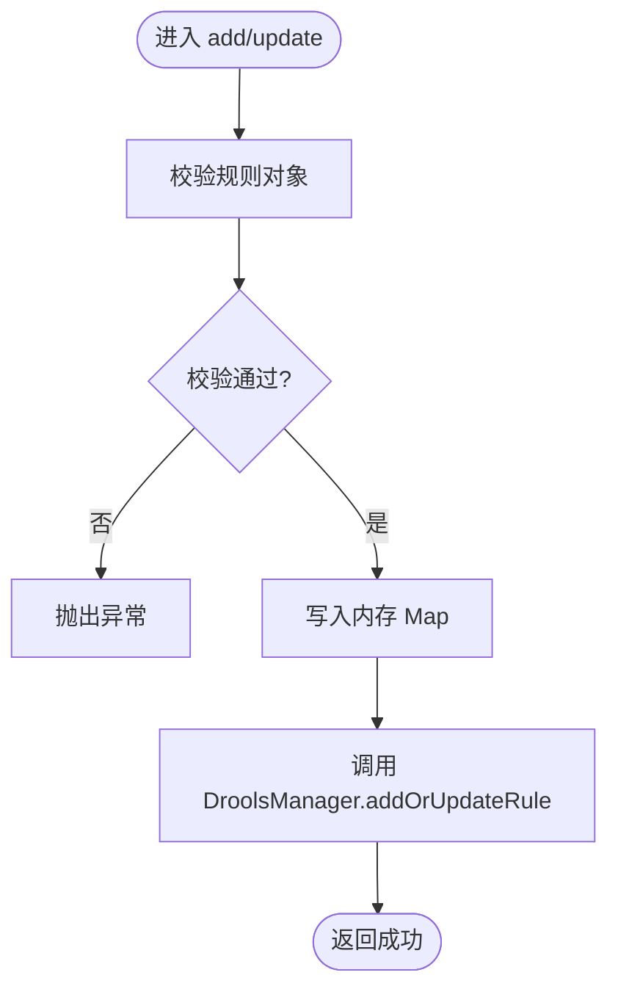
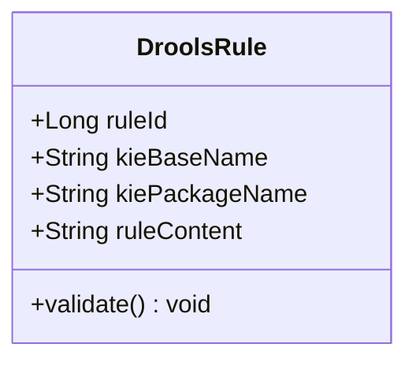
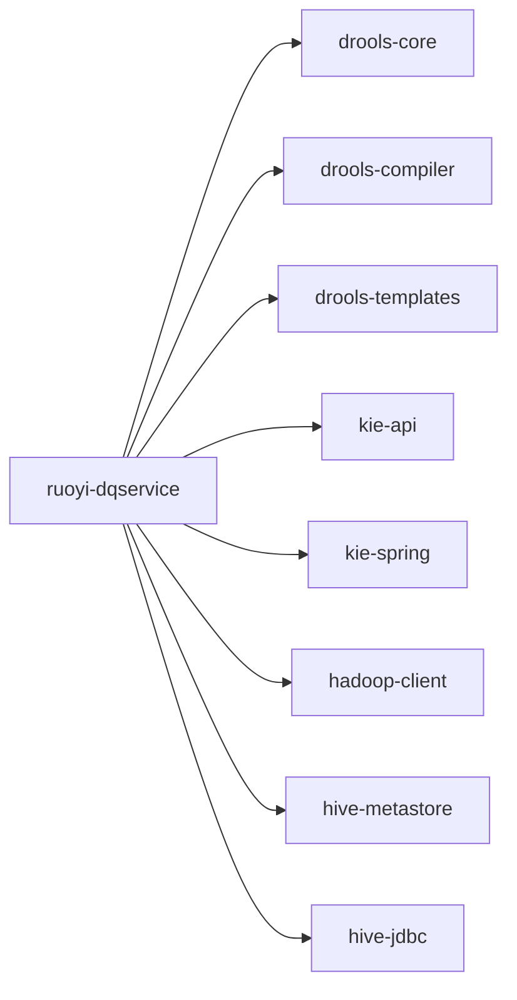

# 核心概念

<cite>
**本文引用的文件**   
- [pom.xml](file://ruoyi-modules/ruoyi-dqservice/pom.xml)
- [DroolsRuleController.java](file://ruoyi-modules/ruoyi-dqservice/src/main/java/com/ruoyi/dqservice/controller/DroolsRuleController.java)
- [DroolsRuleService.java](file://ruoyi-modules/ruoyi-dqservice/src/main/java/com/ruoyi/dqservice/service/DroolsRuleService.java)
- [DroolsRuleServiceImpl.java](file://ruoyi-modules/ruoyi-dqservice/src/main/java/com/ruoyi/dqservice/service/impl/DroolsRuleServiceImpl.java)
- [DroolsRule.java](file://ruoyi-modules/ruoyi-dqservice/src/main/java/com/ruoyi/dqservice/domain/DroolsRule.java)
</cite>

## 目录
1. [引言](#引言)
2. [项目结构](#项目结构)
3. [核心组件](#核心组件)
4. [架构总览](#架构总览)
5. [详细组件分析](#详细组件分析)
6. [依赖关系分析](#依赖关系分析)
7. [性能考量](#性能考量)
8. [故障排查指南](#故障排查指南)
9. [结论](#结论)
10. [附录](#附录)

## 引言
本文件围绕数据质量管理的核心概念展开，重点阐述：
- 数据质量的定义与重要性
- Drools 规则引擎在本项目中的工作原理与使用方式
- 元数据管理在数据质量中的作用
- 规则类型、执行模式、检测结果等关键概念
- 结合代码示例与配置说明，帮助开发者理解系统的设计与技术实现

本项目基于 Spring Boot 微服务架构，数据质量能力通过独立的 dqservice 模块提供，并集成 Drools 规则引擎以支持动态规则管理与执行。

## 项目结构
dqservice 模块是数据质量能力的核心承载模块，包含控制器、服务、领域模型以及与规则引擎的连接器。其职责包括：
- 暴露规则管理 API（增删改查）
- 将规则持久化到内存（当前实现为模拟存储）
- 调用 DroolsManager 进行规则的编译、注册与执行
- 提供规则触发入口

图表来源
- [DroolsRuleController.java:13-49](file://ruoyi-modules/ruoyi-dqservice/src/main/java/com/ruoyi/dqservice/controller/DroolsRuleController.java#L13-L49)
- [DroolsRuleServiceImpl.java:11-48](file://ruoyi-modules/ruoyi-dqservice/src/main/java/com/ruoyi/dqservice/service/impl/DroolsRuleServiceImpl.java#L11-L48)

章节来源
- [DroolsRuleController.java:13-49](file://ruoyi-modules/ruoyi-dqservice/src/main/java/com/ruoyi/dqservice/controller/DroolsRuleController.java#L13-L49)
- [DroolsRuleServiceImpl.java:11-48](file://ruoyi-modules/ruoyi-dqservice/src/main/java/com/ruoyi/dqservice/service/impl/DroolsRuleServiceImpl.java#L11-L48)

## 核心组件
- 控制器层：对外暴露规则管理与触发的 REST 接口
- 服务层：封装规则的生命周期操作，维护内存中的规则集合，并与规则引擎交互
- 领域模型：描述规则的结构与校验逻辑
- 连接器：封装 Drools/KIE 的运行期操作（添加/更新/删除规则、触发规则）

章节来源
- [DroolsRuleController.java:13-49](file://ruoyi-modules/ruoyi-dqservice/src/main/java/com/ruoyi/dqservice/controller/DroolsRuleController.java#L13-L49)
- [DroolsRuleService.java:7-15](file://ruoyi-modules/ruoyi-dqservice/src/main/java/com/ruoyi/dqservice/service/DroolsRuleService.java#L7-L15)
- [DroolsRuleServiceImpl.java:11-48](file://ruoyi-modules/ruoyi-dqservice/src/main/java/com/ruoyi/dqservice/service/impl/DroolsRuleServiceImpl.java#L11-L48)
- [DroolsRule.java:5-31](file://ruoyi-modules/ruoyi-dqservice/src/main/java/com/ruoyi/dqservice/domain/DroolsRule.java#L5-L31)

## 架构总览
下图展示了从请求进入到规则执行的端到端流程，以及各组件之间的协作关系。

图表来源
- [DroolsRuleController.java:27-31](file://ruoyi-modules/ruoyi-dqservice/src/main/java/com/ruoyi/dqservice/controller/DroolsRuleController.java#L27-L31)
- [DroolsRuleServiceImpl.java:26-31](file://ruoyi-modules/ruoyi-dqservice/src/main/java/com/ruoyi/dqservice/service/impl/DroolsRuleServiceImpl.java#L26-L31)
- [DroolsRule.java:23-31](file://ruoyi-modules/ruoyi-dqservice/src/main/java/com/ruoyi/dqservice/domain/DroolsRule.java#L23-L31)

## 详细组件分析

### 控制器层：DroolsRuleController
职责与行为
- 暴露规则查询、新增、更新、删除与触发的 REST 接口
- 转发请求至服务层与规则引擎连接器

关键点
- 所有规则管理接口均委托给 DroolsRuleService
- 触发规则接口直接调用 DroolsManager.fireRule

图表来源
- [DroolsRuleController.java:13-49](file://ruoyi-modules/ruoyi-dqservice/src/main/java/com/ruoyi/dqservice/controller/DroolsRuleController.java#L13-L49)

章节来源
- [DroolsRuleController.java:13-49](file://ruoyi-modules/ruoyi-dqservice/src/main/java/com/ruoyi/dqservice/controller/DroolsRuleController.java#L13-L49)

### 服务层：DroolsRuleService 与 DroolsRuleServiceImpl
职责与行为
- 定义规则生命周期操作的接口
- 使用内存 Map 模拟规则存储
- 对规则对象进行校验后，调用 DroolsManager 同步规则状态

关键点
- 新增/更新时先校验规则对象，再写入内存并通知规则引擎
- 删除时先从内存移除，再通知规则引擎删除对应规则

图表来源
- [DroolsRuleServiceImpl.java:26-38](file://ruoyi-modules/ruoyi-dqservice/src/main/java/com/ruoyi/dqservice/service/impl/DroolsRuleServiceImpl.java#L26-L38)
- [DroolsRule.java:23-31](file://ruoyi-modules/ruoyi-dqservice/src/main/java/com/ruoyi/dqservice/domain/DroolsRule.java#L23-L31)

章节来源
- [DroolsRuleService.java:7-15](file://ruoyi-modules/ruoyi-dqservice/src/main/java/com/ruoyi/dqservice/service/DroolsRuleService.java#L7-L15)
- [DroolsRuleServiceImpl.java:11-48](file://ruoyi-modules/ruoyi-dqservice/src/main/java/com/ruoyi/dqservice/service/impl/DroolsRuleServiceImpl.java#L11-L48)

### 领域模型：DroolsRule
职责与行为
- 描述规则的基本信息（规则 ID、kieBase 名称、包名、规则内容）
- 提供构造器用于从外部规则对象映射字段
- 提供校验方法确保必要字段非空

关键点
- kieBaseName 与 kiePackageName 由外部规则对象派生
- validate 方法在新增/更新前被调用，不通过则抛异常

图表来源
- [DroolsRule.java:5-31](file://ruoyi-modules/ruoyi-dqservice/src/main/java/com/ruoyi/dqservice/domain/DroolsRule.java#L5-L31)

章节来源
- [DroolsRule.java:5-31](file://ruoyi-modules/ruoyi-dqservice/src/main/java/com/ruoyi/dqservice/domain/DroolsRule.java#L5-L31)

### 规则引擎连接器：DroolsManager
职责与行为
- 封装 Drools/KIE 的运行期操作
- 提供添加/更新规则、删除规则、触发规则的方法

注意
- 该类在当前上下文中未展示具体实现，但控制器与服务层均依赖其提供的能力

章节来源
- [DroolsRuleController.java:19-47](file://ruoyi-modules/ruoyi-dqservice/src/main/java/com/ruoyi/dqservice/controller/DroolsRuleController.java#L19-L47)
- [DroolsRuleServiceImpl.java:13-46](file://ruoyi-modules/ruoyi-dqservice/src/main/java/com/ruoyi/dqservice/service/impl/DroolsRuleServiceImpl.java#L13-L46)

## 依赖关系分析
dqservice 模块引入了 Drools/KIE 相关依赖，用于规则编译、模板与运行期管理；同时集成了 Nacos、Sentinel、Hive/Hadoop 等生态组件，支撑数据质量场景下的元数据访问与计算。

图表来源
- [pom.xml:327-352](file://ruoyi-modules/ruoyi-dqservice/pom.xml#L327-L352)
- [pom.xml:79-127](file://ruoyi-modules/ruoyi-dqservice/pom.xml#L79-L127)
- [pom.xml:240-244](file://ruoyi-modules/ruoyi-dqservice/pom.xml#L240-L244)

章节来源
- [pom.xml:327-352](file://ruoyi-modules/ruoyi-dqservice/pom.xml#L327-L352)
- [pom.xml:79-127](file://ruoyi-modules/ruoyi-dqservice/pom.xml#L79-L127)
- [pom.xml:240-244](file://ruoyi-modules/ruoyi-dqservice/pom.xml#L240-L244)

## 性能考量
- 规则热更新：通过 DroolsManager 动态编译与注册规则，避免重启服务即可生效
- 内存缓存：当前服务层使用内存 Map 暂存规则，适合演示与轻量场景；生产环境建议替换为数据库或分布式缓存
- 规则粒度：建议将复杂规则拆分为多个细粒度规则，提升匹配效率与可维护性
- 资源隔离：不同租户/业务域建议使用不同的 kieBaseName 与 packageName，避免规则冲突

[本节为通用指导，不涉及具体文件分析]

## 故障排查指南
常见问题与建议
- 参数校验失败：新增/更新规则时报“参数有问题”，检查 ruleId、kieBaseName、kiePackageName、ruleContent 是否齐全
- 规则未生效：确认 DroolsManager.addOrUpdateRule 是否成功；检查 kieBaseName 与 packageName 是否与规则内容一致
- 触发规则异常：核对 fireRule 传入的 kieBaseName 是否存在；检查入参类型与规则期望是否匹配
- 规则冲突：若同名规则重复注册，需确保删除旧规则后再添加新规则

章节来源
- [DroolsRule.java:23-31](file://ruoyi-modules/ruoyi-dqservice/src/main/java/com/ruoyi/dqservice/domain/DroolsRule.java#L23-L31)
- [DroolsRuleController.java:27-47](file://ruoyi-modules/ruoyi-dqservice/src/main/java/com/ruoyi/dqservice/controller/DroolsRuleController.java#L27-L47)
- [DroolsRuleServiceImpl.java:26-46](file://ruoyi-modules/ruoyi-dqservice/src/main/java/com/ruoyi/dqservice/service/impl/DroolsRuleServiceImpl.java#L26-L46)

## 结论
本项目通过 dqservice 模块将数据质量管理与 Drools 规则引擎解耦，实现了规则的动态管理与执行。控制器-服务-连接器的分层设计使规则生命周期清晰可控，便于扩展与维护。结合 Hive/Hadoop 依赖，系统具备对接大数据生态的能力，为数据质量评估与监控提供了坚实基础。

[本节为总结性内容，不涉及具体文件分析]

## 附录

### 数据质量的核心概念
- 数据质量定义：指数据满足业务需求与预期用途的程度，通常从准确性、完整性、一致性、时效性、唯一性等维度衡量
- 数据质量的重要性：直接影响决策可信度、合规性与运营效率；高质量数据可降低风险、提升体验与价值
- 元数据管理的作用：为数据资产提供“关于数据的数据”的描述，支撑数据血缘、影响分析、质量策略编排与治理闭环

[本节为概念性内容，不涉及具体文件分析]

### 规则类型与执行模式
- 规则类型：包括但不限于完整性校验、格式校验、一致性校验、业务规则校验等
- 执行模式：
  - 在线实时：在数据写入或查询路径中触发规则，快速反馈问题
  - 离线批处理：在 T+1 或定时任务中对历史数据进行批量评估
- 检测结果：通常包括通过/失败、严重等级、错误明细、定位信息（表/字段/行级）等

[本节为概念性内容，不涉及具体文件分析]

### 实际应用场景
- 数据接入阶段：对原始数据进行格式与完整性校验，拦截不合格数据
- 数据加工阶段：在 ETL 过程中应用一致性规则，保障中间结果质量
- 数据服务阶段：在 API 输出前进行质量门禁，防止低质量数据外泄

[本节为概念性内容，不涉及具体文件分析]