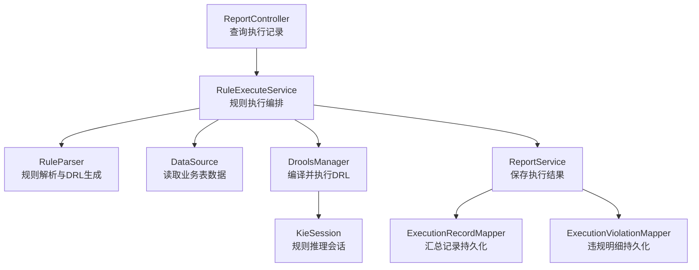
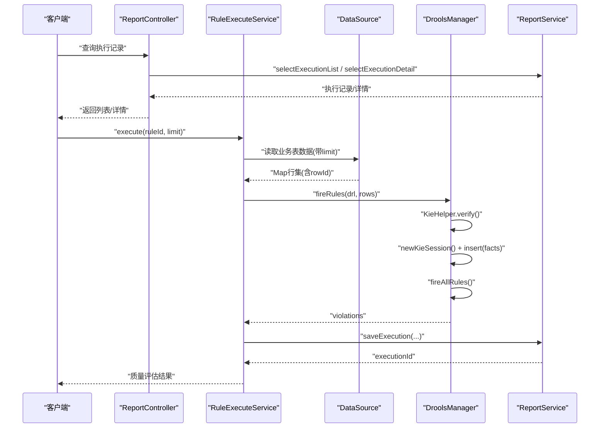
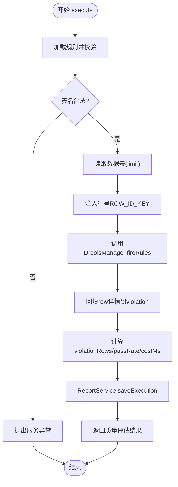
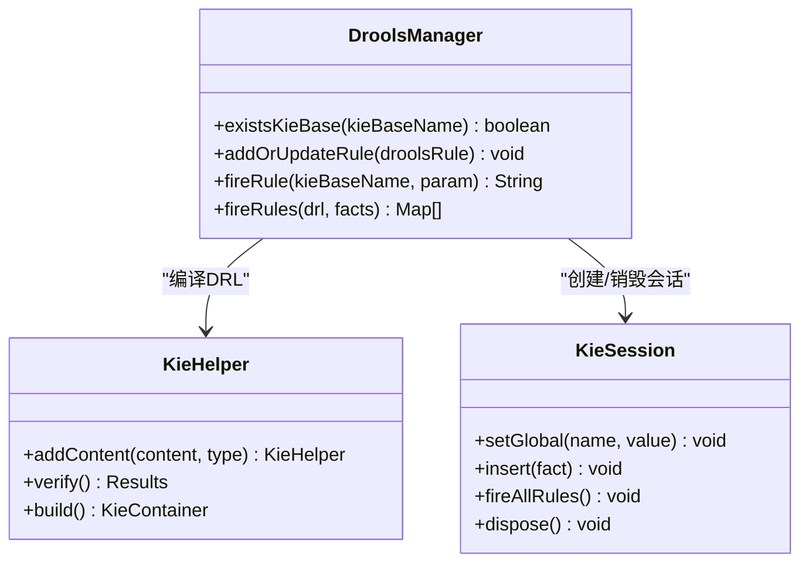
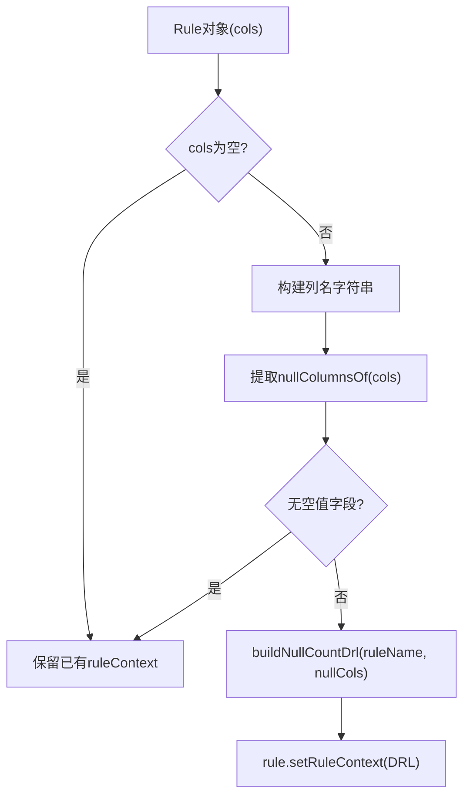
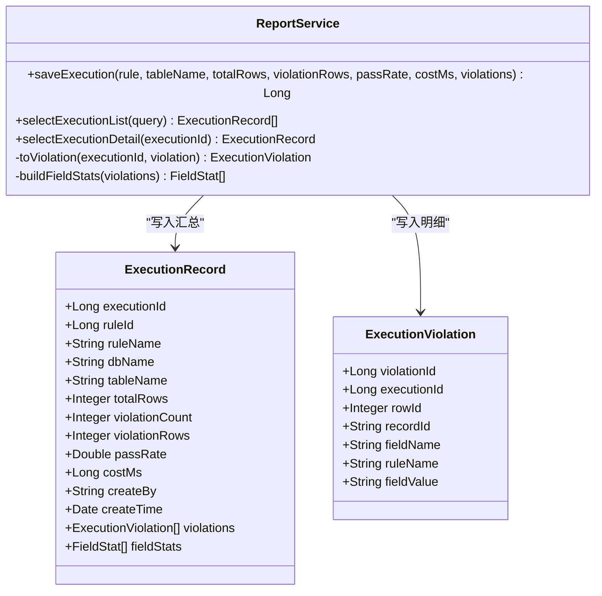
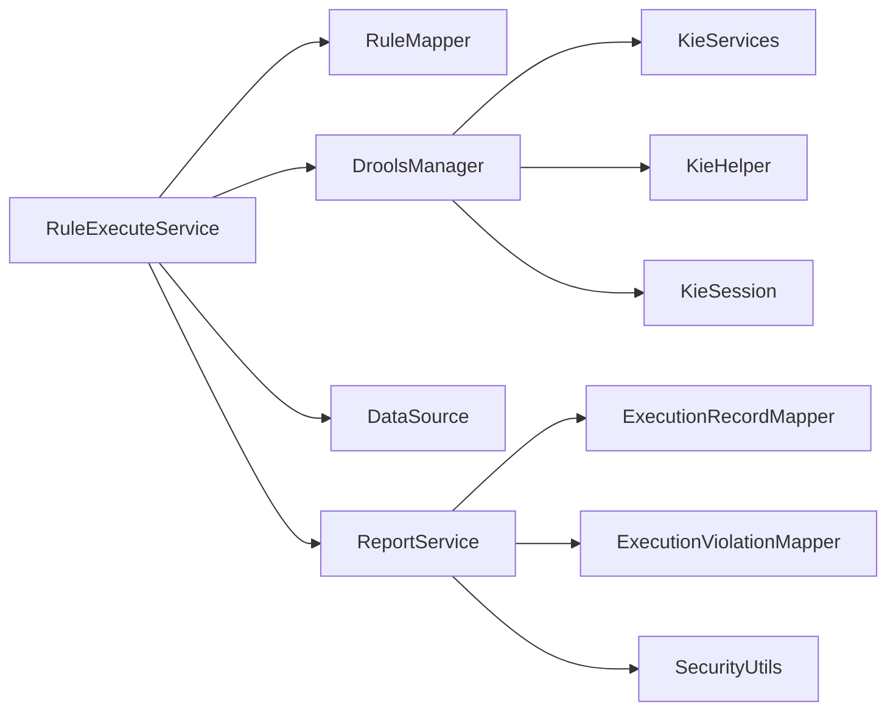

# 规则执行模型

<cite>
**本文引用的文件**   
- [RuleExecuteService.java](file://ruoyi-modules/ruoyi-dqservice/src/main/java/com/ruoyi/dqservice/service/RuleExecuteService.java)
- [ReportService.java](file://ruoyi-modules/ruoyi-dqservice/src/main/java/com/ruoyi/dqservice/service/ReportService.java)
- [ExecutionRecord.java](file://ruoyi-modules/ruoyi-dqservice/src/main/java/com/ruoyi/dqservice/domain/ExecutionRecord.java)
- [ExecutionViolation.java](file://ruoyi-modules/ruoyi-dqservice/src/main/java/com/ruoyi/dqservice/domain/ExecutionViolation.java)
- [DroolsManager.java](file://ruoyi-modules/ruoyi-dqservice/src/main/java/com/ruoyi/dqservice/connecter/DroolsManager.java)
- [RuleParser.java](file://ruoyi-modules/ruoyi-dqservice/src/main/java/com/ruoyi/dqservice/util/RuleParser.java)
- [ReportController.java](file://ruoyi-modules/ruoyi-dqservice/src/main/java/com/ruoyi/dqservice/controller/ReportController.java)
</cite>

## 目录
1. [引言](#引言)
2. [项目结构](#项目结构)
3. [核心组件](#核心组件)
4. [架构总览](#架构总览)
5. [详细组件分析](#详细组件分析)
6. [依赖关系分析](#依赖关系分析)
7. [性能与调优](#性能与调优)
8. [故障排查指南](#故障排查指南)
9. [结论](#结论)

## 引言
本技术文档围绕“规则执行模型”展开，聚焦数据质量规则从解析、数据准备到结果验证的完整生命周期。重点说明：
- 规则解析与 DRL 生成机制
- 数据读取、行号注入与违规明细回填
- Drools 引擎的执行流程与异常处理
- 执行记录（ExecutionRecord）与违规记录（ExecutionViolation）的数据模型设计
- 批量执行、分区处理与并发控制策略
- 状态管理、异常处理与重试机制
- 性能监控、调优建议与大规模数据处理最佳实践

## 项目结构
该规则执行能力位于 ruoyi-dqservice 模块中，关键代码集中在 service、connecter、util、domain 四个包：
- service：规则执行编排与报告落库
- connecter：Drools 引擎封装
- util：规则解析与 DRL 生成
- domain：执行记录与违规明细实体
- controller：对外查询执行记录的接口入口

**图表来源**
- [ReportController.java:1-40](file://ruoyi-modules/ruoyi-dqservice/src/main/java/com/ruoyi/dqservice/controller/ReportController.java#L1-L40)
- [RuleExecuteService.java:62-114](file://ruoyi-modules/ruoyi-dqservice/src/main/java/com/ruoyi/dqservice/service/RuleExecuteService.java#L62-L114)
- [RuleParser.java:41-93](file://ruoyi-modules/ruoyi-dqservice/src/main/java/com/ruoyi/dqservice/util/RuleParser.java#L41-L93)
- [DroolsManager.java:149-187](file://ruoyi-modules/ruoyi-dqservice/src/main/java/com/ruoyi/dqservice/connecter/DroolsManager.java#L149-L187)
- [ReportService.java:58-89](file://ruoyi-modules/ruoyi-dqservice/src/main/java/com/ruoyi/dqservice/service/ReportService.java#L58-L89)

**章节来源**
- [RuleExecuteService.java:26-35](file://ruoyi-modules/ruoyi-dqservice/src/main/java/com/ruoyi/dqservice/service/RuleExecuteService.java#L26-L35)
- [ReportService.java:21-28](file://ruoyi-modules/ruoyi-dqservice/src/main/java/com/ruoyi/dqservice/service/ReportService.java#L21-L28)

## 核心组件
- RuleExecuteService：规则执行编排服务，负责加载规则、校验参数、读取数据、调用 Drools 执行、统计指标、落库报告。
- DroolsManager：Drools 引擎封装，提供动态编译 DRL、创建 KieSession、插入事实、触发规则、回收违规明细。
- RuleParser：规则解析器，根据列约束生成空值检测 DRL，支持字段级违规产出。
- ReportService：报告服务，负责将执行汇总与违规明细写入数据库，并提供查询接口。
- ExecutionRecord / ExecutionViolation：执行汇总与违规明细的数据模型。

**章节来源**
- [RuleExecuteService.java:62-114](file://ruoyi-modules/ruoyi-dqservice/src/main/java/com/ruoyi/dqservice/service/RuleExecuteService.java#L62-L114)
- [DroolsManager.java:149-187](file://ruoyi-modules/ruoyi-dqservice/src/main/java/com/ruoyi/dqservice/connecter/DroolsManager.java#L149-L187)
- [RuleParser.java:41-93](file://ruoyi-modules/ruoyi-dqservice/src/main/java/com/ruoyi/dqservice/util/RuleParser.java#L41-L93)
- [ReportService.java:58-89](file://ruoyi-modules/ruoyi-dqservice/src/main/java/com/ruoyi/dqservice/service/ReportService.java#L58-L89)
- [ExecutionRecord.java:17-73](file://ruoyi-modules/ruoyi-dqservice/src/main/java/com/ruoyi/dqservice/domain/ExecutionRecord.java#L17-L73)
- [ExecutionViolation.java:13-37](file://ruoyi-modules/ruoyi-dqservice/src/main/java/com/ruoyi/dqservice/domain/ExecutionViolation.java#L13-L37)

## 架构总览
规则执行的端到端流程如下：
1. 控制器接收查询请求，调用 ReportService 获取执行记录列表或详情。
2. 规则执行入口由 RuleExecuteService.execute 发起，先校验规则与表名合法性。
3. 通过 DataSource 读取业务表数据，每行转为 Map，并注入行号占位字段。
4. DroolsManager 动态编译 DRL，将每条记录作为事实插入 KieSession，触发规则。
5. 规则命中后，在 then 块中将违规明细写入全局集合 violations。
6. RuleExecuteService 统计通过率、违规行数、字段分布，并调用 ReportService 保存执行结果。
7. ReportService 在同一事务内写入汇总记录与违规明细，返回执行批次 ID。

**图表来源**
- [ReportController.java:1-40](file://ruoyi-modules/ruoyi-dqservice/src/main/java/com/ruoyi/dqservice/controller/ReportController.java#L1-L40)
- [RuleExecuteService.java:69-114](file://ruoyi-modules/ruoyi-dqservice/src/main/java/com/ruoyi/dqservice/service/RuleExecuteService.java#L69-L114)
- [DroolsManager.java:149-187](file://ruoyi-modules/ruoyi-dqservice/src/main/java/com/ruoyi/dqservice/connecter/DroolsManager.java#L149-L187)
- [ReportService.java:58-89](file://ruoyi-modules/ruoyi-dqservice/src/main/java/com/ruoyi/dqservice/service/ReportService.java#L58-L89)

## 详细组件分析

### 规则执行编排（RuleExecuteService）
职责与关键点：
- 规则加载与校验：检查 ruleId 是否存在、tableName 是否合法、ruleContext 是否为空。
- 数据读取：使用全限定 DataSource 直接连接主数据源，按表名白名单拼接 SQL，限制最大扫描行数。
- 行号注入：为每条记录添加 ROW_ID_KEY，供 DRL 回填 rowId。
- Drools 执行：调用 DroolsManager.fireRules 执行 DRL，收集 violations。
- 指标计算：统计 violationRows、passRate、costMs、fieldStats。
- 报告落库：调用 ReportService.saveExecution 保存汇总与明细。

**图表来源**
- [RuleExecuteService.java:69-114](file://ruoyi-modules/ruoyi-dqservice/src/main/java/com/ruoyi/dqservice/service/RuleExecuteService.java#L69-L114)
- [RuleExecuteService.java:120-149](file://ruoyi-modules/ruoyi-dqservice/src/main/java/com/ruoyi/dqservice/service/RuleExecuteService.java#L120-L149)
- [RuleExecuteService.java:154-197](file://ruoyi-modules/ruoyi-dqservice/src/main/java/com/ruoyi/dqservice/service/RuleExecuteService.java#L154-L197)

**章节来源**
- [RuleExecuteService.java:69-114](file://ruoyi-modules/ruoyi-dqservice/src/main/java/com/ruoyi/dqservice/service/RuleExecuteService.java#L69-L114)
- [RuleExecuteService.java:120-149](file://ruoyi-modules/ruoyi-dqservice/src/main/java/com/ruoyi/dqservice/service/RuleExecuteService.java#L120-L149)
- [RuleExecuteService.java:154-197](file://ruoyi-modules/ruoyi-dqservice/src/main/java/com/ruoyi/dqservice/service/RuleExecuteService.java#L154-L197)

### Drools 引擎封装（DroolsManager）
职责与关键点：
- 动态编译 DRL：使用 KieHelper.addContent 与 verify 进行语法校验。
- 会话管理：每次 fireRules 创建独立 KieSession，并在 finally 中 dispose。
- 全局集合回收：通过 setGlobal("violations", list) 收集 then 块产出的违规明细。
- 错误处理：编译失败抛 ServiceException；未声明 global 时给出可读提示。

**图表来源**
- [DroolsManager.java:149-187](file://ruoyi-modules/ruoyi-dqservice/src/main/java/com/ruoyi/dqservice/connecter/DroolsManager.java#L149-L187)

**章节来源**
- [DroolsManager.java:149-187](file://ruoyi-modules/ruoyi-dqservice/src/main/java/com/ruoyi/dqservice/connecter/DroolsManager.java#L149-L187)

### 规则解析与 DRL 生成（RuleParser）
职责与关键点：
- nullCountParser：根据列约束生成空值检测 DRL，每个字段一条规则，then 块写入 violations。
- ROW_ID_KEY：执行时由 RuleExecuteService 注入，DRL 通过 this["__rowId"] 获取行号。
- parseNullColumns/fillDetectColumns：从已有 DRL 解析实际生效字段，用于前端回显编辑。

**图表来源**
- [RuleParser.java:41-93](file://ruoyi-modules/ruoyi-dqservice/src/main/java/com/ruoyi/dqservice/util/RuleParser.java#L41-L93)
- [RuleParser.java:103-125](file://ruoyi-modules/ruoyi-dqservice/src/main/java/com/ruoyi/dqservice/util/RuleParser.java#L103-L125)
- [RuleParser.java:131-159](file://ruoyi-modules/ruoyi-dqservice/src/main/java/com/ruoyi/dqservice/util/RuleParser.java#L131-L159)

**章节来源**
- [RuleParser.java:41-93](file://ruoyi-modules/ruoyi-dqservice/src/main/java/com/ruoyi/dqservice/util/RuleParser.java#L41-L93)
- [RuleParser.java:103-125](file://ruoyi-modules/ruoyi-dqservice/src/main/java/com/ruoyi/dqservice/util/RuleParser.java#L103-L125)
- [RuleParser.java:131-159](file://ruoyi-modules/ruoyi-dqservice/src/main/java/com/ruoyi/dqservice/util/RuleParser.java#L131-L159)

### 报告与持久化（ReportService）
职责与关键点：
- saveExecution：同一事务内写入汇总记录与违规明细，避免不一致。
- toViolation：将 Map 违规明细转换为 ExecutionViolation 实体，截断超长字段。
- selectExecutionDetail：查询详情时组装 violations 与 fieldStats。

**图表来源**
- [ReportService.java:58-89](file://ruoyi-modules/ruoyi-dqservice/src/main/java/com/ruoyi/dqservice/service/ReportService.java#L58-L89)
- [ReportService.java:111-129](file://ruoyi-modules/ruoyi-dqservice/src/main/java/com/ruoyi/dqservice/service/ReportService.java#L111-L129)
- [ExecutionRecord.java:17-73](file://ruoyi-modules/ruoyi-dqservice/src/main/java/com/ruoyi/dqservice/domain/ExecutionRecord.java#L17-L73)
- [ExecutionViolation.java:13-37](file://ruoyi-modules/ruoyi-dqservice/src/main/java/com/ruoyi/dqservice/domain/ExecutionViolation.java#L13-L37)

**章节来源**
- [ReportService.java:58-89](file://ruoyi-modules/ruoyi-dqservice/src/main/java/com/ruoyi/dqservice/service/ReportService.java#L58-L89)
- [ReportService.java:91-109](file://ruoyi-modules/ruoyi-dqservice/src/main/java/com/ruoyi/dqservice/service/ReportService.java#L91-L109)
- [ReportService.java:111-129](file://ruoyi-modules/ruoyi-dqservice/src/main/java/com/ruoyi/dqservice/service/ReportService.java#L111-L129)
- [ExecutionRecord.java:17-73](file://ruoyi-modules/ruoyi-dqservice/src/main/java/com/ruoyi/dqservice/domain/ExecutionRecord.java#L17-L73)
- [ExecutionViolation.java:13-37](file://ruoyi-modules/ruoyi-dqservice/src/main/java/com/ruoyi/dqservice/domain/ExecutionViolation.java#L13-L37)

## 依赖关系分析
- RuleExecuteService 依赖：
  - RuleMapper：加载规则元信息
  - DroolsManager：执行 DRL
  - DataSource：读取业务数据
  - ReportService：保存执行结果
- DroolsManager 依赖：
  - KieServices/KieHelper/KieSession：Drools 运行时
- ReportService 依赖：
  - ExecutionRecordMapper / ExecutionViolationMapper：持久化层
  - SecurityUtils：获取当前用户名

**图表来源**
- [RuleExecuteService.java:49-60](file://ruoyi-modules/ruoyi-dqservice/src/main/java/com/ruoyi/dqservice/service/RuleExecuteService.java#L49-L60)
- [DroolsManager.java:22-35](file://ruoyi-modules/ruoyi-dqservice/src/main/java/com/ruoyi/dqservice/connecter/DroolsManager.java#L22-L35)
- [ReportService.java:39-43](file://ruoyi-modules/ruoyi-dqservice/src/main/java/com/ruoyi/dqservice/service/ReportService.java#L39-L43)

**章节来源**
- [RuleExecuteService.java:49-60](file://ruoyi-modules/ruoyi-dqservice/src/main/java/com/ruoyi/dqservice/service/RuleExecuteService.java#L49-L60)
- [DroolsManager.java:22-35](file://ruoyi-modules/ruoyi-dqservice/src/main/java/com/ruoyi/dqservice/connecter/DroolsManager.java#L22-L35)
- [ReportService.java:39-43](file://ruoyi-modules/ruoyi-dqservice/src/main/java/com/ruoyi/dqservice/service/ReportService.java#L39-L43)

## 性能与调优
- 单次执行默认与上限：
  - DEFAULT_LIMIT = 1000，MAX_LIMIT = 10000，防止大表拖慢演示环境。
- 数据读取优化：
  - 使用 limit 控制扫描行数，减少内存占用与网络传输。
  - 表名白名单校验，避免 SQL 注入风险。
- Drools 执行优化：
  - 每次 fireRules 使用独立 KieHelper 编译，避免全局文件系统污染。
  - 每次 fireRules 创建独立 KieSession，finally 中 dispose，避免会话泄漏。
- 指标计算优化：
  - 使用 HashSet 去重统计 violationRows，降低重复计数开销。
  - fieldStats 使用 LinkedHashMap 保持顺序并按降序排序，便于可视化。
- 批处理与分区处理：
  - 当前实现为单批次执行，适合中小规模数据；对大规模数据可考虑：
    - 分批读取（分页/游标），逐批执行 DRL，聚合结果。
    - 分区并行执行（按表分区或按时间范围），注意线程安全与资源隔离。
- 并发控制策略：
  - 当前 DroolsManager.fireRules 串行执行；如需并发，需确保：
    - 每个线程拥有独立的 KieSession。
    - violations 集合线程安全或使用局部集合合并。
    - 数据库连接池与事务边界合理配置。
- 状态管理与重试机制：
  - 当前未实现幂等与重试；建议：
    - 引入执行批次状态机（待执行/执行中/成功/失败）。
    - 对网络/IO 异常进行有限次重试，指数退避。
    - 对 Drools 编译失败快速失败，不重试。
- 监控与可观测性：
  - 已记录执行耗时、扫描行数、违规条数、命中率；建议增加：
    - 指标埋点（QPS、P95/P99 延迟、GC 停顿、连接池使用率）。
    - 告警阈值（超时、失败率、违规率突增）。

[本节为通用指导，不直接分析具体文件]

## 故障排查指南
常见问题与定位要点：
- 规则不存在：
  - 现象：抛出 ServiceException，提示 ruleId 不存在。
  - 排查：确认 RuleMapper.selectRuleByRuleId 返回是否为空。
- 表名非法：
  - 现象：抛出 ServiceException，提示表名不合法。
  - 排查：检查 RULE_NAME_PATTERN 匹配逻辑与规则元数据中的 tableName。
- 规则内容为空：
  - 现象：抛出 ServiceException，提示无法执行。
  - 排查：确认 RuleParser.nullCountParser 是否正确生成 ruleContext。
- 读取数据表失败：
  - 现象：抛出 ServiceException，提示读取失败。
  - 排查：检查 DataSource 配置、SQL 拼接、权限与索引。
- 规则编译失败：
  - 现象：DroolsManager.fireRules 抛出 ServiceException，包含编译错误消息。
  - 排查：查看 DRL 语法、global 声明、fact 类型匹配。
- 未声明 global violations：
  - 现象：抛出 ServiceException，提示规则未声明 global java.util.List violations。
  - 排查：确保 DRL 中声明 global 并使用 violations.add(...) 写入明细。
- 执行结果不一致：
  - 现象：汇总与明细数量不一致。
  - 排查：确认 ReportService.saveExecution 在同一事务内写入，检查 Mapper 批量插入逻辑。

**章节来源**
- [RuleExecuteService.java:69-114](file://ruoyi-modules/ruoyi-dqservice/src/main/java/com/ruoyi/dqservice/service/RuleExecuteService.java#L69-L114)
- [RuleExecuteService.java:120-149](file://ruoyi-modules/ruoyi-dqservice/src/main/java/com/ruoyi/dqservice/service/RuleExecuteService.java#L120-L149)
- [DroolsManager.java:149-187](file://ruoyi-modules/ruoyi-dqservice/src/main/java/com/ruoyi/dqservice/connecter/DroolsManager.java#L149-L187)
- [ReportService.java:58-89](file://ruoyi-modules/ruoyi-dqservice/src/main/java/com/ruoyi/dqservice/service/ReportService.java#L58-L89)

## 结论
该规则执行模型以 RuleExecuteService 为核心编排，结合 RuleParser 的动态 DRL 生成与 DroolsManager 的规则引擎执行，实现了从数据读取、规则推理到结果落库的闭环。数据模型 ExecutionRecord 与 ExecutionViolation 清晰分离汇总与明细，便于审计与可视化。当前实现适用于中小规模数据；对于大规模场景，建议引入分批、分区与并发控制，完善状态机与重试机制，并加强监控与告警，以提升稳定性与可观测性。

[本节为总结性内容，不直接分析具体文件]