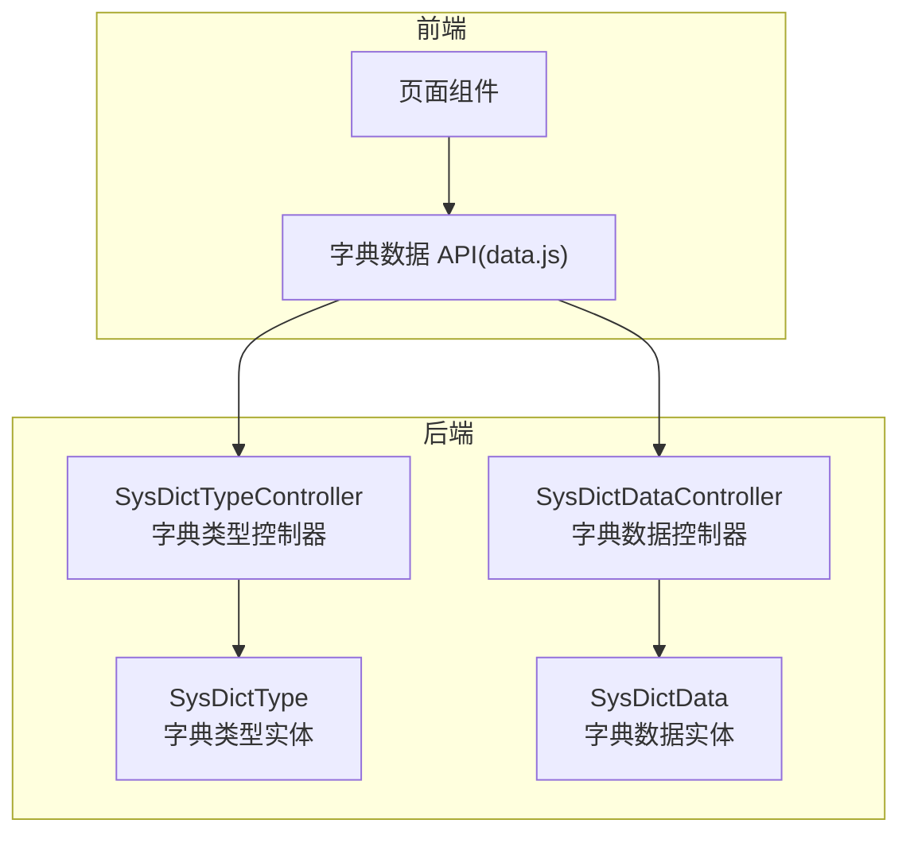
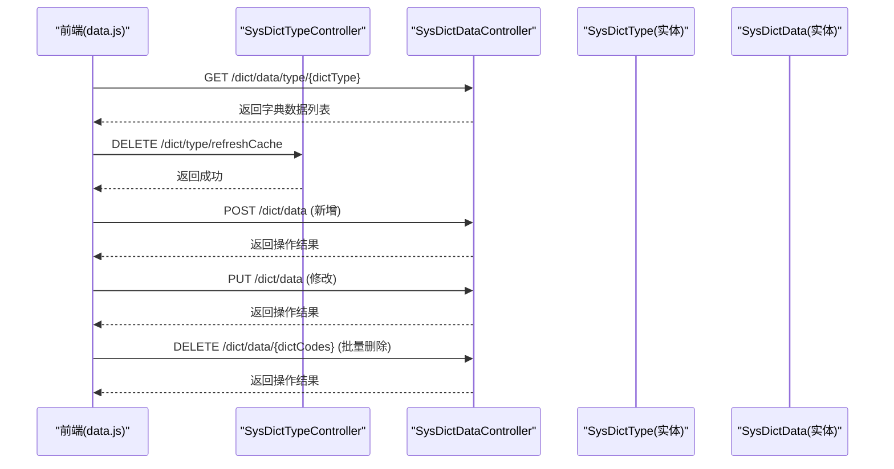
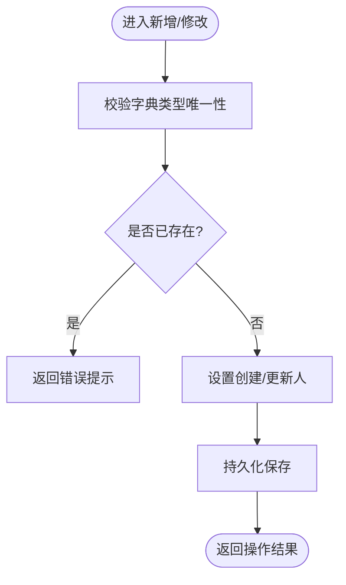
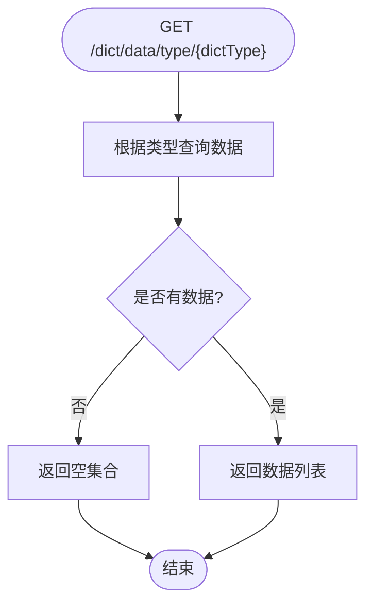
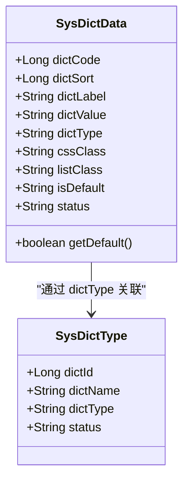
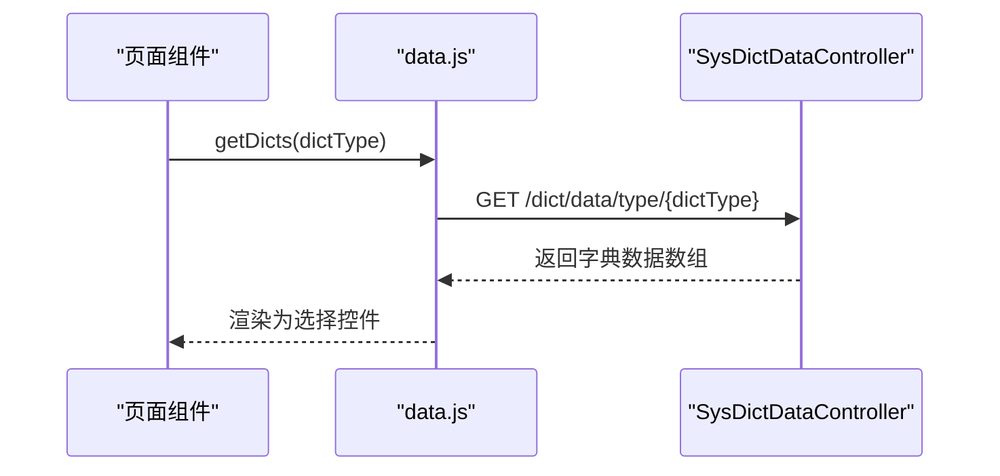
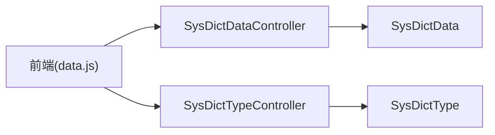

# 字典管理

<cite>
**本文引用的文件**   
- [SysDictTypeController.java](file://ruoyi-modules/ruoyi-system/src/main/java/com/ruoyi/system/controller/SysDictTypeController.java)
- [SysDictDataController.java](file://ruoyi-modules/ruoyi-system/src/main/java/com/ruoyi/system/controller/SysDictDataController.java)
- [SysDictType.java](file://ruoyi-api/ruoyi-api-system/src/main/java/com/ruoyi/system/api/domain/SysDictType.java)
- [SysDictData.java](file://ruoyi-api/ruoyi-api-system/src/main/java/com/ruoyi/system/api/domain/SysDictData.java)
- [data.js](file://ruoyi-ui/src/api/system/dict/data.js)
</cite>

## 目录
1. [简介](#简介)
2. [项目结构](#项目结构)
3. [核心组件](#核心组件)
4. [架构总览](#架构总览)
5. [详细组件分析](#详细组件分析)
6. [依赖关系分析](#依赖关系分析)
7. [性能与缓存](#性能与缓存)
8. [故障排查指南](#故障排查指南)
9. [结论](#结论)
10. [附录：API 接口文档](#附录api-接口文档)

## 简介
本章节面向“字典管理”功能，覆盖字典类型与字典数据的全生命周期管理、前后端交互流程、数据结构定义、缓存刷新机制以及在前端组件中的使用方式。后端通过 Spring MVC 控制器暴露 REST API，前端通过统一的请求封装调用接口，结合字典工具进行动态加载与渲染。

## 项目结构
围绕字典管理的代码主要分布在以下位置：
- 后端控制器：系统模块的字典类型与字典数据控制器
- 领域模型：字典类型与字典数据的实体类（跨服务共享）
- 前端 API：字典数据的 HTTP 请求封装

图表来源
- [SysDictTypeController.java:32-37](file://ruoyi-modules/ruoyi-system/src/main/java/com/ruoyi/system/controller/SysDictTypeController.java#L32-L37)
- [SysDictDataController.java:34-42](file://ruoyi-modules/ruoyi-system/src/main/java/com/ruoyi/system/controller/SysDictDataController.java#L34-L42)
- [SysDictType.java:17-35](file://ruoyi-api/ruoyi-api-system/src/main/java/com/ruoyi/system/api/domain/SysDictType.java#L17-L35)
- [SysDictData.java:17-53](file://ruoyi-api/ruoyi-api-system/src/main/java/com/ruoyi/system/api/domain/SysDictData.java#L17-L53)
- [data.js:1-52](file://ruoyi-ui/src/api/system/dict/data.js#L1-L52)

章节来源
- [SysDictTypeController.java:1-134](file://ruoyi-modules/ruoyi-system/src/main/java/com/ruoyi/system/controller/SysDictTypeController.java#L1-L134)
- [SysDictDataController.java:1-123](file://ruoyi-modules/ruoyi-system/src/main/java/com/ruoyi/system/controller/SysDictDataController.java#L1-L123)
- [SysDictType.java:1-97](file://ruoyi-api/ruoyi-api-system/src/main/java/com/ruoyi/system/api/domain/SysDictType.java#L1-L97)
- [SysDictData.java:1-177](file://ruoyi-api/ruoyi-api-system/src/main/java/com/ruoyi/system/api/domain/SysDictData.java#L1-L177)
- [data.js:1-52](file://ruoyi-ui/src/api/system/dict/data.js#L1-L52)

## 核心组件
- 字典类型控制器：提供字典类型的分页查询、详情、新增、修改、删除、导出、刷新缓存、选项列表等能力
- 字典数据控制器：提供字典数据的分页查询、详情、按类型查询、新增、修改、删除、导出等能力
- 字典类型实体：包含字典主键、名称、类型标识、状态等字段，并带有校验注解
- 字典数据实体：包含编码、排序、标签、键值、所属类型、样式、默认标记、状态等字段，并提供布尔便捷方法
- 前端字典数据 API：封装了列表、详情、按类型获取、新增、修改、删除等请求

章节来源
- [SysDictTypeController.java:32-132](file://ruoyi-modules/ruoyi-system/src/main/java/com/ruoyi/system/controller/SysDictTypeController.java#L32-L132)
- [SysDictDataController.java:34-121](file://ruoyi-modules/ruoyi-system/src/main/java/com/ruoyi/system/controller/SysDictDataController.java#L34-L121)
- [SysDictType.java:17-96](file://ruoyi-api/ruoyi-api-system/src/main/java/com/ruoyi/system/api/domain/SysDictType.java#L17-L96)
- [SysDictData.java:17-176](file://ruoyi-api/ruoyi-api-system/src/main/java/com/ruoyi/system/api/domain/SysDictData.java#L17-L176)
- [data.js:1-52](file://ruoyi-ui/src/api/system/dict/data.js#L1-L52)

## 架构总览
字典管理采用典型的前后端分离架构：
- 前端通过统一请求封装发起 HTTP 请求
- 后端控制器接收请求，执行业务逻辑（由服务层实现），返回统一响应体
- 字典类型与数据以实体对象在前后端之间传递
- 字典类型支持“刷新缓存”操作，便于在配置变更后快速生效

图表来源
- [data.js:3-52](file://ruoyi-ui/src/api/system/dict/data.js#L3-L52)
- [SysDictDataController.java:73-121](file://ruoyi-modules/ruoyi-system/src/main/java/com/ruoyi/system/controller/SysDictDataController.java#L73-L121)
- [SysDictTypeController.java:112-122](file://ruoyi-modules/ruoyi-system/src/main/java/com/ruoyi/system/controller/SysDictTypeController.java#L112-L122)

## 详细组件分析

### 字典类型管理（SysDictTypeController）
职责与要点：
- 提供字典类型的分页查询、详情、新增、修改、删除、导出、刷新缓存、选项列表
- 新增/修改前进行唯一性校验，避免重复的字典类型
- 刷新缓存接口用于在字典类型变更时主动清理缓存，保证读取一致性

关键流程（新增/修改唯一性校验）：

图表来源
- [SysDictTypeController.java:68-98](file://ruoyi-modules/ruoyi-system/src/main/java/com/ruoyi/system/controller/SysDictTypeController.java#L68-L98)

章节来源
- [SysDictTypeController.java:32-132](file://ruoyi-modules/ruoyi-system/src/main/java/com/ruoyi/system/controller/SysDictTypeController.java#L32-L132)

### 字典数据管理（SysDictDataController）
职责与要点：
- 提供字典数据的分页查询、详情、按类型查询、新增、修改、删除、导出
- 按类型查询接口在服务层获取数据，若为空则返回空集合，避免前端空指针
- 新增/修改自动填充操作人信息

关键流程（按类型查询）：

图表来源
- [SysDictDataController.java:73-85](file://ruoyi-modules/ruoyi-system/src/main/java/com/ruoyi/system/controller/SysDictDataController.java#L73-L85)

章节来源
- [SysDictDataController.java:34-121](file://ruoyi-modules/ruoyi-system/src/main/java/com/ruoyi/system/controller/SysDictDataController.java#L34-L121)

### 数据结构定义（实体类）
- SysDictType（字典类型）
  - 关键字段：字典主键、字典名称、字典类型（标识）、状态
  - 校验规则：名称与类型必填；类型需符合小写字母开头、仅含小写字母/数字/下划线
- SysDictData（字典数据）
  - 关键字段：编码、排序、标签、键值、所属类型、样式属性、表格样式、是否默认、状态
  - 便捷方法：将“是否默认”字符串转换为布尔值

图表来源
- [SysDictType.java:17-96](file://ruoyi-api/ruoyi-api-system/src/main/java/com/ruoyi/system/api/domain/SysDictType.java#L17-L96)
- [SysDictData.java:17-176](file://ruoyi-api/ruoyi-api-system/src/main/java/com/ruoyi/system/api/domain/SysDictData.java#L17-L176)

章节来源
- [SysDictType.java:17-96](file://ruoyi-api/ruoyi-api-system/src/main/java/com/ruoyi/system/api/domain/SysDictType.java#L17-L96)
- [SysDictData.java:17-176](file://ruoyi-api/ruoyi-api-system/src/main/java/com/ruoyi/system/api/domain/SysDictData.java#L17-L176)

### 前端使用与动态加载
- 前端通过 data.js 提供的函数调用后端接口，包括：
  - 列表查询、详情查询、按类型获取、新增、修改、删除
- 典型用法：
  - 页面初始化或打开表单时，调用“按类型获取”接口，将返回的字典项渲染为下拉框、单选/复选组等
  - 在字典数据发生变更后，可触发“刷新缓存”接口，确保后续读取为最新数据

图表来源
- [data.js:20-26](file://ruoyi-ui/src/api/system/dict/data.js#L20-L26)
- [SysDictDataController.java:73-85](file://ruoyi-modules/ruoyi-system/src/main/java/com/ruoyi/system/controller/SysDictDataController.java#L73-L85)

章节来源
- [data.js:1-52](file://ruoyi-ui/src/api/system/dict/data.js#L1-L52)

## 依赖关系分析
- 控制器与服务层：控制器依赖服务接口完成业务逻辑（如分页、校验、持久化、缓存刷新）
- 控制器与实体：控制器入参/出参使用实体对象，承载校验与序列化
- 前端与后端：前端通过 data.js 统一封装的请求与后端控制器一一对应

图表来源
- [data.js:1-52](file://ruoyi-ui/src/api/system/dict/data.js#L1-L52)
- [SysDictDataController.java:34-42](file://ruoyi-modules/ruoyi-system/src/main/java/com/ruoyi/system/controller/SysDictDataController.java#L34-L42)
- [SysDictTypeController.java:32-37](file://ruoyi-modules/ruoyi-system/src/main/java/com/ruoyi/system/controller/SysDictTypeController.java#L32-L37)
- [SysDictData.java:17-53](file://ruoyi-api/ruoyi-api-system/src/main/java/com/ruoyi/system/api/domain/SysDictData.java#L17-L53)
- [SysDictType.java:17-35](file://ruoyi-api/ruoyi-api-system/src/main/java/com/ruoyi/system/api/domain/SysDictType.java#L17-L35)

章节来源
- [SysDictDataController.java:34-121](file://ruoyi-modules/ruoyi-system/src/main/java/com/ruoyi/system/controller/SysDictDataController.java#L34-L121)
- [SysDictTypeController.java:32-132](file://ruoyi-modules/ruoyi-system/src/main/java/com/ruoyi/system/controller/SysDictTypeController.java#L32-L132)
- [data.js:1-52](file://ruoyi-ui/src/api/system/dict/data.js#L1-L52)

## 性能与缓存
- 缓存刷新：字典类型提供“刷新缓存”接口，建议在字典类型或数据发生批量变更后调用，以减少数据库压力并提升读取性能
- 按需加载：前端优先使用“按类型获取”接口，避免全量拉取字典数据
- 分页与导出：列表查询支持分页，导出功能独立于分页，避免大数据集对列表接口造成压力

章节来源
- [SysDictTypeController.java:112-122](file://ruoyi-modules/ruoyi-system/src/main/java/com/ruoyi/system/controller/SysDictTypeController.java#L112-L122)
- [SysDictDataController.java:44-61](file://ruoyi-modules/ruoyi-system/src/main/java/com/ruoyi/system/controller/SysDictDataController.java#L44-L61)

## 故障排查指南
- 唯一性冲突：新增/修改字典类型时报错“字典类型已存在”，请检查字典类型标识是否重复
- 空数据返回：按类型查询返回空集合属于正常情况，前端需兼容空数组渲染
- 权限问题：所有写操作均受权限控制，未授权会拒绝访问
- 参数校验失败：字典类型需满足正则表达式约束（小写字母开头，仅含小写字母/数字/下划线）

章节来源
- [SysDictTypeController.java:68-98](file://ruoyi-modules/ruoyi-system/src/main/java/com/ruoyi/system/controller/SysDictTypeController.java#L68-L98)
- [SysDictDataController.java:73-85](file://ruoyi-modules/ruoyi-system/src/main/java/com/ruoyi/system/controller/SysDictDataController.java#L73-L85)
- [SysDictType.java:59-65](file://ruoyi-api/ruoyi-api-system/src/main/java/com/ruoyi/system/api/domain/SysDictType.java#L59-L65)

## 结论
字典管理在后端通过清晰的控制器分层与严格的实体校验保障数据质量，在前端通过统一的 API 封装与按需加载策略提升用户体验。配合“刷新缓存”机制，可在配置变更后快速生效，兼顾一致性与性能。

## 附录：API 接口文档

### 字典类型接口（/dict/type）
- 分页查询
  - 方法：GET
  - 路径：/dict/type/list
  - 权限：system:dict:list
  - 说明：返回字典类型分页数据
- 导出
  - 方法：POST
  - 路径：/dict/type/export
  - 权限：system:dict:export
  - 说明：导出字典类型为 Excel
- 详情
  - 方法：GET
  - 路径：/dict/type/{dictId}
  - 权限：system:dict:query
  - 说明：根据 ID 获取字典类型详情
- 新增
  - 方法：POST
  - 路径：/dict/type
  - 权限：system:dict:add
  - 说明：新增字典类型，包含唯一性校验
- 修改
  - 方法：PUT
  - 路径：/dict/type
  - 权限：system:dict:edit
  - 说明：修改字典类型，包含唯一性校验
- 删除
  - 方法：DELETE
  - 路径：/dict/type/{dictIds}
  - 权限：system:dict:remove
  - 说明：批量删除字典类型
- 刷新缓存
  - 方法：DELETE
  - 路径：/dict/type/refreshCache
  - 权限：system:dict:remove
  - 说明：清空字典相关缓存
- 选项列表
  - 方法：GET
  - 路径：/dict/type/optionselect
  - 说明：返回所有字典类型供选择

章节来源
- [SysDictTypeController.java:39-132](file://ruoyi-modules/ruoyi-system/src/main/java/com/ruoyi/system/controller/SysDictTypeController.java#L39-L132)

### 字典数据接口（/dict/data）
- 分页查询
  - 方法：GET
  - 路径：/dict/data/list
  - 权限：system:dict:list
  - 说明：返回字典数据分页数据
- 导出
  - 方法：POST
  - 路径：/dict/data/export
  - 权限：system:dict:export
  - 说明：导出字典数据为 Excel
- 详情
  - 方法：GET
  - 路径：/dict/data/{dictCode}
  - 权限：system:dict:query
  - 说明：根据编码获取字典数据详情
- 按类型查询
  - 方法：GET
  - 路径：/dict/data/type/{dictType}
  - 说明：根据字典类型返回数据列表，空结果返回空数组
- 新增
  - 方法：POST
  - 路径：/dict/data
  - 权限：system:dict:add
  - 说明：新增字典数据
- 修改
  - 方法：PUT
  - 路径：/dict/data
  - 权限：system:dict:edit
  - 说明：修改字典数据
- 删除
  - 方法：DELETE
  - 路径：/dict/data/{dictCodes}
  - 权限：system:dict:remove
  - 说明：批量删除字典数据

章节来源
- [SysDictDataController.java:44-121](file://ruoyi-modules/ruoyi-system/src/main/java/com/ruoyi/system/controller/SysDictDataController.java#L44-L121)

### 前端 API 封装（data.js）
- 列表查询：listData(query)
- 详情查询：getData(dictCode)
- 按类型获取：getDicts(dictType)
- 新增：addData(data)
- 修改：updateData(data)
- 删除：delData(dictCode)

章节来源
- [data.js:1-52](file://ruoyi-ui/src/api/system/dict/data.js#L1-L52)