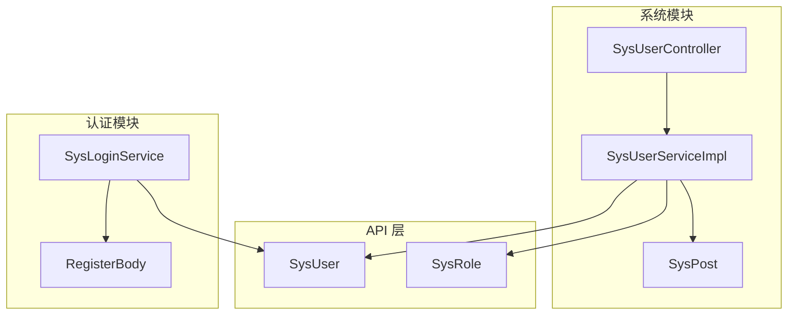
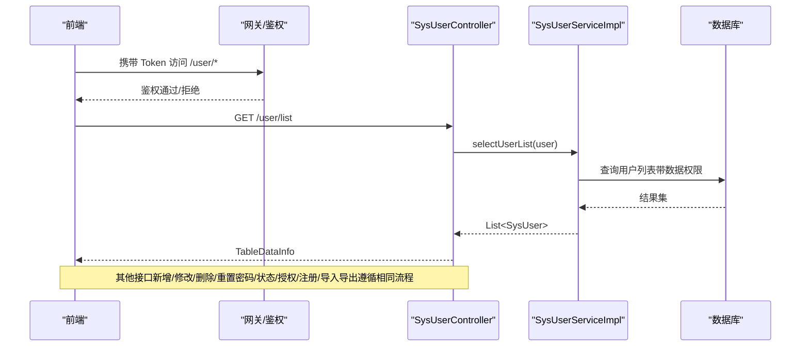
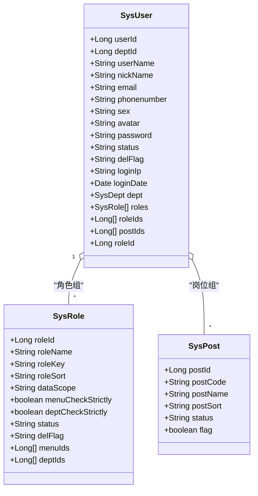
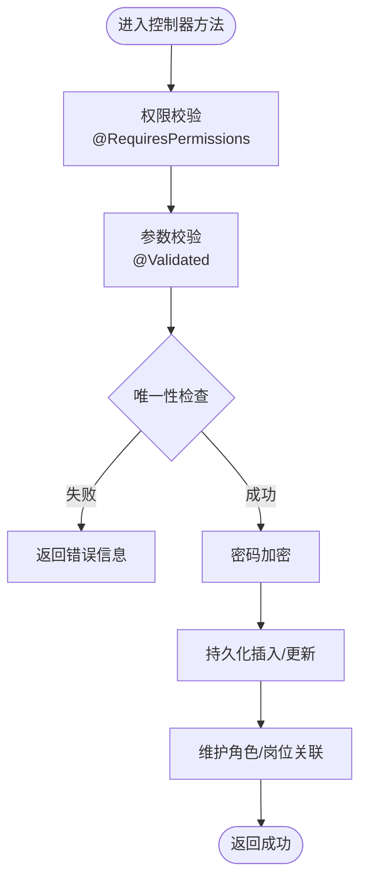
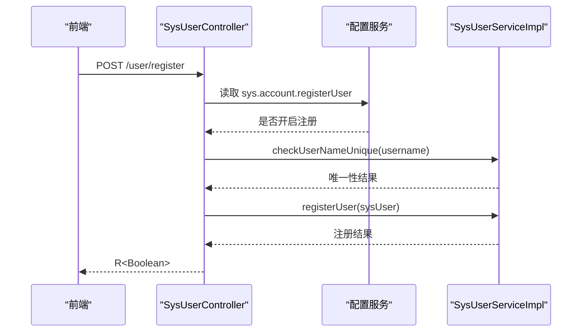
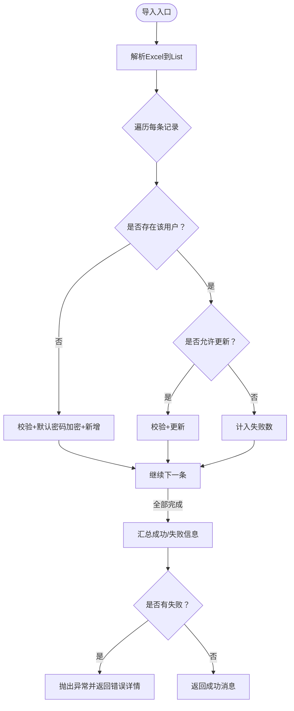
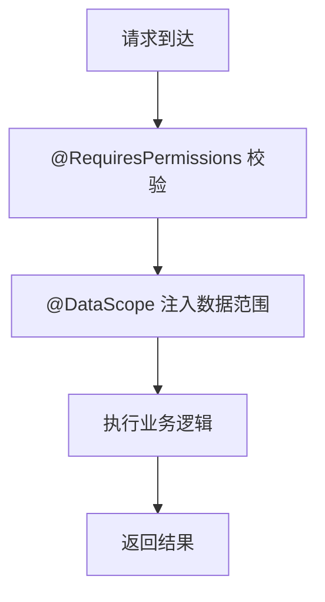
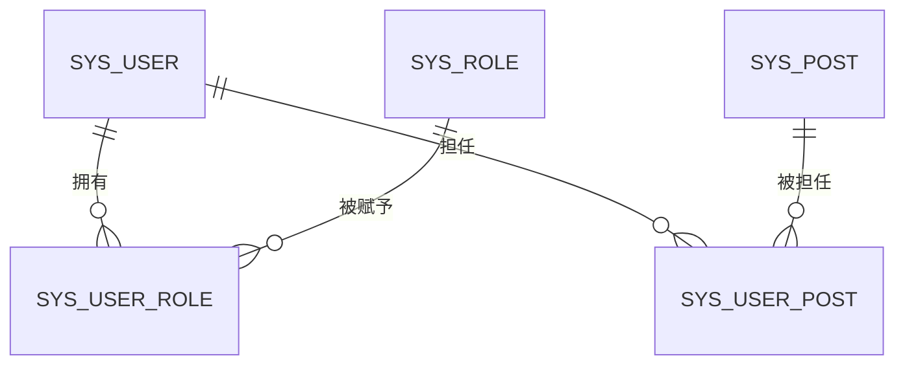
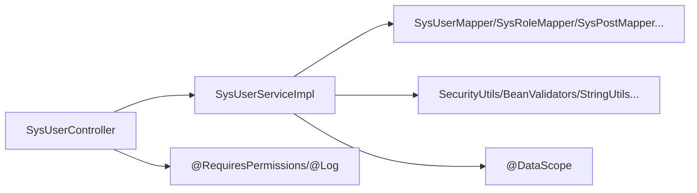

# 用户管理

<cite>
**本文引用的文件**   
- [SysUser.java](file://ruoyi-api/ruoyi-api-system/src/main/java/com/ruoyi/system/api/domain/SysUser.java)
- [SysRole.java](file://ruoyi-api/ruoyi-api-system/src/main/java/com/ruoyi/system/api/domain/SysRole.java)
- [SysPost.java](file://ruoyi-modules/ruoyi-system/src/main/java/com/ruoyi/system/domain/SysPost.java)
- [SysUserController.java](file://ruoyi-modules/ruoyi-system/src/main/java/com/ruoyi/system/controller/SysUserController.java)
- [SysUserServiceImpl.java](file://ruoyi-modules/ruoyi-system/src/main/java/com/ruoyi/system/service/impl/SysUserServiceImpl.java)
- [ISysUserService.java](file://ruoyi-modules/ruoyi-system/src/main/java/com/ruoyi/system/service/ISysUserService.java)
- [SysLoginService.java](file://ruoyi-auth/src/main/java/com/ruoyi/auth/service/SysLoginService.java)
- [RegisterBody.java](file://ruoyi-auth/src/main/java/com/ruoyi/auth/form/RegisterBody.java)
</cite>

## 目录
1. [简介](#简介)
2. [项目结构](#项目结构)
3. [核心组件](#核心组件)
4. [架构总览](#架构总览)
5. [详细组件分析](#详细组件分析)
6. [依赖关系分析](#依赖关系分析)
7. [性能与扩展性](#性能与扩展性)
8. [故障排查指南](#故障排查指南)
9. [结论](#结论)
10. [附录：API 接口文档](#附录api-接口文档)

## 简介
本文件面向“用户管理”功能，覆盖用户的增删改查、注册、密码重置、状态管理、数据验证、权限控制、批量导入导出、以及与角色和岗位的关联关系。同时提供前端操作指引与后端服务扩展建议，帮助开发者快速理解并二次开发。

## 项目结构
围绕用户管理的代码主要分布在以下模块：
- API 层（跨服务共享模型）：SysUser、SysRole
- 系统模块（业务实现）：SysUserController、SysUserServiceImpl、SysPost
- 认证模块：SysLoginService、RegisterBody

图表来源
- [SysUserController.java:46-63](file://ruoyi-modules/ruoyi-system/src/main/java/com/ruoyi/system/controller/SysUserController.java#L46-L63)
- [SysUserServiceImpl.java:38-62](file://ruoyi-modules/ruoyi-system/src/main/java/com/ruoyi/system/service/impl/SysUserServiceImpl.java#L38-L62)
- [SysUser.java:16-89](file://ruoyi-api/ruoyi-api-system/src/main/java/com/ruoyi/system/api/domain/SysUser.java#L16-L89)
- [SysRole.java:11-60](file://ruoyi-api/ruoyi-api-system/src/main/java/com/ruoyi/system/api/domain/SysRole.java#L11-L60)
- [SysPost.java:11-41](file://ruoyi-modules/ruoyi-system/src/main/java/com/ruoyi/system/domain/SysPost.java#L11-L41)
- [SysLoginService.java](file://ruoyi-auth/src/main/java/com/ruoyi/auth/service/SysLoginService.java)
- [RegisterBody.java](file://ruoyi-auth/src/main/java/com/ruoyi/auth/form/RegisterBody.java)

章节来源
- [SysUserController.java:46-63](file://ruoyi-modules/ruoyi-system/src/main/java/com/ruoyi/system/controller/SysUserController.java#L46-L63)
- [SysUserServiceImpl.java:38-62](file://ruoyi-modules/ruoyi-system/src/main/java/com/ruoyi/system/service/impl/SysUserServiceImpl.java#L38-L62)

## 核心组件
- SysUser：用户实体，包含账号、昵称、邮箱、手机、性别、头像、密码、状态、删除标志、最后登录信息，以及部门、角色、岗位等关联字段；内置校验注解用于输入校验与 Excel 导入导出映射。
- SysRole：角色实体，包含角色名、权限标识、排序、数据范围、状态等，支持菜单与部门的数据权限配置。
- SysPost：岗位实体，包含编码、名称、排序、状态等。
- SysUserController：对外暴露的用户管理 REST 接口，涵盖列表、详情、新增、修改、删除、重置密码、状态变更、授权角色、注册、导入导出等。
- SysUserServiceImpl：用户业务逻辑实现，封装了唯一性校验、数据权限校验、CRUD、角色/岗位关联维护、批量导入导出处理、状态与密码更新等。
- ISysUserService：用户服务接口定义。
- SysLoginService：认证登录服务（与用户管理联动）。
- RegisterBody：注册请求体（认证模块）。

章节来源
- [SysUser.java:16-89](file://ruoyi-api/ruoyi-api-system/src/main/java/com/ruoyi/system/api/domain/SysUser.java#L16-L89)
- [SysRole.java:11-60](file://ruoyi-api/ruoyi-api-system/src/main/java/com/ruoyi/system/api/domain/SysRole.java#L11-L60)
- [SysPost.java:11-41](file://ruoyi-modules/ruoyi-system/src/main/java/com/ruoyi/system/domain/SysPost.java#L11-L41)
- [SysUserController.java:46-104](file://ruoyi-modules/ruoyi-system/src/main/java/com/ruoyi/system/controller/SysUserController.java#L46-L104)
- [SysUserServiceImpl.java:64-246](file://ruoyi-modules/ruoyi-system/src/main/java/com/ruoyi/system/service/impl/SysUserServiceImpl.java#L64-L246)
- [ISysUserService.java](file://ruoyi-modules/ruoyi-system/src/main/java/com/ruoyi/system/service/ISysUserService.java)
- [SysLoginService.java](file://ruoyi-auth/src/main/java/com/ruoyi/auth/service/SysLoginService.java)
- [RegisterBody.java](file://ruoyi-auth/src/main/java/com/ruoyi/auth/form/RegisterBody.java)

## 架构总览
用户管理采用典型的 Controller-Service-Mapper 分层架构，结合注解驱动的安全与数据权限控制。

图表来源
- [SysUserController.java:68-104](file://ruoyi-modules/ruoyi-system/src/main/java/com/ruoyi/system/controller/SysUserController.java#L68-L104)
- [SysUserServiceImpl.java:70-75](file://ruoyi-modules/ruoyi-system/src/main/java/com/ruoyi/system/service/impl/SysUserServiceImpl.java#L70-L75)

## 详细组件分析

### 用户数据模型与校验规则
- 字段与校验
  - 用户名：非空、长度限制、XSS 防护
  - 昵称：长度限制、XSS 防护
  - 邮箱：格式校验、长度限制
  - 手机号：长度限制
  - 状态：正常/停用
  - 删除标志：存在/删除
  - 角色/岗位：数组或对象集合，用于多对多关联
- Excel 注解：用于导入导出的列映射与转换说明

图表来源
- [SysUser.java:16-89](file://ruoyi-api/ruoyi-api-system/src/main/java/com/ruoyi/system/api/domain/SysUser.java#L16-L89)
- [SysRole.java:11-60](file://ruoyi-api/ruoyi-api-system/src/main/java/com/ruoyi/system/api/domain/SysRole.java#L11-L60)
- [SysPost.java:11-41](file://ruoyi-modules/ruoyi-system/src/main/java/com/ruoyi/system/domain/SysPost.java#L11-L41)

章节来源
- [SysUser.java:133-179](file://ruoyi-api/ruoyi-api-system/src/main/java/com/ruoyi/system/api/domain/SysUser.java#L133-L179)
- [SysRole.java:92-114](file://ruoyi-api/ruoyi-api-system/src/main/java/com/ruoyi/system/api/domain/SysRole.java#L92-L114)
- [SysPost.java:53-79](file://ruoyi-modules/ruoyi-system/src/main/java/com/ruoyi/system/domain/SysPost.java#L53-L79)

### 用户增删改查与状态管理
- 列表查询：分页+条件过滤，受数据权限控制
- 详情获取：返回用户基本信息、角色与岗位
- 新增：用户名/手机/邮箱唯一性校验，密码加密后落库，写入角色与岗位关联
- 修改：保护超级管理员，唯一性校验，更新角色与岗位关联
- 删除：禁止删除当前用户，级联清理角色与岗位关联
- 重置密码：加密后更新
- 状态变更：启用/停用

图表来源
- [SysUserController.java:191-239](file://ruoyi-modules/ruoyi-system/src/main/java/com/ruoyi/system/controller/SysUserController.java#L191-L239)
- [SysUserServiceImpl.java:254-299](file://ruoyi-modules/ruoyi-system/src/main/java/com/ruoyi/system/service/impl/SysUserServiceImpl.java#L254-L299)

章节来源
- [SysUserController.java:68-104](file://ruoyi-modules/ruoyi-system/src/main/java/com/ruoyi/system/controller/SysUserController.java#L68-L104)
- [SysUserController.java:191-283](file://ruoyi-modules/ruoyi-system/src/main/java/com/ruoyi/system/controller/SysUserController.java#L191-L283)
- [SysUserServiceImpl.java:254-325](file://ruoyi-modules/ruoyi-system/src/main/java/com/ruoyi/system/service/impl/SysUserServiceImpl.java#L254-L325)

### 用户注册与密码重置
- 注册：通过内部接口 /user/register，受配置开关控制；用户名唯一性校验；成功后调用服务层保存
- 密码重置：管理员重置密码接口，加密后更新；另有按用户名重置的服务方法

图表来源
- [SysUserController.java:131-146](file://ruoyi-modules/ruoyi-system/src/main/java/com/ruoyi/system/controller/SysUserController.java#L131-L146)
- [SysUserServiceImpl.java:273-277](file://ruoyi-modules/ruoyi-system/src/main/java/com/ruoyi/system/service/impl/SysUserServiceImpl.java#L273-L277)

章节来源
- [SysUserController.java:131-146](file://ruoyi-modules/ruoyi-system/src/main/java/com/ruoyi/system/controller/SysUserController.java#L131-L146)
- [SysUserServiceImpl.java:358-375](file://ruoyi-modules/ruoyi-system/src/main/java/com/ruoyi/system/service/impl/SysUserServiceImpl.java#L358-L375)

### 批量导入导出
- 导出：根据查询条件导出用户数据为 Excel
- 导入：解析 Excel，逐条校验与处理，支持新增与更新模式，汇总成功/失败信息
- 模板下载：提供标准导入模板

图表来源
- [SysUserController.java:87-104](file://ruoyi-modules/ruoyi-system/src/main/java/com/ruoyi/system/controller/SysUserController.java#L87-L104)
- [SysUserServiceImpl.java:502-561](file://ruoyi-modules/ruoyi-system/src/main/java/com/ruoyi/system/service/impl/SysUserServiceImpl.java#L502-L561)

章节来源
- [SysUserController.java:77-104](file://ruoyi-modules/ruoyi-system/src/main/java/com/ruoyi/system/controller/SysUserController.java#L77-L104)
- [SysUserServiceImpl.java:502-561](file://ruoyi-modules/ruoyi-system/src/main/java/com/ruoyi/system/service/impl/SysUserServiceImpl.java#L502-L561)

### 权限控制机制
- 接口级权限：使用 @RequiresPermissions 控制访问
- 数据权限：通过 @DataScope 注解在 Service 层注入 SQL 条件，限制可访问的部门/用户范围
- 超级管理员保护：禁止对超级管理员进行敏感操作

图表来源
- [SysUserController.java:68-75](file://ruoyi-modules/ruoyi-system/src/main/java/com/ruoyi/system/controller/SysUserController.java#L68-L75)
- [SysUserServiceImpl.java:70-75](file://ruoyi-modules/ruoyi-system/src/main/java/com/ruoyi/system/service/impl/SysUserServiceImpl.java#L70-L75)

章节来源
- [SysUserController.java:68-75](file://ruoyi-modules/ruoyi-system/src/main/java/com/ruoyi/system/controller/SysUserController.java#L68-L75)
- [SysUserServiceImpl.java:70-75](file://ruoyi-modules/ruoyi-system/src/main/java/com/ruoyi/system/service/impl/SysUserServiceImpl.java#L70-L75)

### 用户与角色、岗位的关联关系
- 用户-角色：多对多，通过中间表维护；支持批量授权与解绑
- 用户-岗位：多对多，通过中间表维护；支持批量分配与解绑
- 角色数据范围：支持所有/自定义/本部门/本部门及以下/仅本人等数据权限策略

图表来源
- [SysUserServiceImpl.java:382-427](file://ruoyi-modules/ruoyi-system/src/main/java/com/ruoyi/system/service/impl/SysUserServiceImpl.java#L382-L427)
- [SysRole.java:36-38](file://ruoyi-api/ruoyi-api-system/src/main/java/com/ruoyi/system/api/domain/SysRole.java#L36-L38)

章节来源
- [SysUserServiceImpl.java:382-427](file://ruoyi-modules/ruoyi-system/src/main/java/com/ruoyi/system/service/impl/SysUserServiceImpl.java#L382-L427)
- [SysRole.java:36-38](file://ruoyi-api/ruoyi-api-system/src/main/java/com/ruoyi/system/api/domain/SysRole.java#L36-L38)

### 前端界面操作指南
- 用户列表：支持分页、筛选、导出
- 新增/编辑：填写必填项，选择角色与岗位，提交前进行前端校验
- 删除：批量勾选后删除，注意不可删除当前登录用户
- 重置密码：管理员可对指定用户重置密码
- 状态管理：启用/停用用户
- 授权角色：为用户分配/取消角色

提示
- 表单校验规则与后端一致（用户名、邮箱、手机号等）
- 导入导出使用统一模板，确保字段顺序与类型正确

[本节为通用操作说明，不直接分析具体文件]

## 依赖关系分析
- 控制器依赖服务接口，服务实现依赖多个 Mapper 与工具类
- 安全与日志通过注解横切
- 数据权限通过 AOP 在查询时注入 SQL 条件

图表来源
- [SysUserController.java:46-63](file://ruoyi-modules/ruoyi-system/src/main/java/com/ruoyi/system/controller/SysUserController.java#L46-L63)
- [SysUserServiceImpl.java:38-62](file://ruoyi-modules/ruoyi-system/src/main/java/com/ruoyi/system/service/impl/SysUserServiceImpl.java#L38-L62)

章节来源
- [SysUserController.java:46-63](file://ruoyi-modules/ruoyi-system/src/main/java/com/ruoyi/system/controller/SysUserController.java#L46-L63)
- [SysUserServiceImpl.java:38-62](file://ruoyi-modules/ruoyi-system/src/main/java/com/ruoyi/system/service/impl/SysUserServiceImpl.java#L38-L62)

## 性能与扩展性
- 分页查询：Controller 层统一分页，减少数据传输量
- 批量操作：导入导出采用流式处理，避免一次性加载过大内存
- 事务控制：关键写操作使用事务保证一致性
- 可扩展点
  - 新增校验规则：在实体字段上增加校验注解或在 Service 中补充校验逻辑
  - 扩展数据权限：基于 @DataScope 扩展新的数据范围策略
  - 扩展导入导出：复用 ExcelUtil，扩展字段映射与转换器

[本节为通用指导，不直接分析具体文件]

## 故障排查指南
- 唯一性冲突：用户名/手机/邮箱重复导致新增或修改失败，检查数据源与业务逻辑
- 权限不足：接口返回无权限，检查 @RequiresPermissions 与用户角色/权限配置
- 数据越权：非管理员访问他人数据被拒，检查 @DataScope 与角色数据范围
- 导入失败：逐行失败原因会汇总返回，检查模板字段与数据格式
- 超级管理员保护：尝试修改或删除超级管理员会被拒绝

章节来源
- [SysUserController.java:191-239](file://ruoyi-modules/ruoyi-system/src/main/java/com/ruoyi/system/controller/SysUserController.java#L191-L239)
- [SysUserServiceImpl.java:219-246](file://ruoyi-modules/ruoyi-system/src/main/java/com/ruoyi/system/service/impl/SysUserServiceImpl.java#L219-L246)
- [SysUserServiceImpl.java:502-561](file://ruoyi-modules/ruoyi-system/src/main/java/com/ruoyi/system/service/impl/SysUserServiceImpl.java#L502-L561)

## 结论
用户管理模块以清晰的层次结构与注解驱动的权限/数据权限控制为核心，提供了完整的用户生命周期管理与批量处理能力。通过统一的校验与错误处理机制，保证了数据的完整性与安全性。建议在扩展时遵循现有模式，保持前后端一致的校验与交互体验。

[本节为总结，不直接分析具体文件]

## 附录：API 接口文档

- 基础路径：/user
- 通用响应：R/AjaxResult/TableDataInfo（由框架统一封装）

| 接口 | 方法 | 路径 | 权限 | 说明 | 请求参数 | 响应 |
|---|---|---|---|---|---|---|
| 用户列表 | GET | /user/list | system:user:list | 分页查询用户列表 | SysUser 查询条件（含分页） | TableDataInfo |
| 导出用户 | POST | /user/export | system:user:export | 导出用户数据为 Excel | SysUser 查询条件 | 文件流 |
| 导入用户 | POST | /user/importData | system:user:import | 批量导入用户 | MultipartFile file, boolean updateSupport | AjaxResult |
| 下载导入模板 | POST | /user/importTemplate | 无 | 下载标准导入模板 | 无 | 文件流 |
| 获取当前用户信息 | GET | /user/getInfo | 已登录 | 返回当前用户及权限 | 无 | AjaxResult |
| 获取用户详情 | GET | /user/{userId} | system:user:query | 根据 ID 获取用户详情 | Long userId | AjaxResult |
| 新增用户 | POST | /user | system:user:add | 新增用户 | SysUser | AjaxResult |
| 修改用户 | PUT | /user | system:user:edit | 修改用户 | SysUser | AjaxResult |
| 删除用户 | DELETE | /user/{userIds} | system:user:remove | 批量删除用户 | Long[] userIds | AjaxResult |
| 重置密码 | PUT | /user/resetPwd | system:user:edit | 重置用户密码 | SysUser | AjaxResult |
| 状态修改 | PUT | /user/changeStatus | system:user:edit | 启用/停用用户 | SysUser | AjaxResult |
| 获取用户授权角色 | GET | /user/authRole/{userId} | system:user:query | 获取用户已授权角色 | Long userId | AjaxResult |
| 用户授权角色 | PUT | /user/authRole | system:user:edit | 为用户分配角色 | Long userId, Long[] roleIds | AjaxResult |
| 内部：根据用户名获取用户信息 | GET | /user/info/{username} | InnerAuth | 内部服务调用 | String username | R<LoginUser> |
| 内部：注册用户 | POST | /user/register | InnerAuth | 内部服务调用注册 | SysUser | R<Boolean> |

注意事项
- 所有写操作均记录操作日志（@Log）
- 涉及敏感操作的接口需具备相应权限
- 内部接口（InnerAuth）仅供服务间调用

章节来源
- [SysUserController.java:68-104](file://ruoyi-modules/ruoyi-system/src/main/java/com/ruoyi/system/controller/SysUserController.java#L68-L104)
- [SysUserController.java:153-188](file://ruoyi-modules/ruoyi-system/src/main/java/com/ruoyi/system/controller/SysUserController.java#L153-L188)
- [SysUserController.java:191-311](file://ruoyi-modules/ruoyi-system/src/main/java/com/ruoyi/system/controller/SysUserController.java#L191-L311)