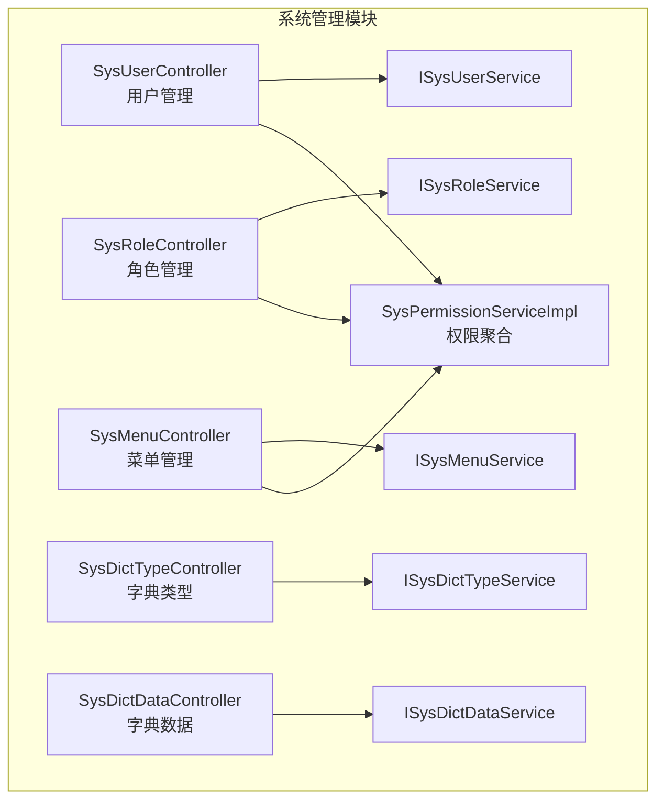
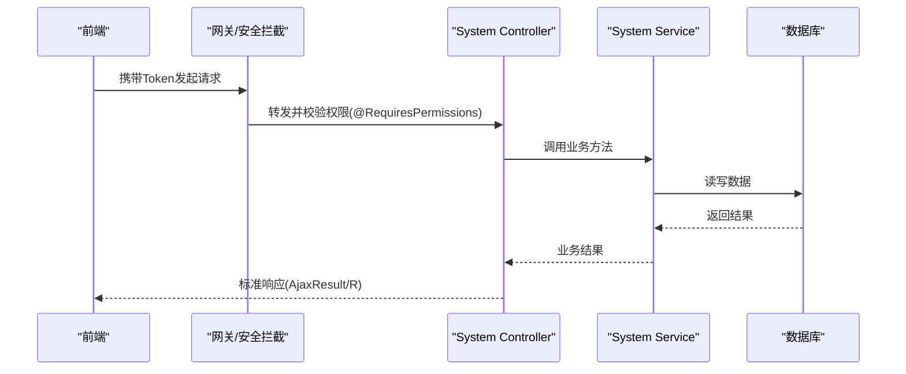
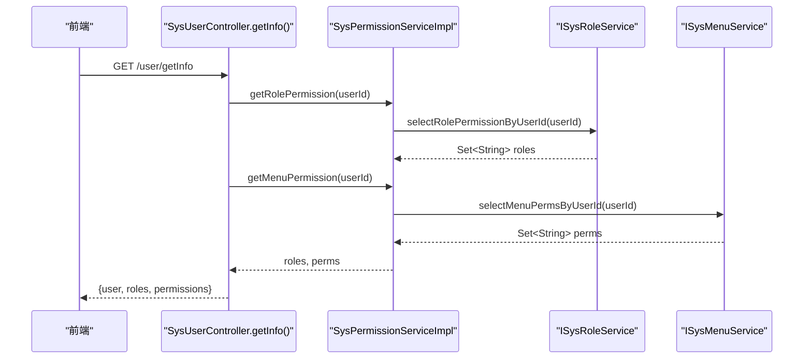
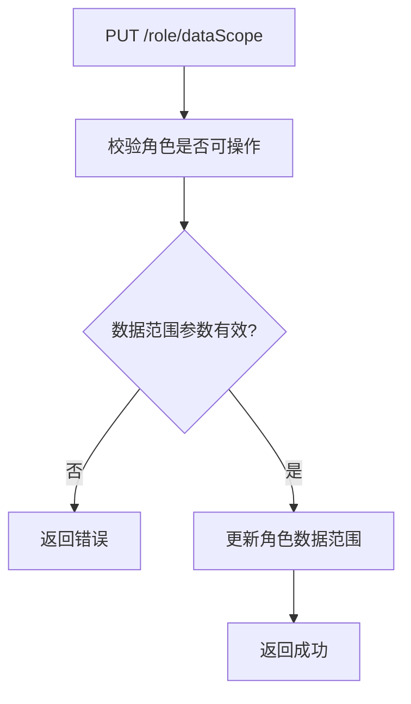
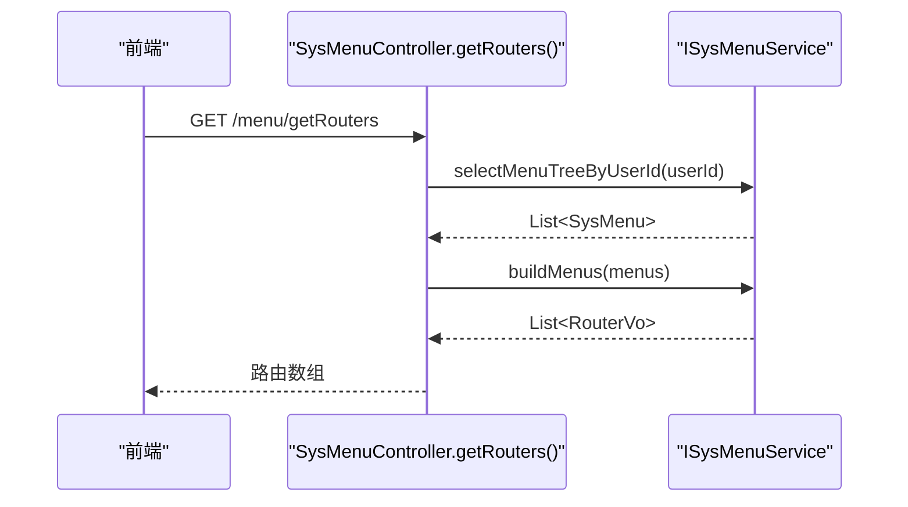
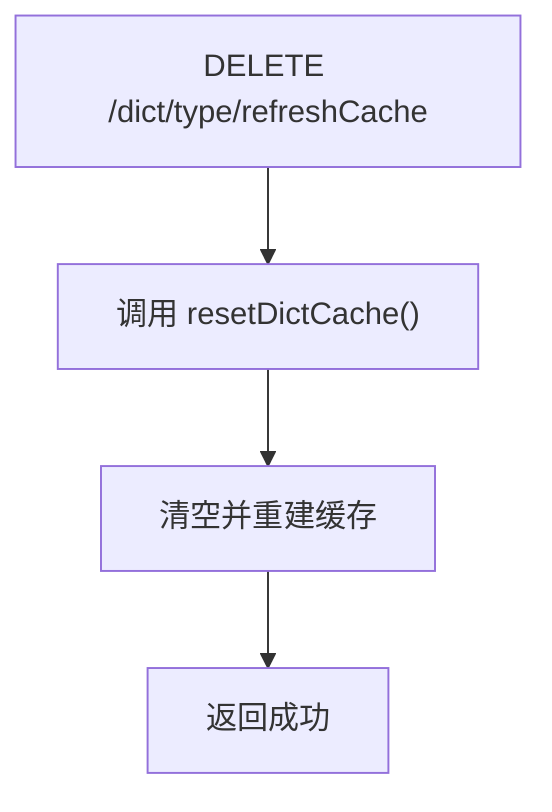
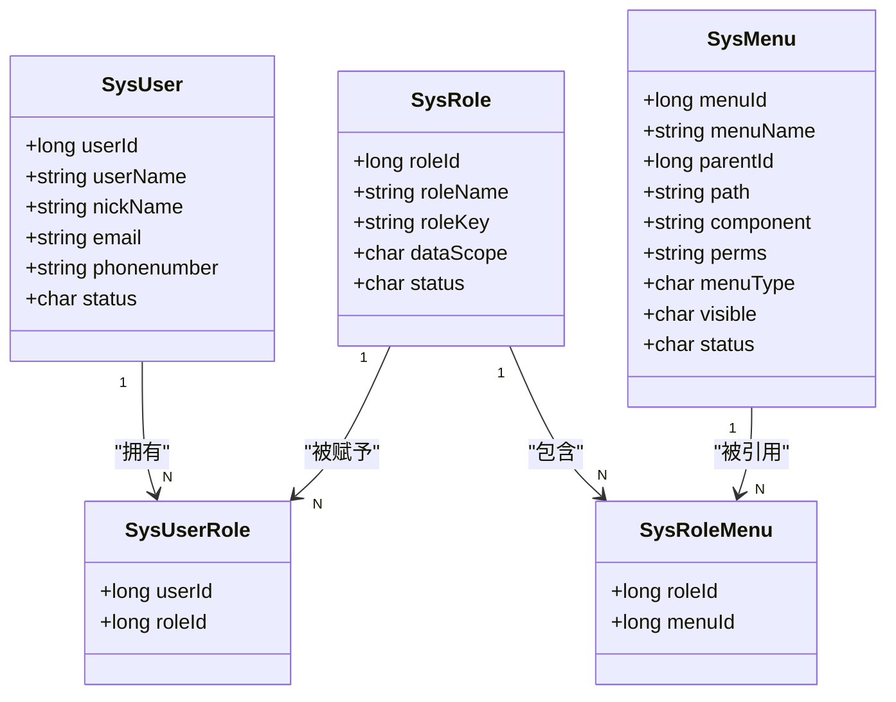
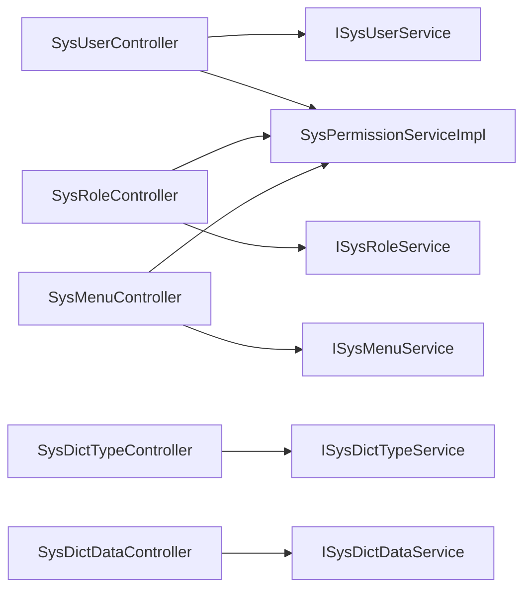

# 系统管理

<cite>
**本文引用的文件**   
- [SysUserController.java](file://ruoyi-modules/ruoyi-system/src/main/java/com/ruoyi/system/controller/SysUserController.java)
- [SysRoleController.java](file://ruoyi-modules/ruoyi-system/src/main/java/com/ruoyi/system/controller/SysRoleController.java)
- [SysMenuController.java](file://ruoyi-modules/ruoyi-system/src/main/java/com/ruoyi/system/controller/SysMenuController.java)
- [SysDictTypeController.java](file://ruoyi-modules/ruoyi-system/src/main/java/com/ruoyi/system/controller/SysDictTypeController.java)
- [SysDictDataController.java](file://ruoyi-modules/ruoyi-system/src/main/java/com/ruoyi/system/controller/SysDictDataController.java)
- [ISysUserService.java](file://ruoyi-modules/ruoyi-system/src/main/java/com/ruoyi/system/service/ISysUserService.java)
- [ISysRoleService.java](file://ruoyi-modules/ruoyi-system/src/main/java/com/ruoyi/system/service/ISysRoleService.java)
- [ISysMenuService.java](file://ruoyi-modules/ruoyi-system/src/main/java/com/ruoyi/system/service/ISysMenuService.java)
- [ISysDictTypeService.java](file://ruoyi-modules/ruoyi-system/src/main/java/com/ruoyi/system/service/ISysDictTypeService.java)
- [ISysDictDataService.java](file://ruoyi-modules/ruoyi-system/src/main/java/com/ruoyi/system/service/ISysDictDataService.java)
- [SysPermissionServiceImpl.java](file://ruoyi-modules/ruoyi-system/src/main/java/com/ruoyi/system/service/impl/SysPermissionServiceImpl.java)
- [ry_20210908.sql](file://sql/ry_20210908.sql)
</cite>

## 目录
1. [简介](#简介)
2. [项目结构](#项目结构)
3. [核心组件](#核心组件)
4. [架构总览](#架构总览)
5. [详细组件分析](#详细组件分析)
6. [依赖关系分析](#依赖关系分析)
7. [性能与缓存](#性能与缓存)
8. [故障排查指南](#故障排查指南)
9. [结论](#结论)
10. [附录：管理员操作指南与API参考](#附录管理员操作指南与api参考)

## 简介
本模块为系统的“系统管理”子域，提供用户管理、角色权限、菜单配置、字典管理等基础能力。后端基于 Spring Boot + MyBatis，前端基于 Vue + Element UI；权限模型采用 RBAC（基于角色的访问控制），通过注解 @RequiresPermissions 进行接口级鉴权，结合动态菜单路由实现界面级权限控制。字典数据支持缓存刷新，便于运行时动态生效。

## 项目结构
系统管理相关代码位于 ruoyi-modules/ruoyi-system 模块中，按 Controller / Service / Domain / Mapper 分层组织；数据库脚本位于 sql 目录。

图表来源
- [SysUserController.java:46-63](file://ruoyi-modules/ruoyi-system/src/main/java/com/ruoyi/system/controller/SysUserController.java#L46-L63)
- [SysRoleController.java:35-43](file://ruoyi-modules/ruoyi-system/src/main/java/com/ruoyi/system/controller/SysRoleController.java#L35-L43)
- [SysMenuController.java:30-35](file://ruoyi-modules/ruoyi-system/src/main/java/com/ruoyi/system/controller/SysMenuController.java#L30-L35)
- [SysDictTypeController.java:32-37](file://ruoyi-modules/ruoyi-system/src/main/java/com/ruoyi/system/controller/SysDictTypeController.java#L32-L37)
- [SysDictDataController.java:34-42](file://ruoyi-modules/ruoyi-system/src/main/java/com/ruoyi/system/controller/SysDictDataController.java#L34-L42)
- [SysPermissionServiceImpl.java:12-19](file://ruoyi-modules/ruoyi-system/src/main/java/com/ruoyi/system/service/impl/SysPermissionServiceImpl.java#L12-L19)

章节来源
- [SysUserController.java:46-63](file://ruoyi-modules/ruoyi-system/src/main/java/com/ruoyi/system/controller/SysUserController.java#L46-L63)
- [SysRoleController.java:35-43](file://ruoyi-modules/ruoyi-system/src/main/java/com/ruoyi/system/controller/SysRoleController.java#L35-L43)
- [SysMenuController.java:30-35](file://ruoyi-modules/ruoyi-system/src/main/java/com/ruoyi/system/controller/SysMenuController.java#L30-L35)
- [SysDictTypeController.java:32-37](file://ruoyi-modules/ruoyi-system/src/main/java/com/ruoyi/system/controller/SysDictTypeController.java#L32-L37)
- [SysDictDataController.java:34-42](file://ruoyi-modules/ruoyi-system/src/main/java/com/ruoyi/system/controller/SysDictDataController.java#L34-L42)

## 核心组件
- 用户管理：提供用户分页查询、新增、修改、删除、重置密码、状态变更、导入导出、授权角色等能力。
- 角色管理：提供角色CRUD、数据范围配置、状态变更、批量授权/取消授权用户等能力。
- 菜单管理：提供菜单树查询、下拉选择、角色菜单树、路由构建、增删改查等能力。
- 字典管理：提供字典类型与数据的CRUD、按类型取值、导出、缓存刷新等能力。
- 权限服务：聚合角色与菜单权限，统一返回当前用户的角色集合与权限标识集合。

章节来源
- [SysUserController.java:65-311](file://ruoyi-modules/ruoyi-system/src/main/java/com/ruoyi/system/controller/SysUserController.java#L65-L311)
- [SysRoleController.java:45-221](file://ruoyi-modules/ruoyi-system/src/main/java/com/ruoyi/system/controller/SysRoleController.java#L45-L221)
- [SysMenuController.java:37-158](file://ruoyi-modules/ruoyi-system/src/main/java/com/ruoyi/system/controller/SysMenuController.java#L37-L158)
- [SysDictTypeController.java:39-132](file://ruoyi-modules/ruoyi-system/src/main/java/com/ruoyi/system/controller/SysDictTypeController.java#L39-L132)
- [SysDictDataController.java:44-121](file://ruoyi-modules/ruoyi-system/src/main/java/com/ruoyi/system/controller/SysDictDataController.java#L44-L121)
- [SysPermissionServiceImpl.java:21-63](file://ruoyi-modules/ruoyi-system/src/main/java/com/ruoyi/system/service/impl/SysPermissionServiceImpl.java#L21-L63)

## 架构总览
系统管理模块遵循典型的分层架构：Controller 暴露 REST API，Service 封装业务逻辑，Mapper 负责持久化，Domain/VO 承载数据模型。权限校验通过注解驱动，在请求进入 Controller 前完成鉴权。

图表来源
- [SysUserController.java:68-75](file://ruoyi-modules/ruoyi-system/src/main/java/com/ruoyi/system/controller/SysUserController.java#L68-L75)
- [SysRoleController.java:45-52](file://ruoyi-modules/ruoyi-system/src/main/java/com/ruoyi/system/controller/SysRoleController.java#L45-L52)
- [SysMenuController.java:40-47](file://ruoyi-modules/ruoyi-system/src/main/java/com/ruoyi/system/controller/SysMenuController.java#L40-L47)

## 详细组件分析

### 用户管理
- 功能要点
  - 列表分页、导出、导入模板与导入数据
  - 当前用户信息获取（含角色与权限）
  - 注册（受配置开关控制）
  - 新增/修改/删除/重置密码/状态变更
  - 授权角色（用户-角色关联）
- 关键流程（以“获取当前用户信息”为例）

图表来源
- [SysUserController.java:153-166](file://ruoyi-modules/ruoyi-system/src/main/java/com/ruoyi/system/controller/SysUserController.java#L153-L166)
- [SysPermissionServiceImpl.java:21-63](file://ruoyi-modules/ruoyi-system/src/main/java/com/ruoyi/system/service/impl/SysPermissionServiceImpl.java#L21-L63)
- [ISysRoleService.java:31-37](file://ruoyi-modules/ruoyi-system/src/main/java/com/ruoyi/system/service/ISysRoleService.java#L31-L37)
- [ISysMenuService.java:33-39](file://ruoyi-modules/ruoyi-system/src/main/java/com/ruoyi/system/service/ISysMenuService.java#L33-L39)

- 数据模型与约束
  - 用户表包含账号、昵称、邮箱、手机、性别、头像、状态、删除标志、登录信息等字段
  - 唯一性校验：用户名、手机号、邮箱
  - 密码加密存储
  - 用户-角色多对多关联

章节来源
- [SysUserController.java:65-311](file://ruoyi-modules/ruoyi-system/src/main/java/com/ruoyi/system/controller/SysUserController.java#L65-L311)
- [ISysUserService.java:13-206](file://ruoyi-modules/ruoyi-system/src/main/java/com/ruoyi/system/service/ISysUserService.java#L13-L206)
- [ry_20210908.sql:41-71](file://sql/ry_20210908.sql#L41-L71)
- [ry_20210908.sql:262-276](file://sql/ry_20210908.sql#L262-L276)

### 角色管理
- 功能要点
  - 角色CRUD、状态变更、数据范围配置
  - 导出、选项选择
  - 用户授权/取消授权（已分配/未分配列表）
- 关键流程（以“保存角色数据范围”为例）

图表来源
- [SysRoleController.java:118-129](file://ruoyi-modules/ruoyi-system/src/main/java/com/ruoyi/system/controller/SysRoleController.java#L118-L129)
- [ISysRoleService.java:124-130](file://ruoyi-modules/ruoyi-system/src/main/java/com/ruoyi/system/service/ISysRoleService.java#L124-L130)

- 数据模型与约束
  - 角色表包含名称、权限字符串、排序、数据范围、严格联动开关、状态等
  - 角色-菜单多对多关联
  - 唯一性校验：角色名、角色键

章节来源
- [SysRoleController.java:45-221](file://ruoyi-modules/ruoyi-system/src/main/java/com/ruoyi/system/controller/SysRoleController.java#L45-L221)
- [ISysRoleService.java:15-173](file://ruoyi-modules/ruoyi-system/src/main/java/com/ruoyi/system/service/ISysRoleService.java#L15-L173)
- [ry_20210908.sql:102-128](file://sql/ry_20210908.sql#L102-L128)
- [ry_20210908.sql:279-295](file://sql/ry_20210908.sql#L279-L295)

### 菜单管理
- 功能要点
  - 菜单树查询、下拉树、角色菜单树
  - 路由构建（供前端动态生成侧边栏）
  - 菜单CRUD、外链校验、父子关系校验、存在性检查
- 关键流程（以“获取动态路由”为例）

图表来源
- [SysMenuController.java:147-158](file://ruoyi-modules/ruoyi-system/src/main/java/com/ruoyi/system/controller/SysMenuController.java#L147-L158)
- [ISysMenuService.java:41-63](file://ruoyi-modules/ruoyi-system/src/main/java/com/ruoyi/system/service/ISysMenuService.java#L41-L63)

- 数据模型与约束
  - 菜单表包含父节点、路径、组件、外链、类型（目录/菜单/按钮）、可见性、状态、权限标识、图标等
  - 唯一性校验：菜单名
  - 外链校验：path 必须以 http(s):// 开头

章节来源
- [SysMenuController.java:37-158](file://ruoyi-modules/ruoyi-system/src/main/java/com/ruoyi/system/controller/SysMenuController.java#L37-L158)
- [ISysMenuService.java:16-136](file://ruoyi-modules/ruoyi-system/src/main/java/com/ruoyi/system/service/ISysMenuService.java#L16-L136)
- [ry_20210908.sql:131-183](file://sql/ry_20210908.sql#L131-L183)

### 字典管理
- 功能要点
  - 字典类型与字典数据CRUD
  - 按类型获取字典值列表
  - 导出、缓存刷新
- 关键流程（以“刷新字典缓存”为例）

图表来源
- [SysDictTypeController.java:112-122](file://ruoyi-modules/ruoyi-system/src/main/java/com/ruoyi/system/controller/SysDictTypeController.java#L112-L122)
- [ISysDictTypeService.java:60-73](file://ruoyi-modules/ruoyi-system/src/main/java/com/ruoyi/system/service/ISysDictTypeService.java#L60-L73)

- 数据模型与约束
  - 字典类型与字典数据分离，便于扩展与维护
  - 唯一性校验：字典类型编码

章节来源
- [SysDictTypeController.java:39-132](file://ruoyi-modules/ruoyi-system/src/main/java/com/ruoyi/system/controller/SysDictTypeController.java#L39-L132)
- [SysDictDataController.java:44-121](file://ruoyi-modules/ruoyi-system/src/main/java/com/ruoyi/system/controller/SysDictDataController.java#L44-L121)
- [ISysDictTypeService.java:14-98](file://ruoyi-modules/ruoyi-system/src/main/java/com/ruoyi/system/service/ISysDictTypeService.java#L14-L98)
- [ISysDictDataService.java:13-60](file://ruoyi-modules/ruoyi-system/src/main/java/com/ruoyi/system/service/ISysDictDataService.java#L13-L60)

### 权限控制机制与RBAC模型
- 权限模型
  - 用户-角色-菜单（权限标识）三层关系
  - 管理员拥有全部权限（角色集包含 admin，权限集包含 *:*:*）
- 接口鉴权
  - 使用 @RequiresPermissions 注解声明所需权限标识
  - 鉴权失败抛出异常，由全局处理器统一处理
- 权限聚合
  - SysPermissionServiceImpl 根据用户ID聚合角色与菜单权限

图表来源
- [ry_20210908.sql:41-71](file://sql/ry_20210908.sql#L41-L71)
- [ry_20210908.sql:102-128](file://sql/ry_20210908.sql#L102-L128)
- [ry_20210908.sql:131-183](file://sql/ry_20210908.sql#L131-L183)
- [ry_20210908.sql:262-295](file://sql/ry_20210908.sql#L262-L295)

章节来源
- [SysPermissionServiceImpl.java:21-63](file://ruoyi-modules/ruoyi-system/src/main/java/com/ruoyi/system/service/impl/SysPermissionServiceImpl.java#L21-L63)
- [SysUserController.java:68-75](file://ruoyi-modules/ruoyi-system/src/main/java/com/ruoyi/system/controller/SysUserController.java#L68-L75)
- [SysRoleController.java:45-52](file://ruoyi-modules/ruoyi-system/src/main/java/com/ruoyi/system/controller/SysRoleController.java#L45-L52)
- [SysMenuController.java:40-47](file://ruoyi-modules/ruoyi-system/src/main/java/com/ruoyi/system/controller/SysMenuController.java#L40-L47)

## 依赖关系分析
- 控制器依赖对应 Service 接口，Service 再依赖持久层与领域对象
- 权限聚合服务同时依赖角色与菜单服务，形成松耦合的权限计算中心
- 字典服务提供缓存刷新能力，避免频繁读库

图表来源
- [SysUserController.java:50-63](file://ruoyi-modules/ruoyi-system/src/main/java/com/ruoyi/system/controller/SysUserController.java#L50-L63)
- [SysRoleController.java:39-43](file://ruoyi-modules/ruoyi-system/src/main/java/com/ruoyi/system/controller/SysRoleController.java#L39-L43)
- [SysMenuController.java:34-35](file://ruoyi-modules/ruoyi-system/src/main/java/com/ruoyi/system/controller/SysMenuController.java#L34-L35)
- [SysDictTypeController.java:36-37](file://ruoyi-modules/ruoyi-system/src/main/java/com/ruoyi/system/controller/SysDictTypeController.java#L36-L37)
- [SysDictDataController.java:38-42](file://ruoyi-modules/ruoyi-system/src/main/java/com/ruoyi/system/controller/SysDictDataController.java#L38-L42)
- [SysPermissionServiceImpl.java:15-19](file://ruoyi-modules/ruoyi-system/src/main/java/com/ruoyi/system/service/impl/SysPermissionServiceImpl.java#L15-L19)

## 性能与缓存
- 字典缓存
  - 提供加载、清空、重置缓存接口，减少重复查询
  - 建议在字典数据变更后调用刷新接口，保证前端展示一致
- 分页查询
  - 列表接口均支持分页，避免一次性加载大量数据
- 权限聚合
  - 管理员直接返回全量权限，减少复杂计算开销

[本节为通用指导，不直接分析具体文件]

## 故障排查指南
- 权限不足
  - 现象：接口返回无权限或403
  - 排查：确认用户是否具备对应权限标识；检查菜单与按钮权限是否已分配给角色
- 菜单无法显示
  - 现象：前端侧边栏缺少菜单
  - 排查：确认菜单可见性与状态；检查路由构建接口返回的路由数据
- 字典不生效
  - 现象：前端显示旧值或空值
  - 排查：调用字典缓存刷新接口；确认字典类型与键值正确
- 用户操作受限
  - 现象：新增/修改/删除失败
  - 排查：检查唯一性校验（用户名/手机/邮箱/角色名/角色键/菜单名）；确认数据权限范围

章节来源
- [SysUserController.java:196-215](file://ruoyi-modules/ruoyi-system/src/main/java/com/ruoyi/system/controller/SysUserController.java#L196-L215)
- [SysRoleController.java:81-94](file://ruoyi-modules/ruoyi-system/src/main/java/com/ruoyi/system/controller/SysRoleController.java#L81-L94)
- [SysMenuController.java:90-102](file://ruoyi-modules/ruoyi-system/src/main/java/com/ruoyi/system/controller/SysMenuController.java#L90-L102)
- [SysDictTypeController.java:73-82](file://ruoyi-modules/ruoyi-system/src/main/java/com/ruoyi/system/controller/SysDictTypeController.java#L73-L82)

## 结论
系统管理模块提供了完善的用户、角色、菜单与字典管理能力，并通过 RBAC 与注解式鉴权实现了细粒度的权限控制。配合动态菜单路由与字典缓存，既满足灵活的业务扩展需求，也保证了良好的运行性能与管理体验。

[本节为总结性内容，不直接分析具体文件]

## 附录：管理员操作指南与API参考

### 管理员操作指南
- 用户管理
  - 新建用户：填写账号、昵称、部门、岗位、角色、联系方式等，必要时设置初始密码
  - 授权角色：为用户分配一个或多个角色，使其获得相应菜单与按钮权限
  - 重置密码/修改状态：用于账号安全管理
- 角色管理
  - 新建角色：定义角色名称与权限标识，配置数据范围（全部/自定义/本部门/本部门及以下）
  - 授权用户：将用户批量授予该角色，或从角色移除
- 菜单管理
  - 新增菜单：区分目录/菜单/按钮，设置路由地址、组件路径、权限标识、图标、可见性等
  - 外链菜单：path 必须以 http(s):// 开头
  - 动态路由：登录后调用路由接口，前端据此渲染侧边栏
- 字典管理
  - 新增字典类型与数据项：用于下拉框、状态枚举等场景
  - 刷新缓存：修改字典后调用刷新接口，确保前端及时生效

[本节为通用指导，不直接分析具体文件]

### API接口参考（节选）
- 用户管理
  - GET /user/list：分页查询用户列表（需权限 system:user:list）
  - POST /user/export：导出用户数据（需权限 system:user:export）
  - POST /user/importData：导入用户数据（需权限 system:user:import）
  - GET /user/info/{username}：内部接口，根据用户名获取用户信息与权限（需内部认证）
  - GET /user/getInfo：获取当前用户信息与权限
  - POST /user：新增用户（需权限 system:user:add）
  - PUT /user：修改用户（需权限 system:user:edit）
  - DELETE /user/{userIds}：删除用户（需权限 system:user:remove）
  - PUT /user/resetPwd：重置密码（需权限 system:user:edit）
  - PUT /user/changeStatus：修改状态（需权限 system:user:edit）
  - GET /user/authRole/{userId}：查询用户已授权角色（需权限 system:user:query）
  - PUT /user/authRole：为用户授权角色（需权限 system:user:edit）

- 角色管理
  - GET /role/list：分页查询角色列表（需权限 system:role:list）
  - POST /role/export：导出角色数据（需权限 system:role:export）
  - GET /role/{roleId}：查询角色详情（需权限 system:role:query）
  - POST /role：新增角色（需权限 system:role:add）
  - PUT /role：修改角色（需权限 system:role:edit）
  - PUT /role/dataScope：配置数据范围（需权限 system:role:edit）
  - PUT /role/changeStatus：修改状态（需权限 system:role:edit）
  - DELETE /role/{roleIds}：删除角色（需权限 system:role:remove）
  - GET /role/optionselect：获取角色选项
  - GET /role/authUser/allocatedList：查询已分配用户（需权限 system:role:list）
  - GET /role/authUser/unallocatedList：查询未分配用户（需权限 system:role:list）
  - PUT /role/authUser/cancel：取消授权用户（需权限 system:role:edit）
  - PUT /role/authUser/cancelAll：批量取消授权（需权限 system:role:edit）
  - PUT /role/authUser/selectAll：批量授权（需权限 system:role:edit）

- 菜单管理
  - GET /menu/list：查询菜单列表（需权限 system:menu:list）
  - GET /menu/{menuId}：查询菜单详情（需权限 system:menu:query）
  - GET /menu/treeselect：菜单下拉树
  - GET /menu/roleMenuTreeselect/{roleId}：角色菜单树
  - POST /menu：新增菜单（需权限 system:menu:add）
  - PUT /menu：修改菜单（需权限 system:menu:edit）
  - DELETE /menu/{menuId}：删除菜单（需权限 system:menu:remove）
  - GET /menu/getRouters：获取动态路由

- 字典管理
  - GET /dict/type/list：分页查询字典类型（需权限 system:dict:list）
  - POST /dict/type/export：导出字典类型（需权限 system:dict:export）
  - GET /dict/type/{dictId}：查询字典类型详情（需权限 system:dict:query）
  - POST /dict/type：新增字典类型（需权限 system:dict:add）
  - PUT /dict/type：修改字典类型（需权限 system:dict:edit）
  - DELETE /dict/type/{dictIds}：删除字典类型（需权限 system:dict:remove）
  - DELETE /dict/type/refreshCache：刷新字典缓存（需权限 system:dict:remove）
  - GET /dict/type/optionselect：获取字典类型选项
  - GET /dict/data/list：分页查询字典数据（需权限 system:dict:list）
  - POST /dict/data/export：导出字典数据（需权限 system:dict:export）
  - GET /dict/data/{dictCode}：查询字典数据详情（需权限 system:dict:query）
  - GET /dict/data/type/{dictType}：按类型获取字典数据
  - POST /dict/data：新增字典数据（需权限 system:dict:add）
  - PUT /dict/data：修改字典数据（需权限 system:dict:edit）
  - DELETE /dict/data/{dictCodes}：删除字典数据（需权限 system:dict:remove）

章节来源
- [SysUserController.java:68-311](file://ruoyi-modules/ruoyi-system/src/main/java/com/ruoyi/system/controller/SysUserController.java#L68-L311)
- [SysRoleController.java:45-221](file://ruoyi-modules/ruoyi-system/src/main/java/com/ruoyi/system/controller/SysRoleController.java#L45-L221)
- [SysMenuController.java:40-158](file://ruoyi-modules/ruoyi-system/src/main/java/com/ruoyi/system/controller/SysMenuController.java#L40-L158)
- [SysDictTypeController.java:39-132](file://ruoyi-modules/ruoyi-system/src/main/java/com/ruoyi/system/controller/SysDictTypeController.java#L39-L132)
- [SysDictDataController.java:44-121](file://ruoyi-modules/ruoyi-system/src/main/java/com/ruoyi/system/controller/SysDictDataController.java#L44-L121)