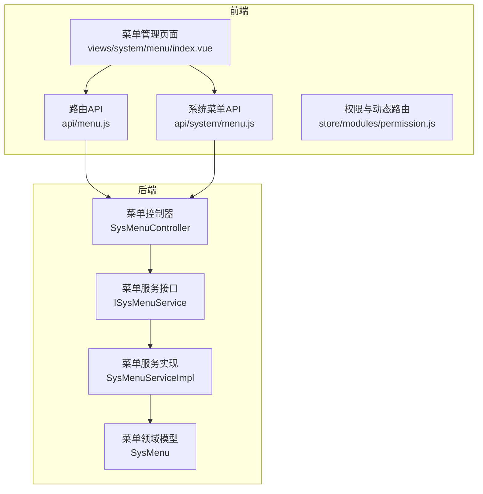
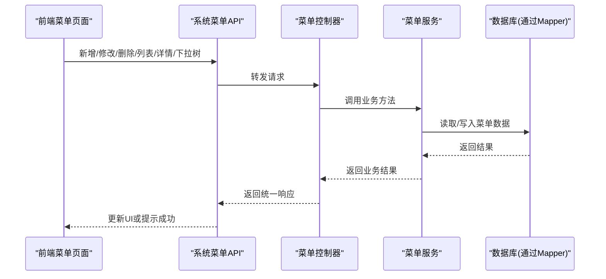
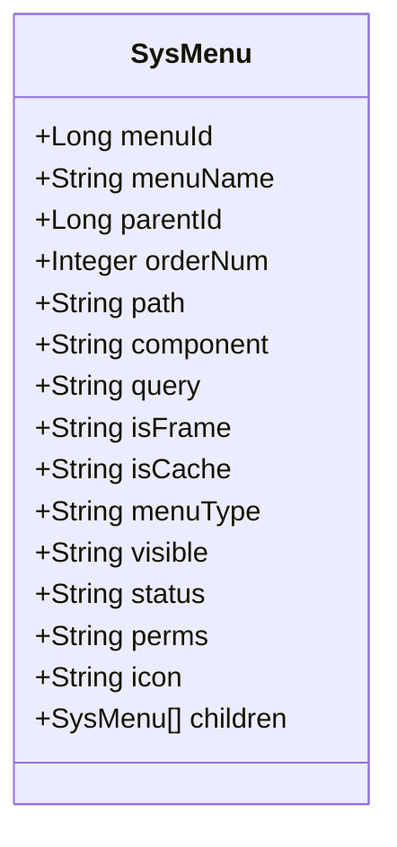
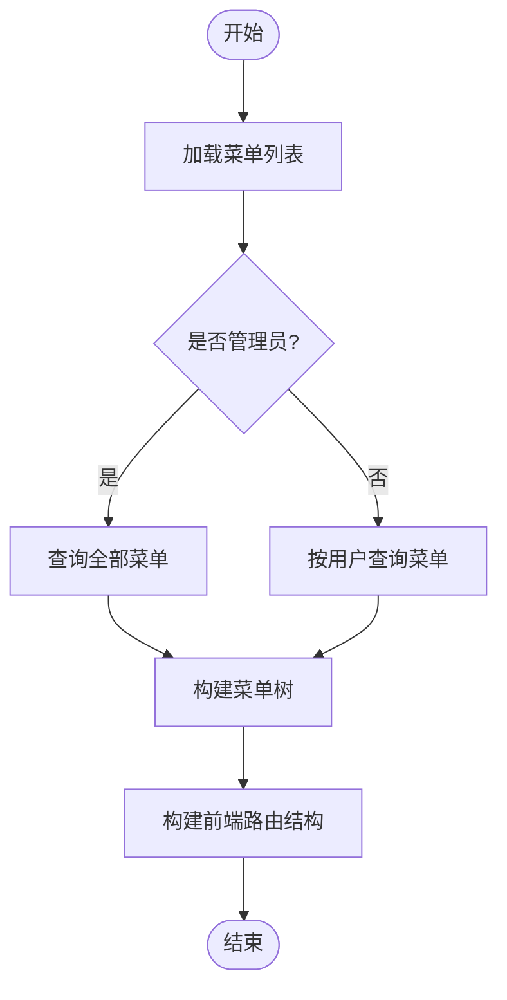
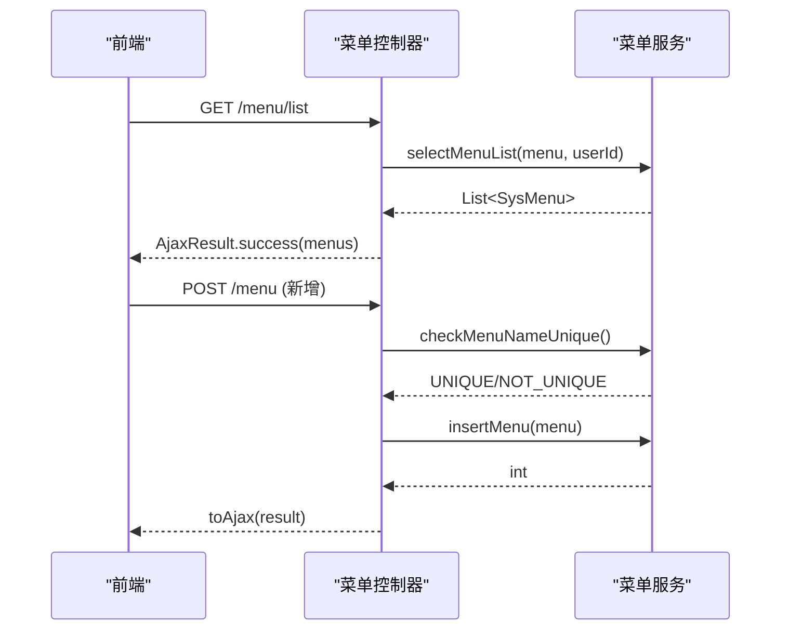
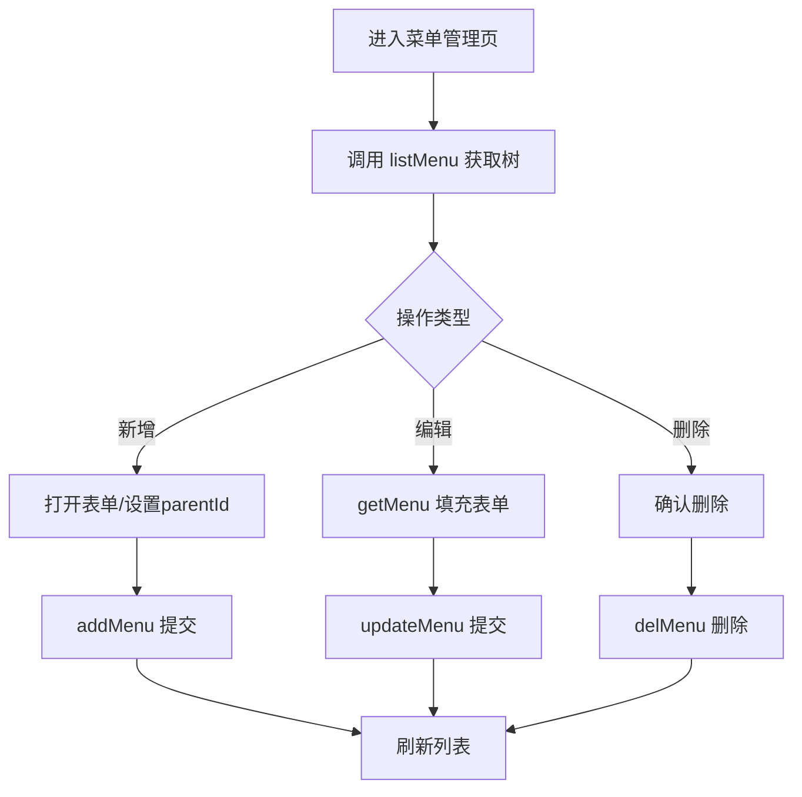
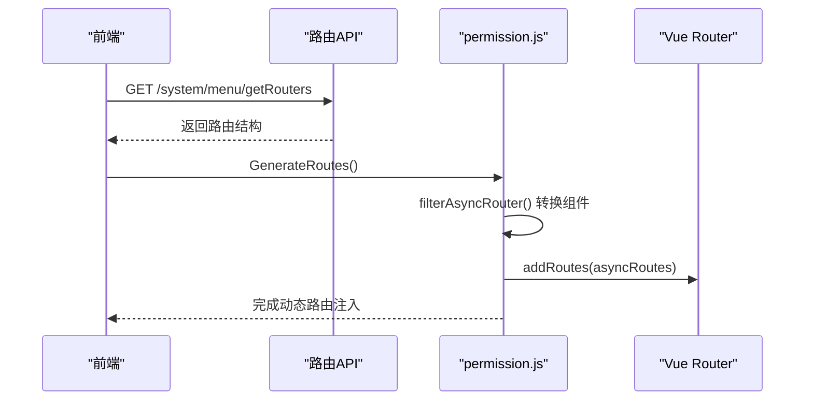
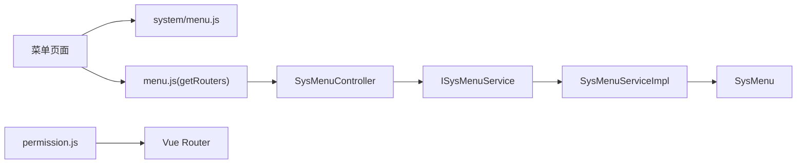

# 菜单管理

<cite>
**本文引用的文件**   
- [SysMenu.java](file://ruoyi-modules/ruoyi-system/src/main/java/com/ruoyi/system/domain/SysMenu.java)
- [ISysMenuService.java](file://ruoyi-modules/ruoyi-system/src/main/java/com/ruoyi/system/service/ISysMenuService.java)
- [SysMenuServiceImpl.java](file://ruoyi-modules/ruoyi-system/src/main/java/com/ruoyi/system/service/impl/SysMenuServiceImpl.java)
- [SysMenuController.java](file://ruoyi-modules/ruoyi-system/src/main/java/com/ruoyi/system/controller/SysMenuController.java)
- [menu.js（系统菜单API）](file://ruoyi-ui/src/api/system/menu.js)
- [menu.js（路由API）](file://ruoyi-ui/src/api/menu.js)
- [permission.js（前端权限与动态路由）](file://ruoyi-ui/src/store/modules/permission.js)
- [index.vue（菜单管理页面）](file://ruoyi-ui/src/views/system/menu/index.vue)
</cite>

## 目录
1. [简介](#简介)
2. [项目结构](#项目结构)
3. [核心组件](#核心组件)
4. [架构总览](#架构总览)
5. [详细组件分析](#详细组件分析)
6. [依赖关系分析](#依赖关系分析)
7. [性能考虑](#性能考虑)
8. [故障排查指南](#故障排查指南)
9. [结论](#结论)
10. [附录：接口与数据模型](#附录接口与数据模型)

## 简介
本文件面向“菜单管理”功能，覆盖以下目标：
- 动态菜单的创建、编辑、删除操作说明
- 菜单树形结构的维护与管理方法
- 菜单与角色的权限关联机制
- 前端路由的动态加载原理
- 菜单配置的API接口文档
- 菜单数据结构定义与层级关系说明
- 菜单权限控制的实现细节与前端集成方法

## 项目结构
围绕菜单管理，后端位于 system 模块，前端在 ruoyi-ui 中提供菜单管理与动态路由能力。关键路径如下：
- 后端领域模型：SysMenu
- 后端服务层：ISysMenuService 与 SysMenuServiceImpl
- 后端控制器：SysMenuController
- 前端菜单API：system/menu.js
- 前端路由API：menu.js（getRouters）
- 前端权限与动态路由：store/modules/permission.js
- 前端菜单管理界面：views/system/menu/index.vue

图表来源
- [SysMenuController.java:30-158](file://ruoyi-modules/ruoyi-system/src/main/java/com/ruoyi/system/controller/SysMenuController.java#L30-L158)
- [ISysMenuService.java:14-136](file://ruoyi-modules/ruoyi-system/src/main/java/com/ruoyi/system/service/ISysMenuService.java#L14-L136)
- [SysMenuServiceImpl.java:33-515](file://ruoyi-modules/ruoyi-system/src/main/java/com/ruoyi/system/service/impl/SysMenuServiceImpl.java#L33-L515)
- [SysMenu.java:17-259](file://ruoyi-modules/ruoyi-system/src/main/java/com/ruoyi/system/domain/SysMenu.java#L17-L259)
- [menu.js（系统菜单API）:1-60](file://ruoyi-ui/src/api/system/menu.js#L1-L60)
- [menu.js（路由API）:1-9](file://ruoyi-ui/src/api/menu.js#L1-L9)
- [permission.js:1-133](file://ruoyi-ui/src/store/modules/permission.js#L1-L133)
- [index.vue:1-454](file://ruoyi-ui/src/views/system/menu/index.vue#L1-L454)

章节来源
- [SysMenuController.java:30-158](file://ruoyi-modules/ruoyi-system/src/main/java/com/ruoyi/system/controller/SysMenuController.java#L30-L158)
- [SysMenuServiceImpl.java:33-515](file://ruoyi-modules/ruoyi-system/src/main/java/com/ruoyi/system/service/impl/SysMenuServiceImpl.java#L33-L515)
- [SysMenu.java:17-259](file://ruoyi-modules/ruoyi-system/src/main/java/com/ruoyi/system/domain/SysMenu.java#L17-L259)
- [menu.js（系统菜单API）:1-60](file://ruoyi-ui/src/api/system/menu.js#L1-L60)
- [menu.js（路由API）:1-9](file://ruoyi-ui/src/api/menu.js#L1-L9)
- [permission.js:1-133](file://ruoyi-ui/src/store/modules/permission.js#L1-L133)
- [index.vue:1-454](file://ruoyi-ui/src/views/system/menu/index.vue#L1-L454)

## 核心组件
- 菜单领域模型 SysMenu：承载菜单基础信息、类型、可见性、状态、权限标识、图标、父子关系等。
- 菜单服务 ISysMenuService/SysMenuServiceImpl：封装菜单查询、树构建、权限计算、CRUD 逻辑。
- 菜单控制器 SysMenuController：对外暴露菜单列表、详情、下拉树、角色菜单树、新增/修改/删除、动态路由等接口。
- 前端菜单API：封装系统菜单相关请求（列表、详情、下拉树、角色菜单树、增删改）。
- 前端路由API：获取当前用户动态路由。
- 前端权限与动态路由：根据后端返回的路由结构生成可访问路由，并注入到 Vue Router。
- 菜单管理页面：提供菜单树展示、搜索、新增/编辑/删除、上级菜单选择等交互。

章节来源
- [SysMenu.java:17-259](file://ruoyi-modules/ruoyi-system/src/main/java/com/ruoyi/system/domain/SysMenu.java#L17-L259)
- [ISysMenuService.java:14-136](file://ruoyi-modules/ruoyi-system/src/main/java/com/ruoyi/system/service/ISysMenuService.java#L14-L136)
- [SysMenuServiceImpl.java:33-515](file://ruoyi-modules/ruoyi-system/src/main/java/com/ruoyi/system/service/impl/SysMenuServiceImpl.java#L33-L515)
- [SysMenuController.java:30-158](file://ruoyi-modules/ruoyi-system/src/main/java/com/ruoyi/system/controller/SysMenuController.java#L30-L158)
- [menu.js（系统菜单API）:1-60](file://ruoyi-ui/src/api/system/menu.js#L1-L60)
- [menu.js（路由API）:1-9](file://ruoyi-ui/src/api/menu.js#L1-L9)
- [permission.js:1-133](file://ruoyi-ui/src/store/modules/permission.js#L1-L133)
- [index.vue:1-454](file://ruoyi-ui/src/views/system/menu/index.vue#L1-L454)

## 架构总览
菜单管理的端到端流程包括：
- 前端菜单管理页面调用系统菜单API进行增删改查。
- 后端控制器校验权限后调用服务层处理业务。
- 服务层负责菜单树构建、权限集合计算、与角色/菜单关联检查。
- 前端通过路由API获取动态路由，并在权限模块中转换为可执行路由。

图表来源
- [SysMenuController.java:30-158](file://ruoyi-modules/ruoyi-system/src/main/java/com/ruoyi/system/controller/SysMenuController.java#L30-L158)
- [SysMenuServiceImpl.java:33-515](file://ruoyi-modules/ruoyi-system/src/main/java/com/ruoyi/system/service/impl/SysMenuServiceImpl.java#L33-L515)
- [menu.js（系统菜单API）:1-60](file://ruoyi-ui/src/api/system/menu.js#L1-L60)
- [index.vue:1-454](file://ruoyi-ui/src/views/system/menu/index.vue#L1-L454)

## 详细组件分析

### 菜单领域模型与数据结构
- 关键字段
  - menuId：菜单ID
  - menuName：菜单名称
  - parentId：父菜单ID
  - orderNum：显示顺序
  - path：路由地址
  - component：组件路径
  - query：路由参数
  - isFrame：是否外链
  - isCache：是否缓存
  - menuType：类型（目录/菜单/按钮）
  - visible：显示状态
  - status：菜单状态
  - perms：权限字符串
  - icon：图标
  - children：子菜单集合

- 层级关系
  - 通过 parentId 与 menuId 形成父子关系，服务层递归组装为树结构。

图表来源
- [SysMenu.java:17-259](file://ruoyi-modules/ruoyi-system/src/main/java/com/ruoyi/system/domain/SysMenu.java#L17-L259)

章节来源
- [SysMenu.java:17-259](file://ruoyi-modules/ruoyi-system/src/main/java/com/ruoyi/system/domain/SysMenu.java#L17-L259)

### 菜单服务层与树构建
- 主要职责
  - 按用户查询菜单列表（管理员全量，普通用户按角色过滤）
  - 计算用户权限集合（perms）
  - 构建前端路由结构（RouterVo）
  - 构建菜单树（SysMenu 树）与下拉树（TreeSelect）
  - CRUD 与唯一性校验、父子关系校验、删除前置校验

- 树构建关键点
  - buildMenuTree：将平铺菜单组装成父子树
  - buildMenus：将菜单转为前端路由结构，处理目录、菜单、外链、内链、ParentView 等场景
  - getChildPerms/recursionFn：递归查找子节点

图表来源
- [SysMenuServiceImpl.java:53-122](file://ruoyi-modules/ruoyi-system/src/main/java/com/ruoyi/system/service/impl/SysMenuServiceImpl.java#L53-L122)
- [SysMenuServiceImpl.java:143-193](file://ruoyi-modules/ruoyi-system/src/main/java/com/ruoyi/system/service/impl/SysMenuServiceImpl.java#L143-L193)
- [SysMenuServiceImpl.java:201-238](file://ruoyi-modules/ruoyi-system/src/main/java/com/ruoyi/system/service/impl/SysMenuServiceImpl.java#L201-L238)

章节来源
- [ISysMenuService.java:14-136](file://ruoyi-modules/ruoyi-system/src/main/java/com/ruoyi/system/service/ISysMenuService.java#L14-L136)
- [SysMenuServiceImpl.java:33-515](file://ruoyi-modules/ruoyi-system/src/main/java/com/ruoyi/system/service/impl/SysMenuServiceImpl.java#L33-L515)

### 菜单控制器与权限控制
- 接口概览
  - GET /menu/list：获取菜单列表（需 system:menu:list）
  - GET /menu/{menuId}：获取菜单详情（需 system:menu:query）
  - GET /menu/treeselect：获取菜单下拉树
  - GET /menu/roleMenuTreeselect/{roleId}：获取角色已选菜单树
  - POST /menu：新增菜单（需 system:menu:add）
  - PUT /menu：修改菜单（需 system:menu:edit）
  - DELETE /menu/{menuId}：删除菜单（需 system:menu:remove）
  - GET /menu/getRouters：获取动态路由

- 权限控制
  - 使用注解 @RequiresPermissions 控制接口访问
  - 新增/修改时校验菜单名称唯一性与外链地址格式
  - 删除前校验是否存在子菜单、是否被角色引用

图表来源
- [SysMenuController.java:30-158](file://ruoyi-modules/ruoyi-system/src/main/java/com/ruoyi/system/controller/SysMenuController.java#L30-L158)
- [SysMenuServiceImpl.java:284-330](file://ruoyi-modules/ruoyi-system/src/main/java/com/ruoyi/system/service/impl/SysMenuServiceImpl.java#L284-L330)

章节来源
- [SysMenuController.java:30-158](file://ruoyi-modules/ruoyi-system/src/main/java/com/ruoyi/system/controller/SysMenuController.java#L30-L158)
- [SysMenuServiceImpl.java:284-330](file://ruoyi-modules/ruoyi-system/src/main/java/com/ruoyi/system/service/impl/SysMenuServiceImpl.java#L284-L330)

### 前端菜单管理页面
- 功能点
  - 列表展示：支持树形表格、展开/折叠、排序、状态筛选
  - 表单校验：必填项包含菜单名称、排序、路由地址
  - 上级菜单选择：使用下拉树组件，支持主类目根节点
  - 新增/编辑：提交表单调用 addMenu/updateMenu
  - 删除：二次确认后调用 delMenu

- 交互流程
  - 初始化：调用 listMenu 获取菜单树
  - 新增：打开对话框，预置 parentId，提交后刷新列表
  - 编辑：先 getMenu 填充表单，再 updateMenu
  - 删除：delMenu 成功后刷新列表

图表来源
- [index.vue:334-450](file://ruoyi-ui/src/views/system/menu/index.vue#L334-L450)
- [menu.js（系统菜单API）:1-60](file://ruoyi-ui/src/api/system/menu.js#L1-L60)

章节来源
- [index.vue:1-454](file://ruoyi-ui/src/views/system/menu/index.vue#L1-L454)
- [menu.js（系统菜单API）:1-60](file://ruoyi-ui/src/api/system/menu.js#L1-L60)

### 动态路由加载与权限控制（前端）
- 流程概述
  - 登录成功后，前端调用 getRouters 获取当前用户的动态路由
  - permission.js 将后端路由结构转换为可执行路由，并注入到 Vue Router
  - 同时生成侧边栏与顶部导航所需路由
  - 对静态动态路由（dynamicRoutes）进行权限过滤

图表来源
- [menu.js（路由API）:1-9](file://ruoyi-ui/src/api/menu.js#L1-L9)
- [permission.js:1-133](file://ruoyi-ui/src/store/modules/permission.js#L1-L133)
- [SysMenuController.java:147-158](file://ruoyi-modules/ruoyi-system/src/main/java/com/ruoyi/system/controller/SysMenuController.java#L147-L158)
- [SysMenuServiceImpl.java:143-193](file://ruoyi-modules/ruoyi-system/src/main/java/com/ruoyi/system/service/impl/SysMenuServiceImpl.java#L143-L193)

章节来源
- [menu.js（路由API）:1-9](file://ruoyi-ui/src/api/menu.js#L1-L9)
- [permission.js:1-133](file://ruoyi-ui/src/store/modules/permission.js#L1-L133)
- [SysMenuController.java:147-158](file://ruoyi-modules/ruoyi-system/src/main/java/com/ruoyi/system/controller/SysMenuController.java#L147-L158)
- [SysMenuServiceImpl.java:143-193](file://ruoyi-modules/ruoyi-system/src/main/java/com/ruoyi/system/service/impl/SysMenuServiceImpl.java#L143-L193)

### 菜单与角色的权限关联机制
- 角色分配菜单
  - 通过 roleMenuTreeselect 接口获取角色已选菜单ID集合与完整菜单树
  - 前端保存选中菜单ID集合，提交时一并更新角色配置
- 用户权限计算
  - 服务层根据用户角色聚合菜单权限字符串（perms），去重后供前端权限判断使用
- 菜单可见性与访问控制
  - 菜单 visible 字段控制是否在侧边栏显示
  - 菜单 status 控制是否可用
  - 前端根据后端返回的路由结构与权限集合决定是否渲染与跳转

章节来源
- [SysMenuController.java:70-82](file://ruoyi-modules/ruoyi-system/src/main/java/com/ruoyi/system/controller/SysMenuController.java#L70-L82)
- [SysMenuServiceImpl.java:88-101](file://ruoyi-modules/ruoyi-system/src/main/java/com/ruoyi/system/service/impl/SysMenuServiceImpl.java#L88-L101)
- [SysMenuServiceImpl.java:110-122](file://ruoyi-modules/ruoyi-system/src/main/java/com/ruoyi/system/service/impl/SysMenuServiceImpl.java#L110-L122)

## 依赖关系分析
- 控制器依赖服务接口，服务实现依赖 Mapper 与常量工具类
- 前端菜单页面依赖系统菜单API；动态路由依赖路由API与权限模块
- 权限模块依赖 auth 插件与 router 实例

图表来源
- [SysMenuController.java:30-158](file://ruoyi-modules/ruoyi-system/src/main/java/com/ruoyi/system/controller/SysMenuController.java#L30-L158)
- [ISysMenuService.java:14-136](file://ruoyi-modules/ruoyi-system/src/main/java/com/ruoyi/system/service/ISysMenuService.java#L14-L136)
- [SysMenuServiceImpl.java:33-515](file://ruoyi-modules/ruoyi-system/src/main/java/com/ruoyi/system/service/impl/SysMenuServiceImpl.java#L33-L515)
- [SysMenu.java:17-259](file://ruoyi-modules/ruoyi-system/src/main/java/com/ruoyi/system/domain/SysMenu.java#L17-L259)
- [menu.js（系统菜单API）:1-60](file://ruoyi-ui/src/api/system/menu.js#L1-L60)
- [menu.js（路由API）:1-9](file://ruoyi-ui/src/api/menu.js#L1-L9)
- [permission.js:1-133](file://ruoyi-ui/src/store/modules/permission.js#L1-L133)

章节来源
- [SysMenuController.java:30-158](file://ruoyi-modules/ruoyi-system/src/main/java/com/ruoyi/system/controller/SysMenuController.java#L30-L158)
- [SysMenuServiceImpl.java:33-515](file://ruoyi-modules/ruoyi-system/src/main/java/com/ruoyi/system/service/impl/SysMenuServiceImpl.java#L33-L515)
- [menu.js（系统菜单API）:1-60](file://ruoyi-ui/src/api/system/menu.js#L1-L60)
- [menu.js（路由API）:1-9](file://ruoyi-ui/src/api/menu.js#L1-L9)
- [permission.js:1-133](file://ruoyi-ui/src/store/modules/permission.js#L1-L133)

## 性能考虑
- 菜单树构建在服务层采用递归方式，建议在大数据量时结合缓存策略（如 Redis）减少重复计算
- 前端动态路由注入仅在登录后执行一次，避免频繁重建路由
- 列表查询建议分页与条件过滤，降低前后端数据传输量
- 外链与内链处理在服务层集中完成，避免前端重复逻辑

[本节为通用指导，不直接分析具体文件]

## 故障排查指南
- 新增/修改失败
  - 菜单名称重复：检查唯一性校验逻辑与数据库约束
  - 外链地址未以 http(s):// 开头：检查 isFrame 与 path 配置
  - 上级菜单不能选择自己：检查 parentId 与 menuId 一致性
- 删除失败
  - 存在子菜单：先删除或移动子菜单
  - 菜单已被角色分配：先解除角色关联
- 动态路由不生效
  - 检查 getRouters 是否返回正确结构
  - 检查 permission.js 是否正确转换组件与注入路由
  - 检查菜单 visible 与 status 是否允许显示与访问

章节来源
- [SysMenuController.java:87-145](file://ruoyi-modules/ruoyi-system/src/main/java/com/ruoyi/system/controller/SysMenuController.java#L87-L145)
- [SysMenuServiceImpl.java:258-330](file://ruoyi-modules/ruoyi-system/src/main/java/com/ruoyi/system/service/impl/SysMenuServiceImpl.java#L258-L330)
- [permission.js:31-51](file://ruoyi-ui/src/store/modules/permission.js#L31-L51)

## 结论
本菜单管理体系以后端领域模型与服务层为核心，通过控制器暴露标准REST接口，前端基于系统菜单API与动态路由API完成菜单管理与路由注入。权限控制贯穿前后端：后端通过角色-菜单关联与权限字符串聚合，前端依据路由结构与权限集合渲染与限制访问。该方案具备良好的扩展性与可维护性，适合多角色、多层级菜单的管理场景。

[本节为总结性内容，不直接分析具体文件]

## 附录：接口与数据模型

### 菜单管理API（系统菜单）
- 列表
  - 方法：GET
  - 路径：/system/menu/list
  - 权限：system:menu:list
  - 参数：menuName、visible 等
  - 返回：菜单列表（树形结构）
- 详情
  - 方法：GET
  - 路径：/system/menu/{menuId}
  - 权限：system:menu:query
  - 返回：菜单详情
- 下拉树
  - 方法：GET
  - 路径：/system/menu/treeselect
  - 返回：菜单下拉树
- 角色菜单树
  - 方法：GET
  - 路径：/system/menu/roleMenuTreeselect/{roleId}
  - 返回：checkedKeys 与 menus
- 新增
  - 方法：POST
  - 路径：/system/menu
  - 权限：system:menu:add
  - 请求体：SysMenu
- 修改
  - 方法：PUT
  - 路径：/system/menu
  - 权限：system:menu:edit
  - 请求体：SysMenu
- 删除
  - 方法：DELETE
  - 路径：/system/menu/{menuId}
  - 权限：system:menu:remove

章节来源
- [menu.js（系统菜单API）:1-60](file://ruoyi-ui/src/api/system/menu.js#L1-L60)
- [SysMenuController.java:30-158](file://ruoyi-modules/ruoyi-system/src/main/java/com/ruoyi/system/controller/SysMenuController.java#L30-L158)

### 动态路由API
- 获取路由
  - 方法：GET
  - 路径：/system/menu/getRouters
  - 返回：当前用户可访问的路由结构（RouterVo 列表）

章节来源
- [menu.js（路由API）:1-9](file://ruoyi-ui/src/api/menu.js#L1-L9)
- [SysMenuController.java:147-158](file://ruoyi-modules/ruoyi-system/src/main/java/com/ruoyi/system/controller/SysMenuController.java#L147-L158)

### 菜单数据模型（SysMenu）
- 字段说明
  - menuId：菜单ID
  - menuName：菜单名称
  - parentId：父菜单ID
  - orderNum：显示顺序
  - path：路由地址
  - component：组件路径
  - query：路由参数
  - isFrame：是否外链
  - isCache：是否缓存
  - menuType：类型（M目录/C菜单/F按钮）
  - visible：显示状态
  - status：菜单状态
  - perms：权限字符串
  - icon：图标
  - children：子菜单集合

章节来源
- [SysMenu.java:17-259](file://ruoyi-modules/ruoyi-system/src/main/java/com/ruoyi/system/domain/SysMenu.java#L17-L259)