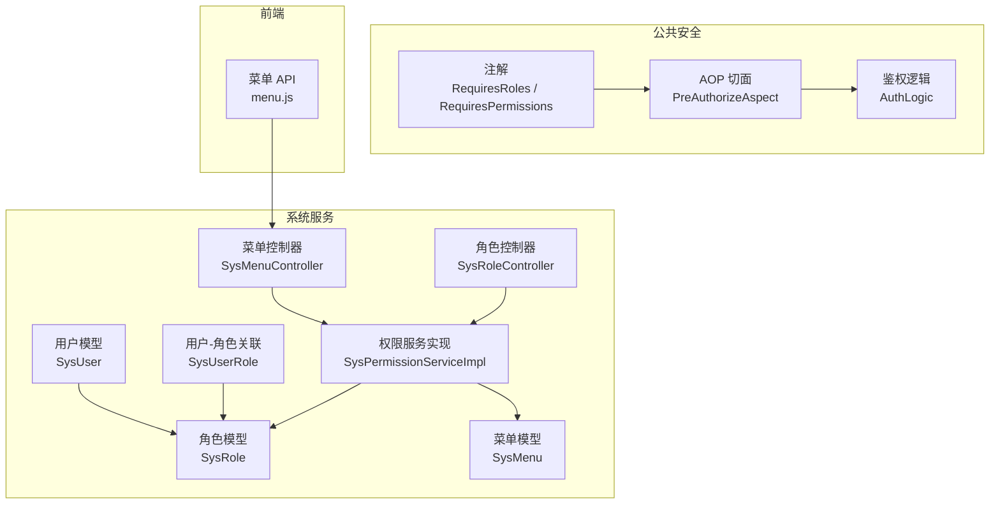
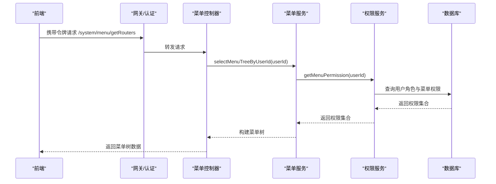
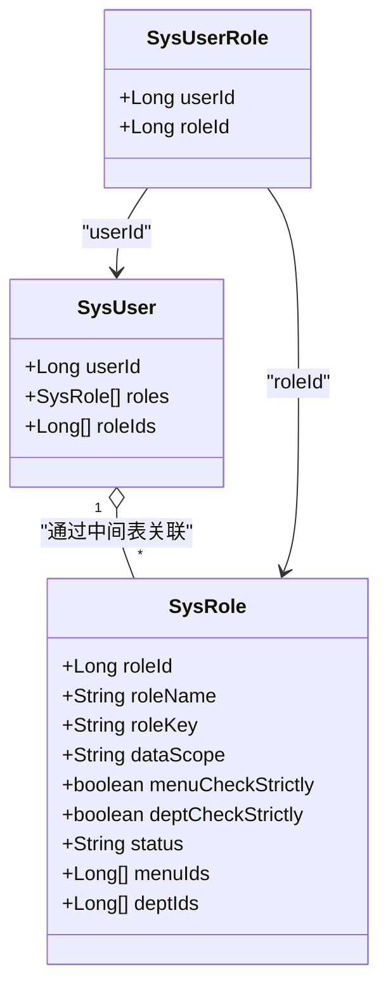
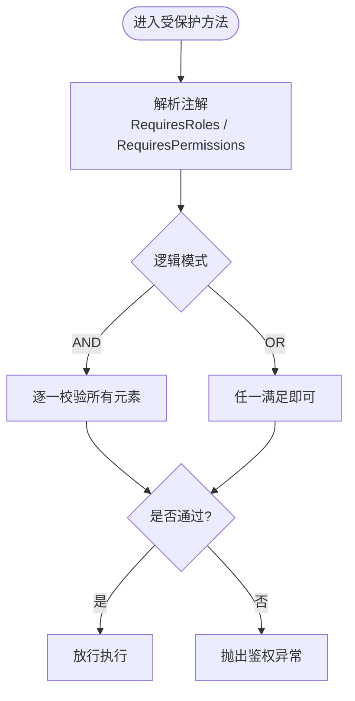
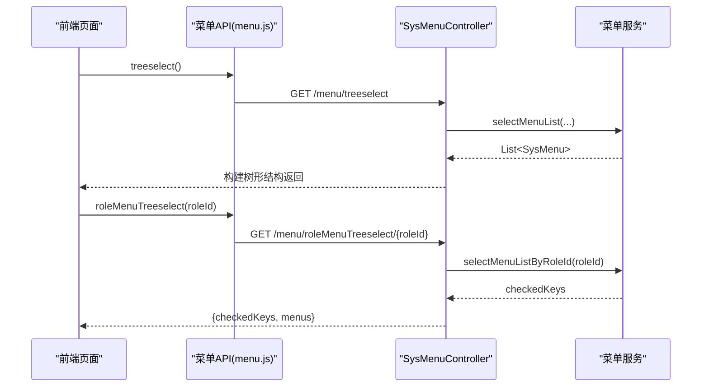
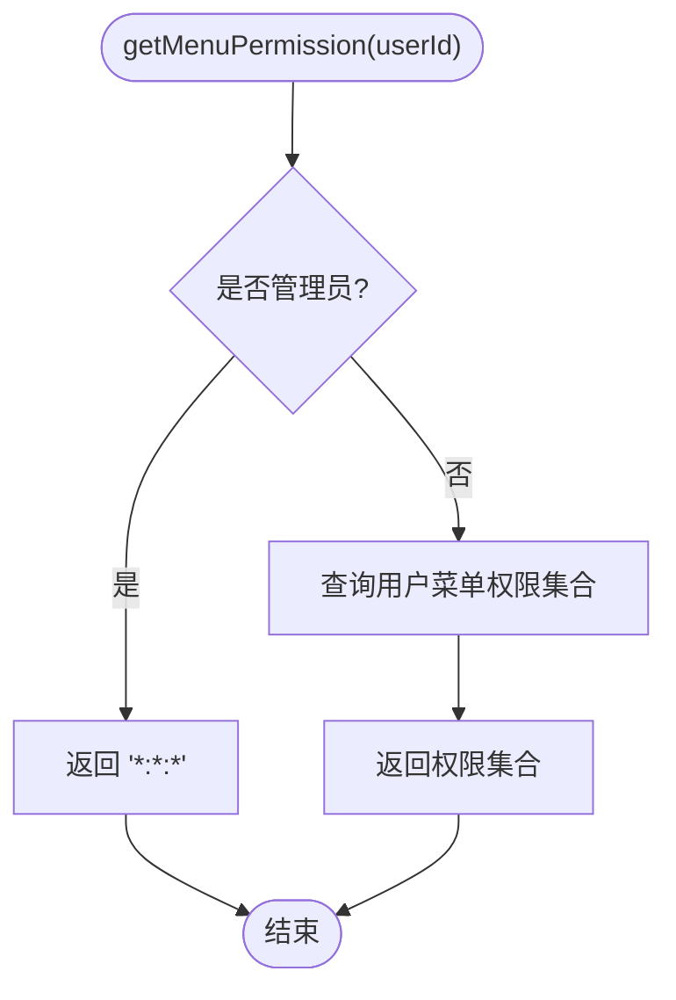
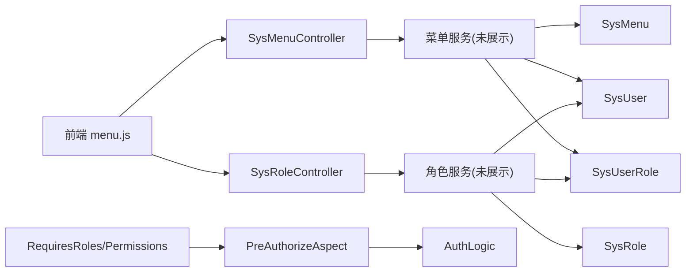

# 角色权限管理

<cite>
**本文引用的文件**   
- [SysRole.java](file://ruoyi-api/ruoyi-api-system/src/main/java/com/ruoyi/system/api/domain/SysRole.java)
- [SysUser.java](file://ruoyi-api/ruoyi-api-system/src/main/java/com/ruoyi/system/api/domain/SysUser.java)
- [SysMenu.java](file://ruoyi-modules/ruoyi-system/src/main/java/com/ruoyi/system/domain/SysMenu.java)
- [SysUserRole.java](file://ruoyi-modules/ruoyi-system/src/main/java/com/ruoyi/system/domain/SysUserRole.java)
- [SysPermissionServiceImpl.java](file://ruoyi-modules/ruoyi-system/src/main/java/com/ruoyi/system/service/impl/SysPermissionServiceImpl.java)
- [SysMenuController.java](file://ruoyi-modules/ruoyi-system/src/main/java/com/ruoyi/system/controller/SysMenuController.java)
- [SysRoleController.java](file://ruoyi-modules/ruoyi-system/src/main/java/com/ruoyi/system/controller/SysRoleController.java)
- [RequiresRoles.java](file://ruoyi-common/ruoyi-common-security/src/main/java/com/ruoyi/common/security/annotation/RequiresRoles.java)
- [RequiresPermissions.java](file://ruoyi-common/ruoyi-common-security/src/main/java/com/ruoyi/common/security/annotation/RequiresPermissions.java)
- [Logical.java](file://ruoyi-common/ruoyi-common-security/src/main/java/com/ruoyi/common/security/annotation/Logical.java)
- [AuthLogic.java](file://ruoyi-common/ruoyi-common-security/src/main/java/com/ruoyi/common/security/auth/AuthLogic.java)
- [PreAuthorizeAspect.java](file://ruoyi-common/ruoyi-common-security/src/main/java/com/ruoyi/common/security/aspect/PreAuthorizeAspect.java)
- [menu.js](file://ruoyi-ui/src/api/system/menu.js)
- [ry_20210908.sql](file://sql/ry_20210908.sql)
</cite>

## 目录
1. [简介](#简介)
2. [项目结构](#项目结构)
3. [核心组件](#核心组件)
4. [架构总览](#架构总览)
5. [详细组件分析](#详细组件分析)
6. [依赖关系分析](#依赖关系分析)
7. [性能与缓存建议](#性能与缓存建议)
8. [故障排查指南](#故障排查指南)
9. [结论](#结论)
10. [附录：API 与数据模型](#附录api-与数据模型)

## 简介
本文件面向“角色权限管理”功能，系统性说明 RBAC（基于角色的访问控制）在系统中的实现方式，包括：
- 角色定义、用户-角色多对多关系、菜单与按钮级权限控制
- 权限注解与 AOP 鉴权流程
- 角色管理 API 与菜单树形数据传输格式
- 最佳实践与常见问题解决方案

## 项目结构
权限相关代码主要分布在以下模块：
- 公共安全能力：注解、AOP 切面、鉴权逻辑
- 系统服务模块：角色、用户、菜单的领域模型与控制器
- 前端 API：菜单树与角色菜单选择接口调用

图表来源
- [RequiresRoles.java:1-26](file://ruoyi-common/ruoyi-common-security/src/main/java/com/ruoyi/common/security/annotation/RequiresRoles.java#L1-L26)
- [RequiresPermissions.java:1-27](file://ruoyi-common/ruoyi-common-security/src/main/java/com/ruoyi/common/security/annotation/RequiresPermissions.java#L1-L27)
- [PreAuthorizeAspect.java:1-44](file://ruoyi-common/ruoyi-common-security/src/main/java/com/ruoyi/common/security/aspect/PreAuthorizeAspect.java#L1-L44)
- [AuthLogic.java:196-308](file://ruoyi-common/ruoyi-common-security/src/main/java/com/ruoyi/common/security/auth/AuthLogic.java#L196-L308)
- [SysRole.java:1-227](file://ruoyi-api/ruoyi-api-system/src/main/java/com/ruoyi/system/api/domain/SysRole.java#L1-L227)
- [SysUser.java:1-326](file://ruoyi-api/ruoyi-api-system/src/main/java/com/ruoyi/system/api/domain/SysUser.java#L1-L326)
- [SysMenu.java:1-260](file://ruoyi-modules/ruoyi-system/src/main/java/com/ruoyi/system/domain/SysMenu.java#L1-L260)
- [SysUserRole.java:1-46](file://ruoyi-modules/ruoyi-system/src/main/java/com/ruoyi/system/domain/SysUserRole.java#L1-L46)
- [SysPermissionServiceImpl.java:1-64](file://ruoyi-modules/ruoyi-system/src/main/java/com/ruoyi/system/service/impl/SysPermissionServiceImpl.java#L1-L64)
- [SysMenuController.java:1-159](file://ruoyi-modules/ruoyi-system/src/main/java/com/ruoyi/system/controller/SysMenuController.java#L1-L159)
- [SysRoleController.java:1-222](file://ruoyi-modules/ruoyi-system/src/main/java/com/ruoyi/system/controller/SysRoleController.java#L1-L222)
- [menu.js:1-60](file://ruoyi-ui/src/api/system/menu.js#L1-L60)

章节来源
- [SysRole.java:1-227](file://ruoyi-api/ruoyi-api-system/src/main/java/com/ruoyi/system/api/domain/SysRole.java#L1-L227)
- [SysUser.java:1-326](file://ruoyi-api/ruoyi-api-system/src/main/java/com/ruoyi/system/api/domain/SysUser.java#L1-L326)
- [SysMenu.java:1-260](file://ruoyi-modules/ruoyi-system/src/main/java/com/ruoyi/system/domain/SysMenu.java#L1-L260)
- [SysUserRole.java:1-46](file://ruoyi-modules/ruoyi-system/src/main/java/com/ruoyi/system/domain/SysUserRole.java#L1-L46)
- [SysPermissionServiceImpl.java:1-64](file://ruoyi-modules/ruoyi-system/src/main/java/com/ruoyi/system/service/impl/SysPermissionServiceImpl.java#L1-L64)
- [SysMenuController.java:1-159](file://ruoyi-modules/ruoyi-system/src/main/java/com/ruoyi/system/controller/SysMenuController.java#L1-L159)
- [SysRoleController.java:1-222](file://ruoyi-modules/ruoyi-system/src/main/java/com/ruoyi/system/controller/SysRoleController.java#L1-L222)
- [RequiresRoles.java:1-26](file://ruoyi-common/ruoyi-common-security/src/main/java/com/ruoyi/common/security/annotation/RequiresRoles.java#L1-L26)
- [RequiresPermissions.java:1-27](file://ruoyi-common/ruoyi-common-security/src/main/java/com/ruoyi/common/security/annotation/RequiresPermissions.java#L1-L27)
- [Logical.java:1-20](file://ruoyi-common/ruoyi-common-security/src/main/java/com/ruoyi/common/security/annotation/Logical.java#L1-L20)
- [AuthLogic.java:196-308](file://ruoyi-common/ruoyi-common-security/src/main/java/com/ruoyi/common/security/auth/AuthLogic.java#L196-L308)
- [PreAuthorizeAspect.java:1-44](file://ruoyi-common/ruoyi-common-security/src/main/java/com/ruoyi/common/security/aspect/PreAuthorizeAspect.java#L1-L44)
- [menu.js:1-60](file://ruoyi-ui/src/api/system/menu.js#L1-L60)

## 核心组件
- 角色 SysRole：承载角色标识、名称、排序、数据范围、状态等；支持管理员判定。
- 用户 SysUser：承载用户基本信息及角色集合；支持管理员判定。
- 菜单 SysMenu：承载菜单层级、路由、组件、类型（目录/菜单/按钮）、可见性、权限字符串 perms 等。
- 用户-角色关联 SysUserRole：表示用户与角色的多对多关系。
- 权限服务 SysPermissionServiceImpl：根据用户 ID 获取角色权限集合与菜单权限集合；管理员拥有全部权限。
- 鉴权注解与 AOP：RequiresRoles、RequiresPermissions、Logical、PreAuthorizeAspect、AuthLogic 共同完成方法级权限校验。
- 控制器：SysRoleController、SysMenuController 暴露角色与菜单的管理与查询接口。

章节来源
- [SysRole.java:1-227](file://ruoyi-api/ruoyi-api-system/src/main/java/com/ruoyi/system/api/domain/SysRole.java#L1-L227)
- [SysUser.java:1-326](file://ruoyi-api/ruoyi-api-system/src/main/java/com/ruoyi/system/api/domain/SysUser.java#L1-L326)
- [SysMenu.java:1-260](file://ruoyi-modules/ruoyi-system/src/main/java/com/ruoyi/system/domain/SysMenu.java#L1-L260)
- [SysUserRole.java:1-46](file://ruoyi-modules/ruoyi-system/src/main/java/com/ruoyi/system/domain/SysUserRole.java#L1-L46)
- [SysPermissionServiceImpl.java:1-64](file://ruoyi-modules/ruoyi-system/src/main/java/com/ruoyi/system/service/impl/SysPermissionServiceImpl.java#L1-L64)
- [RequiresRoles.java:1-26](file://ruoyi-common/ruoyi-common-security/src/main/java/com/ruoyi/common/security/annotation/RequiresRoles.java#L1-L26)
- [RequiresPermissions.java:1-27](file://ruoyi-common/ruoyi-common-security/src/main/java/com/ruoyi/common/security/annotation/RequiresPermissions.java#L1-L27)
- [Logical.java:1-20](file://ruoyi-common/ruoyi-common-security/src/main/java/com/ruoyi/common/security/annotation/Logical.java#L1-L20)
- [PreAuthorizeAspect.java:1-44](file://ruoyi-common/ruoyi-common-security/src/main/java/com/ruoyi/common/security/aspect/PreAuthorizeAspect.java#L1-L44)
- [AuthLogic.java:196-308](file://ruoyi-common/ruoyi-common-security/src/main/java/com/ruoyi/common/security/auth/AuthLogic.java#L196-L308)

## 架构总览
RBAC 权限体系由“用户-角色-权限（菜单/按钮）”三层构成，并通过注解+AOP 进行方法级拦截校验。

图表来源
- [SysMenuController.java:147-158](file://ruoyi-modules/ruoyi-system/src/main/java/com/ruoyi/system/controller/SysMenuController.java#L147-L158)
- [SysPermissionServiceImpl.java:49-63](file://ruoyi-modules/ruoyi-system/src/main/java/com/ruoyi/system/service/impl/SysPermissionServiceImpl.java#L49-L63)

## 详细组件分析

### 角色与用户的多对多关系
- 用户 SysUser 包含角色列表 roles 与角色ID数组 roleIds，用于前端多选与后端批量授权。
- 用户-角色关联 SysUserRole 表示中间表实体，便于批量授权与取消授权。
- 角色 SysRole 提供管理员判定、数据范围 dataScope、菜单/部门严格联动等配置项。

图表来源
- [SysUser.java:81-88](file://ruoyi-api/ruoyi-api-system/src/main/java/com/ruoyi/system/api/domain/SysUser.java#L81-L88)
- [SysRole.java:36-60](file://ruoyi-api/ruoyi-api-system/src/main/java/com/ruoyi/system/api/domain/SysRole.java#L36-L60)
- [SysUserRole.java:1-46](file://ruoyi-modules/ruoyi-system/src/main/java/com/ruoyi/system/domain/SysUserRole.java#L1-L46)

章节来源
- [SysUser.java:81-88](file://ruoyi-api/ruoyi-api-system/src/main/java/com/ruoyi/system/api/domain/SysUser.java#L81-L88)
- [SysRole.java:36-60](file://ruoyi-api/ruoyi-api-system/src/main/java/com/ruoyi/system/api/domain/SysRole.java#L36-L60)
- [SysUserRole.java:1-46](file://ruoyi-modules/ruoyi-system/src/main/java/com/ruoyi/system/domain/SysUserRole.java#L1-L46)

### 权限注解与自定义验证逻辑
- 注解：
  - RequiresRoles：声明方法需要指定角色标识，支持 AND/OR 逻辑。
  - RequiresPermissions：声明方法需要指定权限码，支持 AND/OR 逻辑。
  - Logical：枚举 AND/OR。
- AOP 切面 PreAuthorizeAspect：拦截带有上述注解的方法，统一走 AuthLogic 校验。
- AuthLogic：提供 checkRole/checkPermi 等方法，未通过则抛出对应异常。

图表来源
- [RequiresRoles.java:1-26](file://ruoyi-common/ruoyi-common-security/src/main/java/com/ruoyi/common/security/annotation/RequiresRoles.java#L1-L26)
- [RequiresPermissions.java:1-27](file://ruoyi-common/ruoyi-common-security/src/main/java/com/ruoyi/common/security/annotation/RequiresPermissions.java#L1-L27)
- [Logical.java:1-20](file://ruoyi-common/ruoyi-common-security/src/main/java/com/ruoyi/common/security/annotation/Logical.java#L1-L20)
- [PreAuthorizeAspect.java:31-44](file://ruoyi-common/ruoyi-common-security/src/main/java/com/ruoyi/common/security/aspect/PreAuthorizeAspect.java#L31-L44)
- [AuthLogic.java:196-308](file://ruoyi-common/ruoyi-common-security/src/main/java/com/ruoyi/common/security/auth/AuthLogic.java#L196-L308)

章节来源
- [RequiresRoles.java:1-26](file://ruoyi-common/ruoyi-common-security/src/main/java/com/ruoyi/common/security/annotation/RequiresRoles.java#L1-L26)
- [RequiresPermissions.java:1-27](file://ruoyi-common/ruoyi-common-security/src/main/java/com/ruoyi/common/security/annotation/RequiresPermissions.java#L1-L27)
- [Logical.java:1-20](file://ruoyi-common/ruoyi-common-security/src/main/java/com/ruoyi/common/security/annotation/Logical.java#L1-L20)
- [PreAuthorizeAspect.java:31-44](file://ruoyi-common/ruoyi-common-security/src/main/java/com/ruoyi/common/security/aspect/PreAuthorizeAspect.java#L31-L44)
- [AuthLogic.java:196-308](file://ruoyi-common/ruoyi-common-security/src/main/java/com/ruoyi/common/security/auth/AuthLogic.java#L196-L308)

### 菜单权限控制与树形结构
- 菜单 SysMenu 包含父节点 parentId、类型 menuType（M/C/F）、权限字符串 perms、图标 icon、子节点 children 等。
- 控制器提供：
  - 菜单列表、详情、新增、修改、删除
  - 下拉树 treeselect
  - 按角色加载已选菜单 roleMenuTreeselect
  - 当前用户路由 getRouters（用于前端动态生成侧边栏）

图表来源
- [menu.js:20-34](file://ruoyi-ui/src/api/system/menu.js#L20-L34)
- [SysMenuController.java:62-81](file://ruoyi-modules/ruoyi-system/src/main/java/com/ruoyi/system/controller/SysMenuController.java#L62-L81)

章节来源
- [SysMenu.java:1-260](file://ruoyi-modules/ruoyi-system/src/main/java/com/ruoyi/system/domain/SysMenu.java#L1-L260)
- [SysMenuController.java:37-81](file://ruoyi-modules/ruoyi-system/src/main/java/com/ruoyi/system/controller/SysMenuController.java#L37-L81)
- [menu.js:1-60](file://ruoyi-ui/src/api/system/menu.js#L1-L60)

### 角色管理 API
- 列表分页：GET /role/list
- 导出：POST /role/export
- 详情：GET /role/{roleId}
- 新增：POST /role
- 修改：PUT /role
- 数据范围授权：PUT /role/dataScope
- 状态变更：PUT /role/changeStatus
- 删除：DELETE /role/{roleIds}
- 角色选项：GET /role/optionselect
- 已分配用户：GET /role/authUser/allocatedList
- 未分配用户：GET /role/authUser/unallocatedList
- 取消授权：PUT /role/authUser/cancel
- 批量取消授权：PUT /role/authUser/cancelAll
- 批量授权：PUT /role/authUser/selectAll

章节来源
- [SysRoleController.java:45-221](file://ruoyi-modules/ruoyi-system/src/main/java/com/ruoyi/system/controller/SysRoleController.java#L45-L221)

### 权限计算与服务层
- 角色权限：getRolePermission(userId)
  - 管理员直接返回 admin
  - 非管理员从角色服务聚合角色标识
- 菜单权限：getMenuPermission(userId)
  - 管理员直接返回 *:*:*
  - 非管理员从菜单服务聚合 perms

图表来源
- [SysPermissionServiceImpl.java:49-63](file://ruoyi-modules/ruoyi-system/src/main/java/com/ruoyi/system/service/impl/SysPermissionServiceImpl.java#L49-L63)

章节来源
- [SysPermissionServiceImpl.java:1-64](file://ruoyi-modules/ruoyi-system/src/main/java/com/ruoyi/system/service/impl/SysPermissionServiceImpl.java#L1-L64)

## 依赖关系分析
- 控制器依赖服务层，服务层依赖领域模型与数据库映射。
- 鉴权注解与 AOP 切面解耦业务逻辑，集中处理权限校验。
- 前端通过 menu.js 调用后端菜单与角色菜单树接口。

图表来源
- [menu.js:1-60](file://ruoyi-ui/src/api/system/menu.js#L1-L60)
- [SysMenuController.java:1-159](file://ruoyi-modules/ruoyi-system/src/main/java/com/ruoyi/system/controller/SysMenuController.java#L1-L159)
- [SysRoleController.java:1-222](file://ruoyi-modules/ruoyi-system/src/main/java/com/ruoyi/system/controller/SysRoleController.java#L1-L222)
- [SysMenu.java:1-260](file://ruoyi-modules/ruoyi-system/src/main/java/com/ruoyi/system/domain/SysMenu.java#L1-L260)
- [SysRole.java:1-227](file://ruoyi-api/ruoyi-api-system/src/main/java/com/ruoyi/system/api/domain/SysRole.java#L1-L227)
- [SysUser.java:1-326](file://ruoyi-api/ruoyi-api-system/src/main/java/com/ruoyi/system/api/domain/SysUser.java#L1-L326)
- [SysUserRole.java:1-46](file://ruoyi-modules/ruoyi-system/src/main/java/com/ruoyi/system/domain/SysUserRole.java#L1-L46)
- [RequiresRoles.java:1-26](file://ruoyi-common/ruoyi-common-security/src/main/java/com/ruoyi/common/security/annotation/RequiresRoles.java#L1-L26)
- [RequiresPermissions.java:1-27](file://ruoyi-common/ruoyi-common-security/src/main/java/com/ruoyi/common/security/annotation/RequiresPermissions.java#L1-L27)
- [PreAuthorizeAspect.java:1-44](file://ruoyi-common/ruoyi-common-security/src/main/java/com/ruoyi/common/security/aspect/PreAuthorizeAspect.java#L1-L44)
- [AuthLogic.java:196-308](file://ruoyi-common/ruoyi-common-security/src/main/java/com/ruoyi/common/security/auth/AuthLogic.java#L196-L308)

## 性能与缓存建议
- 菜单树与权限集合建议在登录成功后缓存至 Redis，避免频繁查询数据库。
- 使用懒加载与分页减少首屏渲染压力。
- 对高频读取的菜单树与权限集合设置合理过期时间，并在角色/菜单变更后主动失效。

[本节为通用建议，不直接分析具体文件]

## 故障排查指南
- 注解未生效
  - 检查目标方法是否正确标注 RequiresRoles/RequiresPermissions
  - 确认 AOP 切面已启用且包扫描路径包含 PreAuthorizeAspect
- 权限码不一致
  - 核对菜单 perms 与注解中声明的权限码是否一致
  - 确认角色已正确分配对应菜单
- 菜单树为空或路由缺失
  - 检查 getRouters 接口是否被正确调用
  - 确认用户具备相应菜单权限
- 角色授权失败
  - 检查角色唯一性校验（名称、权限标识）
  - 检查数据范围与部门限制是否导致不可见

章节来源
- [PreAuthorizeAspect.java:31-44](file://ruoyi-common/ruoyi-common-security/src/main/java/com/ruoyi/common/security/aspect/PreAuthorizeAspect.java#L31-L44)
- [SysRoleController.java:78-116](file://ruoyi-modules/ruoyi-system/src/main/java/com/ruoyi/system/controller/SysRoleController.java#L78-L116)
- [SysMenuController.java:147-158](file://ruoyi-modules/ruoyi-system/src/main/java/com/ruoyi/system/controller/SysMenuController.java#L147-L158)

## 结论
本项目采用标准 RBAC 模型，结合注解与 AOP 实现了细粒度的方法与资源访问控制。通过角色-菜单-按钮三级权限、用户-角色多对多关系以及灵活的权限逻辑（AND/OR），可满足复杂的企业级权限场景。配合完善的角色与菜单管理 API，可快速构建前后端一致的权限体系。

[本节为总结性内容，不直接分析具体文件]

## 附录：API 与数据模型

### 菜单管理 API
- GET /menu/list：菜单列表（需权限 system:menu:list）
- GET /menu/{menuId}：菜单详情（需权限 system:menu:query）
- GET /menu/treeselect：菜单下拉树
- GET /menu/roleMenuTreeselect/{roleId}：按角色返回已选菜单与完整树
- POST /menu：新增菜单（需权限 system:menu:add）
- PUT /menu：修改菜单（需权限 system:menu:edit）
- DELETE /menu/{menuId}：删除菜单（需权限 system:menu:remove）
- GET /menu/getRouters：当前用户路由信息

章节来源
- [SysMenuController.java:37-158](file://ruoyi-modules/ruoyi-system/src/main/java/com/ruoyi/system/controller/SysMenuController.java#L37-L158)

### 角色管理 API
- GET /role/list：角色分页列表（需权限 system:role:list）
- POST /role/export：导出角色（需权限 system:role:export）
- GET /role/{roleId}：角色详情（需权限 system:role:query）
- POST /role：新增角色（需权限 system:role:add）
- PUT /role：修改角色（需权限 system:role:edit）
- PUT /role/dataScope：数据范围授权（需权限 system:role:edit）
- PUT /role/changeStatus：状态变更（需权限 system:role:edit）
- DELETE /role/{roleIds}：删除角色（需权限 system:role:remove）
- GET /role/optionselect：角色选项（需权限 system:role:query）
- GET /role/authUser/allocatedList：已分配用户（需权限 system:role:list）
- GET /role/authUser/unallocatedList：未分配用户（需权限 system:role:list）
- PUT /role/authUser/cancel：取消授权（需权限 system:role:edit）
- PUT /role/authUser/cancelAll：批量取消授权（需权限 system:role:edit）
- PUT /role/authUser/selectAll：批量授权（需权限 system:role:edit）

章节来源
- [SysRoleController.java:45-221](file://ruoyi-modules/ruoyi-system/src/main/java/com/ruoyi/system/controller/SysRoleController.java#L45-L221)

### 数据模型要点
- 角色 SysRole
  - 关键字段：roleId、roleName、roleKey、dataScope、status、menuIds、deptIds
- 用户 SysUser
  - 关键字段：userId、roles、roleIds
- 菜单 SysMenu
  - 关键字段：menuId、parentId、menuType、perms、children
- 用户-角色关联 SysUserRole
  - 关键字段：userId、roleId

章节来源
- [SysRole.java:20-60](file://ruoyi-api/ruoyi-api-system/src/main/java/com/ruoyi/system/api/domain/SysRole.java#L20-L60)
- [SysUser.java:81-88](file://ruoyi-api/ruoyi-api-system/src/main/java/com/ruoyi/system/api/domain/SysUser.java#L81-L88)
- [SysMenu.java:21-67](file://ruoyi-modules/ruoyi-system/src/main/java/com/ruoyi/system/domain/SysMenu.java#L21-L67)
- [SysUserRole.java:13-17](file://ruoyi-modules/ruoyi-system/src/main/java/com/ruoyi/system/domain/SysUserRole.java#L13-L17)

### 数据库表结构参考
- 菜单权限表 sys_menu：包含 perms、icon、create_time、update_time 等字段
- 角色-部门关联表 sys_role_dept：角色与部门的关联关系

章节来源
- [ry_20210908.sql:148-156](file://sql/ry_20210908.sql#L148-L156)
- [ry_20210908.sql:377-385](file://sql/ry_20210908.sql#L377-L385)