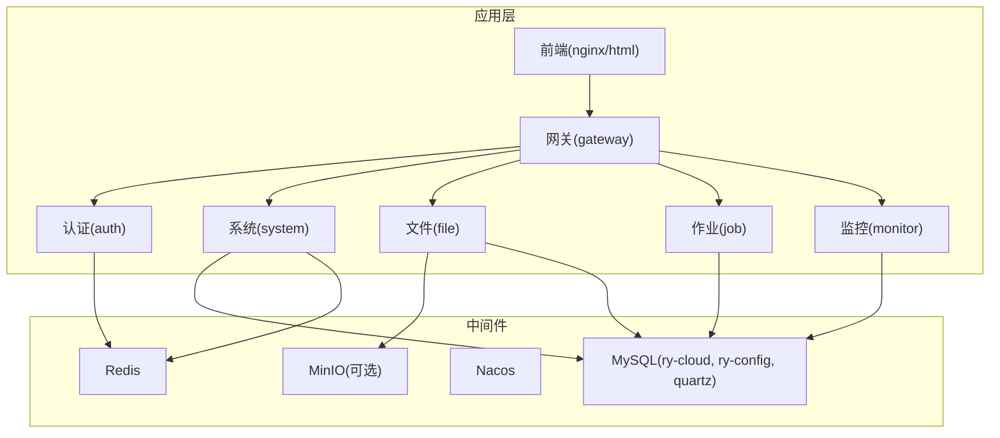
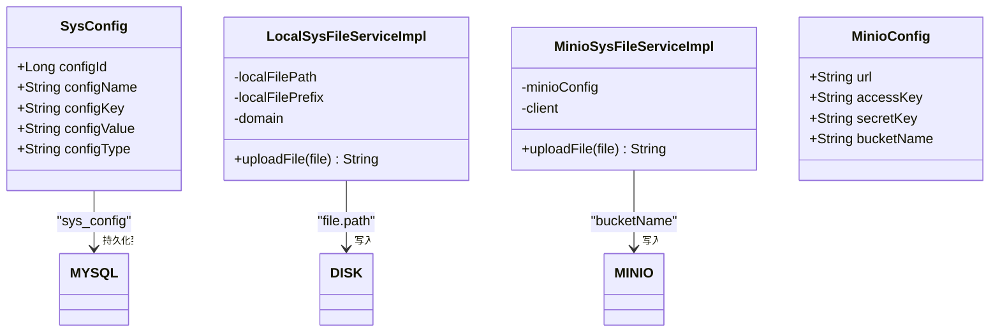
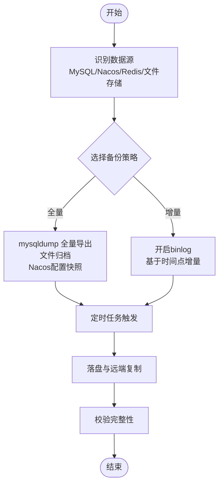
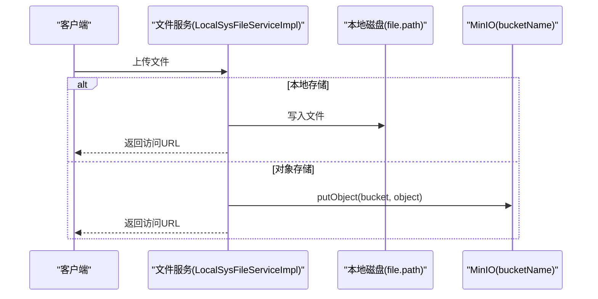
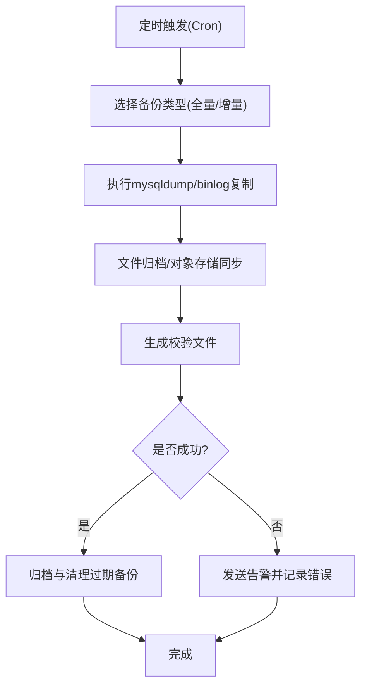
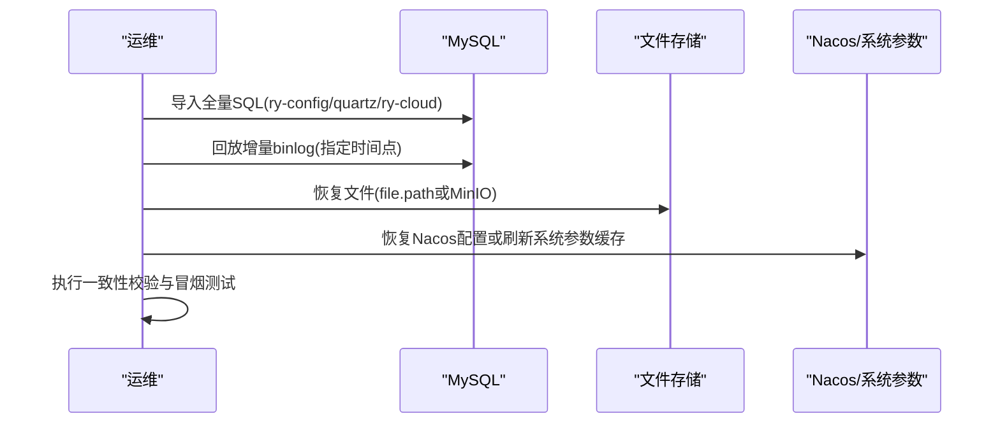
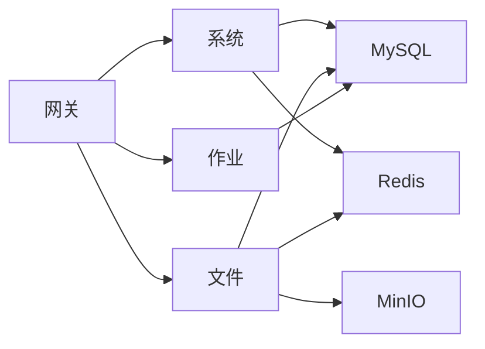

# 备份恢复

<cite>
**本文引用的文件**   
- [docker-compose.yml](file://docker/docker-compose.yml)
- [deploy.sh](file://docker/deploy.sh)
- [copy.sh](file://docker/copy.sh)
- [ry_20210908.sql](file://sql/ry_20210908.sql)
- [ry_config_20220424.sql](file://sql/ry_config_20220424.sql)
- [quartz.sql](file://sql/quartz.sql)
- [SysConfig.java](file://ruoyi-modules/ruoyi-system/src/main/java/com/ruoyi/system/domain/SysConfig.java)
- [SysConfigServiceImpl.java](file://ruoyi-modules/ruoyi-system/src/main/java/com/ruoyi/system/service/impl/SysConfigServiceImpl.java)
- [SysConfigMapper.xml](file://ruoyi-modules/ruoyi-system/src/main/resources/mapper/system/SysConfigMapper.xml)
- [SysFile.java](file://ruoyi-api/ruoyi-api-system/src/main/java/com/ruoyi/system/api/domain/SysFile.java)
- [LocalSysFileServiceImpl.java](file://ruoyi-modules/ruoyi-file/src/main/java/com/ruoyi/file/service/LocalSysFileServiceImpl.java)
- [MinioSysFileServiceImpl.java](file://ruoyi-modules/ruoyi-file/src/main/java/com/ruoyi/file/service/MinioSysFileServiceImpl.java)
- [MinioConfig.java](file://ruoyi-modules/ruoyi-file/src/main/java/com/ruoyi/file/config/MinioConfig.java)
</cite>

## 目录
1. [引言](#引言)
2. [项目结构与数据资产范围](#项目结构与数据资产范围)
3. [核心组件与数据边界](#核心组件与数据边界)
4. [架构总览](#架构总览)
5. [详细备份策略与实现](#详细备份策略与实现)
6. [自动化备份脚本与定时任务](#自动化备份脚本与定时任务)
7. [灾难恢复流程](#灾难恢复流程)
8. [数据迁移方案](#数据迁移方案)
9. [版本回滚操作指南](#版本回滚操作指南)
10. [依赖关系分析](#依赖关系分析)
11. [性能与一致性保障](#性能与一致性保障)
12. [故障排查与常见问题](#故障排查与常见问题)
13. [结论](#结论)

## 引言
本文件面向生产环境的数据质量平台，提供完整的数据库全量与增量备份、文件存储与配置数据的备份方案，以及自动化脚本、定时任务、备份文件管理、灾难恢复、数据迁移和版本回滚的操作指南。同时给出备份验证、恢复测试和数据一致性检查的质量保证措施，确保在容器化部署环境下具备可重复、可审计、可回滚的运维能力。

## 项目结构与数据资产范围
本项目采用 Spring Cloud 微服务架构，关键持久化与外部依赖包括：
- MySQL：业务库 ry-cloud、配置中心库 ry-config、调度库 quartz
- Redis：缓存与会话等临时数据
- Nacos：分布式配置中心（独立服务）
- MinIO/FastDFS/本地磁盘：文件存储后端（由文件模块支持多种实现）
- Nginx：静态资源与反向代理

**图表来源**
- [docker-compose.yml:3-139](file://docker/docker-compose.yml#L3-L139)

**章节来源**
- [docker-compose.yml:3-139](file://docker/docker-compose.yml#L3-L139)

## 核心组件与数据边界
- 数据库
  - 业务库：ry-cloud（包含 sys_config 等系统表）
  - 配置库：ry-config（Nacos 配置持久化）
  - 调度库：quartz（Quartz 调度表结构）
- 缓存：Redis（会话、字典、参数缓存等）
- 配置中心：Nacos（运行时配置）
- 文件存储：本地磁盘或对象存储（MinIO/FastDFS），通过文件模块统一接口

**图表来源**
- [SysConfig.java:11-111](file://ruoyi-modules/ruoyi-system/src/main/java/com/ruoyi/system/domain/SysConfig.java#L11-L111)
- [LocalSysFileServiceImpl.java:14-50](file://ruoyi-modules/ruoyi-file/src/main/java/com/ruoyi/file/service/LocalSysFileServiceImpl.java#L14-L50)
- [MinioSysFileServiceImpl.java:16-45](file://ruoyi-modules/ruoyi-file/src/main/java/com/ruoyi/file/service/MinioSysFileServiceImpl.java#L16-L45)
- [MinioConfig.java:13-82](file://ruoyi-modules/ruoyi-file/src/main/java/com/ruoyi/file/config/MinioConfig.java#L13-L82)

**章节来源**
- [SysConfig.java:11-111](file://ruoyi-modules/ruoyi-system/src/main/java/com/ruoyi/system/domain/SysConfig.java#L11-L111)
- [LocalSysFileServiceImpl.java:14-50](file://ruoyi-modules/ruoyi-file/src/main/java/com/ruoyi/file/service/LocalSysFileServiceImpl.java#L14-L50)
- [MinioSysFileServiceImpl.java:16-45](file://ruoyi-modules/ruoyi-file/src/main/java/com/ruoyi/file/service/MinioSysFileServiceImpl.java#L16-L45)
- [MinioConfig.java:13-82](file://ruoyi-modules/ruoyi-file/src/main/java/com/ruoyi/file/config/MinioConfig.java#L13-L82)

## 架构总览
从备份视角看，系统的关键数据面如下：
- 数据库：MySQL 中的 ry-cloud、ry-config、quartz
- 文件：本地路径 file.path 或 MinIO bucket
- 配置：Nacos 配置（可通过配置文件或数据库持久化）
- 缓存：Redis（可重建，但建议保留会话与热点数据）

[本图为概念流程图，不直接映射具体源码文件]

## 详细备份策略与实现

### 数据库全量备份
- 目标库
  - ry-cloud：业务数据与系统配置（含 sys_config）
  - ry-config：Nacos 配置持久化
  - quartz：调度任务元数据
- 工具与方法
  - 使用 mysqldump 对每个库进行逻辑备份，生成按日期命名的 .sql 文件
  - 建议在低峰期执行，避免影响在线业务
- 注意事项
  - 保持字符集与排序规则一致（utf8mb4 / utf8mb4_unicode_ci）
  - 记录备份时间戳与校验值（如 md5/sha256）

**章节来源**
- [docker-compose.yml:18-39](file://docker/docker-compose.yml#L18-L39)
- [ry_20210908.sql:521-537](file://sql/ry_20210908.sql#L521-L537)
- [ry_config_20220424.sql:1-158](file://sql/ry_config_20220424.sql#L1-L158)
- [quartz.sql:68-79](file://sql/quartz.sql#L68-L79)

### 数据库增量备份
- 启用 binlog
  - 在 MySQL 启动参数中开启 binlog（例如 --log-bin=mysql-bin）
  - 设置合适的 binlog 格式（推荐 row）与过期策略（expire_logs_days）
- 增量策略
  - 基于时间点（point-in-time recovery）或基于 binlog 位置进行增量恢复
  - 结合全量基线，滚动保留最近若干天的增量日志

**章节来源**
- [docker-compose.yml:29-36](file://docker/docker-compose.yml#L29-L36)

### 文件存储备份
- 本地磁盘模式
  - 文件根路径由 file.path 配置，需定期打包归档并复制到远端存储
- 对象存储模式（MinIO/FastDFS）
  - MinIO：通过 bucketName 与 endpoint 访问，建议对 bucket 做跨地域复制
  - FastDFS：通过 domain 与 storePath 访问，建议同步至远端集群

**图表来源**
- [LocalSysFileServiceImpl.java:14-50](file://ruoyi-modules/ruoyi-file/src/main/java/com/ruoyi/file/service/LocalSysFileServiceImpl.java#L14-L50)
- [MinioSysFileServiceImpl.java:16-45](file://ruoyi-modules/ruoyi-file/src/main/java/com/ruoyi/file/service/MinioSysFileServiceImpl.java#L16-L45)
- [MinioConfig.java:13-82](file://ruoyi-modules/ruoyi-file/src/main/java/com/ruoyi/file/config/MinioConfig.java#L13-L82)

**章节来源**
- [LocalSysFileServiceImpl.java:14-50](file://ruoyi-modules/ruoyi-file/src/main/java/com/ruoyi/file/service/LocalSysFileServiceImpl.java#L14-L50)
- [MinioSysFileServiceImpl.java:16-45](file://ruoyi-modules/ruoyi-file/src/main/java/com/ruoyi/file/service/MinioSysFileServiceImpl.java#L16-L45)
- [MinioConfig.java:13-82](file://ruoyi-modules/ruoyi-file/src/main/java/com/ruoyi/file/config/MinioConfig.java#L13-L82)

### 配置数据备份
- Nacos 配置
  - 若使用数据库持久化，则 ry-config 库即为配置中心数据源，纳入数据库备份范围
  - 若使用文件系统持久化，需将 Nacos conf 目录纳入备份
- 系统参数（sys_config）
  - 作为业务库的一部分，随 ry-cloud 全量备份

**章节来源**
- [ry_config_20220424.sql:1-158](file://sql/ry_config_20220424.sql#L1-L158)
- [SysConfig.java:11-111](file://ruoyi-modules/ruoyi-system/src/main/java/com/ruoyi/system/domain/SysConfig.java#L11-L111)

### 用户数据备份
- 业务数据：全部位于 ry-cloud 库，随全量/增量备份覆盖
- 附件与图片：根据文件存储后端（本地/MinIO/FastDFS）分别归档

**章节来源**
- [SysFile.java:6-50](file://ruoyi-api/ruoyi-api-system/src/main/java/com/ruoyi/system/api/domain/SysFile.java#L6-L50)

## 自动化备份脚本与定时任务

### 备份脚本设计要点
- 全量备份
  - 调用 mysqldump 导出 ry-cloud、ry-config、quartz
  - 压缩并生成校验文件（md5/sha256）
  - 归档文件命名包含时间戳与库名
- 增量备份
  - 读取当前 binlog 位置或时间点，记录增量区间
  - 仅复制新增的 binlog 文件至备份目录
- 文件备份
  - 本地模式：tar 打包 file.path 目录
  - MinIO 模式：使用 mc sync 或官方 SDK 拉取 bucket 内容
- 清理策略
  - 保留最近 N 天全量与 M 天增量，删除过期文件
- 通知与告警
  - 备份成功/失败发送通知（邮件/钉钉/企业微信）

### 定时任务配置
- 操作系统级
  - Linux：crontab 或 systemd timer
  - Windows：计划任务
- 应用内调度
  - 使用 Quartz（quartz.sql 提供表结构）
  - 通过 job 模块创建“备份任务”，配置 Cron 表达式执行备份脚本

[本图为概念流程图，不直接映射具体源码文件]

**章节来源**
- [quartz.sql:68-79](file://sql/quartz.sql#L68-L79)
- [docker/deploy.sh:27-35](file://docker/deploy.sh#L27-L35)

## 灾难恢复流程

### 恢复前准备
- 确认恢复目标环境（同版本或兼容版本）
- 停止写入或进入只读模式，避免数据不一致
- 准备最新的全量备份与最近的增量 binlog

### 数据库恢复步骤
- 全量恢复
  - 导入 ry-config、quartz、ry-cloud（顺序建议先配置库，再业务库）
- 增量恢复
  - 指定时间点或 binlog 位置，回放增量日志
- 验证
  - 检查关键表行数、主键连续性、外键约束
  - 抽样比对业务关键字段

### 文件恢复步骤
- 本地模式：解压归档至 file.path，确保权限正确
- MinIO 模式：mc cp/sync 恢复 bucket 内容

### 配置恢复步骤
- Nacos：若使用数据库持久化，恢复 ry-config；若使用文件系统，恢复 conf 目录
- 系统参数：随 ry-cloud 恢复后，通过接口刷新缓存

**章节来源**
- [docker-compose.yml:18-39](file://docker/docker-compose.yml#L18-L39)
- [SysConfigServiceImpl.java:149-177](file://ruoyi-modules/ruoyi-system/src/main/java/com/ruoyi/system/service/impl/SysConfigServiceImpl.java#L149-L177)

## 数据迁移方案
- 库间迁移
  - 使用 mysqldump 导出目标库，再在新环境导入
  - 注意字符集、排序规则、时区一致
- 文件迁移
  - 本地模式：rsync/scp 同步 file.path
  - MinIO 模式：mc mirror 或 mc sync 跨桶/跨账号迁移
- 配置迁移
  - Nacos：导出配置或通过数据库迁移 ry-config
- 版本兼容
  - 升级前备份，灰度发布，回滚预案就绪

**章节来源**
- [MinioConfig.java:13-82](file://ruoyi-modules/ruoyi-file/src/main/java/com/ruoyi/file/config/MinioConfig.java#L13-L82)

## 版本回滚操作指南
- 数据库回滚
  - 停止服务，导入上一个稳定版本的全量 SQL
  - 如有增量，停止在目标时间点之前
- 文件回滚
  - 恢复到对应版本的归档快照
- 配置回滚
  - 恢复 Nacos 配置快照或系统参数快照
- 服务重启
  - 依次启动基础服务（MySQL/Redis/Nacos），再启动应用模块

**章节来源**
- [docker/deploy.sh:27-45](file://docker/deploy.sh#L27-L45)

## 依赖关系分析
- 应用与服务
  - 网关、认证、系统、文件、作业、监控均依赖 MySQL/Redis
  - 文件模块可选择本地或 MinIO 存储
- 配置与调度
  - Nacos 提供运行时配置
  - Quartz 提供任务调度（表结构见 quartz.sql）

**图表来源**
- [docker-compose.yml:67-139](file://docker/docker-compose.yml#L67-L139)

**章节来源**
- [docker-compose.yml:67-139](file://docker/docker-compose.yml#L67-L139)

## 性能与一致性保障
- 备份窗口
  - 全量备份安排在业务低峰期
  - 增量备份高频执行（如每 5-15 分钟）
- 并发控制
  - 限制备份进程数，避免 IO 争用
- 一致性
  - 数据库：使用事务一致的 mysqldump 选项（如 --single-transaction）
  - 文件：在归档前锁定写操作或使用快照技术
- 校验
  - 生成校验文件（md5/sha256）
  - 恢复后进行抽样比对与完整性检查

[本节为通用指导，不直接分析具体文件]

## 故障排查与常见问题
- 备份失败
  - 检查 MySQL 连接与权限
  - 检查磁盘空间与网络连通性
- 恢复异常
  - 核对字符集与排序规则
  - 检查 binlog 是否完整
- 文件不可访问
  - 检查 file.path 权限或 MinIO 凭证
- 配置未生效
  - 刷新系统参数缓存（参考系统配置服务）

**章节来源**
- [SysConfigServiceImpl.java:149-177](file://ruoyi-modules/ruoyi-system/src/main/java/com/ruoyi/system/service/impl/SysConfigServiceImpl.java#L149-L177)

## 结论
通过本方案，可在容器化环境中实现对数据库、文件与配置的全面备份与恢复，结合自动化脚本与定时任务，形成可重复、可审计、可回滚的运维闭环。配合校验与一致性检查，确保数据质量与业务连续性。