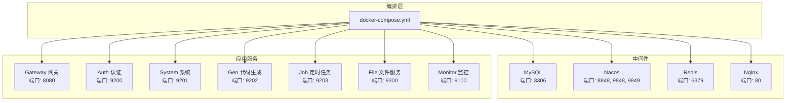
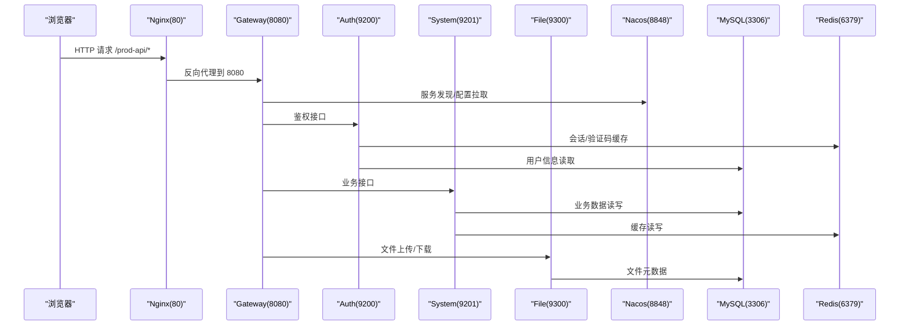
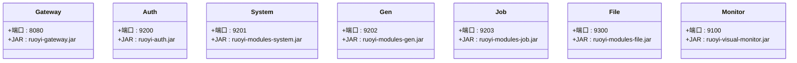
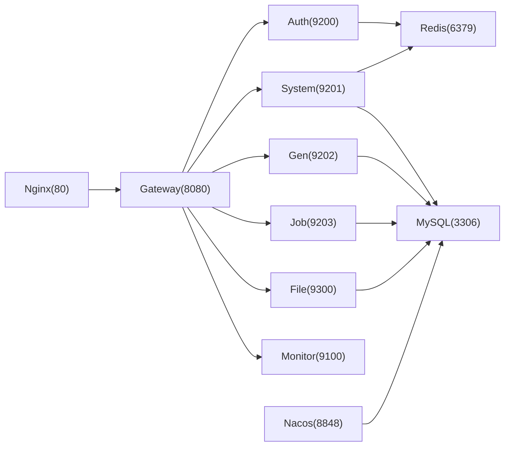
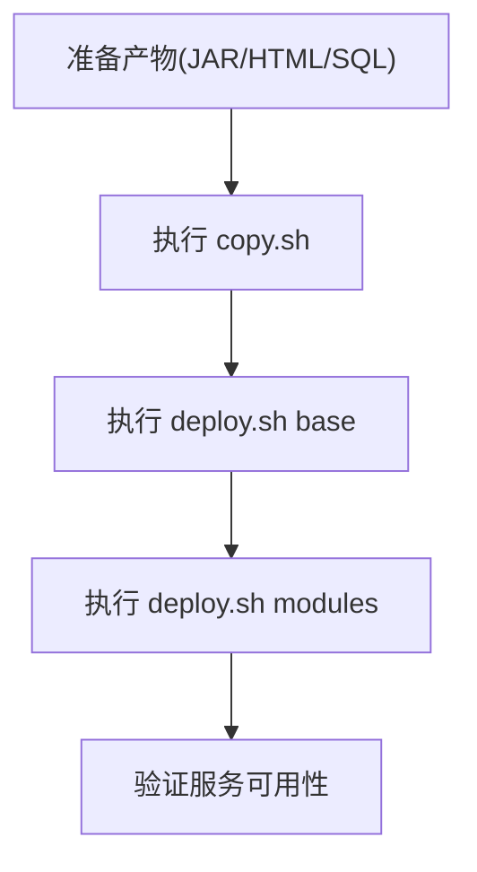

# 容器化部署

<cite>
**本文引用的文件**   
- [docker-compose.yml](file://docker/docker-compose.yml)
- [deploy.sh](file://docker/deploy.sh)
- [copy.sh](file://docker/copy.sh)
- [mysql/dockerfile](file://docker/mysql/dockerfile)
- [nacos/dockerfile](file://docker/nacos/dockerfile)
- [redis/dockerfile](file://docker/redis/dockerfile)
- [nginx/dockerfile](file://docker/nginx/dockerfile)
- [auth/dockerfile](file://docker/ruoyi/auth/dockerfile)
- [gateway/dockerfile](file://docker/ruoyi/gateway/dockerfile)
- [modules/system/dockerfile](file://docker/ruoyi/modules/system/dockerfile)
- [modules/gen/dockerfile](file://docker/ruoyi/modules/gen/dockerfile)
- [modules/job/dockerfile](file://docker/ruoyi/modules/job/dockerfile)
- [modules/file/dockerfile](file://docker/ruoyi/modules/file/dockerfile)
- [visual/monitor/dockerfile](file://docker/ruoyi/visual/monitor/dockerfile)
- [nacos/conf/application.properties](file://docker/nacos/conf/application.properties)
- [redis/conf/redis.conf](file://docker/redis/conf/redis.conf)
- [nginx/conf/nginx.conf](file://docker/nginx/conf/nginx.conf)
</cite>

## 目录
1. [简介](#简介)
2. [项目结构](#项目结构)
3. [核心组件](#核心组件)
4. [架构总览](#架构总览)
5. [详细组件分析](#详细组件分析)
6. [依赖关系分析](#依赖关系分析)
7. [性能与可观测性](#性能与可观测性)
8. [故障排查指南](#故障排查指南)
9. [结论](#结论)
10. [附录：一键构建与部署流程](#附录一键构建与部署流程)

## 简介
本文件面向容器化部署，系统性说明基于 Docker Compose 的中间件与服务编排、镜像构建过程、服务依赖关系、网络与数据卷配置、环境变量与端口映射等关键内容。覆盖 MySQL、Nacos、Redis、Nginx 以及各微服务的 Dockerfile 与自定义镜像构建方法，帮助读者快速完成本地或生产环境的容器化部署。

## 项目结构
仓库在 docker 目录下提供完整的容器化资源：
- 中间件：MySQL、Nacos、Redis、Nginx 的 Dockerfile 与配置文件
- 应用服务：网关、认证、系统、代码生成、定时任务、文件、监控等模块的 Dockerfile
- 编排：docker-compose.yml 定义服务、网络、数据卷、端口与环境变量
- 脚本：copy.sh 用于将编译产物复制到镜像构建上下文；deploy.sh 用于一键启动/停止

图表来源
- [docker-compose.yml:1-140](file://docker/docker-compose.yml#L1-L140)

章节来源
- [docker-compose.yml:1-140](file://docker/docker-compose.yml#L1-L140)

## 核心组件
- 数据库 MySQL：使用官方镜像并注入初始化 SQL，暴露 3306 端口，数据持久化到宿主机目录。
- 注册中心 Nacos：单节点模式，连接 MySQL 存储配置，暴露 8848/9848/9849 端口。
- 缓存 Redis：自定义 redis.conf，数据持久化到宿主机目录。
- 反向代理 Nginx：静态资源托管与 API 反向代理至 Gateway。
- 应用服务：Gateway、Auth、System、Gen、Job、File、Monitor 各自独立镜像与端口。

章节来源
- [docker-compose.yml:18-140](file://docker/docker-compose.yml#L18-L140)
- [mysql/dockerfile:1-8](file://docker/mysql/dockerfile#L1-L8)
- [nacos/dockerfile:1-8](file://docker/nacos/dockerfile#L1-L8)
- [redis/dockerfile:1-14](file://docker/redis/dockerfile#L1-L14)
- [nginx/dockerfile:1-16](file://docker/nginx/dockerfile#L1-L16)

## 架构总览
下图展示请求从浏览器经 Nginx 进入网关，再路由到具体业务服务，同时所有服务通过 Nacos 进行服务发现与配置管理，并通过 MySQL/Redis 访问数据与缓存。

图表来源
- [nginx/conf/nginx.conf:13-29](file://docker/nginx/conf/nginx.conf#L13-L29)
- [docker-compose.yml:51-77](file://docker/docker-compose.yml#L51-L77)
- [docker-compose.yml:78-101](file://docker/docker-compose.yml#L78-L101)

## 详细组件分析

### MySQL 容器化
- 基础镜像：mysql:5.7
- 初始化：自动执行 db/*.sql 初始化脚本
- 端口：3306
- 数据卷：conf/logs/data 分别挂载到宿主机
- 运行参数：字符集 utf8mb4、时区 +8:00、表名大小写不敏感等

章节来源
- [mysql/dockerfile:1-8](file://docker/mysql/dockerfile#L1-L8)
- [docker-compose.yml:18-40](file://docker/docker-compose.yml#L18-L40)

### Nacos 容器化
- 基础镜像：nacos/nacos-server:v2.0.4（与客户端版本匹配）
- 模式：standalone
- 配置：application.properties 指定 MySQL 数据源、安全策略、日志等
- 端口：8848/9848/9849
- 依赖：ruoyi-mysql

章节来源
- [nacos/dockerfile:1-8](file://docker/nacos/dockerfile#L1-L8)
- [nacos/conf/application.properties:1-33](file://docker/nacos/conf/application.properties#L1-L33)
- [docker-compose.yml:3-17](file://docker/docker-compose.yml#L3-L17)

### Redis 容器化
- 基础镜像：redis
- 配置：redis.conf（默认未启用密码，可按需开启 requirepass）
- 端口：6379
- 数据卷：conf/data 持久化

章节来源
- [redis/dockerfile:1-14](file://docker/redis/dockerfile#L1-L14)
- [redis/conf/redis.conf:1-1](file://docker/redis/conf/redis.conf#L1-L1)
- [docker-compose.yml:40-50](file://docker/docker-compose.yml#L40-L50)

### Nginx 容器化
- 基础镜像：nginx
- 静态资源：/home/ruoyi/projects/ruoyi-ui
- 反向代理：/prod-api 转发至 ruoyi-gateway:8080
- 端口：80
- 依赖：ruoyi-gateway

章节来源
- [nginx/dockerfile:1-16](file://docker/nginx/dockerfile#L1-L16)
- [nginx/conf/nginx.conf:13-29](file://docker/nginx/conf/nginx.conf#L13-L29)
- [docker-compose.yml:51-66](file://docker/docker-compose.yml#L51-L66)

### 应用服务镜像与入口
- 基础镜像：openjdk:8-jre
- 工作目录：/home/ruoyi
- 启动命令：java -jar <service>.jar
- 端口映射：各服务独立端口（Gateway 8080、Auth 9200、System 9201、Gen 9202、Job 9203、File 9300、Monitor 9100）

图表来源
- [gateway/dockerfile:1-15](file://docker/ruoyi/gateway/dockerfile#L1-L15)
- [auth/dockerfile:1-15](file://docker/ruoyi/auth/dockerfile#L1-L15)
- [modules/system/dockerfile:1-15](file://docker/ruoyi/modules/system/dockerfile#L1-L15)
- [modules/gen/dockerfile:1-15](file://docker/ruoyi/modules/gen/dockerfile#L1-L15)
- [modules/job/dockerfile:1-15](file://docker/ruoyi/modules/job/dockerfile#L1-L15)
- [modules/file/dockerfile:1-15](file://docker/ruoyi/modules/file/dockerfile#L1-L15)
- [visual/monitor/dockerfile:1-15](file://docker/ruoyi/visual/monitor/dockerfile#L1-L15)

章节来源
- [gateway/dockerfile:1-15](file://docker/ruoyi/gateway/dockerfile#L1-L15)
- [auth/dockerfile:1-15](file://docker/ruoyi/auth/dockerfile#L1-L15)
- [modules/system/dockerfile:1-15](file://docker/ruoyi/modules/system/dockerfile#L1-L15)
- [modules/gen/dockerfile:1-15](file://docker/ruoyi/modules/gen/dockerfile#L1-L15)
- [modules/job/dockerfile:1-15](file://docker/ruoyi/modules/job/dockerfile#L1-L15)
- [modules/file/dockerfile:1-15](file://docker/ruoyi/modules/file/dockerfile#L1-L15)
- [visual/monitor/dockerfile:1-15](file://docker/ruoyi/visual/monitor/dockerfile#L1-L15)

## 依赖关系分析
- 服务间依赖：
  - Nacos 依赖 MySQL
  - Nginx 依赖 Gateway
  - Gateway/Auth/System/Gen/Job/File/Monitor 依赖 Redis 和/或 MySQL（由 compose depends_on 控制）
- 网络：
  - 默认 bridge 网络，服务间通过容器名互通（如 ruoyi-gateway、ruoyi-mysql）
- 端口映射：
  - 外部访问：80(Nginx)、8080(Gateway)、8848/9848/9849(Nacos)、6379(Redis)、3306(MySQL)、9100(Monitor)、9200(Auth)、9201(System)、9202(Gen)、9203(Job)、9300(File)

图表来源
- [docker-compose.yml:3-140](file://docker/docker-compose.yml#L3-L140)

章节来源
- [docker-compose.yml:3-140](file://docker/docker-compose.yml#L3-L140)

## 性能与可观测性
- MySQL：
  - 缓冲池大小、字符集与时区已在 compose command 中设置
  - 日志与数据目录持久化便于问题定位
- Nacos：
  - 已开启 Tomcat 访问日志，便于审计
  - 指标导出关闭（Elastic/Influx），可按需开启
- Redis：
  - 可通过 redis.conf 开启持久化与慢查询日志
- Nginx：
  - 可结合 upstream 健康检查与限流提升稳定性
- 应用服务：
  - 建议为每个服务添加健康检查与健康端点，配合编排工具实现自愈

[本节为通用指导，不涉及具体文件分析]

## 故障排查指南
- 端口冲突：
  - 确认宿主机未被占用；必要时修改 docker-compose.yml 中的端口映射
- 数据库初始化失败：
  - 检查 mysql/db/*.sql 是否被正确拷贝到镜像构建上下文
  - 查看 MySQL 容器日志与 /var/lib/mysql 权限
- Nacos 无法连接 MySQL：
  - 核对 application.properties 中 db.url/db.user/db.password
  - 确保 ruoyi-mysql 先于 ruoyi-nacos 启动
- Redis 连接失败：
  - 若启用 requirepass，需在应用侧配置对应密码
- Nginx 反向代理异常：
  - 检查 /prod-api 路径是否正确转发到 ruoyi-gateway:8080
  - 确认 Gateway 已启动且端口可达
- 服务启动顺序：
  - 使用 deploy.sh 按步骤启动基础环境与模块，避免依赖未就绪

章节来源
- [docker-compose.yml:3-140](file://docker/docker-compose.yml#L3-L140)
- [nacos/conf/application.properties:1-33](file://docker/nacos/conf/application.properties#L1-L33)
- [nginx/conf/nginx.conf:13-29](file://docker/nginx/conf/nginx.conf#L13-L29)

## 结论
本项目通过 Docker Compose 统一编排了中间件与应用服务，提供了清晰的镜像构建与部署路径。借助 copy.sh 与 deploy.sh，可实现“复制产物—构建镜像—启动服务”的一体化流程。建议在正式环境补充健康检查、日志集中收集与监控告警，以提升系统的可运维性与稳定性。

[本节为总结性内容，不涉及具体文件分析]

## 附录：一键构建与部署流程
- 前置准备
  - 安装 Docker 与 Docker Compose
  - 准备后端 JAR 包与前端 dist 静态资源
- 复制产物
  - 执行 copy.sh，将 SQL、JAR、HTML 复制到 docker 构建上下文
- 构建与启动
  - 执行 deploy.sh base 启动基础环境（MySQL、Redis、Nacos）
  - 执行 deploy.sh modules 启动应用模块（Nginx、Gateway、Auth、System 等）
- 验证
  - 浏览器访问 http://localhost
  - 访问 Nacos 控制台 http://localhost:8848/nacos
  - 校验各服务端口连通性

图表来源
- [copy.sh:1-42](file://docker/copy.sh#L1-L42)
- [deploy.sh:1-68](file://docker/deploy.sh#L1-L68)

章节来源
- [copy.sh:1-42](file://docker/copy.sh#L1-L42)
- [deploy.sh:1-68](file://docker/deploy.sh#L1-L68)