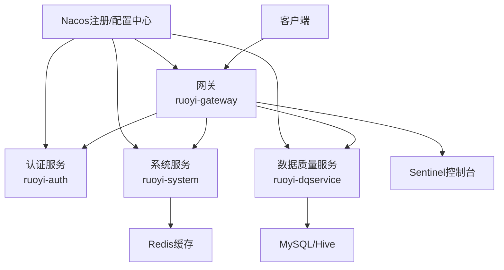
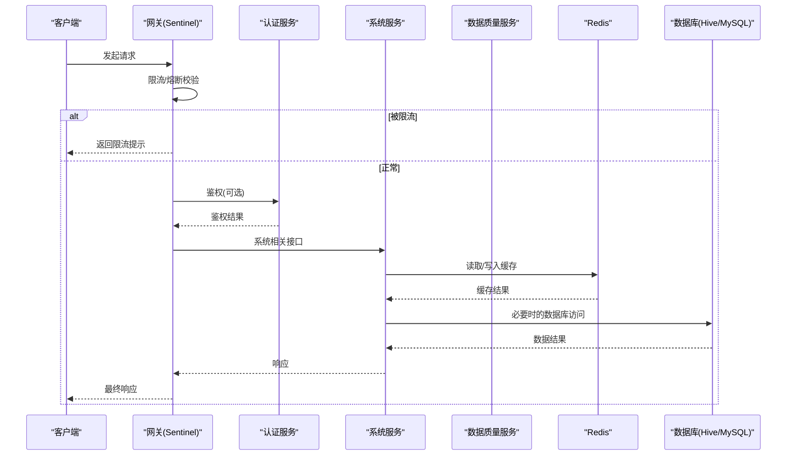
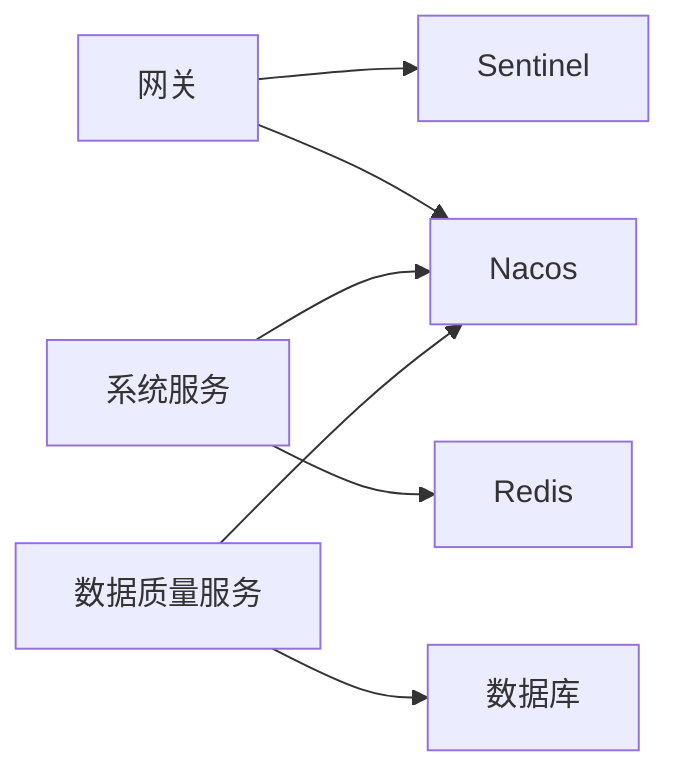

# 性能调优

<cite>
**本文引用的文件**   
- [application.properties](file://ruoyi-modules/ruoyi-dqservice/src/main/resources/application.properties)
- [DBUtil.java](file://ruoyi-modules/ruoyi-dqservice/src/main/java/com/ruoyi/dqservice/connecter/DBUtil.java)
- [CacheConfig.java](file://ruoyi-modules/ruoyi-dqservice/src/main/java/com/ruoyi/dqservice/config/CacheConfig.java)
- [RedisConfig.java](file://ruoyi-common/ruoyi-common-redis/src/main/java/com/ruoyi/common/redis/configure/RedisConfig.java)
- [RedisService.java](file://ruoyi-common/ruoyi-common-redis/src/main/java/com/ruoyi/common/redis/service/RedisService.java)
- [SysConfigServiceImpl.java](file://ruoyi-modules/ruoyi-system/src/main/java/com/ruoyi/system/service/impl/SysConfigServiceImpl.java)
- [bootstrap.yml（网关）](file://ruoyi-gateway/src/main/resources/bootstrap.yml)
- [GatewayConfig.java](file://ruoyi-gateway/src/main/java/com/ruoyi/gateway/config/GatewayConfig.java)
- [SentinelFallbackHandler.java](file://ruoyi-gateway/src/main/java/com/ruoyi/gateway/handler/SentinelFallbackHandler.java)
- [application.properties（Nacos）](file://docker/nacos/conf/application.properties)
- [redis.conf](file://docker/redis/conf/redis.conf)
</cite>

## 目录
1. [简介](#简介)
2. [项目结构](#项目结构)
3. [核心组件](#核心组件)
4. [架构总览](#架构总览)
5. [详细组件分析](#详细组件分析)
6. [依赖关系分析](#依赖关系分析)
7. [性能考虑](#性能考虑)
8. [故障排查指南](#故障排查指南)
9. [结论](#结论)
10. [附录](#附录)

## 简介
本指南面向数据质量与微服务架构下的系统性能调优，覆盖JVM参数优化、内存分配与垃圾回收策略；数据库连接池、查询优化与索引设计；Redis缓存策略、热点数据处理与缓存穿透防护；以及微服务架构中的负载均衡、熔断降级与限流配置。同时提供性能测试工具使用、瓶颈分析方法与监控指标解读的实用技能。

## 项目结构
本项目采用Spring Cloud微服务架构，包含认证服务、网关、业务模块、可视化监控等子模块，并通过Nacos作为注册中心与配置中心，Redis作为缓存，MySQL/Hive作为数据存储。关键配置集中在各模块的bootstrap.yml与application.properties中，网关集成Sentinel实现限流与熔断。

图表来源
- [bootstrap.yml（网关）:1-44](file://ruoyi-gateway/src/main/resources/bootstrap.yml#L1-L44)
- [application.properties（Nacos）:1-33](file://docker/nacos/conf/application.properties#L1-L33)

章节来源
- [bootstrap.yml（网关）:1-44](file://ruoyi-gateway/src/main/resources/bootstrap.yml#L1-L44)
- [application.properties（Nacos）:1-33](file://docker/nacos/conf/application.properties#L1-L33)

## 核心组件
- 网关与限流：基于Spring Cloud Gateway与Sentinel，支持规则持久化到Nacos，统一拦截与返回限流提示。
- 缓存层：通过RedisTemplate封装RedisService，提供通用缓存操作；系统配置类启动时预热至缓存。
- 数据访问：DQ服务直接通过JDBC访问Hive/MySQL，当前为直连方式，未使用连接池。
- 配置中心：Nacos统一管理应用配置与动态规则。

章节来源
- [GatewayConfig.java:1-23](file://ruoyi-gateway/src/main/java/com/ruoyi/gateway/config/GatewayConfig.java#L1-L23)
- [SentinelFallbackHandler.java:1-41](file://ruoyi-gateway/src/main/java/com/ruoyi/gateway/handler/SentinelFallbackHandler.java#L1-L41)
- [RedisConfig.java:1-32](file://ruoyi-common/ruoyi-common-redis/src/main/java/com/ruoyi/common/redis/configure/RedisConfig.java#L1-L32)
- [RedisService.java:1-256](file://ruoyi-common/ruoyi-common-redis/src/main/java/com/ruoyi/common/redis/service/RedisService.java#L1-L256)
- [SysConfigServiceImpl.java:1-53](file://ruoyi-modules/ruoyi-system/src/main/java/com/ruoyi/system/service/impl/SysConfigServiceImpl.java#L1-L53)
- [DBUtil.java:1-33](file://ruoyi-modules/ruoyi-dqservice/src/main/java/com/ruoyi/dqservice/connecter/DBUtil.java#L1-L33)

## 架构总览
下图展示请求从网关进入后的主要路径，包括鉴权、路由、限流、后端服务调用、缓存与数据库访问。

图表来源
- [bootstrap.yml（网关）:29-44](file://ruoyi-gateway/src/main/resources/bootstrap.yml#L29-L44)
- [SentinelFallbackHandler.java:16-41](file://ruoyi-gateway/src/main/java/com/ruoyi/gateway/handler/SentinelFallbackHandler.java#L16-L41)
- [RedisService.java:34-50](file://ruoyi-common/ruoyi-common-redis/src/main/java/com/ruoyi/common/redis/service/RedisService.java#L34-L50)
- [DBUtil.java:14-22](file://ruoyi-modules/ruoyi-dqservice/src/main/java/com/ruoyi/dqservice/connecter/DBUtil.java#L14-L22)

## 详细组件分析

### JVM参数优化、内存分配与GC策略
- 目标：降低Full GC频率、缩短STW时间、提升吞吐与延迟稳定性。
- 建议：
  - 堆大小：根据服务负载与容器资源限制设置-Xms/-Xmx，避免频繁扩容。
  - 新生代：合理设置新生代比例与Eden/Survivor比，减少Minor GC开销。
  - 老年代：结合对象晋升阈值与GC日志观察，调整晋升条件。
  - GC选择：优先使用G1或ZGC（视JDK版本），开启GC日志并定期分析。
  - 元空间：设置MaxMetaspaceSize防止OOM，监控类加载增长。
  - 线程栈：根据并发模型调整线程栈大小，避免过多线程导致上下文切换。
- 验证：通过压测观察GC日志、吞吐量、P95/P99延迟变化，逐步收敛参数。

[本节为通用指导，不直接分析具体文件]

### 数据库连接池与查询优化
- 现状：DQ服务通过JDBC直连Hive/MySQL，未使用连接池，存在连接创建/销毁开销与资源泄漏风险。
- 建议：
  - 引入连接池（如HikariCP），配置最大连接数、空闲超时、连接验证SQL。
  - 批量操作：启用rewriteBatchedStatements，合并小事务，减少网络往返。
  - 慢查询治理：开启慢查询日志，定位全表扫描与排序/临时表问题。
  - 索引设计：遵循最左前缀原则，避免冗余索引，关注唯一性与选择性。
  - Hive场景：利用分区/分桶、物化视图、统计信息收集，减少Shuffle与IO。
- 参考实现位置：
  - JDBC直连与URL参数示例：[DBUtil.java:8-10](file://ruoyi-modules/ruoyi-dqservice/src/main/java/com/ruoyi/dqservice/connecter/DBUtil.java#L8-L10)
  - Hive Metastore/JDBC配置：[application.properties:1-14](file://ruoyi-modules/ruoyi-dqservice/src/main/resources/application.properties#L1-L14)

章节来源
- [DBUtil.java:1-33](file://ruoyi-modules/ruoyi-dqservice/src/main/java/com/ruoyi/dqservice/connecter/DBUtil.java#L1-L33)
- [application.properties:1-14](file://ruoyi-modules/ruoyi-dqservice/src/main/resources/application.properties#L1-L14)

### Redis缓存策略与热点数据处理
- 现状：已启用Spring Cache与RedisTemplate，提供通用缓存方法；系统配置在启动时预热到缓存。
- 建议：
  - Key设计：统一Key命名规范，避免冲突与过长键。
  - TTL策略：按数据时效性设置过期时间，避免脏读与雪崩。
  - 热点保护：对热点Key加本地缓存（如Caffeine）与互斥锁，防击穿。
  - 缓存一致性：写后更新/失效策略，必要时引入版本号或订阅变更。
  - 序列化：使用高效序列化器（FastJSON2），减少CPU与带宽占用。
- 参考实现位置：
  - Spring Cache配置与Key生成器：[CacheConfig.java:9-23](file://ruoyi-modules/ruoyi-dqservice/src/main/java/com/ruoyi/dqservice/config/CacheConfig.java#L9-L23)
  - RedisTemplate与序列化配置：[RedisConfig.java:21-32](file://ruoyi-common/ruoyi-common-redis/src/main/java/com/ruoyi/common/redis/configure/RedisConfig.java#L21-L32)
  - 通用缓存API：[RedisService.java:34-50](file://ruoyi-common/ruoyi-common-redis/src/main/java/com/ruoyi/common/redis/service/RedisService.java#L34-L50)
  - 配置预热逻辑：[SysConfigServiceImpl.java:35-39](file://ruoyi-modules/ruoyi-system/src/main/java/com/ruoyi/system/service/impl/SysConfigServiceImpl.java#L35-L39)

章节来源
- [CacheConfig.java:9-23](file://ruoyi-modules/ruoyi-dqservice/src/main/java/com/ruoyi/dqservice/config/CacheConfig.java#L9-L23)
- [RedisConfig.java:21-32](file://ruoyi-common/ruoyi-common-redis/src/main/java/com/ruoyi/common/redis/configure/RedisConfig.java#L21-L32)
- [RedisService.java:34-50](file://ruoyi-common/ruoyi-common-redis/src/main/java/com/ruoyi/common/redis/service/RedisService.java#L34-L50)
- [SysConfigServiceImpl.java:35-39](file://ruoyi-modules/ruoyi-system/src/main/java/com/ruoyi/system/service/impl/SysConfigServiceImpl.java#L35-L39)

### 缓存穿透、击穿与雪崩防护
- 穿透：对空值也进行短TTL缓存，配合布隆过滤器前置校验。
- 击穿：热点Key加分布式锁或本地互斥，保证单点回源重建。
- 雪崩：随机化TTL，分层缓存，多副本隔离。
- 监控：统计缓存命中率、延迟、异常率，及时告警。

[本节为通用指导，不直接分析具体文件]

### 微服务负载均衡、熔断降级与限流
- 负载均衡：由Spring Cloud LoadBalancer与Nacos服务发现共同完成，自动轮询健康实例。
- 熔断降级：通过Sentinel对下游服务进行熔断与降级，保障整体可用性。
- 限流：网关层集中限流，规则持久化到Nacos，支持动态调整。
- 参考实现位置：
  - 网关Sentinel集成与规则持久化：[bootstrap.yml（网关）:29-44](file://ruoyi-gateway/src/main/resources/bootstrap.yml#L29-L44)
  - 自定义限流异常处理：[SentinelFallbackHandler.java:16-41](file://ruoyi-gateway/src/main/java/com/ruoyi/gateway/handler/SentinelFallbackHandler.java#L16-L41)
  - 网关限流Bean注册：[GatewayConfig.java:14-23](file://ruoyi-gateway/src/main/java/com/ruoyi/gateway/config/GatewayConfig.java#L14-L23)

章节来源
- [bootstrap.yml（网关）:29-44](file://ruoyi-gateway/src/main/resources/bootstrap.yml#L29-L44)
- [GatewayConfig.java:14-23](file://ruoyi-gateway/src/main/java/com/ruoyi/gateway/config/GatewayConfig.java#L14-L23)
- [SentinelFallbackHandler.java:16-41](file://ruoyi-gateway/src/main/java/com/ruoyi/gateway/handler/SentinelFallbackHandler.java#L16-L41)

### 性能测试工具与瓶颈分析
- 压测工具：JMeter、wrk、ab等，模拟高并发与长尾请求。
- 链路追踪：结合SkyWalking/Zipkin定位跨服务调用耗时。
- 指标采集：Prometheus+Grafana监控JVM、GC、线程、HTTP、DB、Redis。
- 瓶颈定位：
  - CPU：采样火焰图定位热点方法。
  - 内存：Heap Dump分析大对象与泄漏。
  - IO：磁盘I/O与网络带宽监控，识别慢查询与慢网络。
  - 锁竞争：线程Dump分析死锁与阻塞。

[本节为通用指导，不直接分析具体文件]

### 监控指标解读
- JVM：堆使用率、GC次数与停顿时间、线程数、类加载数。
- 网关：QPS、RT、错误率、限流触发次数。
- 数据库：连接池活跃/空闲、慢查询数量、锁等待、全表扫描。
- Redis：命中率、内存使用、命令延迟、主从复制延迟。

[本节为通用指导，不直接分析具体文件]

## 依赖关系分析
- 网关依赖Sentinel与Nacos，负责鉴权、限流、路由。
- 业务服务依赖Redis与数据库，部分服务启动时预热配置到缓存。
- Nacos作为注册与配置中心，支撑服务发现与动态配置。

图表来源
- [bootstrap.yml（网关）:16-44](file://ruoyi-gateway/src/main/resources/bootstrap.yml#L16-L44)
- [application.properties（Nacos）:1-33](file://docker/nacos/conf/application.properties#L1-L33)

章节来源
- [bootstrap.yml（网关）:16-44](file://ruoyi-gateway/src/main/resources/bootstrap.yml#L16-L44)
- [application.properties（Nacos）:1-33](file://docker/nacos/conf/application.properties#L1-L33)

## 性能考虑
- 连接池：尽快将JDBC直连替换为连接池，控制最大连接与超时，避免连接风暴。
- 缓存：完善Key设计与TTL策略，增加热点保护与一致性机制。
- 限流：细化限流维度（IP、用户、接口），结合业务特征动态调整阈值。
- 监控：建立端到端监控与告警，持续跟踪关键指标。
- 容量规划：依据压测结果评估资源需求，预留弹性空间。

[本节为通用指导，不直接分析具体文件]

## 故障排查指南
- 限流误伤：检查Sentinel规则与Nacos配置，确认阈值是否合理。
- 缓存未命中：核对Key生成策略与序列化一致性，检查TTL与过期策略。
- 数据库慢查询：开启慢查询日志，分析执行计划，优化索引与SQL。
- 连接泄漏：检查连接获取与释放路径，确保close()调用正确。
- 网关异常：查看SentinelFallbackHandler返回逻辑与日志输出。

章节来源
- [SentinelFallbackHandler.java:16-41](file://ruoyi-gateway/src/main/java/com/ruoyi/gateway/handler/SentinelFallbackHandler.java#L16-L41)
- [DBUtil.java:14-32](file://ruoyi-modules/ruoyi-dqservice/src/main/java/com/ruoyi/dqservice/connecter/DBUtil.java#L14-L32)

## 结论
通过引入连接池、完善缓存策略、强化网关限流与熔断、建立完善的监控体系，可显著提升系统的稳定性与性能。建议在压测环境中逐项验证优化效果，并结合业务特征持续迭代。

[本节为总结性内容，不直接分析具体文件]

## 附录
- Nacos配置示例（连接MySQL、访问日志、安全与Token等）：[application.properties（Nacos）:1-33](file://docker/nacos/conf/application.properties#L1-L33)
- Redis基础配置（密码开关）：[redis.conf:1-1](file://docker/redis/conf/redis.conf#L1-L1)

章节来源
- [application.properties（Nacos）:1-33](file://docker/nacos/conf/application.properties#L1-L33)
- [redis.conf:1-1](file://docker/redis/conf/redis.conf#L1-L1)