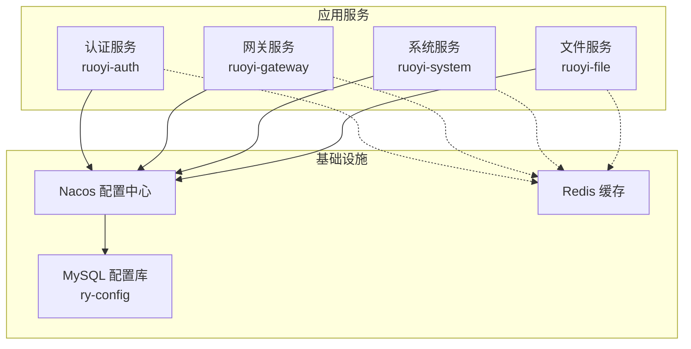
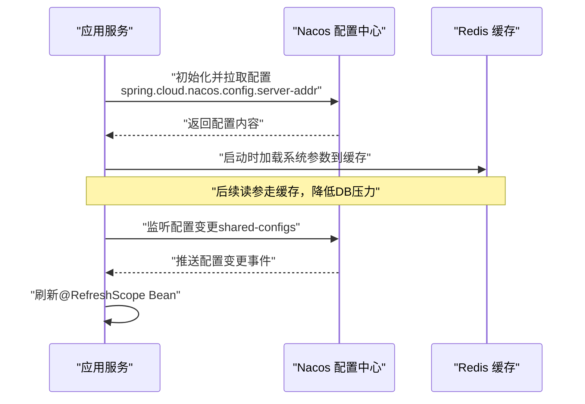
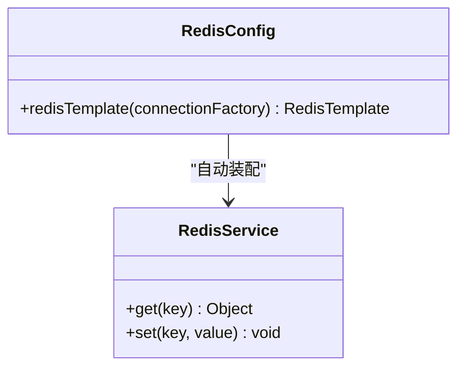
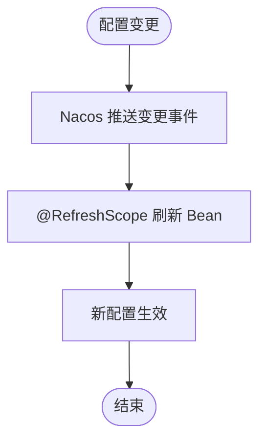
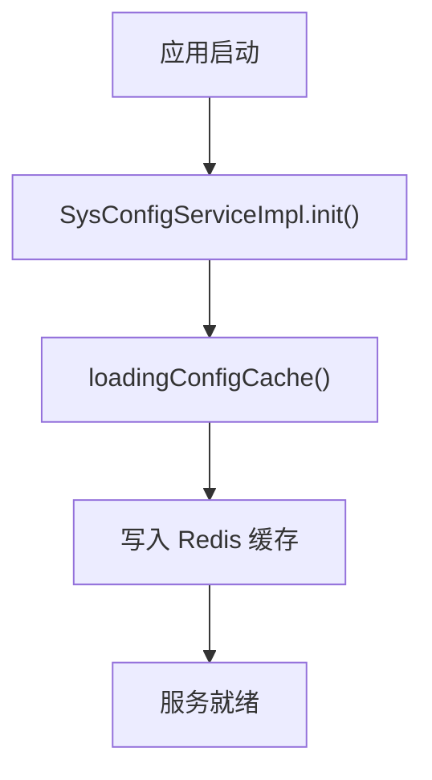
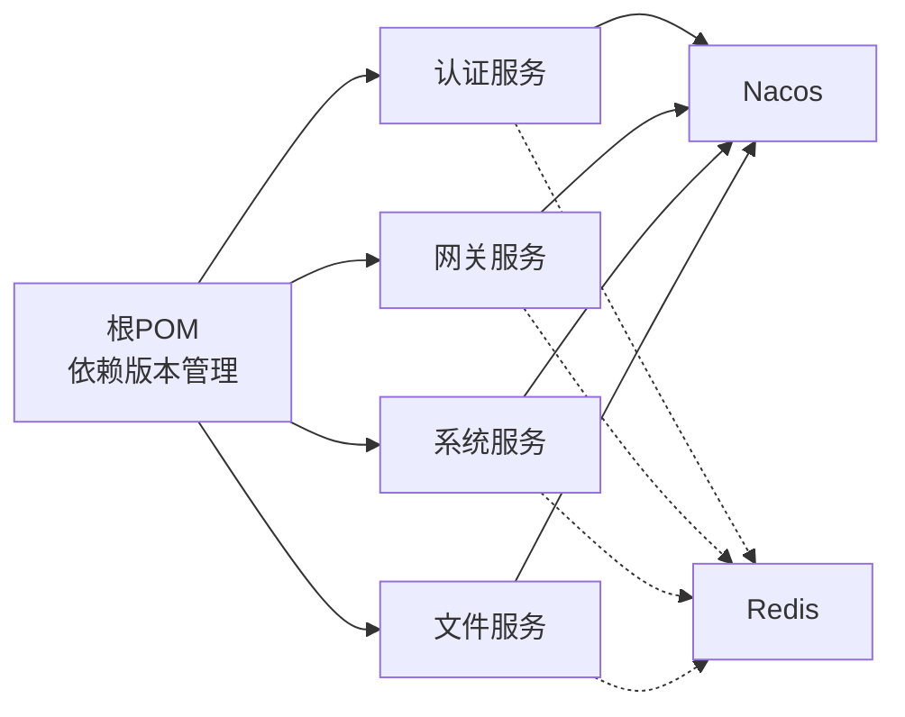

# 环境配置管理

<cite>
**本文引用的文件**   
- [pom.xml](file://pom.xml)
- [bootstrap.yml（认证服务）](file://ruoyi-auth/src/main/resources/bootstrap.yml)
- [bootstrap.yml（网关服务）](file://ruoyi-gateway/src/main/resources/bootstrap.yml)
- [bootstrap.yml（系统服务）](file://ruoyi-modules/ruoyi-system/src/main/resources/bootstrap.yml)
- [bootstrap.yml（文件服务）](file://ruoyi-modules/ruoyi-file/src/main/resources/bootstrap.yml)
- [application.properties（Nacos服务端）](file://docker/nacos/conf/application.properties)
- [RedisConfig.java](file://ruoyi-common/ruoyi-common-redis/src/main/java/com/ruoyi/common/redis/configure/RedisConfig.java)
- [CaptchaProperties.java](file://ruoyi-gateway/src/main/java/com/ruoyi/gateway/config/properties/CaptchaProperties.java)
- [SysConfigServiceImpl.java](file://ruoyi-modules/ruoyi-system/src/main/java/com/ruoyi/system/service/impl/SysConfigServiceImpl.java)
</cite>

## 目录
1. [简介](#简介)
2. [项目结构](#项目结构)
3. [核心组件](#核心组件)
4. [架构总览](#架构总览)
5. [详细组件分析](#详细组件分析)
6. [依赖关系分析](#依赖关系分析)
7. [性能与扩展性](#性能与扩展性)
8. [故障排查指南](#故障排查指南)
9. [结论](#结论)

## 简介
本文件面向“数据质量”微服务项目的环境配置管理，聚焦于 Nacos 配置中心的使用方式、配置结构与最佳实践。文档涵盖：
- bootstrap.yml 的作用与各配置项含义
- 数据库连接、Redis 缓存等外部依赖的配置方法
- 开发、测试、生产环境的差异化配置建议
- 配置热更新、配置加密与敏感信息管理的高级能力

## 项目结构
本项目采用 Spring Cloud Alibaba + Nacos 的微服务架构，各子模块通过统一的 bootstrap.yml 接入 Nacos 进行服务注册与配置拉取。Nacos 服务端在 docker/nacos 下提供容器化部署配置。

图示来源
- [bootstrap.yml（认证服务）:1-26](file://ruoyi-auth/src/main/resources/bootstrap.yml#L1-L26)
- [bootstrap.yml（网关服务）:1-44](file://ruoyi-gateway/src/main/resources/bootstrap.yml#L1-L44)
- [bootstrap.yml（系统服务）:1-26](file://ruoyi-modules/ruoyi-system/src/main/resources/bootstrap.yml#L1-L26)
- [bootstrap.yml（文件服务）:1-25](file://ruoyi-modules/ruoyi-file/src/main/resources/bootstrap.yml#L1-L25)
- [application.properties（Nacos服务端）:1-33](file://docker/nacos/conf/application.properties#L1-L33)

章节来源
- [bootstrap.yml（认证服务）:1-26](file://ruoyi-auth/src/main/resources/bootstrap.yml#L1-L26)
- [bootstrap.yml（网关服务）:1-44](file://ruoyi-gateway/src/main/resources/bootstrap.yml#L1-L44)
- [bootstrap.yml（系统服务）:1-26](file://ruoyi-modules/ruoyi-system/src/main/resources/bootstrap.yml#L1-L26)
- [bootstrap.yml（文件服务）:1-25](file://ruoyi-modules/ruoyi-file/src/main/resources/bootstrap.yml#L1-L25)
- [application.properties（Nacos服务端）:1-33](file://docker/nacos/conf/application.properties#L1-L33)

## 核心组件
- Nacos 客户端集成：所有服务通过 spring.cloud.nacos.discovery 和 spring.cloud.nacos.config 完成服务发现与配置拉取。
- 共享配置：通过 shared-configs 引用 application-{profile}.yml，实现按环境隔离的共享配置。
- Redis 缓存：统一通过 RedisConfig 暴露 RedisTemplate，供业务使用。
- 动态配置：网关侧 CaptchaProperties 使用 @RefreshScope 支持配置热更新。
- 系统参数缓存：SysConfigServiceImpl 启动时加载系统参数到 Redis，提升读取性能。

章节来源
- [bootstrap.yml（认证服务）:1-26](file://ruoyi-auth/src/main/resources/bootstrap.yml#L1-L26)
- [bootstrap.yml（网关服务）:1-44](file://ruoyi-gateway/src/main/resources/bootstrap.yml#L1-L44)
- [bootstrap.yml（系统服务）:1-26](file://ruoyi-modules/ruoyi-system/src/main/resources/bootstrap.yml#L1-L26)
- [bootstrap.yml（文件服务）:1-25](file://ruoyi-modules/ruoyi-file/src/main/resources/bootstrap.yml#L1-L25)
- [RedisConfig.java:1-32](file://ruoyi-common/ruoyi-common-redis/src/main/java/com/ruoyi/common/redis/configure/RedisConfig.java#L1-L32)
- [CaptchaProperties.java:1-46](file://ruoyi-gateway/src/main/java/com/ruoyi/gateway/config/properties/CaptchaProperties.java#L1-L46)
- [SysConfigServiceImpl.java:1-53](file://ruoyi-modules/ruoyi-system/src/main/java/com/ruoyi/system/service/impl/SysConfigServiceImpl.java#L1-L53)

## 架构总览
下图展示应用启动时从 Nacos 获取配置的时序流程，以及配置热更新的触发路径。

图示来源
- [bootstrap.yml（认证服务）:1-26](file://ruoyi-auth/src/main/resources/bootstrap.yml#L1-L26)
- [bootstrap.yml（网关服务）:1-44](file://ruoyi-gateway/src/main/resources/bootstrap.yml#L1-L44)
- [bootstrap.yml（系统服务）:1-26](file://ruoyi-modules/ruoyi-system/src/main/resources/bootstrap.yml#L1-L26)
- [bootstrap.yml（文件服务）:1-25](file://ruoyi-modules/ruoyi-file/src/main/resources/bootstrap.yml#L1-L25)
- [CaptchaProperties.java:1-46](file://ruoyi-gateway/src/main/java/com/ruoyi/gateway/config/properties/CaptchaProperties.java#L1-L46)
- [SysConfigServiceImpl.java:1-53](file://ruoyi-modules/ruoyi-system/src/main/java/com/ruoyi/system/service/impl/SysConfigServiceImpl.java#L1-L53)

## 详细组件分析

### Nacos 配置中心使用与配置结构
- 服务发现与配置中心地址：
  - discovery.server-addr：服务注册地址
  - config.server-addr：配置中心地址
- 配置文件格式与共享配置：
  - file-extension：指定远程配置文件的后缀（如 yml）
  - shared-configs：引用 application-{profile}.yml，实现按环境共享配置
- 各服务均包含上述基础配置，端口与应用名各自独立。

章节来源
- [bootstrap.yml（认证服务）:1-26](file://ruoyi-auth/src/main/resources/bootstrap.yml#L1-L26)
- [bootstrap.yml（网关服务）:1-44](file://ruoyi-gateway/src/main/resources/bootstrap.yml#L1-L44)
- [bootstrap.yml（系统服务）:1-26](file://ruoyi-modules/ruoyi-system/src/main/resources/bootstrap.yml#L1-L26)
- [bootstrap.yml（文件服务）:1-25](file://ruoyi-modules/ruoyi-file/src/main/resources/bootstrap.yml#L1-L25)

### bootstrap.yml 配置项说明
- server.port：服务监听端口
- spring.application.name：应用名称，用于服务注册与配置命名空间区分
- spring.profiles.active：当前激活的环境标识（dev/test/prod）
- spring.cloud.nacos.discovery.server-addr：Nacos 服务注册地址
- spring.cloud.nacos.config.server-addr：Nacos 配置中心地址
- spring.cloud.nacos.config.file-extension：远程配置文件后缀
- spring.cloud.nacos.config.shared-configs：共享配置列表，通常包含 application-{profile}.yml

章节来源
- [bootstrap.yml（认证服务）:1-26](file://ruoyi-auth/src/main/resources/bootstrap.yml#L1-L26)
- [bootstrap.yml（网关服务）:1-44](file://ruoyi-gateway/src/main/resources/bootstrap.yml#L1-L44)
- [bootstrap.yml（系统服务）:1-26](file://ruoyi-modules/ruoyi-system/src/main/resources/bootstrap.yml#L1-L26)
- [bootstrap.yml（文件服务）:1-25](file://ruoyi-modules/ruoyi-file/src/main/resources/bootstrap.yml#L1-L25)

### 数据库连接配置（Nacos 服务端）
- Nacos 服务端通过 application.properties 配置 MySQL 作为持久化存储：
  - spring.datasource.platform=mysql
  - db.url.0：JDBC URL，指向 ry-config 库
  - db.user/db.password：数据库账号密码
- 注意：该配置为 Nacos 服务端自身的数据源，非业务服务直接使用的数据源。

章节来源
- [application.properties（Nacos服务端）:1-33](file://docker/nacos/conf/application.properties#L1-L33)

### Redis 缓存配置
- RedisConfig 启用缓存并创建 RedisTemplate Bean，序列化策略由内部 FastJson2JsonRedisSerializer 处理。
- 业务服务通过注入 RedisService 或 RedisTemplate 访问缓存。

图示来源
- [RedisConfig.java:1-32](file://ruoyi-common/ruoyi-common-redis/src/main/java/com/ruoyi/common/redis/configure/RedisConfig.java#L1-L32)

章节来源
- [RedisConfig.java:1-32](file://ruoyi-common/ruoyi-common-redis/src/main/java/com/ruoyi/common/redis/configure/RedisConfig.java#L1-L32)

### 消息队列与外部依赖
- 在当前仓库中未发现消息队列相关依赖与配置。若需引入 MQ（如 RabbitMQ/Kafka），建议在 Nacos 的 application-{profile}.yml 中集中声明连接信息，并通过 @ConfigurationProperties 绑定至配置类。

[本节未直接分析具体文件]

### 配置热更新
- 网关验证码配置 CaptchaProperties 使用 @RefreshScope，当 Nacos 推送配置变更时，Bean 会被刷新，无需重启服务。
- 典型用法：将开关、类型等易变参数放入 Nacos，通过 @RefreshScope 控制实时生效。

图示来源
- [CaptchaProperties.java:1-46](file://ruoyi-gateway/src/main/java/com/ruoyi/gateway/config/properties/CaptchaProperties.java#L1-L46)

章节来源
- [CaptchaProperties.java:1-46](file://ruoyi-gateway/src/main/java/com/ruoyi/gateway/config/properties/CaptchaProperties.java#L1-L46)

### 系统参数缓存与加载流程
- SysConfigServiceImpl 在启动时调用 loadingConfigCache() 将系统参数加载到 Redis，后续读取优先走缓存，减少数据库压力。

图示来源
- [SysConfigServiceImpl.java:1-53](file://ruoyi-modules/ruoyi-system/src/main/java/com/ruoyi/system/service/impl/SysConfigServiceImpl.java#L1-L53)

章节来源
- [SysConfigServiceImpl.java:1-53](file://ruoyi-modules/ruoyi-system/src/main/java/com/ruoyi/system/service/impl/SysConfigServiceImpl.java#L1-L53)

### 配置加密与敏感信息管理
- 仓库中未发现内置的 Nacos 配置加密实现。建议方案：
  - 在 Nacos 服务端开启鉴权与 Token 机制（见 application.properties 中的 nacos.core.auth.*），限制对敏感配置的访问。
  - 在应用层使用 Jasypt 或自定义解密器，结合环境变量或密钥管理服务注入密文，并在启动阶段解密后注入到 Spring Environment。
  - 对于极敏感信息（如数据库密码），建议使用外部密钥管理系统（如 Vault）或云厂商 KMS，避免明文出现在配置文件中。

章节来源
- [application.properties（Nacos服务端）:1-33](file://docker/nacos/conf/application.properties#L1-L33)

### 开发、测试、生产环境差异
- 环境切换：通过 spring.profiles.active 切换 dev/test/prod，配合 Nacos 的 application-{profile}.yml 实现配置隔离。
- 端口差异：各服务在不同环境中可配置不同端口（例如 gateway 默认 8089，system 默认 9201）。
- 依赖地址：Nacos、MySQL、Redis 等外部依赖地址应随环境变化而调整，建议集中在 application-{profile}.yml 中维护。
- 安全策略：生产环境建议开启 Nacos 鉴权、HTTPS、最小权限原则，并对敏感配置进行加密或托管于密钥管理系统。

章节来源
- [bootstrap.yml（认证服务）:1-26](file://ruoyi-auth/src/main/resources/bootstrap.yml#L1-L26)
- [bootstrap.yml（网关服务）:1-44](file://ruoyi-gateway/src/main/resources/bootstrap.yml#L1-L44)
- [bootstrap.yml（系统服务）:1-26](file://ruoyi-modules/ruoyi-system/src/main/resources/bootstrap.yml#L1-L26)
- [bootstrap.yml（文件服务）:1-25](file://ruoyi-modules/ruoyi-file/src/main/resources/bootstrap.yml#L1-L25)
- [application.properties（Nacos服务端）:1-33](file://docker/nacos/conf/application.properties#L1-L33)

## 依赖关系分析
- 版本管理：根 pom.xml 统一管理 Spring Cloud、Spring Cloud Alibaba、Nacos Client、Spring Boot 的版本。
- 模块耦合：
  - 各服务通过 Nacos 解耦，仅依赖公共接口与配置。
  - Redis 作为通用缓存组件被多个服务复用。
  - 网关层具备限流熔断（Sentinel）与验证码等能力，依赖 Nacos 进行规则持久化。

图示来源
- [pom.xml:44-80](file://pom.xml#L44-L80)
- [bootstrap.yml（认证服务）:1-26](file://ruoyi-auth/src/main/resources/bootstrap.yml#L1-L26)
- [bootstrap.yml（网关服务）:1-44](file://ruoyi-gateway/src/main/resources/bootstrap.yml#L1-L44)
- [bootstrap.yml（系统服务）:1-26](file://ruoyi-modules/ruoyi-system/src/main/resources/bootstrap.yml#L1-L26)
- [bootstrap.yml（文件服务）:1-25](file://ruoyi-modules/ruoyi-file/src/main/resources/bootstrap.yml#L1-L25)

章节来源
- [pom.xml:44-80](file://pom.xml#L44-L80)
- [bootstrap.yml（认证服务）:1-26](file://ruoyi-auth/src/main/resources/bootstrap.yml#L1-L26)
- [bootstrap.yml（网关服务）:1-44](file://ruoyi-gateway/src/main/resources/bootstrap.yml#L1-L44)
- [bootstrap.yml（系统服务）:1-26](file://ruoyi-modules/ruoyi-system/src/main/resources/bootstrap.yml#L1-L26)
- [bootstrap.yml（文件服务）:1-25](file://ruoyi-modules/ruoyi-file/src/main/resources/bootstrap.yml#L1-L25)

## 性能与扩展性
- 配置热更新：通过 @RefreshScope 实现关键参数的无感更新，减少重启成本。
- 缓存优先：系统参数先入 Redis，提高读取性能；合理设置过期时间与失效策略。
- 连接池与序列化：RedisTemplate 的序列化策略影响性能与兼容性，建议根据业务对象选择合适序列化器。
- 扩展点：
  - 新增外部依赖（如 MQ、搜索引擎）时，统一在 Nacos 的 application-{profile}.yml 中声明，并通过 @ConfigurationProperties 绑定。
  - 对敏感配置采用外部密钥管理或加密方案，避免硬编码。

[本节为通用指导，不直接分析具体文件]

## 故障排查指南
- Nacos 连接失败：
  - 检查 spring.cloud.nacos.config.server-addr 与 discovery.server-addr 是否正确。
  - 确认 Nacos 服务端已启动且网络可达。
- 配置未生效：
  - 确认 shared-configs 中 application-{profile}.yml 是否存在。
  - 检查 @RefreshScope 是否正确使用。
- Redis 不可用：
  - 检查 Redis 连接配置（通常在 application-{profile}.yml 中）。
  - 查看 RedisConfig 是否成功加载。
- 系统参数读取缓慢：
  - 确认 SysConfigServiceImpl 的缓存加载逻辑是否正常执行。
  - 检查 Redis 可用性与缓存命中率。

章节来源
- [bootstrap.yml（认证服务）:1-26](file://ruoyi-auth/src/main/resources/bootstrap.yml#L1-L26)
- [bootstrap.yml（网关服务）:1-44](file://ruoyi-gateway/src/main/resources/bootstrap.yml#L1-L44)
- [bootstrap.yml（系统服务）:1-26](file://ruoyi-modules/ruoyi-system/src/main/resources/bootstrap.yml#L1-L26)
- [bootstrap.yml（文件服务）:1-25](file://ruoyi-modules/ruoyi-file/src/main/resources/bootstrap.yml#L1-L25)
- [RedisConfig.java:1-32](file://ruoyi-common/ruoyi-common-redis/src/main/java/com/ruoyi/common/redis/configure/RedisConfig.java#L1-L32)
- [SysConfigServiceImpl.java:1-53](file://ruoyi-modules/ruoyi-system/src/main/java/com/ruoyi/system/service/impl/SysConfigServiceImpl.java#L1-L53)

## 结论
本项目以 Nacos 为核心进行服务发现与配置管理，通过 bootstrap.yml 统一接入，配合 shared-configs 实现按环境隔离。Redis 作为通用缓存组件提升系统性能，网关层通过 @RefreshScope 实现配置热更新。建议在后续演进中完善消息队列集成、统一外部依赖配置规范，并引入密钥管理与配置加密方案，以提升安全性与可运维性。