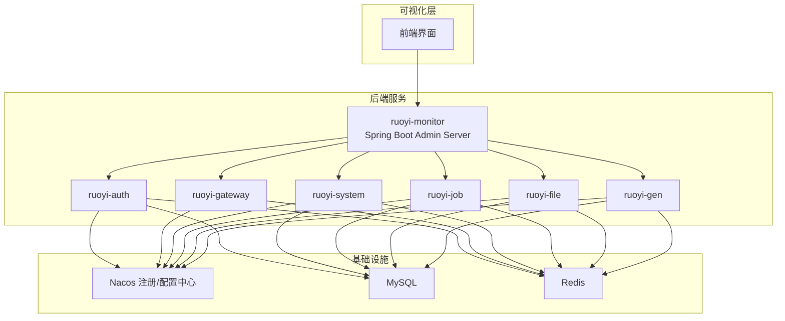
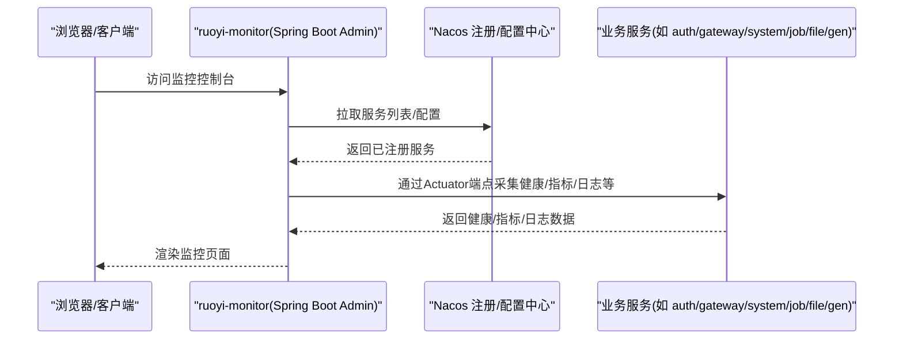
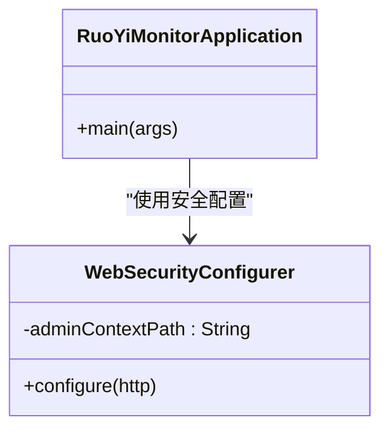
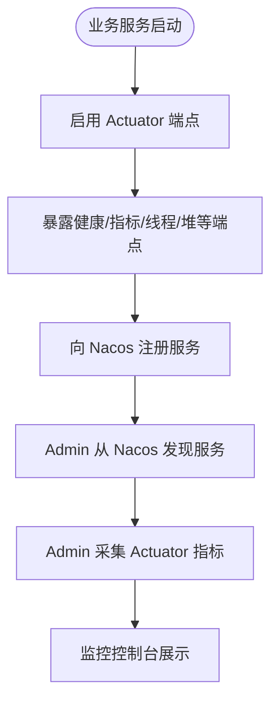
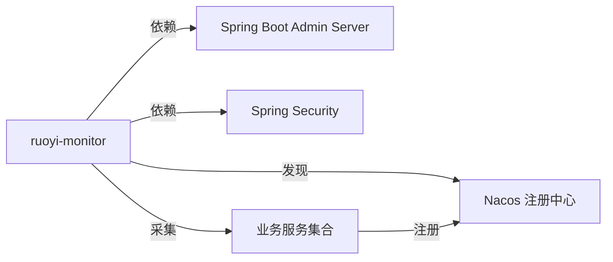

# 监控告警

<cite>
**本文引用的文件**   
- [RuoYiMonitorApplication.java](file://ruoyi-visual/ruoyi-monitor/src/main/java/com/ruoyi/modules/monitor/RuoYiMonitorApplication.java)
- [WebSecurityConfigurer.java](file://ruoyi-visual/ruoyi-monitor/src/main/java/com/ruoyi/modules/monitor/config/WebSecurityConfigurer.java)
- [bootstrap.yml（监控服务）](file://ruoyi-visual/ruoyi-monitor/src/main/resources/bootstrap.yml)
- [application.properties（Nacos配置中心示例）](file://docker/nacos/conf/application.properties)
</cite>

## 目录
1. [简介](#简介)
2. [项目结构](#项目结构)
3. [核心组件](#核心组件)
4. [架构总览](#架构总览)
5. [详细组件分析](#详细组件分析)
6. [依赖关系分析](#依赖关系分析)
7. [性能与可观测性建议](#性能与可观测性建议)
8. [故障排查指南](#故障排查指南)
9. [结论](#结论)
10. [附录：告警与通知集成方案](#附录：告警与通知集成方案)

## 简介
本章节面向“Spring Boot Admin 监控系统”的部署与配置，结合仓库中已有的监控服务模块，说明如何启用 Spring Boot Admin Server、接入 Nacos 注册与配置中心、开放必要的 Actuator 端点，并给出应用性能监控、日志收集、错误追踪、JVM/连接池/业务指标采集、告警规则与通知渠道（邮件、钉钉、企业微信）以及可视化仪表盘的落地方案。

## 项目结构
本项目采用微服务分层架构，监控相关代码位于 ruoyi-visual/ruoyi-monitor 模块，提供基于 Spring Boot Admin 的服务发现与状态查看能力；其他业务服务通过 Nacos 进行注册与配置共享。

图表来源
- [RuoYiMonitorApplication.java:12-18](file://ruoyi-visual/ruoyi-monitor/src/main/java/com/ruoyi/modules/monitor/RuoYiMonitorApplication.java#L12-L18)
- [bootstrap.yml（监控服务）:1-26](file://ruoyi-visual/ruoyi-monitor/src/main/resources/bootstrap.yml#L1-L26)

章节来源
- [RuoYiMonitorApplication.java:1-30](file://ruoyi-visual/ruoyi-monitor/src/main/java/com/ruoyi/modules/monitor/RuoYiMonitorApplication.java#L1-L30)
- [bootstrap.yml（监控服务）:1-26](file://ruoyi-visual/ruoyi-monitor/src/main/resources/bootstrap.yml#L1-L26)

## 核心组件
- 监控服务启动类：启用 Spring Boot Admin Server，对外暴露监控控制台。
- 安全配置：对监控控制台进行基础认证与路径放行，允许 actuator 与实例信息访问。
- 服务注册与配置：通过 Nacos 完成服务发现与共享配置加载。

章节来源
- [RuoYiMonitorApplication.java:12-18](file://ruoyi-visual/ruoyi-monitor/src/main/java/com/ruoyi/modules/monitor/RuoYiMonitorApplication.java#L12-L18)
- [WebSecurityConfigurer.java:14-49](file://ruoyi-visual/ruoyi-monitor/src/main/java/com/ruoyi/modules/monitor/config/WebSecurityConfigurer.java#L14-L49)
- [bootstrap.yml（监控服务）:6-26](file://ruoyi-visual/ruoyi-monitor/src/main/resources/bootstrap.yml#L6-L26)

## 架构总览
下图展示 Spring Boot Admin Server 与各业务服务的交互关系，以及 Nacos 在其中的作用。

图表来源
- [RuoYiMonitorApplication.java:12-18](file://ruoyi-visual/ruoyi-monitor/src/main/java/com/ruoyi/modules/monitor/RuoYiMonitorApplication.java#L12-L18)
- [bootstrap.yml（监控服务）:13-26](file://ruoyi-visual/ruoyi-monitor/src/main/resources/bootstrap.yml#L13-L26)

## 详细组件分析

### 监控服务启动与安全配置
- 启动类使用 @EnableAdminServer 开启 Spring Boot Admin Server 能力。
- WebSecurityConfigurer 对监控控制台进行安全控制：
  - 放行静态资源、登录页、actuator 与 instances 接口。
  - 启用表单登录与 Basic 认证，关闭 CSRF。
- 端口与 Nacos 集成：
  - 默认监听 9100 端口。
  - 通过 bootstrap.yml 指定 Nacos 地址与共享配置。

图表来源
- [RuoYiMonitorApplication.java:12-18](file://ruoyi-visual/ruoyi-monitor/src/main/java/com/ruoyi/modules/monitor/RuoYiMonitorApplication.java#L12-L18)
- [WebSecurityConfigurer.java:14-49](file://ruoyi-visual/ruoyi-monitor/src/main/java/com/ruoyi/modules/monitor/config/WebSecurityConfigurer.java#L14-L49)

章节来源
- [RuoYiMonitorApplication.java:12-18](file://ruoyi-visual/ruoyi-monitor/src/main/java/com/ruoyi/modules/monitor/RuoYiMonitorApplication.java#L12-L18)
- [WebSecurityConfigurer.java:14-49](file://ruoyi-visual/ruoyi-monitor/src/main/java/com/ruoyi/modules/monitor/config/WebSecurityConfigurer.java#L14-L49)
- [bootstrap.yml（监控服务）:1-26](file://ruoyi-visual/ruoyi-monitor/src/main/resources/bootstrap.yml#L1-L26)

### 应用性能监控（APM）与指标采集
- 通过 Spring Boot Admin 聚合各服务的 Actuator 端点，实现健康检查、线程、内存、GC、类加载、HTTP 请求、数据库连接池等指标的集中展示。
- 建议在业务服务中开启 Actuator 端点并暴露必要指标（例如 health、info、metrics、threaddump、heapdump、httptrace 等），并在 Nacos 共享配置中统一管控。

[本图为概念流程，不直接映射具体源码文件]

### 日志收集与错误追踪
- 日志收集：建议在各业务服务中统一日志格式与输出位置，并通过 Logback 将日志落盘或发送至日志系统（如 ELK/EFK）。Spring Boot Admin 支持查看在线应用的日志。
- 错误追踪：可在业务服务中引入 APM 探针（如 SkyWalking、Pinpoint）或链路追踪（如 Sleuth+Zipkin），并结合 Spring Boot Admin 的日志查看功能进行问题定位。

[本节为通用实践说明，未直接分析具体源码文件]

### JVM 监控、数据库连接池监控、业务指标监控
- JVM 监控：通过 Actuator 的 /actuator/metrics 与 /actuator/threaddump、/actuator/heapdump 获取 JVM 运行状态。
- 数据库连接池监控：若使用 HikariCP 等连接池，可通过 Actuator 的 metrics 端点观察连接数、活跃连接、等待时间等指标。
- 业务指标监控：在业务代码中通过 Micrometer 暴露自定义指标（计数器、计时器、分布摘要等），由 Admin 统一展示。

[本节为通用实践说明，未直接分析具体源码文件]

### 告警规则与通知渠道集成
- 告警规则：在 Spring Boot Admin 中配置告警规则（如健康状态异常、CPU/内存阈值、慢查询等），并选择通知渠道。
- 通知渠道：
  - 邮件：配置 SMTP 服务器与账号密码，设置收件人与主题模板。
  - 钉钉：配置机器人 Webhook 与签名，发送 Markdown/文本消息。
  - 企业微信：配置企业微信机器人 Webhook，发送图文或纯文本消息。
- 最佳实践：按环境隔离告警通道，避免误报；对关键指标设置分级告警与静默策略。

[本节为通用实践说明，未直接分析具体源码文件]

### 监控数据可视化与自定义仪表盘
- 使用 Spring Boot Admin 内置仪表盘查看服务健康、线程、内存、GC、HTTP 请求等。
- 如需更强大的可视化，可将指标导出至 Prometheus + Grafana，构建自定义仪表盘，展示 JVM、数据库连接池、业务 KPI 等。

[本节为通用实践说明，未直接分析具体源码文件]

## 依赖关系分析
- 监控服务依赖 Spring Boot Admin Server 能力与 Spring Security。
- 所有服务通过 Nacos 完成服务注册与配置共享。
- Actuator 端点是监控数据采集的关键入口。

图表来源
- [RuoYiMonitorApplication.java:12-18](file://ruoyi-visual/ruoyi-monitor/src/main/java/com/ruoyi/modules/monitor/RuoYiMonitorApplication.java#L12-L18)
- [bootstrap.yml（监控服务）:13-26](file://ruoyi-visual/ruoyi-monitor/src/main/resources/bootstrap.yml#L13-L26)

章节来源
- [RuoYiMonitorApplication.java:12-18](file://ruoyi-visual/ruoyi-monitor/src/main/java/com/ruoyi/modules/monitor/RuoYiMonitorApplication.java#L12-L18)
- [bootstrap.yml（监控服务）:13-26](file://ruoyi-visual/ruoyi-monitor/src/main/resources/bootstrap.yml#L13-L26)

## 性能与可观测性建议
- 合理暴露 Actuator 端点，仅暴露必要端点，避免敏感信息泄露。
- 对高频指标采集进行采样与降采样，降低监控开销。
- 使用连接池监控与慢 SQL 告警，及时发现数据库瓶颈。
- 将 JVM 参数与 GC 日志纳入监控体系，结合外部 APM 工具进行深度分析。
- 统一日志规范，便于检索与关联分析。

[本节为通用实践说明，未直接分析具体源码文件]

## 故障排查指南
- 无法访问监控控制台：
  - 检查 WebSecurityConfigurer 是否放行了 actuator 与 instances 路径。
  - 确认登录与 Basic 认证配置是否正确。
- 监控不到服务：
  - 检查 Nacos 地址与共享配置是否正确加载。
  - 确认业务服务已注册到 Nacos 且端口可达。
- 指标缺失：
  - 检查 Actuator 端点是否启用与暴露。
  - 核对 Micrometer 与业务指标埋点是否正确。

章节来源
- [WebSecurityConfigurer.java:31-47](file://ruoyi-visual/ruoyi-monitor/src/main/java/com/ruoyi/modules/monitor/config/WebSecurityConfigurer.java#L31-L47)
- [bootstrap.yml（监控服务）:13-26](file://ruoyi-visual/ruoyi-monitor/src/main/resources/bootstrap.yml#L13-L26)

## 结论
本项目已具备基于 Spring Boot Admin 的监控基础能力，配合 Nacos 可实现服务发现与配置管理。在此基础上，建议完善 Actuator 端点暴露、指标采集、日志规范与告警通知，逐步构建完整的可观测性体系，提升系统的稳定性与可维护性。

[本节为总结性内容，未直接分析具体源码文件]

## 附录：告警与通知集成方案
- 邮件通知：配置 SMTP 服务器、用户名、密码与发件人，设置告警模板与收件人组。
- 钉钉通知：创建机器人并获取 Webhook 地址，配置签名与消息类型（Markdown/文本）。
- 企业微信通知：创建群机器人并获取 Webhook 地址，配置消息体（文本/图文）。
- 告警规则建议：
  - 健康检查失败立即告警。
  - CPU/内存超过阈值持续一段时间触发告警。
  - 数据库连接池耗尽或慢查询比例升高触发告警。
  - 业务关键指标（订单量、转化率、错误率）偏离基线触发告警。

[本节为通用实践说明，未直接分析具体源码文件]