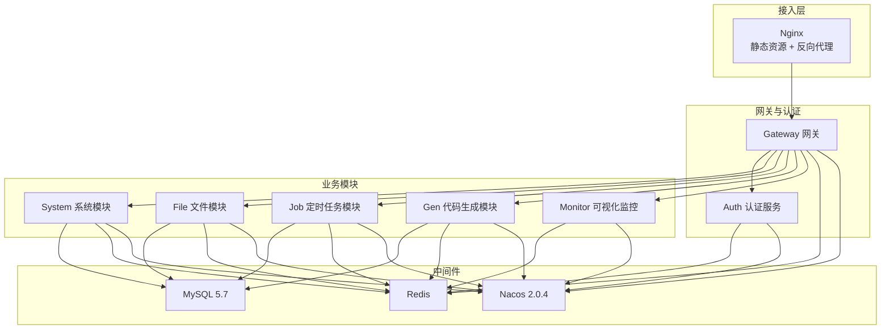
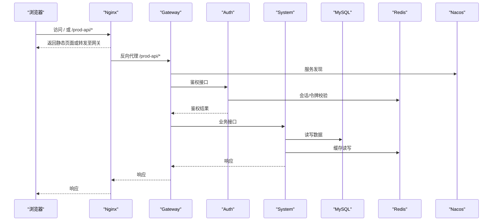
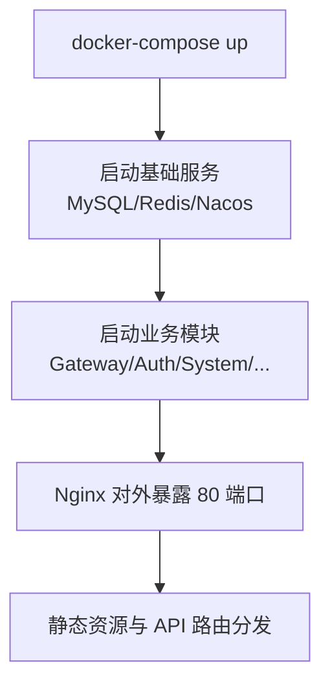
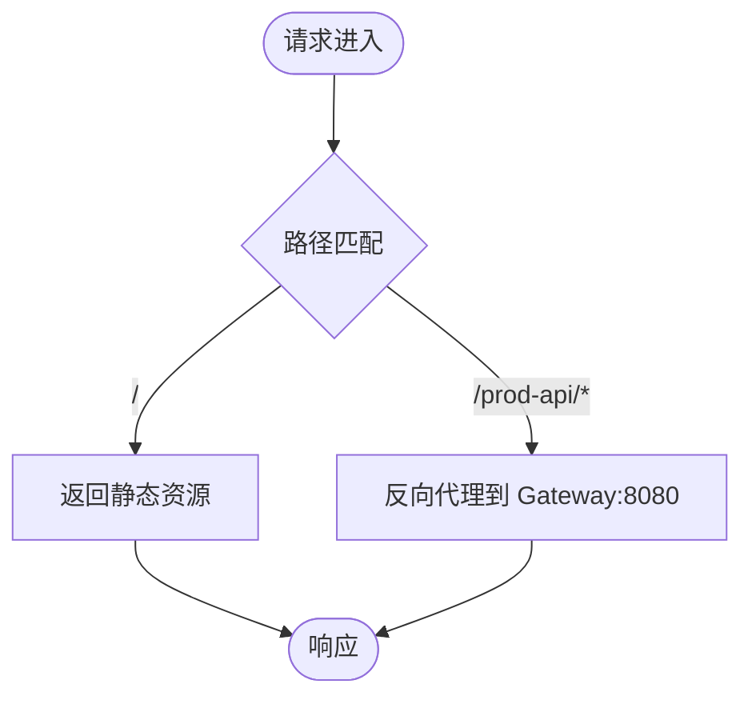
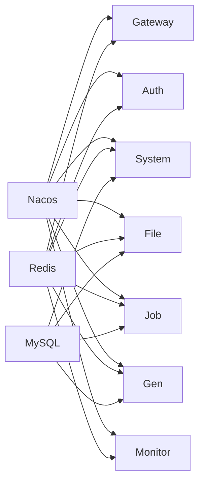
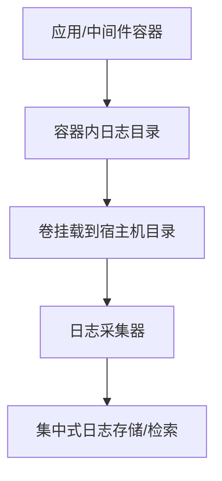
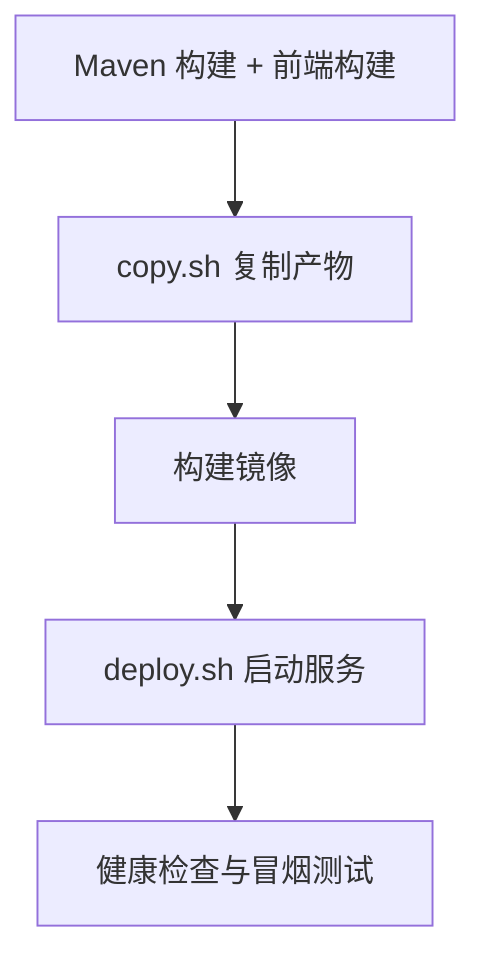

# 部署运维

<cite>
**本文引用的文件**   
- [docker-compose.yml](file://docker/docker-compose.yml)
- [deploy.sh](file://docker/deploy.sh)
- [copy.sh](file://docker/copy.sh)
- [nginx.conf](file://docker/nginx/conf/nginx.conf)
- [mysql dockerfile](file://docker/mysql/dockerfile)
- [redis dockerfile](file://docker/redis/dockerfile)
- [nginx dockerfile](file://docker/nginx/dockerfile)
- [nacos dockerfile](file://docker/nacos/dockerfile)
- [auth dockerfile](file://docker/ruoyi/auth/dockerfile)
- [gateway dockerfile](file://docker/ruoyi/gateway/dockerfile)
- [system dockerfile](file://docker/ruoyi/modules/system/dockerfile)
- [file dockerfile](file://docker/ruoyi/modules/file/dockerfile)
- [job dockerfile](file://docker/ruoyi/modules/job/dockerfile)
- [gen dockerfile](file://docker/ruoyi/modules/gen/dockerfile)
- [monitor dockerfile](file://docker/ruoyi/visual/monitor/dockerfile)
</cite>

## 目录
1. [简介](#简介)
2. [项目结构](#项目结构)
3. [核心组件](#核心组件)
4. [架构总览](#架构总览)
5. [详细组件分析](#详细组件分析)
6. [依赖关系分析](#依赖关系分析)
7. [性能与容量规划](#性能与容量规划)
8. [监控与告警](#监控与告警)
9. [日志收集与归档](#日志收集与归档)
10. [环境变量与配置管理](#环境变量与配置管理)
11. [CI/CD 流水线与自动化部署](#cicd-流水线与自动化部署)
12. [备份恢复与灾难恢复](#备份恢复与灾难恢复)
13. [故障排查指南](#故障排查指南)
14. [结论](#结论)

## 简介
本运维文档面向生产环境，覆盖 Docker 容器化部署、服务编排、端口与网络、Nginx 反向代理、数据库与缓存初始化、应用模块启动、监控可视化、日志采集、CI/CD 自动化、备份与灾备等全链路运维要点。读者可据此快速完成本地开发、测试与生产环境的标准化交付。

## 项目结构
本项目采用多模块微服务架构，配合 Nacos 作为注册中心与配置中心，MySQL 持久化存储，Redis 缓存与会话，Nginx 提供静态资源与反向代理，各业务模块以独立 JAR 运行于容器中。

图表来源
- [docker-compose.yml:3-139](file://docker/docker-compose.yml#L3-L139)
- [nginx.conf:13-29](file://docker/nginx/conf/nginx.conf#L13-L29)

章节来源
- [docker-compose.yml:1-140](file://docker/docker-compose.yml#L1-L140)
- [nginx.conf:1-36](file://docker/nginx/conf/nginx.conf#L1-L36)

## 核心组件
- Nacos：服务注册与配置中心（standalone 模式）
- MySQL：关系型数据库，默认字符集 utf8mb4，时区 +8:00
- Redis：缓存与会话
- Nginx：前端静态资源托管与 API 反向代理
- Gateway：统一网关入口
- Auth：认证授权
- System/File/Job/Gen：业务模块
- Monitor：可视化监控

章节来源
- [docker-compose.yml:3-139](file://docker/docker-compose.yml#L3-L139)

## 架构总览
下图展示请求从浏览器到后端服务的完整路径，以及关键中间件的交互。

图表来源
- [nginx.conf:17-29](file://docker/nginx/conf/nginx.conf#L17-L29)
- [docker-compose.yml:51-139](file://docker/docker-compose.yml#L51-L139)

## 详细组件分析

### 基础设施与服务编排
- Nacos：单节点模式，暴露 8848/9848/9849 端口，挂载日志与配置文件
- MySQL：5.7，初始化脚本通过 entrypoint 自动执行；参数包含 InnoDB Buffer Pool、字符集与时区
- Redis：自定义 redis.conf，数据持久化目录挂载
- Nginx：静态资源目录挂载，API 反向代理至 Gateway

图表来源
- [docker-compose.yml:18-66](file://docker/docker-compose.yml#L18-L66)
- [docker-compose.yml:67-139](file://docker/docker-compose.yml#L67-L139)

章节来源
- [docker-compose.yml:1-140](file://docker/docker-compose.yml#L1-L140)
- [mysql dockerfile:1-8](file://docker/mysql/dockerfile#L1-L8)
- [redis dockerfile:1-14](file://docker/redis/dockerfile#L1-L14)
- [nginx dockerfile:1-16](file://docker/nginx/dockerfile#L1-L16)
- [nacos dockerfile:1-8](file://docker/nacos/dockerfile#L1-L8)

### 应用镜像与启动方式
所有 Java 服务镜像基于 openjdk:8-jre，统一将 JAR 复制到 /home/ruoyi 并 java -jar 启动。

- Gateway：ENTRYPOINT 启动 ruoyi-gateway.jar
- Auth：ENTRYPOINT 启动 ruoyi-auth.jar
- System/File/Job/Gen/Monitor：各自 ENTRYPOINT 启动对应 JAR

```mermaid
classDiagram
class GatewayImage {
+FROM openjdk : 8-jre
+COPY ./jar/ruoyi-gateway.jar
+ENTRYPOINT ["java","-jar","ruoyi-gateway.jar"]
}
class AuthImage {
+FROM openjdk : 8-jre
+COPY ./jar/ruoyi-auth.jar
+ENTRYPOINT ["java","-jar","ruoyi-auth.jar"]
}
class SystemImage {
+FROM openjdk : 8-jre
+COPY ./jar/ruoyi-modules-system.jar
+ENTRYPOINT ["java","-jar","ruoyi-modules-system.jar"]
}
class FileImage {
+FROM openjdk : 8-jre
+COPY ./jar/ruoyi-modules-file.jar
+ENTRYPOINT ["java","-jar","ruoyi-modules-file.jar"]
}
class JobImage {
+FROM openjdk : 8-jre
+COPY ./jar/ruoyi-modules-job.jar
+ENTRYPOINT ["java","-jar","ruoyi-modules-job.jar"]
}
class GenImage {
+FROM openjdk : 8-jre
+COPY ./jar/ruoyi-modules-gen.jar
+ENTRYPOINT ["java","-jar","ruoyi-modules-gen.jar"]
}
class MonitorImage {
+FROM openjdk : 8-jre
+COPY ./jar/ruoyi-visual-monitor.jar
+ENTRYPOINT ["java","-jar","ruoyi-visual-monitor.jar"]
}
```

图表来源
- [gateway dockerfile:1-15](file://docker/ruoyi/gateway/dockerfile#L1-L15)
- [auth dockerfile:1-15](file://docker/ruoyi/auth/dockerfile#L1-L15)
- [system dockerfile:1-15](file://docker/ruoyi/modules/system/dockerfile#L1-L15)
- [file dockerfile:1-15](file://docker/ruoyi/modules/file/dockerfile#L1-L15)
- [job dockerfile:1-15](file://docker/ruoyi/modules/job/dockerfile#L1-L15)
- [gen dockerfile:1-15](file://docker/ruoyi/modules/gen/dockerfile#L1-L15)
- [monitor dockerfile:1-15](file://docker/ruoyi/visual/monitor/dockerfile#L1-L15)

章节来源
- [gateway dockerfile:1-15](file://docker/ruoyi/gateway/dockerfile#L1-L15)
- [auth dockerfile:1-15](file://docker/ruoyi/auth/dockerfile#L1-L15)
- [system dockerfile:1-15](file://docker/ruoyi/modules/system/dockerfile#L1-L15)
- [file dockerfile:1-15](file://docker/ruoyi/modules/file/dockerfile#L1-L15)
- [job dockerfile:1-15](file://docker/ruoyi/modules/job/dockerfile#L1-L15)
- [gen dockerfile:1-15](file://docker/ruoyi/modules/gen/dockerfile#L1-L15)
- [monitor dockerfile:1-15](file://docker/ruoyi/visual/monitor/dockerfile#L1-L15)

### Nginx 反向代理与静态资源
- 静态资源根目录映射至容器内 /home/ruoyi/projects/ruoyi-ui
- /prod-api 前缀的请求反向代理至 Gateway 8080 端口
- 支持 SPA try_files 回退到 index.html

图表来源
- [nginx.conf:17-29](file://docker/nginx/conf/nginx.conf#L17-L29)

章节来源
- [nginx.conf:1-36](file://docker/nginx/conf/nginx.conf#L1-L36)

## 依赖关系分析
- 服务间依赖由 docker-compose depends_on 控制启动顺序
- 外部依赖：MySQL、Redis、Nacos
- 内部依赖：Gateway 依赖 Redis；Auth/Gateway/System/File/Job/Gen/Monitor 依赖 Nacos 进行服务发现与配置拉取

图表来源
- [docker-compose.yml:16-139](file://docker/docker-compose.yml#L16-L139)

章节来源
- [docker-compose.yml:1-140](file://docker/docker-compose.yml#L1-L140)

## 性能与容量规划
- MySQL
  - InnoDB Buffer Pool 初始大小建议根据内存规模调整（当前示例为 80M，生产需按实际负载上调）
  - 字符集 utf8mb4，时区 +8:00，表名不区分大小写
- Redis
  - 使用自定义 redis.conf，建议开启持久化策略并根据内存上限设置 maxmemory
- Nginx
  - worker_processes 与 worker_connections 可按 CPU 核数与并发量调优
- JVM
  - 建议为每个 Java 服务设置合理的堆大小、GC 参数与日志级别（可通过环境变量注入）

章节来源
- [docker-compose.yml:29-36](file://docker/docker-compose.yml#L29-L36)
- [nginx.conf:1-11](file://docker/nginx/conf/nginx.conf#L1-L11)

## 监控与告警
- 可视化监控服务 Monitor 已纳入编排，默认端口 9100
- 建议结合宿主机指标（CPU/内存/磁盘/网络）与中间件指标（MySQL/Redis/Nacos）建立统一监控面板
- 告警策略建议：
  - 服务存活探测失败（容器退出或端口不可达）
  - 数据库连接池耗尽、慢查询增多
  - Redis 内存超限、命中率下降
  - Nginx 错误率上升、上游超时

章节来源
- [docker-compose.yml:133-139](file://docker/docker-compose.yml#L133-L139)

## 日志收集与归档
- Nacos：日志挂载至宿主 ./nacos/logs
- MySQL：日志挂载至宿主 ./mysql/logs
- Nginx：日志挂载至宿主 ./nginx/logs
- 应用日志：由各模块 logback.xml 输出至容器内日志目录，建议通过日志采集器（如 Filebeat/Fluent Bit）统一收集并转存至集中式日志平台

图表来源
- [docker-compose.yml:9-11](file://docker/docker-compose.yml#L9-L11)
- [docker-compose.yml:25-28](file://docker/docker-compose.yml#L25-L28)
- [docker-compose.yml:58-62](file://docker/docker-compose.yml#L58-L62)

章节来源
- [docker-compose.yml:9-11](file://docker/docker-compose.yml#L9-L11)
- [docker-compose.yml:25-28](file://docker/docker-compose.yml#L25-L28)
- [docker-compose.yml:58-62](file://docker/docker-compose.yml#L58-L62)

## 环境变量与配置管理
- Nacos
  - MODE=standalone（单节点模式）
- MySQL
  - MYSQL_DATABASE=ry-cloud
  - MYSQL_ROOT_PASSWORD=password
- Redis
  - 通过命令指定配置文件路径：redis-server /home/ruoyi/redis/redis.conf
- Nginx
  - 静态资源目录与配置文件通过卷挂载
- 应用模块
  - 通过 Nacos 获取运行时配置（服务发现与配置中心）

章节来源
- [docker-compose.yml:7-11](file://docker/docker-compose.yml#L7-L11)
- [docker-compose.yml:37-39](file://docker/docker-compose.yml#L37-L39)
- [docker-compose.yml:47-50](file://docker/docker-compose.yml#L47-L50)
- [docker-compose.yml:58-62](file://docker/docker-compose.yml#L58-L62)

## CI/CD 流水线与自动化部署
推荐流水线阶段
- 构建
  - Maven 编译打包各模块 JAR
  - 前端构建产出 dist
- 复制产物
  - 使用 copy.sh 将 SQL、JAR、HTML 复制到 docker 目录
- 构建镜像
  - 基于各模块 dockerfile 构建镜像
- 部署
  - 使用 deploy.sh 一键启动基础环境与业务模块
  - 或通过 docker-compose up -d 编排启动

图表来源
- [copy.sh:10-40](file://docker/copy.sh#L10-L40)
- [deploy.sh:27-45](file://docker/deploy.sh#L27-L45)

章节来源
- [copy.sh:1-42](file://docker/copy.sh#L1-L42)
- [deploy.sh:1-68](file://docker/deploy.sh#L1-L68)

## 备份恢复与灾难恢复
- 数据库备份
  - 定期 mysqldump 导出 ry-cloud 库，保留历史快照
  - 建议增量备份 binlog（如需）
- 缓存备份
  - Redis RDB/AOF 策略按需开启，定期持久化文件拷贝
- 静态资源与上传文件
  - Nginx 静态资源目录与文件模块上传目录（./ruoyi/uploadPath）需纳入备份
- 恢复流程
  - 停止相关服务
  - 导入数据库快照
  - 恢复 Redis 数据（如启用）
  - 恢复静态资源与上传文件
  - 重启服务并验证

章节来源
- [docker-compose.yml:25-28](file://docker/docker-compose.yml#L25-L28)
- [docker-compose.yml:47-50](file://docker/docker-compose.yml#L47-L50)
- [docker-compose.yml:58-62](file://docker/docker-compose.yml#L58-L62)
- [docker-compose.yml:131-132](file://docker/docker-compose.yml#L131-L132)

## 故障排查指南
- 端口冲突
  - 使用 deploy.sh port 打开必要端口（80/8080/8848/9848/9849/6379/3306/9100/9200-9203/9300）
- 启动顺序
  - 先 base（MySQL/Redis/Nacos），再 modules（Nginx/Gateway/Auth/System 等）
- 常见症状
  - 网关无法解析服务：检查 Nacos 是否启动且服务已注册
  - 数据库连接失败：检查 MySQL 账号密码与字符集配置
  - 静态资源 404：检查 Nginx 静态目录挂载是否正确
  - 文件上传失败：检查文件模块上传目录权限与挂载
- 操作建议
  - 使用 docker logs 查看各容器日志
  - 使用 docker-compose stop/rm 清理后重新部署
  - 使用 deploy.sh stop/rm 快速收尾

章节来源
- [deploy.sh:9-25](file://docker/deploy.sh#L9-L25)
- [deploy.sh:27-45](file://docker/deploy.sh#L27-L45)
- [docker-compose.yml:18-66](file://docker/docker-compose.yml#L18-L66)
- [docker-compose.yml:67-139](file://docker/docker-compose.yml#L67-L139)

## 结论
通过标准化的 Docker 镜像与 Compose 编排，配合 Nacos 的服务治理、Nginx 的反向代理与静态资源托管，以及完善的日志与监控体系，本项目可实现从开发到生产的稳定交付。建议在生产环境中进一步细化 JVM 与中间件参数、完善备份与灾备演练、引入统一的日志与监控平台，以提升系统的可观测性与韧性。