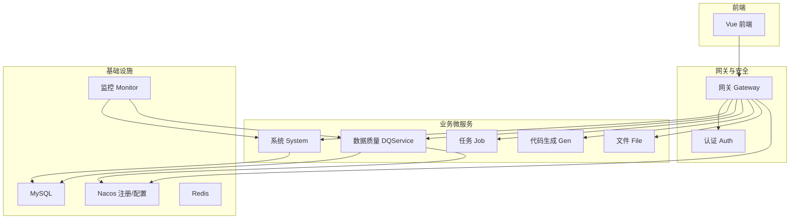
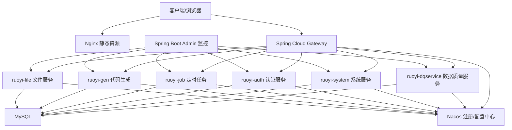
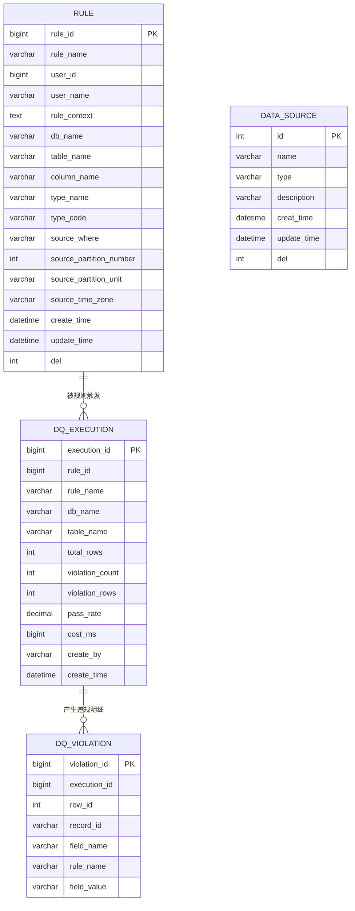
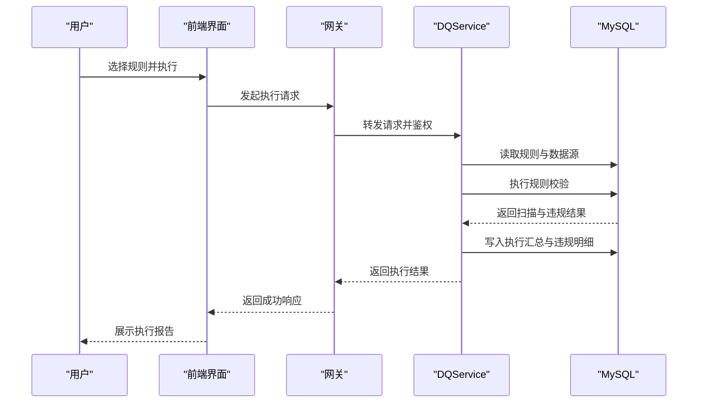
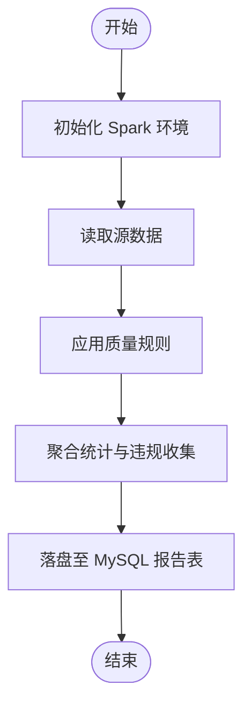
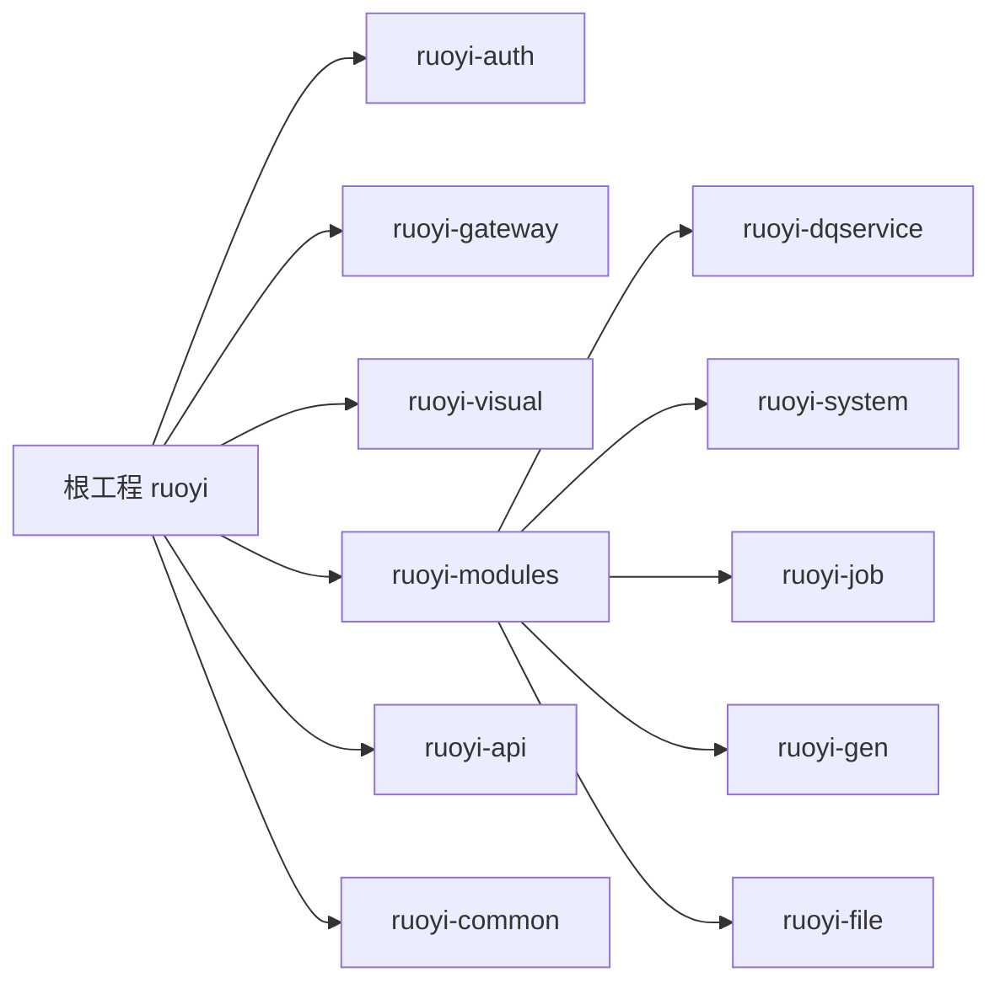

# 项目概述

<cite>
**本文引用的文件**   
- [pom.xml](file://pom.xml)
- [README.md](file://README.md)
- [ry_dqservice_20261026.sql](file://sql/ry_dqservice_20261026.sql)
- [ry_dq_report_20261026.sql](file://sql/ry_dq_report_20261026.sql)
- [WordCount.scala](file://ruoyi-modules/ruoyi-dqservice/src/main/java/com/sch/spark/WordCount.scala)
</cite>

## 目录
1. [引言](#引言)
2. [项目结构](#项目结构)
3. [核心组件](#核心组件)
4. [架构总览](#架构总览)
5. [详细组件分析](#详细组件分析)
6. [依赖关系分析](#依赖关系分析)
7. [性能与可扩展性](#性能与可扩展性)
8. [故障排查指南](#故障排查指南)
9. [结论](#结论)
10. [附录](#附录)

## 引言
本项目是一个基于若依微服务框架的数据质量管理系统，围绕“规则引擎、元数据管理、执行监控与报告”等核心能力构建。系统采用前后端分离与微服务拆分，支持容器化部署；通过统一的网关与安全认证，为业务提供稳定可靠的数据质量治理能力。

从仓库可见，该项目在若依云原生微服务底座之上，新增数据质量模块（ruoyi-dqservice），并配套数据库脚本定义规则、数据源与执行报告等核心实体，同时预留 Spark 计算扩展点以支撑大规模数据处理场景。

**章节来源**
- [README.md:1-1](file://README.md#L1-L1)
- [pom.xml:11-22](file://pom.xml#L11-L22)

## 项目结构
整体采用 Maven 多模块工程组织，包含认证、网关、可视化、公共组件、API 契约以及多个业务模块。数据质量相关代码位于 ruoyi-modules/ruoyi-dqservice 下，数据库脚本位于 sql 目录。

**图表来源**
- [pom.xml:244-251](file://pom.xml#L244-L251)

**章节来源**
- [pom.xml:244-251](file://pom.xml#L244-L251)

## 核心组件
- 规则引擎：用于定义、管理与执行数据质量规则，支持按库/表/列维度进行校验，并可配置过滤条件与分区策略。
- 元数据管理：维护数据源信息，便于统一接入不同数据库或数据平台。
- 执行与监控：记录每次规则执行的批次统计与违规明细，支持通过率、耗时等指标展示。
- 扩展计算：预留 Spark 计算入口，便于后续对接大数据处理链路。

上述能力由以下数据库对象支撑：
- rule：数据质量规则表
- data_source：数据源表
- dq_execution：执行批次汇总
- dq_violation：违规明细

**章节来源**
- [ry_dqservice_20261026.sql:7-27](file://sql/ry_dqservice_20261026.sql#L7-L27)
- [ry_dqservice_20261026.sql:29-39](file://sql/ry_dqservice_20261026.sql#L29-L39)
- [ry_dq_report_20261026.sql:11-27](file://sql/ry_dq_report_20261026.sql#L11-L27)
- [ry_dq_report_20261026.sql:29-39](file://sql/ry_dq_report_20261026.sql#L29-L39)

## 架构总览
系统遵循若依微服务标准架构：前端通过网关统一接入，网关负责鉴权、限流、路由；各业务微服务通过 Nacos 完成服务发现与配置管理；持久化层使用 MySQL，缓存使用 Redis；可视化监控通过 Spring Boot Admin 集成。

**图表来源**
- [pom.xml:48-71](file://pom.xml#L48-L71)
- [pom.xml:82-87](file://pom.xml#L82-L87)

**章节来源**
- [pom.xml:48-87](file://pom.xml#L48-L87)

## 详细组件分析

### 数据质量模块（ruoyi-dqservice）
该模块承载数据质量的核心业务，包括规则定义、数据源管理、规则执行与结果上报。当前仓库中已提供规则与数据源的数据库模型，以及执行与违规明细的报表模型；Spark 扩展点也已预留。

- 规则模型（rule）：包含规则名称、上下文内容、目标库/表/列、类型编码、过滤条件、分区与时区等字段，支撑灵活的质量规则建模。
- 数据源模型（data_source）：抽象数据源名称、类型与描述，便于接入多种数据库或数据平台。
- 执行报告（dq_execution）：记录每次规则执行的扫描行数、违规条数、通过率、耗时等汇总指标。
- 违规明细（dq_violation）：记录每条违规记录的行号、主键、字段名、命中规则与字段值，便于问题定位与回溯。

**图表来源**
- [ry_dqservice_20261026.sql:7-27](file://sql/ry_dqservice_20261026.sql#L7-L27)
- [ry_dqservice_20261026.sql:29-39](file://sql/ry_dqservice_20261026.sql#L29-L39)
- [ry_dq_report_20261026.sql:11-27](file://sql/ry_dq_report_20261026.sql#L11-L27)
- [ry_dq_report_20261026.sql:29-39](file://sql/ry_dq_report_20261026.sql#L29-L39)

#### 规则执行流程（概念时序）

[本图为概念流程图，不直接映射具体源码文件]

**章节来源**
- [ry_dqservice_20261026.sql:7-27](file://sql/ry_dqservice_20261026.sql#L7-L27)
- [ry_dq_report_20261026.sql:11-27](file://sql/ry_dq_report_20261026.sql#L11-L27)

### 扩展计算（Spark）
仓库中包含一个 Spark 示例入口，便于后续扩展大规模数据质量计算任务。当前实现为空壳，可作为未来与数据湖/批处理平台集成的起点。

**图表来源**
- [WordCount.scala:1-8](file://ruoyi-modules/ruoyi-dqservice/src/main/java/com/sch/spark/WordCount.scala#L1-L8)

**章节来源**
- [WordCount.scala:1-8](file://ruoyi-modules/ruoyi-dqservice/src/main/java/com/sch/spark/WordCount.scala#L1-L8)

## 依赖关系分析
项目顶层 POM 统一管理版本与依赖，涵盖 Spring Cloud、Spring Cloud Alibaba、Nacos、MyBatis、Swagger、Druid、FastJSON、JWT、MinIO、POI、Velocity 等关键组件。模块划分清晰，便于独立演进与复用。

**图表来源**
- [pom.xml:244-251](file://pom.xml#L244-L251)

**章节来源**
- [pom.xml:44-241](file://pom.xml#L44-L241)
- [pom.xml:244-251](file://pom.xml#L244-L251)

## 性能与可扩展性
- 规则执行可结合分区与时区参数进行并行化处理，提升吞吐。
- 执行汇总与违规明细分表存储，有利于历史数据归档与查询优化。
- 通过 Nacos 动态配置与注册发现，支持弹性扩缩容。
- Spark 扩展点为离线批处理与大数据量场景预留空间。

[本节为通用建议，不直接分析具体文件]

## 故障排查指南
- 规则未生效：检查 rule 表中规则上下文与类型编码是否正确，确认数据源连接可用。
- 执行无结果：核对 dq_execution 是否写入成功，查看失败日志与数据库连接状态。
- 违规明细缺失：确认 dq_violation 写入逻辑是否触发，检查执行批次 ID 关联关系。
- 性能瓶颈：关注 cost_ms 与 total_rows 指标，评估是否需要调整分区数量或规则复杂度。

**章节来源**
- [ry_dqservice_20261026.sql:7-27](file://sql/ry_dqservice_20261026.sql#L7-L27)
- [ry_dq_report_20261026.sql:11-27](file://sql/ry_dq_report_20261026.sql#L11-L27)
- [ry_dq_report_20261026.sql:29-39](file://sql/ry_dq_report_20261026.sql#L29-L39)

## 结论
本项目在若依微服务基础上构建了完整的数据质量管理闭环：以规则为核心，以元数据为基础，以执行与报告为抓手，并通过网关、安全、监控与容器化能力保障系统的稳定性与可运维性。随着 Spark 扩展点的完善，系统将具备面向大数据场景的规模化处理能力。

[本节为总结性内容，不直接分析具体文件]

## 附录
- 技术栈概览
  - 后端：Spring Boot + Spring Cloud + Spring Cloud Alibaba
  - 注册与配置：Nacos
  - 数据库：MySQL
  - 缓存：Redis
  - 文档：Swagger
  - 监控：Spring Boot Admin
  - 前端：Vue
  - 容器化：Docker/Nginx

**章节来源**
- [pom.xml:15-42](file://pom.xml#L15-L42)
- [pom.xml:48-87](file://pom.xml#L48-L87)